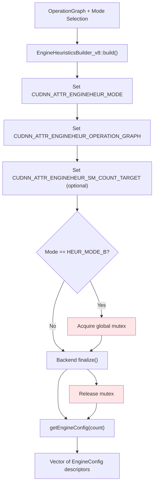
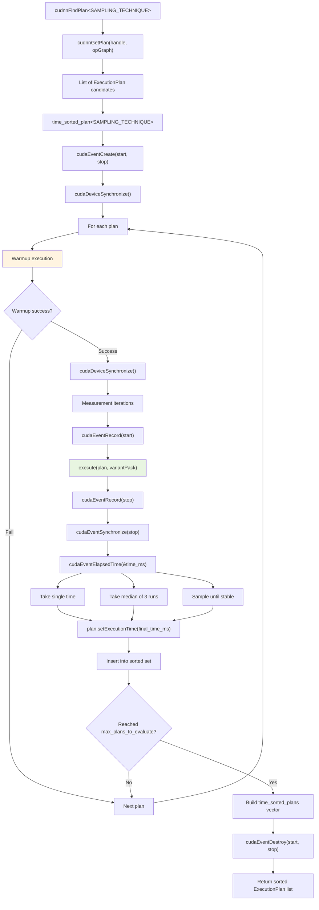
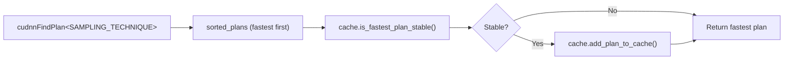
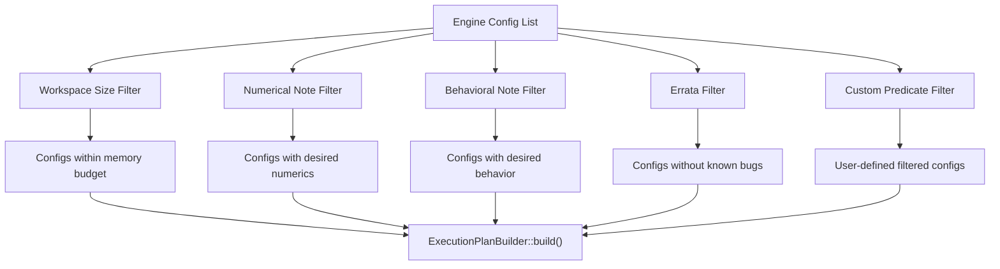
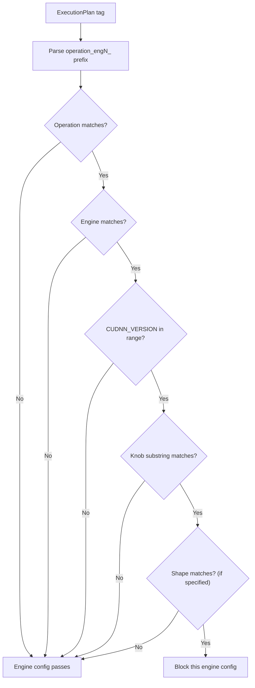
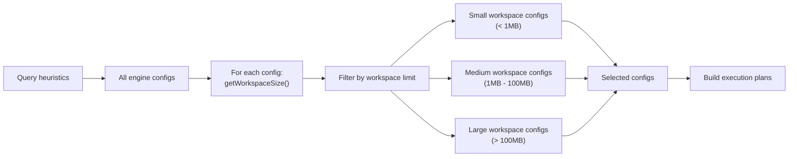
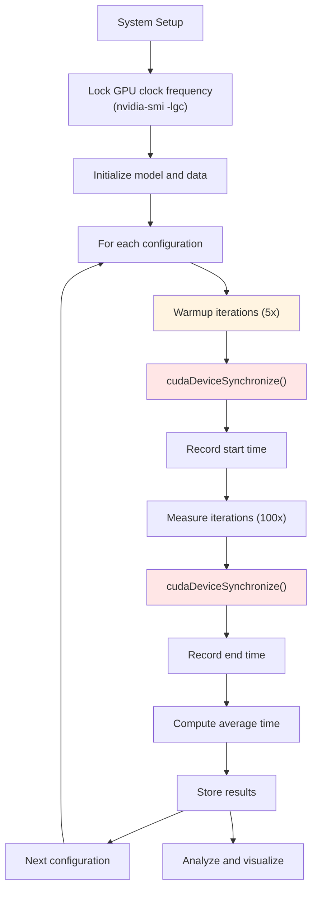

<!-- source: DeepWiki mcp.deepwiki.com · repo NVIDIA/cudnn-frontend · page 5.4 Performance Optimization · fetched 2026-10-26 -->

# Performance Optimization

<details>
<summary>Relevant source files</summary>

The following files were used as context for generating this wiki page:

- [benchmark/Llama-3.2-1B-Training/training_perf.py](benchmark/Llama-3.2-1B-Training/training_perf.py)
- [include/cudnn_frontend_EngineConfigGenerator.h](include/cudnn_frontend_EngineConfigGenerator.h)
- [include/cudnn_frontend_Errata.h](include/cudnn_frontend_Errata.h)
- [include/cudnn_frontend_Filters.h](include/cudnn_frontend_Filters.h)
- [include/cudnn_frontend_Heuristics.h](include/cudnn_frontend_Heuristics.h)
- [include/cudnn_frontend_find_plan.h](include/cudnn_frontend_find_plan.h)
- [include/cudnn_frontend_get_plan.h](include/cudnn_frontend_get_plan.h)

</details>


This page covers techniques for optimizing execution performance in cuDNN Frontend through intelligent plan selection, autotuning, and engine filtering. Topics include heuristic mode selection, execution plan autotuning with `cudnnFindPlan`, engine configuration filtering, and workspace management strategies.

For information about execution plan creation and structure, see [Execution Plans](#2.4). For details about the heuristics system and engine selection fundamentals, see [Heuristics & Engine Selection](#2.5). For memory allocation strategies including virtual tensors, see [Memory Management](#5.5).

## Heuristic Modes and Strategy

The cuDNN Frontend provides three heuristic modes for querying engine configurations, each offering different trade-offs between query time and result quality.

### Heuristic Mode Types

| Mode | Enum Value | Characteristics | Use Case |
|------|-----------|-----------------|----------|
| **Mode A** | `CUDNN_HEUR_MODE_A` or `CUDNN_HEUR_MODE_INSTANT` | Fast heuristic query, returns small set of highly-optimized engines | Default mode for most applications requiring quick plan generation |
| **Mode B** | `CUDNN_HEUR_MODE_B` | Exhaustive search returning many candidate engines, requires mutex lock | When maximum performance is critical and longer planning time is acceptable |
| **Fallback** | `CUDNN_HEUR_MODE_FALLBACK` | Guaranteed to return at least one valid configuration | Fallback when other modes fail or for correctness-critical scenarios |

**Mode Selection**

```
Mode A (heuristics_instant / heuristics_mode_a)
├─ Fast query time (milliseconds)
├─ Returns 1-10 engine configs typically
└─ Best for: Inference, first-time planning, quick prototyping

Mode B (heuristics_mode_b)
├─ Slower query time (seconds)
├─ Returns 10-100+ engine configs
├─ Thread-safe with global mutex
└─ Best for: Training, offline autotuning, maximum performance

Fallback (heuristics_fallback)
├─ Moderate query time
├─ Guaranteed at least one valid config
└─ Best for: Error recovery, correctness testing
```

The `EngineHeuristicsBuilder_v8` constructs heuristic queries with mode selection via `setHeurMode()`. Mode B operations are protected by a mutex to prevent concurrent exhaustive searches that could cause issues [include/cudnn_frontend_Heuristics.h:274-282]().

**Sources:** [include/cudnn_frontend_Heuristics.h:133-145](), [include/cudnn_frontend_Heuristics.h:396-443]()

### Heuristic Query Pipeline



The SM count target (`target_sm_count`) allows targeting a specific number of streaming multiprocessors for engine selection, useful for multi-process scenarios where GPU resources are shared [include/cudnn_frontend_Heuristics.h:253-272]().

**Sources:** [include/cudnn_frontend_Heuristics.h:191-293](), [include/cudnn_frontend_Heuristics.h:360-381]()

### Multi-Mode Query Strategy

The `get_heuristics_list()` function supports querying multiple heuristic modes in sequence with fallback behavior. The function accepts a vector of mode strings and attempts each mode until success or all modes are exhausted.

```mermaid
flowchart LR
    Input["Mode List:<br/>heuristics_mode_a<br/>heuristics_mode_b<br/>heuristics_fallback"]
    
    TryA["Try Mode A"]
    TryB["Try Mode B"]
    TryFallback["Try Fallback"]
    
    SuccessA{"Success?"}
    SuccessB{"Success?"}
    SuccessFallback{"Success?"}
    
    CollectA["Collect engine configs"]
    CollectB["Collect engine configs"]
    CollectFallback["Collect engine configs"]
    
    StatusA["Push status to vector"]
    StatusB["Push status to vector"]
    StatusFallback["Push status to vector"]
    
    Done["Return filtered_configs + statuses"]
    
    Input --> TryA
    TryA --> SuccessA
    SuccessA -->|Yes| CollectA
    SuccessA -->|No| StatusA
    CollectA --> StatusA
    StatusA --> TryB
    
    TryB --> SuccessB
    SuccessB -->|Yes| CollectB
    SuccessB -->|No| StatusB
    CollectB --> StatusB
    StatusB --> TryFallback
    
    TryFallback --> SuccessFallback
    SuccessFallback -->|Yes| CollectFallback
    SuccessFallback -->|No| StatusFallback
    CollectFallback --> StatusFallback
    StatusFallback --> Done
```



The `evaluate_all` parameter controls whether all modes are tried (collecting as many configs as possible) or whether the function stops at the first successful mode [include/cudnn_frontend_Heuristics.h:383-444]().

**Sources:** [include/cudnn_frontend_Heuristics.h:383-467](), [include/cudnn_frontend_Heuristics.h:454-467]()

## Execution Plan Autotuning

Autotuning measures actual execution time of candidate plans to select the fastest configuration. The `cudnnFindPlan` family of functions implements this functionality through the `EngineConfigGenerator` class.

### Sampling Techniques

The `CudnnFindSamplingTechnique` enum defines three strategies for timing measurement, each trading off accuracy for speed:

| Technique | Iterations | Selection Method | Use Case |
|-----------|-----------|------------------|----------|
| `CUDNN_FIND_SAMPLE_ONCE` | 1 | Take single measurement | Quick autotuning, less accurate |
| `CUDNN_FIND_SAMPLE_MEDIAN_OF_THREE` | 3 | Median of three runs | Balanced accuracy/speed |
| `CUDNN_FIND_SAMPLE_TILL_STABLE` | Variable (up to 100) | Sample until stable (threshold: 0.95) | Most accurate, slowest |

**Sources:** [include/cudnn_frontend_EngineConfigGenerator.h:34-38](), [include/cudnn_frontend_find_plan.h:49-52]()

### Autotuning Pipeline



The autotuning process includes a mandatory warmup execution to eliminate cold-start effects. Failed plans during warmup are skipped. CUDA events provide high-precision timing [include/cudnn_frontend_find_plan.h:55-76]().

**Sources:** [include/cudnn_frontend_find_plan.h:36-124](), [include/cudnn_frontend_find_plan.h:126-146]()

### Sampling Algorithm Details

**SAMPLE_ONCE:** Executes once after warmup, fastest but potentially unstable [include/cudnn_frontend_find_plan.h:102-103]().

**SAMPLE_MEDIAN_OF_THREE:** Executes three times, takes median to filter outliers caused by system noise [include/cudnn_frontend_find_plan.h:94-100]().

**SAMPLE_TILL_STABLE:** Iteratively executes until a stable minimum is found or 100 iterations reached. Uses threshold of 0.95 - if `time_ms / min_time_ms < 0.95`, the minimum is considered stable and iteration stops [include/cudnn_frontend_find_plan.h:87-93]().

**Sources:** [include/cudnn_frontend_find_plan.h:77-104]()

### Plan Caching with Autotuning

The `cudnnFindPlanAndCache` function combines autotuning with execution plan caching, storing the fastest plan for reuse:



The stability check ensures only reliably fast plans are cached, preventing cache pollution from measurement noise [include/cudnn_frontend_find_plan.h:148-161]().

**Sources:** [include/cudnn_frontend_find_plan.h:148-161](), [include/cudnn_frontend_EngineConfigGenerator.h:94-101]()

## Engine Filtering Strategies

Filtering narrows candidate engine configurations based on resource constraints and operational requirements. Filters are applied before plan creation to avoid building unusable plans.

### Filter Types and Usage



**Sources:** [include/cudnn_frontend_Filters.h:30-39](), [include/cudnn_frontend_Heuristics.h:360-381]()

### Numerical Note Filtering

Numerical notes indicate computational characteristics of engine implementations. The `hasNumericalNote` template function checks for specific notes:

**Key Numerical Notes:**
- `CUDNN_NUMERICAL_NOTE_TENSOR_CORE` - Uses Tensor Core hardware
- `CUDNN_NUMERICAL_NOTE_DOWN_CONVERT_INPUTS` - Inputs are down-converted before computation
- `CUDNN_NUMERICAL_NOTE_REDUCED_PRECISION_REDUCTION` - Uses reduced precision for reductions
- `CUDNN_NUMERICAL_NOTE_FFT` - Uses FFT-based convolution
- `CUDNN_NUMERICAL_NOTE_NONDETERMINISTIC` - Non-deterministic results
- `CUDNN_NUMERICAL_NOTE_WINOGRAD` - Uses Winograd algorithm

Example filtering for Tensor Core engines:
```cpp
// Filter to keep only Tensor Core configs
auto filter_fn = [](cudnnBackendDescriptor_t engine_config) {
    return !hasNumericalNote<CUDNN_NUMERICAL_NOTE_TENSOR_CORE>(engine_config);
};
filter(engine_configs, filtered_configs, filter_fn);
```

The filter function returns `true` to **exclude** a configuration [include/cudnn_frontend_Filters.h:41-67]().

**Sources:** [include/cudnn_frontend_Filters.h:41-67]()

### Behavioral Note Filtering

Behavioral notes describe operational characteristics affecting execution:

**Key Behavioral Notes:**
- `CUDNN_BEHAVIOR_NOTE_RUNTIME_COMPILATION` - JIT compilation at first execution (adds latency)
- `CUDNN_BEHAVIOR_NOTE_REQUIRES_FILTER_INT8x32_REORDER` - Filter reordering required
- `CUDNN_BEHAVIOR_NOTE_REQUIRES_BIAS_INT8x32_REORDER` - Bias reordering required

Runtime compilation engines have higher first-execution latency but may offer better steady-state performance. Applications sensitive to tail latency may want to filter these out [include/cudnn_frontend_Filters.h:69-95]().

**Sources:** [include/cudnn_frontend_Filters.h:69-95]()

### Errata Filtering

The errata system blocks engine configurations with known correctness or stability issues. Errata rules are loaded from JSON configuration files and checked during plan selection.

**Errata Rule Structure:**
```json
{
  "rules": [
    {
      "operation": "ConvFwd",
      "engine": 1,
      "cudnn_version_start": 8300,
      "cudnn_version_end": 8500,
      "knob": ["TILE_32x32"],
      "input_shape": [1, 64, 224, 224],
      "filter_shape": [64, 64, 3, 3],
      "shape_format": "NCHW"
    }
  ]
}
```

**Rule Matching Process:**



The errata file location is determined by the `CUDNN_ERRATA_JSON_FILE` environment variable. Shape filtering supports both `NCHW` and `NHWC` formats with wildcard support (`-1` means don't filter that dimension) [include/cudnn_frontend_Errata.h:36-51](), [include/cudnn_frontend_Errata.h:66-115]().

**Sources:** [include/cudnn_frontend_Errata.h:36-51](), [include/cudnn_frontend_Errata.h:118-290]()

## Workspace Management for Performance

Workspace size directly impacts plan selection - larger workspaces enable more optimization opportunities but increase memory pressure. The filtering strategy should balance available memory against performance needs.

### Workspace-Aware Plan Selection



**Best Practices:**
1. **Training:** Allocate larger workspace (100MB+) for maximum throughput
2. **Inference:** Use smaller workspace (10-50MB) to reduce memory footprint
3. **Dynamic batching:** Reserve workspace based on maximum batch size
4. **Memory-constrained environments:** Use multiple smaller workspaces and select plans accordingly

Virtual tensors (intermediate results) are allocated from the workspace buffer, so workspace requirements depend on graph complexity [include/cudnn_frontend_EngineConfigGenerator.h:1-123]().

**Sources:** [include/cudnn_frontend_Filters.h:30-39](), [include/cudnn_frontend_get_plan.h:29-52]()

## CUDA Graph Integration

Execution plans can be captured into CUDA graphs for reduced launch overhead in iterative workloads. This is particularly beneficial for training and serving scenarios with repeated graph execution.

**Integration Pattern:**
1. Build and select optimal execution plan via autotuning
2. Create CUDA graph with `cudaStreamBeginCapture`
3. Execute plan to record operations
4. End capture with `cudaStreamEndCapture`
5. Launch graph repeatedly with `cudaGraphLaunch`

CUDA graphs eliminate kernel launch overhead and enable additional optimizations like kernel fusion. Plans with runtime compilation (behavioral note `CUDNN_BEHAVIOR_NOTE_RUNTIME_COMPILATION`) compile during first execution, so they should be warmed up before graph capture to avoid capturing compilation overhead.

**Sources:** [include/cudnn_frontend_Filters.h:69-95]()

## Performance Measurement Best Practices

Accurate performance measurement requires careful experimental design to minimize noise and system effects.

### Measurement Protocol

The benchmark script [benchmark/Llama-3.2-1B-Training/training_perf.py]() demonstrates best practices:



**Critical Elements:**

1. **Clock Locking:** Fixes GPU frequency to eliminate frequency scaling noise [benchmark/Llama-3.2-1B-Training/training_perf.py:12-15]()

2. **Warmup Iterations:** Eliminate cold-start effects including:
   - System cache population
   - CUDA context initialization  
   - cuDNN kernel compilation
   - Memory allocator warmup
   
   [benchmark/Llama-3.2-1B-Training/training_perf.py:62-95]()

3. **Synchronization:** `cudaDeviceSynchronize()` ensures all GPU work completes before timing measurements [benchmark/Llama-3.2-1B-Training/training_perf.py:97-110]()

4. **Iteration Count:** Use 100+ iterations to average out system noise and achieve stable measurements [benchmark/Llama-3.2-1B-Training/training_perf.py:63]()

5. **Statistical Analysis:** Report geometric mean for multiplicative effects, median for outlier rejection, or confidence intervals for variance quantification

**Sources:** [benchmark/Llama-3.2-1B-Training/training_perf.py:1-183]()

### Performance Comparison Framework

When comparing backends or configurations:

```python
# Normalize to baseline (e.g., EFFICIENT_ATTENTION)
df["speedup"] = baseline_time / measured_time

# Report both absolute time and speedup ratio
# Example from training_perf.py output:
#   Backend         Time(ms)  Speedup vs Baseline
#   CUDNN_ATTENTION    45.2         2.21x
#   FLASH_ATTENTION    52.8         1.89x
#   EFFICIENT_ATTENTION 100.0       1.00x (baseline)
```

Visualization should show both absolute performance and relative speedup for different problem sizes to identify scaling behavior [benchmark/Llama-3.2-1B-Training/training_perf.py:116-182]().

**Sources:** [benchmark/Llama-3.2-1B-Training/training_perf.py:116-182]()

---

