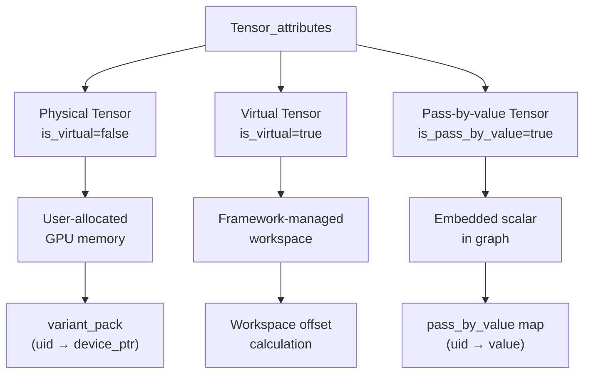
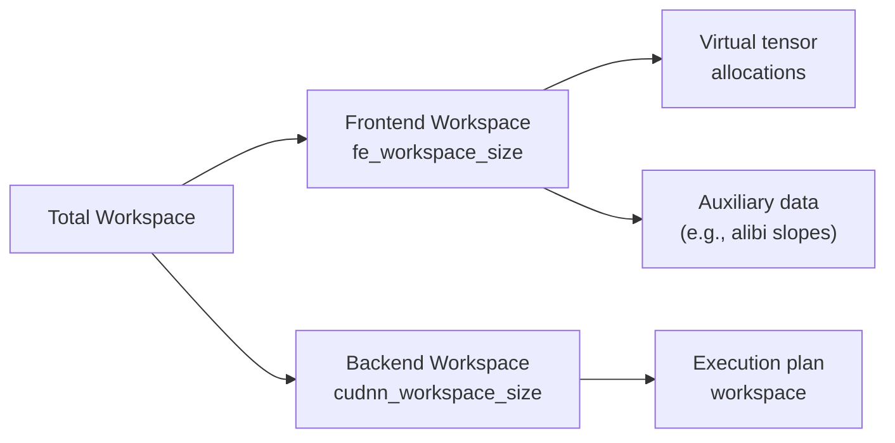
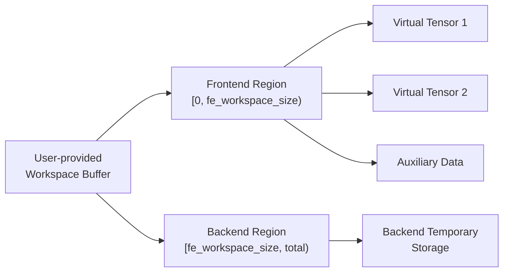
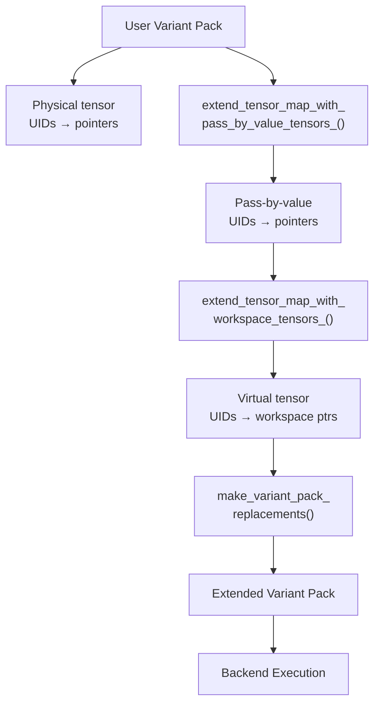
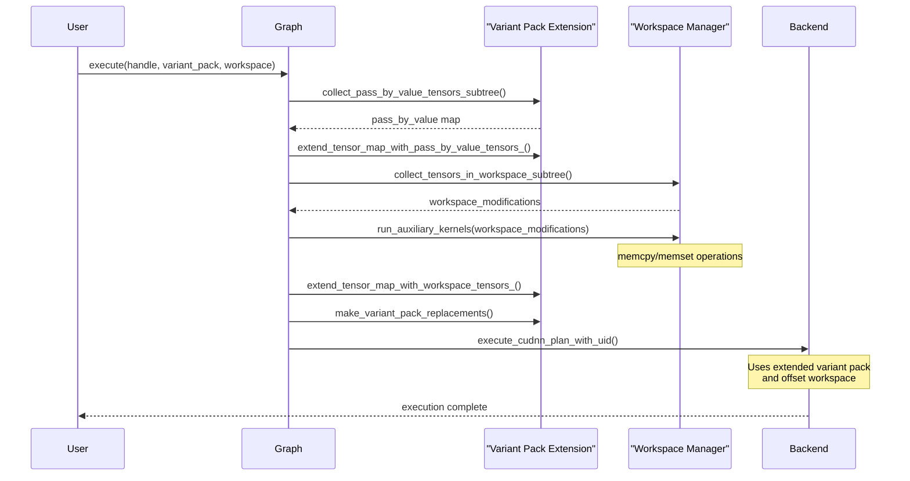
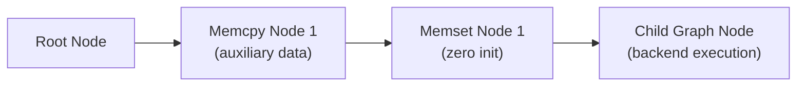

<!-- source: DeepWiki mcp.deepwiki.com · repo NVIDIA/cudnn-frontend · page 5.5 Memory Management · fetched 2026-10-26 -->

# Memory Management

<details>
<summary>Relevant source files</summary>

The following files were used as context for generating this wiki page:

- [include/cudnn_frontend/cudnn_interface.h](include/cudnn_frontend/cudnn_interface.h)
- [include/cudnn_frontend/graph_helpers.h](include/cudnn_frontend/graph_helpers.h)
- [include/cudnn_frontend/graph_interface.h](include/cudnn_frontend/graph_interface.h)
- [include/cudnn_frontend/graph_properties.h](include/cudnn_frontend/graph_properties.h)
- [include/cudnn_frontend/node/sdpa_fp8_bwd.h](include/cudnn_frontend/node/sdpa_fp8_bwd.h)
- [python/pygraph/pygraph.h](python/pygraph/pygraph.h)
- [samples/cpp/CMakeLists.txt](samples/cpp/CMakeLists.txt)
- [samples/cpp/convolution/fprop.cpp](samples/cpp/convolution/fprop.cpp)
- [samples/cpp/sdpa/fp16_fwd_with_custom_dropout.cpp](samples/cpp/sdpa/fp16_fwd_with_custom_dropout.cpp)
- [samples/cpp/sdpa/fp8_fwd.cpp](samples/cpp/sdpa/fp8_fwd.cpp)
- [test/python/test_matmul_bias_relu.py](test/python/test_matmul_bias_relu.py)

</details>


This page explains how cuDNN Frontend manages memory for tensors and execution workspaces. It covers the three-tier tensor memory model (physical/virtual/pass-by-value), workspace allocation strategies, and the variant pack system that binds memory to graph execution.

For information about execution plan management and caching, see [Execution Plans](#2.4). For CUDA graph integration details beyond memory concerns, see [Performance Optimization](#5.4).

## Overview of Memory Responsibilities

cuDNN Frontend divides memory management responsibilities between the user and the framework:

| Memory Type | Allocation | Lifetime | Purpose |
|-------------|-----------|----------|---------|
| **Physical Tensors** | User | Controlled by user | Input/output tensors in variant pack |
| **Virtual Tensors** | Framework | During graph execution | Intermediate results in workspace |
| **Pass-by-value Tensors** | Framework | Graph lifetime | Embedded scalar constants |
| **Workspace** | User | During execution | Temporary storage for framework operations |

**Sources:** [include/cudnn_frontend/graph_properties.h:22-296](), [include/cudnn_frontend/graph_interface.h:40-50]()

## Tensor Memory Categories

The frontend categorizes tensors into three types based on their memory management semantics:



**Sources:** [include/cudnn_frontend/graph_properties.h:66-69](), [include/cudnn_frontend/graph_interface.h:356-367]()

### Physical Tensors

Physical tensors represent user-managed GPU memory for inputs and outputs. The user must provide a device pointer in the variant pack for each physical tensor.

```cpp
// Tensor attribute flags
bool is_virtual = false;  // Physical tensor
```

Physical tensors have unique IDs (UIDs) that are used to associate them with device pointers at execution time.

**Sources:** [include/cudnn_frontend/graph_properties.h:66](), [include/cudnn_frontend/cudnn_interface.h:42-44]()

### Virtual Tensors

Virtual tensors represent intermediate computation results managed automatically by the framework. The framework allocates them from the workspace buffer and handles their lifetime.

```cpp
// Virtual tensor configuration
bool is_virtual = true;
```

Virtual tensors do not appear in the user's variant pack. The framework automatically assigns workspace offsets to them during graph building via `collect_tensors_in_workspace_subtree()`.

**Sources:** [include/cudnn_frontend/graph_properties.h:66](), [include/cudnn_frontend/graph_interface.h:119-127]()

### Pass-by-value Tensors

Pass-by-value tensors embed scalar constants directly into the graph. They support two use cases:

1. **Fused scalar constants**: Values embedded at graph construction time
2. **Runtime scalars**: Scalar pointers provided at execution time via variant pack

```cpp
// Pass-by-value variant types
using pass_by_values_t = std::variant<int64_t, int32_t, half, float, nv_bfloat16>;

std::optional<pass_by_values_t> pass_by_value = std::nullopt;
bool is_pass_by_value = false;
```

The framework handles pass-by-value tensors by adding their pointers to the variant pack internally via `extend_tensor_map_with_pass_by_value_tensors_()`.

**Sources:** [include/cudnn_frontend/graph_properties.h:28-69](), [include/cudnn_frontend/graph_interface.h:148-169]()

## Workspace Memory Management

### Workspace Size Calculation

The total workspace required for graph execution consists of two components:



The frontend tracks its own workspace needs in `fe_workspace_size`, which is computed during `build_operation_graph()`:

```cpp
// From graph_interface.h
fe_workspace_size = get_fe_workspace_size_subtree();
```

Total workspace is calculated by combining both:

```cpp
// Lines 732-740 in graph_interface.h
int64_t cudnn_ws = 0;
CHECK_CUDNN_FRONTEND_ERROR(get_cudnn_workspace_size_node(plan_index, cudnn_ws));
cudnn_workspace_size = cudnn_ws + fe_workspace_size;
```

**Sources:** [include/cudnn_frontend/graph_interface.h:44](), [include/cudnn_frontend/graph_interface.h:697-698](), [include/cudnn_frontend/graph_interface.h:732-740]()

### Workspace Offset Assignment

Virtual tensors and auxiliary data are assigned offsets within the frontend workspace portion. This is tracked via the `workspace_modifications` map:

```cpp
// Map structure: uid → (operation_type, offset, data)
std::unordered_map<uid_t, std::tuple<int64_t, int64_t, std::vector<float>>> 
    workspace_modifications;
```

Operation types in workspace modifications:
- `0`: Memory copy from host to device (e.g., initialization data)
- `1`: Memory set to zero
- Other values: No CUDA graph node required

**Sources:** [include/cudnn_frontend/graph_interface.h:48](), [include/cudnn_frontend/graph_interface.h:120-127](), [include/cudnn_frontend/graph_interface.h:373-379]()

### Auxiliary Kernel Execution

Before executing the main graph, the framework runs auxiliary kernels to initialize workspace data:

```cpp
// From graph_interface.h:200-225
error_t run_auxiliary_kernels(
    cudnnHandle_t handle,
    void *fe_workspace,
    std::unordered_map<uid_t, std::tuple<int64_t, int64_t, std::vector<float>>> 
        &workspace_modifications) const {
    
    cudaStream_t stream;
    _CUDNN_CHECK_CUDNN_ERROR(detail::get_stream(handle, &stream));
    char *workspace = static_cast<char *>(fe_workspace);

    for (auto [uid, data] : workspace_modifications) {
        if (std::get<0>(data) == 0) {
            // memcpy: copy initialization data from host
            auto &vec_data = std::get<2>(data);
            _CUDNN_CHECK_CUDA_ERROR(detail::cuda_mem_cpy_async(
                workspace + std::get<1>(data),
                vec_data.data(),
                vec_data.size() * sizeof(float),
                cudaMemcpyHostToDevice,
                stream));
        } else if (std::get<0>(data) == 1) {
            // memset: zero initialize
            int64_t memset_size = (int64_t)std::get<2>(data)[0];
            _CUDNN_CHECK_CUDA_ERROR(detail::cuda_mem_set_async(
                workspace + std::get<1>(data), 0, memset_size, stream));
        }
    }
    return {error_code_t::OK, ""};
}
```

**Sources:** [include/cudnn_frontend/graph_interface.h:200-225]()

### Workspace Partitioning

The workspace buffer is partitioned between frontend and backend:



The backend receives a pointer offset by `fe_workspace_size`:

```cpp
// Lines 451, 597, 794 in graph_interface.h
void *cudnn_workspace = static_cast<char *>(workspace) + fe_workspace_size;
```

**Sources:** [include/cudnn_frontend/graph_interface.h:451](), [include/cudnn_frontend/graph_interface.h:597](), [include/cudnn_frontend/graph_interface.h:794]()

## Variant Pack System

The variant pack is the runtime binding between tensor UIDs and device memory pointers.

### Variant Pack Construction

Users construct a variant pack by mapping tensor UIDs or `Tensor_attributes` objects to device pointers:

```cpp
// UID-based variant pack (from samples/cpp/convolution/fprop.cpp:80-81)
std::unordered_map<int64_t, void *> variant_pack = {
    {X->get_uid(), x_tensor.devPtr}, 
    {W->get_uid(), w_tensor.devPtr}, 
    {Y->get_uid(), y_tensor.devPtr}
};

// Tensor-based variant pack (from samples/cpp/convolution/fprop.cpp:309-310)
std::unordered_map<std::shared_ptr<fe::graph::Tensor_attributes>, void *> variant_pack = {
    {X, x_tensor.devPtr}, 
    {W, w_tensor.devPtr}, 
    {Y, y_tensor.devPtr}
};
```

**Sources:** [samples/cpp/convolution/fprop.cpp:80-81](), [samples/cpp/convolution/fprop.cpp:309-310]()

### Variant Pack Extension

The framework extends the user's variant pack with framework-managed tensors:



**Sources:** [include/cudnn_frontend/graph_interface.h:366-367](), [include/cudnn_frontend/graph_interface.h:136-169](), [include/cudnn_frontend/graph_interface.h:172-188]()

#### Pass-by-value Tensor Extension

```cpp
// From graph_interface.h:148-169
error_t extend_tensor_map_with_pass_by_value_tensors_(
    std::unordered_map<int64_t, void *> &tensor_to_pointer_map,
    std::unordered_map<uid_t, pass_by_values_t> &tensor_to_pass_by_value) const {
    
    for (auto &[uid, value] : tensor_to_pass_by_value) {
        if (half *half_value_ptr = std::get_if<half>(&value)) {
            tensor_to_pointer_map.emplace(uid, half_value_ptr);
        } else if (nv_bfloat16 *nv_bfloat16_value_ptr = std::get_if<nv_bfloat16>(&value)) {
            tensor_to_pointer_map.emplace(uid, nv_bfloat16_value_ptr);
        } else if (int32_t *int32_t_value_ptr = std::get_if<int32_t>(&value)) {
            tensor_to_pointer_map.emplace(uid, int32_t_value_ptr);
        } else if (int64_t *int64_t_value_ptr = std::get_if<int64_t>(&value)) {
            tensor_to_pointer_map.emplace(uid, int64_t_value_ptr);
        } else if (float *float_value_ptr = std::get_if<float>(&value)) {
            tensor_to_pointer_map.emplace(uid, float_value_ptr);
        }
    }
    return {error_code_t::OK, ""};
}
```

The framework uses `std::get_if` to extract the typed pointer from the variant and adds it to the map.

**Sources:** [include/cudnn_frontend/graph_interface.h:148-169]()

#### Workspace Tensor Extension

```cpp
// From graph_interface.h:136-146
error_t extend_tensor_map_with_workspace_tensors_(
    std::unordered_map<int64_t, void *> &tensor_to_pointer_map,
    void *workspace,
    std::unordered_map<uid_t, std::tuple<int64_t, int64_t, std::vector<float>>> 
        const &workspace_modifications) const {
    
    for (auto const &[uid, data] : workspace_modifications) {
        tensor_to_pointer_map.emplace(uid, static_cast<char *>(workspace) + std::get<1>(data));
    }
    return {error_code_t::OK, ""};
}
```

Virtual tensors are mapped to their workspace offsets by adding the offset to the workspace base pointer.

**Sources:** [include/cudnn_frontend/graph_interface.h:136-146]()

#### Variant Pack Replacements

Some operations require pointer aliasing where one UID's pointer should be derived from another. The `variant_pack_replacements` map tracks these:

```cpp
// From graph_interface.h:195-198
std::unordered_map<Tensor_attributes::uid_t, 
    std::pair<Tensor_attributes::uid_t, int64_t>> variant_pack_replacements;
// Key: UID to replace in variant pack
// Value: (source UID, byte offset to add)
```

Replacements are applied via `make_variant_pack_replacements()`:

```cpp
// From graph_interface.h:172-188
error_t make_variant_pack_replacements(
    std::unordered_map<int64_t, void *> &tensor_to_pointer_map,
    std::unordered_map<Tensor_attributes::uid_t, 
        std::pair<Tensor_attributes::uid_t, int64_t>> replacements) const {
    
    for (auto &[from_uid, value] : replacements) {
        const auto &[to_uid, start_offset] = value;

        auto it = tensor_to_pointer_map.find(from_uid);
        RETURN_CUDNN_FRONTEND_ERROR_IF(it == tensor_to_pointer_map.end(),
            error_code_t::INVALID_VARIANT_PACK,
            "Variant pack expected uid " + std::to_string(from_uid) + " but not found.");

        // Perform pointer arithmetic
        tensor_to_pointer_map[to_uid] = 
            static_cast<void *>(static_cast<char *>(it->second) + start_offset);
    }
    return {error_code_t::OK, ""};
}
```

**Sources:** [include/cudnn_frontend/graph_interface.h:172-198]()

## Memory Binding at Execution

### Standard Execution Flow

The execution flow integrates all memory management components:



**Sources:** [include/cudnn_frontend/graph_interface.h:800-820]()

### Execution Code Path

```cpp
// From graph_interface.h:800-820 (simplified)
error_t execute(
    cudnnHandle_t handle,
    std::unordered_map<int64_t, void *> &tensor_uid_to_pointer_map,
    void *workspace,
    void *user_impl = nullptr) {
    
    // 1. Extend with pass-by-value tensors
    std::unordered_map<uid_t, pass_by_values_t> tensor_to_pass_by_value;
    CHECK_CUDNN_FRONTEND_ERROR(collect_pass_by_value_tensors_subtree(tensor_to_pass_by_value));
    CHECK_CUDNN_FRONTEND_ERROR(
        extend_tensor_map_with_pass_by_value_tensors_(tensor_uid_to_pointer_map, tensor_to_pass_by_value));
    
    // 2. Apply replacements
    CHECK_CUDNN_FRONTEND_ERROR(
        make_variant_pack_replacements(tensor_uid_to_pointer_map, variant_pack_replacements));
    
    // 3. Handle workspace tensors
    std::unordered_map<uid_t, std::tuple<int64_t, int64_t, std::vector<float>>> workspace_modifications;
    int64_t workspace_offset = 0;
    CHECK_CUDNN_FRONTEND_ERROR(collect_tensors_in_workspace_subtree(workspace_modifications, workspace_offset));
    CHECK_CUDNN_FRONTEND_ERROR(run_auxiliary_kernels(handle, workspace, workspace_modifications));
    CHECK_CUDNN_FRONTEND_ERROR(
        extend_tensor_map_with_workspace_tensors_(tensor_uid_to_pointer_map, workspace, workspace_modifications));
    
    // 4. Offset workspace for backend
    void *cudnn_workspace = static_cast<char *>(workspace) + fe_workspace_size;
    
    // 5. Execute backend plan
    CHECK_CUDNN_FRONTEND_ERROR(plans.execute(handle, tensor_uid_to_pointer_map, cudnn_workspace, user_impl));
    
    return {error_code_t::OK, ""};
}
```

**Sources:** [include/cudnn_frontend/graph_interface.h:800-820]()

## CUDA Graph Memory Considerations

When integrating with CUDA graphs, memory management requires special handling to maintain graph topology and enable updates.

### Populating CUDA Graphs

The `populate_cuda_graph()` method creates a linear CUDA graph with memory operations:

```cpp
// From graph_interface.h:487-628 (simplified structure)
error_t populate_cuda_graph(
    cudnnHandle_t handle,
    std::unordered_map<Tensor_attributes::uid_t, void *> &uid_to_device_ptrs,
    void *workspace,
    cudaGraph_t cudnn_cuda_graph) {
    
    cudaGraphNode_t last_node = nullptr;
    
    // 1. Pass-by-value tensors (no CUDA graph nodes)
    std::unordered_map<uid_t, pass_by_values_t> tensor_to_pass_by_value;
    CHECK_CUDNN_FRONTEND_ERROR(collect_pass_by_value_tensors_subtree(tensor_to_pass_by_value));
    CHECK_CUDNN_FRONTEND_ERROR(
        extend_tensor_map_with_pass_by_value_tensors_(uid_to_device_ptrs, tensor_to_pass_by_value));
    
    // 2. Workspace tensors (with memcpy/memset nodes)
    for (auto const &[uid, data] : workspace_modifications) {
        const auto &[operation_type, offset, vec_data] = data;
        uid_to_device_ptrs[uid] = static_cast<char *>(workspace) + offset;
        
        cudaGraphNode_t node = nullptr;
        
        if (operation_type == 0) {
            // Add memcpy node
            _CUDNN_CHECK_CUDA_ERROR(detail::cuda_graph_add_memcpy_node_1D(...));
        } else if (operation_type == 1) {
            // Add memset node
            _CUDNN_CHECK_CUDA_ERROR(detail::cuda_graph_add_memset_node(...));
        }
        
        last_node = node;
    }
    
    // 3. Add backend CUDA graph as child node
    cudaGraphNode_t backend_cuda_graph_node;
    detail::cuda_graph_add_child_graph_node(&backend_cuda_graph_node, ...);
    
    return {error_code_t::OK, ""};
}
```

The resulting CUDA graph structure:



**Sources:** [include/cudnn_frontend/graph_interface.h:487-628]()

### Updating CUDA Graphs

The `update_cuda_graph()` method walks the existing graph structure and updates memory parameters:

```cpp
// From graph_interface.h:338-470 (simplified)
error_t update_cuda_graph(
    cudnnHandle_t handle,
    std::unordered_map<Tensor_attributes::uid_t, void *> &uid_to_device_ptrs,
    void *workspace,
    cudaGraph_t cudnn_cuda_graph) {
    
    // Traverse from root to backend graph node
    cudaGraphNode_t current_node = nullptr;
    _CUDNN_CHECK_CUDA_ERROR(detail::cuda_graph_get_root_nodes(cudnn_cuda_graph, &current_node, ...));
    
    for (auto const &[uid, data] : workspace_modifications) {
        const auto &[operation_type, offset, vec_data] = data;
        uid_to_device_ptrs[uid] = static_cast<char *>(workspace) + offset;
        
        if (operation_type == 0) {
            // Update memcpy node parameters
            _CUDNN_CHECK_CUDA_ERROR(
                detail::cuda_graph_add_memcpy_node_set_params_1D(current_node, ...));
        } else if (operation_type == 1) {
            // Update memset node parameters
            cudaMemsetParams params;
            _CUDNN_CHECK_CUDA_ERROR(
                detail::cuda_graph_add_memset_node_set_params(current_node, &params));
        }
        
        // Move to next node
        _CUDNN_CHECK_CUDA_ERROR(
            detail::cuda_graph_node_get_dependent_nodes(current_node, &current_node, ...));
    }
    
    // Update backend graph node
    cudaGraph_t backend_cuda_graph;
    _CUDNN_CHECK_CUDA_ERROR(detail::cuda_graph_child_graph_node_get_graph(current_node, &backend_cuda_graph));
    _CUDNN_CHECK_CUDNN_ERROR(detail::update_cuda_graph(handle, ...));
    
    return {error_code_t::OK, ""};
}
```

**Sources:** [include/cudnn_frontend/graph_interface.h:338-470]()

### CUDA Graph Memory Constraints

Pass-by-value tensors in CUDA graphs have special lifetime requirements:

```cpp
// From graph_interface.h:359-363
// object lifetime is controlled by tensor_to_pass_by_value which means the pointer 
// should stay valid while making the cuda graph. cuda graph will then keep a copy of 
// the kernel parameters, meaning that at the time of launching the cuda_graph executable, 
// tensor_to_pass_by_value being deallocated does not affect these cpu value's.
```

The CUDA graph captures a copy of pass-by-value scalars, so temporary storage only needs to live during graph creation, not during graph launch.

**Sources:** [include/cudnn_frontend/graph_interface.h:359-363](), [include/cudnn_frontend/graph_interface.h:509-513]()

## Memory Optimization Strategies

### Minimizing Workspace Size

To reduce workspace requirements:

1. **Prefer virtual tensors for intermediates**: Allows framework to optimize layout
2. **Query workspace size before allocation**: Use `get_workspace_size()` or `get_autotune_workspace_size()`
3. **Share workspace across graphs**: If graphs don't execute concurrently

```cpp
// From samples/cpp/convolution/fprop.cpp:83-85
int64_t workspace_size = 0;
REQUIRE(graph->get_workspace_size(workspace_size).is_good());
Surface<int8_t> workspace(workspace_size, false);
```

**Sources:** [samples/cpp/convolution/fprop.cpp:83-85]()

### Autotuning Workspace

During autotuning, use the maximum workspace across all candidate plans:

```cpp
// From graph_interface.h:758-764
int64_t get_autotune_workspace_size() const {
    // There are two workspaces:
    // - cudnn execution plan workspace
    // - FE node workspace (example: alibiSlope for fmha)
    return fe_workspace_size + get_max_cudnn_workspace_size();
}
```

**Sources:** [include/cudnn_frontend/graph_interface.h:758-764]()

### Dynamic Shape Considerations

When using dynamic shapes (cuDNN 9.4+), allocate workspace and tensor buffers based on maximum expected dimensions:

```cpp
// From samples/cpp/convolution/fprop.cpp:112-118
int64_t max_x_volume = 0, max_w_volume = 0, max_y_volume = 0;
for (int idx_shape = 0; idx_shape < conv_shapes_count; ++idx_shape) {
    const auto &conv_shape = conv_shapes[idx_shape];
    max_x_volume = std::max(max_x_volume, conv_shape.n * conv_shape.c * conv_shape.h * conv_shape.w);
    max_w_volume = std::max(max_w_volume, conv_shape.k * conv_shape.c * conv_shape.r * conv_shape.s);
    max_y_volume = std::max(max_y_volume, conv_shape.n * conv_shape.k * conv_shape.h * conv_shape.w);
}
```

**Sources:** [samples/cpp/convolution/fprop.cpp:112-118]()

### Memory Alignment

Tensors have configurable alignment requirements (default 16 bytes):

```cpp
// From graph_properties.h:76
int64_t alignment = 16;  // Default to 16 bytes
```

Proper alignment can improve memory access performance. The alignment is passed to the backend tensor descriptor via `TensorBuilder::setAlignment()`.

**Sources:** [include/cudnn_frontend/graph_properties.h:76](), [include/cudnn_frontend/cudnn_interface.h:61]()

### Reusing Graphs with Different Data

Once a graph is built and execution plans are created, the same graph can be executed multiple times with different input data by providing different variant packs:

```cpp
// From test/python/test_matmul_bias_relu.py:318-320
graph.execute({X: X_gpu, W: W_gpu, B: B_gpu, Y: Y_actual}, workspace, handle=cudnn_handle)
// Can call execute again with different X_gpu, W_gpu, B_gpu, Y_actual
```

This amortizes the cost of graph building across multiple executions.

**Sources:** [test/python/test_matmul_bias_relu.py:318-320]()

---

