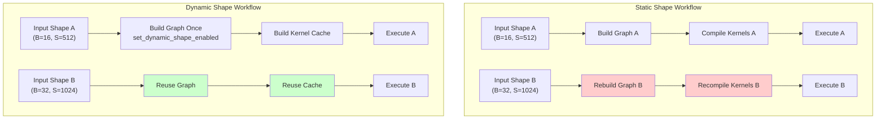
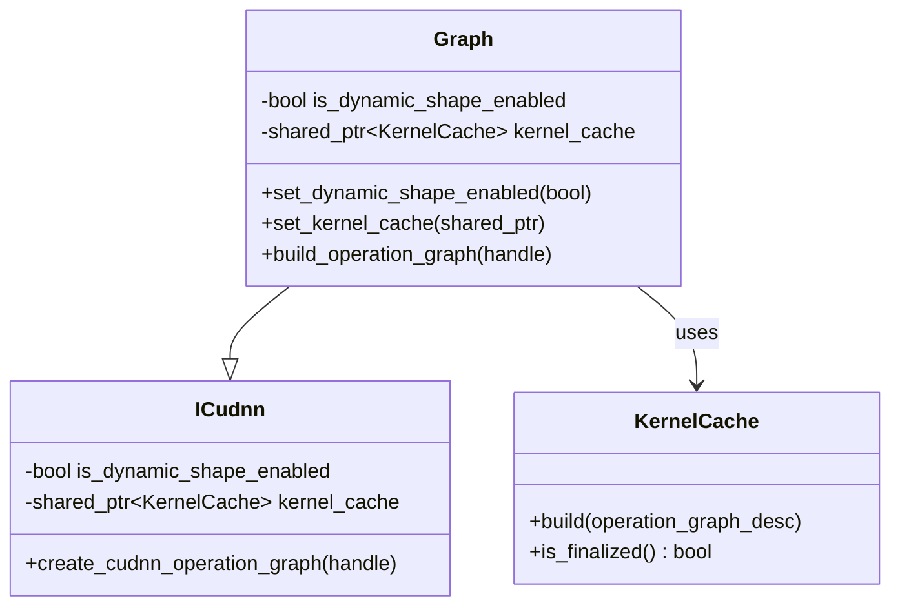
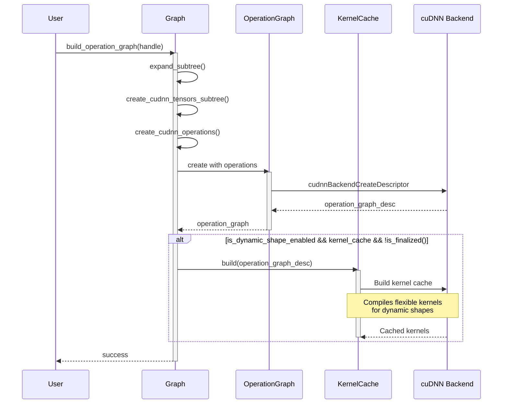
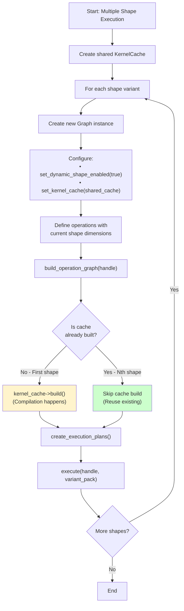
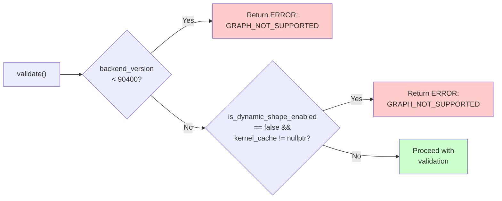
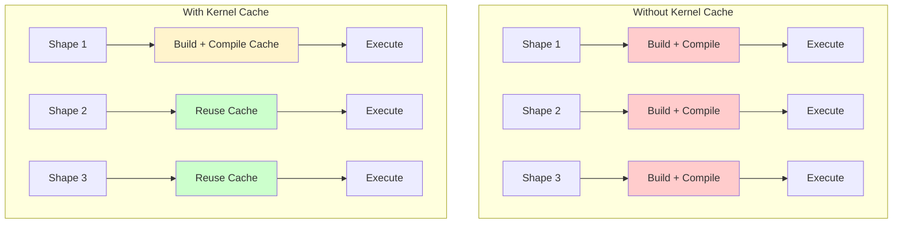
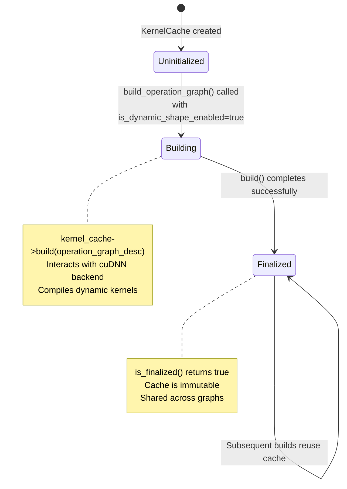

<!-- source: DeepWiki mcp.deepwiki.com · repo NVIDIA/cudnn-frontend · page 5.6 Kernel Cache & Dynamic Shapes · fetched 2026-10-26 -->

# Kernel Cache & Dynamic Shapes

<details>
<summary>Relevant source files</summary>

The following files were used as context for generating this wiki page:

- [include/cudnn_frontend/cudnn_interface.h](include/cudnn_frontend/cudnn_interface.h)
- [include/cudnn_frontend/graph_helpers.h](include/cudnn_frontend/graph_helpers.h)
- [include/cudnn_frontend/graph_interface.h](include/cudnn_frontend/graph_interface.h)
- [include/cudnn_frontend/node/sdpa_fp8_bwd.h](include/cudnn_frontend/node/sdpa_fp8_bwd.h)
- [include/cudnn_frontend_EngineConfigGenerator.h](include/cudnn_frontend_EngineConfigGenerator.h)
- [include/cudnn_frontend_Filters.h](include/cudnn_frontend_Filters.h)
- [include/cudnn_frontend_Heuristics.h](include/cudnn_frontend_Heuristics.h)
- [include/cudnn_frontend_get_plan.h](include/cudnn_frontend_get_plan.h)
- [samples/cpp/convolution/fprop.cpp](samples/cpp/convolution/fprop.cpp)
- [samples/cpp/sdpa/fp16_fwd_with_custom_dropout.cpp](samples/cpp/sdpa/fp16_fwd_with_custom_dropout.cpp)
- [samples/cpp/sdpa/fp8_fwd.cpp](samples/cpp/sdpa/fp8_fwd.cpp)

</details>


## Overview

Kernel Cache and Dynamic Shapes are features introduced in cuDNN 9.4 that enable execution of computation graphs with varying input tensor dimensions without rebuilding the entire operation graph and execution plans. This capability is particularly valuable for workloads with variable sequence lengths, batch sizes, or other dynamic dimensions common in production inference scenarios.

**Requirements:**
- cuDNN version 9.4.0 or later
- CUDA Toolkit 12.0 or later

**Related topics:**
- For graph construction basics, see [Graph API](#2.1)
- For execution plan management, see [Execution Plans](#2.4)
- For performance optimization strategies, see [Performance Optimization](#5.4)

**Sources:** [include/cudnn_frontend/graph_interface.h:83-90]()

---

## Concept and Motivation

### The Static Shape Limitation

By default, cuDNN Frontend graphs are built with fixed tensor dimensions. When a graph is constructed and execution plans are created, the backend compiles kernels optimized for those specific shapes. Changing tensor dimensions requires rebuilding the entire graph, creating new execution plans, and recompiling kernels—an expensive operation that can dominate latency in dynamic workloads.

### Dynamic Shapes Solution

Dynamic shapes decouple kernel compilation from specific tensor dimensions. Instead of compiling a kernel for one exact shape, the backend generates a more flexible kernel that can handle a range of shapes. The `KernelCache` stores these pre-compiled kernels, allowing efficient execution across different input dimensions.



**Sources:** [include/cudnn_frontend/graph_interface.h:83-97](), [samples/cpp/convolution/fprop.cpp:92-212]()

---

## Architecture Components

### Graph Configuration

The `Graph` class provides two key settings for dynamic shapes:

| Method | Type | Description |
|--------|------|-------------|
| `set_dynamic_shape_enabled(bool)` | Graph configuration | Enables dynamic shape support |
| `set_kernel_cache(std::shared_ptr<KernelCache>)` | Graph configuration | Associates a kernel cache instance |

**Validation Rules:**
1. Both features require cuDNN 9.4.0 or later
2. Kernel cache **requires** dynamic shapes to be enabled
3. Dynamic shapes can be enabled without kernel cache (less efficient)



**Sources:** [include/cudnn_frontend/graph_interface.h:123-124](), [include/cudnn_frontend/cudnn_interface.h:123-124]()

---

## Kernel Cache Lifecycle

### Build Phase

During `build_operation_graph()`, if dynamic shapes are enabled and a kernel cache is provided, the cache is built from the operation graph descriptor:



**Sources:** [include/cudnn_frontend/graph_interface.h:670-712]()

---

## Usage Pattern

### Basic Setup

```cpp
// Step 1: Create a kernel cache instance (shared across all shape variations)
auto kernel_cache = std::make_shared<fe::KernelCache>();

// Step 2: Build graph with dynamic shapes enabled
auto graph = std::make_shared<fe::graph::Graph>();
graph->set_io_data_type(fe::DataType_t::HALF)
     .set_compute_data_type(fe::DataType_t::FLOAT)
     .set_dynamic_shape_enabled(true)      // Enable dynamic shapes
     .set_kernel_cache(kernel_cache);       // Associate cache

// Step 3: Define operations with initial shape
auto X = graph->tensor(fe::graph::Tensor_attributes()
    .set_dim({n1, c1, h1, w1})
    .set_stride({c1*h1*w1, 1, c1*w1, c1}));
// ... define other tensors and operations

// Step 4: Build operation graph (populates kernel cache)
graph->build_operation_graph(handle);
graph->create_execution_plans({fe::HeurMode_t::A});
graph->check_support();
graph->build_plans();

// Step 5: Execute with first shape
graph->execute(handle, variant_pack_1, workspace);

// Step 6: Create new graph with different shape (reuses cache)
auto graph2 = std::make_shared<fe::graph::Graph>();
graph2->set_io_data_type(fe::DataType_t::HALF)
      .set_compute_data_type(fe::DataType_t::FLOAT)
      .set_dynamic_shape_enabled(true)
      .set_kernel_cache(kernel_cache);  // SAME cache instance

auto X2 = graph2->tensor(fe::graph::Tensor_attributes()
    .set_dim({n2, c2, h2, w2})  // DIFFERENT dimensions
    .set_stride({c2*h2*w2, 1, c2*w2, c2}));
// ... rest of graph definition

graph2->build_operation_graph(handle);  // Reuses cached kernels
// ... build plans and execute
```

**Sources:** [samples/cpp/convolution/fprop.cpp:120-183]()

### Complete Example: Multiple Convolution Shapes



**Sources:** [samples/cpp/convolution/fprop.cpp:327-454]()

---

## Validation and Error Handling

### Version Checks

The graph performs validation during `pre_validate_node()`:

| Condition | Error | Message |
|-----------|-------|---------|
| `(is_dynamic_shape_enabled \|\| kernel_cache) && backend_version < 90400` | `GRAPH_NOT_SUPPORTED` | "Dynamic shapes or kernel caching enabled, but cuDNN version < 9.4!" |
| `is_dynamic_shape_enabled == false && kernel_cache != nullptr` | `GRAPH_NOT_SUPPORTED` | "Kernel caching enabled but dynamic shapes is disabled" |

### Runtime Verification



**Sources:** [include/cudnn_frontend/graph_interface.h:83-96]()

---

## Supported Operations

Dynamic shapes are supported for most cuDNN Frontend operations when using cuDNN 9.4+. The convolution examples demonstrate support for:

- **Convolution forward propagation** (`conv_fprop`)
- **Pointwise operations** (activation functions, element-wise ops)
- **Composite operations** (Conv-Bias-ReLU patterns)

Example from samples showing CSBR (Convolution-Scale-Bias-ReLU) with dynamic shapes:

| Shape Index | Batch (n) | Channels (c) | Height (h) | Width (w) | Filters (k) |
|-------------|-----------|--------------|------------|-----------|-------------|
| 0 | 8 | 32 | 16 | 16 | 64 |
| 1 | 8 | 32 | 24 | 24 | 64 |
| 2 | 16 | 32 | 32 | 32 | 64 |
| 3 | 16 | 64 | 32 | 32 | 64 |
| 4 | 16 | 16 | 64 | 64 | 16 |

All shapes executed using the same kernel cache and graph structure.

**Sources:** [samples/cpp/convolution/fprop.cpp:334-354]()

---

## Performance Considerations

### When to Use Dynamic Shapes

**Recommended scenarios:**
- Variable sequence lengths in transformers/attention models
- Variable batch sizes in inference serving
- Multi-resolution image processing
- Any workload where rebuilding graphs is a bottleneck

**Not recommended when:**
- All inputs have fixed, known dimensions
- Shape variations are rare (rebuilding cost is acceptable)
- Maximum performance is needed for a single shape (specialized kernels may be faster)

### Memory and Compilation Trade-offs



**Observations:**
- **First execution**: Slightly slower due to kernel cache building
- **Subsequent executions**: Much faster, no recompilation
- **Memory**: Kernel cache consumes additional memory
- **Amortization**: Beneficial when N > 3-5 shape variations

**Sources:** [samples/cpp/convolution/fprop.cpp:92-212](), [samples/cpp/convolution/fprop.cpp:327-454]()

---

## Implementation Details

### Kernel Cache Building Process

The kernel cache is built during `build_operation_graph()` only when:
1. `is_dynamic_shape_enabled` is `true`
2. `kernel_cache` is not `nullptr`
3. `kernel_cache->is_finalized()` returns `false`

Once finalized, the cache is reused across all subsequent graph builds that share the same `KernelCache` instance.



**Sources:** [include/cudnn_frontend/graph_interface.h:704-707]()

---

## Key Classes and Methods

### Graph Class

| Method | Parameters | Description |
|--------|------------|-------------|
| `set_dynamic_shape_enabled` | `bool` | Enables dynamic shape support for the graph |
| `set_kernel_cache` | `std::shared_ptr<KernelCache>` | Associates a kernel cache instance |
| `build_operation_graph` | `cudnnHandle_t` | Builds operation graph and populates kernel cache if applicable |

### KernelCache Class

| Method | Parameters | Description |
|--------|------------|-------------|
| `build` | `operation_graph_desc` | Builds kernel cache from operation graph descriptor |
| `is_finalized` | None | Returns whether cache is already built |

### ICudnn Class (Base)

The `Graph` class inherits from `ICudnn` which contains the core members:

```cpp
bool is_dynamic_shape_enabled = false;
std::shared_ptr<KernelCache> kernel_cache = nullptr;
```

**Sources:** [include/cudnn_frontend/cudnn_interface.h:123-124](), [include/cudnn_frontend/graph_interface.h:36]()

---

## Example: Convolution with Dynamic Shapes

This complete example shows dynamic convolution across 5 different input shapes:

```cpp
// Define multiple shape configurations
struct {
    int64_t n, c, h, w, k, r, s;
} conv_shapes[] = {
    {16, 128, 56, 56, 256, 3, 3},
    {16, 128, 64, 64, 256, 3, 3},
    {16, 128, 80, 64, 256, 3, 3},
    {32, 128, 80, 80, 256, 3, 3},
    {32, 256, 32, 32, 256, 3, 3},
};

// Create shared kernel cache
auto kernel_cache = std::make_shared<fe::KernelCache>();

// Process each shape
for (const auto& shape : conv_shapes) {
    auto graph = std::make_shared<fe::graph::Graph>();
    graph->set_io_data_type(fe::DataType_t::HALF)
         .set_compute_data_type(fe::DataType_t::FLOAT)
         .set_dynamic_shape_enabled(true)
         .set_kernel_cache(kernel_cache);  // Shared across iterations
    
    // Define tensors with current shape
    auto X = graph->tensor(
        fe::graph::Tensor_attributes()
            .set_dim({shape.n, shape.c, shape.h, shape.w})
            .set_stride({shape.c * shape.h * shape.w, 1, 
                        shape.c * shape.w, shape.c}));
    
    auto W = graph->tensor(
        fe::graph::Tensor_attributes()
            .set_dim({shape.k, shape.c, shape.r, shape.s})
            .set_stride({shape.c * shape.r * shape.s, 1, 
                        shape.c * shape.s, shape.c}));
    
    auto Y = graph->conv_fprop(X, W, 
        fe::graph::Conv_fprop_attributes()
            .set_padding({1, 1})
            .set_stride({1, 1})
            .set_dilation({1, 1}));
    Y->set_output(true);
    
    // Build and execute (kernel cache reused after first iteration)
    graph->validate();
    graph->build_operation_graph(handle);
    graph->create_execution_plans({fe::HeurMode_t::A});
    graph->check_support();
    graph->build_plans();
    graph->execute(handle, variant_pack, workspace);
}
```

**Sources:** [samples/cpp/convolution/fprop.cpp:92-212]()

---

## Best Practices

1. **Share KernelCache instances** across graphs with the same operation structure but different shapes
2. **Pre-allocate maximum workspace** size to avoid reallocation between shape variations
3. **Validate version requirements** early: check `cudnnGetVersion() >= 90400` and `cudnnGetCudartVersion() >= 12000`
4. **Profile first execution** separately as it includes cache building overhead
5. **Consider memory constraints** when supporting wide shape ranges

**Sources:** [samples/cpp/convolution/fprop.cpp:92-212](), [include/cudnn_frontend/graph_interface.h:83-97]()

---

