<!-- source: DeepWiki mcp.deepwiki.com · repo NVIDIA/cudnn-frontend · page 6 Examples & Samples · fetched 2026-10-26 -->

# Examples & Samples

<details>
<summary>Relevant source files</summary>

The following files were used as context for generating this wiki page:

- [README.md](README.md)
- [cmake/cuDNN.cmake](cmake/cuDNN.cmake)
- [samples/python/00_introduction.ipynb](samples/python/00_introduction.ipynb)

</details>


This document provides an overview of the example code and sample programs included in the cuDNN Frontend repository. These examples demonstrate how to use the Graph API for common deep learning operations, serving as both learning resources and starting points for integration.

For detailed walkthroughs of specific C++ examples, see [C++ Examples](#6.1). For Python notebook tutorials with step-by-step explanations, see [Python Notebook Examples](#6.2). For performance measurement and benchmarking tools, see [Benchmarking](#6.3).

## Purpose and Scope

The examples in this repository demonstrate:

- **Basic Operations**: Convolution, matrix multiplication, pointwise operations
- **Complex Workflows**: SDPA (Scaled Dot-Product Attention), layer normalization, batch normalization
- **Advanced Features**: Mixed precision, FP8 quantization, serialization, autotuning
- **Integration Patterns**: PyTorch interoperability, memory management, error handling

The samples are organized into two primary categories: C++ programs demonstrating the native API, and Python notebooks showing the Python interface with interactive explanations.

## Repository Structure

The examples are organized in the `samples/` directory with parallel C++ and Python implementations:

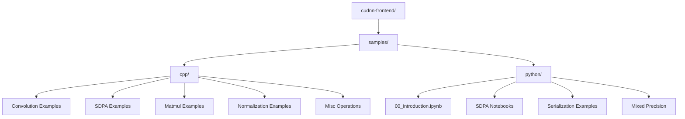

**Sources:** [README.md:68-72]()

## Building and Running Examples

### C++ Samples

The C++ samples are built using CMake and require cuDNN and CUDA installations:

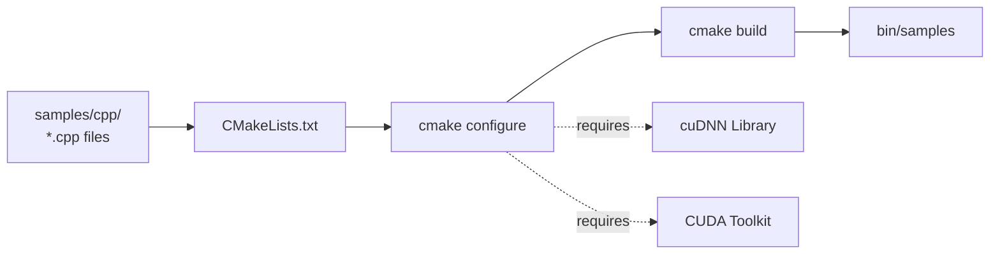

Build commands as documented in the repository:

| Step | Command | Purpose |
|------|---------|---------|
| Create build directory | `mkdir build && cd build` | Isolate build artifacts |
| Configure | `cmake -DCUDNN_PATH=/path/to/cudnn -DCUDAToolkit_ROOT=/path/to/cuda ../` | Set up build system |
| Build | `cmake --build . -j16` | Compile samples |
| Run | `./bin/samples` | Execute sample programs |

The CMake configuration discovers cuDNN components based on version. For cuDNN v8, it links: `cudnn_adv_train`, `cudnn_ops_train`, `cudnn_cnn_train`, `cudnn_adv_infer`, `cudnn_cnn_infer`, `cudnn_ops_infer`. For cuDNN v9, it links: `cudnn_graph`, `cudnn_engines_runtime_compiled`, and optionally `cudnn_ops`, `cudnn_cnn`, `cudnn_adv`, `cudnn_engines_precompiled`, `cudnn_heuristic`.

**Sources:** [README.md:60-66](), [cmake/cuDNN.cmake:77-115]()

### Python Samples

Python samples are Jupyter notebooks that can be run interactively or executed as scripts:

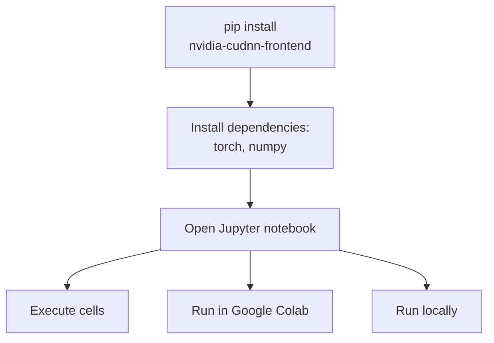

Prerequisites for running Python samples:

| Requirement | Version | Purpose |
|-------------|---------|---------|
| Python | 3.8+ | Runtime environment |
| nvidia-cudnn-frontend | Latest | cuDNN Python bindings |
| nvidia-cudnn-cu12 | Latest | cuDNN backend library |
| PyTorch | 2.0+ recommended | Tensor operations and verification |
| numpy | Any recent | Array operations |

The notebooks include inline installation instructions and can be opened directly in Google Colab using the provided badges.

**Sources:** [samples/python/00_introduction.ipynb:22-57]()

## Example Categories

### Basic Graph Construction

The introduction examples demonstrate fundamental graph creation patterns:

```mermaid
sequenceDiagram
    participant User
    participant Graph["cudnn.Graph or<br/>cudnn.pygraph"]
    participant Tensors["Tensor objects"]
    participant Operations["Operation nodes"]
    participant Execution["Execute"]
    
    User->>Graph: Create graph context
    User->>Tensors: Define input tensors
    User->>Operations: Add operation nodes
    User->>Operations: Mark outputs
    User->>Graph: Build graph
    User->>Execution: Execute with data
```

**High-Level Wrapper (cudnn.Graph):**
- Context manager interface for simplified usage
- Automatic tensor creation from PyTorch/NumPy arrays
- Dynamic output allocation
- Example: [samples/python/00_introduction.ipynb:139-154]()

**Low-Level Bindings (cudnn.pygraph):**
- Direct access to cuDNN frontend primitives
- Explicit tensor descriptor creation
- Manual workspace and variant_pack management
- Example: [samples/python/00_introduction.ipynb:234-297]()

**Sources:** [samples/python/00_introduction.ipynb:63-213]()

## Example Workflow Patterns

### Pattern 1: Single Operation Graph

The simplest pattern demonstrates a single operation like convolution:

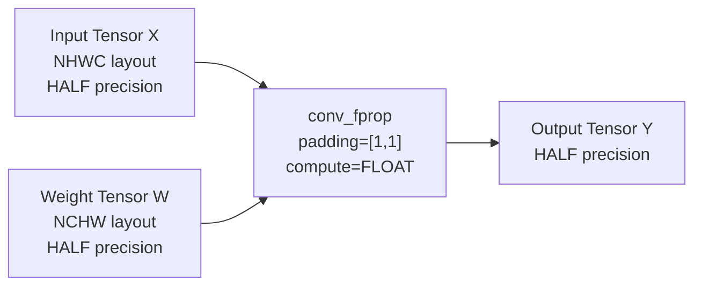

This pattern is used for:
- Convolution forward/backward operations
- Matrix multiplication
- Basic pointwise operations
- Testing and validation

**Sources:** [samples/python/00_introduction.ipynb:134-154]()

### Pattern 2: Multi-Operation Fusion

More complex examples chain multiple operations:

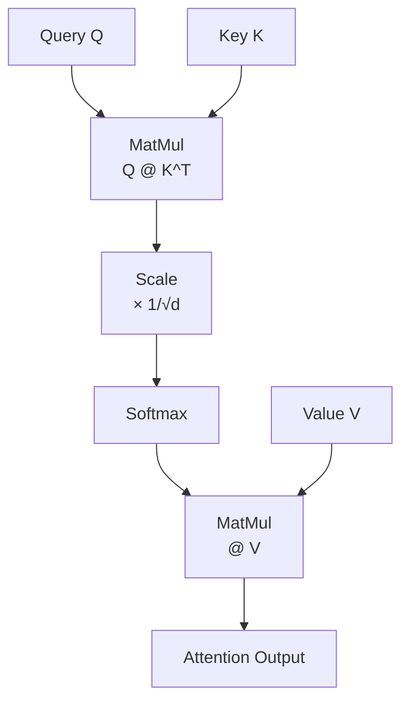

This pattern demonstrates:
- SDPA (Scaled Dot-Product Attention) expansion
- Composite node decomposition into primitives
- Virtual tensor management for intermediate results
- Kernel fusion opportunities

**Sources:** High-level architecture diagrams (Diagram 3)

### Pattern 3: Backward Pass Integration

Examples showing training workflows include forward and backward passes:

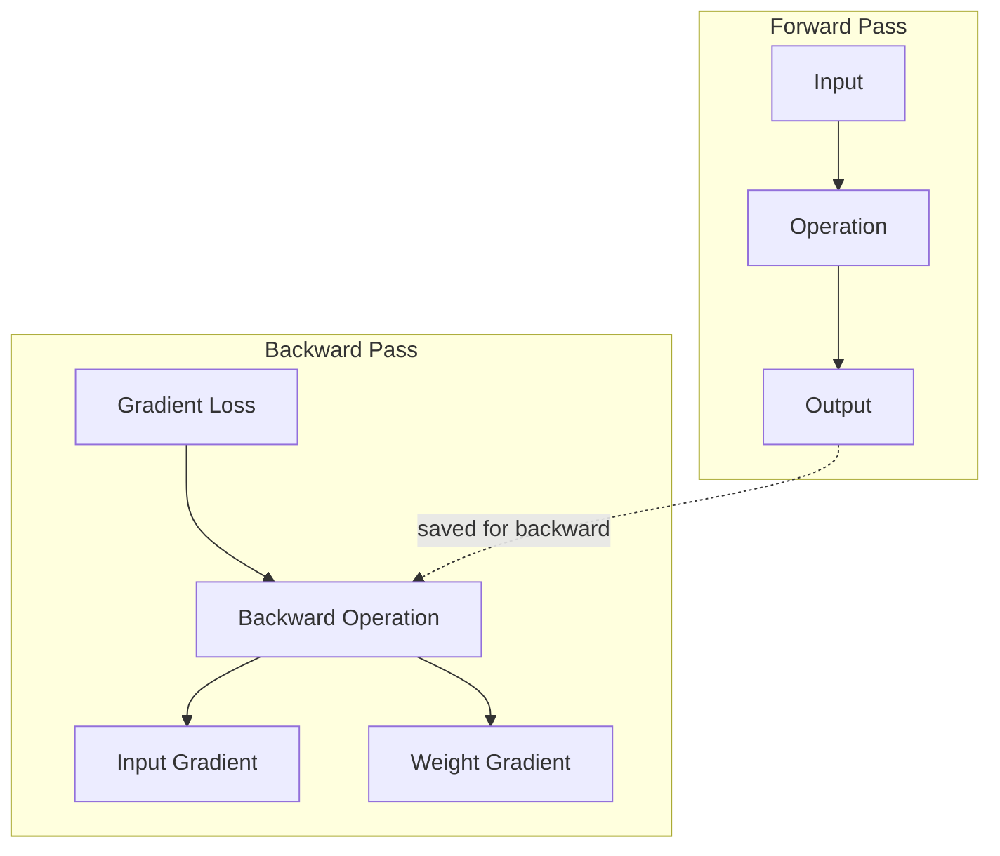

Used in:
- Convolution backward data/filter
- Layer normalization backward
- SDPA backward
- Training loop integration

## Handle and Context Management

All examples demonstrate proper handle lifecycle management:

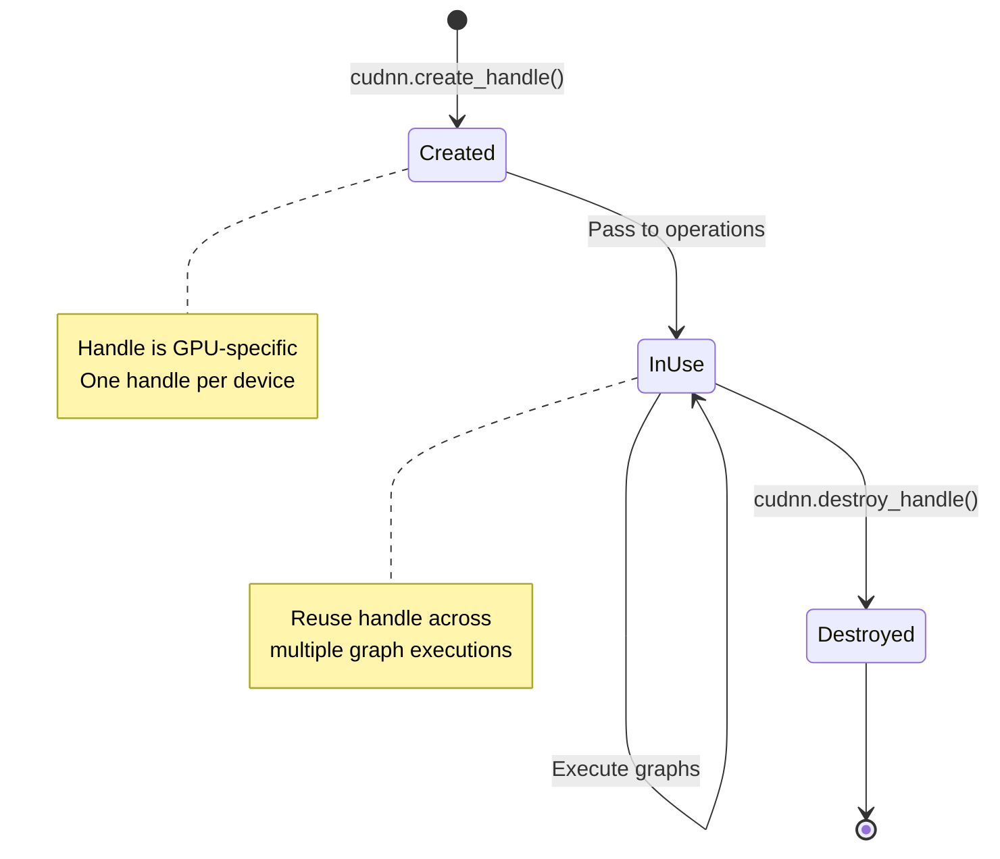

Key handle management principles demonstrated:
- Create once per GPU device
- Reuse across multiple graph executions
- Pass to `build()` and `execute()` calls
- Destroy when no longer needed

**Sources:** [samples/python/00_introduction.ipynb:105-106](), [samples/python/00_introduction.ipynb:428-429]()

## Data Type and Precision Examples

Examples cover multiple precision modes:

| Data Type | Constant | Use Case | Example Location |
|-----------|----------|----------|------------------|
| FP32 | `cudnn.data_type.FLOAT` | High precision compute | Compute type in mixed precision |
| FP16 | `cudnn.data_type.HALF` | Memory-efficient inference | I/O tensors in convolution |
| BF16 | `cudnn.data_type.BFLOAT16` | Training stability | Alternative to FP16 |
| FP8 E4M3 | `cudnn.data_type.FP8_E4M3` | Quantized inference | SDPA FP8 examples |
| FP8 E5M2 | `cudnn.data_type.FP8_E5M2` | Quantized gradients | FP8 backward passes |

The samples demonstrate mixed precision patterns where I/O uses FP16 but computation uses FP32 for numerical stability.

**Sources:** [samples/python/00_introduction.ipynb:149](), [samples/python/00_introduction.ipynb:237-238]()

## Tensor Layout Conventions

Examples demonstrate proper tensor layout handling:

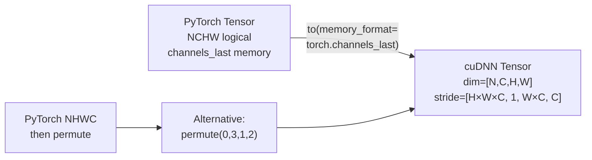

Key layout patterns:
- **Physical layout**: NHWC (channels last) for optimal performance
- **Logical layout**: NCHW for compatibility with cuDNN operations
- **Stride specification**: Explicit stride arrays define physical memory order
- **Verification**: Examples validate results against PyTorch reference implementations

**Sources:** [samples/python/00_introduction.ipynb:107-113](), [samples/python/00_introduction.ipynb:263-269](), [samples/python/00_introduction.ipynb:362-370]()

## Memory Management in Examples

Examples demonstrate three categories of tensor memory:

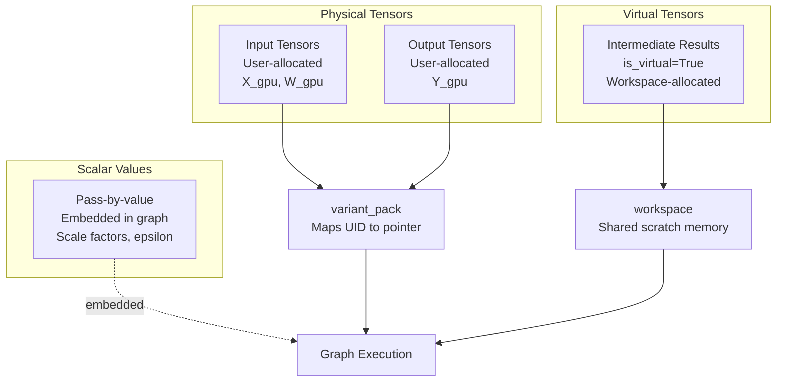

**Physical tensors** require explicit memory allocation and binding via `variant_pack`:
```python
X_gpu = torch.randn(8, 64, 56, 56, device="cuda", dtype=torch.float16)
variant_pack = {X: X_gpu, W: W_gpu, Y: Y_gpu}
```

**Virtual tensors** (intermediate results) are automatically managed via workspace:
```python
workspace = torch.empty(graph.get_workspace_size(), device="cuda", dtype=torch.uint8)
```

**Sources:** [samples/python/00_introduction.ipynb:362-392]()

## Validation and Verification Patterns

All examples include verification against reference implementations:

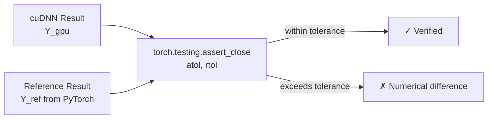

Typical verification pattern:
```python
Y_ref = torch.nn.functional.conv2d(X_gpu, W_gpu, padding=1)
torch.testing.assert_close(Y_gpu, Y_ref, atol=5e-3, rtol=3e-3)
```

The tolerance values (`atol`, `rtol`) account for:
- Mixed precision accumulation differences
- Algorithmic variations between implementations
- Non-deterministic parallel reduction ordering

**Sources:** [samples/python/00_introduction.ipynb:203-205](), [samples/python/00_introduction.ipynb:411-413]()

## Heuristic Mode Demonstration

Examples show different heuristic strategies for engine selection:

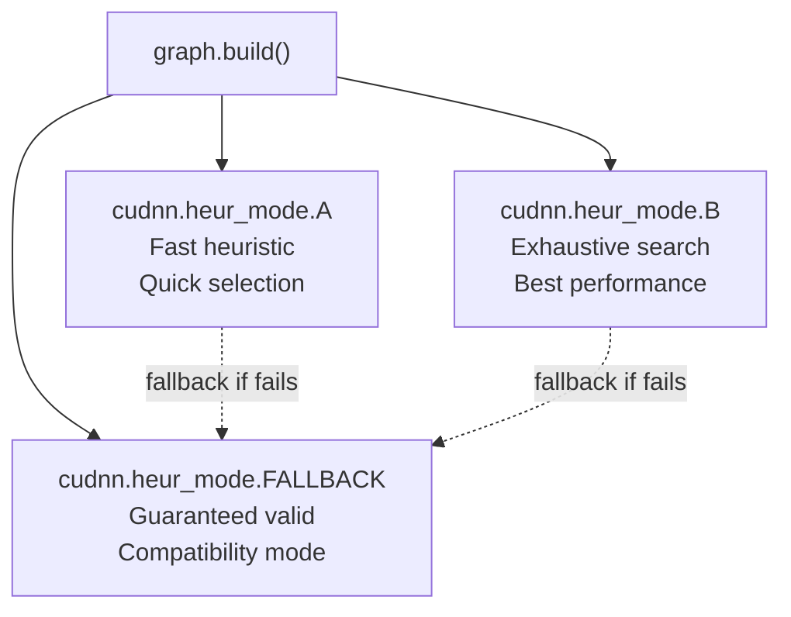

Example usage:
```python
graph.build([cudnn.heur_mode.A, cudnn.heur_mode.FALLBACK])
```

This specifies trying Mode A first, falling back to FALLBACK mode if no suitable engine is found. For more details on heuristic modes and engine selection, see [Heuristics & Engine Selection](#2.5).

**Sources:** [samples/python/00_introduction.ipynb:334]()

## Graph Building Phases

Examples demonstrate the complete graph lifecycle:

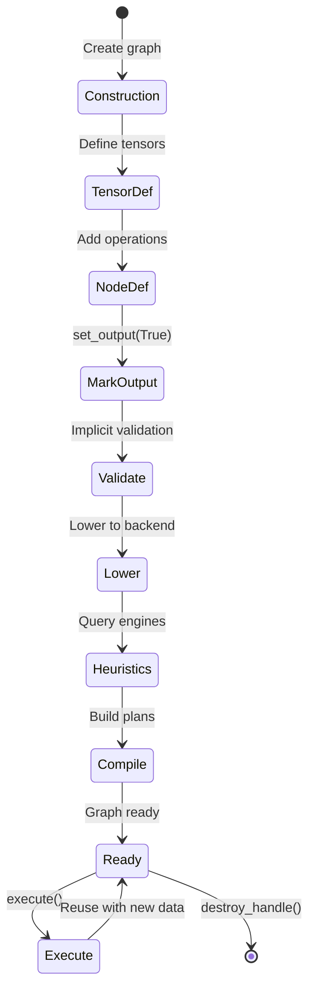

The `build()` call performs multiple phases:
1. **Validation**: Check tensor dimensions, data types, operation compatibility
2. **Shape Inference**: Deduce output shapes from input shapes
3. **Lowering**: Convert high-level nodes to backend operations
4. **Heuristics Query**: Retrieve candidate execution engines
5. **Plan Compilation**: Runtime compilation if needed

After building, the graph can be executed multiple times with different input data without rebuilding.

**Sources:** [samples/python/00_introduction.ipynb:334-351]()

## Example Code Entities

Key classes and functions demonstrated in examples:

| Entity | Type | Purpose | Example Usage |
|--------|------|---------|---------------|
| `cudnn.create_handle()` | Function | Create cuDNN context | `handle = cudnn.create_handle()` |
| `cudnn.Graph` | Class | High-level graph wrapper | Context manager for simplified API |
| `cudnn.pygraph` | Class | Low-level graph bindings | Direct frontend API access |
| `pygraph.tensor()` | Method | Create tensor descriptor | Define graph inputs/outputs |
| `pygraph.conv_fprop()` | Method | Convolution forward | Add conv operation to graph |
| `pygraph.build()` | Method | Finalize graph | Prepare for execution |
| `pygraph.execute()` | Method | Run graph | Launch kernels on GPU |
| `pygraph.get_workspace_size()` | Method | Query memory needs | Allocate workspace buffer |
| `cudnn.data_type` | Enum | Data type constants | `FLOAT`, `HALF`, `FP8_E4M3` |
| `cudnn.heur_mode` | Enum | Heuristic modes | `A`, `B`, `FALLBACK` |

**Sources:** [samples/python/00_introduction.ipynb:79-429]()

## Next Steps

For specific example walkthroughs:
- **C++ Examples** ([#6.1](#6.1)): Detailed documentation of C++ sample programs covering all operation types
- **Python Notebook Examples** ([#6.2](#6.2)): Interactive tutorials with step-by-step explanations
- **Benchmarking** ([#6.3](#6.3)): Performance measurement tools and methodology

For understanding the underlying concepts used in examples:
- **Graph API** ([#2.1](#2.1)): Complete API reference for graph construction
- **Tensor System** ([#2.2](#2.2)): Detailed tensor attribute documentation
- **Execution Plans** ([#2.4](#2.4)): Plan building and caching strategies

**Sources:** [README.md:68-72](), [samples/python/00_introduction.ipynb:1-439]()

---

