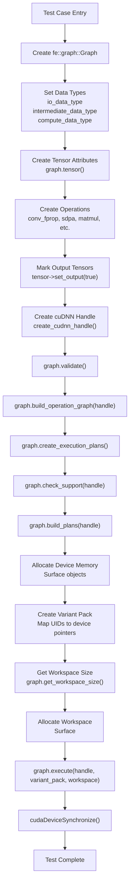
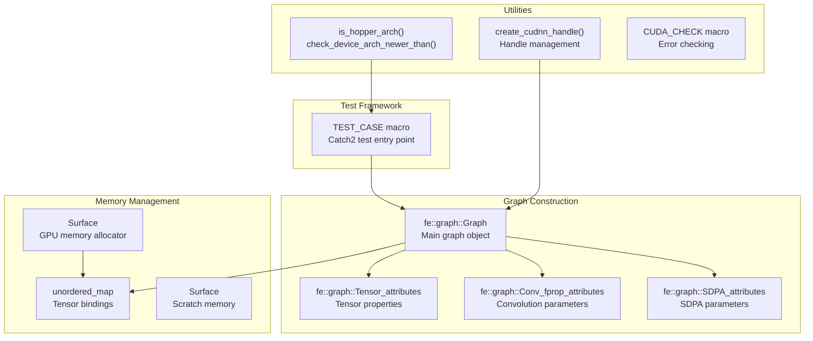
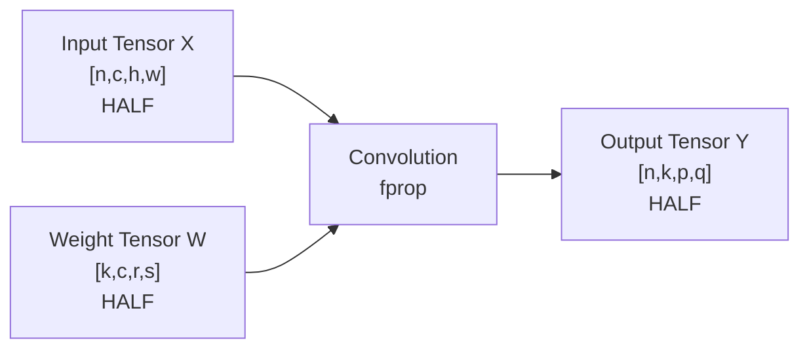
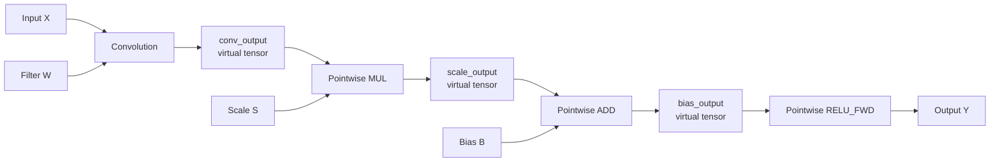
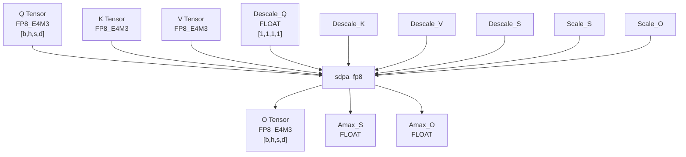

<!-- source: DeepWiki mcp.deepwiki.com · repo NVIDIA/cudnn-frontend · page 6.1 C++ Examples · fetched 2026-10-26 -->

# C++ Examples

<details>
<summary>Relevant source files</summary>

The following files were used as context for generating this wiki page:

- [include/cudnn_frontend/cudnn_interface.h](include/cudnn_frontend/cudnn_interface.h)
- [include/cudnn_frontend/graph_helpers.h](include/cudnn_frontend/graph_helpers.h)
- [include/cudnn_frontend/graph_interface.h](include/cudnn_frontend/graph_interface.h)
- [include/cudnn_frontend/node/sdpa_fp8_bwd.h](include/cudnn_frontend/node/sdpa_fp8_bwd.h)
- [include/cudnn_frontend_ConvDesc.h](include/cudnn_frontend_ConvDesc.h)
- [include/cudnn_frontend_OperationGraph.h](include/cudnn_frontend_OperationGraph.h)
- [include/cudnn_frontend_ReductionDesc.h](include/cudnn_frontend_ReductionDesc.h)
- [samples/cpp/convolution/fprop.cpp](samples/cpp/convolution/fprop.cpp)
- [samples/cpp/sdpa/fp16_fwd_with_custom_dropout.cpp](samples/cpp/sdpa/fp16_fwd_with_custom_dropout.cpp)
- [samples/cpp/sdpa/fp8_fwd.cpp](samples/cpp/sdpa/fp8_fwd.cpp)

</details>


This page documents the C++ sample programs provided in the cuDNN Frontend repository. These examples demonstrate practical usage patterns for various operations including convolution, SDPA (Scaled Dot-Product Attention), matmul, normalization, and other operations. The examples use the modern Graph API and showcase best practices for graph construction, execution, and optimization.

For Python examples, see [Python Notebook Examples](#6.2). For performance measurement scripts, see [Benchmarking](#6.3).

## Overview and Structure

The C++ examples are located in [samples/cpp/]() and organized by operation type. All examples use the Catch2 testing framework, allowing them to be compiled as executable tests that demonstrate both API usage and correctness validation. Each example is self-contained and demonstrates a complete workflow from graph construction through execution.

**Example Structure:**
```
samples/cpp/
├── convolution/
│   ├── fprop.cpp          # Forward propagation examples
│   ├── dgrad.cpp          # Data gradient (backward)
│   └── wgrad.cpp          # Weight gradient
├── sdpa/
│   ├── fp16_fwd.cpp       # FP16 forward SDPA
│   ├── fp8_fwd.cpp        # FP8 forward SDPA
│   ├── fp16_bwd.cpp       # FP16 backward SDPA
│   └── fp16_fwd_with_custom_dropout.cpp
├── matmul/
├── normalization/
└── utils/
    └── helpers.h          # Shared utilities
```

Sources: [samples/cpp/sdpa/fp8_fwd.cpp:1-158](), [samples/cpp/convolution/fprop.cpp:1-90]()

## Common Example Workflow

All C++ examples follow a consistent pattern for graph construction and execution. This workflow ensures proper resource management and error checking at each stage.



**Workflow Stages:**

| Stage | Purpose | Key Methods |
|-------|---------|-------------|
| Graph Construction | Create graph object and set global properties | `Graph()`, `set_io_data_type()`, `set_compute_data_type()` |
| Tensor Definition | Define input/output tensors with dimensions | `graph.tensor()`, `Tensor_attributes()` |
| Operation Creation | Add operations to the graph | `conv_fprop()`, `sdpa()`, `matmul()`, `pointwise()` |
| Validation | Check graph consistency | `validate()` |
| Build Operation Graph | Lower graph to backend operations | `build_operation_graph(handle)` |
| Plan Selection | Query heuristics and select execution plan | `create_execution_plans()`, `check_support()`, `build_plans()` |
| Execution | Execute graph with actual data | `execute(handle, variant_pack, workspace)` |

Sources: [samples/cpp/sdpa/fp8_fwd.cpp:31-158](), [samples/cpp/convolution/fprop.cpp:28-90]()

## Key Code Entities and Their Roles



Sources: [samples/cpp/sdpa/fp8_fwd.cpp:31-100](), [samples/cpp/convolution/fprop.cpp:37-68](), [samples/cpp/utils/helpers.h]()

## Convolution Examples

The convolution examples in [samples/cpp/convolution/fprop.cpp]() demonstrate various convolution patterns including basic forward propagation, dynamic shapes, fusion with element-wise operations, and graph caching.

### Basic Convolution Forward Propagation

The simplest example shows a standard convolution operation:



**Key Code Pattern:**
1. Create input and weight tensors with `graph.tensor(Tensor_attributes())`
2. Specify convolution parameters: `Conv_fprop_attributes().set_padding().set_stride().set_dilation()`
3. Create convolution operation: `auto Y = graph.conv_fprop(X, W, conv_options)`
4. Mark output: `Y->set_output(true)`

Sources: [samples/cpp/convolution/fprop.cpp:28-90]()

### Convolution with Fusion (CSBR Pattern)

The CSBR (Convolution-Scale-Bias-ReLU) example demonstrates operation fusion for improved performance:



**Virtual Tensors:** Intermediate tensors (conv_output, scale_output, bias_output) are not materialized in memory; they exist only within the fused operation.

Sources: [samples/cpp/convolution/fprop.cpp:214-325]()

### Dynamic Shape Convolution

Examples at [samples/cpp/convolution/fprop.cpp:92-212]() demonstrate dynamic shape support (cuDNN 9.4+) where multiple graphs with different shapes share a kernel cache:

**Key Features:**
- `graph->set_dynamic_shape_enabled(true)` enables dynamic shape support
- `graph->set_kernel_cache(kernel_cache)` shares compiled kernels across graphs
- Requires CUDA 12.0+ and cuDNN 9.4+

```cpp
auto kernel_cache = std::make_shared<fe::KernelCache>();
// Build multiple graphs with different shapes
graph->set_dynamic_shape_enabled(true)
     .set_kernel_cache(kernel_cache);
```

Sources: [samples/cpp/convolution/fprop.cpp:92-212](), [samples/cpp/convolution/fprop.cpp:327-454]()

### Graph Caching Pattern

The examples demonstrate user-side graph caching to avoid rebuilding identical graphs:

```cpp
std::unordered_map<std::size_t, graph_and_tensors> user_maintained_cache;

auto key = graph->key();  // Compute graph hash
auto it = user_maintained_cache.find(key);
if (it != user_maintained_cache.end()) {
    // Cache hit - reuse existing graph
    return it->second;
}
// Cache miss - build and insert
user_maintained_cache.insert({key, std::make_tuple(graph, X, W, S, B, Y)});
```

Sources: [samples/cpp/convolution/fprop.cpp:214-325]()

## SDPA (Scaled Dot-Product Attention) Examples

SDPA examples demonstrate attention mechanisms in various precision modes and configurations.

### FP8 Forward SDPA

The FP8 example at [samples/cpp/sdpa/fp8_fwd.cpp]() shows Flash Attention with 8-bit floating point precision:



**FP8 Scaling Tensors:**
- `Descale_*`: Convert FP8 inputs to internal precision
- `Scale_*`: Convert internal precision to FP8 outputs
- `Amax_*`: Track maximum absolute values for scaling

**Requirements:**
- Hopper or Blackwell architecture
- cuDNN 9.1.0+
- CUDA 12.0+

Sources: [samples/cpp/sdpa/fp8_fwd.cpp:31-158]()

### Custom Dropout Mask Example

The example at [samples/cpp/sdpa/fp16_fwd_with_custom_dropout.cpp]() demonstrates providing a pre-computed dropout mask:

**Key Pattern:**
1. Create dropout mask tensor with dimensions `[b, h_q, s_q, s_kv]`
2. Create dropout scale as pass-by-value tensor
3. Pass both to SDPA: `sdpa_options.set_dropout(dropout_scale, dropout_mask)`

```cpp
auto dropout_scale = graph->tensor(Tensor_attributes()
    .set_is_pass_by_value(true)
    .set_data_type(fe::DataType_t::FLOAT));

auto dropout_mask = graph->tensor(Tensor_attributes()
    .set_dim({b, h_q, s_q, s_kv})
    .set_data_type(fe::DataType_t::BFLOAT16));

sdpa_options.set_dropout(dropout_scale, dropout_mask);
```

Sources: [samples/cpp/sdpa/fp16_fwd_with_custom_dropout.cpp:48-131]()

### SDPA Configuration Options

| Option | Method | Description |
|--------|--------|-------------|
| Attention Scale | `.set_attn_scale(float)` | Scaling factor for QK^T |
| Causal Mask | `.set_causal_mask(bool)` | Enable causal (autoregressive) masking |
| Generate Stats | `.set_generate_stats(bool)` | Output softmax statistics for backward pass |
| Bias | `.set_bias(tensor)` | Additive attention bias |
| Dropout | `.set_dropout(scale, mask)` | Dropout configuration |
| Padding Mask | `.set_padding_mask(bool)` | Variable sequence length masking |

Sources: [samples/cpp/sdpa/fp16_fwd_with_custom_dropout.cpp:84-118]()

## Memory Management in Examples

All examples use consistent patterns for GPU memory allocation and binding:

### Surface Utility Class

The `Surface<T>` template class (defined in [samples/cpp/utils/helpers.h]()) provides RAII-style GPU memory management:

```cpp
Surface<half> q_tensor(b * h * s * d, false);  // Allocate device memory
// q_tensor.devPtr contains device pointer
// Automatically freed when Surface goes out of scope
```

### Variant Pack Construction

Two patterns for creating variant packs:

**Pattern 1: Using Tensor UIDs**
```cpp
std::unordered_map<int64_t, void*> variant_pack = {
    {Q_UID, q_tensor.devPtr},
    {K_UID, k_tensor.devPtr},
    {O_UID, o_tensor.devPtr}
};
```

**Pattern 2: Using Tensor Shared Pointers**
```cpp
std::unordered_map<std::shared_ptr<fe::graph::Tensor_attributes>, void*> variant_pack = {
    {Q, q_tensor.devPtr},
    {W, w_tensor.devPtr},
    {Y, y_tensor.devPtr}
};
```

Sources: [samples/cpp/sdpa/fp8_fwd.cpp:116-144](), [samples/cpp/convolution/fprop.cpp:76-86]()

### Workspace Management

```cpp
int64_t workspace_size = 0;
REQUIRE(graph->get_workspace_size(workspace_size).is_good());
Surface<int8_t> workspace(workspace_size, false);

// Pass to execute
graph->execute(handle, variant_pack, workspace.devPtr);
```

Sources: [samples/cpp/sdpa/fp8_fwd.cpp:151-155](), [samples/cpp/convolution/fprop.cpp:83-89]()

## Error Checking Patterns

Examples demonstrate robust error checking:

```cpp
// Check cuDNN version
if (cudnnGetVersion() < 8903) {
    SKIP("Test requires cudnn 8.9.3 or above");
}

// Check architecture
if (!is_hopper_arch() && !is_blackwell_computing_arch()) {
    SKIP("sdpa fp8: Sample requires Hopper or Blackwell Computing GPU");
}

// Check operation support
auto status = graph->validate();
if (status.is_bad()) {
    // Handle validation error
}

REQUIRE(graph->build_operation_graph(handle).is_good());
REQUIRE(graph->create_execution_plans({fe::HeurMode_t::A}).is_good());
REQUIRE(graph->check_support(handle).is_good());
```

Sources: [samples/cpp/sdpa/fp8_fwd.cpp:34-42](), [samples/cpp/convolution/fprop.cpp:57-65]()

## Building and Running Examples

Examples are built as part of the main CMake build:

```bash
# Build all samples
mkdir build && cd build
cmake ..
make

# Run specific test
./bin/samples "Convolution fprop"
./bin/samples "sdpa_fp8_fprop"

# Run all tests
./bin/samples
```

The Catch2 framework allows filtering tests by name, tag, or pattern. Each `TEST_CASE` macro defines a test with name and tags:

```cpp
TEST_CASE("Convolution fprop", "[conv][graph][caching]")
TEST_CASE("sdpa_fp8_fprop", "[graph][sdpa][fp8][forward]")
```

Sources: [samples/cpp/sdpa/fp8_fwd.cpp:31](), [samples/cpp/convolution/fprop.cpp:28]()

## Common Helper Functions

Examples use utility functions from [samples/cpp/utils/helpers.h]():

| Function | Purpose |
|----------|---------|
| `create_cudnn_handle()` | Create and manage cuDNN handle |
| `is_arch_supported_by_cudnn()` | Check architecture compatibility |
| `is_hopper_arch()` | Check for Hopper GPU |
| `is_ampere_arch()` | Check for Ampere GPU |
| `check_device_arch_newer_than(arch)` | Compare GPU architecture |
| `Surface<T>` | RAII GPU memory allocation |
| `CUDA_CHECK(expr)` | CUDA error checking macro |

Sources: [samples/cpp/sdpa/fp8_fwd.cpp:99](), [samples/cpp/convolution/fprop.cpp:31]()

## Example Categories Reference

The following table summarizes available C++ examples by operation type:

| Category | Example Files | Operations Demonstrated |
|----------|--------------|------------------------|
| Convolution | `convolution/fprop.cpp` | Forward propagation, CSBR fusion, dynamic shapes, caching |
| Convolution | `convolution/dgrad.cpp` | Data gradient (backward propagation) |
| Convolution | `convolution/wgrad.cpp` | Weight gradient |
| SDPA | `sdpa/fp16_fwd.cpp` | FP16 forward attention |
| SDPA | `sdpa/fp8_fwd.cpp` | FP8 forward attention with scaling |
| SDPA | `sdpa/fp16_bwd.cpp` | FP16 backward attention |
| SDPA | `sdpa/fp16_fwd_with_custom_dropout.cpp` | Custom dropout masks |
| Matmul | `matmul/*.cpp` | Matrix multiplication variants |
| Normalization | `normalization/*.cpp` | Layer norm, batch norm, RMS norm |

Sources: [samples/cpp/sdpa/fp8_fwd.cpp:1-158](), [samples/cpp/convolution/fprop.cpp:1-555](), [samples/cpp/sdpa/fp16_fwd_with_custom_dropout.cpp:1-199]()

---

