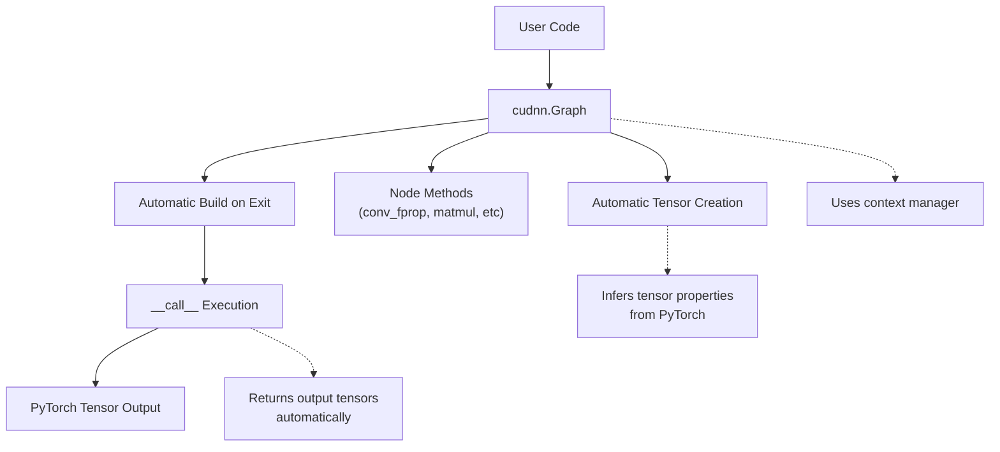
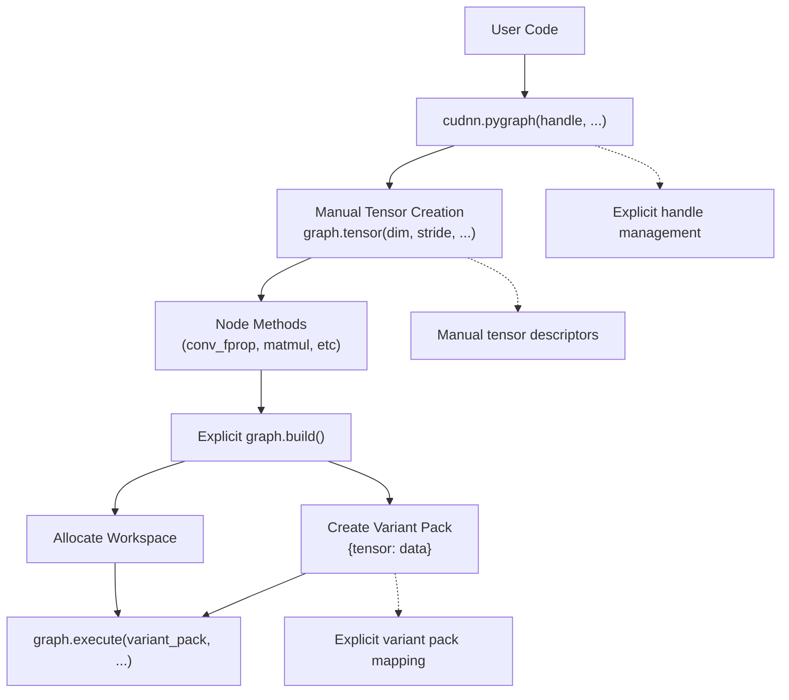
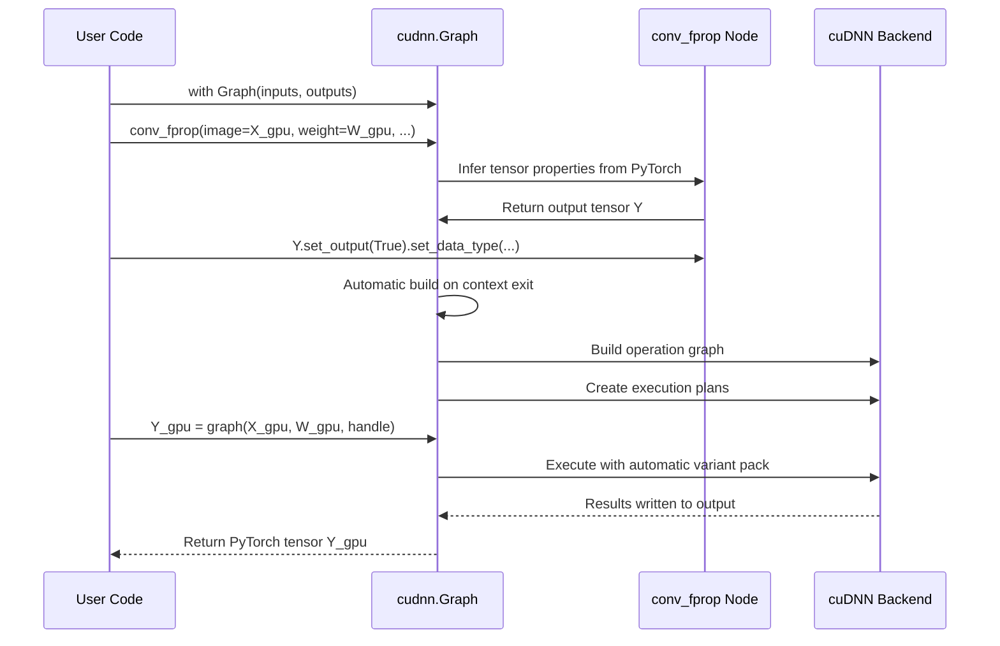
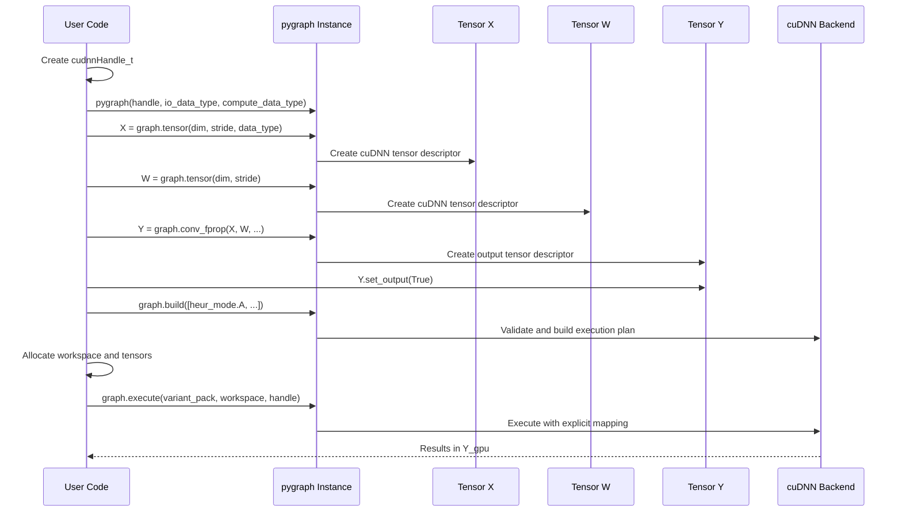
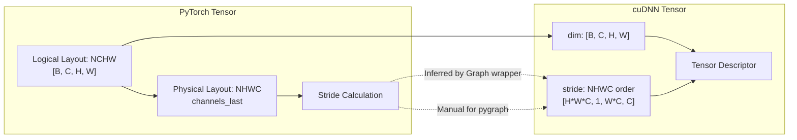
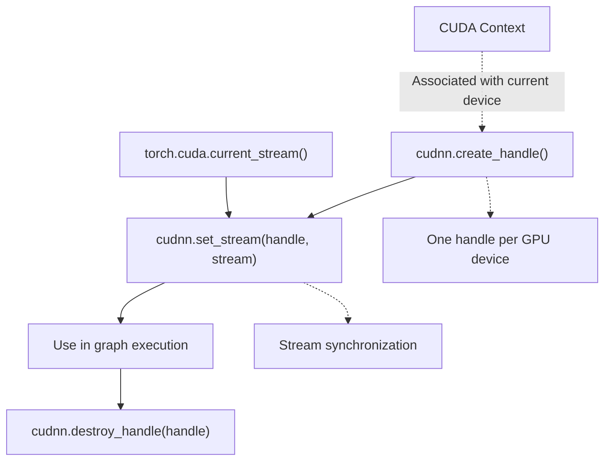
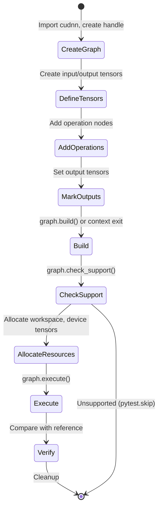
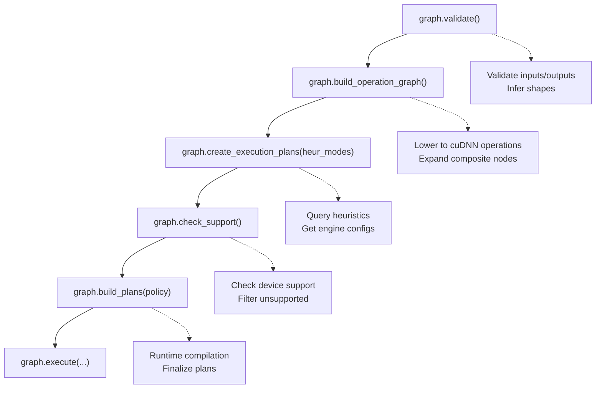

<!-- source: DeepWiki mcp.deepwiki.com · repo NVIDIA/cudnn-frontend · page 6.2 Python Notebook Examples · fetched 2026-10-26 -->

# Python Notebook Examples

<details>
<summary>Relevant source files</summary>

The following files were used as context for generating this wiki page:

- [cmake/cuDNN.cmake](cmake/cuDNN.cmake)
- [include/cudnn_frontend/graph_properties.h](include/cudnn_frontend/graph_properties.h)
- [python/pygraph/pygraph.h](python/pygraph/pygraph.h)
- [samples/cpp/CMakeLists.txt](samples/cpp/CMakeLists.txt)
- [samples/python/00_introduction.ipynb](samples/python/00_introduction.ipynb)
- [test/python/test_matmul_bias_relu.py](test/python/test_matmul_bias_relu.py)

</details>


This document provides walkthroughs of the Jupyter notebook examples in the `samples/python/` directory that demonstrate cuDNN Frontend Python API usage. The notebooks illustrate graph construction, operation chaining, integration with PyTorch, and various advanced features like SDPA, serialization, and mixed precision. For C++ examples, see [C++ Examples](#6.1). For performance benchmarking scripts, see [Benchmarking](#6.3).

## Overview

The cuDNN Frontend provides Python notebook examples demonstrating both the high-level `Graph` wrapper API and the lower-level `pygraph` bindings. These notebooks serve as interactive tutorials for understanding how to construct computational graphs, execute them on GPU, and integrate with deep learning frameworks like PyTorch.

**Key Notebooks:**

| Notebook | Purpose | Key Features Demonstrated |
|----------|---------|---------------------------|
| `00_introduction.ipynb` | Introduction to cuDNN FE Python API | Graph wrapper, pygraph bindings, convolution |
| SDPA notebooks | Attention mechanism variants | Forward/backward SDPA, FP8, masking, dropout |
| Serialization notebooks | Graph persistence | JSON serialization, deserialization, caching |
| Integration notebooks | Framework interop | PyTorch tensor integration, DLPack support |

Sources: [samples/python/00_introduction.ipynb:1-440]()

## Two API Approaches

The Python interface provides two ways to construct and execute graphs, each with different levels of abstraction and control.

### High-Level Graph Wrapper



The `Graph` wrapper provides a simplified interface using Python context managers:

**Key Characteristics:**
- Uses `with cudnn.Graph()` context manager for automatic finalization
- Accepts PyTorch tensors as arguments to infer tensor properties
- Automatically creates cuDNN tensor descriptors from PyTorch metadata
- Returns PyTorch tensors directly from `__call__` execution
- Handles workspace allocation internally

**Typical Usage Pattern:**
1. Create `Graph` with input/output name tuples
2. Pass PyTorch tensors to operation methods (for property inference)
3. Mark outputs using `set_output(True)`
4. Execute by calling graph as function with actual data

Sources: [samples/python/00_introduction.ipynb:139-154](), [samples/python/00_introduction.ipynb:181-184]()

### Low-Level pygraph Bindings



The `pygraph` class provides direct access to the underlying C++ Graph API through pybind11 bindings:

**Key Characteristics:**
- Requires explicit `cudnnHandle_t` creation and management
- Tensors must be created using `graph.tensor()` with explicit dimensions/strides
- Manual control over build phases (validate, build_operation_graph, create_execution_plans, build_plans)
- Requires explicit variant pack dictionary mapping cuDNN tensors to device pointers
- Manual workspace allocation and size querying

**Typical Usage Pattern:**
1. Create handle with `cudnn.create_handle()`
2. Create `pygraph` instance with configuration
3. Create cuDNN tensors with explicit properties
4. Build graph with `graph.build()` or phase-by-phase
5. Allocate workspace based on `graph.get_workspace_size()`
6. Create variant pack mapping tensors to device data
7. Execute with `graph.execute(variant_pack, workspace, handle)`
8. Destroy handle with `cudnn.destroy_handle(handle)`

Sources: [samples/python/00_introduction.ipynb:234-240](), [samples/python/00_introduction.ipynb:263-270](), [samples/python/00_introduction.ipynb:388-391]()

## Convolution Example Walkthrough

The introduction notebook demonstrates both API approaches for a basic convolution operation.

### Graph Wrapper Approach



**Input Setup:**
- Image tensor: `[8, 64, 56, 56]` in NCHW logical format, NHWC physical layout (channels_last)
- Weight tensor: `[32, 64, 3, 3]` in NCHW logical format, NHWC physical layout
- Data type: `torch.float16` (FP16)

**Graph Construction:**
```python
with cudnn.Graph(
    inputs=["conv2d::image", "conv2d::weight"],
    outputs=["conv_out"],
) as graph:
    Y = graph.conv_fprop(
        image=X_gpu,  # PyTorch tensor for property inference
        weight=W_gpu,
        padding=[1, 1],
        stride=[1, 1],
        dilation=[1, 1],
        compute_data_type=cudnn.data_type.FLOAT,
        name="conv2d",
    )
    Y.set_output(True).set_data_type(cudnn.data_type.HALF).set_name("conv_out")
```

**Execution:**
```python
Y_gpu = graph(X_gpu, W_gpu, handle=handle)
```

Sources: [samples/python/00_introduction.ipynb:139-154](), [samples/python/00_introduction.ipynb:181-184]()

### pygraph Approach



**Manual Tensor Creation:**
```python
X = graph.tensor(
    name="X",
    dim=[8, 64, 56, 56],
    stride=[56 * 56 * 64, 1, 56 * 64, 64],  # NHWC strides
    data_type=cudnn.data_type.HALF,
)
W = graph.tensor(
    name="W",
    dim=[32, 64, 3, 3],
    stride=[3 * 3 * 64, 1, 3 * 64, 64],  # NHWC strides
)
```

**Operation and Build:**
```python
Y = graph.conv_fprop(
    X, W,
    padding=[1, 1],
    stride=[1, 1],
    dilation=[1, 1],
    compute_data_type=cudnn.data_type.FLOAT,
)
Y.set_output(True)
graph.build([cudnn.heur_mode.A, cudnn.heur_mode.FALLBACK])
```

**Execution with Variant Pack:**
```python
workspace = torch.empty(graph.get_workspace_size(), device="cuda", dtype=torch.uint8)
variant_pack = {X: X_gpu, W: W_gpu, Y: Y_gpu}
graph.execute(variant_pack, workspace, handle=handle)
```

Sources: [samples/python/00_introduction.ipynb:263-270](), [samples/python/00_introduction.ipynb:289-297](), [samples/python/00_introduction.ipynb:388-391]()

## PyTorch Integration Patterns

### Tensor Layout Compatibility



cuDNN expects tensors in NHWC physical layout for convolution operations. PyTorch supports this through `channels_last` memory format:

**Creating Compatible Tensors:**
```python
# Method 1: Create in NHWC then permute view
X_gpu = torch.randn(8, 56, 56, 64, device=device, dtype=torch.float16).permute(0, 3, 1, 2)

# Method 2: Create in NCHW then convert to channels_last
X_gpu = torch.randn(8, 64, 56, 56, device=device, dtype=torch.float16)
X_gpu = X_gpu.to(memory_format=torch.channels_last)
```

**Stride Calculation for NHWC:**
- For tensor with shape `[N, C, H, W]`
- NHWC stride: `[H * W * C, 1, W * C, C]`
- Example: `[8, 64, 56, 56]` → stride `[200704, 1, 3584, 64]`

Sources: [samples/python/00_introduction.ipynb:108-113](), [samples/python/00_introduction.ipynb:362-370]()

### Data Type Mapping

| PyTorch Type | cuDNN Type | Usage |
|--------------|------------|-------|
| `torch.float32` | `cudnn.data_type.FLOAT` | Standard precision |
| `torch.float16` | `cudnn.data_type.HALF` | Mixed precision, Tensor Cores |
| `torch.bfloat16` | `cudnn.data_type.BFLOAT16` | Mixed precision, wider dynamic range |
| `torch.int8` | `cudnn.data_type.INT8` | Quantized inference |
| `torch.int32` | `cudnn.data_type.INT32` | Integer computations |
| `torch.bool` | `cudnn.data_type.BOOLEAN` | Masks |
| `torch.uint8` | `cudnn.data_type.UINT8` | Workspace, masks |

Sources: [test/python/test_matmul_bias_relu.py:10-24]()

### Handle Management



**Handle Lifecycle:**
```python
# Create handle for current CUDA device
handle = cudnn.create_handle()

# Associate with PyTorch CUDA stream
stream = torch.cuda.current_stream().cuda_stream
cudnn.set_stream(handle=handle, stream=stream)

# Use in graph execution
graph.execute(..., handle=handle)

# Clean up
cudnn.destroy_handle(handle)
```

The handle:
- Must be created on the active CUDA device
- Associates graph execution with a CUDA stream for proper synchronization
- Multiple handles can exist for the same device
- Should be destroyed when no longer needed

Sources: [samples/python/00_introduction.ipynb:105-106](), [test/python/test_matmul_bias_relu.py:59-60]()

## Common Notebook Patterns

### Graph Build and Execution Pattern



**Complete Example Pattern:**

```python
# 1. Setup
import cudnn
import torch
handle = cudnn.create_handle()
stream = torch.cuda.current_stream().cuda_stream
cudnn.set_stream(handle=handle, stream=stream)

# 2. Graph construction
graph = cudnn.pygraph(handle=handle)
X = graph.tensor_like(X_gpu)  # or graph.tensor(dim, stride, ...)
Y = graph.some_operation(X, ...)
Y.set_output(True)

# 3. Build
graph.validate()
graph.build_operation_graph()
try:
    graph.create_execution_plans([cudnn.heur_mode.A, cudnn.heur_mode.FALLBACK])
    graph.check_support()
except cudnn.cudnnGraphNotSupportedError:
    pytest.skip("Unsupported graph")
graph.build_plans(cudnn.build_plan_policy.HEURISTICS_CHOICE)

# 4. Execute
workspace = torch.empty(graph.get_workspace_size(), device="cuda", dtype=torch.uint8)
graph.execute({X: X_gpu, Y: Y_gpu}, workspace, handle=handle)
torch.cuda.synchronize()

# 5. Verify
torch.testing.assert_close(Y_gpu, Y_expected, atol=..., rtol=...)

# 6. Cleanup
cudnn.destroy_handle(handle)
```

Sources: [test/python/test_matmul_bias_relu.py:59-103]()

### Error Handling Pattern

```python
# Check cuDNN version
if LooseVersion(cudnn.backend_version_string()) < "8.9.6":
    pytest.skip("requires cudnn 8.9.6 or higher")

# Check device capability
if torch.cuda.get_device_capability()[0] < 9:
    pytest.skip("requires Hopper or newer arch")

# Check graph support
try:
    graph.create_execution_plans([cudnn.heur_mode.A, cudnn.heur_mode.FALLBACK])
    graph.check_support()
except cudnn.cudnnGraphNotSupportedError as e:
    print(f"TEST WAIVED: unsupported graph. {e}")
    pytest.skip("TEST WAIVED: unsupported graph.")
```

Sources: [test/python/test_matmul_bias_relu.py:32-38](), [test/python/test_matmul_bias_relu.py:82-87]()

### Mixed Precision Pattern

```python
# Create graph with different data types
graph = cudnn.pygraph(
    handle=handle,
    io_data_type=cudnn.data_type.HALF,           # I/O in FP16
    intermediate_data_type=cudnn.data_type.FLOAT, # Intermediates in FP32
    compute_data_type=cudnn.data_type.FLOAT,     # Compute in FP32
)

# Create tensors with specific types
A = graph.tensor(..., data_type=cudnn.data_type.INT8)  # Input in INT8
A_casted = graph.identity(input=A, compute_data_type=cudnn.data_type.FLOAT)
A_casted.set_data_type(cudnn.data_type.BFLOAT16)  # Cast to BF16

# Perform operation
C = graph.matmul(A=A_casted, B=B, compute_data_type=cudnn.data_type.FLOAT)
C.set_output(True).set_data_type(cudnn.data_type.BFLOAT16)
```

Sources: [test/python/test_matmul_bias_relu.py:41-103](), [test/python/test_matmul_bias_relu.py:175-198]()

## PyGraph Method Reference

The `PyGraph` class exposes operation creation methods corresponding to cuDNN operations:

### Tensor Creation

| Method | Purpose | Returns |
|--------|---------|---------|
| `tensor(dim, stride, data_type, ...)` | Create tensor descriptor with explicit properties | `Tensor_attributes` |
| `tensor_like(pyobj)` | Create tensor from PyTorch tensor properties | `Tensor_attributes` |

### Convolution Operations

| Method | Operation | Key Parameters |
|--------|-----------|----------------|
| `conv_fprop(image, weight, ...)` | Forward convolution | `padding`, `stride`, `dilation`, `compute_data_type` |
| `conv_dgrad(loss, filter, ...)` | Data gradient | `padding`, `stride`, `dilation` |
| `conv_wgrad(image, loss, ...)` | Weight gradient | `padding`, `stride`, `dilation` |

### Matrix Operations

| Method | Operation | Key Parameters |
|--------|-----------|----------------|
| `matmul(A, B, ...)` | Matrix multiplication | `compute_data_type`, `padding` |

### Normalization Operations

| Method | Operation | Outputs |
|--------|-----------|---------|
| `layernorm(forward_phase, x, scale, bias, epsilon, ...)` | Layer normalization forward | `[Y, mean, inv_variance]` |
| `layernorm_backward(dy, x, scale, mean, inv_variance, ...)` | Layer normalization backward | `[dX, dscale, dbias]` |
| `batchnorm(...)` | Batch normalization | Multiple outputs including running stats |

### Attention Operations

| Method | Operation | Outputs |
|--------|-----------|---------|
| `sdpa(q, k, v, ...)` | Scaled dot-product attention forward | `[O, stats]` |
| `sdpa_backward(q, k, v, o, dO, stats, ...)` | SDPA backward | `[dQ, dK, dV]` |
| `sdpa_fp8(...)` | FP8 SDPA forward | `[O, stats, amax_s, amax_o]` |
| `sdpa_fp8_backward(...)` | FP8 SDPA backward | `[dQ, dK, dV, amax_dQ, amax_dK, amax_dV, amax_dP]` |

### Pointwise Operations

| Method | Operation |
|--------|-----------|
| `relu(input, ...)` | ReLU activation |
| `leaky_relu(input, negative_slope, ...)` | Leaky ReLU |
| `swish(input, ...)` | Swish activation |
| `add(a, b, ...)` | Element-wise addition |
| `mul(a, b, ...)` | Element-wise multiplication |
| `sub(a, b, ...)` | Element-wise subtraction |
| `div(a, b, ...)` | Element-wise division |

### Utility Operations

| Method | Operation | Purpose |
|--------|-----------|---------|
| `reduction(input, mode, ...)` | Reduce tensor | Sum, max, min, etc. |
| `reshape(input, ...)` | Reshape tensor | Change dimensions |
| `slice(input, slices, ...)` | Slice tensor | Extract sub-tensor |

Sources: [python/pygraph/pygraph.h:109-492]()

## Graph Build Phases

The `pygraph` API allows fine-grained control over graph compilation:



**Phase-by-Phase Build:**

```python
# Phase 1: Validate
graph.validate()  # Check tensor compatibility, infer shapes

# Phase 2: Build operation graph
graph.build_operation_graph()  # Lower to cuDNN operations

# Phase 3: Create execution plans
graph.create_execution_plans([cudnn.heur_mode.A, cudnn.heur_mode.FALLBACK])
# Query heuristics, generate candidate engine configs

# Phase 4: Check support
graph.check_support()  # Verify device support, may throw cudnnGraphNotSupportedError

# Phase 5: Build plans
graph.build_plans(cudnn.build_plan_policy.HEURISTICS_CHOICE)
# Runtime compilation, select best plan

# Alternative: Combined build
graph.build([cudnn.heur_mode.A, cudnn.heur_mode.FALLBACK])
# Performs all phases in sequence
```

**Heuristic Modes:**
- `cudnn.heur_mode.A`: Fast heuristic mode
- `cudnn.heur_mode.B`: Exhaustive search mode
- `cudnn.heur_mode.FALLBACK`: Guaranteed fallback mode

**Build Policies:**
- `cudnn.build_plan_policy.HEURISTICS_CHOICE`: Use heuristics
- `cudnn.build_plan_policy.ALL`: Build all plans (for autotuning)

Sources: [samples/python/00_introduction.ipynb:334-336](), [test/python/test_matmul_bias_relu.py:79-89]()

## Running Notebooks

### Prerequisites

```bash
# Install cuDNN Python package
pip install nvidia-cudnn-cu12

# Install cuDNN Frontend
pip install nvidia-cudnn-frontend

# Install PyTorch (with CUDA support)
pip3 install torch --index-url https://download.pytorch.org/whl/nightly/cu128
```

### Execution Environment

**Local Jupyter:**
```bash
jupyter notebook samples/python/00_introduction.ipynb
```

**Google Colab:**
- Notebooks include Colab badge links for one-click execution
- Automatically installs dependencies in Colab environment
- Requires GPU runtime (Runtime → Change runtime type → GPU)

**Verification:**
```python
# Check GPU availability
import torch
assert torch.cuda.is_available()

# Check cuDNN version
import cudnn
print(cudnn.backend_version_string())  # e.g., "9.0.0"
```

Sources: [samples/python/00_introduction.ipynb:29-30](), [samples/python/00_introduction.ipynb:54-56]()

## Key Takeaways

1. **Two API Levels**: Use `Graph` wrapper for simplicity, `pygraph` for fine control
2. **Tensor Layout**: cuDNN requires NHWC physical layout for convolutions
3. **Handle Management**: Create one handle per device, associate with CUDA stream
4. **Build Phases**: Validate → Build ops → Create plans → Check support → Build plans → Execute
5. **PyTorch Integration**: Use `tensor_like()` for automatic property inference
6. **Error Handling**: Always check version requirements and catch `cudnnGraphNotSupportedError`
7. **Workspace**: Allocate workspace of size `graph.get_workspace_size()` before execution

Sources: [samples/python/00_introduction.ipynb:1-440](), [test/python/test_matmul_bias_relu.py:1-328]()

---

