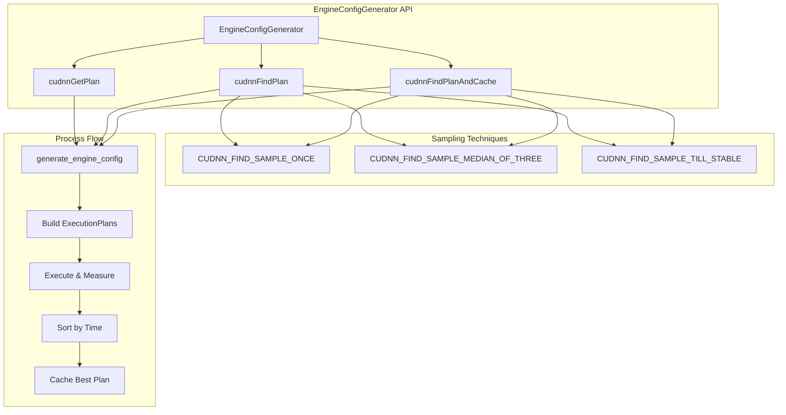
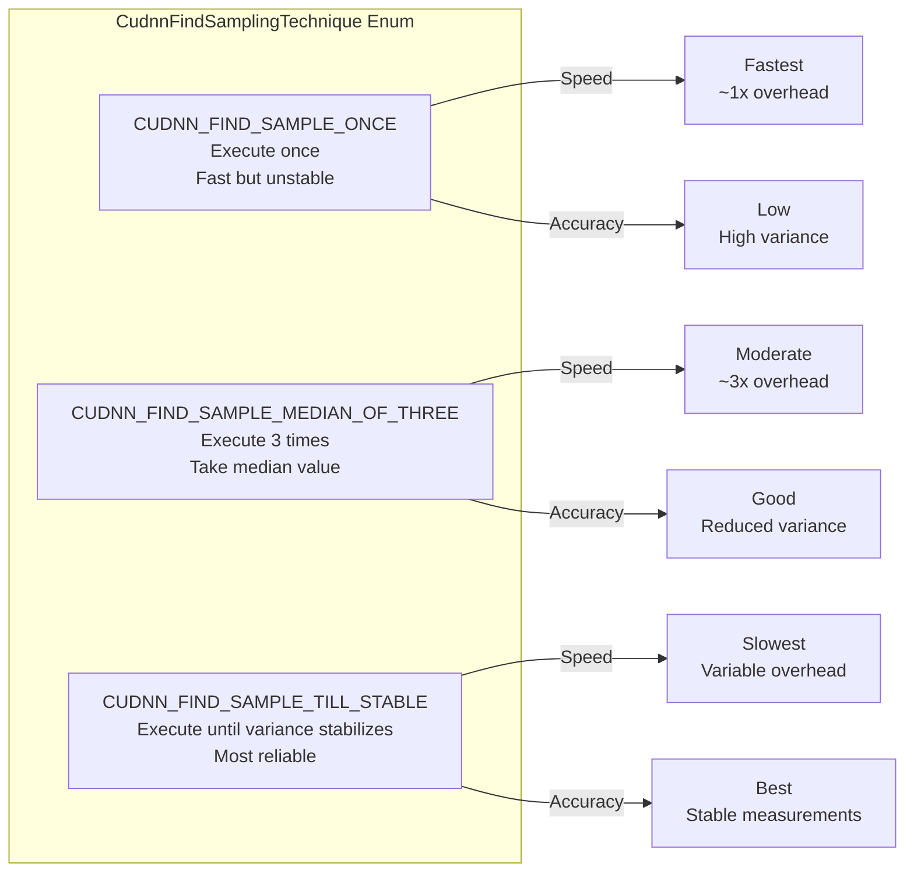
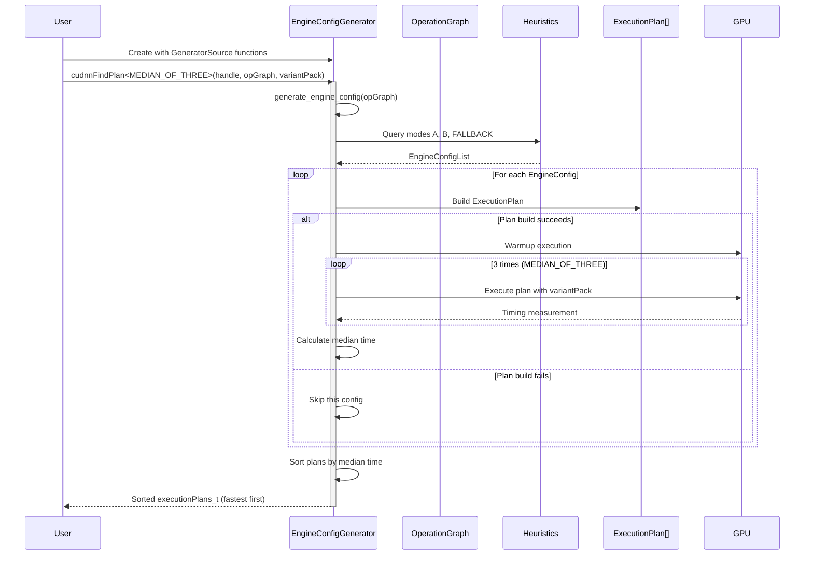
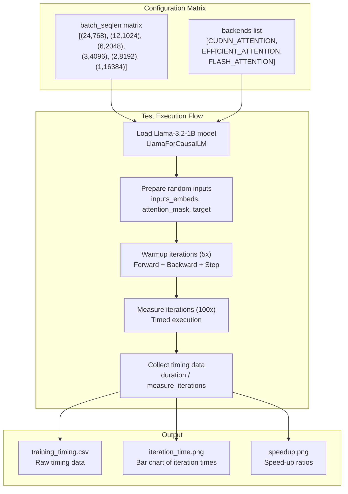
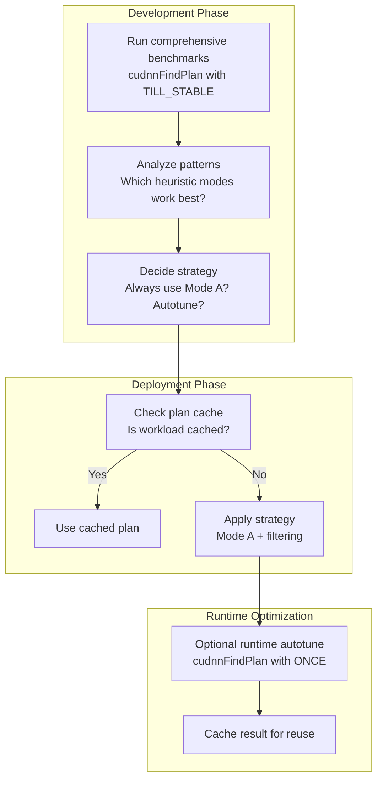

<!-- source: DeepWiki mcp.deepwiki.com · repo NVIDIA/cudnn-frontend · page 6.3 Benchmarking · fetched 2026-10-26 -->

# Benchmarking

<details>
<summary>Relevant source files</summary>

The following files were used as context for generating this wiki page:

- [benchmark/Llama-3.2-1B-Training/training_perf.py](benchmark/Llama-3.2-1B-Training/training_perf.py)
- [include/cudnn_frontend_EngineConfigGenerator.h](include/cudnn_frontend_EngineConfigGenerator.h)
- [include/cudnn_frontend_Filters.h](include/cudnn_frontend_Filters.h)
- [include/cudnn_frontend_Heuristics.h](include/cudnn_frontend_Heuristics.h)
- [include/cudnn_frontend_get_plan.h](include/cudnn_frontend_get_plan.h)

</details>


This document explains the performance measurement tools and methodologies provided by cuDNN Frontend for evaluating and comparing execution plans. It covers the `cudnnFindPlan` API for automated performance profiling, the benchmark scripts for SDPA and Llama training workloads, and best practices for collecting reliable performance data.

For information about heuristics and engine selection strategies, see [Heuristics & Engine Selection](#2.5). For general performance optimization techniques including plan caching and workspace management, see [Performance Optimization](#5.4).

## Overview

cuDNN Frontend provides two primary mechanisms for performance benchmarking:

1. **API-level benchmarking**: The `EngineConfigGenerator::cudnnFindPlan` template methods that automatically profile candidate execution plans and return them sorted by performance
2. **Script-level benchmarking**: Standalone Python benchmark scripts that measure end-to-end training or inference performance for specific workloads (e.g., Llama model training)

The distinction is important: API-level benchmarking focuses on finding the optimal cuDNN execution plan for a specific operation graph, while script-level benchmarking measures complete training/inference workflows including data movement, loss computation, and backward passes.

**Sources:** [include/cudnn_frontend_EngineConfigGenerator.h:1-123](), [benchmark/Llama-3.2-1B-Training/training_perf.py:1-183]()

## Performance Measurement API

### cudnnFindPlan Methods

The `EngineConfigGenerator` class provides template methods for measuring execution plan performance with configurable sampling strategies:



**Key Methods:**

| Method | Purpose | Returns |
|--------|---------|---------|
| `cudnnGetPlan` | Retrieves candidate execution plans without measuring performance | Vector of `ExecutionPlan` objects in heuristic order |
| `cudnnFindPlan<Technique>` | Profiles all candidate plans using specified sampling technique and returns sorted by performance | Vector of `ExecutionPlan` sorted by execution time (fastest first) |
| `cudnnFindPlanAndCache<Technique>` | Profiles plans, caches the fastest, returns it | Single best `ExecutionPlan` |

**Sources:** [include/cudnn_frontend_EngineConfigGenerator.h:29-102](), [include/cudnn_frontend_get_plan.h:29-62]()

### Sampling Techniques

The sampling technique controls how many times each plan is executed during profiling to obtain reliable timing measurements:



**`CUDNN_FIND_SAMPLE_ONCE`**: Executes each plan a single time. This is the fastest approach but may produce unreliable results due to cache effects, GPU frequency scaling, or system load. Suitable for rapid prototyping or when relative ordering is more important than absolute timing.

**`CUDNN_FIND_SAMPLE_MEDIAN_OF_THREE`**: Executes each plan three times and uses the median timing value. This provides a balance between measurement reliability and profiling overhead. The median is robust to single-sample outliers while keeping overhead manageable.

**`CUDNN_FIND_SAMPLE_TILL_STABLE`**: Executes each plan multiple times until the timing variance meets a stability criterion. This provides the most accurate measurements but requires the most time. Use this when precise absolute timing values are critical, such as when making architectural decisions or reporting benchmark results.

**Sources:** [include/cudnn_frontend_EngineConfigGenerator.h:34-38]()

## API-Level Benchmarking Workflow

### Plan Generation and Profiling

The typical workflow for finding the optimal execution plan involves:



**Warmup Phase**: Before timing measurements, plans are typically executed several times to ensure GPU caches are populated, kernels are compiled (for runtime compilation), and frequency scaling has stabilized.

**Measurement Phase**: Each plan is executed the number of times specified by the sampling technique. Measurements are synchronized using `cudaDeviceSynchronize()` to ensure accurate timing.

**Filtering**: The optional `Predicate` parameter allows filtering plans before profiling. For example, you might exclude plans that exceed a workspace size limit or require specific hardware features.

**Sources:** [include/cudnn_frontend_EngineConfigGenerator.h:81-92]()

## Llama Training Benchmark

### Benchmark Script Overview

The Llama training benchmark measures end-to-end training performance across different attention backends and workload configurations.



The script tests a configuration matrix of batch sizes and sequence lengths designed to span from compute-bound (large batch, short sequence) to memory-bound (small batch, long sequence) regimes. Each configuration is tested with three PyTorch attention backends:

- **`CUDNN_ATTENTION`**: Uses cuDNN-optimized attention kernels
- **`FLASH_ATTENTION`**: Uses Flash Attention 2 implementation
- **`EFFICIENT_ATTENTION`**: Uses memory-efficient attention (baseline)

**Sources:** [benchmark/Llama-3.2-1B-Training/training_perf.py:1-183]()

### Key Components

| Component | Implementation | Purpose |
|-----------|---------------|---------|
| Model | `LlamaForCausalLM(config)` | Llama 3.2 1B parameter model in training mode |
| Optimizer | `torch.optim.SGD(lr=1e-6)` | Simple gradient descent optimizer |
| Loss Function | `torch.nn.CrossEntropyLoss()` | Standard language modeling loss |
| Backend Selection | `sdpa_kernel(backends=[backend])` | Context manager to force specific attention backend |
| Warmup | 5 iterations | Eliminate cold-start effects |
| Measurement | 100 iterations | Averaged for per-iteration timing |

**Sources:** [benchmark/Llama-3.2-1B-Training/training_perf.py:49-63]()

### Timing Loop Implementation

The benchmark implements a two-phase timing methodology:

```python
# Phase 1: Warmup
for _ in range(warmup_iterations):
    output = model.forward(inputs_embeds=inputs_embeds, attention_mask=attention_mask)
    loss = loss_fct(output.logits.view(-1, config.vocab_size), target.view(-1))
    optimizer.zero_grad()
    loss.backward()
    optimizer.step()

# Phase 2: Timed execution
torch.cuda.synchronize()
start = time.time()
for _ in range(measure_iterations):
    output = model.forward(inputs_embeds=inputs_embeds, attention_mask=attention_mask)
    loss = loss_fct(output.logits.view(-1, config.vocab_size), target.view(-1))
    optimizer.zero_grad()
    loss.backward()
    optimizer.step()
torch.cuda.synchronize()
duration = time.time() - start
```

Critical elements:
- **Complete training iteration**: Forward pass, loss computation, backward pass, and optimizer step are all included in timing
- **CUDA synchronization**: `torch.cuda.synchronize()` ensures all GPU work completes before timing measurements
- **Averaged timing**: Total duration divided by iteration count provides mean per-iteration time

**Sources:** [benchmark/Llama-3.2-1B-Training/training_perf.py:85-114]()

### Output Analysis

The script generates three outputs:

**1. CSV Data (`training_timing.csv`)**
Contains columns: `backend`, `batch_size`, `seq_len`, `time`, `label`, `speedup_label`, `speedup`

**2. Iteration Time Plot (`iteration_time.png`)**
Bar chart comparing absolute iteration times across backends for each configuration

**3. Speed-up Plot (`speedup.png`)**
Bar chart showing relative performance improvements of CUDNN_ATTENTION and FLASH_ATTENTION compared to EFFICIENT_ATTENTION baseline

Speed-up calculation:
```python
speedup = time_baseline / time_measured
```
Where `time_baseline` is EFFICIENT_ATTENTION timing for the same batch size and sequence length.

**Sources:** [benchmark/Llama-3.2-1B-Training/training_perf.py:116-183]()

## Best Practices for Accurate Benchmarking

### Environment Setup

```mermaid
graph TB
    subgraph "Hardware Configuration"
        GPU_FREQ["Lock GPU Clock Frequency<br/>nvidia-smi -i 0 -lgc min,max"]
        SINGLE_GPU["Use Single GPU<br/>CUDA_VISIBLE_DEVICES=0"]
        THERMAL["Ensure Adequate Cooling<br/>Monitor temperatures"]
    end
    
    subgraph "System Configuration"
        BACKGROUND["Minimize Background Processes<br/>Close unnecessary applications"]
        POWER["Set High Performance Power Mode<br/>Disable power saving"]
        PERSISTENCE["Enable Persistence Mode<br/>nvidia-smi -pm 1"]
    end
    
    subgraph "Software Configuration"
        CUDNN_VER["Note cuDNN Version<br/>torch.backends.cudnn.version()"]
        CUDA_VER["Note CUDA Version<br/>torch.version.cuda"]
        FRAMEWORK_VER["Note Framework Versions<br/>torch.__version__, etc."]
    end
    
    GPU_FREQ --> REPRODUCIBLE["Reproducible Results"]
    SINGLE_GPU --> REPRODUCIBLE
    THERMAL --> REPRODUCIBLE
    BACKGROUND --> REPRODUCIBLE
    POWER --> REPRODUCIBLE
    PERSISTENCE --> REPRODUCIBLE
    CUDNN_VER --> DOCUMENTATION["Documented Configuration"]
    CUDA_VER --> DOCUMENTATION
    FRAMEWORK_VER --> DOCUMENTATION
```



**Critical recommendations:**

1. **Lock GPU clock frequency**: Prevents boost clock variability
   ```bash
   nvidia-smi -i 0 -lgc <min_clock>,<max_clock>
   ```

2. **Isolate GPU**: Set `CUDA_VISIBLE_DEVICES` to use a dedicated GPU not running displays or other workloads

3. **Document configuration**: Record all version information (cuDNN, CUDA, PyTorch, driver) as shown in the benchmark script

4. **Enable persistence mode**: Keeps GPU driver loaded to avoid initialization overhead
   ```bash
   nvidia-smi -pm 1
   ```

**Sources:** [benchmark/Llama-3.2-1B-Training/training_perf.py:12-16](), [benchmark/Llama-3.2-1B-Training/training_perf.py:28-36]()

### Measurement Guidelines

| Guideline | Rationale | Implementation |
|-----------|-----------|----------------|
| **Warmup iterations** | Populate caches, compile kernels, stabilize frequency | Execute 5-10 iterations before timing |
| **Multiple measurements** | Reduce impact of outliers and system noise | Use MEDIAN_OF_THREE or TILL_STABLE sampling |
| **CUDA synchronization** | Ensure accurate timing of asynchronous GPU work | `cudaDeviceSynchronize()` or `torch.cuda.synchronize()` |
| **Sufficient iterations** | Amortize measurement overhead | 100+ iterations for microsecond-level operations |
| **Fixed inputs** | Eliminate data generation overhead from measurements | Pre-allocate and reuse input tensors |
| **Stable configuration** | Compare across controlled conditions | Test one variable at a time (batch size, dtype, etc.) |

### Interpreting Results

When analyzing benchmark results, consider:

1. **Absolute vs. relative performance**: Speed-up ratios are often more meaningful than absolute times when comparing approaches

2. **Workload characteristics**: Different backends may perform differently across compute-bound vs. memory-bound regimes. Small batch/long sequence (memory-bound) often shows different patterns than large batch/short sequence (compute-bound)

3. **Variance analysis**: High variance indicates unstable measurements—increase warmup iterations or use more stable sampling technique

4. **Workspace requirements**: Faster plans may require more workspace memory. Check workspace sizes when comparing plans

5. **Numerical notes**: Plans may have different numerical properties (tensor cores, reduced precision) affecting both performance and accuracy

**Sources:** [benchmark/Llama-3.2-1B-Training/training_perf.py:119-131](), [include/cudnn_frontend_Filters.h:41-67]()

## Integration with Plan Selection

Benchmarking results can inform plan selection strategies at different levels:



**Development-time benchmarking**: Use thorough benchmarking (`TILL_STABLE`) during development to understand which heuristic modes and filtering criteria work well for your workloads. This informs the strategy deployed in production.

**Deployment-time selection**: In production, use fast plan selection (Mode A) with appropriate filters based on development-time insights. Cache plans for repeated workloads.

**Optional runtime autotuning**: For critical paths or variable workloads, optionally use `cudnnFindPlan` with `SAMPLE_ONCE` for quick runtime optimization. Cache results to avoid repeated profiling.

**Sources:** [include/cudnn_frontend_EngineConfigGenerator.h:94-101]()