# Page: Overview

# Overview

<details>
<summary>Relevant source files</summary>

The following files were used as context for generating this wiki page:

- [CMakeLists.txt](CMakeLists.txt)
- [README.md](README.md)
- [include/cudnn_frontend.h](include/cudnn_frontend.h)
- [include/cudnn_frontend/cudnn_interface.h](include/cudnn_frontend/cudnn_interface.h)
- [include/cudnn_frontend/graph_helpers.h](include/cudnn_frontend/graph_helpers.h)
- [include/cudnn_frontend/graph_interface.h](include/cudnn_frontend/graph_interface.h)
- [include/cudnn_frontend/node/sdpa_fp8_bwd.h](include/cudnn_frontend/node/sdpa_fp8_bwd.h)
- [samples/cpp/convolution/fprop.cpp](samples/cpp/convolution/fprop.cpp)
- [samples/cpp/sdpa/fp16_fwd_with_custom_dropout.cpp](samples/cpp/sdpa/fp16_fwd_with_custom_dropout.cpp)
- [samples/cpp/sdpa/fp8_fwd.cpp](samples/cpp/sdpa/fp8_fwd.cpp)
- [setup.py](setup.py)

</details>


## Purpose and Scope

This page provides a high-level introduction to the cuDNN Frontend library, explaining its architecture, key components, and how it interfaces with NVIDIA's cuDNN library. For detailed installation instructions, see [Installation & Setup](#1.1). For architectural deep-dives, see [Architecture Overview](#1.2). For API-specific documentation, see [API Reference](#2) and [Python Interface](#4).

**Sources:** [README.md:1-100]()

## What is cuDNN Frontend

**cuDNN Frontend (FE)** is a modern, open-source C++ header-only library and Python package that provides a simplified interface to NVIDIA's cuDNN deep learning primitives library. It abstracts the complexity of the cuDNN backend API while enabling advanced features like graph-based operation fusion, automatic kernel selection, and execution plan caching.

The library serves two primary audiences:
- **C++ developers** who include [include/cudnn_frontend.h:1-147]() to access the full API
- **Python developers** who install via `pip install nvidia_cudnn_frontend`

Key capabilities:
- **Graph API**: Build reusable, fusible operation graphs via `cudnn_frontend::graph::Graph`
- **Automatic Optimization**: Built-in heuristics for engine selection and autotuning
- **Multi-Precision Support**: FP32, FP16, BF16, FP8, and integer types
- **OSS Kernels**: Access to open-source high-performance kernel implementations

**Sources:** [README.md:1-100](), [include/cudnn_frontend.h:25-98]()

## System Architecture

The cuDNN Frontend operates as a layered system that translates high-level graph descriptions into optimized cuDNN backend operations.

### Layered Architecture

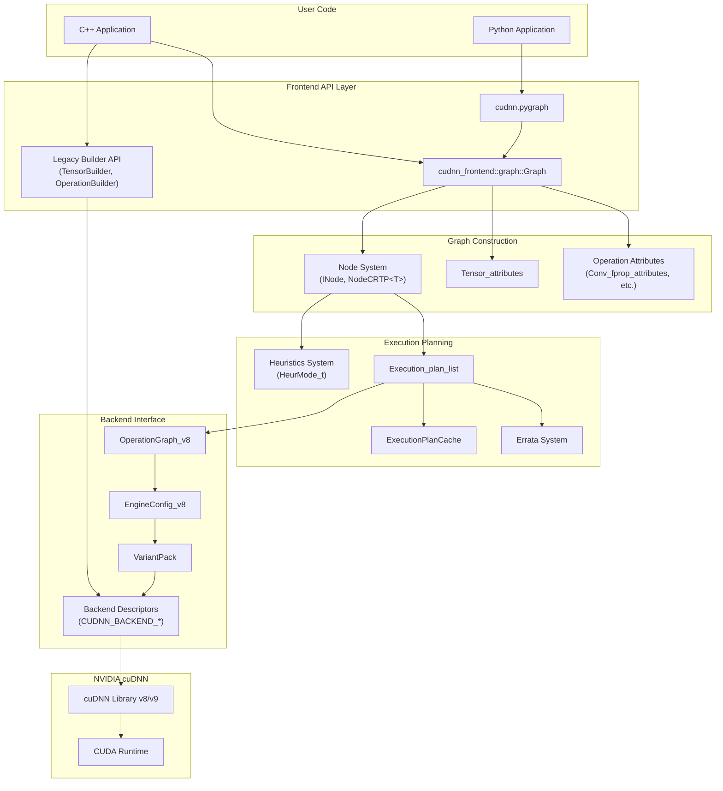

**Sources:** [include/cudnn_frontend/graph_interface.h:38-320](), [include/cudnn_frontend/cudnn_interface.h:100-206]()

### Core Components

| Component | Class/Type | Purpose |
|-----------|-----------|---------|
| **Graph Container** | `cudnn_frontend::graph::Graph` | Top-level container for operations, tensors, and execution plans |
| **Node System** | `INode`, `NodeCRTP<T>` | Base for operation nodes; uses CRTP pattern for zero-cost polymorphism |
| **Tensor Representation** | `Tensor_attributes` | Describes tensor shape, stride, data type, and memory properties |
| **Execution Plans** | `Execution_plan_list` | Container for compiled execution strategies with workspace requirements |
| **Backend Bridge** | `ICudnn` | Interface to cuDNN backend API, manages descriptors and operations |
| **Kernel Cache** | `KernelCache` | Caches compiled kernels for dynamic shape scenarios (cuDNN 9.4+) |

**Sources:** [include/cudnn_frontend/graph_interface.h:40-49](), [include/cudnn_frontend/cudnn_interface.h:100-127]()

## API Approaches

cuDNN Frontend provides two distinct API styles, both ultimately using the same backend infrastructure.

### Graph API (Modern)

The **Graph API** is the recommended approach, providing a functional-style interface for building reusable operation graphs:

```cpp
// Example: Creating a graph
auto graph = std::make_shared<fe::graph::Graph>();
graph->set_io_data_type(fe::DataType_t::HALF)
     .set_compute_data_type(fe::DataType_t::FLOAT);

auto X = graph->tensor(fe::graph::Tensor_attributes()
                          .set_dim({n, c, h, w})
                          .set_stride({c*h*w, 1, c*w, c}));

auto Y = graph->conv_fprop(X, W, conv_options);
```

The Graph API is defined in [include/cudnn_frontend/graph_interface.h:40-1484]() and supports:
- Automatic operation fusion
- Composite operations (SDPA, LayerNorm, BatchNorm)
- Dynamic shapes (cuDNN 9.4+)
- Serialization to JSON

**Sources:** [samples/cpp/convolution/fprop.cpp:28-90]()

### Legacy Builder API

The **Legacy API** uses a builder pattern for direct descriptor creation:

```cpp
auto tensor = cudnn_frontend::TensorBuilder()
                  .setDim(dim.size(), dim.data())
                  .setStrides(stride.size(), stride.data())
                  .setId(uid)
                  .setDataType(data_type)
                  .build();
```

This API provides finer control but requires more boilerplate. It maps directly to cuDNN backend descriptors.

**Sources:** [include/cudnn_frontend.h:77-86]()

## Typical Workflow

The standard workflow for using the Graph API follows these phases:

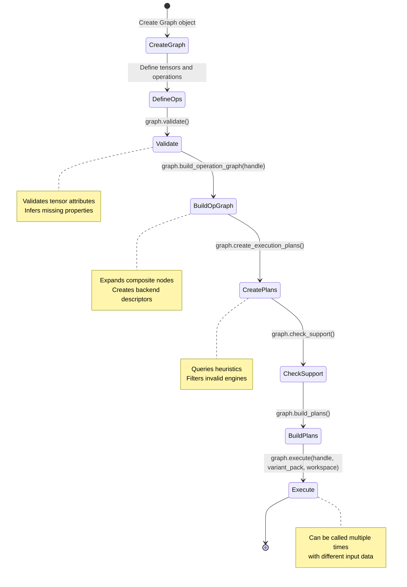

### Phase Details

**1. Graph Construction** ([include/cudnn_frontend/graph_interface.h:630-655]())
- Create `Graph` object and set global data types
- Define `Tensor_attributes` for inputs/outputs
- Add operations (convolution, matmul, SDPA, etc.)

**2. Validation** ([include/cudnn_frontend/graph_interface.h:630-655]())
- Validates tensor properties and operation attributes
- Infers missing tensor dimensions and strides
- Performed by `graph->validate()`

**3. Operation Graph Building** ([include/cudnn_frontend/graph_interface.h:669-712]())
- Expands composite nodes into primitive operations
- Creates cuDNN backend tensor and operation descriptors
- Assigns unique IDs (UIDs) to all tensors
- Performed by `graph->build_operation_graph(handle)`

**4. Execution Plan Creation** ([include/cudnn_frontend/plans.h]())
- Queries heuristics for candidate engine configurations
- Filters engines based on workspace, numerical notes, and errata
- Selects or profiles plans for optimal performance
- Performed by `graph->create_execution_plans()` and `graph->build_plans()`

**5. Execution** ([include/cudnn_frontend/graph_interface.h:850-1060]())
- Binds device pointers via `variant_pack` (UID → pointer map)
- Allocates workspace memory
- Executes selected plan
- Can be called repeatedly with different data

**Sources:** [samples/cpp/convolution/fprop.cpp:37-90](), [include/cudnn_frontend/graph_interface.h:630-712]()

## Language Bindings

### C++ Interface

The C++ API is **header-only**, requiring no linking beyond cuDNN itself. Key headers:

- **Main Header**: [include/cudnn_frontend.h:1-147]() - Includes all components
- **Graph Interface**: [include/cudnn_frontend/graph_interface.h:1-40]() - Graph API
- **Node Definitions**: [include/cudnn_frontend/node/]() - Operation node types

Configuration via CMake ([CMakeLists.txt:1-108]()):
- Minimum C++17 required ([CMakeLists.txt:46]())
- Interface library target: `cudnn_frontend`
- Optional JSON serialization support

### Python Interface

The Python bindings wrap the C++ Graph API using `pybind11`:

- **Installation**: `pip install nvidia_cudnn_frontend`
- **Build Process**: [setup.py:1-119]() - Custom CMake integration
- **Python Module**: `cudnn` with `pygraph` class for graph construction
- **Native Extension**: `_compiled_module.so` compiled from pybind11 sources

The Python API provides the same Graph API functionality with Pythonic syntax, including integration with PyTorch and other frameworks.

**Sources:** [README.md:22-73](), [setup.py:1-119](), [CMakeLists.txt:1-108]()

## Key Concepts

### Tensors and UIDs

Every tensor in a graph is identified by a **unique ID (UID)**, which serves as the key in the variant pack during execution. Tensors are represented by `Tensor_attributes` objects that describe:
- **Dimensions** (`dim`) and **strides** (`stride`)
- **Data type** (`DataType_t`)
- **Memory category**: physical (user-managed), virtual (framework-managed), or pass-by-value (scalar)
- **UID** for binding to device memory

**Sources:** [include/cudnn_frontend/graph_interface.h:42-43](), [include/cudnn_frontend/cudnn_interface.h:22-32]()

### Composite vs Primitive Nodes

The node system distinguishes two categories:

**Composite Nodes** expand into multiple primitive operations:
- `SDPANode` - Scaled Dot-Product Attention
- `LayerNormNode` - Layer normalization
- `BatchNormNode` - Batch normalization
- Expansion occurs during `build_operation_graph()`

**Primitive Nodes** map directly to cuDNN backend operations:
- `MatmulNode` - Matrix multiplication
- `PointwiseNode` - Element-wise operations
- `ConvolutionNode` - Convolution operations
- `ReductionNode` - Reduction operations

For detailed node documentation, see [Node Types](#3).

**Sources:** Diagrams provided in prompt, [include/cudnn_frontend/node/]()

### Execution Plans and Heuristics

cuDNN provides multiple **engines** (kernel implementations) for each operation. The frontend selects engines using:

**Heuristic Modes** ([include/cudnn_frontend/plans.h]()):
- `HeurMode_t::A` - Fast heuristics, returns top candidates
- `HeurMode_t::B` - Exhaustive search, returns all valid engines
- `HeurMode_t::FALLBACK` - Guaranteed valid fallback engine

**Filtering Pipeline**:
1. Query heuristics for candidate engines
2. Filter by workspace size limit
3. Filter by numerical notes (e.g., tensor core usage)
4. Filter by behavioral notes (e.g., runtime compilation)
5. Check errata database for known issues
6. Verify device support

For detailed execution plan documentation, see [Execution Plans](#2.4) and [Heuristics & Engine Selection](#2.5).

**Sources:** Diagram 4 from prompt

### Workspace Management

Execution requires two types of workspace:

**cuDNN Workspace**: Required by backend execution plans, queried via `get_workspace_size()` ([include/cudnn_frontend/graph_interface.h:726-741]())

**Frontend Workspace**: Used for auxiliary operations like constant tensor initialization, tracked internally as `fe_workspace_size` ([include/cudnn_frontend/graph_interface.h:44]())

Total workspace = cuDNN workspace + FE workspace

**Sources:** [include/cudnn_frontend/graph_interface.h:44](), [include/cudnn_frontend/graph_interface.h:726-741]()

## Version Compatibility

cuDNN Frontend supports cuDNN versions 8.x and 9.x, with version-specific features:

- **cuDNN 8.9+**: Full Graph API support, SDPA operations
- **cuDNN 9.0+**: FP8 support, improved errata system
- **cuDNN 9.1+**: FP8 backward SDPA
- **cuDNN 9.4+**: Dynamic shapes, kernel caching
- **cuDNN 9.7+**: Bottom-right causal masking

Version detection occurs at runtime via `detail::get_backend_version()`. For detailed version requirements, see [Version Compatibility](#1.3).

**Sources:** [include/cudnn_frontend/graph_interface.h:85-97](), [samples/cpp/sdpa/fp8_fwd.cpp:103-108]()

## Next Steps

- For installation instructions, see [Installation & Setup](#1.1)
- For understanding the layered architecture in depth, see [Architecture Overview](#1.2)
- For Graph API usage, see [Graph API](#2.1)
- For Python-specific information, see [Python Interface](#4)
- For example code, see [Examples & Samples](#6)

---

# Page: Installation & Setup

# Installation & Setup

<details>
<summary>Relevant source files</summary>

The following files were used as context for generating this wiki page:

- [CMakeLists.txt](CMakeLists.txt)
- [cmake/cuDNN.cmake](cmake/cuDNN.cmake)
- [dlpack_version.txt](dlpack_version.txt)
- [include/cudnn_frontend.h](include/cudnn_frontend.h)
- [include/cudnn_frontend/node/moe_grouped_matmul.h](include/cudnn_frontend/node/moe_grouped_matmul.h)
- [python/CMakeLists.txt](python/CMakeLists.txt)
- [python/pycudnn.cpp](python/pycudnn.cpp)
- [requirements.txt](requirements.txt)
- [samples/CMakeLists.txt](samples/CMakeLists.txt)
- [samples/python/00_introduction.ipynb](samples/python/00_introduction.ipynb)
- [setup.py](setup.py)

</details>


This document provides detailed instructions for installing and configuring the cuDNN Frontend library for both C++ and Python environments. The cuDNN Frontend is a header-only C++ library that provides a modern, graph-based API to NVIDIA's cuDNN library, with optional Python bindings for seamless integration with Python-based workflows.

For information about cuDNN version compatibility and feature support across versions, see [Version Compatibility](#1.3). For architectural details about how the build system works, see [Architecture Overview](#1.2).

---

## Prerequisites

### System Requirements

| Component | Requirement |
|-----------|-------------|
| **CMake** | ≥ 3.23 (C++ builds) or ≥ 3.18 (Python builds) |
| **C++ Compiler** | C++17 support (C++20 for Python bindings) |
| **CUDA Toolkit** | Required for both C++ and Python |
| **cuDNN Library** | Version 8.x or 9.x |
| **Python** | ≥ 3.8 (Python installation only) |
| **Operating System** | Linux, Windows (MSVC, MSYS, MinGW) |

### CUDA Toolkit

The CUDA Toolkit must be installed and accessible on your system. The build system uses CMake's `find_package(CUDAToolkit REQUIRED)` to locate CUDA headers and libraries.

**Installation options:**
- Download from [NVIDIA Developer Downloads](https://developer.nvidia.com/cuda-downloads)
- Set `CUDA_PATH` or `CUDAToolkit_ROOT` environment variable if installed in non-standard location

### cuDNN Library

The cuDNN library provides the backend computation kernels. The frontend library dynamically detects the installed version (v8 or v9) and links appropriate components.

**Version-specific libraries:**

cuDNN 8.x components:
- `libcudnn.so.8` (or `cudnn.dll`)
- `libcudnn_adv_infer.so.8`, `libcudnn_adv_train.so.8`
- `libcudnn_cnn_infer.so.8`, `libcudnn_cnn_train.so.8`
- `libcudnn_ops_infer.so.8`, `libcudnn_ops_train.so.8`

cuDNN 9.x components:
- `libcudnn.so.9`
- `libcudnn_graph.so.9`, `libcudnn_engines_runtime_compiled.so.9`
- `libcudnn_ops.so.9`, `libcudnn_cnn.so.9`, `libcudnn_adv.so.9`
- `libcudnn_engines_precompiled.so.9` (optional)
- `libcudnn_heuristic.so.9` (optional)

Set `CUDNN_PATH` environment variable if installed in non-standard location.

**Sources:** [cmake/cuDNN.cmake:77-115]()

---

## Installation Decision Flow

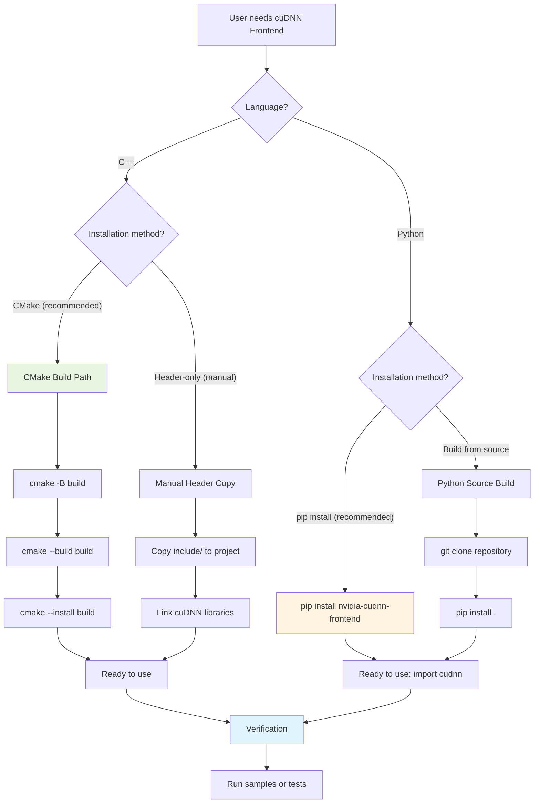

**Sources:** [CMakeLists.txt:1-108](), [setup.py:1-119]()

---

## C++ Installation

The cuDNN Frontend is a **header-only library** defined as a CMake `INTERFACE` target. No compilation is required for the library itself, but samples and tests can optionally be built.

### Using CMake (Recommended)

#### Step 1: Clone the Repository

```bash
git clone https://github.com/NVIDIA/cudnn-frontend.git
cd cudnn-frontend
```

#### Step 2: Configure the Build

```bash
cmake -B build \
  -DCUDNN_FRONTEND_BUILD_SAMPLES=ON \
  -DCUDNN_FRONTEND_BUILD_TESTS=ON \
  -DCUDNN_PATH=/path/to/cudnn \
  -DCUDAToolkit_ROOT=/path/to/cuda
```

**Build options:**

| CMake Option | Default | Description |
|--------------|---------|-------------|
| `CUDNN_FRONTEND_SKIP_JSON_LIB` | `OFF` | Exclude nlohmann/json.hpp (disables serialization) |
| `CUDNN_FRONTEND_BUILD_SAMPLES` | `ON` | Build C++ sample programs |
| `CUDNN_FRONTEND_BUILD_TESTS` | `ON` | Build unit tests |
| `CUDNN_FRONTEND_BUILD_PYTHON_BINDINGS` | `OFF` | Build Python bindings (see Python section) |

#### Step 3: Build (Optional, for Samples/Tests)

```bash
cmake --build build --parallel
```

This compiles the sample programs in [samples/cpp/]() and test suite in [test/]().

#### Step 4: Install

```bash
sudo cmake --install build --prefix /usr/local
```

This installs:
- Headers to `${CMAKE_INSTALL_INCLUDEDIR}/cudnn_frontend/`
- CMake package config to `${CMAKE_INSTALL_LIBDIR}/cmake/cudnn_frontend/`
- Sample binaries to `${CMAKE_INSTALL_BINDIR}/` (if built)

**Sources:** [CMakeLists.txt:1-108](), [samples/CMakeLists.txt:1-27]()

### CMake Build System Architecture

```mermaid
graph TB
    subgraph "Root CMakeLists.txt"
        ROOT_CMAKE["CMakeLists.txt"]
        CUDNN_FE["cudnn_frontend<br/>(INTERFACE library)"]
        PCH["_cudnn_frontend_pch<br/>(Precompiled headers)"]
    end
    
    subgraph "Dependencies"
        CUDA_TOOLKIT["CUDAToolkit"]
        CUDNN_CMAKE["cmake/cuDNN.cmake"]
        CUDNN_ALL["CUDNN::cudnn_all"]
    end
    
    subgraph "Build Targets"
        SAMPLES_DIR["samples/CMakeLists.txt"]
        TESTS_DIR["test/CMakeLists.txt"]
        PYTHON_DIR["python/CMakeLists.txt"]
        
        SAMPLES["samples<br/>(C++ samples)"]
        LEGACY_SAMPLES["legacy_samples"]
        TESTS["tests"]
        COMPILED_MODULE["_compiled_module.so<br/>(Python bindings)"]
    end
    
    subgraph "External Dependencies"
        CATCH2["Catch2 v3.3.2<br/>(FetchContent)"]
        DLPACK["dlpack v1.1<br/>(FetchContent)"]
        PYBIND11["pybind11 v2.13.6<br/>(FetchContent)"]
    end
    
    subgraph "Install Artifacts"
        HEADERS["include/cudnn_frontend/*.h"]
        CMAKE_CONFIG["cudnn_frontend-config.cmake"]
        TARGETS_FILE["cudnn_frontend-targets.cmake"]
    end
    
    ROOT_CMAKE --> CUDNN_FE
    ROOT_CMAKE --> PCH
    ROOT_CMAKE --> SAMPLES_DIR
    ROOT_CMAKE --> TESTS_DIR
    ROOT_CMAKE --> PYTHON_DIR
    
    CUDA_TOOLKIT --> CUDNN_FE
    CUDNN_CMAKE --> CUDNN_ALL
    CUDNN_ALL --> SAMPLES
    CUDNN_ALL --> TESTS
    CUDNN_ALL --> COMPILED_MODULE
    
    SAMPLES_DIR --> SAMPLES
    SAMPLES_DIR --> LEGACY_SAMPLES
    TESTS_DIR --> TESTS
    PYTHON_DIR --> COMPILED_MODULE
    
    SAMPLES_DIR --> CATCH2
    PYTHON_DIR --> DLPACK
    PYTHON_DIR --> PYBIND11
    
    CUDNN_FE --> HEADERS
    ROOT_CMAKE --> CMAKE_CONFIG
    ROOT_CMAKE --> TARGETS_FILE
```

**Sources:** [CMakeLists.txt:1-108](), [cmake/cuDNN.cmake:1-116](), [samples/CMakeLists.txt:1-27](), [python/CMakeLists.txt:1-128]()

### Integrating with Your C++ Project

#### Method 1: Using Installed Package

After installation, use `find_package` in your CMakeLists.txt:

```cmake
cmake_minimum_required(VERSION 3.18)
project(my_project)

find_package(cudnn_frontend REQUIRED)
find_package(CUDAToolkit REQUIRED)

add_executable(my_app main.cpp)
target_link_libraries(my_app PRIVATE 
    cudnn_frontend 
    CUDA::cudart
)
```

#### Method 2: Adding as Subdirectory

```cmake
add_subdirectory(cudnn-frontend)
target_link_libraries(my_app PRIVATE cudnn_frontend)
```

#### Method 3: Header-Only Manual Integration

Copy the `include/` directory to your project and add to include path:

```cmake
target_include_directories(my_app PRIVATE /path/to/cudnn-frontend/include)
```

**Required compiler flags:**
- C++17: `-std=c++17` (or `target_compile_features(... cxx_std_17)`)
- Warning flags from [CMakeLists.txt:11-14]()

**Sources:** [CMakeLists.txt:16-46](), [include/cudnn_frontend.h:1-147]()

---

## Python Installation

The Python package `nvidia-cudnn-frontend` provides a `cudnn` module with both high-level wrapper (`cudnn.Graph`) and low-level bindings (`cudnn.pygraph`).

### Using pip (Recommended)

#### Prerequisites

Install cuDNN Python package first (provides backend library):

```bash
pip install nvidia-cudnn-cu12  # For CUDA 12.x
# OR
pip install nvidia-cudnn-cu11  # For CUDA 11.x
```

#### Install cuDNN Frontend

```bash
pip install nvidia-cudnn-frontend
```

This installs the pre-built wheel with compiled Python bindings.

#### Verification

```python
import cudnn
print(cudnn.backend_version())  # Should print version like 90000
```

**Sources:** [samples/python/00_introduction.ipynb:54-56]()

### Building from Source

#### Step 1: Install Dependencies

```bash
pip install -r requirements.txt
```

Key Python dependencies from [requirements.txt:1-9]():
- `pybind11[global]` - C++/Python binding generator (v2.13.6)
- `numpy<2.0.0` - NumPy arrays
- `pytest`, `pytest-xdist` - Testing framework

#### Step 2: Clone and Build

```bash
git clone https://github.com/NVIDIA/cudnn-frontend.git
cd cudnn-frontend
pip install .
```

#### Step 3: Environment Variables (Optional)

Control build behavior with environment variables:

| Variable | Purpose | Example |
|----------|---------|---------|
| `CUDA_PATH` or `CUDAToolkit_ROOT` | CUDA location | `/usr/local/cuda` |
| `CUDNN_PATH` | cuDNN location | `/usr/local/cudnn` |
| `FETCHCONTENT_SOURCE_DIR_DLPACK` | Local DLPack path | `/path/to/dlpack` |
| `CMAKE_BUILD_PARALLEL_LEVEL` | Parallel build jobs | `8` |
| `DEBUG` | Debug build | `1` |

**Sources:** [setup.py:59-71]()

### Python Build Pipeline

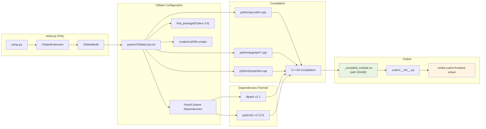

**Sources:** [setup.py:1-119](), [python/CMakeLists.txt:1-128]()

### Python Module Structure

The compiled module exports the following:

| Component | Description | Source File |
|-----------|-------------|-------------|
| `backend_version()` | Returns cuDNN version as integer | [python/pycudnn.cpp:84]() |
| `backend_version_string()` | Returns version string | [python/pycudnn.cpp:85]() |
| `pygraph` | Low-level graph construction class | [python/pygraph/pygraph.cpp]() |
| `create_handle()` / `destroy_handle()` | cuDNN handle management | Defined in Python wrapper |
| `data_type`, `heur_mode`, etc. | Enums and properties | [python/properties.cpp]() |
| `cudnnGraphNotSupportedError` | Custom exception | [python/pycudnn.cpp:92]() |

**Dynamic loading:** The Python bindings are compiled with `NV_CUDNN_FRONTEND_USE_DYNAMIC_LOADING` ([python/CMakeLists.txt:80]()), enabling runtime loading of cuDNN libraries without static linking.

**Sources:** [python/pycudnn.cpp:1-97](), [python/CMakeLists.txt:56-94]()

---

## Dependency Resolution

### C++ Dependencies

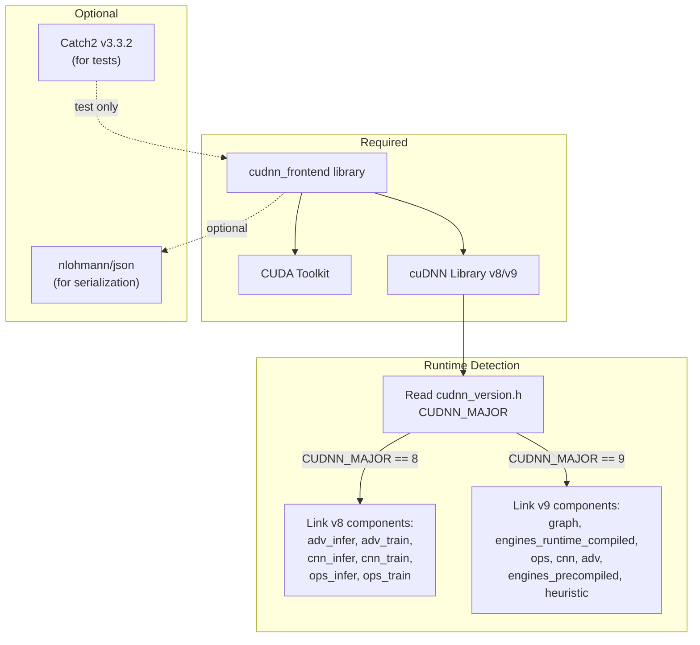

**Sources:** [cmake/cuDNN.cmake:10-115](), [CMakeLists.txt:5-6]()

### Python Dependencies

**Build-time dependencies:**
- CMake ≥ 3.18
- C++20 compiler
- pybind11 ≥ 2.13.6
- DLPack 1.1 (for tensor interoperability)

**Runtime dependencies:**
- numpy < 2.0.0
- nvidia-cudnn-cu12 (or cu11)
- Optional: PyTorch, TensorFlow, JAX (for tensor support)

**DLPack version:** The exact version is specified in [dlpack_version.txt:1]() as `1.1`.

**Sources:** [requirements.txt:1-9](), [python/CMakeLists.txt:21-31](), [dlpack_version.txt:1]()

---

## Library Detection Process

The cuDNN detection mechanism in [cmake/cuDNN.cmake]() performs the following steps:

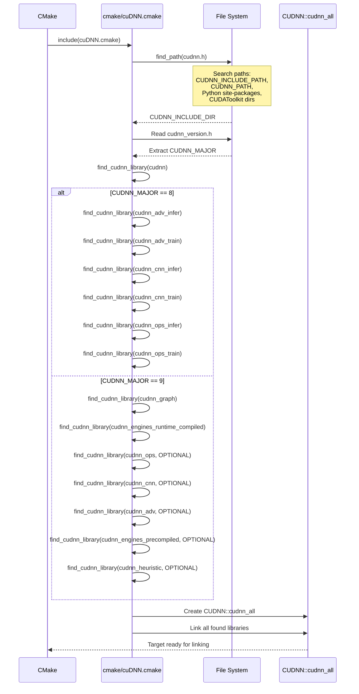

**Search paths for libraries** ([cmake/cuDNN.cmake:25]()):
- `$CUDNN_LIBRARY_PATH` / `$CUDNN_PATH` environment variables
- Python site-packages (`${Python_SITEARCH}/nvidia/cudnn`)
- CUDA Toolkit library directory
- Standard system paths: `lib64`, `lib/x64`, `lib`

**Sources:** [cmake/cuDNN.cmake:1-116]()

---

## Verification

### C++ Verification

After building samples, run a simple test:

```bash
# Run convolution sample
./build/bin/samples

# Or run unit tests
./build/bin/tests
```

Expected output: Tests pass without errors, confirming proper installation and linking.

### Python Verification

Create a test script `verify.py`:

```python
import cudnn
import torch

# Check version
print(f"cuDNN backend version: {cudnn.backend_version()}")
print(f"cuDNN version string: {cudnn.backend_version_string()}")

# Test basic functionality
handle = cudnn.create_handle()
print("Handle created successfully")

# Create a simple graph
graph = cudnn.pygraph(
    handle=handle,
    name="test_graph",
    io_data_type=cudnn.data_type.HALF
)
print("Graph created successfully")

cudnn.destroy_handle(handle)
print("All checks passed!")
```

Run: `python verify.py`

Expected output:
```
cuDNN backend version: 90000
cuDNN version string: 9.0.0
Handle created successfully
Graph created successfully
All checks passed!
```

**Sources:** [samples/python/00_introduction.ipynb:79-82]()

---

## Troubleshooting Common Issues

### Issue: CMake Cannot Find cuDNN

**Symptom:** `CMake Error: Could not find CUDNN_INCLUDE_DIR`

**Solution:**
```bash
export CUDNN_PATH=/path/to/cudnn
cmake -B build -DCUDNN_PATH=$CUDNN_PATH
```

### Issue: Python Import Error

**Symptom:** `ImportError: cannot import name '_compiled_module'`

**Solution:** Ensure nvidia-cudnn-cu12 is installed:
```bash
pip install nvidia-cudnn-cu12
pip install --force-reinstall nvidia-cudnn-frontend
```

### Issue: Version Mismatch

**Symptom:** Runtime error about unsupported operations

**Solution:** Check version compatibility:
```python
import cudnn
print(cudnn.backend_version())  # Should be >= 80000 for v8, >= 90000 for v9
```

### Issue: Dynamic Loading Failure

**Symptom:** `dlopen failed` or similar runtime errors

**Solution:** Set LD_LIBRARY_PATH (Linux) or PATH (Windows):
```bash
export LD_LIBRARY_PATH=/usr/local/cuda/lib64:$LD_LIBRARY_PATH
export LD_LIBRARY_PATH=/path/to/cudnn/lib:$LD_LIBRARY_PATH
```

**Sources:** [python/CMakeLists.txt:80](), [python/pycudnn.cpp:75-81]()

---

## Next Steps

After successful installation:

1. **Learn the API:** See [Graph API](#2.1) for the modern C++ interface or [Python API Overview](#4.1) for Python usage
2. **Run Examples:** Explore [C++ Examples](#6.1) and [Python Notebook Examples](#6.2)
3. **Understand Architecture:** Read [Architecture Overview](#1.2) to understand the library's design
4. **Check Compatibility:** Review [Version Compatibility](#1.3) for feature availability

**Sources:** [CMakeLists.txt:1-108](), [setup.py:1-119](), [cmake/cuDNN.cmake:1-116](), [python/CMakeLists.txt:1-128](), [samples/python/00_introduction.ipynb:1-440]()

---

# Page: Architecture Overview

# Architecture Overview

<details>
<summary>Relevant source files</summary>

The following files were used as context for generating this wiki page:

- [README.md](README.md)
- [include/cudnn_frontend/cudnn_interface.h](include/cudnn_frontend/cudnn_interface.h)
- [include/cudnn_frontend/graph_helpers.h](include/cudnn_frontend/graph_helpers.h)
- [include/cudnn_frontend/graph_interface.h](include/cudnn_frontend/graph_interface.h)
- [include/cudnn_frontend/node/sdpa_fp8_bwd.h](include/cudnn_frontend/node/sdpa_fp8_bwd.h)
- [include/cudnn_frontend/node_interface.h](include/cudnn_frontend/node_interface.h)
- [include/cudnn_frontend/utils/serialize.h](include/cudnn_frontend/utils/serialize.h)
- [include/cudnn_frontend_utils.h](include/cudnn_frontend_utils.h)
- [python/pygraph/pygraph.cpp](python/pygraph/pygraph.cpp)
- [python/pygraph/sdpa.cpp](python/pygraph/sdpa.cpp)
- [samples/cpp/convolution/fprop.cpp](samples/cpp/convolution/fprop.cpp)
- [samples/cpp/sdpa/fp16_fwd_with_custom_dropout.cpp](samples/cpp/sdpa/fp16_fwd_with_custom_dropout.cpp)
- [samples/cpp/sdpa/fp8_fwd.cpp](samples/cpp/sdpa/fp8_fwd.cpp)

</details>


## Purpose and Scope

This page describes the high-level architecture of the cuDNN Frontend library, including its layered design, core components, and data flow. It covers the structural organization of the codebase and how different subsystems interact to provide a modern interface to NVIDIA's cuDNN library.

For installation details, see [Installation & Setup](#1.1). For version-specific features and compatibility, see [Version Compatibility](#1.3). For detailed API documentation, see [API Reference](#2). For node-specific details, see [Node Types](#3).

---

## System Layers

The cuDNN Frontend is organized into five distinct architectural layers, each with specific responsibilities:

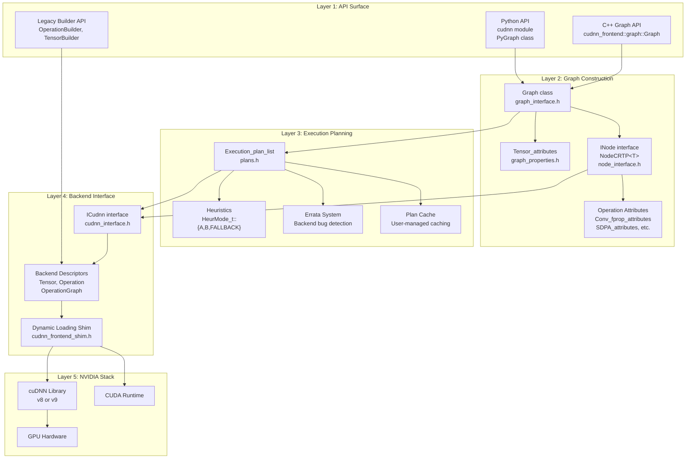

**Sources:** [include/cudnn_frontend/graph_interface.h:40-41](), [include/cudnn_frontend/node_interface.h:41](), [include/cudnn_frontend/cudnn_interface.h:100](), [python/pygraph/pygraph.cpp:1-30]()

### Layer Responsibilities

| Layer | Components | Responsibilities |
|-------|-----------|------------------|
| **API Surface** | `PyGraph`, `Graph`, Legacy Builders | User-facing interfaces for graph construction |
| **Graph Construction** | `INode`, `Tensor_attributes`, Operation Attributes | Internal graph representation and node system |
| **Execution Planning** | `Execution_plan_list`, Heuristics, Errata | Engine selection, filtering, optimization |
| **Backend Interface** | `ICudnn`, Backend Descriptors, Shim | Translation to cuDNN backend API |
| **NVIDIA Stack** | cuDNN Library, CUDA Runtime | Low-level execution on GPU hardware |

**Sources:** [README.md:1-100](), [include/cudnn_frontend/graph_interface.h:100-712]()

---

## Graph Construction Model

The cuDNN Frontend uses a functional graph construction API where operations create and return tensor objects:

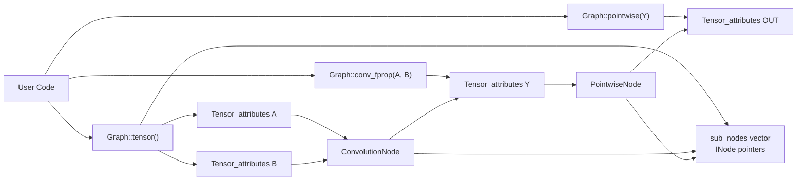

**Sources:** [include/cudnn_frontend/graph_interface.h:320-321](), [samples/cpp/convolution/fprop.cpp:37-68]()

### Core Graph Components

The `Graph` class ([include/cudnn_frontend/graph_interface.h:40]()) serves as the primary entry point and manages:

- **Tensor Creation**: `tensor()` and `tensor_like()` methods create `Tensor_attributes` objects
- **Operation Methods**: `conv_fprop()`, `matmul()`, `sdpa()`, etc. create nodes and return output tensors
- **Subgraph Tracking**: Maintains a `sub_nodes` vector of all operations in topological order
- **Global State**: `full_graph_inputs`, `full_graph_outputs`, `used_uids`

```cpp
// Example from graph construction
auto X = graph->tensor(Tensor_attributes().set_dim({n, c, h, w})...);
auto W = graph->tensor(Tensor_attributes().set_dim({k, c, r, s})...);
auto Y = graph->conv_fprop(X, W, Conv_fprop_attributes()...);
Y->set_output(true);
```

**Sources:** [samples/cpp/convolution/fprop.cpp:41-55](), [include/cudnn_frontend/graph_interface.h:320-656]()

---

## Execution Model

Graph execution follows a distinct multi-phase lifecycle:

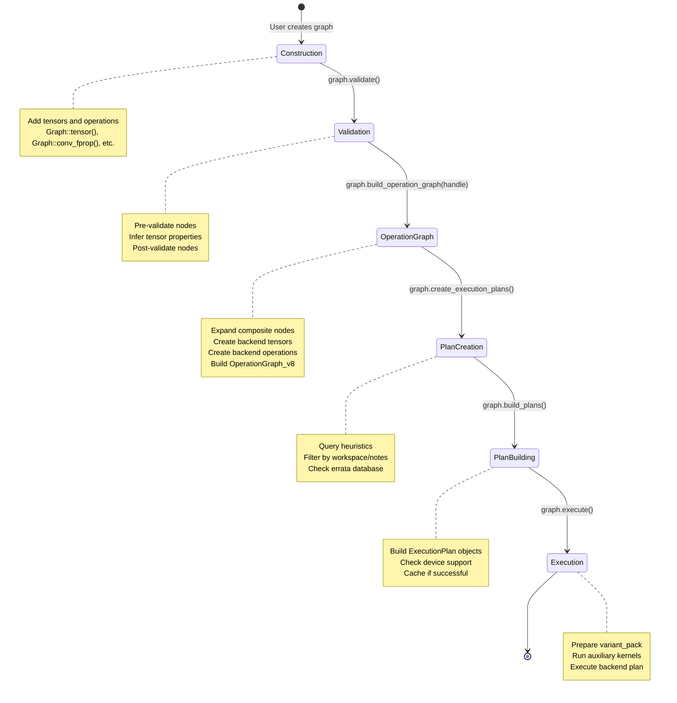

**Sources:** [include/cudnn_frontend/graph_interface.h:630-712](), [samples/cpp/convolution/fprop.cpp:57-89]()

### Execution Phases in Detail

| Phase | Method | Key Activities | Error Conditions |
|-------|--------|----------------|------------------|
| **Validation** | `validate()` | `pre_validate_node()`, `infer_properties_node()`, `post_validate_node()` on all nodes | Missing attributes, incompatible dimensions |
| **Operation Graph** | `build_operation_graph()` | `expand_node()`, `create_cudnn_tensors()`, `create_cudnn_operations()` | Unsupported operation combinations |
| **Plan Creation** | `create_execution_plans()` | Query heuristics, filter by workspace/notes, check errata | No suitable engines found |
| **Plan Building** | `build_plans()` | Finalize plans, check support | Device doesn't support operation |
| **Execution** | `execute()` | Run kernels with variant pack | Runtime errors, insufficient workspace |

**Sources:** [include/cudnn_frontend/graph_interface.h:630-796](), [include/cudnn_frontend/node_interface.h:232-330]()

---

## Node System Architecture

The node system uses a two-tier hierarchy with the **Curiously Recurring Template Pattern (CRTP)** for type-safe polymorphism:

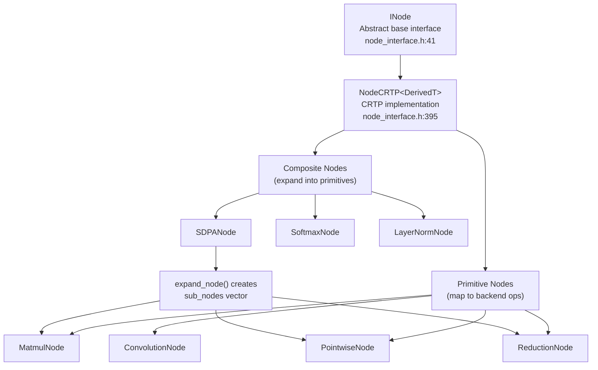

**Sources:** [include/cudnn_frontend/node_interface.h:41-457](), [include/cudnn_frontend/graph_interface.h:8-30]()

### Node Interface Methods

The `INode` interface defines virtual methods called during graph processing:

| Method | Phase | Purpose |
|--------|-------|---------|
| `pre_validate_node()` | Validation | Check attributes are set, validate constraints |
| `infer_properties_node()` | Validation | Deduce output tensor properties from inputs |
| `expand_node()` | Build | Composite nodes expand into primitive operations |
| `post_validate_node()` | Validation | Final validation after property inference |
| `create_cudnn_tensors_node()` | Build | Create backend `Tensor` descriptors |
| `create_cudnn_operations()` | Build | Create backend `Operation` descriptors |
| `collect_pass_by_value_tensors_node()` | Execution | Collect scalar constants |
| `collect_tensors_in_workspace_node()` | Execution | Identify workspace-allocated tensors |

**Sources:** [include/cudnn_frontend/node_interface.h:60-106](), [include/cudnn_frontend/node_interface.h:232-330]()

### CRTP Pattern Implementation

The `NodeCRTP<DerivedT>` template ([include/cudnn_frontend/node_interface.h:395]()) provides common implementations:

```cpp
template <typename DerivedT>
class NodeCRTP : public INode {
    DerivedT& self() { return *static_cast<DerivedT*>(this); }
    
    error_t create_cudnn_tensors_node(...) override {
        // Automatically handles self().attributes.inputs and outputs
        for (auto const& [name, tensor] : self().attributes.inputs) {
            create_cudnn_tensor(tensor, ...);
        }
        // ...
    }
};
```

This pattern eliminates code duplication while maintaining type safety. Each node type (e.g., `ConvolutionNode`, `SDPANode`) inherits from `NodeCRTP<ConvolutionNode>`.

**Sources:** [include/cudnn_frontend/node_interface.h:395-457]()

---

## Memory Management Architecture

The frontend categorizes tensors into three types based on memory ownership:

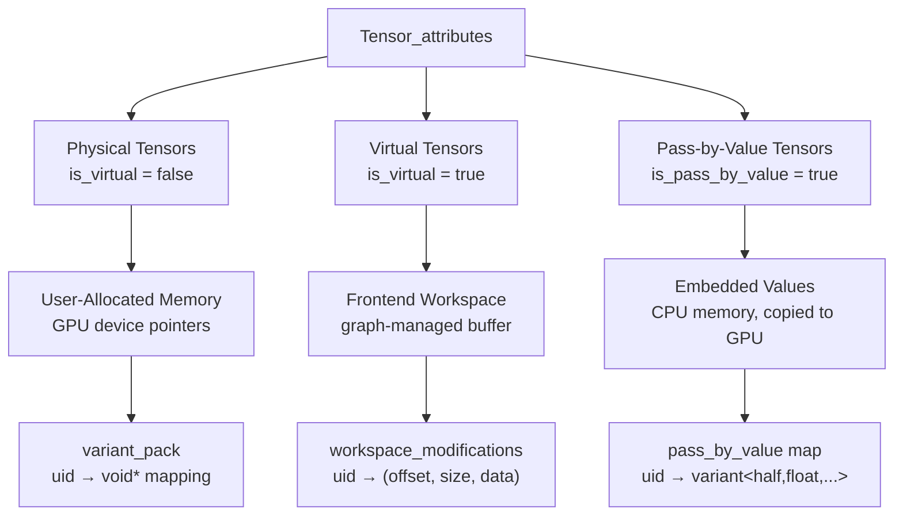

**Sources:** [include/cudnn_frontend/graph_interface.h:141-169](), [include/cudnn_frontend/graph_interface.h:770-788]()

### Memory Categories

| Category | `is_virtual` | `is_pass_by_value` | Memory Source | Use Case |
|----------|--------------|-------------------|---------------|----------|
| **Physical** | `false` | `false` | User provides device pointer in `variant_pack` | Graph inputs/outputs, user-managed tensors |
| **Virtual** | `true` | `false` | Allocated from `workspace` by frontend | Intermediate results, temporary buffers |
| **Pass-by-Value** | - | `true` | Scalar value embedded in graph, copied to GPU | Constants like epsilon, scale factors |

**Example Usage:**

```cpp
// Physical tensor (user provides memory)
auto X = graph->tensor(Tensor_attributes()
    .set_dim({n, c, h, w})
    .set_is_virtual(false));  // User must provide devPtr

// Virtual tensor (framework manages memory)
auto intermediate = graph->pointwise(...);  // is_virtual=true by default

// Pass-by-value scalar
auto epsilon = graph->tensor(Tensor_attributes()
    .set_dim({1,1,1,1})
    .set_is_pass_by_value(true));  // Value embedded in graph
```

**Sources:** [samples/cpp/convolution/fprop.cpp:41-55](), [include/cudnn_frontend/graph_properties.h]()

---

## API Surfaces

The frontend provides two primary API surfaces targeting different user needs:

### C++ Graph API

The modern C++ interface centered on `cudnn_frontend::graph::Graph`:

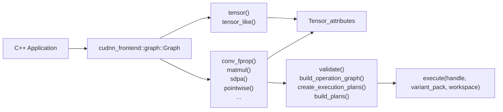

**Sources:** [include/cudnn_frontend/graph_interface.h:40-1300](), [samples/cpp/convolution/fprop.cpp:28-90]()

### Python API

The Python interface wraps the C++ Graph API via `pybind11`:

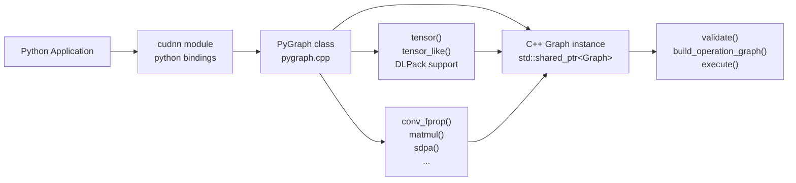

**Sources:** [python/pygraph/pygraph.cpp:22-700](), [python/pygraph/pygraph.h]()

### API Comparison

| Feature | C++ Graph API | Python API |
|---------|--------------|------------|
| **Entry Point** | `cudnn_frontend::graph::Graph` | `cudnn.pygraph(handle, ...)` |
| **Tensor Creation** | `graph->tensor(Tensor_attributes()...)` | `graph.tensor(dim, stride, dtype)` |
| **Interoperability** | Native C++ pointers | DLPack protocol (`__dlpack__`) |
| **Error Handling** | `error_t` struct with `is_good()/is_bad()` | Python exceptions |
| **Memory Model** | Explicit `variant_pack` with UIDs | DLPack capsules or UID mapping |

**Sources:** [include/cudnn_frontend/graph_interface.h:320-1300](), [python/pygraph/pygraph.cpp:80-353]()

---

## Backend Integration

The frontend translates user graphs into cuDNN backend API calls through a multi-step lowering process:

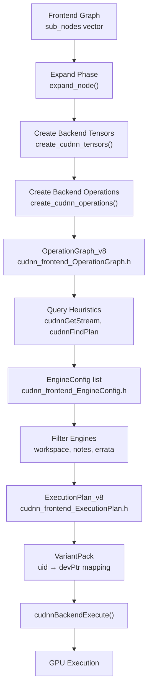

**Sources:** [include/cudnn_frontend/cudnn_interface.h:128-163](), [include/cudnn_frontend/graph_interface.h:669-712]()

### Backend Descriptor Hierarchy

The frontend creates these backend descriptors during the build phase:

| Frontend Type | Backend Descriptor | Backend API Type | Created By |
|---------------|-------------------|------------------|------------|
| `Tensor_attributes` | `cudnn_frontend::Tensor` | `CUDNN_BACKEND_TENSOR_DESCRIPTOR` | `create_cudnn_tensors_node()` |
| `ConvolutionNode` | `cudnn_frontend::Operation` | `CUDNN_BACKEND_OPERATION_CONVOLUTION_FORWARD_DESCRIPTOR` | `create_cudnn_operations()` |
| Graph | `cudnn_frontend::OperationGraph_v8` | `CUDNN_BACKEND_OPERATIONGRAPH_DESCRIPTOR` | `create_cudnn_operation_graph()` |
| Plan candidate | `cudnn_frontend::EngineConfig` | `CUDNN_BACKEND_ENGINECFG_DESCRIPTOR` | Heuristics query |
| Executable plan | `cudnn_frontend::ExecutionPlan_v8` | `CUDNN_BACKEND_EXECUTION_PLAN_DESCRIPTOR` | `build_plans()` |

**Sources:** [include/cudnn_frontend/cudnn_interface.h:128-206](), [include/cudnn_frontend_utils.h:440-482]()

### Dynamic Loading Shim

The frontend uses dynamic library loading to support multiple cuDNN versions without recompilation:

```cpp
// Shim loads symbols at runtime
namespace detail {
    cudnnStatus_t (*cudnnCreate)(cudnnHandle_t*);
    cudnnStatus_t (*cudnnBackendExecute)(cudnnHandle_t, ...);
    // ... loaded via dlopen/dlsym
}
```

This enables:
- **Version flexibility**: Same binary works with cuDNN v8 and v9
- **Symbol resolution**: Missing symbols cause runtime errors, not link errors  
- **Deployment simplicity**: No need to rebuild for different cuDNN versions

**Sources:** [include/cudnn_frontend_shim.h](), [README.md:58]()

---

## Key Architectural Patterns

### 1. Builder Pattern (Legacy API)

The legacy API uses method chaining for descriptor construction:

```cpp
auto tensor = cudnn_frontend::TensorBuilder()
    .setDim(4, dims)
    .setStride(4, strides)
    .setDataType(CUDNN_DATA_HALF)
    .build();
```

**Sources:** [include/cudnn_frontend/cudnn_interface.h:56-94]()

### 2. Functional Graph Construction (Modern API)

Operations return tensors that can be chained:

```cpp
auto Y = graph->conv_fprop(X, W, ...);
auto Z = graph->pointwise(Y, ...);
```

**Sources:** [samples/cpp/convolution/fprop.cpp:41-65]()

### 3. Property Inference with Context

The `detail::Context` object carries global defaults through the graph:

```cpp
graph->set_io_data_type(DataType_t::HALF)
     .set_compute_data_type(DataType_t::FLOAT);
// Context propagated to all nodes during fill_from_context()
```

**Sources:** [include/cudnn_frontend/graph_interface.h:52-54](), [include/cudnn_frontend/graph_properties.h]()

### 4. Error Handling with Result Types

All operations return `error_t` structs instead of throwing exceptions (unless `NV_CUDNN_DISABLE_EXCEPTION` is not defined):

```cpp
auto status = graph->validate();
if (status.is_bad()) {
    std::cout << status.get_message() << std::endl;
    return;
}
```

**Sources:** [include/cudnn_frontend/graph_helpers.h:54-90](), [include/cudnn_frontend/graph_helpers.h:99-144]()

---

This architecture enables the cuDNN Frontend to provide a high-level, type-safe API while maintaining flexibility for different deployment scenarios and cuDNN versions.

---

# Page: Version Compatibility

# Version Compatibility

<details>
<summary>Relevant source files</summary>

The following files were used as context for generating this wiki page:

- [CMakeLists.txt](CMakeLists.txt)
- [cmake/cuDNN.cmake](cmake/cuDNN.cmake)
- [include/cudnn_frontend.h](include/cudnn_frontend.h)
- [include/cudnn_frontend/node/scaled_dot_product_flash_attention.h](include/cudnn_frontend/node/scaled_dot_product_flash_attention.h)
- [include/cudnn_frontend_version.h](include/cudnn_frontend_version.h)
- [python/cudnn/__init__.py](python/cudnn/__init__.py)
- [samples/python/00_introduction.ipynb](samples/python/00_introduction.ipynb)
- [setup.py](setup.py)

</details>


This page documents compatibility requirements between the cuDNN Frontend library and the cuDNN backend library, CUDA runtime, and supported hardware. The cuDNN Frontend is a header-only C++ library that wraps the cuDNN backend API, providing both C++ and Python interfaces. Understanding version compatibility is critical for building and deploying applications.

## Overview

The cuDNN Frontend library has three primary compatibility dimensions:

1. **cuDNN Backend Version**: The underlying cuDNN library (v8 or v9)
2. **CUDA Version**: The CUDA Toolkit version
3. **GPU Architecture**: Hardware compute capability (SM version)

Version mismatches can result in compilation errors, runtime errors, or missing features. The frontend library performs both compile-time and runtime version checks to ensure compatibility.

## cuDNN Backend Version Requirements

### Minimum Version

The cuDNN Frontend library requires **cuDNN 8.5.0 or newer**. The library detects the cuDNN version at build time and runtime.

### cuDNN v8 vs v9 Architecture

cuDNN v8 and v9 have significantly different architectures, with different component libraries:

**Title: cuDNN Version Architecture Comparison**

```mermaid
graph TB
    subgraph "cuDNN v8 Components"
        V8_MAIN["cudnn (main library)"]
        V8_ADV_INFER["cudnn_adv_infer"]
        V8_ADV_TRAIN["cudnn_adv_train"]
        V8_CNN_INFER["cudnn_cnn_infer"]
        V8_CNN_TRAIN["cudnn_cnn_train"]
        V8_OPS_INFER["cudnn_ops_infer"]
        V8_OPS_TRAIN["cudnn_ops_train"]
    end
    
    subgraph "cuDNN v9 Components"
        V9_MAIN["cudnn (main library)"]
        V9_GRAPH["cudnn_graph"]
        V9_ENGINES_RT["cudnn_engines_runtime_compiled"]
        V9_OPS["cudnn_ops (optional)"]
        V9_CNN["cudnn_cnn (optional)"]
        V9_ADV["cudnn_adv (optional)"]
        V9_ENGINES_PRE["cudnn_engines_precompiled (optional)"]
        V9_HEURISTIC["cudnn_heuristic (optional)"]
    end
    
    FE["cuDNN Frontend"] --> V8_MAIN
    FE --> V9_MAIN
    
    V8_MAIN --> V8_ADV_INFER
    V8_MAIN --> V8_ADV_TRAIN
    V8_MAIN --> V8_CNN_INFER
    V8_MAIN --> V8_CNN_TRAIN
    V8_MAIN --> V8_OPS_INFER
    V8_MAIN --> V8_OPS_TRAIN
    
    V9_MAIN --> V9_GRAPH
    V9_MAIN --> V9_ENGINES_RT
    V9_MAIN --> V9_OPS
    V9_MAIN --> V9_CNN
    V9_MAIN --> V9_ADV
    V9_MAIN --> V9_ENGINES_PRE
    V9_MAIN --> V9_HEURISTIC
```

Sources: [cmake/cuDNN.cmake:77-115]()

The build system automatically detects the cuDNN major version from `cudnn_version.h` and links the appropriate libraries:

- **cuDNN v8**: Links all six component libraries (required)
- **cuDNN v9**: Links `cudnn_graph` and `cudnn_engines_runtime_compiled` (required), with optional components

Sources: [cmake/cuDNN.cmake:10-12](), [cmake/cuDNN.cmake:77-115]()

### Version Detection at Build Time

The CMake build system extracts the cuDNN major version from the header file:

```cmake
file(READ "${CUDNN_INCLUDE_DIR}/cudnn_version.h" cudnn_version_header)
string(REGEX MATCH "#define CUDNN_MAJOR [1-9]+" macrodef "${cudnn_version_header}")
string(REGEX MATCH "[1-9]+" CUDNN_MAJOR_VERSION "${macrodef}")
```

This version number determines which component libraries to link against.

Sources: [cmake/cuDNN.cmake:10-12]()

## CUDA Version Requirements

The cuDNN Frontend requires the CUDA Toolkit for compilation and runtime:

- **Build Requirement**: CUDA Toolkit must be installed and discoverable via CMake
- **Runtime Requirement**: CUDA runtime libraries must be available
- **C++ Standard**: C++17 or newer

The CMake configuration searches for the CUDA Toolkit:

```cmake
find_package(CUDAToolkit REQUIRED)
target_compile_features(cudnn_frontend INTERFACE cxx_std_17)
```

Sources: [CMakeLists.txt:39](), [CMakeLists.txt:46]()

For Python installations, the CUDA Toolkit path can be specified via environment variables:

- `CUDA_PATH`: Path to CUDA installation
- `CUDAToolkit_ROOT`: Alternative specification for CUDA root

Sources: [setup.py:59-63]()

## Feature-Specific Version Requirements

Many cuDNN operations require specific backend versions or GPU architectures. The library performs runtime validation using `detail::get_backend_version()` and device properties.

**Title: Feature Version Requirements Matrix**

| Feature | Min cuDNN Version | Min GPU Architecture | Validation Location |
|---------|-------------------|---------------------|---------------------|
| SDPA with sink token | 9.13.0 | Any | `SDPANodeBase::pre_validate_node` |
| SDPA with s_kv%64!=0 workaround | < 9.0.0 | Any | `CompositeSDPANode::expand_node` |
| FP8 SDPA operations | 9.1.0+ | Hopper (SM 9.0+) | Node validation |
| Bottom-right causal masking | 9.7.0+ | Blackwell (SM 10.0+) | Node validation |
| Kernel cache for dynamic shapes | 9.4.0+ | Any | Kernel cache system |

### Example: SDPA Sink Token Version Check

The SDPA node validates that sink token support is available:

```cpp
RETURN_CUDNN_FRONTEND_ERROR_IF(
    detail::get_backend_version() < 91300 &&
    attributes.inputs.find(input_names::SINK_TOKEN) != attributes.inputs.end(),
    error_code_t::ATTRIBUTE_NOT_SET,
    "SDPA with sink_token is not supported before 9.13."
);
```

Sources: [include/cudnn_frontend/node/scaled_dot_product_flash_attention.h:231-234]()

### Example: Workaround for cuDNN < 9.0.0

Earlier cuDNN versions had a limitation when sequence length is not a multiple of 64:

```cpp
if ((s_kv % 64 != 0) && (!(attributes.padding_mask)) && (detail::get_backend_version() < 90000)) {
    // Apply workaround: generate column indices and compare with max_seq_kv
    // ...
}
```

Sources: [include/cudnn_frontend/node/scaled_dot_product_flash_attention.h:500]()

## Hardware Compatibility

GPU architecture requirements are validated at runtime using device properties:

**Title: GPU Architecture Version Checks**

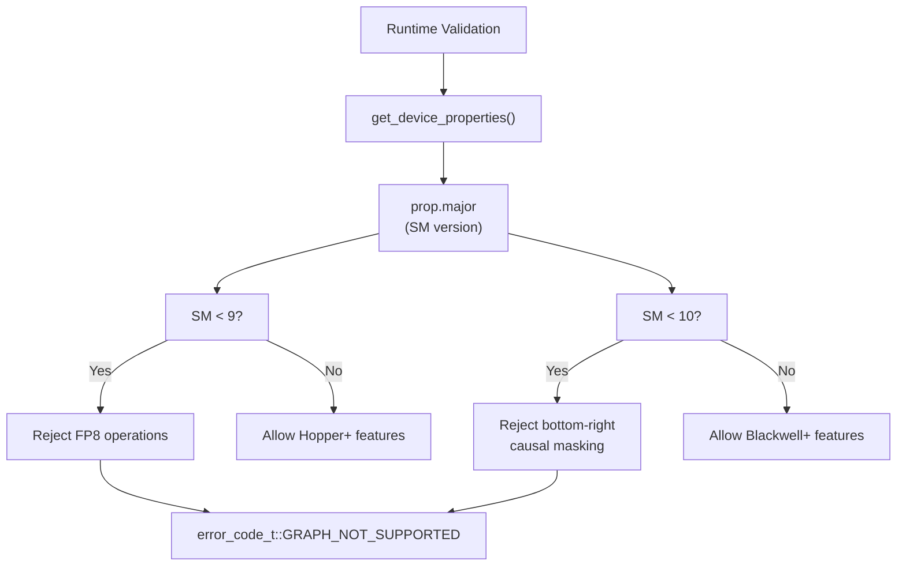

### FP8 Operations - Hopper Required

FP8 operations require Hopper architecture (SM 9.0+):

```cpp
RETURN_CUDNN_FRONTEND_ERROR_IF(
    prop.major < 9,
    error_code_t::GRAPH_NOT_SUPPORTED,
    "sdpa fp8 forward operation is only supported on Hopper architecture and newer..."
);
```

### Causal Masking - Blackwell Required

Bottom-right causal masking requires Blackwell architecture (SM 10.0+):

```cpp
RETURN_CUDNN_FRONTEND_ERROR_IF(
    attributes.causal_mask_bottom_right && prop.major < 10,
    error_code_t::GRAPH_NOT_SUPPORTED,
    "sdpa fp8 forward operation is only supported on Blackwell architecture..."
);
```

Sources: Hardware validation occurs in node validation methods throughout the codebase.

## Python Bindings Compatibility

The Python bindings for cuDNN Frontend require:

- Python 3.8 or newer
- Only the v1.0 API is exposed via Python bindings

Sources: [README.md:35](), [README.md:68]()

## Version Error Handling

When incompatible versions are detected at runtime, the library uses a consistent error reporting mechanism:

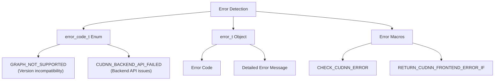

Sources: [include/cudnn_frontend/graph_helpers.h:35-50](), [include/cudnn_frontend/graph_helpers.h:107-120](), [include/cudnn_frontend/graph_helpers.h:122-132]()

## Checking Version Information

To programmatically check the version of the cuDNN Frontend library, you can access the version macros:

```cpp
#include <cudnn_frontend.h>
#include <iostream>

int main() {
    std::cout << "cuDNN Frontend Version: "
              << CUDNN_FRONTEND_MAJOR_VERSION << "."
              << CUDNN_FRONTEND_MINOR_VERSION << "."
              << CUDNN_FRONTEND_PATCH_VERSION << std::endl;
    
    std::cout << "cuDNN Frontend Version (numeric): "
              << CUDNN_FRONTEND_VERSION << std::endl;
    
    return 0;
}
```

Sources: [include/cudnn_frontend_version.h:25-29]()

## API Version Evolution

The cuDNN Frontend API has evolved over time:

- **v1.0**: Introduced a persistent `cudnn_frontend::graph::Graph` object for describing multiple operations as a subgraph
- **Pre-v1.0**: Earlier versions used a more verbose API style
- **v1.0 and later**: All API through Python bindings

For most users, it is recommended to use v1.0 or later as it provides a simplified workflow compared to earlier versions.

Sources: [README.md:13-15]()

---

# Page: API Reference

# API Reference

<details>
<summary>Relevant source files</summary>

The following files were used as context for generating this wiki page:

- [include/cudnn_frontend/cudnn_interface.h](include/cudnn_frontend/cudnn_interface.h)
- [include/cudnn_frontend/graph_helpers.h](include/cudnn_frontend/graph_helpers.h)
- [include/cudnn_frontend/graph_interface.h](include/cudnn_frontend/graph_interface.h)
- [include/cudnn_frontend/node/sdpa_fp8_bwd.h](include/cudnn_frontend/node/sdpa_fp8_bwd.h)
- [include/cudnn_frontend_EngineFallbackList.h](include/cudnn_frontend_EngineFallbackList.h)
- [include/cudnn_frontend_ExecutionPlan.h](include/cudnn_frontend_ExecutionPlan.h)
- [include/cudnn_frontend_Operation.h](include/cudnn_frontend_Operation.h)
- [include/cudnn_frontend_PointWiseDesc.h](include/cudnn_frontend_PointWiseDesc.h)
- [samples/cpp/convolution/fprop.cpp](samples/cpp/convolution/fprop.cpp)
- [samples/cpp/sdpa/fp16_fwd_with_custom_dropout.cpp](samples/cpp/sdpa/fp16_fwd_with_custom_dropout.cpp)
- [samples/cpp/sdpa/fp8_fwd.cpp](samples/cpp/sdpa/fp8_fwd.cpp)

</details>


## Purpose and Scope

This section provides comprehensive documentation for the cuDNN Frontend library's public APIs. The library offers two distinct API styles for building and executing cuDNN operations:

1. **Graph API** (Modern, Recommended) - A high-level, composable interface centered around the `cudnn_frontend::graph::Graph` class
2. **Legacy Builder API** - A lower-level builder pattern interface using descriptor classes

This page provides an overview of both API styles and their usage patterns. For detailed documentation on specific components:
- Graph API details: [Graph API](#2.1)
- Tensor attributes and memory management: [Tensor System](#2.2)
- Operation-specific configuration: [Operation Attributes](#2.3)
- Execution plan management: [Execution Plans](#2.4)
- Engine selection and optimization: [Heuristics & Engine Selection](#2.5)

For higher-level architectural context, see [Architecture Overview](#1.2).

---

## API Comparison

The cuDNN Frontend provides two API paradigms with different design philosophies:

| Aspect | Graph API | Legacy Builder API |
|--------|-----------|-------------------|
| **Primary Class** | `cudnn_frontend::graph::Graph` | `cudnn_frontend::OperationBuilder_v8` |
| **Design Pattern** | Declarative graph construction | Imperative builder pattern |
| **Abstraction Level** | High (composite operations) | Low (primitive operations) |
| **Type Safety** | C++ templates with type inference | Explicit descriptor management |
| **Recommended For** | New applications, complex graphs | Migration from legacy code |
| **Python Support** | Full support via `cudnn.pygraph` | Limited |
| **Version** | cuDNN 8.0+ (mature in 8.9+) | cuDNN 8.0+ |

**Sources:** [include/cudnn_frontend/graph_interface.h:40-41](), [include/cudnn_frontend_Operation.h:77-201]()

---

## Graph API Architecture

### Overview

The Graph API provides a modern, composable interface for building cuDNN operation graphs. It automatically handles graph construction, tensor attribute inference, and execution plan generation.

**Key Class:** `cudnn_frontend::graph::Graph`

**Sources:** [include/cudnn_frontend/graph_interface.h:40-320]()

### Typical Workflow

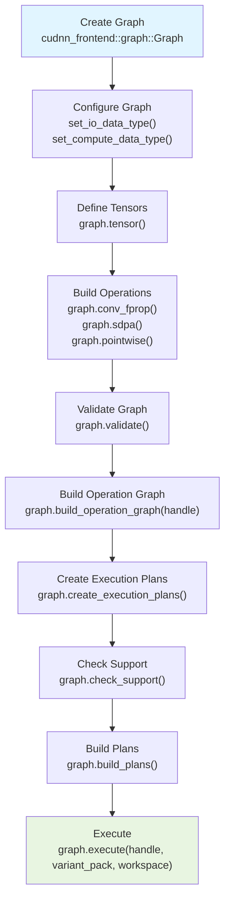

**Graph API Execution Flow**

**Sources:** [include/cudnn_frontend/graph_interface.h:631-712](), [samples/cpp/convolution/fprop.cpp:37-68]()

### Code Example: Convolution with Graph API

```cpp
// 1. Create and configure graph
auto graph = std::make_shared<fe::graph::Graph>();
graph->set_io_data_type(fe::DataType_t::HALF)
     .set_compute_data_type(fe::DataType_t::FLOAT);

// 2. Define input tensors
auto X = graph->tensor(fe::graph::Tensor_attributes()
                          .set_dim({n, c, h, w})
                          .set_stride({c*h*w, 1, c*w, c}));
auto W = graph->tensor(fe::graph::Tensor_attributes()
                          .set_dim({k, c, r, s})
                          .set_stride({c*r*s, 1, c*s, c}));

// 3. Build operation
auto Y = graph->conv_fprop(X, W, 
    fe::graph::Conv_fprop_attributes()
        .set_padding({0, 0})
        .set_stride({1, 1}));
Y->set_output(true);

// 4. Validate and build
graph->validate();
graph->build_operation_graph(handle);
graph->create_execution_plans({fe::HeurMode_t::A});
graph->build_plans();

// 5. Execute
std::unordered_map<int64_t, void*> variant_pack = {
    {X->get_uid(), x_ptr},
    {W->get_uid(), w_ptr},
    {Y->get_uid(), y_ptr}
};
graph->execute(handle, variant_pack, workspace_ptr);
```

**Sources:** [samples/cpp/convolution/fprop.cpp:28-90]()

### Graph API Core Methods

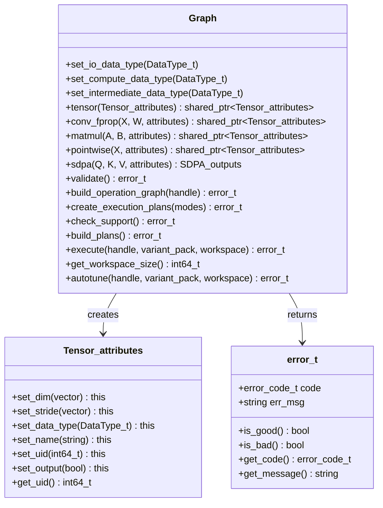

**Graph API Class Structure**

**Sources:** [include/cudnn_frontend/graph_interface.h:320-1454](), [include/cudnn_frontend/graph_properties.h:1-300](), [include/cudnn_frontend/graph_helpers.h:36-90]()

---

## Legacy Builder API Architecture

### Overview

The Legacy Builder API uses a builder pattern where each operation is constructed using descriptor classes. Users manually manage backend descriptors and operation graphs.

**Key Classes:**
- `OperationBuilder_v8` - Builds individual operations
- `OperationGraph_v8` - Container for operations  
- `ExecutionPlan_v8` - Compiled execution plan
- Descriptor builders: `TensorBuilder`, `ConvDescBuilder`, `PointWiseDescBuilder`, etc.

**Sources:** [include/cudnn_frontend_Operation.h:77-201](), [include/cudnn_frontend_ExecutionPlan.h:52-328]()

### Typical Workflow

```mermaid
flowchart TB
    CreateDesc["Create Descriptors<br/>TensorBuilder<br/>ConvDescBuilder<br/>PointWiseDescBuilder"]
    BuildOp["Build Operations<br/>OperationBuilder_v8<br/>.setX()<br/>.setY()<br/>.build()"]
    CreateOpGraph["Create OperationGraph<br/>OperationGraphBuilder<br/>.setOperationGraph()"]
    Finalize["Finalize Graph<br/>.build()"]
    QueryHeur["Query Heuristics<br/>EngineHeuristicsBuilder<br/>get engine configs"]
    BuildPlan["Build Execution Plan<br/>ExecutionPlanBuilder<br/>.setEngineConfig()"]
    CreateVariant["Create Variant Pack<br/>VariantPackBuilder<br/>set tensor UIDs"]
    Execute["Execute Plan<br/>cudnnBackendExecute()"]
    
    CreateDesc --> BuildOp
    BuildOp --> CreateOpGraph
    CreateOpGraph --> Finalize
    Finalize --> QueryHeur
    QueryHeur --> BuildPlan
    BuildPlan --> CreateVariant
    CreateVariant --> Execute
    
    style CreateDesc fill:#ffe8f0
    style Execute fill:#e8f5e1
```

**Legacy Builder API Execution Flow**

**Sources:** [include/cudnn_frontend_Operation.h:207-535](), [include/cudnn_frontend_ExecutionPlan.h:333-466]()

### Code Example: Pointwise with Legacy Builder API

```cpp
// 1. Create tensor descriptors
auto xTensor = TensorBuilder()
    .setDim(4, xDim)
    .setStride(4, xStride)
    .setId('x')
    .setAlignment(16)
    .setDataType(CUDNN_DATA_HALF)
    .build();

auto yTensor = TensorBuilder()
    .setDim(4, yDim)
    .setStride(4, yStride)
    .setId('y')
    .setAlignment(16)
    .setDataType(CUDNN_DATA_HALF)
    .build();

// 2. Create pointwise descriptor
auto pwDesc = PointWiseDescBuilder()
    .setMode(CUDNN_POINTWISE_RELU_FWD)
    .setComputeType(CUDNN_DATA_FLOAT)
    .build();

// 3. Create operation
auto op = OperationBuilder(CUDNN_BACKEND_OPERATION_POINTWISE_DESCRIPTOR)
    .setxDesc(xTensor)
    .setyDesc(yTensor)
    .setpwDesc(pwDesc)
    .build();

// 4. Create operation graph
auto opGraph = OperationGraphBuilder()
    .setHandle(handle)
    .setOperationGraph(1, &op)
    .build();

// 5. Query heuristics and build plan
auto heuristics = EngineHeuristicsBuilder()
    .setOperationGraph(opGraph)
    .setHeurMode(CUDNN_HEUR_MODE_INSTANT)
    .build();

auto& engine_config = heuristics.getEngineConfig(1)[0];
auto plan = ExecutionPlanBuilder()
    .setHandle(handle)
    .setEngineConfig(engine_config)
    .build();

// 6. Create variant pack and execute
auto variantPack = VariantPackBuilder()
    .setWorkspacePointer(workspace)
    .setDataPointers(2, data_ptrs)
    .setUids(2, uids)
    .build();

cudnnBackendExecute(handle, plan.get_raw_desc(), variantPack.get_raw_desc());
```

**Sources:** [include/cudnn_frontend_PointWiseDesc.h:106-399](), [include/cudnn_frontend_Operation.h:392-535]()

### Legacy Builder API Class Hierarchy

```mermaid
classDiagram
    class BackendDescriptor {
        <<base>>
        +get_backend_descriptor() cudnnBackendDescriptor_t
        +get_status() cudnnStatus_t
        +get_error() string
    }
    
    class Tensor_v8 {
        +getDim() vector
        +getStride() vector
        +getId() int64_t
        +getDataType() DataType_t
    }
    
    class Operation_v8 {
        +getTag() string
        +getFeatureVector() feature_vector_t
        +describe() string
    }
    
    class OperationGraph_v8 {
        +getTag() string
        +getOpCount() uint64_t
        +getFeatureVector() feature_vector_t
    }
    
    class ExecutionPlan_v8 {
        +getWorkspaceSize() int64_t
        +getTag() string
        +getNumericNotes() array
        +getBehaviorNotes() array
        +getExecutionTime() float
        +setExecutionTime(float)
    }
    
    class TensorBuilder {
        +setDim(count, dims) this
        +setStride(count, strides) this
        +setId(int64_t) this
        +setDataType(DataType_t) this
        +build() Tensor_v8
    }
    
    class OperationBuilder_v8 {
        +setxDesc(Tensor) this
        +setyDesc(Tensor) this
        +setAlpha(value) this
        +setBeta(value) this
        +build() Operation_v8
    }
    
    class ExecutionPlanBuilder_v8 {
        +setHandle(handle) this
        +setEngineConfig(config) this
        +build() ExecutionPlan_v8
    }
    
    BackendDescriptor <|-- Tensor_v8
    BackendDescriptor <|-- Operation_v8
    BackendDescriptor <|-- OperationGraph_v8
    BackendDescriptor <|-- ExecutionPlan_v8
    
    TensorBuilder ..> Tensor_v8 : builds
    OperationBuilder_v8 ..> Operation_v8 : builds
    ExecutionPlanBuilder_v8 ..> ExecutionPlan_v8 : builds
```

**Legacy Builder API Class Relationships**

**Sources:** [include/cudnn_frontend_Operation.h:77-201](), [include/cudnn_frontend_ExecutionPlan.h:52-158](), [include/cudnn_frontend_Tensor.h:1-100]()

---

## Error Handling

Both APIs use a consistent error handling mechanism based on the `error_t` structure.

### Error Type Definitions

```mermaid
classDiagram
    class error_t {
        +error_code_t code
        +string err_msg
        +is_good() bool
        +is_bad() bool
        +get_code() error_code_t
        +get_message() string
        +operator==(error_code_t) bool
    }
    
    class error_code_t {
        <<enumeration>>
        OK
        ATTRIBUTE_NOT_SET
        SHAPE_DEDUCTION_FAILED
        INVALID_TENSOR_NAME
        INVALID_VARIANT_PACK
        GRAPH_NOT_SUPPORTED
        GRAPH_EXECUTION_PLAN_CREATION_FAILED
        GRAPH_EXECUTION_FAILED
        HEURISTIC_QUERY_FAILED
        CUDA_API_FAILED
        CUDNN_BACKEND_API_FAILED
        INVALID_CUDA_DEVICE
        HANDLE_ERROR
        INVALID_VALUE
    }
    
    error_t --> error_code_t
```

**Error Handling Types**

### Error Checking Patterns

**Graph API (Recommended):**
```cpp
// Check return value
auto status = graph->validate();
if (status.is_bad()) {
    std::cerr << "Validation failed: " 
              << status.get_message() << std::endl;
    return;
}

// Or use macro for automatic error propagation
CHECK_CUDNN_FRONTEND_ERROR(graph->validate());
CHECK_CUDNN_FRONTEND_ERROR(graph->build_operation_graph(handle));
CHECK_CUDNN_FRONTEND_ERROR(graph->execute(handle, variant_pack, workspace));
```

**Legacy Builder API:**
```cpp
// Check descriptor status after build
auto tensor = TensorBuilder().setDim(...).build();
if (tensor.get_status() != CUDNN_STATUS_SUCCESS) {
    std::cerr << "Tensor creation failed: " 
              << tensor.get_error() << std::endl;
    return;
}

// With exception handling (if not using NV_CUDNN_DISABLE_EXCEPTION)
try {
    auto plan = ExecutionPlanBuilder()
                    .setEngineConfig(config)
                    .build();
} catch (cudnn_frontend::cudnnException& e) {
    std::cerr << "Plan build failed: " << e.what() << std::endl;
}
```

**Sources:** [include/cudnn_frontend/graph_helpers.h:36-194](), [samples/cpp/convolution/fprop.cpp:57-65]()

---

## Common Operation Patterns

### Variant Pack Construction

Both APIs require mapping tensor UIDs to device memory pointers for execution.

**Graph API:**
```cpp
std::unordered_map<int64_t, void*> variant_pack = {
    {Q->get_uid(), q_device_ptr},
    {K->get_uid(), k_device_ptr},
    {V->get_uid(), v_device_ptr},
    {O->get_uid(), o_device_ptr}
};

// Or using shared_ptr to Tensor_attributes
std::unordered_map<std::shared_ptr<Tensor_attributes>, void*> variant_pack = {
    {Q, q_device_ptr},
    {K, k_device_ptr},
    {V, v_device_ptr},
    {O, o_device_ptr}
};

graph->execute(handle, variant_pack, workspace_ptr);
```

**Legacy Builder API:**
```cpp
void* data_ptrs[] = {x_ptr, y_ptr};
int64_t uids[] = {'x', 'y'};

auto variantPack = VariantPackBuilder()
    .setWorkspacePointer(workspace)
    .setDataPointers(2, data_ptrs)
    .setUids(2, uids)
    .build();

cudnnBackendExecute(handle, plan_desc, variantPack.get_raw_desc());
```

**Sources:** [include/cudnn_frontend/graph_interface.h:801-812](), [samples/cpp/sdpa/fp8_fwd.cpp:132-155](), [samples/cpp/sdpa/fp16_fwd_with_custom_dropout.cpp:173-194]()

### Workspace Management

Both APIs require users to allocate workspace memory for temporary data.

```cpp
// Query workspace size
int64_t workspace_size = 0;
graph->get_workspace_size(workspace_size);

// Allocate workspace
void* workspace_ptr;
cudaMalloc(&workspace_ptr, workspace_size);

// Execute with workspace
graph->execute(handle, variant_pack, workspace_ptr);

// Clean up
cudaFree(workspace_ptr);
```

The workspace size may vary depending on:
- Selected execution plan (different engines may require different amounts)
- Graph complexity (number of operations, intermediate tensors)
- FE-managed tensors (e.g., dropout masks, auxiliary data)

**Sources:** [include/cudnn_frontend/graph_interface.h:726-765](), [samples/cpp/convolution/fprop.cpp:83-89]()

---

## API Selection Guidelines

### Choose Graph API When:
- Building new applications from scratch
- Using Python (required for Python bindings)
- Working with composite operations (SDPA, layer normalization, etc.)
- Wanting automatic tensor property inference
- Needing dynamic shape support (cuDNN 9.4+)
- Preferring declarative graph construction

### Choose Legacy Builder API When:
- Migrating existing cuDNN backend code
- Requiring fine-grained control over descriptors
- Working with cuDNN versions < 8.9 (limited Graph API support)
- Building custom wrappers around raw backend descriptors

**Note:** The Graph API is the recommended and actively developed interface. New features and optimizations are primarily targeted at the Graph API.

**Sources:** [include/cudnn_frontend/graph_interface.h:1-40](), [include/cudnn_frontend_Operation.h:43-76]()

---

## Detailed Component Documentation

For in-depth coverage of specific API components, refer to the following sections:

- **[Graph API](#2.1)** - Complete Graph API reference including all operation types
- **[Tensor System](#2.2)** - Tensor attributes, data types, memory categories (physical/virtual/pass-by-value)
- **[Operation Attributes](#2.3)** - Configuration classes for convolution, matmul, SDPA, normalization operations
- **[Execution Plans](#2.4)** - Plan creation, workspace requirements, caching, and autotuning
- **[Heuristics & Engine Selection](#2.5)** - Heuristic modes, engine filtering, numeric/behavioral notes, errata system

For implementation examples, see [Examples & Samples](#6).

**Sources:** [include/cudnn_frontend/graph_interface.h](), [include/cudnn_frontend_Operation.h](), [include/cudnn_frontend_ExecutionPlan.h]()

---

# Page: Graph API

# Graph API

<details>
<summary>Relevant source files</summary>

The following files were used as context for generating this wiki page:

- [include/cudnn_frontend/cudnn_interface.h](include/cudnn_frontend/cudnn_interface.h)
- [include/cudnn_frontend/graph_helpers.h](include/cudnn_frontend/graph_helpers.h)
- [include/cudnn_frontend/graph_interface.h](include/cudnn_frontend/graph_interface.h)
- [include/cudnn_frontend/graph_properties.h](include/cudnn_frontend/graph_properties.h)
- [include/cudnn_frontend/node/sdpa_fp8_bwd.h](include/cudnn_frontend/node/sdpa_fp8_bwd.h)
- [python/pygraph/pygraph.h](python/pygraph/pygraph.h)
- [samples/cpp/CMakeLists.txt](samples/cpp/CMakeLists.txt)
- [samples/cpp/convolution/fprop.cpp](samples/cpp/convolution/fprop.cpp)
- [samples/cpp/sdpa/fp16_fwd_with_custom_dropout.cpp](samples/cpp/sdpa/fp16_fwd_with_custom_dropout.cpp)
- [samples/cpp/sdpa/fp8_fwd.cpp](samples/cpp/sdpa/fp8_fwd.cpp)
- [test/python/test_matmul_bias_relu.py](test/python/test_matmul_bias_relu.py)

</details>


The Graph API is the primary interface for constructing and executing cuDNN operations in cudnn-frontend. It provides a modern, composable approach to building neural network operations by representing computations as dataflow graphs. Users construct a graph by adding tensors and operations, validate the graph structure, build execution plans, and execute them on the GPU.

For information about the underlying node system that powers graph construction, see [Node Types](#3). For details about execution plan generation and optimization, see [Execution Plans](#2.4) and [Heuristics & Engine Selection](#2.5). For tensor properties and memory management, see [Tensor System](#2.2).

---

## Graph Construction Workflow

The Graph API follows a multi-phase workflow that separates graph definition from execution. This design enables graph reuse across multiple executions with different input data.

```mermaid
flowchart TD
    START["User Code"] --> CREATE["graph = Graph()"]
    CREATE --> CONFIG["Set Data Types:<br/>set_io_data_type()<br/>set_compute_data_type()<br/>set_intermediate_data_type()"]
    CONFIG --> ADD_TENSORS["Create Tensors:<br/>graph.tensor()"]
    ADD_TENSORS --> ADD_OPS["Add Operations:<br/>graph.conv_fprop()<br/>graph.matmul()<br/>graph.sdpa()"]
    ADD_OPS --> MARK_OUTPUT["Mark Outputs:<br/>tensor->set_output(true)"]
    MARK_OUTPUT --> VALIDATE["validate()"]
    VALIDATE --> BUILD["build_operation_graph(handle)"]
    BUILD --> PLANS["create_execution_plans(heur_modes)"]
    PLANS --> CHECK["check_support()"]
    CHECK --> BUILD_PLANS["build_plans()"]
    BUILD_PLANS --> EXECUTE["execute(variant_pack, workspace)"]
    EXECUTE --> REUSE{Reuse?}
    REUSE -->|Yes| EXECUTE
    REUSE -->|No| END["Cleanup"]
```

**Graph Lifecycle Phases**

Sources: [include/cudnn_frontend/graph_interface.h:631-712](), [samples/cpp/convolution/fprop.cpp:37-89]()

---

## Core Graph Class

The `cudnn_frontend::graph::Graph` class is the central abstraction for the Graph API. It inherits from both `ICudnn` (backend interface) and `INode` (node system interface).

```mermaid
classDiagram
    class Graph {
        +set_io_data_type(DataType_t) Graph
        +set_compute_data_type(DataType_t) Graph
        +set_intermediate_data_type(DataType_t) Graph
        +tensor(Tensor_attributes) shared_ptr~Tensor_attributes~
        +conv_fprop(X, W, attributes) shared_ptr~Tensor_attributes~
        +matmul(A, B, attributes) shared_ptr~Tensor_attributes~
        +sdpa(Q, K, V, attributes) SDPA_outputs
        +validate() error_t
        +build_operation_graph(handle) error_t
        +create_execution_plans(heur_modes) error_t
        +check_support() error_t
        +build_plans() error_t
        +execute(variant_pack, workspace) error_t
        +get_workspace_size() int64_t
        -sub_nodes vector~unique_ptr~INode~~
        -full_graph_inputs unordered_set
        -full_graph_outputs unordered_set
    }
    
    class ICudnn {
        #uid_to_tensors map
        #operations vector
        #operation_graph shared_ptr
        #plans Execution_plan_list
        +execute_cudnn_plan_with_uid()
    }
    
    class INode {
        #sub_nodes vector
        +validate_subtree()
        +expand_subtree()
        +create_cudnn_operations()
    }
    
    Graph --|> ICudnn
    Graph --|> INode
```

**Key Responsibilities**

| Responsibility | Methods | Description |
|----------------|---------|-------------|
| **Configuration** | `set_io_data_type()`, `set_compute_data_type()` | Set global data types for the graph |
| **Tensor Creation** | `tensor()`, `tensor_like()` | Create tensor attributes for inputs/outputs |
| **Operation Addition** | `conv_fprop()`, `matmul()`, `sdpa()`, `pointwise()` | Add operations to the graph |
| **Validation** | `validate()` | Check graph structure and tensor properties |
| **Backend Lowering** | `build_operation_graph()` | Convert to backend descriptors |
| **Plan Management** | `create_execution_plans()`, `build_plans()` | Generate and build execution plans |
| **Execution** | `execute()`, `autotune()` | Execute the graph with data |

Sources: [include/cudnn_frontend/graph_interface.h:40-320](), [include/cudnn_frontend/cudnn_interface.h:100-207]()

---

## Tensor Creation

Tensors in the Graph API are represented by `Tensor_attributes` objects. Each tensor has properties like dimensions, strides, data type, and a unique identifier (UID).

### Tensor Creation Methods

```mermaid
graph LR
    A["Graph::tensor()"] --> B["Tensor_attributes"]
    C["Graph::tensor_like()"] --> B
    D["Operation Output"] --> B
    
    B --> E["set_dim()"]
    B --> F["set_stride()"]
    B --> G["set_data_type()"]
    B --> H["set_uid()"]
    B --> I["set_output()"]
    B --> J["set_is_virtual()"]
```

**Example: Creating Tensors**

```cpp
// Create graph and set data types
auto graph = std::make_shared<fe::graph::Graph>();
graph->set_io_data_type(fe::DataType_t::HALF)
     .set_compute_data_type(fe::DataType_t::FLOAT);

// Create input tensor with explicit dimensions
auto X = graph->tensor(
    fe::graph::Tensor_attributes()
        .set_name("input")
        .set_dim({n, c, h, w})
        .set_stride({c*h*w, 1, c*w, c})
);

// Create tensor from existing tensor (for PyTorch/etc)
auto Y = graph->tensor_like(existing_tensor);

// Mark tensor as output
Y->set_output(true);
```

### Tensor Categories

| Category | `is_virtual` | `is_pass_by_value` | Memory Management |
|----------|--------------|-------------------|-------------------|
| **Physical** | `false` | `false` | User-allocated, provided via variant pack |
| **Virtual** | `true` | `false` | Framework-managed, allocated in workspace |
| **Pass-by-value** | N/A | `true` | Scalar constant embedded in graph or passed at execution |

Sources: [include/cudnn_frontend/graph_interface.h:1079-1164](), [include/cudnn_frontend/graph_properties.h:22-296]()

---

## Operation Methods

The Graph API provides high-level methods for adding operations. Each method returns output tensor(s) that can be connected to subsequent operations.

### Operation Method Signature Pattern

```mermaid
graph TB
    INPUT["Input Tensors"] --> OP["Operation Method<br/>e.g., graph.matmul(A, B, attrs)"]
    ATTR["Operation Attributes"] --> OP
    OP --> OUTPUT["Output Tensor(s)"]
    OUTPUT --> CHAIN["Chain to Next Op"]
```

### Common Operations

| Operation Category | Methods | Input Attributes Class |
|-------------------|---------|----------------------|
| **Convolution** | `conv_fprop()`, `conv_dgrad()`, `conv_wgrad()` | `Conv_fprop_attributes` |
| **Matrix Multiplication** | `matmul()`, `matmul_fp8()` | `Matmul_attributes` |
| **Attention** | `sdpa()`, `sdpa_fp8()`, `sdpa_backward()` | `SDPA_attributes` |
| **Pointwise** | `pointwise()`, `relu()`, `gelu()` | `Pointwise_attributes` |
| **Reduction** | `reduction()` | `Reduction_attributes` |
| **Normalization** | `layernorm()`, `batchnorm()`, `rmsnorm()` | `Layernorm_attributes` |

**Example: Building a Convolution-Bias-ReLU Graph**

```cpp
// Create input tensors
auto X = graph->tensor(fe::graph::Tensor_attributes()
    .set_dim({n, c, h, w})
    .set_stride({c*h*w, 1, c*w, c}));
auto W = graph->tensor(fe::graph::Tensor_attributes()
    .set_dim({k, c, r, s})
    .set_stride({c*r*s, 1, c*s, c}));

// Convolution
auto conv_attrs = fe::graph::Conv_fprop_attributes()
    .set_padding({1, 1})
    .set_stride({1, 1});
auto conv_out = graph->conv_fprop(X, W, conv_attrs);

// Bias
auto B = graph->tensor(fe::graph::Tensor_attributes()
    .set_dim({1, k, 1, 1}));
auto bias_out = graph->pointwise(
    conv_out, B,
    fe::graph::Pointwise_attributes().set_mode(fe::PointwiseMode_t::ADD));

// ReLU
auto Y = graph->pointwise(
    bias_out,
    fe::graph::Pointwise_attributes().set_mode(fe::PointwiseMode_t::RELU_FWD));
Y->set_output(true);
```

Sources: [include/cudnn_frontend/graph_interface.h:1079-1492](), [samples/cpp/convolution/fprop.cpp:214-264]()

---

## Graph Validation

The `validate()` method performs structural checks on the graph before backend lowering. It verifies tensor properties and ensures operation compatibility.

```mermaid
flowchart TD
    START["validate()"] --> VALIDATE_INPUTS["Validate Input Tensors<br/>Check dim, stride, data_type"]
    VALIDATE_INPUTS --> VALIDATE_SUBTREE["validate_subtree()<br/>Calls pre_validate_node()"]
    VALIDATE_SUBTREE --> INFER["infer_properties_node()<br/>Deduce missing properties"]
    INFER --> POST_VALIDATE["post_validate_node()<br/>Final checks"]
    POST_VALIDATE --> VALIDATE_OUTPUTS["Validate Output Tensors"]
    VALIDATE_OUTPUTS --> CHECK_UIDS["Check UID Uniqueness"]
    CHECK_UIDS --> RETURN["Return error_t"]
```

**Validation Checks**

| Check Type | Description | Error Code |
|------------|-------------|------------|
| **Tensor Properties** | Dims and strides must be set | `ATTRIBUTE_NOT_SET` |
| **UID Conflicts** | All assigned UIDs must be unique | `INVALID_VALUE` |
| **Operation Support** | Operation supported on current cuDNN version | `GRAPH_NOT_SUPPORTED` |
| **Data Type Compatibility** | Tensors have compatible data types | `ATTRIBUTE_NOT_SET` |

Sources: [include/cudnn_frontend/graph_interface.h:631-655](), [include/cudnn_frontend/graph_properties.h:36-56]()

---

## Building the Operation Graph

The `build_operation_graph()` method converts the high-level graph into backend cuDNN descriptors. This is a four-step process.

```mermaid
sequenceDiagram
    participant User
    participant Graph
    participant Nodes
    participant Backend
    
    User->>Graph: build_operation_graph(handle)
    Graph->>Nodes: 1. expand_subtree()
    Note over Nodes: Expand composite nodes<br/>(e.g., SDPA → matmuls)
    Nodes-->>Graph: Expanded primitive nodes
    
    Graph->>Nodes: 2. create_cudnn_tensors_subtree()
    Note over Nodes: Create backend Tensor descriptors<br/>Assign UIDs
    Nodes->>Backend: TensorBuilder.build()
    Backend-->>Graph: uid_to_tensors map
    
    Graph->>Nodes: 3. create_cudnn_operations()
    Note over Nodes: Create backend Operation descriptors
    Nodes->>Backend: OperationBuilder.build()
    Backend-->>Graph: operations vector
    
    Graph->>Backend: 4. create_cudnn_operation_graph()
    Note over Backend: OperationGraphBuilder
    Backend-->>Graph: operation_graph
```

**Build Phase Details**

| Phase | Method | Purpose |
|-------|--------|---------|
| **1. Expand** | `expand_subtree()` | Composite nodes (SDPA, LayerNorm) expand to primitive operations |
| **2. Create Tensors** | `create_cudnn_tensors_subtree()` | Generate backend tensor descriptors, assign UIDs |
| **3. Create Operations** | `create_cudnn_operations()` | Generate backend operation descriptors |
| **4. Build Op Graph** | `create_cudnn_operation_graph()` | Fuse operations into a single backend graph |

Sources: [include/cudnn_frontend/graph_interface.h:669-712](), [include/cudnn_frontend/cudnn_interface.h:128-163]()

---

## Execution Plans and Heuristics

After building the operation graph, the user must create execution plans by querying heuristics. This determines which kernels cuDNN will use.

### Plan Creation Flow

```mermaid
flowchart LR
    A["create_execution_plans(heur_modes)"] --> B["HeurMode_t::A<br/>Fast Heuristic"]
    A --> C["HeurMode_t::B<br/>Exhaustive Search"]
    A --> D["HeurMode_t::FALLBACK<br/>Guaranteed Valid"]
    
    B --> E["Engine Configs"]
    C --> E
    D --> E
    
    E --> F["Filter by Workspace"]
    F --> G["Filter by Notes"]
    G --> H["Check Errata"]
    H --> I["check_support()"]
    I --> J["build_plans()"]
    J --> K["execution_plans vector"]
```

**Heuristic Modes**

| Mode | Description | Use Case |
|------|-------------|----------|
| `HeurMode_t::A` | Fast heuristic, returns 1-2 engines | Production, minimal autotuning |
| `HeurMode_t::B` | Exhaustive search, many engines | Full autotuning for optimal performance |
| `HeurMode_t::FALLBACK` | Guaranteed to return valid engine | Fallback when A/B fail |

**Example: Creating and Building Plans**

```cpp
// Create plans with multiple heuristic modes
auto status = graph->create_execution_plans({
    fe::HeurMode_t::A,
    fe::HeurMode_t::FALLBACK
});

// Check if graph is supported on current device
status = graph->check_support(handle);
if (status.is_bad()) {
    // Handle unsupported graph
}

// Build the plans (compiles kernels if needed)
status = graph->build_plans(handle);
```

Sources: [include/cudnn_frontend/graph_interface.h:1633-1718](), [include/cudnn_frontend/plans.h:1-100]()

---

## Graph Execution

The `execute()` method runs the graph with user-provided data. Data pointers are passed via a variant pack that maps tensor UIDs to device memory.

### Execution Flow

```mermaid
flowchart TD
    START["execute(handle, variant_pack, workspace)"] --> PASS_BY_VALUE["Collect Pass-by-value Tensors"]
    PASS_BY_VALUE --> WORKSPACE_PREP["Prepare Workspace Tensors<br/>Run auxiliary kernels (memcpy, memset)"]
    WORKSPACE_PREP --> VALIDATE_VP["Validate Variant Pack<br/>Check all UIDs present"]
    VALIDATE_VP --> CREATE_VP["Create Backend Variant Pack"]
    CREATE_VP --> EXEC_PLAN["Execute Selected Plan<br/>plans.execution_plans[candidate]"]
    EXEC_PLAN --> RETURN["Return error_t"]
```

**Variant Pack Structure**

The variant pack is a map from tensor UID to device pointer:

```cpp
std::unordered_map<int64_t, void*> variant_pack = {
    {Q->get_uid(), q_device_ptr},
    {K->get_uid(), k_device_ptr},
    {V->get_uid(), v_device_ptr},
    {O->get_uid(), o_device_ptr}
};

// Or using shared_ptr keys:
std::unordered_map<std::shared_ptr<fe::graph::Tensor_attributes>, void*> variant_pack = {
    {Q, q_device_ptr},
    {K, k_device_ptr}
};
```

**Workspace Management**

```cpp
// Query workspace size
int64_t workspace_size;
graph->get_workspace_size(workspace_size);

// Allocate workspace
void* workspace;
cudaMalloc(&workspace, workspace_size);

// Execute
graph->execute(handle, variant_pack, workspace);
```

Sources: [include/cudnn_frontend/graph_interface.h:1903-2043](), [samples/cpp/convolution/fprop.cpp:75-89]()

---

## Python Interface

The Python Graph API wraps the C++ Graph API through the `PyGraph` class. It provides a Pythonic interface while maintaining access to all C++ functionality.

### Python Graph Creation

```python
import cudnn

# Create graph
graph = cudnn.pygraph(
    handle=cudnn_handle,
    io_data_type=cudnn.data_type.HALF,
    intermediate_data_type=cudnn.data_type.FLOAT,
    compute_data_type=cudnn.data_type.FLOAT
)

# Create tensors from PyTorch/NumPy
Q = graph.tensor_like(q_tensor)
K = graph.tensor_like(k_tensor)
V = graph.tensor_like(v_tensor)

# Add operations
O, Stats = graph.sdpa(
    q=Q, k=K, v=V,
    attn_scale=attn_scale,
    is_inference=False
)
O.set_output(True)

# Build and execute
graph.validate()
graph.build_operation_graph()
graph.create_execution_plans([cudnn.heur_mode.A])
graph.check_support()
graph.build_plans()

# Execute with PyTorch tensors
workspace = torch.empty(graph.get_workspace_size(), device="cuda", dtype=torch.uint8)
graph.execute({Q: q_tensor, K: k_tensor, V: v_tensor, O: o_tensor}, workspace)
```

**Key Differences from C++**

| Feature | C++ | Python |
|---------|-----|--------|
| **Graph Creation** | `std::make_shared<Graph>()` | `cudnn.pygraph()` |
| **Tensor Creation** | `graph->tensor()` | `graph.tensor()` or `graph.tensor_like()` |
| **Method Chaining** | `->` | `.` |
| **Variant Pack** | `std::unordered_map` | Python `dict` |
| **Handle Management** | Manual or passed | Automatic or passed |

Sources: [python/pygraph/pygraph.h:17-124](), [test/python/test_matmul_bias_relu.py:240-327]()

---

## Complete Example: SDPA Forward Pass

This example demonstrates creating and executing a Scaled Dot-Product Attention (SDPA) graph.

**C++ Example**

```cpp
// Graph setup
fe::graph::Graph mha_graph;
mha_graph.set_io_data_type(fe::DataType_t::FP8_E4M3)
         .set_intermediate_data_type(fe::DataType_t::FLOAT)
         .set_compute_data_type(fe::DataType_t::FLOAT);

// Create tensors
auto Q = mha_graph.tensor(
    fe::graph::Tensor_attributes()
        .set_name("Q")
        .set_dim({b, h, s, d})
        .set_stride({s*3*h*d, d, 3*h*d, 1}));
auto K = mha_graph.tensor_like(Q, "K");
auto V = mha_graph.tensor_like(Q, "V");

// FP8 scaling tensors
auto descale_q = mha_graph.tensor(
    fe::graph::Tensor_attributes()
        .set_dim({1, 1, 1, 1})
        .set_data_type(fe::DataType_t::FLOAT));
// ... create other scaling tensors ...

// Create SDPA
auto sdpa_options = fe::graph::SDPA_fp8_attributes()
    .set_attn_scale(attn_scale)
    .set_causal_mask(true);
auto [O, Stats, Amax_S, Amax_O] = mha_graph.sdpa_fp8(
    Q, K, V, descale_q, descale_k, descale_v,
    descale_s, scale_s, scale_o, sdpa_options);

// Mark outputs
O->set_output(true);
Amax_O->set_output(true);
Amax_S->set_output(true);

// Build and execute
mha_graph.validate();
mha_graph.build_operation_graph(handle);
mha_graph.create_execution_plans({fe::HeurMode_t::A});
mha_graph.check_support(handle);
mha_graph.build_plans(handle);

// Execute
std::unordered_map<std::shared_ptr<fe::graph::Tensor_attributes>, void*> variant_pack = {
    {Q, q_ptr}, {K, k_ptr}, {V, v_ptr}, {O, o_ptr},
    {descale_q, descale_q_ptr}, // ...
};
mha_graph.execute(handle, variant_pack, workspace_ptr);
```

Sources: [samples/cpp/sdpa/fp8_fwd.cpp:31-158]()

---

## Advanced Features

### Dynamic Shape Support

For cuDNN 9.4+, graphs can be built with dynamic shapes, allowing execution with varying tensor sizes without rebuilding.

```cpp
// Enable dynamic shapes
auto kernel_cache = std::make_shared<fe::KernelCache>();
graph->set_dynamic_shape_enabled(true)
     .set_kernel_cache(kernel_cache);

// Build once, execute with different shapes
for (auto& shape : shape_variations) {
    // Update tensor dimensions
    X->set_dim(shape.dims);
    
    // Execute (no rebuild needed)
    graph->execute(handle, variant_pack, workspace);
}
```

### Graph Serialization

Graphs can be serialized to JSON for debugging or caching.

```cpp
#ifndef CUDNN_FRONTEND_SKIP_JSON_LIB
json j;
graph->serialize(j);
std::cout << j.dump(4) << std::endl;
#endif
```

### Autotuning

The `autotune()` method profiles all available plans and selects the fastest.

```cpp
// Autotune to find best plan
graph->autotune(handle, variant_pack, workspace);

// Query selected plan
std::string plan_name;
graph->get_plan_name(plan_name);
std::cout << "Selected plan: " << plan_name << std::endl;
```

Sources: [include/cudnn_frontend/graph_interface.h:766-798](), [samples/cpp/convolution/fprop.cpp:92-212](), [samples/cpp/misc/autotuning.cpp]()

---

## Error Handling

All Graph API methods return `error_t` objects that indicate success or failure.

```cpp
auto status = graph->validate();
if (status.is_bad()) {
    std::cerr << "Validation failed: " 
              << status.get_message() 
              << " (code: " << status.get_code() << ")" 
              << std::endl;
    return;
}

// Or use CHECK macro
CHECK_CUDNN_FRONTEND_ERROR(graph->build_plans(handle));
```

**Common Error Codes**

| Error Code | Meaning | Common Causes |
|------------|---------|---------------|
| `OK` | Success | - |
| `ATTRIBUTE_NOT_SET` | Required property missing | Tensor dim/stride not set |
| `GRAPH_NOT_SUPPORTED` | Unsupported graph | Old cuDNN version, unsupported GPU arch |
| `INVALID_VARIANT_PACK` | Missing tensor in variant pack | UID not found in execute() |
| `CUDNN_BACKEND_API_FAILED` | Backend API error | Invalid descriptor, API failure |

Sources: [include/cudnn_frontend/graph_helpers.h:36-194]()

---

# Page: Tensor System

# Tensor System

<details>
<summary>Relevant source files</summary>

The following files were used as context for generating this wiki page:

- [include/cudnn_frontend/graph_properties.h](include/cudnn_frontend/graph_properties.h)
- [include/cudnn_frontend/node_interface.h](include/cudnn_frontend/node_interface.h)
- [include/cudnn_frontend/utils/serialize.h](include/cudnn_frontend/utils/serialize.h)
- [include/cudnn_frontend_utils.h](include/cudnn_frontend_utils.h)
- [python/pygraph/pygraph.cpp](python/pygraph/pygraph.cpp)
- [python/pygraph/pygraph.h](python/pygraph/pygraph.h)
- [python/pygraph/sdpa.cpp](python/pygraph/sdpa.cpp)
- [samples/cpp/CMakeLists.txt](samples/cpp/CMakeLists.txt)
- [test/python/test_matmul_bias_relu.py](test/python/test_matmul_bias_relu.py)

</details>


The Tensor System provides the foundational data structure for representing multi-dimensional arrays and their properties within the cuDNN Frontend. It defines how tensors are created, managed, and tracked throughout graph construction, validation, and execution phases.

**Scope**: This page covers `Tensor_attributes`, data types, UID management, memory categories (physical/virtual/pass-by-value), and tensor creation APIs. For information about how tensors are used within operations, see [Operation Attributes](#2.3). For execution-time memory binding, see [Execution Plans](#2.4).

## Tensor Attributes Structure

The `Tensor_attributes` class encapsulates all properties needed to describe a tensor in the graph.

```mermaid
classDiagram
    class Tensor_attributes {
        -string name
        -DataType_t data_type
        -vector~int64_t~ dim
        -vector~int64_t~ stride
        -bool is_virtual
        -bool is_pass_by_value
        -optional~pass_by_values_t~ pass_by_value
        -TensorReordering_t reordering_type
        -int64_t uid
        -bool uid_assigned
        -shared_ptr~Tensor_attributes~ ragged_offset
        -int64_t alignment
        -int64_t vector_count
        -int64_t vector_dimension
        +get_name() string
        +set_name(value) Tensor_attributes&
        +get_data_type() DataType_t
        +set_data_type(value) Tensor_attributes&
        +get_dim() vector~int64_t~
        +set_dim(value) Tensor_attributes&
        +get_stride() vector~int64_t~
        +set_stride(value) Tensor_attributes&
        +get_is_virtual() bool
        +set_is_virtual(value) Tensor_attributes&
        +get_is_pass_by_value() bool
        +set_is_pass_by_value(value) Tensor_attributes&
        +get_uid() uid_t
        +set_uid(value) Tensor_attributes&
        +validate() error_t
        +fill_from_context(context) Tensor_attributes&
    }
    
    class Context {
        +get_io_data_type() DataType_t
        +get_intermediate_data_type() DataType_t
        +get_compute_data_type() DataType_t
    }
    
    Tensor_attributes ..> Context : uses for inference
```

**Sources**: [include/cudnn_frontend/graph_properties.h:24-296]()

## Unique Identifier (UID) System

Each tensor is tracked through a unique identifier system that enables tensor binding during graph execution.

```mermaid
graph TB
    subgraph "Tensor Creation"
        CREATE["Tensor_attributes()"]
        AUTO_UID["Auto-assign UID<br/>(if not specified)"]
        USER_UID["User-specified UID<br/>set_uid(value)"]
    end
    
    subgraph "UID Assignment"
        UID_TRACK["uid_assigned = true<br/>uid = value"]
    end
    
    subgraph "Graph Building"
        COLLECT["collect_pass_by_value_tensors"]
        VALIDATE["validate UIDs are unique"]
    end
    
    subgraph "Execution Time"
        VARIANT_PACK["variant_pack<br/>uid → void* mapping"]
        EXECUTE["Execute with tensor bindings"]
    end
    
    CREATE --> AUTO_UID
    CREATE --> USER_UID
    AUTO_UID --> UID_TRACK
    USER_UID --> UID_TRACK
    UID_TRACK --> COLLECT
    COLLECT --> VALIDATE
    VALIDATE --> VARIANT_PACK
    VARIANT_PACK --> EXECUTE
```

The UID is a 64-bit integer (`uid_t` typedef for `int64_t`) that uniquely identifies tensors. UIDs are either auto-assigned during graph building or explicitly set by users. At execution time, the `variant_pack` maps UIDs to device pointers.

**Sources**: [include/cudnn_frontend/graph_properties.h:26,72-73,267-289](), [python/pygraph/pygraph.cpp:572-588]()

## Data Type System

The tensor system supports a comprehensive set of data types, including modern low-precision formats.

| Data Type | Size (bytes) | Description |
|-----------|--------------|-------------|
| `FLOAT` | 4 | IEEE 754 single precision |
| `DOUBLE` | 8 | IEEE 754 double precision |
| `HALF` | 2 | IEEE 754 half precision (FP16) |
| `BFLOAT16` | 2 | Brain floating point |
| `FP8_E4M3` | 1 | 8-bit float (4-bit exponent, 3-bit mantissa) |
| `FP8_E5M2` | 1 | 8-bit float (5-bit exponent, 2-bit mantissa) |
| `INT8` | 1 | Signed 8-bit integer |
| `INT32` | 4 | Signed 32-bit integer |
| `INT64` | 8 | Signed 64-bit integer |
| `UINT8` | 1 | Unsigned 8-bit integer |
| `BOOLEAN` | 1 | Boolean type |

```mermaid
graph LR
    subgraph "Floating Point Types"
        FP32["FLOAT<br/>32-bit"]
        FP64["DOUBLE<br/>64-bit"]
        FP16["HALF<br/>16-bit"]
        BF16["BFLOAT16<br/>16-bit"]
        FP8_E4M3["FP8_E4M3<br/>8-bit"]
        FP8_E5M2["FP8_E5M2<br/>8-bit"]
    end
    
    subgraph "Integer Types"
        I8["INT8<br/>8-bit"]
        I32["INT32<br/>32-bit"]
        I64["INT64<br/>64-bit"]
        U8["UINT8<br/>8-bit"]
    end
    
    subgraph "Special Types"
        BOOL["BOOLEAN<br/>8-bit"]
    end
    
    DataType_t --> FP32
    DataType_t --> FP64
    DataType_t --> FP16
    DataType_t --> BF16
    DataType_t --> FP8_E4M3
    DataType_t --> FP8_E5M2
    DataType_t --> I8
    DataType_t --> I32
    DataType_t --> I64
    DataType_t --> U8
    DataType_t --> BOOL
```

**Sources**: [include/cudnn_frontend_utils.h:679-728](), [include/cudnn_frontend/graph_properties.h:63,149-158]()

## Memory Categories

Tensors are categorized into three types based on their memory management semantics:

### Physical Tensors

Physical tensors represent user-allocated GPU memory that must be provided at execution time.

```mermaid
graph TD
    PHYS["Physical Tensor<br/>is_virtual = false"]
    USER_ALLOC["User allocates memory"]
    VARIANT["Bound via variant_pack"]
    EXECUTE["Passed to execute()"]
    
    PHYS --> USER_ALLOC
    USER_ALLOC --> VARIANT
    VARIANT --> EXECUTE
```

- **Characteristics**: `is_virtual = false`, `is_pass_by_value = false`
- **Memory**: User-managed device pointers
- **Binding**: Via `variant_pack` using UID → device pointer mapping
- **Use cases**: Graph inputs, outputs, and explicitly managed intermediates

### Virtual Tensors

Virtual tensors represent framework-managed intermediate results allocated from workspace.

```mermaid
graph TD
    VIRT["Virtual Tensor<br/>is_virtual = true"]
    FRAMEWORK["Framework manages"]
    WORKSPACE["Allocated from workspace"]
    AUTO["Automatic lifecycle"]
    
    VIRT --> FRAMEWORK
    FRAMEWORK --> WORKSPACE
    WORKSPACE --> AUTO
```

- **Characteristics**: `is_virtual = true`, `is_pass_by_value = false`
- **Memory**: Allocated from workspace buffer provided to `execute()`
- **Binding**: Automatic, no user involvement needed
- **Use cases**: Intermediate results between operations within a graph

### Pass-by-Value Tensors

Pass-by-value tensors represent scalar constants embedded directly in the graph or passed at execution time.

```mermaid
graph TD
    PBV["Pass-by-Value Tensor<br/>is_pass_by_value = true"]
    FUSED["Fused Scalar Constants"]
    RUNTIME["Runtime Scalars"]
    
    PBV --> FUSED
    PBV --> RUNTIME
    
    FUSED --> EMBEDDED["Embedded in graph<br/>pass_by_value has value"]
    RUNTIME --> EXEC_TIME["Passed at execute()<br/>via variant_pack"]
```

- **Characteristics**: `is_pass_by_value = true`
- **Supported types**: `int64_t`, `int32_t`, `half`, `float`, `nv_bfloat16`
- **Two modes**:
  1. **Fused scalars**: `pass_by_value` contains the actual value
  2. **Runtime scalars**: Value provided via `variant_pack` at execution

**Sources**: [include/cudnn_frontend/graph_properties.h:28-34,66-69,192-226](), [include/cudnn_frontend/node_interface.h:44]()

## Tensor Creation API

### C++ Graph API

```mermaid
graph LR
    subgraph "Creation Methods"
        TENSOR["graph→tensor(attributes)"]
        TENSOR_LIKE["graph→tensor_like(tensor)"]
        OUTPUT["node→output_tensor(name)"]
    end
    
    subgraph "Tensor_attributes Configuration"
        SET_DIM["set_dim(dims)"]
        SET_STRIDE["set_stride(strides)"]
        SET_TYPE["set_data_type(type)"]
        SET_VIRTUAL["set_is_virtual(bool)"]
        SET_UID["set_uid(id)"]
    end
    
    TENSOR --> TENSOR_ATTRS["Tensor_attributes"]
    TENSOR_LIKE --> TENSOR_ATTRS
    OUTPUT --> TENSOR_ATTRS
    
    TENSOR_ATTRS --> SET_DIM
    TENSOR_ATTRS --> SET_STRIDE
    TENSOR_ATTRS --> SET_TYPE
    TENSOR_ATTRS --> SET_VIRTUAL
    TENSOR_ATTRS --> SET_UID
```

**C++ Example Pattern**:
```cpp
// Create physical input tensor
auto X = graph::Tensor_attributes()
    .set_dim({batch, height, width, channels})
    .set_stride({height*width*channels, width*channels, channels, 1})
    .set_data_type(DataType_t::HALF)
    .set_is_virtual(false);

// Create virtual intermediate tensor
auto intermediate = graph::Tensor_attributes()
    .set_dim({batch, height, width, channels})
    .set_stride({height*width*channels, width*channels, channels, 1})
    .set_data_type(DataType_t::NOT_SET)  // Inferred from context
    .set_is_virtual(true);

// Create pass-by-value scalar
auto alpha = Tensor_attributes(1.0f);  // Constructor for float scalar
```

### Python API

The Python API provides convenience methods for tensor creation:

```mermaid
graph TD
    subgraph "Python Tensor Creation"
        PY_TENSOR["graph.tensor(dim, stride, data_type, ...)"]
        PY_TENSOR_LIKE_TENSOR["graph.tensor_like(cudnn_tensor)"]
        PY_TENSOR_LIKE_OBJ["graph.tensor_like(dlpack_obj)"]
    end
    
    subgraph "DLPack Integration"
        DLPACK["__dlpack__() protocol"]
        EXTRACT["Extract dim, stride, dtype"]
        CONVERT["convert_to_cudnn_data_type()"]
    end
    
    PY_TENSOR --> CPP_TENSOR["C++ Tensor_attributes"]
    PY_TENSOR_LIKE_TENSOR --> CPP_TENSOR
    PY_TENSOR_LIKE_OBJ --> DLPACK
    DLPACK --> EXTRACT
    EXTRACT --> CONVERT
    CONVERT --> CPP_TENSOR
```

**Python Example**:
```python
# Create from existing PyTorch/NumPy tensor via DLPack
X = graph.tensor_like(torch_tensor)

# Create explicitly
Y = graph.tensor(
    dim=[batch, seq, hidden],
    stride=[seq*hidden, hidden, 1],
    data_type=cudnn.data_type.HALF,
    is_virtual=False
)

# Create virtual intermediate
intermediate = graph.tensor(
    dim=[batch, seq, hidden],
    stride=[seq*hidden, hidden, 1],
    is_virtual=True
)
```

**Sources**: [python/pygraph/pygraph.cpp:80-178](), [python/pygraph/pygraph.h:109-124](), [include/cudnn_frontend/graph_properties.h:103-136]()

## Context-Based Type Inference

The `fill_from_context()` mechanism allows tensors to inherit data types from the graph's global context, simplifying graph construction.

```mermaid
graph TB
    subgraph "Context Configuration"
        CTX["detail::Context"]
        IO_TYPE["io_data_type"]
        INTER_TYPE["intermediate_data_type"]
        COMPUTE_TYPE["compute_data_type"]
    end
    
    subgraph "Tensor Type Inference"
        TENSOR["Tensor_attributes"]
        CHECK_VIRTUAL["is_virtual?"]
        PHYSICAL_PATH["Use io_data_type"]
        VIRTUAL_PATH["Use intermediate_data_type"]
    end
    
    subgraph "Application Point"
        FILL["fill_from_context(context)"]
        VALIDATE["validate()"]
    end
    
    CTX --> IO_TYPE
    CTX --> INTER_TYPE
    CTX --> COMPUTE_TYPE
    
    TENSOR --> CHECK_VIRTUAL
    CHECK_VIRTUAL -->|false| PHYSICAL_PATH
    CHECK_VIRTUAL -->|true| VIRTUAL_PATH
    
    PHYSICAL_PATH --> FILL
    VIRTUAL_PATH --> FILL
    FILL --> VALIDATE
```

**Inference Rules**:
- If `data_type == NOT_SET` and `is_virtual == true`: Use `context.intermediate_data_type`
- If `data_type == NOT_SET` and `is_virtual == false`: Use `context.io_data_type`
- If `data_type` is already set: No inference performed

**Sources**: [include/cudnn_frontend/graph_properties.h:81-90,389-424](), [include/cudnn_frontend/context.h]()

## Tensor Validation

Validation ensures tensor properties are consistent and complete before graph building.

```mermaid
graph TD
    VALIDATE["validate()"]
    
    CHECK1["dim not empty?"]
    CHECK2["stride not empty?"]
    CHECK3["dim.size == stride.size?"]
    CHECK4["NOT (is_virtual AND is_pass_by_value)?"]
    CHECK5["pass_by_value implies is_pass_by_value?"]
    
    VALIDATE --> CHECK1
    CHECK1 -->|fail| ERR1["ATTRIBUTE_NOT_SET:<br/>dims not set"]
    CHECK1 -->|pass| CHECK2
    
    CHECK2 -->|fail| ERR2["ATTRIBUTE_NOT_SET:<br/>strides not set"]
    CHECK2 -->|pass| CHECK3
    
    CHECK3 -->|fail| ERR3["ATTRIBUTE_NOT_SET:<br/>dim/stride mismatch"]
    CHECK3 -->|pass| CHECK4
    
    CHECK4 -->|fail| ERR4["ATTRIBUTE_NOT_SET:<br/>can't be virtual and pass_by_value"]
    CHECK4 -->|pass| CHECK5
    
    CHECK5 -->|fail| ERR5["ATTRIBUTE_NOT_SET:<br/>pass_by_value value set but not marked"]
    CHECK5 -->|pass| OK["OK"]
```

**Validation Checks**:
1. Dimensions vector is non-empty
2. Strides vector is non-empty
3. Dimensions and strides have matching sizes
4. Tensor cannot be both virtual and pass-by-value
5. If `pass_by_value` has a value, `is_pass_by_value` must be true

**Sources**: [include/cudnn_frontend/graph_properties.h:36-56]()

## Tensor Lifecycle in Graph Execution

```mermaid
sequenceDiagram
    participant User
    participant Graph
    participant Tensor_attributes
    participant Node
    participant Backend
    
    User->>Graph: tensor(properties)
    Graph->>Tensor_attributes: create with properties
    Tensor_attributes-->>Graph: tensor instance
    Graph-->>User: shared_ptr<Tensor_attributes>
    
    User->>Graph: add operation(inputs, outputs)
    Graph->>Node: create node with tensors
    
    User->>Graph: validate()
    Graph->>Tensor_attributes: validate()
    Tensor_attributes->>Tensor_attributes: fill_from_context()
    Tensor_attributes-->>Graph: validation result
    
    User->>Graph: build_operation_graph()
    Graph->>Node: create_cudnn_tensors_node()
    Node->>Backend: create backend tensor descriptors
    Backend-->>Node: backend tensors
    
    User->>Graph: execute(variant_pack, workspace)
    Graph->>Backend: bind UIDs to pointers
    Backend->>Backend: execute operations
    Backend-->>Graph: execution result
```

**Lifecycle Phases**:

1. **Creation**: User creates `Tensor_attributes` with properties
2. **Graph Construction**: Tensors attached to operations via nodes
3. **Validation**: Type inference and property validation
4. **Backend Lowering**: Convert to backend tensor descriptors
5. **Execution**: Bind UIDs to device pointers, execute

**Sources**: [include/cudnn_frontend/node_interface.h:414-453](), [python/pygraph/pygraph.cpp:381-395,572-588]()

## Tensor Reordering

Some operations require specific tensor data layouts for optimal performance. The `TensorReordering_t` enum specifies layout transformations.

| Reordering Type | Description |
|-----------------|-------------|
| `NONE` | No reordering required |
| `INT8x32` | INT8 32-element vectorization |
| `F16x16` | FP16 16-element vectorization |
| `F8_128x4` | FP8 128×4 layout |

```mermaid
graph LR
    TENSOR["Tensor_attributes"]
    REORDER["set_reordering_type()"]
    TYPE["TensorReordering_t"]
    
    NONE["NONE"]
    INT8["INT8x32"]
    F16["F16x16"]
    F8["F8_128x4"]
    
    TENSOR --> REORDER
    REORDER --> TYPE
    TYPE --> NONE
    TYPE --> INT8
    TYPE --> F16
    TYPE --> F8
```

**Sources**: [include/cudnn_frontend_utils.h:346-359](), [include/cudnn_frontend/graph_properties.h:71,228-237]()

## Ragged Tensors

Support for ragged tensors (tensors with variable-length dimensions) is provided through an offset tensor.

```mermaid
graph TD
    MAIN["Main Tensor"]
    RAGGED["ragged_offset tensor"]
    OFFSET["Stores dimension offsets"]
    
    MAIN -->|set_ragged_offset()| RAGGED
    RAGGED --> OFFSET
```

The `ragged_offset` is a shared pointer to another `Tensor_attributes` that specifies how to interpret variable-length dimensions in the main tensor.

**Sources**: [include/cudnn_frontend/graph_properties.h:75,196-199,292-295]()

## Alignment and Vectorization

Tensors support alignment and vectorization hints for performance optimization:

- **Alignment**: Byte alignment of tensor data (default: 16 bytes)
- **Vector Count**: Number of vectorized elements
- **Vector Dimension**: Which dimension is vectorized

```mermaid
graph LR
    TENSOR["Tensor_attributes"]
    
    ALIGN["alignment<br/>default: 16 bytes"]
    VEC_COUNT["vector_count<br/>default: 1"]
    VEC_DIM["vector_dimension<br/>default: -1 (not set)"]
    
    TENSOR --> ALIGN
    TENSOR --> VEC_COUNT
    TENSOR --> VEC_DIM
```

**Sources**: [include/cudnn_frontend/graph_properties.h:76-78,239-265]()

## Integration with Operation Attributes

Tensors are referenced in operation attribute classes through named input/output maps:

```mermaid
graph TB
    subgraph "Operation Attributes Example: Matmul_attributes"
        INPUTS["inputs map"]
        OUTPUTS["outputs map"]
        
        INPUT_A["input_names::A"]
        INPUT_B["input_names::B"]
        OUTPUT_C["output_names::C"]
    end
    
    subgraph "Tensor References"
        TENSOR_A["shared_ptr<Tensor_attributes>"]
        TENSOR_B["shared_ptr<Tensor_attributes>"]
        TENSOR_C["shared_ptr<Tensor_attributes>"]
    end
    
    INPUTS --> INPUT_A
    INPUTS --> INPUT_B
    INPUT_A --> TENSOR_A
    INPUT_B --> TENSOR_B
    
    OUTPUTS --> OUTPUT_C
    OUTPUT_C --> TENSOR_C
```

Each operation attributes class defines:
- `input_names` enum for named input ports
- `output_names` enum for named output ports  
- `inputs` map: `unordered_map<input_names, shared_ptr<Tensor_attributes>>`
- `outputs` map: `unordered_map<output_names, shared_ptr<Tensor_attributes>>`

**Sources**: [include/cudnn_frontend/graph_properties.h:809-866](), [include/cudnn_frontend/utils/serialize.h:234-246]()

## Serialization Support

Tensors can be serialized to/from JSON for debugging, caching, and graph persistence.

```mermaid
graph LR
    subgraph "Serialization"
        TENSOR["Tensor_attributes"]
        TO_JSON["to_json()"]
        JSON["JSON object"]
    end
    
    subgraph "Deserialization"
        JSON2["JSON object"]
        FROM_JSON["from_json()"]
        TENSOR2["Tensor_attributes"]
    end
    
    TENSOR --> TO_JSON
    TO_JSON --> JSON
    
    JSON2 --> FROM_JSON
    FROM_JSON --> TENSOR2
```

**Serialized Fields**:
- `name`, `data_type`, `dim`, `stride`
- `is_virtual`, `is_pass_by_value`, `pass_by_value`
- `reordering_type`, `uid`
- `ragged_offset`, `alignment`, `vector_count`, `vector_dimension`

**Sources**: [include/cudnn_frontend/graph_properties.h:94-99](), [include/cudnn_frontend/utils/serialize.h:503-547]()

---

# Page: Operation Attributes

# Operation Attributes

<details>
<summary>Relevant source files</summary>

The following files were used as context for generating this wiki page:

- [include/cudnn_frontend/graph_properties.h](include/cudnn_frontend/graph_properties.h)
- [include/cudnn_frontend_EngineFallbackList.h](include/cudnn_frontend_EngineFallbackList.h)
- [include/cudnn_frontend_ExecutionPlan.h](include/cudnn_frontend_ExecutionPlan.h)
- [include/cudnn_frontend_Operation.h](include/cudnn_frontend_Operation.h)
- [include/cudnn_frontend_PointWiseDesc.h](include/cudnn_frontend_PointWiseDesc.h)
- [python/pygraph/pygraph.h](python/pygraph/pygraph.h)
- [samples/cpp/CMakeLists.txt](samples/cpp/CMakeLists.txt)
- [test/python/test_matmul_bias_relu.py](test/python/test_matmul_bias_relu.py)

</details>


This page documents the operation attribute classes in the cuDNN Frontend Graph API. Operation attributes define the configuration and parameters for various neural network operations like convolutions, matrix multiplications, and pointwise functions. These attributes are used when creating nodes in the computation graph (see [Node Types](#3)). For information on the tensor system, see [Tensor System](#2.2).

## Core Concepts

Operation attributes in the Graph API use a CRTP-based inheritance model where each operation type has a dedicated attribute class that inherits from `Attributes<DerivedT>`. These classes encapsulate:

- Input and output tensor references
- Operation-specific parameters (padding, stride, dilation, modes, etc.)
- Compute data type configuration
- Named accessors using `enum class` for inputs/outputs

**Attribute Class Hierarchy**

```mermaid
classDiagram
    class "Attributes~DerivedT~" {
        +string name
        +DataType_t compute_data_type
        +set_name(string) DerivedT&
        +set_compute_data_type(DataType_t) DerivedT&
        +fill_from_context(Context)
        #get_non_virtual_uids()
        #fill_pass_by_value()
    }
    
    class "Conv_fprop_attributes" {
        +unordered_map~input_names, Tensor_attributes~ inputs
        +unordered_map~output_names, Tensor_attributes~ outputs
        +vector~int64_t~ pre_padding
        +vector~int64_t~ post_padding
        +vector~int64_t~ stride
        +vector~int64_t~ dilation
        +ConvolutionMode_t math_mode
        +set_padding(vector)
        +set_stride(vector)
        +set_dilation(vector)
    }
    
    class "Matmul_attributes" {
        +unordered_map~input_names, Tensor_attributes~ inputs
        +unordered_map~output_names, Tensor_attributes~ outputs
        +double padding_value
        +set_m_override(Tensor_attributes)
        +set_n_override(Tensor_attributes)
        +set_k_override(Tensor_attributes)
        +set_padding(double)
    }
    
    class "Pointwise_attributes" {
        +unordered_map~input_names, Tensor_attributes~ inputs
        +unordered_map~output_names, Tensor_attributes~ outputs
        +PointwiseMode_t mode
        +optional~int64_t~ axis
        +optional~float~ relu_lower_clip
        +optional~float~ relu_upper_clip
        +set_mode(PointwiseMode_t)
        +set_relu_lower_clip(float)
    }
    
    "Attributes~DerivedT~" <|-- "Conv_fprop_attributes"
    "Attributes~DerivedT~" <|-- "Matmul_attributes"
    "Attributes~DerivedT~" <|-- "Pointwise_attributes"
```

Sources: [include/cudnn_frontend/graph_properties.h:302-490](), [include/cudnn_frontend/graph_properties.h:540-629](), [include/cudnn_frontend/graph_properties.h:809-866](), [include/cudnn_frontend/graph_properties.h:868-924]().

### Base Attributes Class

The `Attributes<DerivedT>` template class provides common functionality for all operation attributes through the CRTP pattern. It handles:

- Tensor management across inputs and outputs
- Context-based data type inference via `fill_from_context()`
- Pass-by-value tensor handling for scalar constants
- UID tracking for non-virtual tensors

Key methods:
- `fill_from_context()` - Propagates data types from `detail::Context` to tensors
- `get_non_virtual_uids()` - Returns UIDs of physical (non-virtual) tensors
- `fill_pass_by_value()` - Extracts embedded scalar values from pass-by-value tensors

Sources: [include/cudnn_frontend/graph_properties.h:302-490]().

## Convolution Attributes

Convolution operations are defined using attribute classes for forward propagation and gradient computation.

**Conv_fprop_attributes**

Defines forward convolution with configurable padding, stride, and dilation:

| Property | Type | Description |
|----------|------|-------------|
| `inputs` | `unordered_map<input_names, Tensor_attributes>` | `X` (input), `W` (weights) |
| `outputs` | `unordered_map<output_names, Tensor_attributes>` | `Y` (output) |
| `pre_padding` | `vector<int64_t>` | Padding before spatial dimensions |
| `post_padding` | `vector<int64_t>` | Padding after spatial dimensions |
| `stride` | `vector<int64_t>` | Stride per spatial dimension |
| `dilation` | `vector<int64_t>` | Dilation per spatial dimension |
| `math_mode` | `ConvolutionMode_t` | `CROSS_CORRELATION` or `CONVOLUTION` |

Key methods:
- `set_padding(vector<int64_t>)` - Sets both pre and post padding
- `set_pre_padding(vector<int64_t>)` - Sets only pre-padding
- `set_post_padding(vector<int64_t>)` - Sets only post-padding
- `set_stride(vector<int64_t>)` - Sets stride
- `set_dilation(vector<int64_t>)` - Sets dilation
- `set_convolution_mode(ConvolutionMode_t)` - Sets math mode

Sources: [include/cudnn_frontend/graph_properties.h:540-629]().

**Conv_dgrad_attributes**

Defines gradient computation with respect to input (data gradient). Has identical structure to `Conv_fprop_attributes` but with different input/output semantics:

| Input/Output | Tensor | Description |
|--------------|--------|-------------|
| `inputs` | `DY` | Loss gradient |
| `inputs` | `W` | Weights |
| `outputs` | `DX` | Input gradient |

Sources: [include/cudnn_frontend/graph_properties.h:673-763]().

**Conv_wgrad_attributes**

Defines gradient computation with respect to weights. Input names: `X` (input), `DY` (loss gradient). Output name: `DW` (weight gradient).

Sources: Referenced in node system, structure follows same pattern.

## Matrix Multiplication Attributes

Matrix multiplication operations support both standard precision and FP8 variants.

**Matmul_attributes**

Defines standard matrix multiplication with optional dimension overrides:

| Property | Type | Description |
|----------|------|-------------|
| `inputs` | `unordered_map<input_names, Tensor_attributes>` | `A`, `B`, `M_override`, `N_override`, `K_override` |
| `outputs` | `unordered_map<output_names, Tensor_attributes>` | `C` (result) |
| `padding_value` | `double` | Value for padding ragged dimensions |

Key methods:
- `set_m_override(Tensor_attributes)` - Override M dimension
- `set_n_override(Tensor_attributes)` - Override N dimension  
- `set_k_override(Tensor_attributes)` - Override K dimension
- `set_padding(double)` - Set padding value

The dimension overrides enable dynamic shapes where the actual matrix dimensions are provided at execution time via scalar tensors.

Sources: [include/cudnn_frontend/graph_properties.h:809-866]().

**Matmul_fp8_attributes**

Extends matrix multiplication for FP8 data types with additional scaling tensors:

| Input | Description |
|-------|-------------|
| `Descale_A` | Descaling factor for matrix A |
| `Descale_B` | Descaling factor for matrix B |
| `A` | Input matrix A (FP8) |
| `B` | Input matrix B (FP8) |
| `Scale_C` | Scaling factor for output |

| Output | Description |
|--------|-------------|
| `C` | Result matrix |
| `Amax_C` | Absolute maximum of C for scaling |

The `clone_fp8_attributes()` method in `Matmul_attributes` enables copying FP8-specific configuration to standard matmul attributes.

Sources: [include/cudnn_frontend/graph_properties.h:765-807](), [include/cudnn_frontend/graph_properties.h:823-841]().

## Pointwise Attributes

Pointwise operations perform element-wise computations with configurable modes and parameters.

**Pointwise_attributes Structure**

| Property | Type | Description |
|----------|------|-------------|
| `inputs` | `unordered_map<input_names, Tensor_attributes>` | `IN_0`, `IN_1`, `IN_2` (up to 3 inputs) |
| `outputs` | `unordered_map<output_names, Tensor_attributes>` | `OUT_0` |
| `mode` | `PointwiseMode_t` | Operation mode (see table below) |
| `axis` | `optional<int64_t>` | Axis for operations like `GEN_INDEX` |

**Activation-Specific Parameters**

| Parameter | Type | Operations | Description |
|-----------|------|------------|-------------|
| `relu_lower_clip` | `optional<float>` | `RELU_FWD`, `RELU_BWD` | Lower clipping value |
| `relu_upper_clip` | `optional<float>` | `RELU_FWD`, `RELU_BWD` | Upper clipping value |
| `relu_lower_clip_slope` | `optional<float>` | `RELU_FWD`, `RELU_BWD` | Slope for negative values |
| `swish_beta` | `optional<float>` | `SWISH_FWD`, `SWISH_BWD` | Swish activation parameter |
| `elu_alpha` | `optional<float>` | `ELU_FWD`, `ELU_BWD` | ELU activation parameter |
| `softplus_beta` | `optional<float>` | `SOFTPLUS_FWD`, `SOFTPLUS_BWD` | Softplus activation parameter |

**Common Pointwise Modes**

The `PointwiseMode_t` enum defines operations including:
- Arithmetic: `ADD`, `SUB`, `MUL`, `DIV`, `MAX`, `MIN`
- Activations: `RELU_FWD`, `RELU_BWD`, `TANH_FWD`, `TANH_BWD`, `SIGMOID_FWD`, `ELU_FWD`, `GELU_FWD`, `SWISH_FWD`
- Comparison: `CMP_EQ`, `CMP_NEQ`, `CMP_GT`, `CMP_GE`, `CMP_LT`, `CMP_LE`
- Math: `SQRT`, `EXP`, `LOG`, `NEG`, `ABS`, `SIN`, `COS`
- Other: `GEN_INDEX`, `BINARY_SELECT`, `LOGICAL_AND`, `LOGICAL_OR`, `LOGICAL_NOT`

Key methods:
- `set_mode(PointwiseMode_t)` - Sets operation mode
- `set_axis(int64_t)` - Sets axis for applicable operations
- `set_relu_lower_clip(float)`, `set_relu_upper_clip(float)` - Configure ReLU clipping
- `set_relu_lower_clip_slope(float)` - Set leaky ReLU slope

Sources: [include/cudnn_frontend/graph_properties.h:868-924]().

## Building Operations Workflow

The typical workflow for building operations involves creating appropriate descriptors, configuring them, and then using the OperationBuilder to assemble the final operation.

```mermaid
sequenceDiagram
    participant User
    participant Builder as "OperationBuilder_v8"
    participant OpDesc as "Operation Descriptor (e.g., ConvDesc_v8)"
    participant Operation as "Operation_v8"
    participant Backend as "cuDNN Backend"

    User->>OpDesc: Create descriptor(s) with properties
    OpDesc-->>User: Configured descriptor
    
    User->>Builder: Create OperationBuilder_v8
    User->>Builder: Configure with descriptor(s)
    User->>Builder: Set input/output tensors
    User->>Builder: Set scaling parameters (alpha/beta)
    
    Builder->>Operation: Build specific operation type (e.g., build_conv_forward())
    Builder->>Backend: Set operation attributes
    Backend-->>Builder: Status
    Builder->>Backend: Finalize operation
    Backend-->>Builder: Status
    
    Builder-->>User: Return built Operation_v8
```

Sources: [include/cudnn_frontend_Operation.h:294-390](). [include/cudnn_frontend_Operation.h:392-535](). [include/cudnn_frontend_Operation.h:537-634]().

## Example: Building a Matrix Multiplication Operation

To build a matrix multiplication operation, you typically need to:

1. Create and configure a MatMulDesc descriptor
2. Create tensor descriptors for input matrices and output
3. Use OperationBuilder to build the matmul operation

```mermaid
graph TD
    subgraph "MatMul Operation Building"
        A["Create MatMulDesc_v8"]
        B["Create Tensor Descriptors"]
        C["Create OperationBuilder_v8"]
        D["Set Input Tensors and Descriptor"]
        E["Build MatMul Operation"]
        F["Use in Operation Graph"]
    end
    
    A --> B
    B --> C
    C --> D
    D --> E
    E --> F
    
    subgraph "MatMulDesc Configuration"
        A1["Set Compute Type"]
        A2["Set Padding Value (if needed)"]
    end
    
    A --> A1
    A --> A2
    
    subgraph "Tensor Configuration"
        B1["Create A Matrix Tensor"]
        B2["Create B Matrix Tensor"]
        B3["Create C Output Tensor"]
    end
    
    B --> B1
    B --> B2
    B --> B3
```

Sources: [include/cudnn_frontend_MatMulDesc.h:76-188](). [include/cudnn_frontend_Operation.h:294-390]().

## Example: Building a Pointwise Operation

To build a pointwise operation, you typically need to:

1. Create and configure a PointWiseDesc descriptor with appropriate mode
2. Create tensor descriptors for inputs and outputs
3. Use OperationBuilder to build the pointwise operation

```mermaid
graph TD
    subgraph "Pointwise Operation Building"
        A["Create PointWiseDesc_v8"]
        B["Create Tensor Descriptors"]
        C["Create OperationBuilder_v8"]
        D["Set Input/Output Tensors and Descriptor"]
        E["Build Pointwise Operation"]
        F["Use in Operation Graph"]
    end
    
    A --> B
    B --> C
    C --> D
    D --> E
    E --> F
    
    subgraph "PointWiseDesc Configuration"
        A1["Set Computation Type"]
        A2["Set Mode (ReLU, sigmoid, etc.)"]
        A3["Set Mode-specific Parameters\n(e.g., ReLU clip values)"]
    end
    
    A --> A1
    A --> A2
    A --> A3
```

Sources: [include/cudnn_frontend_PointWiseDesc.h:106-388](). [include/cudnn_frontend_Operation.h:392-535]().

## Integration with Other Components

Operations built using the Operation Building system are typically combined into operation graphs and executed using execution plans.

```mermaid
graph TD
    subgraph "System Workflow"
        Operations["Operations\n(Operation_v8)"]
        OpGraph["Operation Graph\n(OperationGraph_v8)"]
        Engines["Engines\n(Engine_v8)"]
        EngineConfig["Engine Configuration\n(EngineConfig_v8)"]
        ExecutionPlan["Execution Plan\n(ExecutionPlan_v8)"]
        Execution["Execution"]
    end
    
    Operations --> OpGraph
    OpGraph --> Engines
    Engines --> EngineConfig
    EngineConfig --> ExecutionPlan
    ExecutionPlan --> Execution
    
    subgraph "Operation Building"
        OpBuilder["OperationBuilder_v8"]
        Descriptors["Operation Descriptors\n(ConvDesc, MatMulDesc, etc.)"]
        Tensors["Tensor Descriptors"]
    end
    
    OpBuilder --> Operations
    Descriptors --> OpBuilder
    Tensors --> OpBuilder
```

Sources: [include/cudnn_frontend_Engine.h:37-340](). [include/cudnn_frontend_EngineConfig.h:35-246](). [include/cudnn_frontend_VariantPack.h:36-202]().

## Key Considerations

When building operations, consider the following:

1. **Data Types**: Ensure the compute type is set appropriately for your needs (precision vs. performance)
2. **Memory Layout**: Pay attention to tensor dimensions and strides for optimal performance
3. **Operation Chaining**: Plan how operations will be combined in the operation graph
4. **Error Handling**: Check return status from build operations to ensure success

## Next Steps

After building operations, you'll typically:

1. Combine them into an operation graph (see [Graph System](#2.3))
2. Create execution plans to run the operations (see [Execution Plans](#2.4))
3. Use heuristics to find optimal execution configurations (see [Heuristics & Engine Configuration](#2.5))

---

# Page: Execution Plans

# Execution Plans

<details>
<summary>Relevant source files</summary>

The following files were used as context for generating this wiki page:

- [include/cudnn_frontend/plans.h](include/cudnn_frontend/plans.h)
- [include/cudnn_frontend_EngineConfigGenerator.h](include/cudnn_frontend_EngineConfigGenerator.h)
- [include/cudnn_frontend_Filters.h](include/cudnn_frontend_Filters.h)
- [include/cudnn_frontend_Heuristics.h](include/cudnn_frontend_Heuristics.h)
- [include/cudnn_frontend_get_plan.h](include/cudnn_frontend_get_plan.h)
- [include/cudnn_frontend_shim.h](include/cudnn_frontend_shim.h)

</details>


**Purpose:** This page explains the `ExecutionPlan` concept in cuDNN Frontend, covering plan creation from engine configurations, workspace requirements, filtering strategies, autotuning, and plan caching mechanisms.

**Scope:** This page focuses on the plan building and execution phase. For information about querying heuristics to obtain engine configurations, see [Heuristics & Engine Selection](#2.5). For details about graph construction that precedes plan generation, see [Graph API](#2.1).

---

## Overview

An **Execution Plan** is a finalized, device-ready kernel configuration that can be executed on the GPU. It represents the culmination of the graph construction and heuristic query phases, containing all information needed to launch cuDNN kernels for a specific operation graph.

The execution plan system bridges the gap between high-level graph operations and low-level GPU execution through several stages:

1. **Heuristic Query**: Backend recommends candidate engine configurations
2. **Filtering**: Eliminate unsuitable configurations based on constraints
3. **Plan Building**: Finalize backend descriptors into executable plans
4. **Selection**: Choose best plan (via autotuning or heuristics)
5. **Execution**: Launch kernels with provided device memory

Sources: [include/cudnn_frontend/plans.h:1-668](), [include/cudnn_frontend_get_plan.h:1-62]()

---

## Core Types and Relationships

```mermaid
graph TB
    subgraph "Configuration Phase"
        OpGraph["OperationGraph_v8<br/>(Backend Descriptors)"]
        Heuristics["EngineHeuristics_v8<br/>(Heuristic Query)"]
        EngineConfig["EngineConfig<br/>(ManagedOpaqueDescriptor)"]
    end
    
    subgraph "Plan Phase"
        ExecPlan["ExecutionPlan<br/>(Finalized Descriptor)"]
        PlanList["Execution_plan_list<br/>(Plan Container)"]
    end
    
    subgraph "Execution Phase"
        VariantPack["VariantPack<br/>(UID → Device Pointer)"]
        Workspace["Workspace Buffer<br/>(Temporary Memory)"]
        Backend["cuDNN Backend<br/>(cudnnBackendExecute)"]
    end
    
    OpGraph --> Heuristics
    Heuristics -->|"getEngineConfig()"| EngineConfig
    EngineConfig -->|"ExecutionPlanBuilder"| ExecPlan
    ExecPlan --> PlanList
    
    PlanList -->|"candidate index"| ExecPlan
    ExecPlan --> VariantPack
    ExecPlan --> Workspace
    VariantPack --> Backend
    Workspace --> Backend
    Backend -->|"Launch Kernels"| GPU["GPU"]
```

**Type Definitions:**

| Type | Location | Purpose |
|------|----------|---------|
| `ExecutionPlan` | Legacy Builder API | Wrapper around `CUDNN_BACKEND_EXECUTION_PLAN_DESCRIPTOR` |
| `Execution_plan_list` | [include/cudnn_frontend/plans.h:173]() | Container managing multiple plans with filtering and selection |
| `EngineConfigList` | Type alias for `std::vector<ManagedOpaqueDescriptor>` | List of candidate engine configurations |
| `executionPlans_t` | [include/cudnn_frontend_EngineConfigGenerator.h:30]() | Type alias for `std::vector<ExecutionPlan>` |

Sources: [include/cudnn_frontend/plans.h:173-664](), [include/cudnn_frontend_EngineConfigGenerator.h:29-32](), [include/cudnn_frontend_Heuristics.h:50-145]()

---

## Plan Creation Lifecycle

```mermaid
sequenceDiagram
    participant User
    participant Graph as Graph::Graph
    participant Heuristics as EngineHeuristics_v8
    participant PlanList as Execution_plan_list
    participant PlanBuilder as ExecutionPlanBuilder
    participant Plan as ExecutionPlan
    
    User->>Graph: create_execution_plans(modes)
    Graph->>Heuristics: query_cudnn_heuristics_impl()
    
    Note over Heuristics: Set heuristic mode<br/>(A, B, or FALLBACK)
    Heuristics->>Heuristics: build() and finalize()
    Heuristics->>Heuristics: getEngineConfig(count)
    Heuristics-->>Graph: EngineConfigList
    
    Graph->>PlanList: enqueue_engine_configs(list)
    Graph->>PlanList: query_properties()
    
    Note over PlanList: Extract numerical_notes<br/>and behavior_notes
    
    User->>PlanList: filter_numeric_notes(notes, keep)
    PlanList->>PlanList: Mark barred_indices
    
    User->>PlanList: check_support()
    loop For each engine_config
        PlanList->>PlanList: check_support_at_index(i)
        alt Config not barred
            PlanList->>PlanBuilder: build()
            PlanBuilder->>Plan: Create ExecutionPlan
            Plan-->>PlanList: Store at index
        end
    end
    
    User->>PlanList: build_plans(policy)
    PlanList->>PlanList: Select candidate
    
    User->>PlanList: execute(handle, variant_pack)
    PlanList->>Plan: execute()
    Plan-->>User: Results
```

**Key Methods:**

- **`query_cudnn_heuristics_impl()`** [include/cudnn_frontend/plans.h:42-93](): Queries cuDNN backend for recommended engine configurations using specified heuristic modes.

- **`create_cudnn_execution_plan()`** [include/cudnn_frontend/plans.h:133-168](): Builds an `ExecutionPlan` from an `EngineConfig` using `ExecutionPlanBuilder`.

- **`check_support_at_index()`** [include/cudnn_frontend/plans.h:397-462](): Validates whether a specific engine configuration is supported on the current device, checking workspace limits, shared memory requirements, and building the plan if necessary.

- **`build_plans()`** [include/cudnn_frontend/plans.h:512-548](): Iterates through engine configurations and builds supported plans according to the specified `BuildPlanPolicy_t`.

Sources: [include/cudnn_frontend/plans.h:42-168](), [include/cudnn_frontend/plans.h:397-548]()

---

## Building Execution Plans

### From Engine Configurations

An `ExecutionPlan` is constructed from an `EngineConfig` (a backend descriptor) through the `ExecutionPlanBuilder`:

```mermaid
graph LR
    EngineConfig["EngineConfig<br/>(CUDNN_BACKEND_ENGINECFG_DESCRIPTOR)"]
    Builder["ExecutionPlanBuilder"]
    Plan["ExecutionPlan<br/>(CUDNN_BACKEND_EXECUTION_PLAN_DESCRIPTOR)"]
    
    EngineConfig -->|"setEngineConfig()"| Builder
    Builder -->|"build()"| Plan
    
    Plan -->|"getWorkspaceSize()"| WorkspaceSize["Workspace Size"]
    Plan -->|"getTag()"| Tag["Engine Name/Tag"]
    Plan -->|"get_raw_desc()"| RawDesc["cudnnBackendDescriptor_t"]
```

The `ExecutionPlanBuilder` (from legacy API) performs these steps:

1. Creates a `CUDNN_BACKEND_EXECUTION_PLAN_DESCRIPTOR`
2. Associates it with the engine config
3. Optionally sets a `KernelCache` for dynamic shapes (cuDNN 9.4+)
4. Finalizes the descriptor via `cudnnBackendFinalize`

**Key Classes:**

- **`ExecutionPlanBuilder`**: Builder pattern for creating execution plans from engine configs. Sets engine config, handle, and optional kernel cache.

- **`Execution_plan_list`** [include/cudnn_frontend/plans.h:173](): Manages multiple plans, tracking which are viable (`barred_indices`), workspace requirements, and the selected candidate plan.

Sources: [include/cudnn_frontend/plans.h:133-168](), [include/cudnn_frontend/plans.h:186-222]()

---

### Build Policies

The `build_plans()` method supports different policies via `BuildPlanPolicy_t`:

| Policy | Behavior |
|--------|----------|
| `HEURISTICS_CHOICE` | Builds only the first supported plan (fast) |
| `ALL` | Builds all supported plans (for autotuning) |

**Implementation:** [include/cudnn_frontend/plans.h:512-548]()

```cpp
// Pseudocode for build_plans logic
for (i = 0; i < engine_configs.size(); i++) {
    status = build_plan_at_index(i);
    if (status.is_good() && candidate == -1) {
        candidate = i;  // First successful plan
        if (policy == HEURISTICS_CHOICE) {
            return;  // Stop early
        }
    }
}
```

The `candidate` member [include/cudnn_frontend/plans.h:233]() stores the index of the selected plan for execution.

Sources: [include/cudnn_frontend/plans.h:512-548](), [include/cudnn_frontend/plans.h:233]()

---

## Workspace Management

### Workspace Requirements

Each execution plan requires a **workspace buffer**—a contiguous region of GPU memory for intermediate computations. The workspace size varies by plan and can range from 0 bytes to several gigabytes.

**Querying Workspace Size:**

```mermaid
graph LR
    Plan["ExecutionPlan"]
    Query["getWorkspaceSize()"]
    Size["int64_t workspace_size"]
    
    Plan --> Query
    Query --> Size
    
    Size -->|"User allocates"| Buffer["void* workspace_ptr"]
    Buffer -->|"Passed to execute()"| Execution["cudnnBackendExecute"]
```

**Workspace Filtering:**

The `Execution_plan_list` enforces workspace limits through `max_workspace_allowed` [include/cudnn_frontend/plans.h:179]():

- **Pre-cuDNN 9.2**: Workspace check happens after building the plan via `plan->getWorkspaceSize()` [include/cudnn_frontend/plans.h:211]()
- **cuDNN 9.2+**: Workspace check happens at engine config level before building [include/cudnn_frontend/plans.h:446-452]()

**Setting Workspace Limit:**

```cpp
plan_list.set_max_workspace_allowed(max_bytes);  // [plans.h:363]
```

Plans exceeding this limit are marked as barred and excluded from execution.

Sources: [include/cudnn_frontend/plans.h:179](), [include/cudnn_frontend/plans.h:210-216](), [include/cudnn_frontend/plans.h:446-452](), [include/cudnn_frontend/plans.h:363-365]()

---

### Autotuning Workspace Calculation

For autotuning, the framework needs workspace that accommodates the largest plan:

**`get_autotune_workspace()`** [include/cudnn_frontend/plans.h:551-557]():

```cpp
int64_t max_size = 0;
for (auto& plan : execution_plans) {
    max_size = std::max(max_size, plan->getWorkspaceSize());
}
return max_size;
```

This ensures a single workspace allocation can be reused across all plan executions during autotuning.

Sources: [include/cudnn_frontend/plans.h:551-557]()

---

## Plan Filtering and Selection

### Multi-Stage Filtering Pipeline

```mermaid
flowchart TD
    Start["EngineConfigList<br/>(from heuristics)"]
    
    Start --> Extract["Extract Properties<br/>query_properties()"]
    Extract --> NumFilter["Filter Numerical Notes<br/>filter_numeric_notes()"]
    NumFilter --> BehFilter["Filter Behavioral Notes<br/>filter_behavior_notes()"]
    BehFilter --> NameFilter["Filter Engine Names<br/>set_barred_names()"]
    NameFilter --> WorkFilter["Filter Workspace Size<br/>set_max_workspace_allowed()"]
    WorkFilter --> SMemFilter["Filter Shared Memory<br/>set_max_shared_mem_allowed()"]
    SMemFilter --> CheckSupport["Check Support<br/>check_support_at_index()"]
    
    CheckSupport -->|"Plan builds successfully"| Valid["Valid Plan"]
    CheckSupport -->|"Fails to build"| Invalid["Mark as Barred"]
    
    Invalid --> BarredIndices["barred_indices[i] = true"]
    Valid --> Candidate["Candidate Plan<br/>(lowest index)"]
```

**Filtering Criteria:**

| Filter Type | Method | Purpose |
|-------------|--------|---------|
| Numerical Notes | `filter_numeric_notes()` [include/cudnn_frontend/plans.h:337]() | Keep/exclude plans with specific compute characteristics (e.g., tensor core usage) |
| Behavioral Notes | `filter_behavior_notes()` [include/cudnn_frontend/plans.h:350]() | Keep/exclude plans with runtime behaviors (e.g., runtime compilation) |
| Engine Names | `set_barred_names()` [include/cudnn_frontend/plans.h:373]() | Exclude plans matching specific engine name patterns |
| Workspace Size | `set_max_workspace_allowed()` [include/cudnn_frontend/plans.h:363]() | Exclude plans exceeding memory limit |
| Shared Memory | `set_max_shared_mem_allowed()` [include/cudnn_frontend/plans.h:368]() | Exclude plans exceeding shared memory limit (cuDNN 9.2+) |

Sources: [include/cudnn_frontend/plans.h:337-375](), [include/cudnn_frontend/plans.h:397-462]()

---

### Numerical and Behavioral Notes

**Numerical Notes** describe computational characteristics:

```mermaid
graph TB
    EngineConfig["EngineConfig"]
    Engine["CUDNN_BACKEND_ENGINE_DESCRIPTOR"]
    Notes["Numerical Notes Array"]
    
    EngineConfig -->|"CUDNN_ATTR_ENGINECFG_ENGINE"| Engine
    Engine -->|"CUDNN_ATTR_ENGINE_NUMERICAL_NOTE"| Notes
    
    Notes --> TC["TENSOR_CORE"]
    Notes --> FP16["REDUCED_PRECISION_REDUCTION"]
    Notes --> FFT["FFT"]
    Notes --> WINO["WINOGRAD"]
    Notes --> NONDETERMINISTIC["NONDETERMINISTIC"]
```

**Behavioral Notes** describe runtime characteristics:

- `RUNTIME_COMPILATION`: Engine requires JIT compilation
- `REQUIRES_FILTER_INT8x32_REORDER`: Requires weight reordering
- `REQUIRES_BIAS_INT8x32_REORDER`: Requires bias reordering

**Extraction:** [include/cudnn_frontend/plans.h:254-334]()

The `query_properties()` method extracts both note types for all engine configs, storing them in parallel vectors `numeric_notes` and `behavior_notes`.

**Usage Example:**

```cpp
// Keep only plans using tensor cores
plan_list.filter_numeric_notes({NumericalNote_t::TENSOR_CORE}, /*keep=*/true);

// Exclude plans requiring runtime compilation  
plan_list.filter_behavior_notes({BehaviorNote_t::RUNTIME_COMPILATION}, /*keep=*/false);
```

Sources: [include/cudnn_frontend/plans.h:254-334](), [include/cudnn_frontend/plans.h:337-360]()

---

### Support Checking

**`check_support_at_index()`** [include/cudnn_frontend/plans.h:397-462]() performs comprehensive validation:

```mermaid
flowchart TD
    Start["check_support_at_index(i)"]
    
    Start --> AlreadyBarred{"Already barred?"}
    AlreadyBarred -->|Yes| Fail1["Return ERROR"]
    AlreadyBarred -->|No| NameCheck["Check engine name<br/>against barred_engine_names"]
    
    NameCheck -->|Blocked| Fail2["Mark barred"]
    NameCheck -->|OK| VersionCheck{"cuDNN >= 9.2?"}
    
    VersionCheck -->|Yes| SMemCheck["Check shared memory<br/>via get_shared_memory_size()"]
    VersionCheck -->|No| BuildPlan["Build plan<br/>_build_plan_at_index_impl()"]
    
    SMemCheck -->|Exceeds limit| Fail3["Mark barred"]
    SMemCheck -->|OK| WorkCheck["Check workspace<br/>via get_workspace_size()"]
    
    WorkCheck -->|Exceeds limit| Fail4["Mark barred"]
    WorkCheck -->|OK| Success["Return OK"]
    
    BuildPlan -->|Fails| Fail5["Mark barred"]
    BuildPlan -->|Success| WorkCheckOld["Check workspace<br/>via plan->getWorkspaceSize()"]
    
    WorkCheckOld -->|Exceeds| Fail6["Mark barred"]
    WorkCheckOld -->|OK| Success
```

This method is typically called during `check_support()` [include/cudnn_frontend/plans.h:465-478](), which iterates through all configs and returns success if at least one is supported.

Sources: [include/cudnn_frontend/plans.h:397-478]()

---

## Autotuning

Autotuning measures the actual execution time of each plan to select the fastest one. This is more accurate than relying solely on heuristic ordering.

### Autotuning Process

```mermaid
sequenceDiagram
    participant User
    participant PlanList as Execution_plan_list
    participant Plan as ExecutionPlan
    participant CUDA
    
    User->>PlanList: autotune(handle, tensor_map, workspace)
    PlanList->>PlanList: autotune_default_impl()
    
    Note over PlanList: Create CUDA events for timing
    
    loop For each plan
        PlanList->>Plan: execute() [Warmup]
        Note over Plan: Warmup run (ignored)
        
        loop maxIterCount times (up to 100)
            PlanList->>CUDA: cudaEventRecord(start)
            PlanList->>Plan: execute()
            PlanList->>CUDA: cudaEventRecord(stop)
            PlanList->>CUDA: cudaEventElapsedTime()
            
            alt Time stable (< 95% of min)
                PlanList->>PlanList: Break loop
            end
        end
        
        PlanList->>Plan: setExecutionTime(min_time)
    end
    
    PlanList->>PlanList: Sort plans by execution time
    PlanList-->>User: Fastest plan at index 0
```

**Key Constants:** [include/cudnn_frontend/plans.h:581-582]()

- `maxIterCount = 100`: Maximum profiling iterations per plan
- `threshold = 0.95f`: Stability threshold (time must be within 95% of minimum)

**Implementation:** [include/cudnn_frontend/plans.h:560-634]()

The `autotune_default_impl()` static method:

1. Performs a warmup execution for each plan
2. Profiles each plan up to 100 times, tracking minimum time
3. Stops early when time stabilizes (within 95% of minimum)
4. Sorts plans by execution time using `std::multiset`
5. Returns the sorted list with fastest plan first

**Custom Autotuning:**

Users can replace the default implementation:

```cpp
plan_list.autotune_impl = custom_autotune_function;  // [plans.h:641]
```

Sources: [include/cudnn_frontend/plans.h:560-650]()

---

## Plan Caching

### Kernel Cache (cuDNN 9.4+)

For **dynamic shapes**, cuDNN 9.4+ supports kernel caching via the `KernelCache` object. This caches compiled kernels across different tensor shapes, avoiding recompilation.

**Setting Kernel Cache:**

```cpp
auto kernel_cache = std::make_shared<KernelCache>();
plan_list.set_kernel_cache(kernel_cache);  // [plans.h:244]
```

The kernel cache is passed to `ExecutionPlanBuilder` during plan creation [include/cudnn_frontend/plans.h:139]().

**Details:** For more information on kernel caching and dynamic shapes, see [Kernel Cache & Dynamic Shapes](#5.6).

Sources: [include/cudnn_frontend/plans.h:244-246](), [include/cudnn_frontend/plans.h:139]()

---

### Plan Serialization

Execution plans can be serialized to JSON for offline storage and later reconstruction:

**Serialization:**

```cpp
// Build plan from engine config
auto plan = ExecutionPlanBuilder()
    .setHandle(handle)
    .setEngineConfig(config, tag)
    .build();

// Serialize to JSON
std::string json = plan.getJsonRepresentation();
```

**Deserialization:** [include/cudnn_frontend/plans.h:96-130]()

```cpp
auto plan_builder = ExecutionPlanBuilder()
    .setHandle(handle)
    .loadFromJson(serialized_data);
    
auto plan = plan_builder.build();
```

The `create_cudnn_execution_plan()` overload [include/cudnn_frontend/plans.h:96]() accepts serialized JSON and reconstructs the plan.

**Use Cases:**

- Avoid repeated heuristic queries across application runs
- Share optimized plans between similar workloads
- Debug plan selection by inspecting serialized configuration

Sources: [include/cudnn_frontend/plans.h:96-130]()

---

## Executing Plans

### Execution Flow

```mermaid
graph TB
    subgraph "User Preparation"
        TensorMap["std::unordered_map<int64_t, void*><br/>UID → Device Pointer"]
        Workspace["void* workspace_ptr<br/>(User-allocated)"]
    end
    
    subgraph "Execution"
        PlanList["Execution_plan_list"]
        Plan["execution_plans[candidate]"]
        VarPack["VariantPack Descriptor<br/>(CUDNN_BACKEND_VARIANT_PACK_DESCRIPTOR)"]
        Backend["cudnnBackendExecute()"]
    end
    
    TensorMap --> VarPack
    Workspace --> VarPack
    
    PlanList -->|"candidate index"| Plan
    Plan --> VarPack
    
    VarPack --> Backend
    Backend -->|"Launch kernels"| GPU["GPU Execution"]
```

**Execution Method:** [include/cudnn_frontend/plans.h:19-39]()

```cpp
error_t execute(cudnnHandle_t handle,
                ExecutionPlan* plan,
                std::vector<void*>& device_ptrs,
                std::vector<int64_t> const& uids,
                void* workspace_ptr);
```

**Steps:**

1. Create a `CUDNN_BACKEND_VARIANT_PACK_DESCRIPTOR`
2. Populate it with tensor UIDs and device pointers via `create_variant_pack()` [include/cudnn_frontend/plans.h:33]()
3. Include workspace pointer
4. Call `cudnnBackendExecute(handle, plan_descriptor, variant_pack_descriptor)` [include/cudnn_frontend/plans.h:34]()

Sources: [include/cudnn_frontend/plans.h:19-39]()

---

### Variant Pack Construction

The **Variant Pack** maps logical tensor UIDs to physical device memory:

| Component | Type | Purpose |
|-----------|------|---------|
| Tensor UIDs | `std::vector<int64_t>` | Logical identifiers from graph construction |
| Device Pointers | `std::vector<void*>` | GPU memory addresses for inputs/outputs |
| Workspace Pointer | `void*` | Temporary buffer for intermediate results |

**Backend Descriptor Population:**

The variant pack descriptor requires:
- `CUDNN_ATTR_VARIANT_PACK_UNIQUE_IDS`: Array of UIDs
- `CUDNN_ATTR_VARIANT_PACK_DATA_POINTERS`: Array of device pointers
- `CUDNN_ATTR_VARIANT_PACK_WORKSPACE`: Workspace pointer

This mapping allows the same plan to be executed with different input data by simply updating the variant pack.

Sources: [include/cudnn_frontend/plans.h:28-34]()

---

### Plan Validity

Before execution, verify the plan is valid:

**`is_plan_index_executable()`** [include/cudnn_frontend/plans.h:653-663]()

```cpp
RETURN_CUDNN_FRONTEND_ERROR_IF(
    execution_plans[index] == nullptr,
    error_code_t::GRAPH_EXECUTION_FAILED,
    "Plan index did not build.");
```

This checks that:
1. Index is within bounds
2. Plan was successfully built (not `nullptr`)

A plan may be `nullptr` if it failed support checks or build attempts.

Sources: [include/cudnn_frontend/plans.h:653-663]()

---

## Summary

The execution plan system provides a flexible, multi-stage pipeline for converting high-level graph operations into optimized GPU kernels:

1. **Query heuristics** to obtain candidate engine configurations
2. **Filter configurations** based on workspace, notes, and device constraints  
3. **Build plans** from viable configurations using `ExecutionPlanBuilder`
4. **Select the best plan** via heuristic priority or autotuning
5. **Execute with variant pack** mapping tensors to device memory
6. **Cache plans** for reuse with serialization or kernel caching

**Key Classes:**

- `ExecutionPlan`: Finalized, executable descriptor wrapping `CUDNN_BACKEND_EXECUTION_PLAN_DESCRIPTOR`
- `Execution_plan_list`: Container managing multiple plans with filtering, selection, and autotuning
- `ExecutionPlanBuilder`: Builder pattern for creating plans from engine configs
- `EngineConfigList`: List of candidate configurations from heuristics

**Key Methods:**

- `query_cudnn_heuristics_impl()`: Query backend for engine configs
- `check_support()`: Validate plan support on current device
- `build_plans()`: Construct execution plans with specified policy
- `autotune()`: Profile and select fastest plan
- `execute()`: Run plan with variant pack

Sources: [include/cudnn_frontend/plans.h:1-668](), [include/cudnn_frontend_get_plan.h:1-62](), [include/cudnn_frontend_EngineConfigGenerator.h:1-123]()

---

# Page: Heuristics & Engine Selection

# Heuristics & Engine Configuration

<details>
<summary>Relevant source files</summary>

The following files were used as context for generating this wiki page:

- [include/cudnn_frontend_EngineConfigGenerator.h](include/cudnn_frontend_EngineConfigGenerator.h)
- [include/cudnn_frontend_Errata.h](include/cudnn_frontend_Errata.h)
- [include/cudnn_frontend_Filters.h](include/cudnn_frontend_Filters.h)
- [include/cudnn_frontend_Heuristics.h](include/cudnn_frontend_Heuristics.h)
- [include/cudnn_frontend_find_plan.h](include/cudnn_frontend_find_plan.h)
- [include/cudnn_frontend_get_plan.h](include/cudnn_frontend_get_plan.h)

</details>


This page documents the heuristics and engine configuration components in the cuDNN Frontend library. These components provide mechanisms to select optimal execution engines for operation graphs based on different heuristic modes and filtering criteria. For information about how to use the selected engine configurations with execution plans, see [Execution Plans](#2.4).

## Overview

When executing neural network operations through cuDNN, multiple hardware-specific implementations (engines) may be available for each operation or operation graph. The Heuristics system helps select the most appropriate engine configuration based on various criteria and optimization strategies.

```mermaid
flowchart TD
    OpGraph["OperationGraph_v8"] --> Heuristics["EngineHeuristics_v8"]
    Heuristics --> EngineConfigs["Engine Configurations List"]
    EngineConfigs --> Filtering["Configuration Filtering"]
    Filtering --> SelectedConfig["Selected Engine Config"]
    SelectedConfig --> ExecutionPlan["ExecutionPlan_v8"]
    ExecutionPlan --> Execution["GPU Execution"]
```

Sources: [include/cudnn_frontend_Heuristics.h:39-143]()

## Core Components

### EngineHeuristics_v8

The `EngineHeuristics_v8` class determines the available engine configurations from an operation graph based on different heuristic modes.

Key functionalities:
- **getEngineConfig**: Retrieves engine configurations based on heuristic analysis
- **getEngineConfigCount**: Returns the total count of available engine configurations

### EngineHeuristicsBuilder_v8

The `EngineHeuristicsBuilder_v8` class helps construct `EngineHeuristics_v8` objects through a builder pattern.

Key builder methods:
- **setOperationGraph**: Sets the operation graph for which to find engines
- **setHeurMode**: Sets the heuristic mode (strategy)
- **setSMCount**: Sets the target SM (Streaming Multiprocessor) count for better hardware-specific selection
- **build**: Creates and returns the `EngineHeuristics_v8` object

```mermaid
classDiagram
    class EngineHeuristics_v8 {
        -cudnnBackendHeurMode_t mode
        -ManagedOpaqueDescriptor opGraph
        -vector~ManagedOpaqueDescriptor~ m_heuristic_results
        -string opGraphTag
        -int32_t target_sm_count
        +getEngineConfig(int64_t count) vector~ManagedOpaqueDescriptor~&
        +getEngineConfigCount() int64_t
    }
    
    class EngineHeuristicsBuilder_v8 {
        -EngineHeuristics_v8 m_heuristics
        +setOperationGraph(OperationGraph_v8& opGraph) EngineHeuristicsBuilder_v8&
        +setHeurMode(cudnnBackendHeurMode_t mode) EngineHeuristicsBuilder_v8&
        +setSMCount(int32_t sm_count) EngineHeuristicsBuilder_v8&
        +build() EngineHeuristics_v8&&
    }
    
    EngineHeuristicsBuilder_v8 --> EngineHeuristics_v8 : builds
```

Sources: [include/cudnn_frontend_Heuristics.h:39-143](), [include/cudnn_frontend_Heuristics.h:146-277]()

## Heuristic Modes

cuDNN Frontend provides different heuristic modes that represent different strategies for finding engine configurations:

| Mode | Constant | Description |
|------|----------|-------------|
| Mode A | `CUDNN_HEUR_MODE_A` / `CUDNN_HEUR_MODE_INSTANT` | Fast selection strategy, quickly returns viable engines |
| Mode B | `CUDNN_HEUR_MODE_B` | More thorough search, may find better solutions but takes more time |
| Fallback | `CUDNN_HEUR_MODE_FALLBACK` | Used when other modes don't find suitable configurations |

Sources: [include/cudnn_frontend_Heuristics.h:169-172](), [include/cudnn_frontend_Heuristics.h:416-420]()

## Engine Configuration Selection Process

The typical process for selecting engine configurations follows these steps:

```mermaid
sequenceDiagram
    participant User
    participant OpGraph as "OperationGraph_v8"
    participant HeurBuilder as "EngineHeuristicsBuilder_v8"
    participant Heur as "EngineHeuristics_v8"
    participant Filter as "Filters"
    participant ExecPlan as "ExecutionPlan_v8"

    User->>OpGraph: 1. Create operation graph
    User->>HeurBuilder: 2. setOperationGraph(opGraph)
    User->>HeurBuilder: 3. setHeurMode(mode)
    HeurBuilder->>Heur: 4. build()
    User->>Heur: 5. getEngineConfigCount()
    User->>Heur: 6. getEngineConfig(count)
    Heur-->>User: 7. Return engine configs
    User->>Filter: 8. Apply filters
    Filter-->>User: 9. Return filtered configs
    User->>ExecPlan: 10. Create with selected config
```

Sources: [include/cudnn_frontend_Heuristics.h:278-298](), [include/cudnn_frontend_Heuristics.h:332-348]()

## Utility Functions

The library provides several utility functions to simplify the process of obtaining and filtering engine configurations:

### get_heuristics_list

Multiple overloaded versions of `get_heuristics_list` are available to retrieve engine configurations based on various heuristic modes:

```cpp
// Using an array of heuristic modes
template <std::size_t SIZE>
EngineConfigList get_heuristics_list(
    std::array<cudnnBackendHeurMode_t, SIZE> modes,
    OperationGraph_v8 &opGraph,
    std::function<bool(cudnnBackendDescriptor_t)> filter_fn);

// Using string-based mode names
std::vector<cudnnStatus_t> get_heuristics_list(
    std::vector<std::string> const &modes,
    OperationGraph_v8 &opGraph,
    std::function<bool(cudnnBackendDescriptor_t)> filter_fn,
    EngineConfigList &filtered_configs,
    bool evaluate_all = false,
    int32_t sm_count = -1);
```

Sources: [include/cudnn_frontend_Heuristics.h:279-439]()

## Filtering Engine Configurations

After obtaining engine configurations, you can filter them based on custom criteria:

```mermaid
flowchart TD
    A["Engine Configurations"] --> B["filter() Function"]
    B --> C{"Filter Criteria"}
    C -->|"Pass (Return false)"| D["Accepted Configs"]
    C -->|"Fail (Return true)"| E["Rejected Configs"]
    
    subgraph "Filter Types"
    F["hasNumericalNote<NOTE>()"]
    G["hasBehaviorNote<NOTE>()"]
    H["Custom User Filter Functions"]
    end
    
    F --> B
    G --> B
    H --> B
```

The library provides the following filtering utilities:

### filter

The `filter` function separates engine configurations based on a filter function:

```cpp
static void filter(
    EngineConfigList &from, 
    EngineConfigList &to, 
    std::function<bool(cudnnBackendDescriptor_t)> filter_fn);
```

**Note**: If the filter function returns `true` for a configuration, it will be filtered out and not included in the result.

### hasNumericalNote and hasBehaviorNote

Helper functions to check for specific engine characteristics:

```cpp
template <cudnnBackendNumericalNote_t NUMERIC_NOTE>
bool hasNumericalNote(cudnnBackendDescriptor_t engine_config);

template <cudnnBackendBehaviorNote_t BEHAVIOR_NOTE>
bool hasBehaviorNote(cudnnBackendDescriptor_t engine_config);
```

Sources: [include/cudnn_frontend_Filters.h:30-95]()

## Usage Example

Here's a typical usage pattern for obtaining and filtering engine configurations:

```cpp
// Create an operation graph
auto opGraph = /* ... */;

// Define a filter function
auto filter_fn = [](cudnnBackendDescriptor_t engine_config) -> bool {
    // Return true to exclude this engine config
    return false; // Accept all configurations for this example
};

// Get engine configurations using multiple heuristic modes
EngineConfigList filtered_configs;
auto modes = std::vector<std::string>{"heuristics_mode_a", "heuristics_mode_b"};
auto statuses = get_heuristics_list(modes, opGraph, filter_fn, filtered_configs);

// Check if we got any valid configurations
if (filtered_configs.empty()) {
    // Handle error
} else {
    // Use one of the engine configurations to create an execution plan
    auto execution_plan = /* create with filtered_configs[0] */;
}
```

Sources: [include/cudnn_frontend_Heuristics.h:350-407]()

## Best Practices

1. **Try multiple heuristic modes**: Different modes may find different optimal solutions
2. **Implement custom filters**: Filter out engines that don't match your specific requirements
3. **Consider fallback modes**: Use fallback modes when primary modes don't yield suitable configurations
4. **Target specific SM count**: For performance-critical applications, target the specific SM count of your deployment hardware using `setSMCount()`
5. **Error handling**: Always check the status codes and handle cases where no configurations are found

Sources: [include/cudnn_frontend_Heuristics.h:332-348](), [include/cudnn_frontend_Heuristics.h:416-428]()

---

# Page: Node Types

# Node Types

<details>
<summary>Relevant source files</summary>

The following files were used as context for generating this wiki page:

- [include/cudnn_frontend/cudnn_interface.h](include/cudnn_frontend/cudnn_interface.h)
- [include/cudnn_frontend/graph_helpers.h](include/cudnn_frontend/graph_helpers.h)
- [include/cudnn_frontend/graph_interface.h](include/cudnn_frontend/graph_interface.h)
- [include/cudnn_frontend/node/sdpa_fp8_bwd.h](include/cudnn_frontend/node/sdpa_fp8_bwd.h)
- [include/cudnn_frontend/node_interface.h](include/cudnn_frontend/node_interface.h)
- [include/cudnn_frontend/utils/serialize.h](include/cudnn_frontend/utils/serialize.h)
- [include/cudnn_frontend_utils.h](include/cudnn_frontend_utils.h)
- [python/pygraph/pygraph.cpp](python/pygraph/pygraph.cpp)
- [python/pygraph/sdpa.cpp](python/pygraph/sdpa.cpp)
- [samples/cpp/convolution/fprop.cpp](samples/cpp/convolution/fprop.cpp)
- [samples/cpp/sdpa/fp16_fwd_with_custom_dropout.cpp](samples/cpp/sdpa/fp16_fwd_with_custom_dropout.cpp)
- [samples/cpp/sdpa/fp8_fwd.cpp](samples/cpp/sdpa/fp8_fwd.cpp)

</details>


This page provides a comprehensive overview of the node types available in the cuDNN Frontend library. Nodes are the fundamental building blocks of computational graphs in cuDNN Frontend, representing different operations that can be performed on tensors. For detailed information about creating and managing graphs, see [Graph System](#2.3).

## What are Nodes?

In the cuDNN Frontend library, nodes are objects that represent specific operations in a neural network computation graph. Each node type corresponds to a particular mathematical operation or data transformation that can be executed on the GPU using cuDNN's optimized kernels.

```mermaid
flowchart TB
    subgraph "Node System Overview"
        User["User Application"] --> Graph["Graph API"]
        Graph --> NodeCreation["Node Creation"]
        NodeCreation --> NodeTypes["Node Types"]
        NodeTypes --> Operations["cuDNN Operations"]
        Operations --> Backend["cuDNN Backend"]
        Backend --> GPU["GPU Execution"]
    end
```

Sources: [include/cudnn_frontend/node_interface.h:39-366]()

## Node Interface Hierarchy

All node types in the cuDNN Frontend library inherit from the `INode` interface, which defines the common behavior and properties that all nodes must implement. The `NodeCRTP` template provides a Curiously Recurring Template Pattern implementation that most concrete node types use.

```mermaid
classDiagram
    class INode {
        +detail::Context context
        #std::vector<std::shared_ptr<INode>> sub_nodes
        +getType() Type
        +matmul()
        +pointwise()
        +reduction()
        +reshape()
        +rng()
        #validate_subtree()
        #expand_subtree()
        #create_cudnn_operations()
    }
    class NodeCRTP~DerivedT~ {
        #collect_pass_by_value_tensors_node()
        #create_cudnn_tensors_node()
    }
    
    INode <|-- NodeCRTP
    
    NodeCRTP <|-- MatmulNode
    NodeCRTP <|-- PointwiseNode
    NodeCRTP <|-- ConvolutionNode
    NodeCRTP <|-- ReductionNode
    NodeCRTP <|-- ReshapeNode
    NodeCRTP <|-- ResampleNode
    NodeCRTP <|-- RngNode
    NodeCRTP <|-- SoftmaxNode
    NodeCRTP <|-- BatchNormNode
    NodeCRTP <|-- ConcatenateNode
    
    class Type {
        <<enumeration>>
        COMPOSITE
        MATMUL
        POINTWISE
        CONVOLUTION
        REDUCTION
        RESHAPE
        RESAMPLE
        RNG
        SOFTMAX
        BATCHNORM
        LAYERNORM
        INSTANCENORM
        SCALED_DOT_PRODUCT_ATTENTION
        RMSNORM
        CONCATENATE
        etc...
    }
    
    INode -- Type
```

Sources: [include/cudnn_frontend/node_interface.h:39-366](), [include/cudnn_frontend/node_interface.h:110-139]()

## Core Node Categories

The cuDNN Frontend library provides several categories of node types to handle different kinds of operations needed in deep learning workloads.

### Basic Operation Nodes

These nodes perform fundamental mathematical operations:

| Node Type | Description | Input Tensors | Output Tensors |
|-----------|-------------|---------------|----------------|
| MatmulNode | Matrix multiplication | A, B | C |
| PointwiseNode | Element-wise operations (activation, binary ops) | IN_0, IN_1, IN_2 (optional) | OUT_0 |
| ReductionNode | Reduction operations (sum, max, etc.) | X | Y |
| ReshapeNode | Reshape tensor to different dimensions | X | Y |

Sources: [include/cudnn_frontend/node_interface.h:142-185](), [include/cudnn_frontend/utils/serialize.h:203-268]()

### Convolution Operation Nodes

Nodes for convolution operations, which are fundamental to convolutional neural networks:

| Node Type | Description | Input Tensors | Output Tensors |
|-----------|-------------|---------------|----------------|
| ConvolutionNode (fprop) | Forward convolution | X, W | Y |
| ConvolutionNode (dgrad) | Gradient w.r.t. input | W, DY | DX |
| ConvolutionNode (wgrad) | Gradient w.r.t. weights | DY, X | DW |

Sources: [include/cudnn_frontend/utils/serialize.h:79-110]()

### Normalization Operation Nodes

Nodes for various normalization techniques:

| Node Type | Description | Input Tensors | Output Tensors |
|-----------|-------------|---------------|----------------|
| BatchNormNode | Batch normalization | X, SCALE, BIAS, etc. | Y, MEAN, INV_VARIANCE, etc. |
| LayerNormNode | Layer normalization | X, SCALE, BIAS, EPSILON | Y, MEAN, INV_VARIANCE |
| InstanceNormNode | Instance normalization | X, SCALE, BIAS, EPSILON | Y, MEAN, INV_VARIANCE |
| RMSNormNode | RMS normalization | X, SCALE, BIAS, EPSILON | Y, INV_VARIANCE |

Sources: [include/cudnn_frontend/utils/serialize.h:31-201](), [include/cudnn_frontend/utils/serialize.h:270-297]()

### Attention Operation Nodes

Nodes for attention mechanisms, critical for transformer-based models:

| Node Type | Description | Input Tensors | Output Tensors |
|-----------|-------------|---------------|----------------|
| SDPANode (Scaled Dot-Product Attention) | Standard attention mechanism | Q, K, V, Attn_scale, etc. | O, Stats |
| SDPA_fp8Node | FP8 precision attention | Q, K, V, Descale_*, Scale_*, etc. | O, Stats, Amax_* |

Sources: [include/cudnn_frontend/utils/serialize.h:319-369]()

## Node Type Details

### Pointwise Nodes

Pointwise nodes perform element-wise operations on tensors. The cuDNN Frontend library supports a wide range of pointwise operations through the `PointwiseMode_t` enumeration.

```mermaid
graph TD
    subgraph "Pointwise Operation Modes"
        Pointwise["PointwiseNode"] --> Activation["Activation Functions"]
        Pointwise --> Binary["Binary Operations"]
        Pointwise --> Unary["Unary Operations"]
        Pointwise --> Ternary["Ternary Operations"]
        
        Activation --> RELU["RELU_FWD/BWD"]
        Activation --> TANH["TANH_FWD/BWD"]
        Activation --> SIGMOID["SIGMOID_FWD/BWD"]
        Activation --> ELU["ELU_FWD/BWD"]
        Activation --> GELU["GELU_FWD/BWD"]
        Activation --> SOFTPLUS["SOFTPLUS_FWD/BWD"]
        Activation --> SWISH["SWISH_FWD/BWD"]
        
        Binary --> ADD["ADD"]
        Binary --> MUL["MUL"]
        Binary --> DIV["DIV"]
        Binary --> SUB["SUB"]
        Binary --> MAX["MAX"]
        Binary --> MIN["MIN"]
        
        Unary --> IDENTITY["IDENTITY"]
        Unary --> SQRT["SQRT"]
        Unary --> NEG["NEG"]
        Unary --> ABS["ABS"]
        Unary --> RECIPROCAL["RECIPROCAL"]
        Unary --> LOG["LOG"]
        Unary --> EXP["EXP"]
        
        Ternary --> AXPBY["AXPBY"]
        Ternary --> SCALE_BIAS["SCALE_BIAS"]
    end
```

Sources: [include/cudnn_frontend_PointWiseDesc.h:36-93](), [include/cudnn_frontend_PointWiseDesc.h:132-135]()

### Matmul Nodes

Matrix multiplication nodes perform one of the most fundamental operations in deep learning. The MatmulNode can be configured with various options:

| Property | Description |
|----------|-------------|
| compute_type | Precision of computation (FLOAT, HALF, etc.) |
| transA | Transpose A matrix before multiplication |
| transB | Transpose B matrix before multiplication |
| m_override, n_override, k_override | Optional overrides for matrix dimensions |

In addition to standard matrix multiplication, cuDNN Frontend also supports specialized FP8 matmul operations for improved efficiency with reduced precision.

Sources: [include/cudnn_frontend/node_interface.h:143-156](), [include/cudnn_frontend/utils/serialize.h:203-233]()

### Reduction Nodes

Reduction nodes perform operations that reduce dimensionality, such as sum, max, avg, etc. The reduction operation and axes can be specified.

```mermaid
graph TD
    subgraph "Reduction Operations"
        ReductionNode["ReductionNode"] --> ReductionModes["Reduction Modes"]
        ReductionModes --> SUM["SUM"]
        ReductionModes --> MAX["MAX"]
        ReductionModes --> MIN["MIN"]
        ReductionModes --> AVG["AVG"]
        ReductionModes --> NORM1["NORM1"]
        ReductionModes --> NORM2["NORM2"]
        ReductionModes --> MUL["MUL"]
        ReductionModes --> AMAX["AMAX"]
        ReductionModes --> SUMSQ["SUMSQ"]
        
        ReductionNode --> ReduceDims["Reduce Dimensions"]
        ReduceDims --> "One Dimension"
        ReduceDims --> "Multiple Dimensions"
        ReduceDims --> "All Dimensions"
    end
```

Sources: [include/cudnn_frontend/node_interface.h:183-185](), [include/cudnn_frontend/utils/serialize.h:247-252]()

## Node Creation and Usage

Nodes in cuDNN Frontend are typically created through the Graph API, which provides a convenient interface for defining computational graphs.

```mermaid
sequenceDiagram
    participant App as "User Application"
    participant Graph as "Graph Object"
    participant Node as "Node Implementation"
    participant Backend as "cuDNN Backend"
    
    App->>Graph: Create graph
    Graph->>App: Return graph instance
    
    App->>Graph: Add tensor(dims, datatype)
    Graph->>App: Return tensor handle
    
    App->>Graph: matmul(tensorA, tensorB, attributes)
    Graph->>Node: Create MatmulNode
    Node->>Graph: Return output tensor
    Graph->>App: Return output tensor
    
    App->>Graph: pointwise(tensor, mode=RELU)
    Graph->>Node: Create PointwiseNode
    Node->>Graph: Return output tensor
    Graph->>App: Return output tensor
    
    App->>Graph: validate()
    Graph->>Node: Validate all nodes
    Node->>Graph: Validation result
    
    App->>Graph: build_operation_graph()
    Graph->>Node: Create operations
    Node->>Backend: Create backend operations
    Backend->>Node: Return operation handles
    Node->>Graph: Return operation graph
    
    App->>Graph: execute(inputs, outputs)
    Graph->>Backend: Execute operations
    Backend->>Graph: Execution results
    Graph->>App: Return results
```

Sources: [include/cudnn_frontend/node_interface.h:325-344]()

## Node Type Implementation

Each node type in the cuDNN Frontend library is implemented as a concrete class that derives from `NodeCRTP<DerivedType>`, which in turn inherits from `INode`. The node implementation handles:

1. Storing input and output tensor attributes
2. Validating node configuration
3. Inferring output properties
4. Creating the corresponding cuDNN operations

```mermaid
flowchart TB
    subgraph "Node Implementation Flow"
        NodeCreate["Create Node"]
        NodeValidate["Validate Node"]
        NodeInfer["Infer Properties"]
        NodeExpand["Expand Node (if composite)"]
        NodeCudnn["Create cuDNN Operations"]
        NodeExecute["Execute Operations"]
        
        NodeCreate --> NodeValidate
        NodeValidate --> NodeInfer
        NodeInfer --> NodeExpand
        NodeExpand --> NodeValidate
        NodeValidate --> NodeCudnn
        NodeCudnn --> NodeExecute
    end
```

Sources: [include/cudnn_frontend/node_interface.h:217-240](), [include/cudnn_frontend/node_interface.h:304-315]()

## Type Enumeration

The node system uses a Type enumeration to categorize the various node types available in the library:

```cpp
enum class Type {
    COMPOSITE,
    BATCHNORM,
    BATCHNORM_INFERENCE,
    BN_FINALIZE,
    CONVOLUTION,
    DBN,
    DBN_WEIGHT,
    DLN,
    DIN,
    DGRAD,
    DRMSNorm,
    GENSTATS,
    LAYERNORM,
    INSTANCENORM,
    MATMUL,
    POINTWISE,
    REDUCTION,
    RESAMPLE,
    RESHAPE,
    RMSNORM,
    RNG,
    SCALED_DOT_PRODUCT_ATTENTION,
    SLICE,
    WGRAD,
    PAGED_CACHE_LOAD,
    BLOCK_SCALE_QUANTIZE,
    BLOCK_SCALE_DEQUANTIZE,
    CONCATENATE
};
```

Sources: [include/cudnn_frontend/node_interface.h:110-139]()

## Relationship Between Nodes and cuDNN Operations

Nodes in the Frontend library are abstractions over cuDNN operations. When a graph is built, each node creates one or more corresponding cuDNN operations.

```mermaid
graph TD
    subgraph "Node to Operation Mapping"
        Node["Frontend Node"]
        Op["cudnn_frontend::Operation"]
        Backend["cuDNN Backend"]
        
        Node -->|"create_cudnn_operations()"| Op
        Op -->|"build_xxx_op()"| Backend
        
        subgraph "Node Types"
            MatmulNode["MatmulNode"]
            PointwiseNode["PointwiseNode"]
            ConvNode["ConvolutionNode"]
        end
        
        subgraph "Operation Types"
            MatmulOp["Matmul Operation"]
            PointwiseOp["Pointwise Operation"]
            ConvOp["Convolution Operation"]
        end
        
        MatmulNode --> MatmulOp
        PointwiseNode --> PointwiseOp
        ConvNode --> ConvOp
    end
```

Sources: [include/cudnn_frontend_Operation.h:33-201](), [include/cudnn_frontend_Operation.h:293-390](), [include/cudnn_frontend_Operation.h:392-535]()

## Summary

The Node Types system in cuDNN Frontend provides a powerful abstraction for building complex neural network computations as graphs. By representing operations as nodes, the library enables users to define, validate, and execute complex computational graphs on NVIDIA GPUs with high performance.

Each node type corresponds to a specific operation category, such as matrix multiplication, convolution, pointwise operations, or normalization. The node system handles all the details of configuring and executing these operations efficiently using the cuDNN backend.

---

# Page: Composite Nodes

# Composite Nodes

<details>
<summary>Relevant source files</summary>

The following files were used as context for generating this wiki page:

- [include/cudnn_frontend/node/pointwise.h](include/cudnn_frontend/node/pointwise.h)
- [include/cudnn_frontend/node/scaled_dot_product_flash_attention.h](include/cudnn_frontend/node/scaled_dot_product_flash_attention.h)
- [include/cudnn_frontend/node/softmax.h](include/cudnn_frontend/node/softmax.h)
- [include/cudnn_frontend_version.h](include/cudnn_frontend_version.h)
- [python/cudnn/__init__.py](python/cudnn/__init__.py)
- [python/pygraph/pointwise.cpp](python/pygraph/pointwise.cpp)

</details>


This document provides technical documentation for composite nodes in the cuDNN Frontend library. Composite nodes are high-level operations that expand into multiple primitive operations during graph construction. This abstraction allows the frontend to support complex operations (like Flash Attention) that don't exist as single primitives in the cuDNN backend.

For information about primitive nodes, see [Primitive Nodes](#3.2). For details on specific attention implementations, see [Attention Operations](#3.5).

## Overview of Composite Nodes

Composite nodes are operations that implement complex functionality by decomposing into sequences of primitive operations. During the graph building phase, each composite node's `expand_node()` method creates a subgraph of primitive operations that implements the desired computation.

**Composite Node Architecture**

```mermaid
classDiagram
    class INode {
        +vector~unique_ptr~INode~~ sub_nodes
        +Context context
    }
    class NodeCRTP~T~ {
        +Type getType()
        +expand_node()
        +pre_validate_node()
        +infer_properties_node()
        +post_validate_node()
    }
    class SoftmaxNode {
        +Softmax_attributes attributes
        +Type::COMPOSITE getType()
        +expand_node()
    }
    class SDPANodeBase~T~ {
        +SDPA_attributes attributes
        +shared_ptr~Tensor_attributes~ rng_output
        +shared_ptr~Tensor_attributes~ alibi_slopes
        +Type::COMPOSITE getType()
    }
    class CompositeSDPANode {
        +expand_node()
    }
    class CompositeSDPABackwardNode {
        +expand_node()
    }
    
    INode <|-- NodeCRTP
    NodeCRTP <|-- SoftmaxNode
    NodeCRTP <|-- SDPANodeBase
    SDPANodeBase <|-- CompositeSDPANode
    NodeCRTP <|-- CompositeSDPABackwardNode
```

Sources: [include/cudnn_frontend/node/softmax.h:14-154](), [include/cudnn_frontend/node/scaled_dot_product_flash_attention.h:73-335](), [include/cudnn_frontend/node/scaled_dot_product_flash_attention.h:337-702](), [include/cudnn_frontend/node/scaled_dot_product_flash_attention.h:704-1836]()

Key characteristics of composite nodes:

1. **Type Identification**: Return `Type::COMPOSITE` from `getType()`
2. **Expansion**: Implement `expand_node()` to create primitive operation subgraph
3. **Validation**: Perform validation before and after expansion
4. **Property Inference**: Infer output tensor properties during expansion
5. **Sub-nodes**: Store expanded operations in the `sub_nodes` vector

## Matrix Multiplication (MatmulNode)

Matrix multiplication is a fundamental operation that computes the product of two input matrices.

### MatmulNode Structure and Flow

```mermaid
flowchart LR
    subgraph "Inputs"
        A["Input A"]
        B["Input B"]
        M["M_override (optional)"]
        N["N_override (optional)"]
        K["K_override (optional)"]
    end
    
    subgraph "MatmulNode"
        attrs["Matmul_attributes:
        - compute_data_type
        - padding_value
        - name"]
        infer["infer_properties_node()"]
        create["create_cudnn_operations()"]
    end
    
    subgraph "Output"
        C["Output C = A×B"]
    end
    
    A --> attrs
    B --> attrs
    M --> attrs
    N --> attrs
    K --> attrs
    attrs --> infer
    infer --> create
    create --> C
```

Sources: [include/cudnn_frontend/node/matmul.h:12-140]()

### Key Components

- **Inputs**:
  - `A`: First input matrix tensor
  - `B`: Second input matrix tensor
  - Optional dimension override tensors: `M_override`, `N_override`, `K_override`
  
- **Outputs**:
  - `C`: Result matrix tensor (C = A × B)
  
- **Attributes**:
  - `compute_data_type`: Data type used for computations
  - `padding_value`: Value used for padding
  - `name`: Name identifier for the node

### Property Inference

The `infer_properties_node()` method automatically determines the output dimensions:
- Output M dimension is taken from the M dimension of A
- Output N dimension is taken from the N dimension of B
- Batch dimensions are broadcast
- Default stride ordering is generated if not specified

Sources: [include/cudnn_frontend/node/matmul.h:24-63]()

### Usage

MatmulNode can be created through the `INode` interface using either of these methods:

```
// Method 1: Pass pre-created output tensor
void INode::matmul(std::shared_ptr<Tensor_attributes> a,
                  std::shared_ptr<Tensor_attributes> b,
                  Matmul_attributes attributes,
                  std::shared_ptr<Tensor_attributes> c);

// Method 2: Auto-create output tensor
std::shared_ptr<Tensor_attributes> INode::matmul(
    std::shared_ptr<Tensor_attributes> a,
    std::shared_ptr<Tensor_attributes> b,
    Matmul_attributes attributes);
```

Sources: [include/cudnn_frontend/node/matmul.h:142-197]()

## Reduction Operations (ReductionNode)

Reduction operations compute aggregate values (like sum, max, min, avg) across dimensions of input tensors.

### ReductionNode Structure and Flow

```mermaid
flowchart LR
    subgraph "Input"
        X["Input X"]
    end
    
    subgraph "ReductionNode"
        attrs["Reduction_attributes:
        - compute_data_type
        - mode (sum, max, min, avg, etc.)
        - name"]
        infer["infer_properties_node()"]
        create["create_cudnn_operations()"]
    end
    
    subgraph "Output"
        Y["Output Y (reduced)"]
    end
    
    X --> attrs
    attrs --> infer
    infer --> create
    create --> Y
```

Sources: [include/cudnn_frontend/node/reduction.h:11-106]()

### Key Components

- **Input**:
  - `X`: Input tensor to be reduced
  
- **Output**:
  - `Y`: Output tensor containing reduction result
  
- **Attributes**:
  - `compute_data_type`: Data type for computation
  - `mode`: Reduction operation (sum, max, min, avg)
  - `name`: Name identifier for the node

### Property Inference

The `infer_properties_node()` method sets the output tensor properties:
- By default, output dimensions match input dimensions
- Default stride ordering is NHWC when not specified

Sources: [include/cudnn_frontend/node/reduction.h:23-47]()

### Usage

ReductionNode can be created through the `INode` interface:

```
// Method 1: Pass pre-created output tensor
void INode::reduction(std::shared_ptr<Tensor_attributes> a,
                     Reduction_attributes attributes,
                     std::shared_ptr<Tensor_attributes> c);

// Method 2: Auto-create output tensor
std::shared_ptr<Tensor_attributes> INode::reduction(
    std::shared_ptr<Tensor_attributes> input, 
    Reduction_attributes attributes);
```

Sources: [include/cudnn_frontend/node/reduction.h:108-124]()

## Random Number Generation (RngNode)

RngNode generates random values according to a specified probability distribution.

### RngNode Structure and Flow

```mermaid
flowchart LR
    subgraph "Inputs (Optional)"
        Seed["Seed"]
        Offset["Offset"]
    end
    
    subgraph "RngNode"
        attrs["Rng_attributes:
        - distribution (currently only Bernoulli)
        - bernoulli_probability
        - seed (optional direct value)
        - dim, stride
        - name"]
        infer["infer_properties_node()"]
        create["create_cudnn_operations()"]
    end
    
    subgraph "Output"
        Y["Output Y (random values)"]
    end
    
    Seed -.-> attrs
    Offset -.-> attrs
    attrs --> infer
    infer --> create
    create --> Y
```

Sources: [include/cudnn_frontend/node/rng.h:11-123]()

### Key Components

- **Inputs** (Optional - either use tensor inputs or direct seed value):
  - `Seed`: Tensor containing seed value
  - `Offset`: Tensor containing offset value

- **Output**:
  - `Y`: Tensor with generated random values

- **Attributes**:
  - `distribution`: Type of distribution (currently only Bernoulli is supported)
  - `bernoulli_probability`: For Bernoulli distribution, the probability of 1s
  - `seed`: Direct seed value (alternative to tensor input)
  - `dim`: Output dimensions (when not specified in output tensor)
  - `stride`: Output strides (when not specified in output tensor)
  - `name`: Name identifier for the node

### Property Inference

The `infer_properties_node()` method determines output tensor properties:
- Uses dimensions from attributes if not set in output tensor
- Uses strides from attributes or generates default NHWC strides

Sources: [include/cudnn_frontend/node/rng.h:23-55]()

### Usage

RngNode can be created through the `INode` interface:

```
// Method 1: Pass pre-created output tensor
void INode::rng(std::shared_ptr<Tensor_attributes> seed,
               std::shared_ptr<Tensor_attributes> offset,
               Rng_attributes attributes,
               std::shared_ptr<Tensor_attributes> y);

// Method 2: Auto-create output tensor
std::shared_ptr<Tensor_attributes> INode::rng(
    std::shared_ptr<Tensor_attributes> seed,
    std::shared_ptr<Tensor_attributes> offset,
    Rng_attributes attributes);
```

Sources: [include/cudnn_frontend/node/rng.h:125-146]()

## Reshape Operations (ReshapeNode)

ReshapeNode transforms an input tensor into a different shape without changing the data.

### ReshapeNode Structure and Flow

```mermaid
flowchart LR
    subgraph "Input"
        X["Input X"]
    end
    
    subgraph "ReshapeNode"
        attrs["Reshape_attributes:
        - dim (output dimensions)
        - stride (output strides)
        - name"]
        infer["infer_properties_node()"]
        create["create_cudnn_operations()"]
    end
    
    subgraph "Output"
        Y["Output Y (reshaped)"]
    end
    
    X --> attrs
    attrs --> infer
    infer --> create
    create --> Y
```

Sources: [include/cudnn_frontend/node/reshape.h:10-106]()

### Key Components

- **Input**:
  - `X`: Input tensor to be reshaped
  
- **Output**:
  - `Y`: Reshaped output tensor
  
- **Attributes**:
  - `dim`: Target dimensions for the output tensor
  - `stride`: Target strides for the output tensor
  - `name`: Name identifier for the node

### Property Inference

The `infer_properties_node()` method sets the output tensor properties:
- Uses dimensions from attributes if not set in output tensor
- Uses strides from attributes or generates default NHWC strides

Sources: [include/cudnn_frontend/node/reshape.h:22-54]()

### Usage

ReshapeNode can be created through the `INode` interface:

```
// Auto-create output tensor
std::shared_ptr<Tensor_attributes> INode::reshape(
    std::shared_ptr<Tensor_attributes> input,
    Reshape_attributes attributes);
```

Sources: [include/cudnn_frontend/node/reshape.h:108-115]()

## Basic Operations Within Graph Execution Context

When building neural network models with cuDNN Frontend, basic operations are typically used as part of a larger computational graph. The following diagram illustrates how basic operations fit into the graph execution flow:

```mermaid
flowchart TD
    subgraph "Graph Definition"
        tensor["Create input tensors"]
        ops["Add basic operations:
        - matmul
        - reduction
        - rng
        - reshape"]
        validate["validate()"]
    end
    
    subgraph "Graph Execution"
        build["build_operation_graph()"]
        plans["create_execution_plans()"]
        exec["execute()"]
    end
    
    subgraph "cuDNN Backend"
        backend_ops["cuDNN Operations"]
        execution["Hardware Execution"]
    end
    
    tensor --> ops
    ops --> validate
    validate --> build
    build --> plans
    plans --> exec
    exec --> backend_ops
    backend_ops --> execution
```

Sources: [include/cudnn_frontend/node/matmul.h:142-197](), [include/cudnn_frontend/node/reduction.h:108-124](), [include/cudnn_frontend/node/rng.h:125-146](), [include/cudnn_frontend/node/reshape.h:108-115]()

## Operation Creation Process

All basic operations follow a similar pattern for creating the corresponding cuDNN backend operations:

1. Build operation-specific descriptor (e.g., MatMulDesc, ReductionDesc, RngDesc)
2. Create operation builder with appropriate descriptor type
3. Set input and output tensor descriptors
4. Set operation-specific parameters
5. Build the operation
6. Add the operation to the operation collection

This standardized process makes it easy to understand and extend the basic operations available in the cuDNN Frontend library.

---

# Page: Primitive Nodes

# Primitive Nodes

<details>
<summary>Relevant source files</summary>

The following files were used as context for generating this wiki page:

- [include/cudnn_frontend/node/matmul.h](include/cudnn_frontend/node/matmul.h)
- [include/cudnn_frontend/node/pointwise.h](include/cudnn_frontend/node/pointwise.h)
- [include/cudnn_frontend/node/reduction.h](include/cudnn_frontend/node/reduction.h)
- [include/cudnn_frontend/node/reshape.h](include/cudnn_frontend/node/reshape.h)
- [include/cudnn_frontend/node/rng.h](include/cudnn_frontend/node/rng.h)
- [include/cudnn_frontend/node/softmax.h](include/cudnn_frontend/node/softmax.h)
- [python/pygraph/pointwise.cpp](python/pygraph/pointwise.cpp)

</details>


This page documents primitive nodes in the cudnn-frontend library. Primitive nodes are operations that map directly to cuDNN backend operations without requiring expansion into multiple sub-operations. For composite nodes that expand into sequences of primitive operations, see [Composite Nodes](#3.1). For specialized operation types like convolution and normalization, see [Convolution Operations](#3.3) and [Normalization Operations](#3.4).

## Overview

Primitive nodes implement the `NodeCRTP<T>` pattern and directly create cuDNN backend descriptors during the `create_cudnn_operations` phase. Unlike composite nodes, they do not have an `expand_node` method and their `getType()` returns a non-COMPOSITE type.

The five core primitive node types are:

| Node Type | Purpose | Backend Descriptor Type |
|-----------|---------|------------------------|
| `PointwiseNode` | Element-wise operations (add, mul, activations) | `OPERATION_POINTWISE_DESCRIPTOR` |
| `ReductionNode` | Reduction operations (sum, max, min) | `OPERATION_REDUCTION_DESCRIPTOR` |
| `MatmulNode` | Matrix multiplication | `OPERATION_MATMUL_DESCRIPTOR` |
| `ReshapeNode` | Tensor reshaping | `OPERATION_RESHAPE_DESCRIPTOR` |
| `RngNode` | Random number generation | `OPERATION_RNG_DESCRIPTOR` |

**Sources:** [include/cudnn_frontend/node/pointwise.h:12-23](), [include/cudnn_frontend/node/reduction.h:11-21](), [include/cudnn_frontend/node/matmul.h:12-22](), [include/cudnn_frontend/node/reshape.h:10-20](), [include/cudnn_frontend/node/rng.h:11-21]()

## Node Lifecycle

All primitive nodes follow a common lifecycle during graph construction and execution:

```mermaid
sequenceDiagram
    participant User as Graph API
    participant Node as Primitive Node
    participant Backend as cuDNN Backend
    
    User->>Node: Create node with attributes
    Note over Node: Constructor stores attributes
    
    User->>Node: pre_validate_node()
    Note over Node: Validate attributes<br/>(version checks, etc.)
    
    User->>Node: infer_properties_node()
    Note over Node: Infer output shapes/strides<br/>from input tensors
    
    User->>Node: create_cudnn_tensors()
    Note over Node: Create backend tensor<br/>descriptors
    
    User->>Node: create_cudnn_operations()
    Node->>Backend: Build operation descriptor
    Node->>Backend: Create backend operation
    Backend-->>Node: Backend operation handle
    
    User->>Node: Execute (via plan)
    Node->>Backend: Execute operation
```

**Sources:** [include/cudnn_frontend/node/pointwise.h:24-73](), [include/cudnn_frontend/node/reduction.h:24-57]()

## PointwiseNode

The `PointwiseNode` performs element-wise operations on tensors, supporting broadcasting for inputs with different shapes. It is the most versatile primitive node with support for mathematical operations, activations, and comparisons.

### Architecture

```mermaid
graph TB
    subgraph "PointwiseNode Structure"
        NODE["PointwiseNode<br/>Type: POINTWISE"]
        ATTRS["Pointwise_attributes"]
        MODE["mode: PointwiseMode_t"]
        COMPUTE["compute_data_type"]
    end
    
    subgraph "Input Ports"
        IN0["IN_0<br/>(required)"]
        IN1["IN_1<br/>(optional)"]
        IN2["IN_2<br/>(optional)"]
    end
    
    subgraph "Output Port"
        OUT0["OUT_0"]
    end
    
    subgraph "Operation Modes"
        UNARY["Unary Modes<br/>EXP, LOG, SQRT, TANH, etc."]
        BINARY["Binary Modes<br/>ADD, MUL, SUB, DIV, etc."]
        TERNARY["Ternary Modes<br/>SELECT"]
        ACTIVATION["Activation Modes<br/>RELU_FWD, GELU_FWD, etc."]
        ACTIVATION_BWD["Activation Backward<br/>RELU_BWD, GELU_BWD, etc."]
    end
    
    NODE --> ATTRS
    ATTRS --> MODE
    ATTRS --> COMPUTE
    
    IN0 --> NODE
    IN1 --> NODE
    IN2 --> NODE
    NODE --> OUT0
    
    MODE --> UNARY
    MODE --> BINARY
    MODE --> TERNARY
    MODE --> ACTIVATION
    MODE --> ACTIVATION_BWD
```

**Sources:** [include/cudnn_frontend/node/pointwise.h:12-183]()

### Port Count and Mode Mapping

The number of required input ports depends on the `PointwiseMode_t`:

| Mode Category | Input Ports | Example Modes |
|--------------|-------------|---------------|
| Unary | 1 (IN_0) | `EXP`, `LOG`, `SQRT`, `TANH_FWD`, `RELU_FWD` |
| Binary | 2 (IN_0, IN_1) | `ADD`, `MUL`, `SUB`, `DIV`, `MAX`, `MIN` |
| Ternary | 3 (IN_0, IN_1, IN_2) | `SELECT` |
| Activation Backward | 2 (IN_0=dy, IN_1=x) | `RELU_BWD`, `TANH_BWD`, `GELU_BWD` |

**Sources:** [include/cudnn_frontend/node/pointwise.h:118-149]()

### Property Inference

The `infer_properties_node` method implements broadcasting logic:

1. Collects input shapes from all non-null input tensors
2. Computes broadcast output shape using `detail::compute_broadcast_shape`
3. Infers output strides from matching input dimension or generates default strides

```mermaid
graph LR
    IN0_SHAPE["Input IN_0 shape<br/>[B, H, S, 1]"]
    IN1_SHAPE["Input IN_1 shape<br/>[B, H, 1, D]"]
    BROADCAST["Broadcast Logic"]
    OUT_SHAPE["Output shape<br/>[B, H, S, D]"]
    
    IN0_SHAPE --> BROADCAST
    IN1_SHAPE --> BROADCAST
    BROADCAST --> OUT_SHAPE
```

**Sources:** [include/cudnn_frontend/node/pointwise.h:25-73]()

### Backend Operation Creation

The `create_cudnn_operations` method:

1. Creates `PointwiseDescBuilder` with mode and compute type
2. Sets optional attributes (axis, relu clips, swish beta, etc.)
3. Maps input/output ports to backend tensor UIDs
4. Builds `OPERATION_POINTWISE_DESCRIPTOR`

```mermaid
graph TB
    DESC_BUILDER["PointwiseDescBuilder"]
    MODE_SET["setMode(attributes.mode)"]
    COMPUTE_SET["setComputeType(attributes.compute_data_type)"]
    
    OPT_ATTRS["Optional Attributes"]
    AXIS["setAxis()"]
    RELU["setReluLowerClip/UpperClip()"]
    SWISH["setSwishBeta()"]
    
    OP_BUILDER["OperationBuilder<br/>(OPERATION_POINTWISE_DESCRIPTOR)"]
    
    TENSOR_MAP["Tensor Mapping"]
    X_DESC["setxDesc(IN_0)"]
    B_DESC["setbDesc(IN_1)"]
    Y_DESC["setyDesc(OUT_0)"]
    
    BACKEND_OP["Backend Operation"]
    
    DESC_BUILDER --> MODE_SET
    DESC_BUILDER --> COMPUTE_SET
    MODE_SET --> OPT_ATTRS
    OPT_ATTRS --> AXIS
    OPT_ATTRS --> RELU
    OPT_ATTRS --> SWISH
    
    OPT_ATTRS --> OP_BUILDER
    OP_BUILDER --> TENSOR_MAP
    TENSOR_MAP --> X_DESC
    TENSOR_MAP --> B_DESC
    TENSOR_MAP --> Y_DESC
    TENSOR_MAP --> BACKEND_OP
```

**Sources:** [include/cudnn_frontend/node/pointwise.h:76-174]()

### Python Bindings

The Python interface provides convenient wrappers for common pointwise operations:

| Python Function | Underlying Mode | Arity |
|----------------|-----------------|-------|
| `add(a, b)` | `PointwiseMode_t::ADD` | Binary |
| `mul(a, b)` | `PointwiseMode_t::MUL` | Binary |
| `relu(input)` | `PointwiseMode_t::RELU_FWD` | Unary |
| `gelu(input)` | `PointwiseMode_t::GELU_FWD` | Unary |
| `exp(input)` | `PointwiseMode_t::EXP` | Unary |
| `log(input)` | `PointwiseMode_t::LOG` | Unary |

**Sources:** [python/pygraph/pointwise.cpp:15-52](), [python/pygraph/pointwise.cpp:180-788]()

## ReductionNode

The `ReductionNode` performs reduction operations along tensor dimensions, such as sum, max, or min. It preserves tensor rank by reducing dimensions to size 1.

### Node Structure

```mermaid
graph TB
    subgraph "ReductionNode"
        NODE["ReductionNode<br/>Type: REDUCTION"]
        ATTRS["Reduction_attributes"]
    end
    
    subgraph "Attributes"
        MODE["mode: ReductionMode_t<br/>(MAX, MIN, ADD, etc.)"]
        COMPUTE["compute_data_type"]
        DETERMINISTIC["is_deterministic<br/>(cuDNN ≥9.11 only)"]
    end
    
    subgraph "Ports"
        INPUT["X (input)"]
        OUTPUT["Y (output)"]
    end
    
    NODE --> ATTRS
    ATTRS --> MODE
    ATTRS --> COMPUTE
    ATTRS --> DETERMINISTIC
    
    INPUT --> NODE
    NODE --> OUTPUT
```

**Sources:** [include/cudnn_frontend/node/reduction.h:11-136]()

### Reduction Modes

Available reduction modes:

| Mode | Operation | Example |
|------|-----------|---------|
| `ReductionMode_t::ADD` | Sum reduction | `sum([1,2,3]) = 6` |
| `ReductionMode_t::MAX` | Maximum value | `max([1,2,3]) = 3` |
| `ReductionMode_t::MIN` | Minimum value | `min([1,2,3]) = 1` |
| `ReductionMode_t::MUL` | Product reduction | `prod([1,2,3]) = 6` |

**Sources:** [include/cudnn_frontend/node/reduction.h:68-72]()

### Property Inference

Reduction nodes copy input dimensions to output by default. Applications typically create virtual intermediate tensors for reductions:

```mermaid
graph LR
    INPUT["Input X<br/>[B, H, S, D]"]
    REDUCTION["ReductionNode<br/>mode=MAX"]
    OUTPUT["Output Y<br/>[B, H, S, 1]<br/>(virtual)"]
    
    INPUT --> REDUCTION
    REDUCTION --> OUTPUT
```

**Sources:** [include/cudnn_frontend/node/reduction.h:34-56]()

### Version Constraints

The `pre_validate_node` method checks for deterministic mode support:

- `is_deterministic` requires cuDNN version ≥ 9.11.0
- Version check performed via `detail::get_backend_version()`

**Sources:** [include/cudnn_frontend/node/reduction.h:24-31]()

### Backend Operation Creation

Creates `ReductionDescBuilder` and `CUDNN_BACKEND_OPERATION_REDUCTION_DESCRIPTOR`:

```mermaid
graph TB
    BUILD_DESC["ReductionDescBuilder"]
    SET_MODE["setReductionOp(mode)"]
    SET_COMPUTE["setComputeType(compute_data_type)"]
    SET_DETERM["setIsDeterministic(is_deterministic)"]
    
    BUILD_OP["OperationBuilder<br/>(REDUCTION_DESCRIPTOR)"]
    SET_X["setxDesc(X tensor UID)"]
    SET_Y["setyDesc(Y tensor UID)"]
    SET_REDUC["setreductionDesc(descriptor)"]
    
    BACKEND["Backend Operation"]
    
    BUILD_DESC --> SET_MODE
    BUILD_DESC --> SET_COMPUTE
    BUILD_DESC --> SET_DETERM
    SET_DETERM --> BUILD_OP
    
    BUILD_OP --> SET_X
    BUILD_OP --> SET_Y
    BUILD_OP --> SET_REDUC
    SET_REDUC --> BACKEND
```

**Sources:** [include/cudnn_frontend/node/reduction.h:60-108]()

## MatmulNode

The `MatmulNode` performs matrix multiplication with support for batched operations and dimension overrides.

### Node Structure

```mermaid
graph TB
    subgraph "MatmulNode"
        NODE["MatmulNode<br/>Type: MATMUL"]
        ATTRS["Matmul_attributes"]
    end
    
    subgraph "Required Inputs"
        A["A (matrix A)"]
        B["B (matrix B)"]
    end
    
    subgraph "Optional Inputs"
        M_OVER["M_override"]
        N_OVER["N_override"]
        K_OVER["K_override"]
    end
    
    subgraph "Output"
        C["C (result)"]
    end
    
    subgraph "Attributes"
        COMPUTE["compute_data_type"]
        PADDING["padding_value"]
    end
    
    NODE --> ATTRS
    ATTRS --> COMPUTE
    ATTRS --> PADDING
    
    A --> NODE
    B --> NODE
    M_OVER -.-> NODE
    N_OVER -.-> NODE
    K_OVER -.-> NODE
    
    NODE --> C
```

**Sources:** [include/cudnn_frontend/node/matmul.h:12-199]()

### Dimension Inference

The `infer_properties_node` computes output dimensions from inputs A and B:

1. Extract M from A's last-2 dimension
2. Extract N from B's last-1 dimension
3. Broadcast batch dimensions (all dimensions except last 2)

Example:
- A shape: `[4, 128, 512]` (batch=4, M=128, K=512)
- B shape: `[4, 512, 256]` (batch=4, K=512, N=256)
- C shape: `[4, 128, 256]` (batch=4, M=128, N=256)

**Sources:** [include/cudnn_frontend/node/matmul.h:25-63]()

### Override Tensors

The `M_override`, `N_override`, and `K_override` inputs support dynamic dimension overriding for variable-length sequences. These are typically pass-by-value scalar tensors.

**Sources:** [include/cudnn_frontend/node/matmul.h:93-106]()

### Backend Operation Creation

```mermaid
graph TB
    MATMUL_DESC["MatMulDescBuilder"]
    SET_COMPUTE["setComputeType()"]
    SET_PAD["setPaddingValue()"]
    
    OP_BUILDER["OperationBuilder<br/>(OPERATION_MATMUL_DESCRIPTOR)"]
    SET_A["setaMatDesc(A)"]
    SET_B["setbMatDesc(B)"]
    SET_C["setcMatDesc(C)"]
    SET_DESC["setmatmulDesc()"]
    
    OPTIONAL["Optional Overrides"]
    SET_M["setmOverrideDesc()"]
    SET_N["setnOverrideDesc()"]
    SET_K["setkOverrideDesc()"]
    
    BACKEND["Backend Operation"]
    
    MATMUL_DESC --> SET_COMPUTE
    MATMUL_DESC --> SET_PAD
    SET_PAD --> OP_BUILDER
    
    OP_BUILDER --> SET_A
    OP_BUILDER --> SET_B
    OP_BUILDER --> SET_C
    OP_BUILDER --> SET_DESC
    
    OP_BUILDER --> OPTIONAL
    OPTIONAL --> SET_M
    OPTIONAL --> SET_N
    OPTIONAL --> SET_K
    
    SET_K --> BACKEND
```

**Sources:** [include/cudnn_frontend/node/matmul.h:66-131]()

## ReshapeNode

The `ReshapeNode` changes tensor dimensions without modifying data. It is a lightweight operation that reinterprets tensor shape and stride.

### Node Structure

```mermaid
graph TB
    subgraph "ReshapeNode"
        NODE["ReshapeNode<br/>Type: RESHAPE"]
        ATTRS["Reshape_attributes"]
    end
    
    subgraph "Attributes"
        DIM["dim: vector<int64_t><br/>(target shape)"]
        STRIDE["stride: vector<int64_t><br/>(target stride)"]
    end
    
    subgraph "Ports"
        INPUT["X (input)"]
        OUTPUT["Y (output)"]
    end
    
    NODE --> ATTRS
    ATTRS --> DIM
    ATTRS --> STRIDE
    
    INPUT --> NODE
    NODE --> OUTPUT
```

**Sources:** [include/cudnn_frontend/node/reshape.h:10-117]()

### Property Inference

The node infers output shape from attributes if not explicitly set:

1. If `y_tensor->get_dim()` is empty, copy from `attributes.dim`
2. If `y_tensor->get_stride()` is empty, copy from `attributes.stride` or generate default NHWC strides
3. Error if both remain empty after inference

**Sources:** [include/cudnn_frontend/node/reshape.h:23-54]()

### Backend Operation Creation

Creates a simple `OPERATION_RESHAPE_DESCRIPTOR`:

```mermaid
graph LR
    OP_BUILDER["OperationBuilder<br/>(OPERATION_RESHAPE_DESCRIPTOR)"]
    SET_X["setxDesc(X)"]
    SET_Y["setyDesc(Y)"]
    BACKEND["Backend Operation"]
    
    OP_BUILDER --> SET_X
    SET_X --> SET_Y
    SET_Y --> BACKEND
```

**Sources:** [include/cudnn_frontend/node/reshape.h:57-97]()

## RngNode

The `RngNode` generates random numbers on the GPU. Currently supports only Bernoulli distribution for dropout operations.

### Node Structure

```mermaid
graph TB
    subgraph "RngNode"
        NODE["RngNode<br/>Type: RNG"]
        ATTRS["Rng_attributes"]
    end
    
    subgraph "Attributes"
        DIST["distribution<br/>(BERNOULLI only)"]
        PROB["bernoulli_probability"]
        SEED_ATTR["seed (optional scalar)"]
        DIM["dim: vector<int64_t>"]
        STRIDE["stride: vector<int64_t>"]
    end
    
    subgraph "Optional Inputs"
        SEED_IN["Seed (tensor)"]
        OFFSET["Offset (tensor)"]
    end
    
    subgraph "Output"
        Y["Y (random values)"]
    end
    
    NODE --> ATTRS
    ATTRS --> DIST
    ATTRS --> PROB
    ATTRS --> SEED_ATTR
    ATTRS --> DIM
    ATTRS --> STRIDE
    
    SEED_IN -.-> NODE
    OFFSET -.-> NODE
    NODE --> Y
```

**Sources:** [include/cudnn_frontend/node/rng.h:11-147]()

### Seed Modes

The RngNode supports two seeding modes:

| Mode | Inputs | Use Case |
|------|--------|----------|
| Scalar seed | `attributes.seed` value | Simple deterministic dropout |
| Tensor seed | `Seed` and `Offset` tensors | Advanced seed management |

**Sources:** [include/cudnn_frontend/node/rng.h:82-90]()

### Property Inference

Output shape inference follows this priority:

1. User-provided `y_tensor->get_dim()`
2. `attributes.dim` from node attributes
3. Error if neither is set

**Sources:** [include/cudnn_frontend/node/rng.h:24-55]()

### Backend Operation Creation

```mermaid
graph TB
    RNG_DESC["RngDescBuilder"]
    SET_DIST["setRngDistribution(BERNOULLI)"]
    SET_PROB["setBernoulliDistProbability()"]
    
    OP_BUILDER["OperationBuilder<br/>(OPERATION_RNG_DESCRIPTOR)"]
    SET_Y["setyDesc(Y)"]
    SET_RNG["setRngDesc()"]
    
    SEED_CHOICE{"Seed Mode"}
    SCALAR["setSeed(scalar)"]
    TENSOR_SEED["setSeedDesc(Seed tensor)"]
    TENSOR_OFFSET["setOffsetDesc(Offset tensor)"]
    
    BACKEND["Backend Operation"]
    
    RNG_DESC --> SET_DIST
    RNG_DESC --> SET_PROB
    SET_PROB --> OP_BUILDER
    
    OP_BUILDER --> SET_Y
    OP_BUILDER --> SET_RNG
    OP_BUILDER --> SEED_CHOICE
    
    SEED_CHOICE -->|Scalar| SCALAR
    SEED_CHOICE -->|Tensor| TENSOR_SEED
    TENSOR_SEED --> TENSOR_OFFSET
    
    SCALAR --> BACKEND
    TENSOR_OFFSET --> BACKEND
```

**Sources:** [include/cudnn_frontend/node/rng.h:58-114]()

## Primitive Node Comparison

The following table summarizes key characteristics of each primitive node type:

| Feature | PointwiseNode | ReductionNode | MatmulNode | ReshapeNode | RngNode |
|---------|--------------|---------------|------------|-------------|---------|
| **Type enum** | `POINTWISE` | `REDUCTION` | `MATMUL` | `RESHAPE` | `RNG` |
| **Min cuDNN version** | 8.0 | 8.0 (9.11 for deterministic) | 8.0 | 8.0 | 8.0 |
| **Input count** | 1-3 | 1 | 2-5 | 1 | 0-2 |
| **Output count** | 1 | 1 | 1 | 1 | 1 |
| **Supports broadcasting** | Yes | No | Yes (batch dims) | No | No |
| **Virtual tensor support** | Yes | Yes | Yes | Yes | Yes |
| **Common use cases** | Activations, arithmetic | Softmax internals, pooling | Attention, FC layers | Batch/sequence reshaping | Dropout masks |

**Sources:** [include/cudnn_frontend/node/pointwise.h:20-22](), [include/cudnn_frontend/node/reduction.h:18-20](), [include/cudnn_frontend/node/matmul.h:19-21](), [include/cudnn_frontend/node/reshape.h:17-19](), [include/cudnn_frontend/node/rng.h:18-20]()

## Common Patterns

### Functional-Style Creation

All primitive nodes support functional-style creation via `INode` helper methods:

```cpp
// Unary pointwise
auto output = pointwise(input, Pointwise_attributes().set_mode(PointwiseMode_t::EXP));

// Binary pointwise
auto sum = pointwise(a, b, Pointwise_attributes().set_mode(PointwiseMode_t::ADD));

// Reduction
auto max_val = reduction(input, Reduction_attributes().set_mode(ReductionMode_t::MAX));

// Matmul
auto result = matmul(a, b, Matmul_attributes());

// Reshape
auto reshaped = reshape(input, Reshape_attributes().set_dim({B, H*S, D}));

// RNG
auto dropout_mask = rng(seed, offset, Rng_attributes().set_bernoulli_probability(0.9));
```

**Sources:** [include/cudnn_frontend/node/pointwise.h:205-268](), [include/cudnn_frontend/node/reduction.h:128-135](), [include/cudnn_frontend/node/matmul.h:153-197](), [include/cudnn_frontend/node/reshape.h:108-115](), [include/cudnn_frontend/node/rng.h:136-146]()

### Non-Functional Creation

When output tensors are pre-created (e.g., for user visibility), use the non-functional overload:

```cpp
auto output = std::make_shared<Tensor_attributes>();
output->set_is_virtual(false); // User-managed

pointwise(input, Pointwise_attributes().set_mode(PointwiseMode_t::RELU_FWD), output);
```

**Sources:** [include/cudnn_frontend/node/pointwise.h:185-192]()

### Virtual vs. Physical Tensors

Primitive nodes commonly use virtual tensors for intermediate results:

```mermaid
graph LR
    PHYSICAL_IN["Physical Input<br/>(user-provided)"]
    POINTWISE1["PointwiseNode<br/>(EXP)"]
    VIRTUAL["Virtual Tensor<br/>(framework-managed)"]
    REDUCTION["ReductionNode<br/>(SUM)"]
    PHYSICAL_OUT["Physical Output<br/>(user-provided)"]
    
    PHYSICAL_IN --> POINTWISE1
    POINTWISE1 --> VIRTUAL
    VIRTUAL --> REDUCTION
    REDUCTION --> PHYSICAL_OUT
```

Virtual tensors are allocated from workspace and not visible to users.

**Sources:** [include/cudnn_frontend/node/softmax.h:50-54](), [include/cudnn_frontend/node/softmax.h:87-91]()

---

# Page: Convolution Operations

# Convolution Operations

<details>
<summary>Relevant source files</summary>

The following files were used as context for generating this wiki page:

- [include/cudnn_frontend/cudnn_interface.h](include/cudnn_frontend/cudnn_interface.h)
- [include/cudnn_frontend/graph_helpers.h](include/cudnn_frontend/graph_helpers.h)
- [include/cudnn_frontend/graph_interface.h](include/cudnn_frontend/graph_interface.h)
- [include/cudnn_frontend/node/sdpa_fp8_bwd.h](include/cudnn_frontend/node/sdpa_fp8_bwd.h)
- [include/cudnn_frontend_ConvDesc.h](include/cudnn_frontend_ConvDesc.h)
- [include/cudnn_frontend_OperationGraph.h](include/cudnn_frontend_OperationGraph.h)
- [include/cudnn_frontend_ReductionDesc.h](include/cudnn_frontend_ReductionDesc.h)
- [samples/cpp/convolution/fprop.cpp](samples/cpp/convolution/fprop.cpp)
- [samples/cpp/sdpa/fp16_fwd_with_custom_dropout.cpp](samples/cpp/sdpa/fp16_fwd_with_custom_dropout.cpp)
- [samples/cpp/sdpa/fp8_fwd.cpp](samples/cpp/sdpa/fp8_fwd.cpp)

</details>


## Purpose and Scope

This document covers the convolution operations available in the cuDNN Frontend library, focusing on forward (fprop), backward data (dgrad), and backward filter (wgrad) convolution operations. It explains how to configure and use these operations effectively, both standalone and in fusion with other operations. For information about basic operations like matmul and pointwise, see [Basic Operations](#3.1).

## Overview of Convolution Operations

Convolution operations are fundamental building blocks in deep neural networks, especially for computer vision applications. The cuDNN Frontend library provides a high-level interface to efficiently execute convolution operations on NVIDIA GPUs through the underlying cuDNN backend.

```mermaid
flowchart TB
    subgraph "cuDNN Frontend API"
        ConvNode["ConvolutionNode"]
        ConvAttr["Conv_fprop_attributes"]
        GraphAPI["Graph API"]
    end
    
    subgraph "Backend Integration"
        ConvDesc["ConvDesc"]
        ConvOp["Convolution Operation"]
    end
    
    subgraph "GPU Execution"
        cudnnEngine["cuDNN Execution Engine"]
        GPU["GPU Hardware"]
    end
    
    GraphAPI --> ConvNode
    ConvNode -- "uses" --> ConvAttr
    ConvNode -- "creates" --> ConvDesc
    ConvDesc -- "configures" --> ConvOp
    ConvOp --> cudnnEngine
    cudnnEngine --> GPU
```

Sources: [include/cudnn_frontend/node/conv_fprop.h:11-151]()

## Convolution Types

The cuDNN Frontend library supports three main types of convolution operations:

| Type | Description | Primary Use Case |
|------|-------------|------------------|
| Forward (fprop) | Forward pass of convolution | Inference and training forward pass |
| Backward Data (dgrad) | Gradient with respect to input | Training backward pass |
| Backward Filter (wgrad) | Gradient with respect to weights | Training backward pass |

This document primarily focuses on forward convolution, which is the most commonly used operation, but many concepts apply to the backward operations as well.

## Creating Basic Convolution Operations

### Forward Convolution (fprop)

To create a forward convolution operation, you need to define:
1. Input tensor (X)
2. Weight tensor (W)
3. Output tensor (Y)
4. Convolution attributes (padding, stride, dilation)

```mermaid
flowchart LR
    subgraph "Input Tensors"
        X["X (Input)"]
        W["W (Weight)"]
    end
    
    subgraph "Convolution Configuration"
        ConvOpts["Conv_fprop_attributes
        - padding
        - stride
        - dilation"]
    end
    
    subgraph "Output"
        Y["Y (Output)"]
    end
    
    X --> ConvFprop["conv_fprop()"]
    W --> ConvFprop
    ConvOpts --> ConvFprop
    ConvFprop --> Y
```

Sources: [samples/cpp/convolution/fprop.cpp:37-68]()

### Example Usage

Here's an example of how to create a basic forward convolution operation using the Graph API:

1. Create a Graph object and set data types
2. Define input and weight tensors with appropriate dimensions and strides
3. Configure convolution attributes (padding, stride, dilation)
4. Create the convolution operation
5. Validate, build, and execute the graph

The code typically follows this pattern:

```
auto graph = std::make_shared<fe::graph::Graph>();
graph->set_io_data_type(fe::DataType_t::HALF).set_compute_data_type(fe::DataType_t::FLOAT);

auto X = graph->tensor(fe::graph::Tensor_attributes()
                            .set_name("image")
                            .set_dim({n, c, h, w})
                            .set_stride({c * h * w, 1, c * w, c}));

auto W = graph->tensor(fe::graph::Tensor_attributes()
                            .set_name("filter")
                            .set_dim({k, c, r, s})
                            .set_stride({c * r * s, 1, c * s, c}));

auto conv_options =
    fe::graph::Conv_fprop_attributes().set_padding({0, 0}).set_stride({1, 1}).set_dilation({1, 1});
auto Y = graph->conv_fprop(X, W, conv_options);

Y->set_output(true);
```

Sources: [samples/cpp/convolution/fprop.cpp:37-56]()

## Key Convolution Attributes

When creating a convolution operation, you need to configure several key attributes:

| Attribute | Description | Method |
|-----------|-------------|--------|
| Padding | Space added to input borders | `set_padding()`, `set_pre_padding()`, `set_post_padding()` |
| Stride | Step size for filter movement | `set_stride()` |
| Dilation | Spacing between filter elements | `set_dilation()` |
| Data Types | Precision for I/O and computation | Graph methods: `set_io_data_type()`, `set_compute_data_type()` |

Sources: [include/cudnn_frontend/node/conv_fprop.h:92-102](), [samples/cpp/convolution/fprop.cpp:50-52]()

## Tensor Dimension Handling

### Input and Output Dimensions

For 2D convolution operations:
- Input tensor X: dimensions [N, C, H, W] (batch, channels, height, width)
- Weight tensor W: dimensions [K, C, R, S] (output channels, input channels, filter height, filter width)
- Output tensor Y: dimensions [N, K, P, Q] where:
  - P = 1 + (H - dilation_h * (R - 1) - 1 + pre_padding_h + post_padding_h) / stride_h
  - Q = 1 + (W - dilation_w * (S - 1) - 1 + pre_padding_w + post_padding_w) / stride_w

For 3D convolution operations, there's an additional dimension for depth.

```mermaid
flowchart TB
    subgraph "Input Tensor X"
        X_n["N (Batch)"]
        X_c["C (Channels)"]
        X_h["H (Height)"]
        X_w["W (Width)"]
    end
    
    subgraph "Weight Tensor W"
        W_k["K (Output Channels)"]
        W_c["C (Input Channels)"]
        W_r["R (Filter Height)"]
        W_s["S (Filter Width)"]
    end
    
    subgraph "Output Tensor Y"
        Y_n["N (Batch)"]
        Y_k["K (Channels)"]
        Y_p["P (Height)"]
        Y_q["Q (Width)"]
    end
    
    ConvOp["Convolution Operation
    (padding, stride, dilation)"]
    
    X_n --> Y_n
    W_k --> Y_k
    X_c -.-> ConvOp
    W_c -.-> ConvOp
    X_h -.-> ConvOp
    X_w -.-> ConvOp
    W_r -.-> ConvOp
    W_s -.-> ConvOp
    ConvOp --> Y_p
    ConvOp --> Y_q
```

Sources: [include/cudnn_frontend/node/conv_fprop.h:54-72]()

### Auto-Inferring Output Dimensions

If you don't explicitly set the output tensor dimensions, the library can infer them based on the input tensor, weight tensor, and convolution attributes:

```
// Output tensor dimension inference
y_tensor_dim[0] = x_tensor_dim[0];  // N remains the same
for (size_t dim = 2; dim < x_tensor_dim.size(); ++dim) {
    y_tensor_dim[dim] = 1 + (x_tensor_dim[dim] - dilation[dim - 2] * (w_tensor_dim[dim] - 1) - 1 +
                            pre_padding[dim - 2] + post_padding[dim - 2]) /
                            stride[dim - 2];
}
y_tensor_dim[1] = w_tensor_dim[0];  // K is the number of output channels
```

Sources: [include/cudnn_frontend/node/conv_fprop.h:54-72]()

## Advanced Features

### Convolution with Dynamic Shapes

Dynamic shapes allow you to build a graph once and execute it with different tensor dimensions:

```mermaid
flowchart LR
    subgraph "Build Once"
        Graph["Create Graph"]
        SetDynamic["set_dynamic_shape_enabled(true)"]
        Cache["set_kernel_cache(cache)"]
        Build["Build Graph"]
    end
    
    subgraph "Execute Multiple Times"
        Exec1["Execute with shape 1"]
        Exec2["Execute with shape 2"]
        Exec3["Execute with shape N"]
    end
    
    Graph --> SetDynamic
    SetDynamic --> Cache
    Cache --> Build
    Build --> Exec1
    Build --> Exec2
    Build --> Exec3
```

Sources: [samples/cpp/convolution/fprop.cpp:92-212]()

To enable dynamic shapes:

```
graph->set_dynamic_shape_enabled(true)
     .set_kernel_cache(kernel_cache);
```

Sources: [samples/cpp/convolution/fprop.cpp:126-129]()

### Convolution Fusion Patterns

You can fuse convolution operations with other operations to improve performance. Common fusion patterns include:

#### 1. CSBR (Convolution-Scale-Bias-Relu)

```mermaid
flowchart LR
    X["Input X"] --> Conv["Convolution"]
    W["Weights W"] --> Conv
    Conv --> Scale["Scale"]
    S["Scale Factor S"] --> Scale
    Scale --> Bias["Bias"]
    B["Bias B"] --> Bias
    Bias --> Relu["ReLU"]
    Relu --> Y["Output Y"]
```

Sources: [samples/cpp/convolution/fprop.cpp:573-608]()

#### 2. SBRCS (Scale-Bias-Relu-Conv-GenStats)

```mermaid
flowchart LR
    X["Input X"] --> Scale["Scale"]
    S["Scale Factor S"] --> Scale
    Scale --> Bias["Bias"]
    B["Bias B"] --> Bias
    Bias --> Relu["ReLU"]
    Relu --> Conv["Convolution"]
    W["Weights W"] --> Conv
    Conv --> Y["Output Y"]
    Y --> GenStats["GenStats"]
    GenStats --> SUM["SUM"]
    GenStats --> SQ_SUM["SQ_SUM"]
```

Sources: [samples/cpp/convolution/fprop.cpp:456-554]()

### Epilogue Fusion with Concatenation

You can fuse a concatenation operation after convolution to efficiently combine multiple feature maps:

```mermaid
flowchart LR
    X["Input X"] --> Conv["Convolution"]
    W["Weights W"] --> Conv
    Conv --> Y["Convolution Output"]
    Y0["Additional Input Y0"] --> Concat["Concatenate"]
    Y --> Concat
    Concat --> Y1["Final Output Y1"]
```

Sources: [samples/cpp/convolution/fprop.cpp:740-830](), [include/cudnn_frontend/node/concatenate.h:1-166]()

## Performance Optimization

### Execution Plan Caching

To avoid redundant graph building, you can cache execution plans:

```mermaid
flowchart TB
    Key["Generate Graph Key"] --> Cache{"Check Cache"}
    Cache -- "Cache Miss" --> Build["Build Graph"]
    Build --> Store["Store in Cache"]
    Store --> Execute["Execute"]
    Cache -- "Cache Hit" --> Execute
```

Sources: [samples/cpp/convolution/fprop.cpp:231-325]()

### Large Tensor Support

For very large tensors (beyond int32_t range), the library provides support for 3D convolutions with large dimensions:

```
int64_t n = 1, c = 128, d = 128, h = 363, w = 363, k = 128, t = 3, r = 3, s = 3;
```

Sources: [samples/cpp/convolution/fprop.cpp:673-738]()

## Data Type Support

The convolution operations support various data types:

| Data Type | Description | Usage |
|-----------|-------------|-------|
| FP32 (FLOAT) | 32-bit floating point | High precision computation |
| FP16 (HALF) | 16-bit floating point | Common for I/O with FP32 computation |
| FP8 | 8-bit floating point | Low precision for certain workloads |
| INT8 | 8-bit integer | Quantized inference |

You can set different data types for I/O and computation:

```
graph->set_io_data_type(fe::DataType_t::HALF)
     .set_compute_data_type(fe::DataType_t::FLOAT);
```

Sources: [samples/cpp/convolution/fprop.cpp:39-40]()

## Summary

The cuDNN Frontend library provides a powerful and flexible interface for creating and executing convolution operations on NVIDIA GPUs. By leveraging the Graph API, you can define, configure, and execute convolution operations with various fusion patterns and optimization techniques. The library supports dynamic shapes, execution plan caching, and multiple data types to optimize performance for different use cases.

For examples of specific convolution use cases, see [Convolution Examples](#6.1).

---

# Page: Normalization Operations

# Normalization Operations

<details>
<summary>Relevant source files</summary>

The following files were used as context for generating this wiki page:

- [include/cudnn_frontend/graph_properties.h](include/cudnn_frontend/graph_properties.h)
- [include/cudnn_frontend/node_interface.h](include/cudnn_frontend/node_interface.h)
- [include/cudnn_frontend/utils/serialize.h](include/cudnn_frontend/utils/serialize.h)
- [include/cudnn_frontend_utils.h](include/cudnn_frontend_utils.h)
- [python/pygraph/pygraph.cpp](python/pygraph/pygraph.cpp)
- [python/pygraph/pygraph.h](python/pygraph/pygraph.h)
- [python/pygraph/sdpa.cpp](python/pygraph/sdpa.cpp)
- [samples/cpp/CMakeLists.txt](samples/cpp/CMakeLists.txt)
- [test/python/test_matmul_bias_relu.py](test/python/test_matmul_bias_relu.py)

</details>


This document provides technical details about normalization operations in the cuDNN Frontend library, focusing on the Softmax implementation. Normalization operations are essential components in neural networks that standardize inputs or activations to improve training stability and performance.

## Supported Operations

Currently, the primary normalization operation provided by the cuDNN Frontend library is the Softmax operation. The Softmax function transforms a vector of real values into a probability distribution and is typically used in neural networks as the final activation function for classification tasks.

### Softmax Implementation Architecture

The Softmax implementation in cuDNN Frontend is a composite operation composed of several primitive operations. It doesn't directly map to a single cuDNN backend operation but instead expands into a series of pointwise and reduction operations.

```mermaid
flowchart TD
    P["Input Tensor P"] --> MAX["Reduction MAX"]
    MAX --> M["Maximum Value M"]
    P --> SUB["Pointwise SUB"]
    M --> SUB
    SUB --> SUB_M["P - M"]
    SUB_M --> EXP["Pointwise EXP"]
    EXP --> EXP_SUB_M["exp(P - M)"]
    EXP_SUB_M --> SUM["Reduction ADD"]
    SUM --> Z["Sum Z"]
    
    subgraph CONDITIONAL_PATHS["Computation Paths"]
        direction TB
        
        subgraph USE_STATS["if use_stats"]
            direction TB
            Z -->|"use_stats=true"| LOG["Pointwise LOG"]
            LOG --> LOG_Z["log(Z)"]
            M --> ADD["Pointwise ADD"]
            LOG_Z --> ADD
            ADD --> STATS["Stats output"]
        end
        
        subgraph COMPUTE_SOFTMAX["Softmax Computation"]
            direction TB
            Z -->|"use_M_Zinv=true"| RECIPROCAL["Pointwise RECIPROCAL"]
            RECIPROCAL --> ZINV["Z^-1"]
            EXP_SUB_M --> MUL["Pointwise MUL"]
            ZINV --> MUL
            MUL --> S1["Softmax output S"]
            
            EXP_SUB_M -->|"use_M_Zinv=false"| DIV["Pointwise DIV"]
            Z -->|"use_M_Zinv=false"| DIV
            DIV --> S2["Softmax output S"]
        end
    end
```

Sources: [include/cudnn_frontend/node/softmax.h:45-113]()

## Class Structure

The Softmax operation is implemented through the `SoftmaxNode` class which inherits from `NodeCRTP<SoftmaxNode>`. 

```mermaid
classDiagram
    class NodeCRTP~T~ {
        +getType() Type
        +pre_validate_node() error_t
        +infer_properties_node() error_t
        +expand_node() error_t
    }
    
    class SoftmaxNode {
        +Softmax_attributes attributes
        +SoftmaxNode(Softmax_attributes&&, Context const&)
        +getType() Type
        +pre_validate_node() error_t
        +infer_properties_node() error_t
        +expand_node() error_t
        +serialize(json&) void
    }
    
    class INode {
        +softmax(p, attributes, s, stats) void
        +softmax(p, attributes, s, m, zinv) void
    }
    
    NodeCRTP~T~ <|-- SoftmaxNode
    INode --> SoftmaxNode : creates
```

Sources: [include/cudnn_frontend/node/softmax.h:14-124]()

## Configuration Options

The `SoftmaxNode` behavior is controlled through the following configuration options:

| Option | Type | Description |
|--------|------|-------------|
| `use_stats` | bool | When true, computes additional statistics (M + log(Z)) which are useful for gradient computation in backpropagation |
| `use_M_Zinv` | bool | When true, uses reciprocal and multiplication instead of division for the final step, which can be more efficient on some hardware |

These options must be set before using the Softmax node, as verified in the `pre_validate_node()` method.

Sources: [include/cudnn_frontend/node/softmax.h:27-37]()

## Implementation Details

The Softmax operation is implemented with the following mathematical steps:

1. Find the maximum value M across the input tensor P (for numerical stability)
2. Subtract M from P to get P - M
3. Compute the exponential of P - M to get exp(P - M)
4. Sum the exponential values to get Z
5. Based on the configuration:
   - If `use_stats` is true: compute log(Z) and add M to get statistics output
   - If `use_M_Zinv` is true: compute 1/Z and multiply by exp(P - M)
   - Otherwise: divide exp(P - M) by Z

This implementation ensures numerical stability by subtracting the maximum value before computing exponentials, preventing overflow issues that can occur with large input values.

Sources: [include/cudnn_frontend/node/softmax.h:45-113]()

## Usage Examples

There are two overloaded methods for creating Softmax nodes:

### 1. Standard Softmax with Statistics

```cpp
// Create input tensor
auto p = tensor("input").set_dim({batch, heads, seq_len, 1});

// Create output tensors
auto s = tensor("softmax_output");
auto stats = tensor("statistics_output");

// Create and add softmax node
auto softmax_attributes = Softmax_attributes()
    .set_name("softmax")
    .set_use_stats(true)
    .set_use_M_Zinv(false);

graph.softmax(p, softmax_attributes, s, stats);
```

Sources: [include/cudnn_frontend/node/softmax.h:126-135]()

### 2. Softmax with Maximum and Reciprocal Sum

```cpp
// Create input tensor
auto p = tensor("input").set_dim({batch, heads, seq_len, 1});

// Create output tensors
auto s = tensor("softmax_output");
auto m = tensor("max_values");
auto zinv = tensor("reciprocal_sum");

// Create and add softmax node
auto softmax_attributes = Softmax_attributes()
    .set_name("softmax")
    .set_use_stats(false)
    .set_use_M_Zinv(true);

graph.softmax(p, softmax_attributes, s, m, zinv);
```

Sources: [include/cudnn_frontend/node/softmax.h:137-148]()

## Integration with Other Operations

The Softmax operation is commonly used in:

1. Classification networks as the final activation layer
2. Attention mechanisms in transformer models
3. Sequence modeling tasks

When used in these contexts, it's often combined with other operations like convolutions, matrix multiplications, and other activation functions to form a complete neural network architecture.

## Performance Considerations

1. **Numerical Stability**: The implementation subtracts maximum values before exponentiation, ensuring numerical stability even with large inputs.

2. **Computation Options**: The `use_M_Zinv` option allows for using multiplication instead of division in the final step, which can be more efficient on some GPU architectures.

3. **Memory Usage**: The composite nature of the implementation means several intermediate tensors are created. These are typically marked as virtual tensors, allowing the cuDNN backend to optimize memory usage.

For more detailed information about:
- Basic operations that compose the Softmax implementation, see [Basic Operations](#3.1)
- Using Softmax in attention mechanisms, see [Attention Operations](#3.4)
- Building and executing computation graphs, see [Graph System](#2.3)

---

# Page: Attention Operations

# Attention Operations

<details>
<summary>Relevant source files</summary>

The following files were used as context for generating this wiki page:

- [include/cudnn_frontend/cudnn_interface.h](include/cudnn_frontend/cudnn_interface.h)
- [include/cudnn_frontend/graph_helpers.h](include/cudnn_frontend/graph_helpers.h)
- [include/cudnn_frontend/graph_interface.h](include/cudnn_frontend/graph_interface.h)
- [include/cudnn_frontend/node/scaled_dot_product_flash_attention.h](include/cudnn_frontend/node/scaled_dot_product_flash_attention.h)
- [include/cudnn_frontend/node/sdpa_fp8_bwd.h](include/cudnn_frontend/node/sdpa_fp8_bwd.h)
- [include/cudnn_frontend_version.h](include/cudnn_frontend_version.h)
- [python/cudnn/__init__.py](python/cudnn/__init__.py)
- [samples/cpp/convolution/fprop.cpp](samples/cpp/convolution/fprop.cpp)
- [samples/cpp/sdpa/fp16_fwd_with_custom_dropout.cpp](samples/cpp/sdpa/fp16_fwd_with_custom_dropout.cpp)
- [samples/cpp/sdpa/fp8_fwd.cpp](samples/cpp/sdpa/fp8_fwd.cpp)

</details>


This document details the attention operations available in the cuDNN Frontend library. It covers scaled dot-product attention (SDPA) implementations for both forward and backward computations, along with features like various masking techniques, dropout, paged key-value caches, and group query attention. For general information about neural network operations, see [Basic Operations](#3.1).

## Overview of Attention Mechanisms

Attention mechanisms, particularly scaled dot-product attention, are fundamental building blocks in Transformer-based architectures. The core computation follows this formula:

```
Attention(Q, K, V) = softmax(QK^T / sqrt(d_k)) × V
```

Where:
- Q: Query tensor
- K: Key tensor
- V: Value tensor
- d_k: Dimensionality of the query/key vectors

The cuDNN Frontend implements this operation through specialized classes that handle both the forward pass (for inference and training) and backward pass (for training only).

```mermaid
graph TD
    subgraph "SDPA Operation"
        Q[/"Query (Q)"/] --> MatMul1["Matrix Multiplication"]
        K[/"Key (K)"/] --> Transpose["Transpose"]
        Transpose --> MatMul1
        MatMul1 --> Scale["Scale (1/sqrt(d_k))"]
        Scale --> Mask["Optional Masking"]
        Mask --> Softmax["Softmax"]
        Softmax --> Dropout["Optional Dropout"]
        Dropout --> MatMul2["Matrix Multiplication"]
        V[/"Value (V)"/] --> MatMul2
        MatMul2 --> O[/"Output (O)"/]
    end
```

Sources: [include/cudnn_frontend/node/scaled_dot_product_flash_attention.h:56-768]()

## SDPA Implementation

The implementation consists of two main classes:

1. `SDPANode`: Handles forward computation
2. `SDPABackwardNode`: Handles backward computation for gradient calculation

### Key Components

```mermaid
classDiagram
    class SDPANode {
        +SDPA_attributes attributes
        +Type getType()
        +error_t pre_validate_node()
        +error_t expand_node()
        +error_t post_validate_node()
        +int64_t get_fe_workspace_size_node()
    }
    
    class SDPABackwardNode {
        +SDPA_backward_attributes attributes
        +Type getType()
        +error_t pre_validate_node()
        +error_t expand_node()
        +error_t post_validate_node()
        +int64_t get_fe_workspace_size_node()
    }
    
    class SDPA_attributes {
        +std::map<input_names, Tensor_attributes> inputs
        +std::map<output_names, Tensor_attributes> outputs
        +std::optional<float> attn_scale_value
        +std::optional<float> dropout_probability
        +bool alibi_mask
        +bool padding_mask
        +DiagonalAlignment_t diagonal_alignment
        +std::optional<int64_t> left_bound
        +std::optional<int64_t> right_bound
    }
    
    SDPANode --> SDPA_attributes
    SDPABackwardNode --> SDPA_backward_attributes
```

Sources: [include/cudnn_frontend/node/scaled_dot_product_flash_attention.h:56-69](), [include/cudnn_frontend/node/scaled_dot_product_flash_attention.h:804-822]()

### Tensor Layouts

The attention operations work with 4D tensors in the following format:

| Tensor | Dimensions | Description |
|--------|------------|-------------|
| Q | [b, h_q, s_q, d_qk] | Batch size, query heads, query sequence length, embedding dimension |
| K | [b, h_k, s_kv, d_qk] | Batch size, key heads, key-value sequence length, embedding dimension |
| V | [b, h_v, s_kv, d_v] | Batch size, value heads, key-value sequence length, value dimension |
| O | [b, h_q, s_q, d_v] | Batch size, query heads, query sequence length, value dimension |
| Stats | [b, h_q, s_q, 1] | Statistics for backward pass (when training) |

Note that internally K is transposed to [b, h_k, d_qk, s_kv] for efficient matrix multiplication.

Sources: [include/cudnn_frontend/node/scaled_dot_product_flash_attention.h:457-467](), [include/cudnn_frontend/node/scaled_dot_product_flash_attention.h:474-491]()

## Masking Techniques

The SDPA implementation supports several masking techniques to control attention patterns:

### Causal Masking

Ensures tokens can only attend to previous positions, essential for autoregressive models like GPT.

```mermaid
graph LR
    A["Attention Score Matrix"] --> B["attn::score_modifiers::causal_mask"]
    B --> C["Masked with -∞ in upper triangle"]
```

Sources: [include/cudnn_frontend/node/scaled_dot_product_flash_attention.h:21]()

### Padding Masking

Used for variable-length sequences to prevent attending to padding tokens.

```mermaid
graph LR
    A["Attention Score Matrix"] --> B["attn::score_modifiers::padding_mask"]
    S_Q["SEQ_LEN_Q"] --> B
    S_KV["SEQ_LEN_KV"] --> B
    B --> C["Masked with -∞ at padding positions"]
```

Sources: [include/cudnn_frontend/node/scaled_dot_product_flash_attention.h:32-35](), [include/cudnn_frontend/node/scaled_dot_product_flash_attention.h:568-576]()

### Alibi Masking

Adds position-dependent biases to attention scores based on their relative positions.

```mermaid
graph LR
    A["Attention Score Matrix"] --> B["attn::score_modifiers::alibi_mask"]
    S["Alibi Slopes"] --> B
    B --> C["Attention with position bias"]
```

Sources: [include/cudnn_frontend/node/scaled_dot_product_flash_attention.h:48-53](), [include/cudnn_frontend/node/scaled_dot_product_flash_attention.h:562-563]()

### Sliding Window Masking

Restricts attention to a window of tokens around the current position.

```mermaid
graph LR
    A["Attention Score Matrix"] --> B["attn::score_modifiers::sliding_window_mask"]
    L["Left Window"] --> B
    R["Right Window"] --> B
    DA["Diagonal Alignment"] --> B
    B --> C["Windowed attention scores"]
```

Sources: [include/cudnn_frontend/node/scaled_dot_product_flash_attention.h:37-46](), [include/cudnn_frontend/node/scaled_dot_product_flash_attention.h:615-623]()

## Advanced Features

### Dropout Support

Implements dropout for regularization during training:

1. **Probability-based dropout**: Generate random mask internally based on provided probability
2. **Custom dropout mask**: Use externally provided dropout mask

```mermaid
graph TD
    A["Normalized Attention Scores"] --> B{"Dropout Type"}
    B -->|"Probability-based"| C["RNG Operation"]
    C --> E["Apply Dropout Mask"]
    B -->|"Custom Mask"| D["Use External Mask"]
    D --> E
    E --> F["Scale Values (1/(1-p))"]
    F --> G["Dropout-applied Scores"]
```

Sources: [include/cudnn_frontend/node/scaled_dot_product_flash_attention.h:648-712]()

### Paged Attention (KV Cache)

Efficiently manages key-value caches during inference, particularly for long sequences or when using sampling techniques:

```mermaid
graph LR
    K_container["K Container"] --> PCL["PagedCacheLoad Operation"]
    V_container["V Container"] --> PCL2["PagedCacheLoad Operation"]
    Page_table_K["Page Table K"] --> PCL
    Page_table_V["Page Table V"] --> PCL2
    SEQ_LEN_KV["Sequence Lengths"] --> PCL
    SEQ_LEN_KV --> PCL2
    PCL --> K_cache["K Cache (Transposed)"]
    PCL2 --> V_cache["V Cache"]
```

Sources: [include/cudnn_frontend/node/scaled_dot_product_flash_attention.h:494-508](), [include/cudnn_frontend/node/scaled_dot_product_flash_attention.h:724-740]()

### Group Query Attention (GQA)

Supports Group Query Attention where multiple query heads share the same key and value heads, reducing memory and computation requirements. This is implemented by allowing different head dimensions for Q, K, and V.

```mermaid
graph TD
    subgraph "Standard Multi-head Attention"
        Q1["Q (b, h, s_q, d_k)"] --> A1["Attention"]
        K1["K (b, h, s_kv, d_k)"] --> A1
        V1["V (b, h, s_kv, d_v)"] --> A1
        A1 --> O1["O (b, h, s_q, d_v)"]
    end
    
    subgraph "Group Query Attention"
        Q2["Q (b, h_q, s_q, d_k)"] --> A2["Attention"]
        K2["K (b, h_k, s_kv, d_k)"] --> A2
        V2["V (b, h_v, s_kv, d_v)"] --> A2
        A2 --> O2["O (b, h_q, s_q, d_v)"]
        note["where h_q = g × h_k = g × h_v"] --> A2
    end
```

Sources: [include/cudnn_frontend/node/scaled_dot_product_flash_attention.h:240-242](), [include/cudnn_frontend/node/scaled_dot_product_flash_attention.h:1432-1473]()

## Forward Computation Details

The forward pass is implemented as a composite node that expands into a subgraph of primitive operations:

```mermaid
flowchart TD
    subgraph "SDPANode::expand_node Flow"
        A["Input tensors Q, K, V"] --> B["Transpose K or load from paged cache"]
        B --> C["MatMul: Q × K^T"]
        C --> D["Optional scale by attn_scale"]
        D --> E{"Apply modifiers?"}
        E -->|"Yes"| F["Apply score modifiers"]
        F --> G["Softmax + stats collection"]
        E -->|"No"| G
        G --> H{"Apply dropout?"}
        H -->|"Yes"| I["Generate or use dropout mask"]
        I --> J["MatMul: Softmax × V"]
        H -->|"No"| J
        J --> K["Output tensor O"]
    end
```

Sources: [include/cudnn_frontend/node/scaled_dot_product_flash_attention.h:445-747]()

## Backward Computation Details

The backward pass calculates gradients with respect to Q, K, and V:

```mermaid
flowchart TD
    subgraph "SDPABackwardNode::expand_node Flow"
        A["Inputs: Q, K, V, O, dO, Stats"] --> B["Compute dO×O for softmax_sum"]
        B --> C["Calculate exp_s_output"]
        A --> D["MatMul: Q×K^T for attention scores"]
        D --> E["Apply modifiers and masks"]
        E --> F["Calculate V gradient (dV)"]
        F --> G["Calculate K gradient (dK)"]
        G --> H["Calculate Q gradient (dQ)"]
        H --> I["Output: dQ, dK, dV"]
    end
```

Sources: [include/cudnn_frontend/node/scaled_dot_product_flash_attention.h:1074-1642]()

## Hardware and Version Considerations

The implementation includes optimizations and limitations based on:

1. **CUDA device architecture**:
   - SM 80+ (Ampere): Hidden dimensions ≤ 128 and multiples of 8
   - SM 90+ (Hopper): Hidden dimensions ≤ 256 and multiples of 8
   - Some features like THD (ragged offset) only supported on Hopper and above

2. **cuDNN backend version**:
   - Basic SDPA requires cuDNN 8.9.3+
   - Bias + padding/causal mask requires cuDNN 8.9.6+
   - Sliding window attention requires cuDNN 9.2.0+
   - Paged caches require cuDNN 9.5.0+

3. **Tensor dimension requirements**:
   - Hidden dimensions must be multiples of 8
   - Some operations require sequence lengths to be multiples of 64

Sources: [include/cudnn_frontend/node/scaled_dot_product_flash_attention.h:358-418](), [include/cudnn_frontend/node/scaled_dot_product_flash_attention.h:1001-1031]()

## Usage Example

Below is a conceptual example of how to use the SDPA operation in a cuDNN Frontend graph:

1. Create tensors with appropriate dimensions
2. Configure the SDPA attributes
3. Create the SDPA node
4. Add it to a graph
5. Execute the graph

The validation functions in the node will check compatibility with your hardware and cuDNN version, ensuring that the operation will work correctly on your system.

For specific code examples using attention operations, see [Attention Examples](#6.2).

Sources: [include/cudnn_frontend/node/scaled_dot_product_flash_attention.h:152-425]()

---

# Page: Python Interface

# Python Interface

<details>
<summary>Relevant source files</summary>

The following files were used as context for generating this wiki page:

- [dlpack_version.txt](dlpack_version.txt)
- [include/cudnn_frontend/node/moe_grouped_matmul.h](include/cudnn_frontend/node/moe_grouped_matmul.h)
- [include/cudnn_frontend/node/scaled_dot_product_flash_attention.h](include/cudnn_frontend/node/scaled_dot_product_flash_attention.h)
- [include/cudnn_frontend_version.h](include/cudnn_frontend_version.h)
- [python/CMakeLists.txt](python/CMakeLists.txt)
- [python/cudnn/__init__.py](python/cudnn/__init__.py)
- [python/pycudnn.cpp](python/pycudnn.cpp)
- [requirements.txt](requirements.txt)
- [samples/CMakeLists.txt](samples/CMakeLists.txt)

</details>


## Purpose and Scope

This page documents the Python interface to the cuDNN Frontend library, including the module structure, binding architecture, and Python-specific APIs. The Python bindings provide a Pythonic wrapper around the C++ Graph API, enabling deep learning frameworks written in Python to access cuDNN's graph-based operations.

For information about the underlying C++ Graph API that these bindings wrap, see [Graph API](#2.1). For details about building the Python package from source, see [Building Python Bindings](#4.3). For practical usage examples, see [Python Examples](#4.4).

## Architecture Overview

The Python interface is built using pybind11 to wrap the C++ Graph API. The architecture follows a layered approach where Python code delegates to compiled C++ extension modules.

```mermaid
graph TB
    subgraph "Python Layer"
        USER["Python Application"]
        CUDNN_PY["cudnn module<br/>python/cudnn/__init__.py"]
        GRAPH_WRAPPER["Graph wrapper<br/>cudnn.Graph"]
        DATATYPES["datatypes.py<br/>Type conversions"]
    end
    
    subgraph "Pybind11 Extension Module"
        COMPILED["_compiled_module.so<br/>pycudnn.cpp"]
        PYGRAPH_BINDINGS["PyGraph bindings<br/>pygraph/*.cpp"]
        PROPERTIES["Properties bindings<br/>properties.cpp"]
    end
    
    subgraph "C++ Core"
        CPP_GRAPH["cudnn_frontend::graph::Graph"]
        NODE_SYSTEM["Node System"]
        BACKEND["Backend Interface"]
    end
    
    subgraph "Dynamic Loading"
        DLHANDLE["dlopen/LoadLibrary"]
        CUDNN_LIB["cuDNN Library"]
    end
    
    USER --> CUDNN_PY
    CUDNN_PY --> GRAPH_WRAPPER
    CUDNN_PY --> COMPILED
    GRAPH_WRAPPER --> COMPILED
    DATATYPES --> COMPILED
    
    COMPILED --> PYGRAPH_BINDINGS
    COMPILED --> PROPERTIES
    
    PYGRAPH_BINDINGS --> CPP_GRAPH
    PROPERTIES --> CPP_GRAPH
    
    CPP_GRAPH --> NODE_SYSTEM
    NODE_SYSTEM --> BACKEND
    
    COMPILED --> DLHANDLE
    DLHANDLE --> CUDNN_LIB
    
    style USER fill:#e1f5ff
    style COMPILED fill:#fff4e1
    style CPP_GRAPH fill:#e8f5e1
```

**Sources:** [python/cudnn/__init__.py:1-284](), [python/pycudnn.cpp:1-97](), [python/CMakeLists.txt:1-128]()

The Python interface consists of three primary layers:

| Layer | Component | Purpose |
|-------|-----------|---------|
| Python API | `cudnn.pygraph` | Low-level direct wrapper of C++ Graph API |
| Python API | `cudnn.Graph` | High-level Pythonic wrapper with convenience methods |
| Extension Module | `_compiled_module` | pybind11-generated native extension containing C++ bindings |
| C++ Core | `cudnn_frontend::graph::Graph` | Underlying C++ implementation |

**Sources:** [python/cudnn/__init__.py:13-46](), [python/pycudnn.cpp:83-93]()

## Module Structure

The `cudnn` Python module provides access to all cuDNN Frontend functionality through a carefully organized package structure.

```mermaid
graph TB
    CUDNN["cudnn package"]
    
    CUDNN --> INIT["__init__.py<br/>Main module entry"]
    CUDNN --> GRAPH["graph.py<br/>High-level graph API"]
    CUDNN --> WRAPPER["wrapper.py<br/>Graph wrapper class"]
    CUDNN --> DATATYPES["datatypes.py<br/>Type conversions"]
    
    INIT --> COMPILED_MODULE["_compiled_module<br/>Native extension"]
    
    COMPILED_MODULE --> PYGRAPH_CLASS["pygraph class"]
    COMPILED_MODULE --> TENSOR_CLASS["tensor class"]
    COMPILED_MODULE --> ENUMS["Enums: data_type,<br/>heur_mode,<br/>behavior_note, etc."]
    COMPILED_MODULE --> FUNCTIONS["Functions:<br/>create_handle,<br/>backend_version, etc."]
    
    INIT --> SYMBOLS["Exported symbols:<br/>pygraph, tensor,<br/>create_handle, etc."]
    
    style CUDNN fill:#e1f5ff
    style COMPILED_MODULE fill:#fff4e1
```

**Sources:** [python/cudnn/__init__.py:17-46]()

### Exported Symbols

The main `cudnn` module exports the following categories of symbols:

| Category | Symbols | Description |
|----------|---------|-------------|
| **Core Classes** | `pygraph`, `tensor`, `knob` | Primary user-facing classes |
| **Enumerations** | `data_type`, `heur_mode`, `behavior_note`, `numerical_note`, `build_plan_policy`, `tensor_reordering`, `diagonal_alignment`, `attention_implementation` | Type-safe enum classes |
| **Handle Management** | `create_handle`, `destroy_handle`, `get_stream`, `set_stream` | cuDNN handle lifecycle |
| **Device Properties** | `create_device_properties`, `create_kernel_cache` | Device and cache management |
| **Version Info** | `backend_version`, `backend_version_string` | Query cuDNN version |
| **Error Handling** | `get_last_error_string`, `cudnnGraphNotSupportedError` | Exception handling |
| **Advanced** | `norm_forward_phase`, `reduction_mode`, `knob_type` | Operation-specific types |

**Sources:** [python/cudnn/__init__.py:17-45]()

### Import Process

The module initialization follows this sequence:

```mermaid
sequenceDiagram
    participant User
    participant Init as "__init__.py"
    participant DL as "Dynamic Loader"
    participant Compiled as "_compiled_module"
    participant CPP as "C++ Core"
    
    User->>Init: import cudnn
    Init->>DL: is_windows() check
    alt Windows
        DL->>DL: load_cudnn()<br/>LoadLibrary("cudnn64_9.dll")
    else Linux
        DL->>DL: _dlopen_cudnn()<br/>dlopen("libcudnn.so.9")
    end
    DL->>Compiled: _set_dlhandle_cudnn(handle)
    Init->>Compiled: import _compiled_module
    Compiled->>CPP: Initialize C++ objects
    Init->>Init: Import symbols to globals()
    Init-->>User: cudnn module ready
```

**Sources:** [python/cudnn/__init__.py:9-220](), [python/pycudnn.cpp:75-81]()

## PyGraph Class

The `pygraph` class is the primary low-level interface for constructing and executing cuDNN computation graphs from Python. It directly wraps the C++ `cudnn_frontend::graph::Graph` class.

### Class Overview

```mermaid
graph TB
    PYGRAPH["pygraph instance"]
    
    PYGRAPH --> CONSTRUCTION["Construction Phase"]
    PYGRAPH --> VALIDATION["Validation Phase"]
    PYGRAPH --> BUILDING["Building Phase"]
    PYGRAPH --> EXECUTION["Execution Phase"]
    
    CONSTRUCTION --> TENSOR["tensor() method<br/>Create tensor descriptors"]
    CONSTRUCTION --> OPS["Operation methods:<br/>sdpa(), conv_fprop(),<br/>matmul(), pointwise(), etc."]
    
    VALIDATION --> VALIDATE["validate()<br/>Check graph consistency"]
    
    BUILDING --> BUILD_OP["build_operation_graph()<br/>Lower to backend ops"]
    BUILDING --> CREATE_PLANS["create_execution_plans()<br/>Query heuristics"]
    BUILDING --> CHECK_SUPPORT["check_support()<br/>Verify device support"]
    BUILDING --> BUILD_PLANS["build_plans()<br/>Compile plans"]
    
    EXECUTION --> EXECUTE["execute()<br/>Run on GPU"]
    EXECUTION --> EXECUTE_AT_INDEX["execute_plan_at_index()<br/>Select specific plan"]
    
    style PYGRAPH fill:#e1f5ff
```

**Sources:** [python/cudnn/__init__.py:36](), [python/pygraph/pygraph.cpp]()

### Tensor Creation

Tensors in Python are created through the `pygraph.tensor()` method, which is enhanced with Python-specific functionality:

| Parameter | Type | Description |
|-----------|------|-------------|
| `dim` | `List[int]` | Tensor dimensions |
| `stride` | `List[int]` | Memory strides |
| `data_type` | `cudnn.data_type` | Data type (FP32, FP16, FP8, etc.) |
| `is_virtual` | `bool` | Whether tensor is framework-managed |
| `is_pass_by_value` | `bool` | Whether tensor contains scalar constant |
| `ragged_offset` | `cudnn_tensor` | Ragged tensor offset descriptor |
| `reordering_type` | `cudnn.tensor_reordering` | Memory layout reordering |
| `name` | `str` | Human-readable name for debugging |
| `uid` | `int` | Optional unique identifier |

**Sources:** [python/cudnn/__init__.py:52-90]()

The Python wrapper automatically converts framework-specific data types:

```python
# Defined in __init__.py
def _tensor(self, dim, stride, data_type=data_type.NOT_SET, ...):
    return self._make_tensor(
        dim=dim,
        stride=stride,
        data_type=_library_type(data_type),  # Convert to internal type
        is_virtual=is_virtual,
        ...
    )
```

**Sources:** [python/cudnn/__init__.py:52-90]()

### Execution Model

The `execute()` method accepts Python tensors, NumPy arrays, or device pointers:

```mermaid
sequenceDiagram
    participant User
    participant Execute as "pygraph.execute()"
    participant Conv as "Type Converter"
    participant CPP as "C++ Execute"
    participant GPU
    
    User->>Execute: execute(tensor_to_device_buffer, workspace)
    Execute->>Conv: Convert dict to uid->pointer map
    
    loop For each tensor
        Conv->>Conv: Check if int (pointer)
        alt PyTorch Tensor
            Conv->>Conv: Extract data_ptr()
        else NumPy/Other
            Conv->>Conv: Use DLPack protocol
        end
    end
    
    Conv->>CPP: _execute(uid_to_pointer, workspace_ptr)
    CPP->>GPU: Launch kernels
    GPU-->>CPP: Results
    CPP-->>Execute: Success
    Execute-->>User: None
```

**Sources:** [python/cudnn/__init__.py:116-135]()

The conversion logic handles multiple tensor types:

| Input Type | Extraction Method | Source |
|------------|-------------------|--------|
| `int` | Direct use as pointer | [python/cudnn/__init__.py:106-107]() |
| PyTorch Tensor | `.data_ptr()` method | [python/cudnn/__init__.py:109-110]() |
| NumPy/DLPack | `_get_data_ptr()` via DLPack | [python/cudnn/__init__.py:112-113]() |

**Sources:** [python/cudnn/__init__.py:104-114]()

### Variant Pack

The variant pack is a Python dictionary mapping tensors (or UIDs) to device memory pointers:

```python
# User provides mapping
tensor_to_device_buffer = {
    q_tensor: q_gpu_ptr,      # Can use tensor object as key
    123: k_gpu_ptr,           # Or use UID directly
    output_tensor: output_ptr
}

# Internally converted to UID->pointer map
uid_to_tensor_pointer = {
    x if type(x) is int else x.get_uid(): _library_device_pointer(pointer)
    for x, pointer in tensor_to_device_buffer.items()
    if x is not None
}
```

**Sources:** [python/cudnn/__init__.py:127-131]()

## Graph Wrapper

The high-level `cudnn.Graph` wrapper class (distinct from `cudnn.pygraph`) provides additional Pythonic conveniences and is defined in `python/cudnn/wrapper.py`.

**Note:** The high-level `Graph` wrapper is separate from the low-level `pygraph` class. Users can choose either interface depending on their needs.

**Sources:** [python/cudnn/__init__.py:223]()

## Tensor and Data Type Management

### Type Conversion System

Python data types are automatically converted to cuDNN internal types:

```mermaid
graph LR
    TORCH_TYPES["PyTorch dtypes:<br/>torch.float32,<br/>torch.float16, etc."]
    NUMPY_TYPES["NumPy dtypes:<br/>np.float32,<br/>np.float16, etc."]
    CUDNN_TYPES["cudnn.data_type:<br/>FLOAT, HALF,<br/>BFLOAT16, FP8, etc."]
    
    CONVERTER["_library_type()<br/>datatypes.py"]
    INTERNAL["Internal<br/>DataType_t enum"]
    
    TORCH_TYPES --> CONVERTER
    NUMPY_TYPES --> CONVERTER
    CUDNN_TYPES --> CONVERTER
    
    CONVERTER --> INTERNAL
```

**Sources:** [python/cudnn/__init__.py:47](), [python/cudnn/datatypes.py]()

### Supported Data Types

The `cudnn.data_type` enumeration includes:

| Enumeration Value | Description | Bit Width |
|-------------------|-------------|-----------|
| `FLOAT` | IEEE 754 single precision | 32 |
| `HALF` | IEEE 754 half precision | 16 |
| `BFLOAT16` | Brain floating point | 16 |
| `FP8_E4M3` | 8-bit float, 4-bit exponent, 3-bit mantissa | 8 |
| `FP8_E5M2` | 8-bit float, 5-bit exponent, 2-bit mantissa | 8 |
| `INT32` | 32-bit signed integer | 32 |
| `INT64` | 64-bit signed integer | 64 |
| `NOT_SET` | Uninitialized/inferred | - |

**Sources:** [python/cudnn/__init__.py:33]()

### DLPack Integration

The Python bindings support tensor exchange via the DLPack protocol for framework interoperability:

```python
def _library_device_pointer(input_tensor):
    # either pass in pointers directly
    if type(input_tensor) is int:
        return input_tensor
    # directly extract data pointer for torch tensors
    elif _is_torch_tensor(input_tensor):
        return input_tensor.data_ptr()
    # fall back to dlpack support by library
    else:
        return _pybind_module._get_data_ptr(input_tensor)
```

**Sources:** [python/cudnn/__init__.py:104-113]()

This enables zero-copy tensor sharing between:
- PyTorch tensors
- JAX arrays
- TensorFlow tensors
- NumPy arrays (via `__dlpack__` protocol)
- Raw device pointers (as `int`)

## Dynamic Library Loading

The Python module dynamically loads the cuDNN library at import time to avoid static linking dependencies.

### Loading Sequence

```mermaid
flowchart TD
    START["Import cudnn"]
    
    CHECK_OS{"Platform?"}
    
    START --> CHECK_OS
    
    CHECK_OS -->|Windows| WIN_SEARCH["Search for cudnn64_9.dll<br/>in site-packages"]
    CHECK_OS -->|Linux| LINUX_SEARCH["Search for libcudnn.so.9<br/>in site-packages"]
    
    WIN_SEARCH --> WIN_FOUND{"Found?"}
    LINUX_SEARCH --> LINUX_FOUND{"Found?"}
    
    WIN_FOUND -->|Yes| WIN_LOAD["ctypes.windll.LoadLibrary()"]
    WIN_FOUND -->|No| WIN_FALLBACK["LoadLibrary('cudnn64_9.dll')"]
    
    LINUX_FOUND -->|Yes| LINUX_LOAD["ctypes.CDLL()"]
    LINUX_FOUND -->|No| LINUX_FALLBACK["Try libcudnn.so.9,<br/>then libcudnn.so"]
    
    WIN_LOAD --> EXTRACT_HANDLE["Extract library handle"]
    WIN_FALLBACK --> EXTRACT_HANDLE
    LINUX_LOAD --> EXTRACT_HANDLE
    LINUX_FALLBACK --> EXTRACT_HANDLE
    
    EXTRACT_HANDLE --> SET_HANDLE["_set_dlhandle_cudnn(handle)"]
    SET_HANDLE --> DONE["cuDNN library loaded"]
```

**Sources:** [python/cudnn/__init__.py:165-220]()

### Search Paths

| Platform | Primary Path | Fallback |
|----------|--------------|----------|
| **Windows** | `nvidia/cudnn/bin/cudnn64_9.dll` in site-packages | System PATH lookup for `cudnn64_9.dll` |
| **Linux** | `nvidia/cudnn/lib/libcudnn.so.*` or `nvidia/cudnn_jit/lib/libcudnn.so.*` | System library path for `libcudnn.so.9` or `libcudnn.so` |

**Sources:** [python/cudnn/__init__.py:165-220]()

### Handle Storage

The loaded library handle is stored in the C++ extension module:

```cpp
// In pycudnn.cpp
#ifdef _WIN32
HMODULE cudnn_dlhandle = nullptr;
#else
void *cudnn_dlhandle = nullptr;
#endif

void set_dlhandle_cudnn(std::intptr_t dlhandle) {
    #ifdef _WIN32
    cudnn_dlhandle = reinterpret_cast<HMODULE>(dlhandle);
    #else
    cudnn_dlhandle = reinterpret_cast<void *>(dlhandle);
    #endif
}
```

**Sources:** [python/pycudnn.cpp:14-81]()

This handle is then used by the C++ backend for dynamic symbol resolution when calling cuDNN API functions.

## Error Handling

The Python bindings implement automatic conversion of C++ exceptions to Python exceptions.

### Exception Mapping

```mermaid
graph TB
    CPP_ERROR["C++ error_code_t"]
    
    CPP_ERROR --> THROW_IF["throw_if() in pycudnn.cpp"]
    
    THROW_IF --> ATTRIBUTE_NOT_SET["ATTRIBUTE_NOT_SET"]
    THROW_IF --> SHAPE_DEDUCTION_FAILED["SHAPE_DEDUCTION_FAILED"]
    THROW_IF --> GRAPH_NOT_SUPPORTED["GRAPH_NOT_SUPPORTED"]
    THROW_IF --> GRAPH_EXECUTION_FAILED["GRAPH_EXECUTION_FAILED"]
    THROW_IF --> HEURISTIC_QUERY_FAILED["HEURISTIC_QUERY_FAILED"]
    THROW_IF --> CUDNN_BACKEND_API_FAILED["CUDNN_BACKEND_API_FAILED"]
    
    ATTRIBUTE_NOT_SET --> INVALID_ARG["std::invalid_argument"]
    SHAPE_DEDUCTION_FAILED --> INVALID_ARG
    
    GRAPH_NOT_SUPPORTED --> GRAPH_EXCEPT["cudnnGraphNotSupportedException"]
    HEURISTIC_QUERY_FAILED --> GRAPH_EXCEPT
    
    GRAPH_EXECUTION_FAILED --> RUNTIME_ERR["std::runtime_error"]
    CUDNN_BACKEND_API_FAILED --> RUNTIME_ERR
    
    INVALID_ARG --> PY_VALUE_ERROR["Python ValueError"]
    GRAPH_EXCEPT --> PY_GRAPH_ERROR["Python cudnnGraphNotSupportedError"]
    RUNTIME_ERR --> PY_RUNTIME_ERROR["Python RuntimeError"]
    
    style CPP_ERROR fill:#fff4e1
    style PY_VALUE_ERROR fill:#e1f5ff
    style PY_GRAPH_ERROR fill:#e1f5ff
    style PY_RUNTIME_ERROR fill:#e1f5ff
```

**Sources:** [python/pycudnn.cpp:24-60]()

### Error Code Mapping Table

| C++ Error Code | C++ Exception | Python Exception |
|----------------|---------------|------------------|
| `ATTRIBUTE_NOT_SET` | `std::invalid_argument` | `ValueError` |
| `SHAPE_DEDUCTION_FAILED` | `std::invalid_argument` | `ValueError` |
| `INVALID_TENSOR_NAME` | `std::invalid_argument` | `ValueError` |
| `INVALID_VARIANT_PACK` | `std::invalid_argument` | `ValueError` |
| `GRAPH_NOT_SUPPORTED` | `cudnnGraphNotSupportedException` | `cudnnGraphNotSupportedError` |
| `HEURISTIC_QUERY_FAILED` | `cudnnGraphNotSupportedException` | `cudnnGraphNotSupportedError` |
| `GRAPH_EXECUTION_PLAN_CREATION_FAILED` | `cudnnGraphNotSupportedException` | `cudnnGraphNotSupportedError` |
| `GRAPH_EXECUTION_FAILED` | `std::runtime_error` | `RuntimeError` |
| `CUDNN_BACKEND_API_FAILED` | `std::runtime_error` | `RuntimeError` |
| `CUDA_API_FAILED` | `std::runtime_error` | `RuntimeError` |

**Sources:** [python/pycudnn.cpp:28-59]()

### Custom Exception Registration

The `cudnnGraphNotSupportedError` is registered as a custom Python exception:

```cpp
py::register_exception<cudnnGraphNotSupportedException>(m, "cudnnGraphNotSupportedError");
```

**Sources:** [python/pycudnn.cpp:92](), [python/cudnn/__init__.py:39]()

This allows Python code to catch graph-specific errors:

```python
try:
    graph.build_operation_graph(handle)
except cudnn.cudnnGraphNotSupportedError as e:
    # Handle unsupported graph configuration
    print(f"Graph not supported: {e}")
```

## Build System Integration

The Python bindings are built using CMake with pybind11 integration, producing a native extension module.

### Build Dependencies

```mermaid
graph TB
    subgraph "Build Inputs"
        CMAKE["CMakeLists.txt"]
        PYBIND_SRC["pybind11 sources:<br/>pycudnn.cpp,<br/>pygraph/*.cpp,<br/>properties.cpp"]
        CPP_HEADERS["cudnn_frontend<br/>C++ headers"]
    end
    
    subgraph "External Dependencies"
        PYTHON["Python 3.8+<br/>Development.Module"]
        PYBIND11["pybind11 v2.13.6"]
        DLPACK["dlpack v1.1"]
        CUDNN["cuDNN Library"]
    end
    
    subgraph "Build Process"
        FETCH["FetchContent:<br/>pybind11, dlpack"]
        COMPILE["Compile C++ extension"]
        LINK["Link against dependencies"]
    end
    
    subgraph "Output"
        SO["_compiled_module.so<br/>(or .pyd on Windows)"]
    end
    
    CMAKE --> FETCH
    FETCH --> PYBIND11
    FETCH --> DLPACK
    
    PYBIND_SRC --> COMPILE
    CPP_HEADERS --> COMPILE
    PYTHON --> COMPILE
    PYBIND11 --> COMPILE
    
    COMPILE --> LINK
    DLPACK --> LINK
    CUDNN --> LINK
    
    LINK --> SO
    
    style CMAKE fill:#e1f5ff
    style SO fill:#e8f5e1
```

**Sources:** [python/CMakeLists.txt:1-128](), [dlpack_version.txt:1]()

### CMake Configuration

Key configuration options:

| Option | Default | Description |
|--------|---------|-------------|
| `CUDNN_FRONTEND_USE_SYSTEM_DLPACK` | OFF | Use system dlpack instead of fetching |
| `CUDNN_FRONTEND_FETCH_PYBINDS_IN_CMAKE` | ON | Fetch pybind11 via CMake |
| `CUDNN_FRONTEND_KEEP_PYBINDS_IN_BINARY_DIR` | ON | Copy to `build/cudnn/` for testing |

**Sources:** [python/CMakeLists.txt:10-127]()

### Compilation Units

The extension module compiles the following source files:

```mermaid
graph TB
    MODULE["_compiled_module library"]
    
    MODULE --> MAIN["pycudnn.cpp<br/>Module entry point"]
    MODULE --> PROPS["properties.cpp<br/>Enums and types"]
    MODULE --> PYGRAPH_CPP["pygraph/pygraph.cpp<br/>PyGraph bindings"]
    MODULE --> NORM["pygraph/norm.cpp<br/>Normalization ops"]
    MODULE --> SDPA["pygraph/sdpa.cpp<br/>Attention ops"]
    MODULE --> POINTWISE["pygraph/pointwise.cpp<br/>Pointwise ops"]
    
    style MODULE fill:#e1f5ff
```

**Sources:** [python/CMakeLists.txt:56-69]()

### Compiler Flags

| Platform | Flag | Purpose |
|----------|------|---------|
| **All** | `-std=c++20` | Require C++20 standard |
| **All** | `-DNV_CUDNN_FRONTEND_USE_DYNAMIC_LOADING` | Enable dynamic library loading |
| **MSVC** | `/wd4127 /wd4244 /wd4458 /wd4505 /bigobj` | Disable specific warnings, enable big object files |
| **GCC/Clang** | `-fvisibility=hidden` | Hide symbols by default |

**Sources:** [python/CMakeLists.txt:72-104]()

### RPATH Configuration

On Linux, the module is built with RPATH settings to locate cuDNN libraries:

```cmake
set_target_properties(
    _compiled_module
    PROPERTIES
    LINK_FLAGS "-Wl,--no-as-needed"
    LINK_FLAGS "-Wl,--enable-new-dtags"
    LINK_FLAGS "-Wl,-rpath,'$ORIGIN',-rpath,'$ORIGIN/../lib',-rpath,'$ORIGIN/../nvidia/cudnn/lib'"
)
```

**Sources:** [python/CMakeLists.txt:106-114]()

This allows the extension to find cuDNN in standard pip package locations.

## Version Management

Both Python and C++ track version information independently.

### Python Package Version

The Python package version is defined in the module:

```python
__version__ = "1.17.0"
```

**Sources:** [python/cudnn/__init__.py:49]()

### C++ Frontend Version

The underlying C++ frontend has its own version defined in macros:

```cpp
#define CUDNN_FRONTEND_MAJOR_VERSION 1
#define CUDNN_FRONTEND_MINOR_VERSION 17
#define CUDNN_FRONTEND_PATCH_VERSION 0
```

**Sources:** [include/cudnn_frontend_version.h:25-27]()

### cuDNN Backend Version

The actual cuDNN library version can be queried at runtime:

```python
import cudnn

# Get version as integer (e.g., 90300 for 9.3.0)
version = cudnn.backend_version()

# Get version as string (e.g., "9.3.0")
version_str = cudnn.backend_version_string()
```

**Sources:** [python/cudnn/__init__.py:18-19](), [python/pycudnn.cpp:84-85]()

These version checks are critical for feature detection and compatibility validation.

---

# Page: Python API Overview

# Python API Overview

<details>
<summary>Relevant source files</summary>

The following files were used as context for generating this wiki page:

- [cmake/cuDNN.cmake](cmake/cuDNN.cmake)
- [include/cudnn_frontend/node/scaled_dot_product_flash_attention.h](include/cudnn_frontend/node/scaled_dot_product_flash_attention.h)
- [include/cudnn_frontend_version.h](include/cudnn_frontend_version.h)
- [python/cudnn/__init__.py](python/cudnn/__init__.py)
- [samples/python/00_introduction.ipynb](samples/python/00_introduction.ipynb)

</details>


This page documents the structure and organization of the cuDNN Frontend Python API, including the module initialization process, available API styles, and core object lifecycle patterns. It focuses on the Python-specific interfaces and how they wrap the underlying C++ Graph API.

For detailed documentation of the `PyGraph` class methods and operations, see [PyGraph Class](#4.2). For build instructions for Python bindings, see [Building Python Bindings](#4.3). For usage examples, see [Python Examples](#4.4).

## Purpose and Scope

The Python API provides two distinct interfaces to cuDNN functionality:

1. **High-level Graph wrapper** (`cudnn.Graph`) - A context manager-based interface that simplifies graph construction and execution with automatic memory management
2. **Low-level pygraph bindings** (`cudnn.pygraph`) - Direct pybind11 bindings to the C++ Graph API offering fine-grained control over all graph operations

Both interfaces ultimately use the same underlying C++ `cudnn_frontend::graph::Graph` implementation but differ in their level of abstraction and convenience features.

Sources: [python/cudnn/__init__.py:1-284](), [samples/python/00_introduction.ipynb:1-440]()

## Module Structure and Initialization

The `cudnn` Python module is organized with a layered architecture:

```mermaid
graph TB
    subgraph "Python API Layer"
        INIT["cudnn/__init__.py"]
        WRAPPER["cudnn/wrapper.py<br/>Graph class"]
        GRAPH_MOD["cudnn/graph.py<br/>graph, jit, cache"]
        DATATYPES["cudnn/datatypes.py<br/>Type conversions"]
    end
    
    subgraph "Compiled Native Extension"
        PYBIND["_compiled_module.so<br/>pybind11 bindings"]
    end
    
    subgraph "C++ Backend"
        CPP_GRAPH["cudnn_frontend::graph::Graph"]
        NODES["Node System"]
        BACKEND["cuDNN Backend"]
    end
    
    subgraph "Dynamic Libraries"
        CUDNN_LIB["libcudnn.so.9 / cudnn64_9.dll"]
        CUDA_RT["CUDA Runtime"]
    end
    
    INIT --> PYBIND
    INIT --> WRAPPER
    INIT --> GRAPH_MOD
    INIT --> DATATYPES
    
    WRAPPER --> PYBIND
    GRAPH_MOD --> PYBIND
    
    PYBIND --> CPP_GRAPH
    CPP_GRAPH --> NODES
    NODES --> BACKEND
    
    INIT -.->|dlopen/LoadLibrary| CUDNN_LIB
    BACKEND --> CUDNN_LIB
    BACKEND --> CUDA_RT
```

**Module Initialization Sequence**

The module initialization performs the following steps at import time:

1. **Platform detection**: Determines operating system to load the correct compiled module
2. **Native module import**: Loads `_compiled_module.so` (Linux/macOS) or `Release/_compiled_module.pyd` (Windows)
3. **Symbol export**: Imports and exposes key symbols from the compiled module to the `cudnn` namespace
4. **Dynamic library loading**: Locates and loads cuDNN shared libraries using `dlopen`/`LoadLibrary`
5. **Wrapper import**: Imports high-level Python wrappers (`Graph`, `graph`, `jit`)

Sources: [python/cudnn/__init__.py:9-46](), [python/cudnn/__init__.py:165-220]()

### Symbol Exports

The module exposes the following categories of symbols from the compiled native extension:

| Category | Symbols | Purpose |
|----------|---------|---------|
| **Version Info** | `backend_version`, `backend_version_string` | Query cuDNN backend version |
| **Handle Management** | `create_handle`, `destroy_handle`, `get_stream`, `set_stream` | Manage cuDNN context and CUDA streams |
| **Graph Classes** | `pygraph`, `tensor`, `knob` | Core graph building primitives |
| **Enumerations** | `data_type`, `heur_mode`, `behavior_note`, `numerical_note` | Configuration enums |
| **Utilities** | `get_last_error_string`, `create_kernel_cache` | Error handling and caching |
| **Exceptions** | `cudnnGraphNotSupportedError` | Python exception types |

Sources: [python/cudnn/__init__.py:17-42]()

## Dual API Architecture

```mermaid
graph LR
    subgraph "User Code"
        HIGH_USER["High-level API User"]
        LOW_USER["Low-level API User"]
    end
    
    subgraph "High-level API"
        GRAPH_CTX["cudnn.Graph<br/>context manager"]
        GRAPH_CALL["__call__ method<br/>auto execution"]
    end
    
    subgraph "Low-level API"
        PYGRAPH["cudnn.pygraph"]
        VALIDATE["validate()"]
        BUILD_OPS["build_operation_graph()"]
        CREATE_PLANS["create_execution_plans()"]
        BUILD_PLANS["build_plans()"]
        EXECUTE["execute()"]
    end
    
    subgraph "Common Backend"
        CPP_GRAPH_API["C++ Graph API<br/>cudnn_frontend::graph::Graph"]
    end
    
    HIGH_USER --> GRAPH_CTX
    GRAPH_CTX --> GRAPH_CALL
    GRAPH_CALL -.->|wraps| PYGRAPH
    
    LOW_USER --> PYGRAPH
    PYGRAPH --> VALIDATE
    VALIDATE --> BUILD_OPS
    BUILD_OPS --> CREATE_PLANS
    CREATE_PLANS --> BUILD_PLANS
    BUILD_PLANS --> EXECUTE
    
    GRAPH_CALL --> CPP_GRAPH_API
    EXECUTE --> CPP_GRAPH_API
```

Sources: [samples/python/00_introduction.ipynb:63-213](), [samples/python/00_introduction.ipynb:218-429]()

### High-level Graph Wrapper

The `cudnn.Graph` class provides a simplified interface using Python context managers:

**Key Features:**
- Automatic graph validation and building
- Dynamic output tensor allocation
- Integrated workspace management
- Named input/output tensors with string-based references
- Support for both PyTorch tensors and cuDNN tensors as input templates

**Typical Usage Pattern:**
```python
with cudnn.Graph(inputs=["conv2d::image", "conv2d::weight"], 
                 outputs=["conv_out"]) as graph:
    Y = graph.conv_fprop(image=X_gpu, weight=W_gpu, ...)
    Y.set_output(True).set_data_type(cudnn.data_type.HALF)

# Execute with automatic workspace allocation
Y_result = graph(X_gpu, W_gpu, handle=handle)
```

The wrapper automatically handles:
- Graph finalization on context exit
- Execution plan creation with default heuristics
- Workspace allocation based on graph requirements
- Output tensor creation with inferred shapes

Sources: [samples/python/00_introduction.ipynb:133-184](), [python/cudnn/__init__.py:222-224]()

### Low-level PyGraph Bindings

The `cudnn.pygraph` class provides direct access to the C++ Graph API with explicit control over all phases:

**Key Features:**
- Explicit phase control (validate, build_operation_graph, create_execution_plans, build_plans, execute)
- Manual workspace management
- Variant pack mapping between cuDNN tensors and device pointers
- Fine-grained execution plan selection
- Access to all graph attributes and statistics

**Typical Usage Pattern:**
```python
graph = cudnn.pygraph(handle=handle, 
                      io_data_type=cudnn.data_type.HALF)

X = graph.tensor(dim=[8, 64, 56, 56], stride=[...])
W = graph.tensor(dim=[32, 64, 3, 3], stride=[...])
Y = graph.conv_fprop(X, W, ...)
Y.set_output(True)

graph.build([cudnn.heur_mode.A, cudnn.heur_mode.FALLBACK])

workspace = torch.empty(graph.get_workspace_size(), device="cuda", dtype=torch.uint8)
variant_pack = {X: X_gpu, W: W_gpu, Y: Y_gpu}
graph.execute(variant_pack, workspace, handle=handle)
```

The low-level API exposes:
- Separate validation and compilation phases
- Multiple heuristic modes for plan selection
- Plan caching and reuse mechanisms
- Detailed error reporting

Sources: [samples/python/00_introduction.ipynb:225-392]()

## Core Object Lifecycle

### Handle Management

```mermaid
stateDiagram-v2
    [*] --> Created: create_handle()
    Created --> StreamSet: set_stream(handle, stream)
    StreamSet --> InUse: graph operations
    InUse --> InUse: multiple graphs can share handle
    InUse --> Destroyed: destroy_handle(handle)
    Destroyed --> [*]
    
    note right of Created
        Handle represents cuDNN
        library context for one GPU
    end note
    
    note right of StreamSet
        Associates handle with
        CUDA stream for execution
    end note
```

The `cudnnHandle_t` is an opaque pointer to the cuDNN context. Key properties:

- **One handle per GPU device**: Created on the current CUDA device at creation time
- **Stream association**: Can be associated with a specific CUDA stream via `set_stream()`
- **Thread safety**: Not thread-safe; use separate handles for concurrent operations
- **Lifecycle**: Must be explicitly destroyed with `destroy_handle()` to free resources

**Handle Functions:**
- `cudnn.create_handle()` - Creates and returns a new handle
- `cudnn.destroy_handle(handle)` - Destroys the handle and frees resources
- `cudnn.set_stream(handle, stream)` - Associates handle with a CUDA stream
- `cudnn.get_stream(handle)` - Retrieves the associated CUDA stream

Sources: [samples/python/00_introduction.ipynb:105-126](), [python/cudnn/__init__.py:26-29]()

### Tensor Creation and Properties

Tensors in the Python API are created through the `pygraph.tensor()` method or automatically inferred by the high-level wrapper:

**Tensor Creation API:**
```python
def tensor(self, dim, stride, data_type=data_type.NOT_SET, 
           is_virtual=False, is_pass_by_value=False, 
           ragged_offset=None, reordering_type=tensor_reordering.NONE,
           name="", uid=-1)
```

**Tensor Categories:**

| Category | `is_virtual` | `is_pass_by_value` | Usage |
|----------|--------------|---------------------|-------|
| **Physical** | `False` | `False` | Graph inputs/outputs requiring device memory |
| **Virtual** | `True` | `False` | Intermediate results managed by framework |
| **Scalar** | `False` | `True` | Constant values embedded in graph |

**Key Properties:**
- **dim**: Logical dimensions (e.g., `[N, C, H, W]`)
- **stride**: Physical memory layout (e.g., `[C*H*W, 1, W*C, C]` for NHWC)
- **data_type**: Element type (FP32, FP16, INT8, FP8, etc.)
- **uid**: Unique identifier for variant pack mapping

Sources: [python/cudnn/__init__.py:52-91](), [samples/python/00_introduction.ipynb:256-279]()

### Graph Building Phases

The low-level API exposes distinct phases of graph construction and execution:

```mermaid
flowchart TD
    START["Create pygraph"] --> ADD_TENSORS["Create tensors with<br/>graph.tensor()"]
    ADD_TENSORS --> ADD_OPS["Add operations<br/>conv_fprop, matmul, etc."]
    ADD_OPS --> MARK_OUTPUT["Mark output tensors<br/>set_output(True)"]
    
    MARK_OUTPUT --> VALIDATE["validate()<br/>Check graph consistency"]
    VALIDATE --> BUILD_OP["build_operation_graph(handle)<br/>Lower to cuDNN operations"]
    BUILD_OP --> CREATE_PLANS["create_execution_plans(heuristics)<br/>Query engine configs"]
    CREATE_PLANS --> CHECK_SUPPORT["check_support()<br/>Verify device support"]
    CHECK_SUPPORT --> BUILD_PLANS["build_plans(plan_policy)<br/>Compile execution plans"]
    
    BUILD_PLANS --> EXECUTE["execute(variant_pack, workspace)<br/>Launch kernels"]
    EXECUTE --> REUSE["Reuse graph<br/>with different data"]
    REUSE --> EXECUTE
    
    style VALIDATE fill:#f9f9f9
    style BUILD_OP fill:#f9f9f9
    style CREATE_PLANS fill:#f9f9f9
    style BUILD_PLANS fill:#f9f9f9
    style EXECUTE fill:#e8f5e9
```

**Convenience Method:**
The `build()` method combines multiple phases:
```python
graph.build([cudnn.heur_mode.A, cudnn.heur_mode.FALLBACK])
# Equivalent to:
# graph.validate()
# graph.build_operation_graph(handle)
# graph.create_execution_plans([cudnn.heur_mode.A, cudnn.heur_mode.FALLBACK])
# graph.check_support()
# graph.build_plans()
```

Sources: [samples/python/00_introduction.ipynb:329-351]()

## Execution Model

### Variant Pack and Workspace

Execution requires mapping cuDNN tensor UIDs to actual device memory pointers:

```mermaid
graph TB
    subgraph "Python Objects"
        CUDNN_TENSOR_X["cudnn.tensor X<br/>uid=12345"]
        CUDNN_TENSOR_W["cudnn.tensor W<br/>uid=67890"]
        CUDNN_TENSOR_Y["cudnn.tensor Y<br/>uid=11111"]
    end
    
    subgraph "Device Memory"
        PTR_X["torch.Tensor X_gpu<br/>data_ptr=0xABCD"]
        PTR_W["torch.Tensor W_gpu<br/>data_ptr=0xEF01"]
        PTR_Y["torch.Tensor Y_gpu<br/>data_ptr=0x2345"]
        WORKSPACE["workspace buffer<br/>data_ptr=0x6789"]
    end
    
    subgraph "Variant Pack Mapping"
        PACK["{<br/>  12345: 0xABCD,<br/>  67890: 0xEF01,<br/>  11111: 0x2345<br/>}"]
    end
    
    CUDNN_TENSOR_X -.->|get_uid()| PACK
    CUDNN_TENSOR_W -.->|get_uid()| PACK
    CUDNN_TENSOR_Y -.->|get_uid()| PACK
    
    PTR_X -.->|data_ptr()| PACK
    PTR_W -.->|data_ptr()| PACK
    PTR_Y -.->|data_ptr()| PACK
    
    PACK --> EXECUTE["graph.execute()"]
    WORKSPACE --> EXECUTE
```

**Variant Pack Construction:**
The module provides automatic device pointer extraction supporting multiple tensor types:

- **PyTorch tensors**: Directly calls `tensor.data_ptr()`
- **Integer pointers**: Passes through unchanged
- **DLPack tensors**: Extracts pointer via `_get_data_ptr()` helper

The wrapper function constructs the UID-to-pointer mapping:

```python
uid_to_tensor_pointer = {
    x if type(x) is int else x.get_uid(): _library_device_pointer(pointer)
    for x, pointer in tensor_to_device_buffer.items()
    if x is not None
}
```

**Workspace Management:**
- Temporary memory buffer for internal computations
- Size determined by `graph.get_workspace_size()`
- Must be allocated on the same device as input/output tensors
- Can be reused across multiple executions of the same graph

Sources: [python/cudnn/__init__.py:104-134](), [samples/python/00_introduction.ipynb:379-391]()

### Execution Methods

The `pygraph` class provides two execution methods:

**Standard Execution:**
```python
def execute(self, tensor_to_device_buffer, workspace, handle=None)
```
Executes the graph using the first available execution plan. Suitable for most use cases.

**Indexed Execution:**
```python
def execute_plan_at_index(self, tensor_to_device_buffer, workspace, index, handle=None)
```
Executes a specific plan by index. Useful when multiple plans are available and you want to benchmark or select a particular implementation.

Both methods:
- Accept variant pack as dictionary mapping tensors to device buffers
- Require workspace buffer of sufficient size
- Optionally accept a handle (uses handle from graph construction if not provided)
- Launch kernels asynchronously on the associated CUDA stream

Sources: [python/cudnn/__init__.py:116-162]()

## Integration with Deep Learning Frameworks

The Python API seamlessly integrates with popular deep learning frameworks through multiple mechanisms:

### PyTorch Integration

**Direct Tensor Support:**
- PyTorch tensors automatically provide `data_ptr()` method for device pointer extraction
- Memory format support via `tensor.to(memory_format=torch.channels_last)`
- Gradient tracking disabled during cuDNN operations (requires manual backward implementation)

**Usage Pattern:**
```python
X_gpu = torch.randn(8, 64, 56, 56, device="cuda", dtype=torch.float16).to(memory_format=torch.channels_last)
Y_result = graph(X_gpu, handle=handle)  # Y_result is a PyTorch tensor
```

Sources: [samples/python/00_introduction.ipynb:99-114]()

### DLPack Protocol

The module includes DLPack support for framework-agnostic tensor interchange:

**Supported via `_get_data_ptr()`:**
Any object implementing `__dlpack__` protocol can be used as input/output tensor, including:
- JAX arrays
- TensorFlow tensors
- NumPy arrays (when using DLPack-compatible wrappers)
- CuPy arrays

Sources: [python/cudnn/__init__.py:112-113](), [python/cudnn/datatypes.py:1-50]()

### Data Type Conversion

The `datatypes.py` module provides automatic type conversion between framework types and cuDNN types:

**Conversion Function:**
```python
def _library_type(data_type)
```
Maps framework-specific types (e.g., `torch.float16`) to `cudnn.data_type` enums.

**Type Detection:**
```python
def _is_torch_tensor(input_tensor)
```
Identifies PyTorch tensors for optimized pointer extraction.

Sources: [python/cudnn/__init__.py:47-48](), [python/cudnn/__init__.py:93-100]()

## Error Handling

The Python API provides exception handling that wraps C++ errors:

**Primary Exception Type:**
- `cudnn.cudnnGraphNotSupportedError`: Raised when a graph configuration is not supported by the backend

**Error Retrieval:**
- `cudnn.get_last_error_string()`: Returns detailed error message from the last failed operation

**Common Error Scenarios:**
- Unsupported operation combinations for cuDNN version
- Invalid tensor dimensions or strides
- Insufficient workspace size
- Unsupported data type combinations
- Device capability mismatches

For detailed error handling patterns, see [Error Handling](#5.1).

Sources: [python/cudnn/__init__.py:20](), [python/cudnn/__init__.py:39]()

## Version Compatibility

**Backend Version Queries:**
- `cudnn.backend_version()`: Returns integer version (e.g., `90500` for cuDNN 9.5.0)
- `cudnn.backend_version_string()`: Returns human-readable version string

**Version-specific Features:**
Different cuDNN versions support different operations and features. The backend version can be checked at runtime to enable conditional functionality.

For comprehensive version compatibility information, see [Version Compatibility](#1.3).

Sources: [python/cudnn/__init__.py:18-19](), [samples/python/00_introduction.ipynb:79-88]()

## Advanced Features

### Kernel Cache Management

For cuDNN 9.4+, the API supports persistent kernel caching for dynamic shapes:

```python
kernel_cache = cudnn.create_kernel_cache(max_cache_size_bytes)
```

Caches compiled kernels across graph executions to improve performance with dynamic shapes. See [Kernel Cache & Dynamic Shapes](#5.6) for details.

Sources: [python/cudnn/__init__.py:27]()

### Device Properties

```python
device_props = cudnn.create_device_properties()
```

Query device capabilities to determine supported operations and features.

Sources: [python/cudnn/__init__.py:28]()

### Build Policy Configuration

```python
cudnn.build_plan_policy  # Enum for plan building strategies
```

Control execution plan compilation strategy for optimization trade-offs between compilation time and runtime performance.

Sources: [python/cudnn/__init__.py:32]()

---

# Page: PyGraph Class

# PyGraph Class

<details>
<summary>Relevant source files</summary>

The following files were used as context for generating this wiki page:

- [include/cudnn_frontend/graph_properties.h](include/cudnn_frontend/graph_properties.h)
- [include/cudnn_frontend/node_interface.h](include/cudnn_frontend/node_interface.h)
- [include/cudnn_frontend/utils/serialize.h](include/cudnn_frontend/utils/serialize.h)
- [include/cudnn_frontend_utils.h](include/cudnn_frontend_utils.h)
- [python/pygraph/pygraph.cpp](python/pygraph/pygraph.cpp)
- [python/pygraph/pygraph.h](python/pygraph/pygraph.h)
- [python/pygraph/sdpa.cpp](python/pygraph/sdpa.cpp)
- [samples/cpp/CMakeLists.txt](samples/cpp/CMakeLists.txt)
- [test/python/test_matmul_bias_relu.py](test/python/test_matmul_bias_relu.py)

</details>


## Purpose and Scope

The `PyGraph` class provides Python bindings to the C++ Graph API, enabling Python applications to construct, validate, and execute cuDNN computation graphs. It serves as the primary interface for Python users to access cuDNN's graph-based execution model through a Pythonic functional API.

For information about the underlying C++ Graph API, see [2.1](#2.1). For high-level Python API wrapper classes, see [4.1](#4.1).

**Sources:** [python/pygraph/pygraph.h:15-673](), [python/pygraph/pygraph.cpp:21-1298]()

---

## Class Architecture

### Core Components

The `PyGraph` class wraps the C++ `cudnn_frontend::graph::Graph` and manages the cuDNN handle lifecycle.

```mermaid
classDiagram
    class PyGraph {
        +Graph_t graph
        +cudnnHandle_t handle
        +bool is_handle_owner
        +optional~PyCallback~ callback_fn
        
        +PyGraph(name, io_data_type, ...)
        +~PyGraph()
        
        +tensor(dim, stride, data_type, ...)
        +tensor_like(tensor)
        +tensor_like(dlpack_object)
        
        +matmul(A, B, ...)
        +conv_fprop(image, weight, ...)
        +sdpa(q, k, v, ...)
        +pointwise(...)
        +reduction(...)
        
        +validate()
        +build_operation_graph()
        +create_execution_plans(modes)
        +check_support()
        +build_plans(policy)
        +execute(variant_pack, workspace, handle)
        
        +serialize()
        +deserialize(data)
    }
    
    class Graph {
        <<C++ Class>>
        +validate()
        +build_operation_graph()
        +execute()
    }
    
    class Tensor_attributes {
        <<shared_ptr>>
        +uid_t uid
        +DataType_t data_type
        +vector~int64_t~ dim
        +vector~int64_t~ stride
        +bool is_virtual
    }
    
    PyGraph --> Graph : wraps
    PyGraph --> Tensor_attributes : creates/manages
```

**Key Members:**
- `graph`: Shared pointer to `cudnn_frontend::graph::Graph` instance
- `handle`: cuDNN handle for execution (may be owned or borrowed)
- `is_handle_owner`: Boolean indicating if PyGraph should destroy the handle on cleanup
- `callback_fn`: Optional Python callback for score modification in SDPA operations

**Sources:** [python/pygraph/pygraph.h:18-97](), [python/pygraph/pygraph.cpp:23-528]()

---

## Constructor and Initialization

```mermaid
flowchart TB
    START["PyGraph Constructor"]
    
    CREATE_GRAPH["Create shared_ptr&lt;Graph&gt;"]
    SET_DTYPES["Set io_data_type,<br/>intermediate_data_type,<br/>compute_data_type"]
    
    DEVICE_PROPS{"device_properties<br/>provided?"}
    HANDLE_PROVIDED{"handle<br/>provided?"}
    CREATE_HANDLE["Create new cudnnHandle_t<br/>is_handle_owner = true"]
    USE_HANDLE["Use provided handle<br/>is_handle_owner = false"]
    SET_DEVICE_PROPS["Set device_properties<br/>(AoT compilation)"]
    
    SM_COUNT{"sm_count<br/>provided?"}
    SM_VERSION{"sm_version<br/>provided?"}
    KERNEL_CACHE{"kernel_cache<br/>provided?"}
    
    SET_SM_COUNT["graph->set_sm_count()"]
    SET_SM_VERSION["graph->set_sm_version()"]
    SET_CACHE["graph->set_kernel_cache()<br/>enable dynamic shapes"]
    
    END["PyGraph ready"]
    
    START --> CREATE_GRAPH
    CREATE_GRAPH --> SET_DTYPES
    SET_DTYPES --> DEVICE_PROPS
    
    DEVICE_PROPS -->|Yes| SET_DEVICE_PROPS
    DEVICE_PROPS -->|No| HANDLE_PROVIDED
    SET_DEVICE_PROPS --> SM_COUNT
    
    HANDLE_PROVIDED -->|Yes| USE_HANDLE
    HANDLE_PROVIDED -->|No| CREATE_HANDLE
    
    USE_HANDLE --> SM_COUNT
    CREATE_HANDLE --> SM_COUNT
    
    SM_COUNT -->|Yes| SET_SM_COUNT
    SM_COUNT -->|No| SM_VERSION
    SET_SM_COUNT --> SM_VERSION
    
    SM_VERSION -->|Yes| SET_SM_VERSION
    SM_VERSION -->|No| KERNEL_CACHE
    SET_SM_VERSION --> KERNEL_CACHE
    
    KERNEL_CACHE -->|Yes| SET_CACHE
    KERNEL_CACHE -->|No| END
    SET_CACHE --> END
```

**Constructor Parameters:**
- `name`: Graph name (for debugging/logging)
- `io_data_type`: Data type for input/output tensors (default: NOT_SET)
- `intermediate_data_type`: Data type for intermediate tensors (default: NOT_SET)
- `compute_data_type`: Data type for computation (default: NOT_SET)
- `handle`: Optional existing cudnnHandle_t (as intptr_t)
- `sm_count`: Optional SM count for device targeting
- `sm_version`: Optional SM version for device targeting
- `kernel_cache`: Optional KernelCache for dynamic shape support
- `device_properties`: Optional DeviceProperties for AoT compilation

**Sources:** [python/pygraph/pygraph.h:55-91](), [python/pygraph/pygraph.cpp:633-653]()

---

## Tensor Creation API

### tensor() Method

Creates a tensor with explicit dimension, stride, and data type specifications.

| Parameter | Type | Default | Description |
|-----------|------|---------|-------------|
| `dim` | `vector<int64_t>` | - | Tensor dimensions |
| `stride` | `vector<int64_t>` | - | Tensor strides |
| `data_type` | `DataType_t` | NOT_SET | Data type |
| `is_virtual` | `bool` | false | Whether tensor is virtual (framework-managed) |
| `is_pass_by_value` | `bool` | false | Whether tensor is passed by value (scalar) |
| `ragged_offset` | `Tensor_attributes*` | nullptr | Ragged offset tensor for variable-length sequences |
| `reordering_type` | `TensorReordering_t` | NONE | Tensor reordering type |
| `name` | `string` | "" | Tensor name |
| `uid` | `int64_t` | -1 | Unique identifier (auto-assigned if -1) |

**Sources:** [python/pygraph/pygraph.h:109-118](), [python/pygraph/pygraph.cpp:80-105]()

### tensor_like() Methods

```mermaid
flowchart LR
    subgraph "tensor_like Overloads"
        TL1["tensor_like(Tensor_attributes, name)"]
        TL2["tensor_like(dlpack_object)"]
    end
    
    subgraph "DLPack Integration"
        DLPACK["__dlpack__() method"]
        CAPSULE["DLManagedTensor capsule"]
        EXTRACT["Extract dtype, shape, strides"]
    end
    
    subgraph "Frameworks"
        TORCH["PyTorch Tensor"]
        JAX["JAX Array"]
        NUMPY["NumPy Array"]
    end
    
    TORCH --> DLPACK
    JAX --> DLPACK
    NUMPY --> DLPACK
    
    DLPACK --> CAPSULE
    CAPSULE --> EXTRACT
    EXTRACT --> TL2
    
    TL1 --> OUTPUT["Tensor_attributes"]
    TL2 --> OUTPUT
```

**DLPack Support:**
The `tensor_like(py::object)` overload uses DLPack protocol to interoperate with Python tensor libraries:
1. Calls `__dlpack__()` on the Python object
2. Extracts `DLManagedTensor` from the capsule
3. Converts DLDataType to `cudnn_frontend::DataType_t`
4. Extracts dimensions and strides
5. Creates `Tensor_attributes` with appropriate properties

**Sources:** [python/pygraph/pygraph.h:120-124](), [python/pygraph/pygraph.cpp:107-178]()

---

## Operation Methods

The PyGraph class provides methods for various cuDNN operations. Each method creates the appropriate operation attributes and adds the operation to the graph.

### Matrix Multiplication

```mermaid
graph LR
    A["matmul(A, B, compute_data_type,<br/>padding, name)"]
    ATTR["Matmul_attributes"]
    GRAPH["graph->matmul(A, B, attrs)"]
    OUTPUT["Tensor_attributes C"]
    
    A --> ATTR
    ATTR --> GRAPH
    GRAPH --> OUTPUT
```

**Parameters:**
- `A`, `B`: Input tensors
- `compute_data_type`: Computation data type
- `padding`: Padding value for non-multiple-of-tile sizes
- `name`: Operation name

**Sources:** [python/pygraph/pygraph.h:232-237](), [python/pygraph/pygraph.cpp:312-325]()

### Convolution Operations

| Method | Inputs | Outputs | Description |
|--------|--------|---------|-------------|
| `conv_fprop` | image, weight | Y | Forward convolution |
| `conv_dgrad` | loss, filter | DX | Data gradient (backward) |
| `conv_wgrad` | image, loss | DW | Weight gradient (backward) |

**Common Parameters:**
- `pre_padding`, `post_padding`: Padding before/after each dimension
- `stride`: Convolution stride
- `dilation`: Dilation factor
- `conv_mode`: CONVOLUTION or CROSS_CORRELATION
- `compute_data_type`: Computation data type

**Sources:** [python/pygraph/pygraph.h:199-230](), [python/pygraph/pygraph.cpp:205-270]()

### Scaled Dot-Product Attention (SDPA)

The SDPA methods support both standard and FP8 variants:

```mermaid
flowchart TB
    SDPA_CALL["sdpa(q, k, v, ...)"]
    SDPA_FP8_CALL["sdpa_fp8(q, k, v, descales, scales, ...)"]
    
    INTERNAL["sdpa_internal(...)"]
    
    MMA_MODE{"mma_core_mode"}
    
    HALF_PATH["graph->sdpa(q, k, v, attrs)"]
    FP8_PATH["graph->sdpa_fp8(q, k, v, ..., attrs)"]
    
    OUTPUTS_HALF["Return {O, Stats}"]
    OUTPUTS_FP8["Return {O, Stats, Amax_S, Amax_O}"]
    
    SDPA_CALL --> INTERNAL
    SDPA_FP8_CALL --> INTERNAL
    
    INTERNAL --> MMA_MODE
    
    MMA_MODE -->|HALF| HALF_PATH
    MMA_MODE -->|FP8_E4M3/FP8_E5M2| FP8_PATH
    
    HALF_PATH --> OUTPUTS_HALF
    FP8_PATH --> OUTPUTS_FP8
```

**Key SDPA Features:**
- **Masking**: Causal masks, padding masks, alibi masks, block masks, diagonal banding
- **Dropout**: Supports both stochastic (probability, seed, offset) and deterministic (mask, scale) dropout
- **Paged Attention**: K/V cache paging for efficient memory management
- **Score Modification**: Custom callback for modifying attention scores
- **FP8 Support**: Quantized attention with descaling/scaling tensors

**Sources:** [python/pygraph/pygraph.h:356-450](), [python/pygraph/sdpa.cpp:15-696]()

### Normalization Operations

| Method | Type | Outputs |
|--------|------|---------|
| `layernorm` | Layer Normalization | [Y, Mean, InvVariance] |
| `layernorm_backward` | Layer Norm Backward | [DX, DScale, DBias] |
| `rmsnorm` | RMS Normalization | [Y, InvVariance] |
| `rmsnorm_backward` | RMS Norm Backward | [DX, DScale, DBias] |
| `instancenorm` | Instance Normalization | [Y, Mean, InvVariance] |
| `batchnorm` | Batch Normalization | [Y, Mean, InvVariance, ...] |

**Sources:** [python/pygraph/pygraph.h:127-192]()

### Pointwise and Reduction Operations

**Pointwise Operations:**
- Binary: `add`, `sub`, `mul`, `div`, `max`, `min`, etc.
- Unary: `relu`, `gelu`, `tanh`, `sigmoid`, `exp`, `log`, `sqrt`, etc.
- Ternary: `binary_select`

**Reduction Operations:**
- Modes: `ADD`, `MUL`, `MIN`, `MAX`, `AMAX`, `AVG`, `NORM1`, `NORM2`

**Sources:** [python/pygraph/pygraph.h:240-317]()

---

## Graph Lifecycle

The graph execution follows a strict multi-phase lifecycle:

```mermaid
stateDiagram-v2
    [*] --> Construction: Create PyGraph
    
    Construction --> Construction: Add tensors/operations
    Construction --> Validation: validate()
    
    Validation --> OperationGraph: build_operation_graph(handle)
    
    OperationGraph --> PlanCreation: create_execution_plans(modes)
    
    PlanCreation --> SupportCheck: check_support()
    
    SupportCheck --> PlanBuild: build_plans(policy)
    SupportCheck --> [*]: Unsupported (Exception)
    
    PlanBuild --> Execution: execute(variant_pack, workspace)
    
    Execution --> Execution: execute() again
    Execution --> [*]: destroy PyGraph
    
    note right of Construction
        - tensor() calls
        - operation calls
        - No backend interaction
    end note
    
    note right of Validation
        - Validates tensor properties
        - Checks operation inputs
        - Infers output shapes
    end note
    
    note right of OperationGraph
        - Expands composite nodes
        - Creates cuDNN operations
        - Builds operation graph
    end note
    
    note right of PlanCreation
        - Queries heuristics
        - Generates engine configs
        - Filters by workspace/notes
    end note
    
    note right of PlanBuild
        - Compiles execution plans
        - Allocates resources
        - Ready for execution
    end note
```

### Phase Details

#### 1. Graph Construction Phase

During construction, users call tensor and operation methods. No backend interaction occurs yet.

```python
graph = cudnn.pygraph(handle=cudnn_handle)
A = graph.tensor_like(A_gpu)
B = graph.tensor_like(B_gpu)
C = graph.matmul(A=A, B=B)
C.set_output(True)
```

**Sources:** [test/python/test_matmul_bias_relu.py:268-296]()

#### 2. Validation Phase

```python
graph.validate()
```

**Actions:**
- Calls `graph->validate()` on the C++ Graph object
- Validates tensor attributes (dimensions, strides, data types)
- Pre-validates all nodes
- Infers properties (shapes, data types)
- Post-validates all nodes

**Sources:** [python/pygraph/pygraph.cpp:380-384]()

#### 3. Operation Graph Building Phase

```python
graph.build_operation_graph()
```

**Actions:**
- Expands composite nodes into primitive operations
- Creates cuDNN backend descriptors for tensors
- Creates cuDNN backend descriptors for operations
- Builds the operation graph descriptor

**Sources:** [python/pygraph/pygraph.cpp:392-395]()

#### 4. Execution Plan Creation Phase

```python
graph.create_execution_plans([cudnn.heur_mode.A, cudnn.heur_mode.FALLBACK])
```

**Heuristic Modes:**
- `HeurMode_t::A`: Fast heuristics (recommended first choice)
- `HeurMode_t::B`: Exhaustive search (slower but more thorough)
- `HeurMode_t::FALLBACK`: Guaranteed valid plan (fallback option)

**Actions:**
- Queries cuDNN heuristics for engine configurations
- Filters engines by workspace size, numerical notes, behavioral notes
- Checks errata database for known issues
- Generates list of candidate execution plans

**Sources:** [python/pygraph/pygraph.cpp:414-417]()

#### 5. Support Checking Phase

```python
graph.check_support()
```

**Actions:**
- Verifies that at least one valid plan exists
- Throws `cudnnGraphNotSupportedError` if no plan is supported

**Sources:** [python/pygraph/pygraph.cpp:470-473]()

#### 6. Plan Building Phase

```python
graph.build_plans(cudnn.build_plan_policy.HEURISTICS_CHOICE)
```

**Build Policies:**
- `BuildPlanPolicy_t::HEURISTICS_CHOICE`: Build first successful plan (fast)
- `BuildPlanPolicy_t::ALL`: Build all successful plans (for autotuning)

**Actions:**
- Finalizes execution plans
- Allocates internal resources
- Prepares for execution

**Sources:** [python/pygraph/pygraph.cpp:442-446]()

#### 7. Execution Phase

```python
workspace = torch.empty(graph.get_workspace_size(), device="cuda", dtype=torch.uint8)
graph.execute({A: A_gpu, B: B_gpu, C: C_gpu}, workspace, handle=cudnn_handle)
```

**Variant Pack Format:**
The variant pack is a dictionary mapping tensor UIDs (or tensor objects) to device pointers:

```python
variant_pack = {
    tensor_uid: device_pointer,  # as intptr_t
    # or
    tensor_object: device_pointer
}
```

**Actions:**
- Binds user-provided device pointers to tensor UIDs
- Executes the compiled plan on the GPU
- Returns after kernel completion (or launches async)

**Sources:** [python/pygraph/pygraph.cpp:571-589](), [test/python/test_matmul_bias_relu.py:312-320]()

---

## Workspace Management

The graph requires workspace memory for intermediate results and internal operations:

```mermaid
flowchart LR
    BUILD["build_plans()"]
    QUERY["get_workspace_size()"]
    ALLOC["Allocate workspace buffer"]
    EXEC["execute(variant_pack, workspace)"]
    
    BUILD --> QUERY
    QUERY -->|Returns size in bytes| ALLOC
    ALLOC --> EXEC
    
    subgraph "Workspace Details"
        SIZE["Size depends on:<br/>- Operation complexity<br/>- Selected plan<br/>- Tensor sizes"]
    end
```

**Workspace Size Query:**
```python
workspace_size = graph.get_workspace_size()
workspace_size_for_plan = graph.get_workspace_size_plan_at_index(plan_idx)
```

**Sources:** [python/pygraph/pygraph.cpp:475-493]()

---

## Plan Selection and Autotuning

### Querying Available Plans

```python
engine_count = graph.get_engine_count()
for i in range(engine_count):
    plan_name = graph.get_plan_name_at_index(i)
    workspace = graph.get_workspace_size_plan_at_index(i)
    behavior_notes = graph.get_behavior_notes_for_plan_at_index(i)
```

### Custom Plan Selection

```python
# Query knobs for specific engine
engine_id = 0
knobs = graph.get_knobs_for_engine(engine_id)

# Create plan with custom knob settings
knob_values = {cudnn.knob_type.TILE_SIZE: 128}
graph.create_execution_plan(engine_id, knob_values)
graph.build_plan_at_index(0)
```

### Executing Specific Plans

```python
# Execute a specific plan by index
graph.execute_plan_at_index(variant_pack, workspace, index=2)
```

**Sources:** [python/pygraph/pygraph.cpp:425-452](), [python/pygraph/pygraph.cpp:591-609]()

---

## Behavioral and Numerical Notes

Plans can have notes indicating special behaviors or numerical properties:

### Behavioral Notes

| Note | Meaning |
|------|---------|
| `RUNTIME_COMPILATION` | Plan requires runtime kernel compilation |
| `REQUIRES_FILTER_INT8x32_REORDER` | Filter tensor needs reordering |
| `REQUIRES_BIAS_INT8x32_REORDER` | Bias tensor needs reordering |
| `SUPPORTS_CUDA_GRAPH_NATIVE_API` | Compatible with CUDA graphs |
| `CUBLASLT_DEPENDENCY` | Uses cuBLASLt library |

### Numerical Notes

| Note | Meaning |
|------|---------|
| `TENSOR_CORE` | Uses tensor core operations |
| `DOWN_CONVERT_INPUTS` | Converts inputs to lower precision |
| `REDUCED_PRECISION_REDUCTION` | Uses reduced precision for reductions |
| `NONDETERMINISTIC` | Results may vary between runs |
| `WINOGRAD` | Uses Winograd algorithm |

**Querying Notes:**
```python
# Get notes for built plans
notes = graph.get_behavior_notes()

# Get notes for specific plan
notes = graph.get_behavior_notes_for_plan_at_index(plan_idx)
```

**Sources:** [python/pygraph/pygraph.cpp:397-411](), [test/python/test_matmul_bias_relu.py:302-310]()

---

## Serialization and Deserialization

The PyGraph supports serialization for caching and debugging:

```mermaid
flowchart TB
    subgraph "Serialization Flow"
        GRAPH1["PyGraph instance"]
        SERIALIZE["serialize()"]
        JSON_DATA["JSON string or<br/>binary vector&lt;uint8_t&gt;"]
    end
    
    subgraph "Deserialization Flow"
        JSON_DATA2["JSON string or<br/>binary vector&lt;uint8_t&gt;"]
        DESERIALIZE["deserialize(data, handle)"]
        GRAPH2["PyGraph instance<br/>(reconstructed)"]
    end
    
    GRAPH1 --> SERIALIZE
    SERIALIZE --> JSON_DATA
    
    JSON_DATA2 --> DESERIALIZE
    DESERIALIZE --> GRAPH2
    
    subgraph "Use Cases"
        AOT["AoT Compilation:<br/>Serialize on host with<br/>device_properties,<br/>deserialize on target device"]
        CACHE["Graph Caching:<br/>Avoid re-building graphs<br/>across runs"]
        DEBUG["Debugging:<br/>Inspect graph structure<br/>in human-readable format"]
    end
```

### Serialization

```python
# Binary serialization
binary_data = graph.serialize()  # Returns vector<uint8_t>

# JSON serialization (via C++ Graph)
json_str = graph.graph.serialize()  # Returns JSON string
```

### Deserialization

```python
# From binary
graph = cudnn.pygraph()
graph.deserialize(binary_data, handle=optional_handle)

# From JSON string
graph = cudnn.pygraph()
graph.deserialize(json_string)
```

**AoT Compilation Example:**
```python
# On compilation host (no GPU needed)
device_props = cudnn.DeviceProperties(sm_version=90, sm_count=132)
graph = cudnn.pygraph(device_property=device_props)
# ... build graph ...
data = graph.serialize()

# On target device
graph = cudnn.pygraph(handle=cudnn_handle)
graph.deserialize(data, handle=cudnn_handle)
graph.execute(...)
```

**Sources:** [python/pygraph/pygraph.cpp:495-528]()

---

## CUDA Graph Integration

PyGraph supports CUDA graph capture for reduced launch overhead:

```mermaid
sequenceDiagram
    participant User
    participant PyGraph
    participant CUDA
    participant cuDNN
    
    User->>CUDA: cudaStreamBeginCapture()
    User->>PyGraph: populate_cuda_graph(handle, variant_pack, workspace, cuda_graph)
    PyGraph->>cuDNN: Populate CUDA graph nodes
    User->>CUDA: cudaStreamEndCapture()
    
    User->>CUDA: cudaGraphInstantiate()
    
    loop Repeated Execution
        User->>PyGraph: update_cuda_graph(handle, variant_pack, workspace, cuda_graph)
        PyGraph->>CUDA: Update graph parameters
        User->>CUDA: cudaGraphLaunch()
    end
```

**Usage:**
```python
# Capture phase
cuda_graph = torch.cuda.CUDAGraph()
with torch.cuda.graph(cuda_graph):
    graph.populate_cuda_graph(
        handle=cudnn_handle,
        var_pack={A: A_ptr, B: B_ptr, C: C_ptr},
        workspace=workspace_ptr,
        cuda_graph=cuda_graph_handle
    )

# Execution phase (repeated)
graph.update_cuda_graph(handle, var_pack, workspace, cuda_graph_handle)
cuda_graph.replay()
```

**Sources:** [python/pygraph/pygraph.cpp:530-569]()

---

## Error Handling

PyGraph methods throw exceptions on errors:

```python
try:
    graph.validate()
    graph.build_operation_graph()
    graph.create_execution_plans([cudnn.heur_mode.A])
    graph.check_support()
    graph.build_plans()
except cudnn.cudnnGraphNotSupportedError as e:
    print(f"Graph not supported: {e}")
    # Handle unsupported graph
except cudnn.cudnnException as e:
    print(f"cuDNN error: {e.get_cudnn_status()}")
    # Handle other cuDNN errors
```

**Exception Types:**
- `cudnn.cudnnException`: Base exception for cuDNN errors
- `cudnn.cudnnGraphNotSupportedError`: Specific to unsupported graphs

**Sources:** [python/pygraph/pygraph.cpp:23-24](), [test/python/test_matmul_bias_relu.py:82-87]()

---

## Memory Model and Tensor UIDs

```mermaid
flowchart TB
    subgraph "Tensor Categories"
        PHYSICAL["Physical Tensors<br/>is_virtual=false<br/>User-allocated GPU memory"]
        VIRTUAL["Virtual Tensors<br/>is_virtual=true<br/>Framework-managed workspace"]
        SCALAR["Scalar Tensors<br/>is_pass_by_value=true<br/>Embedded in graph or<br/>passed at execution"]
    end
    
    subgraph "UID Assignment"
        AUTO["Auto-assigned UIDs<br/>(uid=-1 in tensor())"]
        MANUAL["Manual UIDs<br/>(uid=N in tensor())"]
    end
    
    subgraph "Variant Pack Binding"
        VP_TENSOR["variant_pack[tensor_obj]"]
        VP_UID["variant_pack[uid]"]
        DEVICE_PTR["Device pointer (intptr_t)"]
    end
    
    PHYSICAL --> AUTO
    PHYSICAL --> MANUAL
    
    PHYSICAL --> VP_TENSOR
    PHYSICAL --> VP_UID
    
    VP_TENSOR --> DEVICE_PTR
    VP_UID --> DEVICE_PTR
    
    VIRTUAL -.->|Allocated from| WORKSPACE["Workspace Buffer"]
    SCALAR -.->|Value embedded or<br/>passed separately| GRAPH_DATA["Graph or variant_pack"]
```

**UID-based Execution:**
Physical (non-virtual) tensors must be bound to device pointers at execution time via the variant pack. The PyGraph class accepts either tensor objects or UIDs as dictionary keys:

```python
# Using tensor objects as keys
graph.execute({A: A_gpu.data_ptr(), B: B_gpu.data_ptr(), C: C_gpu.data_ptr()}, workspace)

# Using UIDs as keys (if known)
graph.execute({0: A_ptr, 1: B_ptr, 2: C_ptr}, workspace)
```

**Sources:** [python/pygraph/pygraph.cpp:571-589](), [include/cudnn_frontend/graph_properties.h:24-296]()

---

## Integration with Python Frameworks

### PyTorch Integration Example

```python
import torch
import cudnn

# Create PyTorch tensors
A_torch = torch.randn(16, 32, 64, device='cuda', dtype=torch.float16)
B_torch = torch.randn(16, 64, 128, device='cuda', dtype=torch.float16)

# Create cuDNN graph
graph = cudnn.pygraph(handle=cudnn_handle)

# Create cuDNN tensors from PyTorch tensors (via DLPack)
A = graph.tensor_like(A_torch)
B = graph.tensor_like(B_torch)

# Build graph
C = graph.matmul(A=A, B=B)
C.set_output(True).set_data_type(cudnn.data_type.HALF)

# Execute
graph.validate()
graph.build_operation_graph()
graph.create_execution_plans([cudnn.heur_mode.A])
graph.check_support()
graph.build_plans()

C_torch = torch.zeros(16, 32, 128, device='cuda', dtype=torch.float16)
workspace = torch.empty(graph.get_workspace_size(), device='cuda', dtype=torch.uint8)

graph.execute(
    {A: A_torch.data_ptr(), B: B_torch.data_ptr(), C: C_torch.data_ptr()},
    workspace.data_ptr()
)
```

**DLPack Protocol Support:**
The `tensor_like(py::object)` method works with any object implementing `__dlpack__()`:
- PyTorch tensors
- JAX arrays  
- NumPy arrays (with CUDA support)
- CuPy arrays
- Other array libraries supporting DLPack

**Sources:** [python/pygraph/pygraph.cpp:138-178](), [test/python/test_matmul_bias_relu.py:254-327]()

---

## Helper Methods

### Tensor Property Queries

```python
# Query tensor attributes by UID
tensor_attrs = graph.query_tensor_attributes_of_uid(tensor_uid)

# Access properties
dims = tensor_attrs.get_dim()
strides = tensor_attrs.get_stride()
dtype = tensor_attrs.get_data_type()
is_virtual = tensor_attrs.get_is_virtual()
```

### Graph Inspection

```python
# Get unique key for graph caching
cache_key = graph.key()

# Get plan information
plan_count = graph.get_engine_count()
for i in range(plan_count):
    name = graph.get_plan_name_at_index(i)
    workspace = graph.get_workspace_size_plan_at_index(i)
    notes = graph.get_behavior_notes_for_plan_at_index(i)
```

**Sources:** [python/pygraph/pygraph.cpp:386-390](), [python/pygraph/pygraph.cpp:611-625]()

---

## Advanced Features

### Score Modification Callbacks (SDPA)

For custom attention score modifications:

```python
def score_mod_fn(graph: cudnn.pygraph, q_kt: cudnn.tensor) -> cudnn.tensor:
    # Custom score modification logic
    modified_score = graph.mul(q_kt, scale_tensor)
    return modified_score

# Use in SDPA
o, stats = graph.sdpa(q, k, v, score_mod=score_mod_fn)
```

**Sources:** [python/pygraph/pygraph.h:22-107]()

### Dynamic Shape Support

Enable kernel caching for dynamic shapes:

```python
kernel_cache = cudnn.KernelCache()
graph = cudnn.pygraph(kernel_cache=kernel_cache)

# First execution with shape [16, 64, 128]
# ... execute ...

# Second execution with shape [32, 64, 128]
# Reuses cached kernels if possible
```

**Sources:** [python/pygraph/pygraph.h:87-90]()

### Block Scale Quantization

For structured quantization:

```python
# Quantize
y, scale = graph.block_scale_quantize(
    input=x,
    block_size=128,
    axis=1,
    transpose=False
)

# Dequantize
x_reconstructed = graph.block_scale_dequantize(
    input=y,
    descale=scale,
    block_size=[128],
    is_negative_scale=False
)
```

**Sources:** [python/pygraph/pygraph.cpp:272-310]()

---

## Complete Example: Matmul with Bias

```python
import torch
import cudnn

# Setup
cudnn_handle = cudnn.create_handle()
cudnn.set_stream(handle=cudnn_handle, stream=torch.cuda.current_stream().cuda_stream)

# Create input tensors
X = torch.randn(1, 128, 768, device='cuda', dtype=torch.float16)
W = torch.randn(1, 768, 3072, device='cuda', dtype=torch.float16)
B = torch.randn(1, 1, 3072, device='cuda', dtype=torch.float16)

# Create graph
graph = cudnn.pygraph(
    io_data_type=cudnn.data_type.HALF,
    intermediate_data_type=cudnn.data_type.FLOAT,
    compute_data_type=cudnn.data_type.FLOAT,
    handle=cudnn_handle
)

# Build graph
X_tensor = graph.tensor_like(X)
W_tensor = graph.tensor_like(W)
B_tensor = graph.tensor_like(B)

matmul_out = graph.matmul(name="matmul", A=X_tensor, B=W_tensor)
Y = graph.bias(name="bias", input=matmul_out, bias=B_tensor)
Y.set_output(True).set_data_type(cudnn.data_type.HALF)

# Compile
graph.validate()
graph.build_operation_graph()
graph.create_execution_plans([cudnn.heur_mode.A, cudnn.heur_mode.FALLBACK])
graph.check_support()
graph.build_plans(cudnn.build_plan_policy.HEURISTICS_CHOICE)

# Execute
Y_actual = torch.zeros(1, 128, 3072, device='cuda', dtype=torch.float16)
workspace = torch.empty(graph.get_workspace_size(), device='cuda', dtype=torch.uint8)

graph.execute(
    {X_tensor: X.data_ptr(), W_tensor: W.data_ptr(), B_tensor: B.data_ptr(), Y: Y_actual.data_ptr()},
    workspace.data_ptr(),
    handle=cudnn_handle
)

torch.cuda.synchronize()
```

**Sources:** [test/python/test_matmul_bias_relu.py:242-327]()

---

# Page: Building Python Bindings

# Building the Python Module

<details>
<summary>Relevant source files</summary>

The following files were used as context for generating this wiki page:

- [CMakeLists.txt](CMakeLists.txt)
- [dlpack_version.txt](dlpack_version.txt)
- [include/cudnn_frontend.h](include/cudnn_frontend.h)
- [include/cudnn_frontend/node/moe_grouped_matmul.h](include/cudnn_frontend/node/moe_grouped_matmul.h)
- [python/CMakeLists.txt](python/CMakeLists.txt)
- [python/pycudnn.cpp](python/pycudnn.cpp)
- [requirements.txt](requirements.txt)
- [samples/CMakeLists.txt](samples/CMakeLists.txt)
- [setup.py](setup.py)

</details>


This document provides detailed instructions for building the Python bindings for the cuDNN Frontend library. The Python module provides a convenient Python interface to the functionality offered by the C++ cuDNN Frontend library. For information about the Python API itself, see [Python API Overview](#4.1).

## Overview

The cuDNN Frontend library provides Python bindings using the pybind11 library to expose its functionality to Python users. The build system uses CMake and setuptools to compile the C++ library and generate Python bindings that can be imported as a Python module.

```mermaid
flowchart TD
    subgraph "Python Module Build Process"
        setuppy["setup.py"]
        cmakeext["CMakeExtension"]
        cmakebuild["CMakeBuild"]
        
        setuppy --> cmakeext
        setuppy --> cmakebuild
        
        cmakebuild --> cmake["CMake Configuration"]
        cmake --> binding["Build Python Bindings"]
        binding --> module["Python Module"]
    end
    
    subgraph "Dependencies"
        pybind11["pybind11"]
        cuda["CUDA Toolkit"]
        cudnn["cuDNN Library"]
        ninja["Ninja (optional)"]
        
        pybind11 --> binding
        cuda --> binding
        cudnn --> binding
        ninja --> cmake
    end
    
    module --> import["Import in Python"]
```

Sources: [setup.py:1-113](), [requirements.txt:1-8]()

## Prerequisites

Before building the Python module, ensure you have the following dependencies installed:

| Dependency | Purpose | Required/Optional |
|------------|---------|------------------|
| Python 3.x | Runtime environment | Required |
| CMake (3.15+) | Build system | Required |
| CUDA Toolkit | GPU acceleration | Required |
| cuDNN Library | Deep learning operations | Required |
| pybind11 | Python binding generation | Required |
| Ninja | Build system (faster builds) | Optional |

The Python package dependencies can be installed using the included `requirements.txt` file:

```bash
pip install -r requirements.txt
```

Sources: [requirements.txt:1-8](), [setup.py:71-83]()

## Build Process Architecture

The following diagram illustrates how the Python build system integrates with the cuDNN Frontend C++ library:

```mermaid
classDiagram
    class setup.py {
        +CMakeExtension
        +CMakeBuild
        +build_extension()
    }
    
    class CMakeExtension {
        +sourcedir
        +__init__(name, sourcedir)
    }
    
    class CMakeBuild {
        +build_extension(ext)
        -configure_cmake_args()
        -run_cmake_build()
    }
    
    class pycudnn.cpp {
        +PYBIND11_MODULE()
        +init_pygraph_submodule()
        +init_properties()
        +throw_if()
    }
    
    class "cudnn Python Module" {
        +_compiled_module
        +Graph class
        +Properties
    }
    
    setup.py --> CMakeExtension
    setup.py --> CMakeBuild
    CMakeBuild --> pycudnn.cpp: builds
    pycudnn.cpp --> "cudnn Python Module": generates
    "cudnn Python Module" --> "C++ cuDNN Frontend": wraps
    
    class "C++ cuDNN Frontend" {
        +Graph class
        +Operation class
        +ExecutionPlan class
    }
```

Sources: [setup.py:10-107](), [python/pycudnn.cpp:1-96]()

## Building the Module

You can build and install the Python module using pip:

### Direct Installation

```bash
pip install .
```

This command will:
1. Run the `setup.py` script
2. Configure CMake with the appropriate options
3. Build the C++ extension
4. Install the resulting Python module

### Development Installation

For development purposes, you may want to install the module in editable mode:

```bash
pip install -e .
```

Sources: [setup.py:110-113]()

## Configuration Options

The build process can be configured through environment variables:

| Environment Variable | Description | Default |
|----------------------|-------------|---------|
| `CUDA_PATH` | Path to CUDA installation | Auto-detected |
| `CUDAToolkit_ROOT` | Alternative path to CUDA Toolkit | Auto-detected |
| `CUDNN_PATH` | Path to cuDNN installation | Auto-detected |
| `DEBUG` | Build in debug mode | 0 (Release) |
| `CMAKE_BUILD_PARALLEL_LEVEL` | Number of parallel build jobs | Auto-detected |

These environment variables are checked during the CMake configuration process and used to locate necessary dependencies and configure the build.

```mermaid
flowchart TD
    subgraph "Environment Variables"
        cuda_path["CUDA_PATH"]
        cudatoolkit_root["CUDAToolkit_ROOT"]
        cudnn_path["CUDNN_PATH"]
        debug["DEBUG"]
        parallel["CMAKE_BUILD_PARALLEL_LEVEL"]
    end
    
    subgraph "CMake Configuration"
        cmake_config["CMake Configuration Process"]
        find_cuda["Find CUDA Toolkit"]
        find_cudnn["Find cuDNN Library"]
        build_type["Set Build Type"]
        build_jobs["Set Parallel Jobs"]
    end
    
    cuda_path --> find_cuda
    cudatoolkit_root --> find_cuda
    cudnn_path --> find_cudnn
    debug --> build_type
    parallel --> build_jobs
    
    find_cuda --> cmake_config
    find_cudnn --> cmake_config
    build_type --> cmake_config
    build_jobs --> cmake_config
    
    cmake_config --> build["Build Python Module"]
```

Sources: [setup.py:59-66](), [setup.py:28-31](), [setup.py:90-95]()

## Platform-Specific Considerations

The build system handles platform-specific differences between Windows and other platforms:

### Windows

- Uses `CUDNN_FRONTEND_FETCH_PYBINDS_IN_CMAKE=ON`
- Has different configuration for linking and finding dependencies
- Uses different build command format

### Linux/macOS

- Uses `CUDNN_FRONTEND_FETCH_PYBINDS_IN_CMAKE=OFF`
- Optional Ninja build system integration for faster builds
- Sets Python executable explicitly

Sources: [setup.py:31-58](), [setup.py:73-83]()

## CMake Configuration Details

During the build process, CMake is configured with the following important options:

```
-DCMAKE_BUILD_TYPE=Release/Debug
-DCUDNN_FRONTEND_BUILD_PYTHON_BINDINGS=ON
-DCUDNN_FRONTEND_BUILD_SAMPLES=OFF
-DCUDNN_FRONTEND_BUILD_TESTS=OFF
-DCMAKE_LIBRARY_OUTPUT_DIRECTORY=<output_dir>
-DCUDNN_FRONTEND_KEEP_PYBINDS_IN_BINARY_DIR=OFF
```

These options ensure that only the Python bindings are built and that the output is correctly placed for the Python package structure.

Sources: [setup.py:40-49]()

## cuDNN Library Detection

The build system searches for the cuDNN library in several locations:

1. Path specified by `CUDNN_PATH` environment variable
2. Path specified by `CUDNN_INCLUDE_PATH` environment variable
3. Python site packages directory (for nvidia/cudnn)
4. CUDA Toolkit include directories

Once found, it determines the cuDNN version (8 or 9) and links against the appropriate library components.

```mermaid
flowchart TD
    subgraph "cuDNN Detection"
        find_cudnn["Find cuDNN Library"]
        check_version["Check cuDNN Version"]
        version{Version?}
        
        find_cudnn --> check_version
        check_version --> version
        
        version -->|"v8"| v8_libs["Link cuDNN v8 Libraries:<br>cudnn_adv_infer<br>cudnn_adv_train<br>cudnn_cnn_infer<br>cudnn_cnn_train<br>cudnn_ops_infer<br>cudnn_ops_train"]
        version -->|"v9"| v9_libs["Link cuDNN v9 Libraries:<br>cudnn_cnn<br>cudnn_adv<br>cudnn_graph<br>cudnn_ops<br>cudnn_engines_runtime_compiled<br>cudnn_engines_precompiled<br>cudnn_heuristic"]
    end
```

Sources: [cmake/cuDNN.cmake:1-109]()

## Troubleshooting Common Issues

### Missing CUDA or cuDNN

If the build process fails to find CUDA or cuDNN, set the appropriate environment variables:

```bash
export CUDA_PATH=/path/to/cuda
export CUDNN_PATH=/path/to/cudnn
```

### Linking Errors

If you encounter linking errors, ensure that:
1. The cuDNN version is compatible with your CUDA version
2. All required cuDNN libraries are available in the library path
3. The Python module is being built for the correct architecture

### Import Errors After Installation

If you encounter import errors after installation, verify that:
1. The build completed successfully
2. The module was installed correctly
3. There are no conflicts with other installed packages

Sources: [python/pycudnn.cpp:21-59](), [cmake/cuDNN.cmake:71-109]()

## Generated Module Structure

After successful build and installation, the Python module will have the following structure:

```
cudnn/
├── __init__.py
├── _compiled_module.so (or .pyd on Windows)
└── [other Python files]
```

The extension module `_compiled_module` is imported by the Python package and exposed through a more Pythonic interface.

Sources: [setup.py:111](), [python/pycudnn.cpp:83-93]()

---

# Page: Python Examples

# Python Examples

<details>
<summary>Relevant source files</summary>

The following files were used as context for generating this wiki page:

- [cmake/cuDNN.cmake](cmake/cuDNN.cmake)
- [include/cudnn_frontend/node/scaled_dot_product_flash_attention.h](include/cudnn_frontend/node/scaled_dot_product_flash_attention.h)
- [include/cudnn_frontend_version.h](include/cudnn_frontend_version.h)
- [python/cudnn/__init__.py](python/cudnn/__init__.py)
- [samples/python/00_introduction.ipynb](samples/python/00_introduction.ipynb)

</details>


This page provides walkthroughs of Python examples demonstrating how to use the cuDNN Frontend Python API for various operations including convolution, scaled dot-product attention (SDPA), serialization, and mixed precision computations. These examples illustrate both the high-level `Graph` wrapper and the low-level `pygraph` API.

For information about the Python API architecture and module structure, see [Python API Overview](#4.1). For detailed documentation of the `PyGraph` class methods, see [PyGraph Class](#4.2).

## Available Example Notebooks

The repository includes Jupyter notebooks in the `samples/python/` directory that demonstrate various cuDNN operations:

| Notebook | Purpose | Key Operations |
|----------|---------|----------------|
| `00_introduction.ipynb` | Basic cuDNN usage patterns | Convolution forward, handle management, graph building |
| SDPA examples | Attention mechanisms | Flash attention, backward passes, masking |
| Serialization examples | Graph persistence | JSON export/import, debugging workflows |
| Mixed precision examples | FP8 and quantization | FP8 SDPA, scaled operations, AMAX reduction |

Sources: [samples/python/00_introduction.ipynb:1-440]()

## Example Workflow Overview

The following diagram illustrates the typical workflow for executing a cuDNN operation from Python:

```mermaid
flowchart TB
    Start["Python Script"] --> CreateHandle["cudnn.create_handle()"]
    CreateHandle --> AllocTensors["Allocate PyTorch/NumPy Tensors"]
    
    AllocTensors --> Choice{API Choice}
    
    Choice -->|High-Level| GraphWrapper["cudnn.Graph context manager"]
    Choice -->|Low-Level| PyGraphObj["cudnn.pygraph()"]
    
    GraphWrapper --> DefineGraph1["Define operations<br/>(e.g., conv_fprop, sdpa)"]
    PyGraphObj --> CreateTensors["graph.tensor()<br/>Create cuDNN tensors"]
    
    CreateTensors --> DefineGraph2["Add operations<br/>(e.g., conv_fprop, sdpa)"]
    DefineGraph2 --> MarkOutputs["tensor.set_output(True)"]
    
    DefineGraph1 --> AutoBuild["Automatic build on __exit__"]
    MarkOutputs --> ManualBuild["graph.build(heuristics)"]
    
    AutoBuild --> Execute1["graph(inputs, handle)"]
    ManualBuild --> Execute2["graph.execute(variant_pack,<br/>workspace, handle)"]
    
    Execute1 --> Results["Output Tensors"]
    Execute2 --> Results
    
    Results --> Cleanup["cudnn.destroy_handle(handle)"]
    
    style GraphWrapper fill:#f9f9f9
    style PyGraphObj fill:#f9f9f9
    style Results fill:#e8f5e1
```

Sources: [samples/python/00_introduction.ipynb:63-172](), [samples/python/00_introduction.ipynb:218-428]()

## Example 1: Convolution Using Graph Wrapper

The `cudnn.Graph` wrapper provides the simplest interface for creating and executing cuDNN operations. This example demonstrates a 2D convolution forward pass.

### Code Walkthrough

**Step 1: Create Handle and Input Tensors**

The handle is a required context object associated with a GPU device:

[samples/python/00_introduction.ipynb:99-114]()

The tensors are created in PyTorch with NHWC physical layout (channels last) but NCHW logical layout through permutation. cuDNN expects this format for convolution operations.

**Step 2: Define the Graph**

[samples/python/00_introduction.ipynb:139-154]()

Key aspects:
- The `Graph` context manager automatically finalizes and builds the graph on exit
- `inputs` parameter specifies tensor names using `"node_name::argument_name"` syntax
- `outputs` parameter specifies which tensors to return
- `conv_fprop` creates a convolution forward operation node
- PyTorch tensors are used as placeholders to infer dimensions and strides
- `set_output(True)` marks the tensor as a graph output
- `set_data_type()` specifies the output tensor's data type

**Step 3: Execute the Graph**

[samples/python/00_introduction.ipynb:177-184]()

The graph is called like a function. Input tensors must match the order specified in the `inputs` parameter. The output is automatically allocated as a PyTorch tensor.

**Step 4: Verification**

[samples/python/00_introduction.ipynb:199-205]()

### Graph Wrapper Data Flow

```mermaid
sequenceDiagram
    participant User as "User Code"
    participant Wrapper as "cudnn.Graph"
    participant PyGraph as "pygraph (C++)"
    participant Backend as "cuDNN Backend"
    
    User->>Wrapper: __enter__()
    Wrapper->>PyGraph: pygraph(handle, io_data_type, ...)
    
    User->>Wrapper: conv_fprop(X_gpu, W_gpu, ...)
    Wrapper->>PyGraph: tensor() for inputs
    Wrapper->>PyGraph: conv_fprop() operation
    
    User->>Wrapper: Y.set_output(True)
    
    User->>Wrapper: __exit__()
    Wrapper->>PyGraph: validate()
    Wrapper->>PyGraph: build_operation_graph()
    Wrapper->>PyGraph: create_execution_plans([heur_mode.A])
    Wrapper->>PyGraph: build_plans()
    
    User->>Wrapper: __call__(X_gpu, W_gpu, handle)
    Wrapper->>PyGraph: execute(variant_pack, workspace, handle)
    PyGraph->>Backend: Launch kernels
    Backend-->>PyGraph: Computation complete
    PyGraph-->>Wrapper: Success
    Wrapper-->>User: Y_gpu (output tensor)
```

Sources: [samples/python/00_introduction.ipynb:139-184](), [python/cudnn/__init__.py:116-135]()

## Example 2: Convolution Using PyGraph

The low-level `pygraph` API provides more explicit control over graph construction and execution.

### Code Walkthrough

**Step 1: Create PyGraph Object**

[samples/python/00_introduction.ipynb:230-240]()

The `pygraph` object represents a subgraph. Optional parameters include:
- `name`: Identifier for the graph
- `io_data_type`: Default data type for inputs/outputs
- `compute_data_type`: Data type for computation

**Step 2: Create cuDNN Tensors**

[samples/python/00_introduction.ipynb:259-270]()

Unlike the wrapper API, you must explicitly create `cudnn.tensor` objects with:
- `dim`: Logical dimensions (NCHW format)
- `stride`: Physical strides (NHWC layout)
- `data_type`: Tensor data type (or inherited from `io_data_type`)

The stride `[56*56*64, 1, 56*64, 64]` represents channels-last layout for tensor `X` with shape `[8, 64, 56, 56]`.

**Step 3: Add Operation Node**

[samples/python/00_introduction.ipynb:285-297]()

The operation returns a cuDNN tensor representing the output.

**Step 4: Mark Output and Build Graph**

[samples/python/00_introduction.ipynb:313-336]()

The `build()` method accepts heuristic modes:
- `heur_mode.A`: Fast heuristic
- `heur_mode.FALLBACK`: Guaranteed valid plan

**Step 5: Allocate Actual Tensors and Workspace**

[samples/python/00_introduction.ipynb:357-389]()

The variant pack maps cuDNN tensors (graph placeholders) to actual GPU memory pointers.

**Step 6: Execute**

[samples/python/00_introduction.ipynb:384-392]()

### Tensor and Variant Pack Mapping

```mermaid
graph LR
    subgraph "Graph Definition Phase"
        X_cudnn["X: cudnn.tensor<br/>dim=[8,64,56,56]<br/>stride=[56*56*64,1,56*64,64]"]
        W_cudnn["W: cudnn.tensor<br/>dim=[32,64,3,3]<br/>stride=[3*3*64,1,3*64,64]"]
        Y_cudnn["Y: cudnn.tensor<br/>output=True"]
    end
    
    subgraph "Execution Phase"
        X_gpu["X_gpu: torch.Tensor<br/>device='cuda'<br/>dtype=float16"]
        W_gpu["W_gpu: torch.Tensor<br/>device='cuda'<br/>dtype=float16"]
        Y_gpu["Y_gpu: torch.Tensor<br/>device='cuda'<br/>dtype=float16"]
    end
    
    X_cudnn -.->|"variant_pack[X]"| X_gpu
    W_cudnn -.->|"variant_pack[W]"| W_gpu
    Y_cudnn -.->|"variant_pack[Y]"| Y_gpu
    
    style X_cudnn fill:#fff4e1
    style W_cudnn fill:#fff4e1
    style Y_cudnn fill:#fff4e1
    style X_gpu fill:#e1f5ff
    style W_gpu fill:#e1f5ff
    style Y_gpu fill:#e1f5ff
```

Sources: [samples/python/00_introduction.ipynb:259-392](), [python/cudnn/__init__.py:52-91](), [python/cudnn/__init__.py:116-135]()

## Example 3: Scaled Dot-Product Attention (SDPA)

SDPA is a composite operation that implements the attention mechanism used in transformers. The operation computes:

```
Attention(Q, K, V) = softmax((Q @ K^T) / sqrt(d_k)) @ V
```

### Basic SDPA Usage Pattern

```python
import cudnn
import torch

handle = cudnn.create_handle()

with cudnn.Graph(
    inputs=["sdpa::Q", "sdpa::K", "sdpa::V"],
    outputs=["attn_out"],
) as graph:
    # Create attention operation
    O = graph.sdpa(
        q=Q_gpu,  # [batch, heads, seq_q, dim_qk]
        k=K_gpu,  # [batch, heads, seq_kv, dim_qk]
        v=V_gpu,  # [batch, heads, seq_kv, dim_v]
        is_inference=True,
        attn_scale=1.0 / math.sqrt(dim_qk),
        name="sdpa"
    )
    O.set_output(True).set_name("attn_out")

# Execute
O_gpu = graph(Q_gpu, K_gpu, V_gpu, handle=handle)
```

### SDPA Node Expansion

The `SDPANode` is a composite node that expands into multiple primitive operations:

```mermaid
flowchart TD
    Input["SDPA Input:<br/>Q, K, V tensors"] --> BMM1["MatmulNode: Q @ K^T"]
    BMM1 --> Scale["PointwiseNode: MUL<br/>(attention scale)"]
    
    Scale --> Descale{Quantization?}
    Descale -->|FP8| DescaleQK["PointwiseNode: MUL<br/>(descale Q, descale K)"]
    Descale -->|No| Modifier
    DescaleQK --> Modifier
    
    Modifier{Score Modifiers?}
    Modifier -->|Bias| BiasAdd["PointwiseNode: ADD<br/>(attention bias)"]
    Modifier -->|Causal Mask| CausalMask["PointwiseNode: BINARY_SELECT<br/>(mask with -inf)"]
    Modifier -->|Padding Mask| PaddingMask["PointwiseNode: BINARY_SELECT<br/>(padding mask)"]
    Modifier -->|ALiBi| ALiBi["PointwiseNode: MUL/ADD<br/>(alibi slopes)"]
    Modifier -->|None| Softmax
    
    BiasAdd --> Softmax
    CausalMask --> Softmax
    PaddingMask --> Softmax
    ALiBi --> Softmax
    
    Softmax["SoftmaxNode"] --> Dropout{Dropout?}
    
    Dropout -->|Yes| RNG["RngNode: BERNOULLI"]
    RNG --> DropMask["PointwiseNode: MUL<br/>(dropout mask)"]
    DropMask --> DropScale["PointwiseNode: MUL<br/>(dropout scale)"]
    DropScale --> Quantize
    
    Dropout -->|No| Quantize
    
    Quantize{Quantization?}
    Quantize -->|FP8| AmaxS["ReductionNode: AMAX"]
    AmaxS --> ScaleS["PointwiseNode: MUL<br/>(scale S)"]
    ScaleS --> BMM2FP8["Matmul_fp8Node:<br/>S @ V"]
    
    Quantize -->|No| BMM2["MatmulNode: S @ V"]
    
    BMM2FP8 --> Output["Output: O"]
    BMM2 --> Output
    
    style Input fill:#e1f5ff
    style Output fill:#e8f5e1
    style Softmax fill:#fff4e1
```

Sources: [include/cudnn_frontend/node/scaled_dot_product_flash_attention.h:348-701]()

### SDPA with Masking and Dropout

```python
# Training mode SDPA with causal masking and dropout
with cudnn.Graph(
    inputs=["sdpa::Q", "sdpa::K", "sdpa::V", 
            "sdpa::Seed", "sdpa::Offset"],
    outputs=["attn_out", "stats"],
) as graph:
    O = graph.sdpa(
        q=Q_gpu,
        k=K_gpu,
        v=V_gpu,
        is_inference=False,  # Training mode
        attn_scale=1.0 / math.sqrt(dim_qk),
        use_causal_mask=True,  # Apply causal attention mask
        dropout=0.1,  # 10% dropout
        compute_data_type=cudnn.data_type.FLOAT,
        name="sdpa"
    )
    
    Stats = graph.tensor_like(O)  # Stats for backward pass
    O.set_output(True).set_name("attn_out")
    Stats.set_output(True).set_name("stats")

# Execute with seed and offset for dropout RNG
import numpy as np
seed_gpu = torch.tensor(np.random.randint(0, 2**31), 
                        device='cuda', dtype=torch.int64)
offset_gpu = torch.tensor(0, device='cuda', dtype=torch.int64)

O_gpu, Stats_gpu = graph(Q_gpu, K_gpu, V_gpu, 
                          seed_gpu, offset_gpu, 
                          handle=handle)
```

### FP8 SDPA with Quantization

For FP8 mixed precision, additional scale and descale tensors are required:

```python
with cudnn.Graph(
    inputs=["sdpa::Q", "sdpa::K", "sdpa::V",
            "sdpa::Descale_Q", "sdpa::Descale_K",
            "sdpa::Descale_S", "sdpa::Descale_V",
            "sdpa::Scale_S", "sdpa::Scale_O"],
    outputs=["attn_out", "amax_s", "amax_o"],
) as graph:
    O = graph.sdpa_fp8(
        q=Q_fp8_gpu,  # FP8 tensor
        k=K_fp8_gpu,
        v=V_fp8_gpu,
        descale_q=descale_q_gpu,  # Descaling factors
        descale_k=descale_k_gpu,
        descale_s=descale_s_gpu,
        descale_v=descale_v_gpu,
        scale_s=scale_s_gpu,      # Scaling factors
        scale_o=scale_o_gpu,
        attn_scale=1.0 / math.sqrt(dim_qk),
        name="sdpa"
    )
    
    # Additional outputs for FP8
    Amax_S = graph.tensor_like(O)  # Max absolute value of S
    Amax_O = graph.tensor_like(O)  # Max absolute value of O
    
    O.set_output(True).set_name("attn_out")
    Amax_S.set_output(True).set_name("amax_s")
    Amax_O.set_output(True).set_name("amax_o")
```

Sources: [include/cudnn_frontend/node/scaled_dot_product_flash_attention.h:447-459](), [include/cudnn_frontend/node/scaled_dot_product_flash_attention.h:637-695]()

## Common Patterns and Best Practices

### Pattern 1: Handle Management

Always create and destroy handles properly:

```python
handle = cudnn.create_handle()
try:
    # Use handle for graph operations
    graph.execute(variant_pack, workspace, handle=handle)
finally:
    cudnn.destroy_handle(handle)
```

Sources: [samples/python/00_introduction.ipynb:99-106](), [samples/python/00_introduction.ipynb:424-429]()

### Pattern 2: Workspace Allocation

Query workspace size after building the graph:

```python
graph.build([cudnn.heur_mode.A, cudnn.heur_mode.FALLBACK])
workspace_size = graph.get_workspace_size()
workspace = torch.empty(workspace_size, device='cuda', dtype=torch.uint8)
```

Sources: [samples/python/00_introduction.ipynb:384-389]()

### Pattern 3: Tensor Layout Specification

cuDNN requires explicit stride specification for non-contiguous layouts:

```python
# NHWC layout for [N=8, C=64, H=56, W=56]
# Physical memory order: N, H, W, C
# Strides: [H*W*C, W*C, C, 1]
X = graph.tensor(
    dim=[8, 64, 56, 56],           # Logical NCHW
    stride=[56*56*64, 1, 56*64, 64],  # Physical NHWC
    data_type=cudnn.data_type.HALF
)
```

Sources: [samples/python/00_introduction.ipynb:259-270]()

### Pattern 4: Virtual vs Physical Tensors

Mark intermediate tensors as virtual to save memory:

```python
# Input tensor: physical (requires device pointer)
X = graph.tensor(dim=[...], stride=[...], is_virtual=False)

# Intermediate result: virtual (managed by cuDNN)
intermediate = graph.pointwise(X, mode=cudnn.pointwise_mode.RELU)
# intermediate is virtual by default

# Output tensor: physical (mark with set_output)
Y = graph.matmul(intermediate, W)
Y.set_output(True)  # Makes it physical
```

Sources: [samples/python/00_introduction.ipynb:307-317](), [python/cudnn/__init__.py:52-91]()

### Pattern 5: Heuristic Selection

Specify multiple heuristics for robustness:

```python
# Try fast heuristic first, fall back to guaranteed valid plan
graph.build([
    cudnn.heur_mode.A,        # Fast heuristic
    cudnn.heur_mode.B,        # Exhaustive search
    cudnn.heur_mode.FALLBACK  # Guaranteed valid
])
```

Sources: [samples/python/00_introduction.ipynb:330-336]()

## Execution Model Comparison

The following table summarizes the differences between the two Python APIs:

| Aspect | `cudnn.Graph` Wrapper | `cudnn.pygraph` Direct |
|--------|----------------------|------------------------|
| **Tensor Creation** | PyTorch/NumPy tensors as placeholders | Explicit `graph.tensor()` calls |
| **Input Specification** | `inputs=["node::arg", ...]` | Tensor objects passed to operations |
| **Graph Building** | Automatic on context exit | Manual `graph.build()` call |
| **Output Allocation** | Automatic tensor creation | Pre-allocated tensors in variant pack |
| **Execution** | `graph(inputs, handle=handle)` | `graph.execute(variant_pack, workspace, handle)` |
| **Use Case** | Quick prototyping, simple graphs | Performance-critical, complex graphs |

Sources: [samples/python/00_introduction.ipynb:63-172](), [samples/python/00_introduction.ipynb:218-428](), [python/cudnn/__init__.py:116-162]()

## Data Type Interoperability

cuDNN Python bindings support multiple tensor frameworks through DLPack:

```mermaid
graph TB
    subgraph "Tensor Frameworks"
        PyTorch["PyTorch Tensor"]
        NumPy["NumPy Array"]
        JAX["JAX Array"]
        CuPy["CuPy Array"]
    end
    
    subgraph "cuDNN Python Bindings"
        GetPtr["_library_device_pointer()"]
        DLPack["_get_data_ptr()<br/>(DLPack support)"]
    end
    
    subgraph "Pointer Extraction"
        TorchPtr["tensor.data_ptr()"]
        IntPtr["int (direct pointer)"]
        DLPackPtr["__dlpack__ protocol"]
    end
    
    PyTorch --> TorchPtr
    NumPy --> DLPackPtr
    JAX --> DLPackPtr
    CuPy --> DLPackPtr
    IntPtr --> GetPtr
    
    TorchPtr --> GetPtr
    DLPackPtr --> DLPack
    DLPack --> GetPtr
    
    GetPtr --> Execute["graph.execute()"]
    
    style GetPtr fill:#fff4e1
    style Execute fill:#e8f5e1
```

Sources: [python/cudnn/__init__.py:104-114](), [python/cudnn/__init__.py:116-135]()

## Error Handling

Python bindings translate C++ exceptions to Python exceptions:

```python
try:
    graph.build([cudnn.heur_mode.A])
except cudnn.cudnnGraphNotSupportedError as e:
    print(f"Graph not supported: {e}")
    # Fallback to alternative implementation
except Exception as e:
    error_msg = cudnn.get_last_error_string()
    print(f"cuDNN error: {error_msg}")
```

Sources: [python/cudnn/__init__.py:39]()

## Performance Considerations

### Plan Caching

cuDNN automatically caches execution plans. Reusing the same graph with different data leverages this cache:

```python
# Build graph once
with cudnn.Graph(...) as graph:
    # Define operations
    pass

# Execute multiple times (plans are cached)
for batch in data_loader:
    output = graph(batch, handle=handle)
```

### Autotuning

For performance-critical applications, use `heur_mode.B` for exhaustive search:

```python
graph.build([cudnn.heur_mode.B])  # Slower build, faster execution
```

### Memory Management

Minimize workspace size by building with workspace constraints:

```python
# Limit workspace to 1GB
graph.build(
    [cudnn.heur_mode.A],
    max_workspace_size=1024*1024*1024
)
```

Sources: [samples/python/00_introduction.ipynb:330-336]()

---

# Page: Advanced Topics

# Advanced Topics

<details>
<summary>Relevant source files</summary>

The following files were used as context for generating this wiki page:

- [include/cudnn_frontend/plans.h](include/cudnn_frontend/plans.h)
- [include/cudnn_frontend_EngineConfigGenerator.h](include/cudnn_frontend_EngineConfigGenerator.h)
- [include/cudnn_frontend_Filters.h](include/cudnn_frontend_Filters.h)
- [include/cudnn_frontend_Heuristics.h](include/cudnn_frontend_Heuristics.h)
- [include/cudnn_frontend_get_plan.h](include/cudnn_frontend_get_plan.h)
- [include/cudnn_frontend_shim.h](include/cudnn_frontend_shim.h)

</details>


## Purpose and Scope

This section covers advanced usage patterns, optimization techniques, and specialized features in cuDNN Frontend beyond basic graph construction and execution. These topics enable production-level optimization, deployment flexibility, and sophisticated memory management strategies.

**Topics covered:**
- Performance optimization through heuristics, filtering, and autotuning
- Error handling and propagation
- Dynamic library loading for deployment flexibility  
- Serialization for debugging and caching
- Advanced memory management
- Kernel caching for dynamic shapes (cuDNN 9.4+)

For basic graph API usage, see [Graph API](#2.1). For operation-specific features, see [Node Types](#3). For Python-specific topics, see [Python Interface](#4).

## Execution Planning System Overview

The execution planning system is the core advanced feature of cuDNN Frontend, responsible for selecting and optimizing execution strategies for operation graphs. This multi-stage pipeline transforms an operation graph into executable plans through heuristics, filtering, and optional autotuning.

### Execution Planning Pipeline

```mermaid
graph TB
    subgraph "Input"
        OpGraph["OperationGraph_v8"]
    end
    
    subgraph "Heuristic Query Stage"
        HeurQuery["get_heuristics_list()"]
        ModeA["CUDNN_HEUR_MODE_A<br/>(Fast Heuristic)"]
        ModeB["CUDNN_HEUR_MODE_B<br/>(Exhaustive)"]
        Fallback["CUDNN_HEUR_MODE_FALLBACK<br/>(Guaranteed)"]
    end
    
    subgraph "Engine Config Stage"
        EngineConfigs["EngineConfigList<br/>ManagedOpaqueDescriptor[]"]
        QueryProps["query_properties()"]
        NumericNotes["numeric_notes<br/>NumericalNote_t[][]"]
        BehaviorNotes["behavior_notes<br/>BehaviorNote_t[][]"]
    end
    
    subgraph "Filtering Stage"
        FilterWorkspace["filter by workspace<br/>max_workspace_allowed"]
        FilterSharedMem["filter by shared memory<br/>max_shared_mem_allowed"]
        FilterNumeric["filter_numeric_notes()"]
        FilterBehavior["filter_behavior_notes()"]
        FilterNames["filter by engine names<br/>barred_engine_names"]
    end
    
    subgraph "Plan Building Stage"
        BuildPlans["build_plans()"]
        CheckSupport["check_support()"]
        ExecutionPlans["execution_plans<br/>ExecutionPlan[]"]
    end
    
    subgraph "Optimization Stage"
        Autotune["autotune()"]
        TimedPlans["Sorted by execution time"]
    end
    
    subgraph "Execution"
        Execute["execute()"]
    end
    
    OpGraph --> HeurQuery
    HeurQuery --> ModeA
    HeurQuery --> ModeB
    HeurQuery --> Fallback
    
    ModeA --> EngineConfigs
    ModeB --> EngineConfigs
    Fallback --> EngineConfigs
    
    EngineConfigs --> QueryProps
    QueryProps --> NumericNotes
    QueryProps --> BehaviorNotes
    
    NumericNotes --> FilterNumeric
    BehaviorNotes --> FilterBehavior
    EngineConfigs --> FilterWorkspace
    EngineConfigs --> FilterSharedMem
    EngineConfigs --> FilterNames
    
    FilterNumeric --> BuildPlans
    FilterBehavior --> BuildPlans
    FilterWorkspace --> BuildPlans
    FilterSharedMem --> BuildPlans
    FilterNames --> BuildPlans
    
    BuildPlans --> CheckSupport
    CheckSupport --> ExecutionPlans
    
    ExecutionPlans --> Autotune
    Autotune --> TimedPlans
    
    TimedPlans --> Execute
    ExecutionPlans --> Execute
```

**Sources:** [include/cudnn_frontend_Heuristics.h:359-467](), [include/cudnn_frontend/plans.h:173-664](), [include/cudnn_frontend_Filters.h:30-96]()

### Key Classes and Interfaces

| Class | Purpose | Key Methods |
|-------|---------|-------------|
| `EngineHeuristics_v8` | Queries backend for engine recommendations | `getEngineConfig()`, `getEngineConfigCount()` |
| `Execution_plan_list` | Manages plan lifecycle and filtering | `query_properties()`, `filter_numeric_notes()`, `build_plans()`, `autotune()` |
| `ExecutionPlan` | Individual compiled execution plan | `getWorkspaceSize()`, `getTag()`, `getExecutionTime()` |
| `EngineConfigGenerator` | Generates configs from multiple sources | `generate_engine_config()`, `cudnnGetPlan()`, `cudnnFindPlan()` |

**Sources:** [include/cudnn_frontend_Heuristics.h:50-145](), [include/cudnn_frontend/plans.h:173-224](), [include/cudnn_frontend_EngineConfigGenerator.h:40-102]()

## Heuristic Modes

The cuDNN backend provides three heuristic modes for engine selection, each with different performance and reliability characteristics:

```mermaid
graph LR
    subgraph "Heuristic Modes"
        A["CUDNN_HEUR_MODE_A<br/>heuristics_instant<br/>heuristics_mode_a"]
        B["CUDNN_HEUR_MODE_B<br/>heuristics_mode_b"]
        FB["CUDNN_HEUR_MODE_FALLBACK<br/>heuristics_fallback"]
    end
    
    A -->|"Fast<br/>Limited Coverage"| Result1["EngineConfig List"]
    B -->|"Exhaustive<br/>Best Coverage"| Result2["EngineConfig List"]
    FB -->|"Guaranteed<br/>Always Returns Valid"| Result3["EngineConfig List"]
    
    Result1 --> Merge["Combined List"]
    Result2 --> Merge
    Result3 --> Merge
```

### Mode Characteristics

| Mode | String Identifier | Characteristics | Use Case |
|------|------------------|-----------------|----------|
| `CUDNN_HEUR_MODE_A` | `"heuristics_mode_a"`, `"heuristics_instant"` | Fast query, returns top recommendations | Interactive development, quick iteration |
| `CUDNN_HEUR_MODE_B` | `"heuristics_mode_b"` | Exhaustive search, may take longer, serialized with mutex | Production optimization, benchmarking |
| `CUDNN_HEUR_MODE_FALLBACK` | `"heuristics_fallback"` | Guaranteed to return valid engines | Fallback when other modes fail |

**Sources:** [include/cudnn_frontend_Heuristics.h:274-283](), [include/cudnn_frontend_Heuristics.h:396-440]()

### Heuristic Query Implementation

The `get_heuristics_list()` function queries multiple modes in sequence and accumulates results:

```mermaid
sequenceDiagram
    participant User
    participant GetHeurList as "get_heuristics_list()"
    participant Builder as "EngineHeuristicsBuilder_v8"
    participant Backend as "cuDNN Backend"
    participant Filter as "filter()"
    
    User->>GetHeurList: modes, opGraph, filter_fn
    
    loop For each mode in modes
        GetHeurList->>Builder: setOperationGraph(opGraph)
        GetHeurList->>Builder: setHeurMode(mode)
        GetHeurList->>Builder: setSMCount(sm_count)
        GetHeurList->>Builder: build()
        
        Builder->>Backend: cudnnBackendFinalize()
        Backend-->>Builder: Heuristic descriptor
        
        GetHeurList->>Backend: getEngineConfig(count)
        Backend-->>GetHeurList: Engine configs
        
        GetHeurList->>Filter: filter(configs, filter_fn)
        Filter-->>GetHeurList: Filtered configs
    end
    
    GetHeurList-->>User: EngineConfigList
```

**Sources:** [include/cudnn_frontend_Heuristics.h:383-444]()

**Version-Specific Behavior:**
- cuDNN 8.3-8.5: Mode B does not automatically fallback to Mode A on failure [include/cudnn_frontend_Heuristics.h:420-425]()
- cuDNN 8.9.5+: Supports `CUDNN_ATTR_ENGINEHEUR_SM_COUNT_TARGET` for multi-GPU scenarios [include/cudnn_frontend_Heuristics.h:252-271]()
- cuDNN 9.8+: Supports `CUDNN_ATTR_ENGINEHEUR_DEVICEPROP` for device-specific optimization [include/cudnn_frontend_Heuristics.h:235-249]()

## Filtering and Selection

After obtaining engine configurations from heuristics, the system applies multiple filtering stages to select suitable plans based on constraints and requirements.

### Filter Types and Architecture

```mermaid
graph TB
    subgraph "Engine Config Input"
        Configs["EngineConfigList"]
    end
    
    subgraph "Property Extraction"
        Extract["query_properties()"]
        NumNotes["numeric_notes<br/>TENSOR_CORE<br/>REDUCED_PRECISION<br/>etc."]
        BehNotes["behavior_notes<br/>RUNTIME_COMPILATION<br/>REQUIRES_FILTER_INT8x32<br/>etc."]
        Workspace["workspace_size"]
        SharedMem["shared_memory_size"]
    end
    
    subgraph "Filter Functions"
        F1["filter_numeric_notes()<br/>keep or reject"]
        F2["filter_behavior_notes()<br/>keep or reject"]
        F3["workspace filter<br/>max_workspace_allowed"]
        F4["shared memory filter<br/>max_shared_mem_allowed"]
        F5["engine name filter<br/>barred_engine_names"]
    end
    
    subgraph "Barring Logic"
        BarredIdx["barred_indices[]<br/>bool per config"]
    end
    
    subgraph "Output"
        ValidConfigs["Valid EngineConfigs"]
    end
    
    Configs --> Extract
    Extract --> NumNotes
    Extract --> BehNotes
    Extract --> Workspace
    Extract --> SharedMem
    
    NumNotes --> F1
    BehNotes --> F2
    Workspace --> F3
    SharedMem --> F4
    Configs --> F5
    
    F1 --> BarredIdx
    F2 --> BarredIdx
    F3 --> BarredIdx
    F4 --> BarredIdx
    F5 --> BarredIdx
    
    BarredIdx --> ValidConfigs
```

**Sources:** [include/cudnn_frontend/plans.h:254-361](), [include/cudnn_frontend/plans.h:397-462](), [include/cudnn_frontend_Filters.h:30-96]()

### Numerical and Behavioral Notes

Engine configurations carry metadata about their characteristics and requirements:

**Numerical Notes** indicate computational properties:
- `CUDNN_NUMERICAL_NOTE_TENSOR_CORE`: Uses Tensor Cores
- `CUDNN_NUMERICAL_NOTE_DOWN_CONVERT_INPUTS`: Converts inputs to lower precision
- `CUDNN_NUMERICAL_NOTE_REDUCED_PRECISION_REDUCTION`: Uses reduced precision for reductions
- `CUDNN_NUMERICAL_NOTE_FFT`: Uses FFT operations
- `CUDNN_NUMERICAL_NOTE_NONDETERMINISTIC`: Non-deterministic results

**Behavioral Notes** indicate runtime requirements:
- `CUDNN_BEHAVIOR_NOTE_RUNTIME_COMPILATION`: Requires JIT compilation
- `CUDNN_BEHAVIOR_NOTE_REQUIRES_FILTER_INT8x32_REORDER`: Requires filter reordering
- `CUDNN_BEHAVIOR_NOTE_REQUIRES_BIAS_INT8x32_REORDER`: Requires bias reordering

**Sources:** [include/cudnn_frontend/plans.h:254-333](), [include/cudnn_frontend_Filters.h:41-95]()

### Workspace and Memory Filtering

Memory constraints are enforced differently based on cuDNN version:

```mermaid
graph TB
    subgraph "cuDNN Version Check"
        VersionCheck{"Backend >= 9.2?"}
    end
    
    subgraph "cuDNN 9.2+ Path"
        ConfigLevel["Filter at EngineConfig level<br/>get_workspace_size()"]
        ConfigSMem["Filter shared memory<br/>get_shared_memory_size()"]
    end
    
    subgraph "cuDNN < 9.2 Path"
        PlanLevel["Filter at ExecutionPlan level<br/>getWorkspaceSize()"]
    end
    
    subgraph "Filtering Logic"
        CompareWS["workspace_size > max_workspace_allowed"]
        CompareSM["shared_memory_size > max_shared_mem_allowed"]
    end
    
    subgraph "Result"
        Bar["barred_indices[i] = true"]
    end
    
    VersionCheck -->|"Yes"| ConfigLevel
    VersionCheck -->|"No"| PlanLevel
    
    ConfigLevel --> CompareWS
    ConfigSMem --> CompareSM
    PlanLevel --> CompareWS
    
    CompareWS -->|"Yes"| Bar
    CompareSM -->|"Yes"| Bar
```

**Sources:** [include/cudnn_frontend/plans.h:209-216](), [include/cudnn_frontend/plans.h:430-453]()

## Autotuning

Autotuning empirically measures execution time for multiple plans and selects the fastest. This is more accurate than heuristics alone but requires actual execution.

### Autotuning Process

```mermaid
sequenceDiagram
    participant User
    participant AutotuneImpl as "autotune_default_impl()"
    participant CUDA as "CUDA Events"
    participant Plans as "execution_plans[]"
    participant GPU
    
    User->>AutotuneImpl: handle, tensor_map, workspace
    
    AutotuneImpl->>CUDA: cudaEventCreate(start, stop)
    AutotuneImpl->>GPU: cudaDeviceSynchronize()
    
    loop For each ExecutionPlan
        Note over AutotuneImpl: Warmup run
        AutotuneImpl->>Plans: execute(plan)
        Plans->>GPU: Launch kernels
        GPU-->>Plans: Complete
        AutotuneImpl->>GPU: cudaDeviceSynchronize()
        
        loop maxIterCount (100) or until stable
            AutotuneImpl->>CUDA: cudaEventRecord(start)
            AutotuneImpl->>Plans: execute(plan)
            Plans->>GPU: Launch kernels
            AutotuneImpl->>CUDA: cudaEventRecord(stop)
            AutotuneImpl->>CUDA: cudaEventSynchronize(stop)
            AutotuneImpl->>CUDA: cudaEventElapsedTime()
            
            Note over AutotuneImpl: Track min_time_ms<br/>Break if time/min < threshold (0.95)
        end
        
        AutotuneImpl->>Plans: setExecutionTime(min_time_ms)
    end
    
    AutotuneImpl->>Plans: Sort by execution time
    AutotuneImpl-->>User: Sorted plans
```

**Sources:** [include/cudnn_frontend/plans.h:559-634]()

### Autotuning Configuration

| Parameter | Default | Purpose |
|-----------|---------|---------|
| `maxIterCount` | 100 | Maximum iterations per plan |
| `threshold` | 0.95 | Stability threshold for early exit |
| Warmup runs | 1 | Initial run to eliminate cold-start effects |

The autotuning implementation can be customized by setting `autotune_impl` to a user-provided function with signature:
```cpp
error_t (*)(std::vector<std::shared_ptr<ExecutionPlan>>&,
            cudnnHandle_t,
            std::unordered_map<int64_t, void*> const&,
            void*,
            void*)
```

**Sources:** [include/cudnn_frontend/plans.h:636-650]()

## Dynamic Loading Architecture

The dynamic loading system allows cuDNN Frontend to resolve cuDNN and CUDA functions at runtime rather than link-time, enabling flexible deployment scenarios.

### Dynamic Loading Components

```mermaid
graph TB
    subgraph "Compile-Time Control"
        Flag["NV_CUDNN_FRONTEND_USE_DYNAMIC_LOADING"]
    end
    
    subgraph "Library Loading"
        CudnnDL["cudnn_dlhandle"]
        LoadCuda["load_cuda_so()<br/>libcuda.so"]
        LoadCudart["load_cudart_so()<br/>libcudart.so.12/13"]
    end
    
    subgraph "Symbol Resolution"
        GetSymbol["get_symbol(name)<br/>dlsym(cudnn_dlhandle)"]
        GetCudaSymbol["get_cuda_symbol(library, name)<br/>CudaLibrary enum"]
    end
    
    subgraph "Function Shims"
        BackendMacro["NV_FE_CALL_TO_BACKEND<br/>cuDNN functions"]
        CudaMacro["NV_FE_CALL_TO_CUDA<br/>CUDA runtime"]
        CuMacro["NV_FE_CALL_TO_CU<br/>CUDA driver"]
    end
    
    subgraph "Platform Abstraction"
        LinuxAPI["Linux: dlopen, dlsym, dlclose"]
        WindowsAPI["Windows: LoadLibrary, GetProcAddress, FreeLibrary"]
    end
    
    Flag -->|"Defined"| CudnnDL
    Flag -->|"Defined"| LoadCuda
    Flag -->|"Defined"| LoadCudart
    
    CudnnDL --> GetSymbol
    LoadCuda --> GetCudaSymbol
    LoadCudart --> GetCudaSymbol
    
    GetSymbol --> BackendMacro
    GetCudaSymbol --> CudaMacro
    GetCudaSymbol --> CuMacro
    
    BackendMacro --> LinuxAPI
    BackendMacro --> WindowsAPI
```

**Sources:** [include/cudnn_frontend_shim.h:27-194]()

### Symbol Resolution Macros

Three macros handle function calls with appropriate dynamic/static dispatch:

**`NV_FE_CALL_TO_BACKEND`**: Calls cuDNN backend functions
```cpp
// With dynamic loading:
static void *fptr = get_symbol("cudnnBackendCreateDescriptor");
return reinterpret_cast<decltype(create_descriptor) *>(fptr)(...);

// Without dynamic loading:
return cudnnBackendCreateDescriptor(...);
```

**`NV_FE_CALL_TO_CUDA`**: Calls CUDA runtime functions
```cpp
// With dynamic loading:
return reinterpret_cast<decltype(cuda_malloc) *>(
    get_cuda_symbol(CudaLibrary::CUDART, "cudaMalloc"))(...);

// Without dynamic loading:
return cudaMalloc(...);
```

**`NV_FE_CALL_TO_CU`**: Calls CUDA driver functions
```cpp
// With dynamic loading:
return reinterpret_cast<decltype(cu_graph_create) *>(
    get_cuda_symbol(CudaLibrary::CUDA, "cuGraphCreate"))(...);

// Without dynamic loading:
return cuGraphCreate(...);
```

**Sources:** [include/cudnn_frontend_shim.h:172-194]()

### Platform-Specific Loading

The system handles platform differences transparently:

| Platform | Library Loading | Symbol Resolution | Close Function |
|----------|----------------|-------------------|----------------|
| **Linux** | `dlopen(name, RTLD_NOW)` | `dlsym(handle, symbol)` | `dlclose(handle)` |
| **Windows** | `LoadLibrary(name)` | `GetProcAddress(handle, symbol)` | `FreeLibrary(handle)` |

**CUDA Runtime Version Handling:**
The system attempts to load `libcudart.so.12` or `libcudart.so.13` and throws an error if multiple versions are found, ensuring version consistency [include/cudnn_frontend_shim.h:83-116]().

**Thread Safety:**
Symbol resolution is protected by a static mutex to ensure thread-safe initialization [include/cudnn_frontend_shim.h:118-148]().

**Sources:** [include/cudnn_frontend_shim.h:28-148]()

## Plan Building Policies

The system supports different strategies for building execution plans:

```mermaid
graph TB
    subgraph "BuildPlanPolicy_t"
        Heuristics["HEURISTICS_CHOICE<br/>Build first valid plan only"]
        All["Build all valid plans"]
    end
    
    subgraph "Build Process"
        Start["build_plans(policy)"]
        Loop["Loop through engine configs"]
        CheckSupport["check_support_at_index(i)"]
        BuildPlan["build_plan_at_index(i)"]
        SetCandidate["candidate = i<br/>(first time only)"]
        CheckPolicy{"policy == HEURISTICS_CHOICE?"}
    end
    
    subgraph "Output"
        FirstPlan["Return with first plan"]
        AllPlans["Continue until all built"]
    end
    
    Start --> Loop
    Loop --> CheckSupport
    CheckSupport -->|"Supported"| BuildPlan
    CheckSupport -->|"Not supported"| Loop
    BuildPlan --> SetCandidate
    SetCandidate --> CheckPolicy
    
    CheckPolicy -->|"Yes"| FirstPlan
    CheckPolicy -->|"No"| Loop
    Loop --> AllPlans
```

**Key Optimization:**
For cuDNN versions < 9.2, `check_support()` already builds the plan as a side effect, so `build_plans()` with `HEURISTICS_CHOICE` policy returns immediately if a candidate already exists [include/cudnn_frontend/plans.h:517-521]().

**Sources:** [include/cudnn_frontend/plans.h:503-548]()

## Error Handling in Advanced Features

Advanced operations integrate with the error handling system described in [Error Handling](#5.1):

### Error Propagation Pattern

```mermaid
graph LR
    subgraph "Backend Call"
        BackendOp["cudnnBackendFinalize()"]
        Status["cudnnStatus_t"]
    end
    
    subgraph "Exception Handling"
        CheckException{"NV_CUDNN_DISABLE_EXCEPTION?"}
        ThrowException["throw cudnnException"]
        ReturnStatus["return status"]
    end
    
    subgraph "Frontend Error Handling"
        TryCatch["try-catch block"]
        ErrorObject["error_t {code, message}"]
        MacroCheck["RETURN_CUDNN_FRONTEND_ERROR_IF"]
    end
    
    BackendOp --> Status
    Status --> CheckException
    
    CheckException -->|"No (default)"| ThrowException
    CheckException -->|"Yes"| ReturnStatus
    
    ThrowException --> TryCatch
    ReturnStatus --> MacroCheck
    
    TryCatch --> ErrorObject
    MacroCheck --> ErrorObject
```

**Example from Heuristics:**
```cpp
auto status = detail::finalize(m_heuristics.pointer->get_backend_descriptor());
if (status != CUDNN_STATUS_SUCCESS) {
    set_error_and_throw_exception(
        &m_heuristics, status, "CUDNN_BACKEND_ENGINEHEUR_DESCRIPTOR: cudnn Finalize failed");
    return std::move(m_heuristics);
}
```

**Sources:** [include/cudnn_frontend_Heuristics.h:278-289](), [include/cudnn_frontend/plans.h:29-38]()

## Cross-Cutting Concerns

### Version Compatibility Checks

The system uses macros to conditionally compile or check features based on cuDNN version:

```mermaid
graph TB
    subgraph "Compile-Time Checks"
        IfdefVersion["#if CUDNN_VERSION >= X"]
        Feature["Feature-specific code"]
    end
    
    subgraph "Runtime Checks"
        GetVersion["get_backend_version()"]
        GetCompiled["get_compiled_version()"]
        CheckMacro["NV_CUDNN_FE_DYNAMIC_CHECK_BACKEND_DESCRIPTOR"]
    end
    
    subgraph "Outcome"
        UseFeature["Use feature"]
        ThrowError["throw exception or return error"]
        Fallback["Use fallback behavior"]
    end
    
    IfdefVersion -->|"True"| Feature
    IfdefVersion -->|"False"| Fallback
    
    GetVersion --> CheckMacro
    GetCompiled --> CheckMacro
    CheckMacro -->|"Version sufficient"| UseFeature
    CheckMacro -->|"Version insufficient"| ThrowError
```

**Examples:**
- SM count targeting requires cuDNN 8.9.5+ [include/cudnn_frontend_Heuristics.h:252-271]()
- Device properties requires cuDNN 9.8+ [include/cudnn_frontend_Heuristics.h:235-249]()
- Shared memory queries require cuDNN 9.2+ [include/cudnn_frontend/plans.h:430-453]()

**Sources:** [include/cudnn_frontend_shim.h:153-169]()

### Logging and Debugging

The system uses logging macros throughout advanced features:

| Macro | Purpose | Example Usage |
|-------|---------|---------------|
| `CUDNN_FE_LOG_LABEL_ENDL` | Log labeled message with newline | Plan selection, heuristic counts |
| `CUDNN_FE_LOG_LABEL` | Log labeled message without newline | Filtering progress |
| `CUDNN_FE_LOG` | Log continuation message | Error details |

**Sources:** [include/cudnn_frontend/plans.h:26](), [include/cudnn_frontend_Heuristics.h:375]()

## Workspace Management

Workspace is temporary GPU memory required during execution:

```mermaid
graph TB
    subgraph "Workspace Size Query"
        EngineConfig["EngineConfig"]
        GetWS92["get_workspace_size()<br/>(cuDNN 9.2+)"]
        Plan["ExecutionPlan"]
        GetWSOld["getWorkspaceSize()<br/>(cuDNN < 9.2)"]
    end
    
    subgraph "Allocation Strategy"
        Max["get_autotune_workspace()<br/>max of all plans"]
        Individual["Per-plan allocation"]
    end
    
    subgraph "Execution"
        VariantPack["variant_pack<br/>workspace_ptr"]
        Execute["cudnnBackendExecute"]
    end
    
    EngineConfig --> GetWS92
    Plan --> GetWSOld
    
    GetWS92 --> Max
    GetWSOld --> Max
    GetWS92 --> Individual
    GetWSOld --> Individual
    
    Max --> VariantPack
    Individual --> VariantPack
    
    VariantPack --> Execute
```

**Workspace Query Methods:**

For cuDNN 9.2+:
```cpp
int64_t workspace_size;
CHECK_CUDNN_FRONTEND_ERROR(
    detail::get_workspace_size(engine_configs[index], workspace_size));
```

For cuDNN < 9.2:
```cpp
int64_t workspace_size = execution_plan->getWorkspaceSize();
```

**Autotuning Workspace:**
When autotuning multiple plans, allocate the maximum workspace required by any plan:
```cpp
int64_t max_size = 0;
for (auto& plan : execution_plans) {
    max_size = std::max(max_size, plan->getWorkspaceSize());
}
```

**Sources:** [include/cudnn_frontend/plans.h:443-453](), [include/cudnn_frontend/plans.h:550-557]()

## Summary

The advanced features in cuDNN Frontend provide production-level capabilities:

1. **Execution Planning** - Multi-stage pipeline with heuristics, filtering, and optimization
2. **Performance Tuning** - Autotuning with empirical measurement and plan selection strategies  
3. **Deployment Flexibility** - Dynamic loading for runtime library resolution
4. **Memory Optimization** - Workspace management and filtering by memory constraints
5. **Quality Assurance** - Filtering by numerical and behavioral notes for reliability

For detailed information on specific topics:
- **Error Handling**: [Error Handling](#5.1)
- **Dynamic Loading**: [Dynamic Loading](#5.2)  
- **Serialization**: [Serialization](#5.3)
- **Performance Optimization**: [Performance Optimization](#5.4)
- **Memory Management**: [Memory Management](#5.5)
- **Kernel Caching**: [Kernel Cache & Dynamic Shapes](#5.6)

**Sources:** [include/cudnn_frontend_Heuristics.h](), [include/cudnn_frontend/plans.h](), [include/cudnn_frontend_shim.h](), [include/cudnn_frontend_Filters.h](), [include/cudnn_frontend_EngineConfigGenerator.h](), [include/cudnn_frontend_get_plan.h]()

---

# Page: Error Handling

# Error Handling

<details>
<summary>Relevant source files</summary>

The following files were used as context for generating this wiki page:

- [include/cudnn_frontend/node_interface.h](include/cudnn_frontend/node_interface.h)
- [include/cudnn_frontend/utils/serialize.h](include/cudnn_frontend/utils/serialize.h)
- [include/cudnn_frontend_Errata.h](include/cudnn_frontend_Errata.h)
- [include/cudnn_frontend_find_plan.h](include/cudnn_frontend_find_plan.h)
- [include/cudnn_frontend_utils.h](include/cudnn_frontend_utils.h)
- [python/pygraph/pygraph.cpp](python/pygraph/pygraph.cpp)
- [python/pygraph/sdpa.cpp](python/pygraph/sdpa.cpp)

</details>


This document describes the error handling mechanisms in the cuDNN Frontend library. The library provides a dual approach to error handling: exception-based for C++ applications and status code returns that can be used in both exception and non-exception environments. This page covers how errors are represented, thrown, detected, and handled throughout the library.

## Error Handling Mechanisms

The cuDNN Frontend library provides two main mechanisms for error handling:

1. **Exception-based error handling** - Uses C++ exceptions to signal errors (default behavior)
2. **Status-based error handling** - Returns error statuses that need to be checked explicitly

```mermaid
flowchart LR
    subgraph "Error Sources"
        BE["Backend Errors"]
        FE["Frontend Errors"]
    end
    
    subgraph "Error Representation"
        C["cudnnStatus_t<br/>Backend Status Codes"]
        E["cudnnException<br/>C++ Exception"]
        R["error_t<br/>Return Status"]
    end
    
    subgraph "Error Handling"
        TRY["try/catch<br/>Exception Handling"]
        CHECK["Status Check<br/>Return Value Checking"]
        LOG["Error Logging"]
    end
    
    BE --> C
    FE --> E
    FE --> R
    
    C --> E
    
    E --> TRY
    R --> CHECK
    
    TRY --> LOG
    CHECK --> LOG
```

Sources: [include/cudnn_frontend_utils.h:202-217](), [include/cudnn_frontend_utils.h:233-245]()

### cudnnException Class

The core of the exception-based error handling is the `cudnnException` class, which encapsulates both an error message and the original cuDNN status code.

```mermaid
classDiagram
    class std_runtime_error {
        +what() const char*
    }
    
    class cudnnException {
        -cudnnStatus_t error_status
        +cudnnException(const char* message, cudnnStatus_t status)
        +what() const char*
        +getCudnnStatus() cudnnStatus_t
    }
    
    std_runtime_error <|-- cudnnException
```

Sources: [include/cudnn_frontend_utils.h:202-217]()

The `cudnnException` class inherits from `std::runtime_error` and adds a specific cuDNN status code. This allows catching and handling cuDNN-specific errors while preserving the full error context.

## Error Throwing and Setting

The library provides a centralized mechanism for setting errors and optionally throwing exceptions, controlled by the `NV_CUDNN_DISABLE_EXCEPTION` compilation flag.

```mermaid
flowchart TD
    Start["Error detected"] --> Set["Set error details on descriptor"]
    Set --> Check{"Exceptions<br>enabled?"}
    Check -->|Yes| Throw["Throw cudnnException"]
    Check -->|No| Return["Return with error status"]
    Throw --> Catch["Caller catches exception"]
    Return --> StatusCheck["Caller checks status"]
```

Sources: [include/cudnn_frontend_utils.h:233-245]()

The key function for this process is `set_error_and_throw_exception()`:

```cpp
static inline void
set_error_and_throw_exception(BackendDescriptor const* desc, cudnnStatus_t status, const char* message) {
    std::string padded_message = std::string(message) + detail::get_last_error_string_();
    if (desc != nullptr) {
        desc->set_status(status);
        desc->set_error(padded_message.c_str());
    }
#ifndef NV_CUDNN_DISABLE_EXCEPTION
    throw cudnnException(
        std::string(std::string(padded_message) + std::string(" cudnn_status: ") + to_string(status)).c_str(), status);
#endif
}
```

## Status-Based Error Handling

For environments where exceptions are not suitable (such as C interfaces or if exceptions are disabled), the library provides a status-based error reporting mechanism.

### error_t Structure

The error_t structure combines an error code with a descriptive message:

```mermaid
classDiagram
    class error_t {
        +error_code_t code
        +std::string message
        +bool is_bad()
        +error_code_t get_code()
        +std::string get_message()
    }
```

Sources: [include/cudnn_frontend/graph_properties.h:35-55]()

This allows functions to return detailed error information without relying on exceptions. The `error_t` structure includes helper methods like `is_bad()` to easily check for errors.

### Error Checking Pattern

The typical pattern for checking errors in the status-based approach is:

```mermaid
flowchart TD
    Call["Call function returning error_t"] --> Check{"error.is_bad()?"}
    Check -->|Yes| HandleErr["Handle error using<br>error.get_code() & error.get_message()"]
    Check -->|No| Continue["Continue normal execution"]
```

This pattern is used extensively in the library's internal implementations and can be seen in methods like `validate()` in the `Tensor_attributes` class:

```cpp
error_t
validate() const {
    RETURN_CUDNN_FRONTEND_ERROR_IF(
        dim.empty(), error_code_t::ATTRIBUTE_NOT_SET, "Tensor '" + name + "' dims not set.");
    RETURN_CUDNN_FRONTEND_ERROR_IF(
        stride.empty(), error_code_t::ATTRIBUTE_NOT_SET, "Tensor '" + name + "' strides not set.");
    // ... more validation checks ...
    return {error_code_t::OK, ""};
}
```

Sources: [include/cudnn_frontend/graph_properties.h:35-55]()

## Python Error Handling

The Python bindings for cuDNN Frontend convert C++ errors into Python exceptions for a more Pythonic interface.

```mermaid
flowchart LR
    subgraph "C++ Layer"
        CE["cudnnException"]
        ES["error_t Status"]
    end
    
    subgraph "Translation Layer"
        TI["throw_if() Function"]
    end
    
    subgraph "Python Layer"
        PE["Python Exception"]
    end
    
    CE --> TI
    ES --> TI
    TI --> PE
```

Sources: [python/pygraph/pygraph.cpp:316-317](). [python/pygraph/pygraph.cpp:404-406]()

The Python bindings use a helper function `throw_if()` to check error conditions and convert them to Python exceptions:

```cpp
void
PyGraph::validate() {
    auto status = graph->validate();
    throw_if(status.is_bad(), status.get_code(), status.get_message());
}
```

This pattern is used consistently throughout the Python bindings to ensure that Python users get appropriate exceptions when errors occur.

## Error Status Conversion

The library provides utility functions to convert between different error representations, particularly for converting cuDNN status codes to human-readable strings.

```mermaid
flowchart LR
    Status["cudnnStatus_t"] --> ToString["to_string()"]
    ToString --> Message["Human-readable<br>error message"]
```

Sources: [include/cudnn_frontend_utils.h:225-228]()

Key conversion functions include:

- `to_string(cudnnStatus_t status)` - Converts a cuDNN status code to a string message
- `to_string(cudnnBackendBehaviorNote_t note)` - Converts behavior notes to strings
- `to_string(cudnnBackendNumericalNote_t note)` - Converts numerical notes to strings

## Error Checking in Graph Operations

The Graph API provides a comprehensive way to build and execute neural network operations. Error handling is integrated throughout the Graph API's lifecycle.

```mermaid
sequenceDiagram
    participant U as User
    participant G as Graph
    participant E as Error Handling
    
    U->>G: validate()
    G->>E: Check for configuration errors
    E-->>G: Return error_t
    G-->>U: Propagate errors or continue
    
    U->>G: build_operation_graph()
    G->>E: Check for build errors
    E-->>G: Return error_t
    G-->>U: Propagate errors or continue
    
    U->>G: create_execution_plans()
    G->>E: Check for plan creation errors
    E-->>G: Return error_t
    G-->>U: Propagate errors or continue
    
    U->>G: execute()
    G->>E: Check for execution errors
    E-->>G: Return error_t
    G-->>U: Propagate errors or continue
```

Sources: [python/pygraph/pygraph.h:410-445]()

## Error Handling with Engine Compatibility

The library includes specialized error handling for compatibility issues with different engines and configurations.

```mermaid
flowchart TD
    OG["OperationGraph"] --> EH["EngineHeuristics"]
    EH --> EC["Engine Configs"]
    EC --> F{"Is config<br>faulty?"}
    F -->|Yes| B["Block config"]
    F -->|No| A["Allow config"]
    A --> EP["ExecutionPlan"]
    B --> Next["Try next config"]
```

Sources: [include/cudnn_frontend_Errata.h:254-290]()

The `check_errata()` function is used to verify if a given execution plan configuration is problematic:

```cpp
template <typename T>
static bool
check_errata(const json &json_handle, const std::string &executionPlanTag, cudnnHandle_t handle, T fn) {
    CUDNN_FE_LOG_LABEL("Verifying " << executionPlanTag);
    for (auto const &rule : json_handle["rules"]) {
        if (check_rule<T>(rule, executionPlanTag, handle, fn)) {
            CUDNN_FE_LOG(". Blocking." << std::endl);
            return true;  // Plan is faulty
        }
    }
    CUDNN_FE_LOG(". Passed." << std::endl);
    return false;  // Plan is not faulty
}
```

## Best Practices for Error Handling

When developing applications using the cuDNN Frontend library, the following error handling practices are recommended:

### Using Exception-Based Error Handling (C++)

```cpp
try {
    // Create and configure graph
    auto graph = std::make_shared<cudnn_frontend::graph::Graph>();
    
    // ... configure operations ...
    
    // Build and execute
    graph->validate();
    graph->build_operation_graph(handle);
    graph->create_execution_plans({cudnn_frontend::HeurMode_t::A});
    graph->execute(handle, variant_pack, workspace);
} catch (const cudnn_frontend::cudnnException& e) {
    std::cerr << "cuDNN error: " << e.what() << std::endl;
    std::cerr << "Status code: " << e.getCudnnStatus() << std::endl;
    // Handle error or exit
}
```

### Using Status-Based Error Handling (C++)

```cpp
auto graph = std::make_shared<cudnn_frontend::graph::Graph>();

// ... configure operations ...

auto status = graph->validate();
if (status.is_bad()) {
    std::cerr << "Validation error: " << status.get_message() << std::endl;
    // Handle error or exit
    return;
}

status = graph->build_operation_graph(handle);
if (status.is_bad()) {
    std::cerr << "Build error: " << status.get_message() << std::endl;
    // Handle error or exit
    return;
}

// ... and so on for other operations
```

### Python Error Handling

```python
import cudnn

try:
    graph = cudnn.pygraph()
    
    # ... configure operations ...
    
    graph.validate()
    graph.build_operation_graph()
    graph.create_execution_plans([cudnn.heur_mode.A])
    graph.execute(var_pack, workspace)
except RuntimeError as e:
    print(f"Error: {e}")
    # Handle error or exit
```

## Conclusion

The cuDNN Frontend library provides a flexible dual approach to error handling, allowing developers to choose between exception-based and status-based error reporting based on their application needs. By understanding and properly implementing error handling, developers can build more robust applications that gracefully handle errors in GPU acceleration operations.

---

# Page: Dynamic Loading

# Dynamic Loading

<details>
<summary>Relevant source files</summary>

The following files were used as context for generating this wiki page:

- [CMakeLists.txt](CMakeLists.txt)
- [include/cudnn_frontend.h](include/cudnn_frontend.h)
- [include/cudnn_frontend/plans.h](include/cudnn_frontend/plans.h)
- [include/cudnn_frontend_shim.h](include/cudnn_frontend_shim.h)
- [setup.py](setup.py)

</details>


This document explains the dynamic loading system in cudnn-frontend, which provides runtime symbol resolution for cuDNN and CUDA libraries. This enables the frontend to operate as a header-only library without requiring link-time dependencies.

For information about error handling during dynamic loading failures, see [Error Handling](#5.1). For details on how the backend interface uses these symbols, see [API Reference](#2).

**Sources:** [include/cudnn_frontend_shim.h:1-643]()

## Purpose and Benefits

The dynamic loading shim allows cudnn-frontend to resolve cuDNN and CUDA function symbols at runtime using `dlopen`/`dlsym` (Linux) or `LoadLibrary`/`GetProcAddress` (Windows). This architecture provides several advantages:

| Benefit | Description |
|---------|-------------|
| **Header-Only Distribution** | No link-time dependencies on cuDNN libraries |
| **Version Flexibility** | Works with multiple cuDNN versions without recompilation |
| **Simplified Python Packaging** | Avoids linking complexities in pip packages |
| **Multi-Version Support** | Can coexist with other libraries using different cuDNN versions |
| **Deployment Flexibility** | End users can swap cuDNN libraries without rebuilding |

Dynamic loading is controlled by the `NV_CUDNN_FRONTEND_USE_DYNAMIC_LOADING` preprocessor macro. When disabled, the library falls back to direct function calls.

**Sources:** [include/cudnn_frontend_shim.h:27-41](), [include/cudnn_frontend_shim.h:172-194]()

## Architecture Overview

### Symbol Resolution System

The dynamic loading system resolves symbols from three distinct libraries:

```mermaid
graph TB
    subgraph "Frontend API Calls"
        USER["User Code"]
    end
    
    subgraph "Shim Layer (cudnn_frontend_shim.h)"
        GET_SYMBOL["get_symbol()"]
        GET_CUDA_SYMBOL["get_cuda_symbol()"]
        BACKEND_MACRO["NV_FE_CALL_TO_BACKEND"]
        CUDA_MACRO["NV_FE_CALL_TO_CUDA"]
        CU_MACRO["NV_FE_CALL_TO_CU"]
    end
    
    subgraph "Dynamic Library Handles"
        CUDNN_HANDLE["cudnn_dlhandle"]
        CUDART_HANDLE["CUDART Handle"]
        CUDA_HANDLE["CUDA Handle"]
    end
    
    subgraph "System Libraries"
        LIBCUDNN["libcudnn.so / cudnn64_*.dll"]
        LIBCUDART["libcudart.so.12/13"]
        LIBCUDA["libcuda.so"]
    end
    
    USER --> BACKEND_MACRO
    USER --> CUDA_MACRO
    USER --> CU_MACRO
    
    BACKEND_MACRO --> GET_SYMBOL
    CUDA_MACRO --> GET_CUDA_SYMBOL
    CU_MACRO --> GET_CUDA_SYMBOL
    
    GET_SYMBOL --> CUDNN_HANDLE
    GET_CUDA_SYMBOL --> CUDART_HANDLE
    GET_CUDA_SYMBOL --> CUDA_HANDLE
    
    CUDNN_HANDLE --> LIBCUDNN
    CUDART_HANDLE --> LIBCUDART
    CUDA_HANDLE --> LIBCUDA
```

**Sources:** [include/cudnn_frontend_shim.h:58-62](), [include/cudnn_frontend_shim.h:118-148](), [include/cudnn_frontend_shim.h:172-194]()

### Platform Abstraction Layer

The shim provides a unified interface across Windows and POSIX systems:

```mermaid
graph LR
    subgraph "Platform-Independent Code"
        DLOPEN["dlopen(lib, flags)"]
        DLSYM["dlsym(handle, symbol)"]
        DLCLOSE["dlclose(handle)"]
        DLERROR["dlerror()"]
    end
    
    subgraph "Windows Implementation"
        LOADLIB["LoadLibrary(lib)"]
        GETPROC["GetProcAddress(handle, symbol)"]
        FREELIB["FreeLibrary(handle)"]
        GETLASTERR["GetLastError()"]
    end
    
    subgraph "POSIX Implementation"
        POSIX_DLOPEN["dlopen"]
        POSIX_DLSYM["dlsym"]
        POSIX_DLCLOSE["dlclose"]
        POSIX_DLERROR["dlerror"]
    end
    
    DLOPEN -.->|"#ifdef _WIN32"| LOADLIB
    DLOPEN -.->|"#else"| POSIX_DLOPEN
    
    DLSYM -.->|"#ifdef _WIN32"| GETPROC
    DLSYM -.->|"#else"| POSIX_DLSYM
    
    DLCLOSE -.->|"#ifdef _WIN32"| FREELIB
    DLCLOSE -.->|"#else"| POSIX_DLCLOSE
    
    DLERROR -.->|"#ifdef _WIN32"| GETLASTERR
    DLERROR -.->|"#else"| POSIX_DLERROR
```

**Sources:** [include/cudnn_frontend_shim.h:28-38]()

## Symbol Resolution Implementation

### cuDNN Library Loading

The global handle `cudnn_dlhandle` stores the loaded cuDNN library. The Python package initializes this during import, while C++ users must load it explicitly:

```mermaid
sequenceDiagram
    participant App as "Application"
    participant Shim as "cudnn_frontend::detail"
    participant DL as "dlopen/LoadLibrary"
    participant Lib as "cuDNN Library"
    
    Note over App,Lib: Initialization Phase
    App->>DL: Load cuDNN library
    DL->>Lib: Open library file
    Lib-->>DL: Library handle
    DL-->>App: cudnn_dlhandle
    
    Note over App,Lib: Runtime Call Phase
    App->>Shim: detail::create_handle(handle)
    Shim->>Shim: get_symbol("cudnnCreate")
    Shim->>DL: dlsym(cudnn_dlhandle, "cudnnCreate")
    DL->>Lib: Resolve symbol
    Lib-->>DL: Function pointer
    DL-->>Shim: Function pointer
    Shim->>Lib: Call cudnnCreate(handle)
    Lib-->>Shim: Status
    Shim-->>App: Status
```

**Sources:** [include/cudnn_frontend_shim.h:46-52](), [include/cudnn_frontend_shim.h:58-62](), [include/cudnn_frontend_shim.h:425-428]()

### CUDA Runtime and Driver Loading

The system maintains separate handles for CUDA runtime (`libcudart.so`) and CUDA driver (`libcuda.so`) libraries, using thread-safe lazy initialization:

```mermaid
graph TB
    subgraph "Thread-Safe Loading System"
        MUTEX["static std::mutex cuda_lib_mutex"]
        HANDLES["static std::unordered_map<br/>CudaLibrary, HMODULE><br/>dl_handles"]
    end
    
    subgraph "Library Selection"
        ENUM["CudaLibrary enum"]
        CUDART["CudaLibrary::CUDART"]
        CUDA["CudaLibrary::CUDA"]
    end
    
    subgraph "Loading Functions"
        LOAD_CUDART["load_cudart_so()"]
        LOAD_CUDA["load_cuda_so()"]
    end
    
    subgraph "Libraries Attempted"
        CUDART12["libcudart.so.12"]
        CUDART13["libcudart.so.13"]
        CUDADRV["libcuda.so"]
    end
    
    ENUM --> CUDART
    ENUM --> CUDA
    
    CUDART --> LOAD_CUDART
    CUDA --> LOAD_CUDA
    
    LOAD_CUDART --> CUDART12
    LOAD_CUDART --> CUDART13
    LOAD_CUDA --> CUDADRV
    
    MUTEX -.-> LOAD_CUDART
    MUTEX -.-> LOAD_CUDA
    
    HANDLES -.-> CUDART12
    HANDLES -.-> CUDART13
    HANDLES -.-> CUDADRV
```

The `load_cudart_so()` function attempts to load multiple versions and throws an error if multiple are found:

**Sources:** [include/cudnn_frontend_shim.h:64-116](), [include/cudnn_frontend_shim.h:118-148]()

### Call Forwarding Macros

Three macros route calls to the appropriate library based on the function being invoked:

| Macro | Purpose | Target Library | Example Usage |
|-------|---------|----------------|---------------|
| `NV_FE_CALL_TO_BACKEND` | cuDNN backend functions | `cudnn_dlhandle` | `cudnnCreate`, `cudnnBackendExecute` |
| `NV_FE_CALL_TO_CUDA` | CUDA runtime functions | `CudaLibrary::CUDART` | `cudaMalloc`, `cudaMemcpyAsync` |
| `NV_FE_CALL_TO_CU` | CUDA driver functions | `CudaLibrary::CUDA` | `cuGraphCreate`, `cuGraphGetNodes` |

```mermaid
graph TB
    subgraph "Macro Expansion Flow"
        CALL["Function Call: detail::execute(...)"]
        MACRO["NV_FE_CALL_TO_BACKEND(execute, cudnnBackendExecute, ...)"]
        GETFPTR["fptr = get_symbol('cudnnBackendExecute')"]
        CAST["reinterpret_cast<decltype(execute)*>(fptr)"]
        INVOKE["fptr(...)"]
    end
    
    CALL --> MACRO
    MACRO --> GETFPTR
    GETFPTR --> CAST
    CAST --> INVOKE
    
    style MACRO fill:#f9f9f9
```

When `NV_CUDNN_FRONTEND_USE_DYNAMIC_LOADING` is not defined, these macros simply forward to direct function calls:

**Sources:** [include/cudnn_frontend_shim.h:172-194]()

## Wrapper Functions

### cuDNN Backend Wrappers

The shim provides type-safe wrappers for all cuDNN backend functions. Each wrapper uses `NV_FE_CALL_TO_BACKEND` to resolve and invoke the actual cuDNN function:

| Wrapper Function | Backend Symbol | Purpose |
|------------------|----------------|---------|
| `detail::create_handle()` | `cudnnCreate` | Create cuDNN handle |
| `detail::destroy_handle()` | `cudnnDestroy` | Destroy cuDNN handle |
| `detail::create_descriptor()` | `cudnnBackendCreateDescriptor` | Create backend descriptor |
| `detail::set_attribute()` | `cudnnBackendSetAttribute` | Set descriptor attribute |
| `detail::finalize()` | `cudnnBackendFinalize` | Finalize descriptor |
| `detail::execute()` | `cudnnBackendExecute` | Execute operation |
| `detail::get_backend_version()` | `cudnnGetVersion` | Query cuDNN version |

**Sources:** [include/cudnn_frontend_shim.h:425-639]()

### CUDA Runtime Wrappers

The system wraps essential CUDA runtime functions for memory management, events, streams, and CUDA graphs:

```mermaid
graph TB
    subgraph "Memory Operations"
        MALLOC["cuda_malloc()"]
        FREE["cuda_free()"]
        MEMCPY["cuda_mem_cpy_async()"]
        MEMSET["cuda_mem_set_async()"]
    end
    
    subgraph "Event Operations"
        EVCREATE["cuda_event_create()"]
        EVDESTROY["cuda_event_destroy()"]
        EVRECORD["cuda_event_record()"]
        EVSYNC["cuda_event_synchronize()"]
        EVELAPSED["cuda_event_elapsed_time()"]
    end
    
    subgraph "Stream Operations"
        STRCREATE["cuda_stream_create()"]
        STRDESTROY["cuda_stream_destroy()"]
        STRSYNC["cuda_stream_synchronize()"]
        STRCAPTURE["cuda_stream_is_capturing()"]
    end
    
    subgraph "Graph Operations"
        GRAPHCREATE["cuda_graph_begin_capture()"]
        GRAPHEND["cuda_graph_end_capture()"]
        GRAPHDESTROY["cuda_graph_destroy()"]
        GRAPHADDNODE["cuda_graph_add_child_graph_node()"]
    end
    
    subgraph "NV_FE_CALL_TO_CUDA Macro"
        MACRO["Resolves and invokes<br/>CUDA runtime symbols"]
    end
    
    MALLOC --> MACRO
    FREE --> MACRO
    MEMCPY --> MACRO
    MEMSET --> MACRO
    EVCREATE --> MACRO
    EVDESTROY --> MACRO
    EVRECORD --> MACRO
    EVSYNC --> MACRO
    EVELAPSED --> MACRO
    STRCREATE --> MACRO
    STRDESTROY --> MACRO
    STRSYNC --> MACRO
    STRCAPTURE --> MACRO
    GRAPHCREATE --> MACRO
    GRAPHEND --> MACRO
    GRAPHDESTROY --> MACRO
    GRAPHADDNODE --> MACRO
```

**Sources:** [include/cudnn_frontend_shim.h:196-424]()

### CUDA Driver Wrappers

CUDA driver functions (prefix `cu`) are wrapped separately for graph operations:

- `detail::cu_graph_create()` → `cuGraphCreate`
- `detail::cu_graph_get_nodes()` → `cuGraphGetNodes`
- `detail::cu_get_error_string()` → `cuGetErrorString`

**Sources:** [include/cudnn_frontend_shim.h:196-204](), [include/cudnn_frontend_shim.h:400-403]()

## Version Compatibility System

### Version Query Functions

The shim provides functions to query and compare cuDNN versions at both compile-time and runtime:

```mermaid
graph LR
    subgraph "Version Information"
        COMPILED["get_compiled_version()<br/>Returns: CUDNN_VERSION macro<br/>Type: constexpr"]
        BACKEND["get_backend_version()<br/>Returns: cudnnGetVersion()<br/>Type: runtime"]
        TOSTR["convert_version_to_str()<br/>Converts version to string<br/>Format: major.minor.patch"]
    end
    
    subgraph "Version Checking Macros"
        CHECK_DESC["NV_CUDNN_FE_DYNAMIC_CHECK_BACKEND_DESCRIPTOR"]
        CHECK_STATUS["NV_CUDNN_FE_DYNAMIC_CHECK_CUDNN_BACKEND_VERSION"]
    end
    
    BACKEND --> TOSTR
    COMPILED --> TOSTR
    
    BACKEND --> CHECK_DESC
    BACKEND --> CHECK_STATUS
```

The version checking macros conditionally execute code based on minimum version requirements:

```cpp
// Only enabled when dynamic loading is active
NV_CUDNN_FE_DYNAMIC_CHECK_BACKEND_DESCRIPTOR(90000, descriptor, "Requires cuDNN 9.0+")
NV_CUDNN_FE_DYNAMIC_CHECK_CUDNN_BACKEND_VERSION(90500, CUDNN_STATUS_VERSION_MISMATCH)
```

**Sources:** [include/cudnn_frontend_shim.h:435-470](), [include/cudnn_frontend_shim.h:152-169]()

### Conditional API Support

Functions introduced in newer cuDNN versions use preprocessor guards and runtime version checks:

```mermaid
graph TB
    CALL["API Call: populate_cuda_graph()"]
    COMPILECHECK{"CUDNN_VERSION >= 90500"}
    RUNTIMECHECK{"detail::get_backend_version() >= 90500"}
    DYNAMIC["Use dynamic loading"]
    STATIC["Use static call"]
    SUCCESS["Call cudnnBackendPopulateCudaGraph"]
    FAIL["Return CUDNN_STATUS_VERSION_MISMATCH"]
    
    CALL --> COMPILECHECK
    COMPILECHECK -->|"Yes"| RUNTIMECHECK
    COMPILECHECK -->|"No"| FAIL
    RUNTIMECHECK -->|"Dynamic loading"| DYNAMIC
    RUNTIMECHECK -->|"Static linking"| STATIC
    DYNAMIC --> SUCCESS
    STATIC --> SUCCESS
```

**Sources:** [include/cudnn_frontend_shim.h:524-556]()

## Configuration and Usage

### Enabling Dynamic Loading

To enable dynamic loading, define `NV_CUDNN_FRONTEND_USE_DYNAMIC_LOADING` before including cudnn-frontend headers:

```cpp
#define NV_CUDNN_FRONTEND_USE_DYNAMIC_LOADING
#include <cudnn_frontend.h>
```

The Python bindings always use dynamic loading and handle library initialization automatically during module import.

**Sources:** [include/cudnn_frontend_shim.h:27]()

### Library Discovery Process

The dynamic loading system follows this discovery process for each library type:

| Library Type | Search Order | Error Behavior |
|--------------|--------------|----------------|
| **cuDNN** | User-specified path in `cudnn_dlhandle` | Throws if handle is invalid |
| **CUDA Runtime** | `libcudart.so.12`, then `libcudart.so.13` | Throws if none found or multiple found |
| **CUDA Driver** | `libcuda.so` | Throws if not found |

On Windows, the search uses `cudnn64_*.dll` naming conventions.

**Sources:** [include/cudnn_frontend_shim.h:67-116]()

### Build System Integration

The CMake build system does not explicitly enable dynamic loading for C++ targets. Users must define the macro manually. The Python package build in `setup.py` relies on runtime loading without compile-time linking:

**Sources:** [setup.py:1-119](), [CMakeLists.txt:38-44]()

## Error Handling

### Symbol Resolution Failures

When symbol resolution fails, the shim throws `std::runtime_error` with descriptive messages:

```mermaid
graph TD
    GETFUNC["get_symbol('function_name')"]
    DLSYM["dlsym(handle, 'function_name')"]
    CHECKERR["dlerror()"]
    HASSYM{"symbol != nullptr<br/>error == nullptr"}
    RETURN["Return function pointer"]
    THROW["throw std::runtime_error(<br/>'Unable to find symbol function_name: error')"]
    
    GETFUNC --> DLSYM
    DLSYM --> CHECKERR
    CHECKERR --> HASSYM
    HASSYM -->|"Yes"| RETURN
    HASSYM -->|"No"| THROW
```

Common error scenarios:

| Error Condition | Error Message | Likely Cause |
|----------------|---------------|--------------|
| Library not loaded | "Unable to dlopen libcudnn.so: ..." | Missing or incompatible cuDNN installation |
| Symbol not found | "Unable to find symbol cudnnCreate: ..." | Version mismatch or corrupted library |
| Multiple libraries | "Multiple libcudart libraries found: ..." | Conflicting CUDA installations |

**Sources:** [include/cudnn_frontend_shim.h:59-62](), [include/cudnn_frontend_shim.h:137-144]()

### Version Mismatch Handling

When the backend version is insufficient for an API, version check macros return early with `CUDNN_STATUS_VERSION_MISMATCH`:

**Sources:** [include/cudnn_frontend_shim.h:529-538]()

### Error Message Retrieval

The `get_last_error_string()` wrapper provides detailed error messages from cuDNN 9.0+:

**Sources:** [include/cudnn_frontend_shim.h:563-589]()

## Fallback to Static Linking

When `NV_CUDNN_FRONTEND_USE_DYNAMIC_LOADING` is not defined, all macros expand to direct function calls:

```cpp
// Dynamic loading enabled:
#define NV_FE_CALL_TO_BACKEND(function_name, backend_symbol, ...) \
    static void *fptr = get_symbol(#backend_symbol); \
    return reinterpret_cast<decltype(function_name) *>(fptr)(__VA_ARGS__);

// Dynamic loading disabled:
#define NV_FE_CALL_TO_BACKEND(function_name, backend_symbol, ...) \
    return backend_symbol(__VA_ARGS__);
```

This allows the same codebase to support both deployment modes without code duplication.

**Sources:** [include/cudnn_frontend_shim.h:172-194]()

## Thread Safety

The CUDA library loading system uses a static mutex to ensure thread-safe initialization:

```mermaid
graph TB
    THREAD1["Thread 1:<br/>cuda_malloc()"]
    THREAD2["Thread 2:<br/>cuda_stream_create()"]
    
    GETCSYM["get_cuda_symbol(CUDART, ...)"]
    MUTEX["static std::mutex cuda_lib_mutex"]
    MAP["static std::unordered_map<br/>dl_handles"]
    
    LOADCHECK{"Library loaded?"}
    LOAD["load_cudart_so()"]
    DLSYM["dlsym(handle, symbol)"]
    
    THREAD1 --> GETCSYM
    THREAD2 --> GETCSYM
    
    GETCSYM --> MUTEX
    MUTEX --> MAP
    MAP --> LOADCHECK
    
    LOADCHECK -->|"No"| LOAD
    LOADCHECK -->|"Yes"| DLSYM
    LOAD --> DLSYM
```

Once a library is loaded, subsequent symbol lookups are lock-protected but the handle is cached for efficiency.

**Sources:** [include/cudnn_frontend_shim.h:118-148]()

---

# Page: Serialization

# Serialization

<details>
<summary>Relevant source files</summary>

The following files were used as context for generating this wiki page:

- [include/cudnn_frontend/cudnn_interface.h](include/cudnn_frontend/cudnn_interface.h)
- [include/cudnn_frontend/graph_helpers.h](include/cudnn_frontend/graph_helpers.h)
- [include/cudnn_frontend/graph_interface.h](include/cudnn_frontend/graph_interface.h)
- [include/cudnn_frontend/node/sdpa_fp8_bwd.h](include/cudnn_frontend/node/sdpa_fp8_bwd.h)
- [include/cudnn_frontend/node_interface.h](include/cudnn_frontend/node_interface.h)
- [include/cudnn_frontend/utils/serialize.h](include/cudnn_frontend/utils/serialize.h)
- [include/cudnn_frontend_utils.h](include/cudnn_frontend_utils.h)
- [python/pygraph/pygraph.cpp](python/pygraph/pygraph.cpp)
- [python/pygraph/sdpa.cpp](python/pygraph/sdpa.cpp)
- [samples/cpp/convolution/fprop.cpp](samples/cpp/convolution/fprop.cpp)
- [samples/cpp/sdpa/fp16_fwd_with_custom_dropout.cpp](samples/cpp/sdpa/fp16_fwd_with_custom_dropout.cpp)
- [samples/cpp/sdpa/fp8_fwd.cpp](samples/cpp/sdpa/fp8_fwd.cpp)

</details>


## Purpose and Scope

The cuDNN Frontend library provides JSON-based serialization capabilities for graphs, tensors, and operation attributes. Serialization enables several key workflows:

- **Graph Caching**: Generating unique keys for graphs to cache execution plans across program runs
- **Dynamic Shape Support**: Creating shape-independent graph identifiers for kernel caching (see [5.6](#5.6) for details on kernel caching)
- **Debugging**: Inspecting graph structure and configuration in human-readable format
- **Persistence**: Saving and loading graph configurations (less common)

All serialization functionality depends on the `nlohmann/json` library and can be disabled by defining `CUDNN_FRONTEND_SKIP_JSON_LIB` at compile time.

**Sources:** [include/cudnn_frontend/graph_interface.h:228-243](), [include/cudnn_frontend_utils.h:37-43]()

---

## Serialization Architecture

```mermaid
graph TB
    subgraph "User Code"
        USER["Application"]
    end
    
    subgraph "Graph Layer"
        GRAPH["Graph::serialize()"]
        KEY["Graph::key()"]
        HASH["std::hash&lt;json&gt;"]
    end
    
    subgraph "Node Layer"
        INODE["INode::serialize()"]
        NODECRTP["NodeCRTP::serialize()"]
    end
    
    subgraph "Attribute Layer"
        TENSOR_ATTR["Tensor_attributes"]
        OP_ATTR["Operation Attributes"]
        ENUM_SERIAL["Enum Serialization"]
    end
    
    subgraph "Type Adapters"
        FLOAT_ADAPT["adl_serializer&lt;float&gt;<br/>Hex Encoding"]
        HALF_ADAPT["adl_serializer&lt;half&gt;"]
        VARIANT_ADAPT["adl_serializer&lt;variant&gt;"]
        OPTIONAL_ADAPT["adl_serializer&lt;optional&gt;"]
        SHARED_ADAPT["adl_serializer&lt;shared_ptr&gt;"]
    end
    
    subgraph "JSON Library"
        NLOHMANN["nlohmann::json"]
    end
    
    USER --> KEY
    KEY --> GRAPH
    GRAPH --> INODE
    INODE --> NODECRTP
    NODECRTP --> TENSOR_ATTR
    NODECRTP --> OP_ATTR
    OP_ATTR --> ENUM_SERIAL
    
    TENSOR_ATTR --> FLOAT_ADAPT
    TENSOR_ATTR --> HALF_ADAPT
    TENSOR_ATTR --> VARIANT_ADAPT
    TENSOR_ATTR --> OPTIONAL_ADAPT
    TENSOR_ATTR --> SHARED_ADAPT
    
    FLOAT_ADAPT --> NLOHMANN
    HALF_ADAPT --> NLOHMANN
    VARIANT_ADAPT --> NLOHMANN
    OPTIONAL_ADAPT --> NLOHMANN
    SHARED_ADAPT --> NLOHMANN
    ENUM_SERIAL --> NLOHMANN
    
    GRAPH --> NLOHMANN
    GRAPH --> HASH
```

**Serialization Flow**: Applications call `Graph::key()` which internally calls `serialize()` to produce JSON, then hashes it. The serialization recursively processes nodes, tensors, and attributes, using custom type adapters for CUDA types.

**Sources:** [include/cudnn_frontend/graph_interface.h:228-243](), [include/cudnn_frontend/node_interface.h:369-383](), [include/cudnn_frontend_utils.h:45-180]()

---

## Custom Type Adapters

The library provides specialized JSON serializers for CUDA and cuDNN types that don't have default JSON support:

### Floating-Point Types

| Type | Serialization Strategy | Rationale |
|------|----------------------|-----------|
| `float` | Hexadecimal string (8 hex digits) | Preserves exact bit representation without precision loss |
| `half` | Convert to `float` via `__half2float()` | No precision loss in conversion to float |
| `nv_bfloat16` | Convert to `float` via `__bfloat162float()` | No precision loss in conversion to float |

```mermaid
graph LR
    FLOAT["float (32-bit)"]
    HEX["Hex String<br/>'A1B2C3D4'"]
    HALF["half (16-bit)"]
    FLOAT_VAL["float value"]
    BF16["nv_bfloat16"]
    
    FLOAT -->|"memcpy to uint32_t<br/>then hex format"| HEX
    HEX -->|"parse hex<br/>memcpy to float"| FLOAT
    
    HALF -->|"__half2float()"| FLOAT_VAL
    FLOAT_VAL -->|"__float2half()"| HALF
    
    BF16 -->|"__bfloat162float()"| FLOAT_VAL
    FLOAT_VAL -->|"__float2bfloat16()"| BF16
```

**Implementation Details:**
- **Float Hex Encoding**: [include/cudnn_frontend_utils.h:45-68]() - Uses `std::memcpy` to reinterpret float bits as `uint32_t`, then formats as 8-character hex string
- **Half Conversion**: [include/cudnn_frontend_utils.h:71-82]() - Uses CUDA intrinsics for lossless conversion
- **BFloat16 Conversion**: [include/cudnn_frontend_utils.h:85-96]() - Uses CUDA intrinsics for lossless conversion

**Sources:** [include/cudnn_frontend_utils.h:45-96]()

### Container Types

```cpp
// Variant serialization - stores type index and value
// Example JSON: {"index": 3, "value": "3F800000"}
std::variant<int64_t, int32_t, half, float, nv_bfloat16>

// Optional serialization - null for empty, value otherwise
// Example JSON: 42 or null
std::optional<T>

// Shared pointer serialization - dereferences or null
// Example JSON: {"dim": [1,2,3], "stride": [6,3,1]} or null
std::shared_ptr<T>
```

**Sources:** [include/cudnn_frontend_utils.h:99-166]()

---

## Graph Serialization and Caching

### The key() Method

The `Graph::key()` method is the primary interface for serialization-based caching:

```cpp
size_t Graph::key(bool remove_shape);
```

**Parameters:**
- `remove_shape`: When `true`, removes tensor dimension and stride information from serialization. Used for dynamic shape support where the same graph structure handles multiple shapes.

**Process Flow:**

```mermaid
sequenceDiagram
    participant App as Application
    participant Graph as Graph::key()
    participant Serialize as Graph::serialize()
    participant JSON as json object
    participant Hash as std::hash
    
    App->>Graph: key(remove_shape=false)
    Graph->>Serialize: serialize(json)
    
    loop For each node
        Serialize->>JSON: Add node data
    end
    
    loop For each tensor
        Serialize->>JSON: Add tensor attributes
    end
    
    alt remove_shape == true
        Graph->>JSON: Clear dim/stride fields
    end
    
    Graph->>Hash: hash(json)
    Hash-->>Graph: size_t key
    Graph-->>App: Return key
```

**Sources:** [include/cudnn_frontend/graph_interface.h:228-243]()

### Practical Caching Example

The convolution sample demonstrates user-maintained caching using graph serialization:

```cpp
std::unordered_map<std::size_t, graph_and_tensors> user_maintained_cache;

auto key = graph->key();
auto it = user_maintained_cache.find(key);

if (it != user_maintained_cache.end()) {
    // Cache hit - reuse existing graph
    return it->second;
}

// Cache miss - build new graph and store
graph->build_operation_graph(handle);
graph->create_execution_plans({fe::HeurMode_t::A});
graph->check_support();
graph->build_plans();

user_maintained_cache.insert({key, std::make_tuple(graph, X, W, S, B, Y)});
```

**Sources:** [samples/cpp/convolution/fprop.cpp:228-289]()

### Dynamic Shape Caching

For dynamic shapes (cuDNN 9.4+), graphs can be cached with shape information removed:

```cpp
// Create shape-independent key
size_t key = graph->key(/*remove_shape=*/true);

// Multiple shapes can reuse the same cached plan
for (auto& shape : different_shapes) {
    // Same graph key despite different tensor dimensions
    graph->execute(handle, variant_pack, workspace);
}
```

**Use Case**: When the same operation sequence needs to handle varying batch sizes or sequence lengths, shape-independent keys enable kernel reuse across shapes.

**Sources:** [include/cudnn_frontend/graph_interface.h:228-243]()

---

## Deserialization Support

While less commonly used than serialization, the Graph class supports loading pre-serialized configurations:

### Deserialized Data Storage

```mermaid
graph TB
    subgraph "Graph Private Members"
        DTP["deserialized_tensor_properties<br/>unordered_set"]
        DPBV["deserialized_pass_by_value<br/>unordered_map&lt;uid, value&gt;"]
        DWM["deserialized_workspace_modifications<br/>unordered_map&lt;uid, tuple&gt;"]
    end
    
    subgraph "Runtime Usage"
        COLLECT_PBV["collect_pass_by_value_tensors_node()"]
        COLLECT_WM["collect_tensors_in_workspace_node()"]
    end
    
    DTP --> |"Restore tensor attributes"| COLLECT_PBV
    DPBV --> |"uid → value mapping"| COLLECT_PBV
    DWM --> |"uid → workspace data"| COLLECT_WM
```

**Deserialized Fields:**

| Field | Type | Purpose |
|-------|------|---------|
| `deserialized_tensor_properties` | `unordered_set<shared_ptr<Tensor_attributes>>` | Tensor configuration loaded from JSON |
| `deserialized_pass_by_value` | `unordered_map<uid_t, pass_by_values_t>` | Scalar values embedded in graph |
| `deserialized_workspace_modifications` | `unordered_map<uid_t, tuple<int64_t, int64_t, vector<float>>>` | Workspace initialization data |

**Sources:** [include/cudnn_frontend/graph_interface.h:46-48](), [include/cudnn_frontend/graph_interface.h:110-127]()

---

## Enum and Attribute Serialization

All operation attributes and their input/output port names have corresponding enum serializations:

### Operation Attribute Enums

The `utils/serialize.h` header defines JSON serialization for all attribute enums using the `NLOHMANN_JSON_SERIALIZE_ENUM` macro:

**Examples:**

```cpp
// Conv_fprop_attributes input/output names
NLOHMANN_JSON_SERIALIZE_ENUM(Conv_fprop_attributes::input_names,
    {
        {Conv_fprop_attributes::input_names::X, "X"},
        {Conv_fprop_attributes::input_names::W, "W"},
    })

NLOHMANN_JSON_SERIALIZE_ENUM(Conv_fprop_attributes::output_names,
    {
        {Conv_fprop_attributes::output_names::Y, "Y"},
    })

// SDPA_attributes input/output names  
NLOHMANN_JSON_SERIALIZE_ENUM(SDPA_attributes::input_names,
    {
        {SDPA_attributes::input_names::Q, "Q"},
        {SDPA_attributes::input_names::K, "K"},
        {SDPA_attributes::input_names::V, "V"},
        {SDPA_attributes::input_names::Attn_scale, "Attn_scale"},
        {SDPA_attributes::input_names::Bias, "Bias"},
        // ... more inputs
    })
```

### Serialized Operations

| Operation | Input Names File | Output Names File | Lines |
|-----------|-----------------|-------------------|-------|
| Convolution Forward | `serialize.h` | `serialize.h` | [90-99]() |
| Convolution Backward Data | `serialize.h` | `serialize.h` | [79-88]() |
| Matmul | `serialize.h` | `serialize.h` | [234-246]() |
| SDPA (Attention) | `serialize.h` | `serialize.h` | [327-362]() |
| Pointwise | `serialize.h` | `serialize.h` | [266-276]() |
| Reduction | `serialize.h` | `serialize.h` | [278-283]() |
| Batchnorm | `serialize.h` | `serialize.h` | [31-49]() |
| Layernorm | `serialize.h` | `serialize.h` | [172-201]() |

**Sources:** [include/cudnn_frontend/utils/serialize.h:8-400]()

---

## Node Serialization Interface

All nodes implement the `INode::serialize()` interface:

```cpp
class INode {
public:
    // Make sure each node implements a public serialize function
    #ifndef CUDNN_FRONTEND_SKIP_JSON_LIB
    virtual void serialize(json& j) const = 0;
    #endif
    
    virtual size_t key() {
        #ifndef CUDNN_FRONTEND_SKIP_JSON_LIB
        json j;
        serialize(j);
        return std::hash<json>{}(j);
        #else
        return 1;
        #endif
    }
};
```

**Node Serialization Pattern:**

```mermaid
graph TB
    INode["INode::serialize()"]
    NodeCRTP["NodeCRTP&lt;DerivedT&gt;::serialize()"]
    ConvNode["ConvolutionNode"]
    MatmulNode["MatmulNode"]
    SDPANode["SDPANode"]
    
    INode -->|"Pure virtual"| NodeCRTP
    NodeCRTP -->|"Implements"| ConvNode
    NodeCRTP -->|"Implements"| MatmulNode
    NodeCRTP -->|"Implements"| SDPANode
    
    ConvNode --> JSON1["JSON:<br/>{name: 'conv',<br/>inputs: {...},<br/>attributes: {...}}"]
    MatmulNode --> JSON2["JSON:<br/>{name: 'matmul',<br/>inputs: {...},<br/>attributes: {...}}"]
    SDPANode --> JSON3["JSON:<br/>{name: 'sdpa',<br/>inputs: {...},<br/>attributes: {...}}"]
```

Each node's `serialize()` method outputs:
- Node name
- Input tensor references (by UID)
- Output tensor references (by UID)
- Operation-specific attributes

**Sources:** [include/cudnn_frontend/node_interface.h:369-383]()

---

## Performance Considerations

### Hash Performance

- **JSON Construction**: Serializing a graph to JSON has linear cost in the number of nodes and tensors
- **Hash Computation**: `std::hash<json>` provides fast key generation for caching
- **Cache Lookup**: Hash-based map lookups are O(1) average case

### When to Use Serialization

| Use Case | Recommended | Rationale |
|----------|-------------|-----------|
| Plan caching across runs | ✓ | Amortizes serialization cost over many executions |
| Dynamic shape support | ✓ | Essential for kernel cache functionality |
| Single-use graphs | ✗ | Serialization overhead not justified |
| Real-time applications | △ | Consider caching strategy carefully |

### Memory Impact

Serialization creates temporary JSON objects but does not persistently increase memory usage. The `key()` method destroys the JSON after hashing.

**Sources:** [include/cudnn_frontend/graph_interface.h:228-243]()

---

## Compilation Without JSON

The library can be built without JSON support by defining `CUDNN_FRONTEND_SKIP_JSON_LIB`:

```cpp
#ifdef CUDNN_FRONTEND_SKIP_JSON_LIB
// Serialization disabled - key() returns constant
size_t Graph::key(bool remove_shape) {
    return 1;  // No caching possible
}
#endif
```

**Impact:**
- Graph caching unavailable
- Dynamic shape caching unavailable  
- Debugging via JSON inspection unavailable
- Reduced binary size and compilation time

**Sources:** [include/cudnn_frontend/graph_interface.h:229-242](), [include/cudnn_frontend_utils.h:37-43]()

---

# Page: Performance Optimization

# Performance Optimization

<details>
<summary>Relevant source files</summary>

The following files were used as context for generating this wiki page:

- [benchmark/Llama-3.2-1B-Training/training_perf.py](benchmark/Llama-3.2-1B-Training/training_perf.py)
- [include/cudnn_frontend_EngineConfigGenerator.h](include/cudnn_frontend_EngineConfigGenerator.h)
- [include/cudnn_frontend_Errata.h](include/cudnn_frontend_Errata.h)
- [include/cudnn_frontend_Filters.h](include/cudnn_frontend_Filters.h)
- [include/cudnn_frontend_Heuristics.h](include/cudnn_frontend_Heuristics.h)
- [include/cudnn_frontend_find_plan.h](include/cudnn_frontend_find_plan.h)
- [include/cudnn_frontend_get_plan.h](include/cudnn_frontend_get_plan.h)

</details>


This page covers techniques for optimizing execution performance in cuDNN Frontend through intelligent plan selection, autotuning, and engine filtering. Topics include heuristic mode selection, execution plan autotuning with `cudnnFindPlan`, engine configuration filtering, and workspace management strategies.

For information about execution plan creation and structure, see [Execution Plans](#2.4). For details about the heuristics system and engine selection fundamentals, see [Heuristics & Engine Selection](#2.5). For memory allocation strategies including virtual tensors, see [Memory Management](#5.5).

## Heuristic Modes and Strategy

The cuDNN Frontend provides three heuristic modes for querying engine configurations, each offering different trade-offs between query time and result quality.

### Heuristic Mode Types

| Mode | Enum Value | Characteristics | Use Case |
|------|-----------|-----------------|----------|
| **Mode A** | `CUDNN_HEUR_MODE_A` or `CUDNN_HEUR_MODE_INSTANT` | Fast heuristic query, returns small set of highly-optimized engines | Default mode for most applications requiring quick plan generation |
| **Mode B** | `CUDNN_HEUR_MODE_B` | Exhaustive search returning many candidate engines, requires mutex lock | When maximum performance is critical and longer planning time is acceptable |
| **Fallback** | `CUDNN_HEUR_MODE_FALLBACK` | Guaranteed to return at least one valid configuration | Fallback when other modes fail or for correctness-critical scenarios |

**Mode Selection**

```
Mode A (heuristics_instant / heuristics_mode_a)
├─ Fast query time (milliseconds)
├─ Returns 1-10 engine configs typically
└─ Best for: Inference, first-time planning, quick prototyping

Mode B (heuristics_mode_b)
├─ Slower query time (seconds)
├─ Returns 10-100+ engine configs
├─ Thread-safe with global mutex
└─ Best for: Training, offline autotuning, maximum performance

Fallback (heuristics_fallback)
├─ Moderate query time
├─ Guaranteed at least one valid config
└─ Best for: Error recovery, correctness testing
```

The `EngineHeuristicsBuilder_v8` constructs heuristic queries with mode selection via `setHeurMode()`. Mode B operations are protected by a mutex to prevent concurrent exhaustive searches that could cause issues [include/cudnn_frontend_Heuristics.h:274-282]().

**Sources:** [include/cudnn_frontend_Heuristics.h:133-145](), [include/cudnn_frontend_Heuristics.h:396-443]()

### Heuristic Query Pipeline

```mermaid
flowchart TD
    Start["OperationGraph + Mode Selection"]
    Builder["EngineHeuristicsBuilder_v8::build()"]
    SetMode["Set CUDNN_ATTR_ENGINEHEUR_MODE"]
    SetGraph["Set CUDNN_ATTR_ENGINEHEUR_OPERATION_GRAPH"]
    SetSM["Set CUDNN_ATTR_ENGINEHEUR_SM_COUNT_TARGET (optional)"]
    
    MutexCheck{"Mode == HEUR_MODE_B?"}
    Lock["Acquire global mutex"]
    Finalize["Backend finalize()"]
    Unlock["Release mutex"]
    
    Query["getEngineConfig(count)"]
    Results["Vector of EngineConfig descriptors"]
    
    Start --> Builder
    Builder --> SetMode
    SetMode --> SetGraph
    SetGraph --> SetSM
    SetSM --> MutexCheck
    
    MutexCheck -->|Yes| Lock
    MutexCheck -->|No| Finalize
    Lock --> Finalize
    Finalize --> Unlock
    Finalize --> Query
    Unlock --> Query
    
    Query --> Results
    
    style Lock fill:#ffe6e6
    style Unlock fill:#ffe6e6
```

The SM count target (`target_sm_count`) allows targeting a specific number of streaming multiprocessors for engine selection, useful for multi-process scenarios where GPU resources are shared [include/cudnn_frontend_Heuristics.h:253-272]().

**Sources:** [include/cudnn_frontend_Heuristics.h:191-293](), [include/cudnn_frontend_Heuristics.h:360-381]()

### Multi-Mode Query Strategy

The `get_heuristics_list()` function supports querying multiple heuristic modes in sequence with fallback behavior. The function accepts a vector of mode strings and attempts each mode until success or all modes are exhausted.

```mermaid
flowchart LR
    Input["Mode List:<br/>heuristics_mode_a<br/>heuristics_mode_b<br/>heuristics_fallback"]
    
    TryA["Try Mode A"]
    TryB["Try Mode B"]
    TryFallback["Try Fallback"]
    
    SuccessA{"Success?"}
    SuccessB{"Success?"}
    SuccessFallback{"Success?"}
    
    CollectA["Collect engine configs"]
    CollectB["Collect engine configs"]
    CollectFallback["Collect engine configs"]
    
    StatusA["Push status to vector"]
    StatusB["Push status to vector"]
    StatusFallback["Push status to vector"]
    
    Done["Return filtered_configs + statuses"]
    
    Input --> TryA
    TryA --> SuccessA
    SuccessA -->|Yes| CollectA
    SuccessA -->|No| StatusA
    CollectA --> StatusA
    StatusA --> TryB
    
    TryB --> SuccessB
    SuccessB -->|Yes| CollectB
    SuccessB -->|No| StatusB
    CollectB --> StatusB
    StatusB --> TryFallback
    
    TryFallback --> SuccessFallback
    SuccessFallback -->|Yes| CollectFallback
    SuccessFallback -->|No| StatusFallback
    CollectFallback --> StatusFallback
    StatusFallback --> Done
```

The `evaluate_all` parameter controls whether all modes are tried (collecting as many configs as possible) or whether the function stops at the first successful mode [include/cudnn_frontend_Heuristics.h:383-444]().

**Sources:** [include/cudnn_frontend_Heuristics.h:383-467](), [include/cudnn_frontend_Heuristics.h:454-467]()

## Execution Plan Autotuning

Autotuning measures actual execution time of candidate plans to select the fastest configuration. The `cudnnFindPlan` family of functions implements this functionality through the `EngineConfigGenerator` class.

### Sampling Techniques

The `CudnnFindSamplingTechnique` enum defines three strategies for timing measurement, each trading off accuracy for speed:

| Technique | Iterations | Selection Method | Use Case |
|-----------|-----------|------------------|----------|
| `CUDNN_FIND_SAMPLE_ONCE` | 1 | Take single measurement | Quick autotuning, less accurate |
| `CUDNN_FIND_SAMPLE_MEDIAN_OF_THREE` | 3 | Median of three runs | Balanced accuracy/speed |
| `CUDNN_FIND_SAMPLE_TILL_STABLE` | Variable (up to 100) | Sample until stable (threshold: 0.95) | Most accurate, slowest |

**Sources:** [include/cudnn_frontend_EngineConfigGenerator.h:34-38](), [include/cudnn_frontend_find_plan.h:49-52]()

### Autotuning Pipeline

```mermaid
flowchart TD
    Start["cudnnFindPlan&lt;SAMPLING_TECHNIQUE&gt;"]
    GetPlans["cudnnGetPlan(handle, opGraph)"]
    Candidates["List of ExecutionPlan candidates"]
    
    SortFunc["time_sorted_plan&lt;SAMPLING_TECHNIQUE&gt;"]
    CreateEvents["cudaEventCreate(start, stop)"]
    Sync1["cudaDeviceSynchronize()"]
    
    LoopStart["For each plan"]
    Warmup["Warmup execution"]
    WarmupCheck{"Warmup success?"}
    WarmupSync["cudaDeviceSynchronize()"]
    
    MeasureLoop["Measurement iterations"]
    Record1["cudaEventRecord(start)"]
    Execute["execute(plan, variantPack)"]
    Record2["cudaEventRecord(stop)"]
    EventSync["cudaEventSynchronize(stop)"]
    Elapsed["cudaEventElapsedTime(&time_ms)"]
    
    SampleOnce["Take single time"]
    SampleMedian["Take median of 3 runs"]
    SampleStable["Sample until stable"]
    
    SetTime["plan.setExecutionTime(final_time_ms)"]
    Insert["Insert into sorted set"]
    
    CheckLimit{"Reached max_plans_to_evaluate?"}
    NextPlan["Next plan"]
    
    BuildSorted["Build time_sorted_plans vector"]
    Cleanup["cudaEventDestroy(start, stop)"]
    Return["Return sorted ExecutionPlan list"]
    
    Start --> GetPlans
    GetPlans --> Candidates
    Candidates --> SortFunc
    SortFunc --> CreateEvents
    CreateEvents --> Sync1
    Sync1 --> LoopStart
    
    LoopStart --> Warmup
    Warmup --> WarmupCheck
    WarmupCheck -->|Fail| NextPlan
    WarmupCheck -->|Success| WarmupSync
    WarmupSync --> MeasureLoop
    
    MeasureLoop --> Record1
    Record1 --> Execute
    Execute --> Record2
    Record2 --> EventSync
    EventSync --> Elapsed
    
    Elapsed --> SampleOnce
    Elapsed --> SampleMedian
    Elapsed --> SampleStable
    
    SampleOnce --> SetTime
    SampleMedian --> SetTime
    SampleStable --> SetTime
    
    SetTime --> Insert
    Insert --> CheckLimit
    CheckLimit -->|Yes| BuildSorted
    CheckLimit -->|No| NextPlan
    NextPlan --> LoopStart
    
    BuildSorted --> Cleanup
    Cleanup --> Return
    
    style Warmup fill:#fff4e1
    style Execute fill:#e8f5e1
```

The autotuning process includes a mandatory warmup execution to eliminate cold-start effects. Failed plans during warmup are skipped. CUDA events provide high-precision timing [include/cudnn_frontend_find_plan.h:55-76]().

**Sources:** [include/cudnn_frontend_find_plan.h:36-124](), [include/cudnn_frontend_find_plan.h:126-146]()

### Sampling Algorithm Details

**SAMPLE_ONCE:** Executes once after warmup, fastest but potentially unstable [include/cudnn_frontend_find_plan.h:102-103]().

**SAMPLE_MEDIAN_OF_THREE:** Executes three times, takes median to filter outliers caused by system noise [include/cudnn_frontend_find_plan.h:94-100]().

**SAMPLE_TILL_STABLE:** Iteratively executes until a stable minimum is found or 100 iterations reached. Uses threshold of 0.95 - if `time_ms / min_time_ms < 0.95`, the minimum is considered stable and iteration stops [include/cudnn_frontend_find_plan.h:87-93]().

**Sources:** [include/cudnn_frontend_find_plan.h:77-104]()

### Plan Caching with Autotuning

The `cudnnFindPlanAndCache` function combines autotuning with execution plan caching, storing the fastest plan for reuse:

```mermaid
flowchart LR
    Find["cudnnFindPlan&lt;SAMPLING_TECHNIQUE&gt;"]
    Sorted["sorted_plans (fastest first)"]
    Check["cache.is_fastest_plan_stable()"]
    Stable{"Stable?"}
    Add["cache.add_plan_to_cache()"]
    Return["Return fastest plan"]
    
    Find --> Sorted
    Sorted --> Check
    Check --> Stable
    Stable -->|Yes| Add
    Stable -->|No| Return
    Add --> Return
```

The stability check ensures only reliably fast plans are cached, preventing cache pollution from measurement noise [include/cudnn_frontend_find_plan.h:148-161]().

**Sources:** [include/cudnn_frontend_find_plan.h:148-161](), [include/cudnn_frontend_EngineConfigGenerator.h:94-101]()

## Engine Filtering Strategies

Filtering narrows candidate engine configurations based on resource constraints and operational requirements. Filters are applied before plan creation to avoid building unusable plans.

### Filter Types and Usage

```mermaid
graph TD
    EngineConfigs["Engine Config List"]
    
    WorkspaceFilter["Workspace Size Filter"]
    NumericFilter["Numerical Note Filter"]
    BehaviorFilter["Behavioral Note Filter"]
    ErrataFilter["Errata Filter"]
    CustomFilter["Custom Predicate Filter"]
    
    WorkspaceFiltered["Configs within memory budget"]
    NumericFiltered["Configs with desired numerics"]
    BehaviorFiltered["Configs with desired behavior"]
    ErrataFiltered["Configs without known bugs"]
    CustomFiltered["User-defined filtered configs"]
    
    BuildPlans["ExecutionPlanBuilder::build()"]
    
    EngineConfigs --> WorkspaceFilter
    EngineConfigs --> NumericFilter
    EngineConfigs --> BehaviorFilter
    EngineConfigs --> ErrataFilter
    EngineConfigs --> CustomFilter
    
    WorkspaceFilter --> WorkspaceFiltered
    NumericFilter --> NumericFiltered
    BehaviorFilter --> BehaviorFiltered
    ErrataFilter --> ErrataFiltered
    CustomFilter --> CustomFiltered
    
    WorkspaceFiltered --> BuildPlans
    NumericFiltered --> BuildPlans
    BehaviorFiltered --> BuildPlans
    ErrataFiltered --> BuildPlans
    CustomFiltered --> BuildPlans
```

**Sources:** [include/cudnn_frontend_Filters.h:30-39](), [include/cudnn_frontend_Heuristics.h:360-381]()

### Numerical Note Filtering

Numerical notes indicate computational characteristics of engine implementations. The `hasNumericalNote` template function checks for specific notes:

**Key Numerical Notes:**
- `CUDNN_NUMERICAL_NOTE_TENSOR_CORE` - Uses Tensor Core hardware
- `CUDNN_NUMERICAL_NOTE_DOWN_CONVERT_INPUTS` - Inputs are down-converted before computation
- `CUDNN_NUMERICAL_NOTE_REDUCED_PRECISION_REDUCTION` - Uses reduced precision for reductions
- `CUDNN_NUMERICAL_NOTE_FFT` - Uses FFT-based convolution
- `CUDNN_NUMERICAL_NOTE_NONDETERMINISTIC` - Non-deterministic results
- `CUDNN_NUMERICAL_NOTE_WINOGRAD` - Uses Winograd algorithm

Example filtering for Tensor Core engines:
```cpp
// Filter to keep only Tensor Core configs
auto filter_fn = [](cudnnBackendDescriptor_t engine_config) {
    return !hasNumericalNote<CUDNN_NUMERICAL_NOTE_TENSOR_CORE>(engine_config);
};
filter(engine_configs, filtered_configs, filter_fn);
```

The filter function returns `true` to **exclude** a configuration [include/cudnn_frontend_Filters.h:41-67]().

**Sources:** [include/cudnn_frontend_Filters.h:41-67]()

### Behavioral Note Filtering

Behavioral notes describe operational characteristics affecting execution:

**Key Behavioral Notes:**
- `CUDNN_BEHAVIOR_NOTE_RUNTIME_COMPILATION` - JIT compilation at first execution (adds latency)
- `CUDNN_BEHAVIOR_NOTE_REQUIRES_FILTER_INT8x32_REORDER` - Filter reordering required
- `CUDNN_BEHAVIOR_NOTE_REQUIRES_BIAS_INT8x32_REORDER` - Bias reordering required

Runtime compilation engines have higher first-execution latency but may offer better steady-state performance. Applications sensitive to tail latency may want to filter these out [include/cudnn_frontend_Filters.h:69-95]().

**Sources:** [include/cudnn_frontend_Filters.h:69-95]()

### Errata Filtering

The errata system blocks engine configurations with known correctness or stability issues. Errata rules are loaded from JSON configuration files and checked during plan selection.

**Errata Rule Structure:**
```json
{
  "rules": [
    {
      "operation": "ConvFwd",
      "engine": 1,
      "cudnn_version_start": 8300,
      "cudnn_version_end": 8500,
      "knob": ["TILE_32x32"],
      "input_shape": [1, 64, 224, 224],
      "filter_shape": [64, 64, 3, 3],
      "shape_format": "NCHW"
    }
  ]
}
```

**Rule Matching Process:**

```mermaid
flowchart TD
    Start["ExecutionPlan tag"]
    ParseTag["Parse operation_engN_ prefix"]
    CheckOp{"Operation matches?"}
    CheckEngine{"Engine matches?"}
    CheckVersion{"CUDNN_VERSION in range?"}
    CheckKnob{"Knob substring matches?"}
    CheckShape{"Shape matches? (if specified)"}
    Block["Block this engine config"]
    Pass["Engine config passes"]
    
    Start --> ParseTag
    ParseTag --> CheckOp
    CheckOp -->|No| Pass
    CheckOp -->|Yes| CheckEngine
    CheckEngine -->|No| Pass
    CheckEngine -->|Yes| CheckVersion
    CheckVersion -->|No| Pass
    CheckVersion -->|Yes| CheckKnob
    CheckKnob -->|No| Pass
    CheckKnob -->|Yes| CheckShape
    CheckShape -->|No| Pass
    CheckShape -->|Yes| Block
```

The errata file location is determined by the `CUDNN_ERRATA_JSON_FILE` environment variable. Shape filtering supports both `NCHW` and `NHWC` formats with wildcard support (`-1` means don't filter that dimension) [include/cudnn_frontend_Errata.h:36-51](), [include/cudnn_frontend_Errata.h:66-115]().

**Sources:** [include/cudnn_frontend_Errata.h:36-51](), [include/cudnn_frontend_Errata.h:118-290]()

## Workspace Management for Performance

Workspace size directly impacts plan selection - larger workspaces enable more optimization opportunities but increase memory pressure. The filtering strategy should balance available memory against performance needs.

### Workspace-Aware Plan Selection

```mermaid
flowchart LR
    Query["Query heuristics"]
    AllConfigs["All engine configs"]
    
    GetWS["For each config:<br/>getWorkspaceSize()"]
    Filter["Filter by workspace limit"]
    
    Small["Small workspace configs<br/>(< 1MB)"]
    Medium["Medium workspace configs<br/>(1MB - 100MB)"]
    Large["Large workspace configs<br/>(> 100MB)"]
    
    Selected["Selected configs"]
    BuildPlan["Build execution plans"]
    
    Query --> AllConfigs
    AllConfigs --> GetWS
    GetWS --> Filter
    
    Filter --> Small
    Filter --> Medium
    Filter --> Large
    
    Small --> Selected
    Medium --> Selected
    Large --> Selected
    
    Selected --> BuildPlan
```

**Best Practices:**
1. **Training:** Allocate larger workspace (100MB+) for maximum throughput
2. **Inference:** Use smaller workspace (10-50MB) to reduce memory footprint
3. **Dynamic batching:** Reserve workspace based on maximum batch size
4. **Memory-constrained environments:** Use multiple smaller workspaces and select plans accordingly

Virtual tensors (intermediate results) are allocated from the workspace buffer, so workspace requirements depend on graph complexity [include/cudnn_frontend_EngineConfigGenerator.h:1-123]().

**Sources:** [include/cudnn_frontend_Filters.h:30-39](), [include/cudnn_frontend_get_plan.h:29-52]()

## CUDA Graph Integration

Execution plans can be captured into CUDA graphs for reduced launch overhead in iterative workloads. This is particularly beneficial for training and serving scenarios with repeated graph execution.

**Integration Pattern:**
1. Build and select optimal execution plan via autotuning
2. Create CUDA graph with `cudaStreamBeginCapture`
3. Execute plan to record operations
4. End capture with `cudaStreamEndCapture`
5. Launch graph repeatedly with `cudaGraphLaunch`

CUDA graphs eliminate kernel launch overhead and enable additional optimizations like kernel fusion. Plans with runtime compilation (behavioral note `CUDNN_BEHAVIOR_NOTE_RUNTIME_COMPILATION`) compile during first execution, so they should be warmed up before graph capture to avoid capturing compilation overhead.

**Sources:** [include/cudnn_frontend_Filters.h:69-95]()

## Performance Measurement Best Practices

Accurate performance measurement requires careful experimental design to minimize noise and system effects.

### Measurement Protocol

The benchmark script [benchmark/Llama-3.2-1B-Training/training_perf.py]() demonstrates best practices:

```mermaid
flowchart TD
    Setup["System Setup"]
    LockClock["Lock GPU clock frequency<br/>(nvidia-smi -lgc)"]
    InitModel["Initialize model and data"]
    
    Config["For each configuration"]
    Warmup["Warmup iterations (5x)"]
    Sync1["cudaDeviceSynchronize()"]
    
    StartTimer["Record start time"]
    Measure["Measure iterations (100x)"]
    Sync2["cudaDeviceSynchronize()"]
    EndTimer["Record end time"]
    
    Compute["Compute average time"]
    Store["Store results"]
    
    NextConfig["Next configuration"]
    Analyze["Analyze and visualize"]
    
    Setup --> LockClock
    LockClock --> InitModel
    InitModel --> Config
    
    Config --> Warmup
    Warmup --> Sync1
    Sync1 --> StartTimer
    StartTimer --> Measure
    Measure --> Sync2
    Sync2 --> EndTimer
    EndTimer --> Compute
    Compute --> Store
    
    Store --> NextConfig
    NextConfig --> Config
    Store --> Analyze
    
    style Warmup fill:#fff4e1
    style Sync1 fill:#ffe6e6
    style Sync2 fill:#ffe6e6
```

**Critical Elements:**

1. **Clock Locking:** Fixes GPU frequency to eliminate frequency scaling noise [benchmark/Llama-3.2-1B-Training/training_perf.py:12-15]()

2. **Warmup Iterations:** Eliminate cold-start effects including:
   - System cache population
   - CUDA context initialization  
   - cuDNN kernel compilation
   - Memory allocator warmup
   
   [benchmark/Llama-3.2-1B-Training/training_perf.py:62-95]()

3. **Synchronization:** `cudaDeviceSynchronize()` ensures all GPU work completes before timing measurements [benchmark/Llama-3.2-1B-Training/training_perf.py:97-110]()

4. **Iteration Count:** Use 100+ iterations to average out system noise and achieve stable measurements [benchmark/Llama-3.2-1B-Training/training_perf.py:63]()

5. **Statistical Analysis:** Report geometric mean for multiplicative effects, median for outlier rejection, or confidence intervals for variance quantification

**Sources:** [benchmark/Llama-3.2-1B-Training/training_perf.py:1-183]()

### Performance Comparison Framework

When comparing backends or configurations:

```python
# Normalize to baseline (e.g., EFFICIENT_ATTENTION)
df["speedup"] = baseline_time / measured_time

# Report both absolute time and speedup ratio
# Example from training_perf.py output:
#   Backend         Time(ms)  Speedup vs Baseline
#   CUDNN_ATTENTION    45.2         2.21x
#   FLASH_ATTENTION    52.8         1.89x
#   EFFICIENT_ATTENTION 100.0       1.00x (baseline)
```

Visualization should show both absolute performance and relative speedup for different problem sizes to identify scaling behavior [benchmark/Llama-3.2-1B-Training/training_perf.py:116-182]().

**Sources:** [benchmark/Llama-3.2-1B-Training/training_perf.py:116-182]()

---

# Page: Memory Management

# Memory Management

<details>
<summary>Relevant source files</summary>

The following files were used as context for generating this wiki page:

- [include/cudnn_frontend/cudnn_interface.h](include/cudnn_frontend/cudnn_interface.h)
- [include/cudnn_frontend/graph_helpers.h](include/cudnn_frontend/graph_helpers.h)
- [include/cudnn_frontend/graph_interface.h](include/cudnn_frontend/graph_interface.h)
- [include/cudnn_frontend/graph_properties.h](include/cudnn_frontend/graph_properties.h)
- [include/cudnn_frontend/node/sdpa_fp8_bwd.h](include/cudnn_frontend/node/sdpa_fp8_bwd.h)
- [python/pygraph/pygraph.h](python/pygraph/pygraph.h)
- [samples/cpp/CMakeLists.txt](samples/cpp/CMakeLists.txt)
- [samples/cpp/convolution/fprop.cpp](samples/cpp/convolution/fprop.cpp)
- [samples/cpp/sdpa/fp16_fwd_with_custom_dropout.cpp](samples/cpp/sdpa/fp16_fwd_with_custom_dropout.cpp)
- [samples/cpp/sdpa/fp8_fwd.cpp](samples/cpp/sdpa/fp8_fwd.cpp)
- [test/python/test_matmul_bias_relu.py](test/python/test_matmul_bias_relu.py)

</details>


This page explains how cuDNN Frontend manages memory for tensors and execution workspaces. It covers the three-tier tensor memory model (physical/virtual/pass-by-value), workspace allocation strategies, and the variant pack system that binds memory to graph execution.

For information about execution plan management and caching, see [Execution Plans](#2.4). For CUDA graph integration details beyond memory concerns, see [Performance Optimization](#5.4).

## Overview of Memory Responsibilities

cuDNN Frontend divides memory management responsibilities between the user and the framework:

| Memory Type | Allocation | Lifetime | Purpose |
|-------------|-----------|----------|---------|
| **Physical Tensors** | User | Controlled by user | Input/output tensors in variant pack |
| **Virtual Tensors** | Framework | During graph execution | Intermediate results in workspace |
| **Pass-by-value Tensors** | Framework | Graph lifetime | Embedded scalar constants |
| **Workspace** | User | During execution | Temporary storage for framework operations |

**Sources:** [include/cudnn_frontend/graph_properties.h:22-296](), [include/cudnn_frontend/graph_interface.h:40-50]()

## Tensor Memory Categories

The frontend categorizes tensors into three types based on their memory management semantics:

```mermaid
graph TB
    Tensor["Tensor_attributes"]
    
    Physical["Physical Tensor<br/>is_virtual=false"]
    Virtual["Virtual Tensor<br/>is_virtual=true"]
    PassByValue["Pass-by-value Tensor<br/>is_pass_by_value=true"]
    
    UserMemory["User-allocated<br/>GPU memory"]
    WorkspaceMemory["Framework-managed<br/>workspace"]
    EmbeddedValue["Embedded scalar<br/>in graph"]
    
    VariantPack["variant_pack<br/>(uid → device_ptr)"]
    WorkspaceOffset["Workspace offset<br/>calculation"]
    ScalarMap["pass_by_value map<br/>(uid → value)"]
    
    Tensor --> Physical
    Tensor --> Virtual
    Tensor --> PassByValue
    
    Physical --> UserMemory
    Virtual --> WorkspaceMemory
    PassByValue --> EmbeddedValue
    
    UserMemory --> VariantPack
    WorkspaceMemory --> WorkspaceOffset
    EmbeddedValue --> ScalarMap
```

**Sources:** [include/cudnn_frontend/graph_properties.h:66-69](), [include/cudnn_frontend/graph_interface.h:356-367]()

### Physical Tensors

Physical tensors represent user-managed GPU memory for inputs and outputs. The user must provide a device pointer in the variant pack for each physical tensor.

```cpp
// Tensor attribute flags
bool is_virtual = false;  // Physical tensor
```

Physical tensors have unique IDs (UIDs) that are used to associate them with device pointers at execution time.

**Sources:** [include/cudnn_frontend/graph_properties.h:66](), [include/cudnn_frontend/cudnn_interface.h:42-44]()

### Virtual Tensors

Virtual tensors represent intermediate computation results managed automatically by the framework. The framework allocates them from the workspace buffer and handles their lifetime.

```cpp
// Virtual tensor configuration
bool is_virtual = true;
```

Virtual tensors do not appear in the user's variant pack. The framework automatically assigns workspace offsets to them during graph building via `collect_tensors_in_workspace_subtree()`.

**Sources:** [include/cudnn_frontend/graph_properties.h:66](), [include/cudnn_frontend/graph_interface.h:119-127]()

### Pass-by-value Tensors

Pass-by-value tensors embed scalar constants directly into the graph. They support two use cases:

1. **Fused scalar constants**: Values embedded at graph construction time
2. **Runtime scalars**: Scalar pointers provided at execution time via variant pack

```cpp
// Pass-by-value variant types
using pass_by_values_t = std::variant<int64_t, int32_t, half, float, nv_bfloat16>;

std::optional<pass_by_values_t> pass_by_value = std::nullopt;
bool is_pass_by_value = false;
```

The framework handles pass-by-value tensors by adding their pointers to the variant pack internally via `extend_tensor_map_with_pass_by_value_tensors_()`.

**Sources:** [include/cudnn_frontend/graph_properties.h:28-69](), [include/cudnn_frontend/graph_interface.h:148-169]()

## Workspace Memory Management

### Workspace Size Calculation

The total workspace required for graph execution consists of two components:

```mermaid
graph LR
    Total["Total Workspace"]
    FE["Frontend Workspace<br/>fe_workspace_size"]
    Backend["Backend Workspace<br/>cudnn_workspace_size"]
    
    Total --> FE
    Total --> Backend
    
    FE --> VirtualTensors["Virtual tensor<br/>allocations"]
    FE --> AuxData["Auxiliary data<br/>(e.g., alibi slopes)"]
    
    Backend --> ExecPlan["Execution plan<br/>workspace"]
```

The frontend tracks its own workspace needs in `fe_workspace_size`, which is computed during `build_operation_graph()`:

```cpp
// From graph_interface.h
fe_workspace_size = get_fe_workspace_size_subtree();
```

Total workspace is calculated by combining both:

```cpp
// Lines 732-740 in graph_interface.h
int64_t cudnn_ws = 0;
CHECK_CUDNN_FRONTEND_ERROR(get_cudnn_workspace_size_node(plan_index, cudnn_ws));
cudnn_workspace_size = cudnn_ws + fe_workspace_size;
```

**Sources:** [include/cudnn_frontend/graph_interface.h:44](), [include/cudnn_frontend/graph_interface.h:697-698](), [include/cudnn_frontend/graph_interface.h:732-740]()

### Workspace Offset Assignment

Virtual tensors and auxiliary data are assigned offsets within the frontend workspace portion. This is tracked via the `workspace_modifications` map:

```cpp
// Map structure: uid → (operation_type, offset, data)
std::unordered_map<uid_t, std::tuple<int64_t, int64_t, std::vector<float>>> 
    workspace_modifications;
```

Operation types in workspace modifications:
- `0`: Memory copy from host to device (e.g., initialization data)
- `1`: Memory set to zero
- Other values: No CUDA graph node required

**Sources:** [include/cudnn_frontend/graph_interface.h:48](), [include/cudnn_frontend/graph_interface.h:120-127](), [include/cudnn_frontend/graph_interface.h:373-379]()

### Auxiliary Kernel Execution

Before executing the main graph, the framework runs auxiliary kernels to initialize workspace data:

```cpp
// From graph_interface.h:200-225
error_t run_auxiliary_kernels(
    cudnnHandle_t handle,
    void *fe_workspace,
    std::unordered_map<uid_t, std::tuple<int64_t, int64_t, std::vector<float>>> 
        &workspace_modifications) const {
    
    cudaStream_t stream;
    _CUDNN_CHECK_CUDNN_ERROR(detail::get_stream(handle, &stream));
    char *workspace = static_cast<char *>(fe_workspace);

    for (auto [uid, data] : workspace_modifications) {
        if (std::get<0>(data) == 0) {
            // memcpy: copy initialization data from host
            auto &vec_data = std::get<2>(data);
            _CUDNN_CHECK_CUDA_ERROR(detail::cuda_mem_cpy_async(
                workspace + std::get<1>(data),
                vec_data.data(),
                vec_data.size() * sizeof(float),
                cudaMemcpyHostToDevice,
                stream));
        } else if (std::get<0>(data) == 1) {
            // memset: zero initialize
            int64_t memset_size = (int64_t)std::get<2>(data)[0];
            _CUDNN_CHECK_CUDA_ERROR(detail::cuda_mem_set_async(
                workspace + std::get<1>(data), 0, memset_size, stream));
        }
    }
    return {error_code_t::OK, ""};
}
```

**Sources:** [include/cudnn_frontend/graph_interface.h:200-225]()

### Workspace Partitioning

The workspace buffer is partitioned between frontend and backend:

```mermaid
graph LR
    UserWorkspace["User-provided<br/>Workspace Buffer"]
    
    FERegion["Frontend Region<br/>[0, fe_workspace_size)"]
    BackendRegion["Backend Region<br/>[fe_workspace_size, total)"]
    
    UserWorkspace --> FERegion
    UserWorkspace --> BackendRegion
    
    FERegion --> VirtualTensor1["Virtual Tensor 1"]
    FERegion --> VirtualTensor2["Virtual Tensor 2"]
    FERegion --> AuxData["Auxiliary Data"]
    
    BackendRegion --> BackendTemp["Backend Temporary<br/>Storage"]
```

The backend receives a pointer offset by `fe_workspace_size`:

```cpp
// Lines 451, 597, 794 in graph_interface.h
void *cudnn_workspace = static_cast<char *>(workspace) + fe_workspace_size;
```

**Sources:** [include/cudnn_frontend/graph_interface.h:451](), [include/cudnn_frontend/graph_interface.h:597](), [include/cudnn_frontend/graph_interface.h:794]()

## Variant Pack System

The variant pack is the runtime binding between tensor UIDs and device memory pointers.

### Variant Pack Construction

Users construct a variant pack by mapping tensor UIDs or `Tensor_attributes` objects to device pointers:

```cpp
// UID-based variant pack (from samples/cpp/convolution/fprop.cpp:80-81)
std::unordered_map<int64_t, void *> variant_pack = {
    {X->get_uid(), x_tensor.devPtr}, 
    {W->get_uid(), w_tensor.devPtr}, 
    {Y->get_uid(), y_tensor.devPtr}
};

// Tensor-based variant pack (from samples/cpp/convolution/fprop.cpp:309-310)
std::unordered_map<std::shared_ptr<fe::graph::Tensor_attributes>, void *> variant_pack = {
    {X, x_tensor.devPtr}, 
    {W, w_tensor.devPtr}, 
    {Y, y_tensor.devPtr}
};
```

**Sources:** [samples/cpp/convolution/fprop.cpp:80-81](), [samples/cpp/convolution/fprop.cpp:309-310]()

### Variant Pack Extension

The framework extends the user's variant pack with framework-managed tensors:

```mermaid
graph TB
    UserPack["User Variant Pack"]
    ExtendedPack["Extended Variant Pack"]
    
    UserPack --> PhysicalUIDs["Physical tensor<br/>UIDs → pointers"]
    
    ExtendPass["extend_tensor_map_with_<br/>pass_by_value_tensors_()"]
    ExtendWS["extend_tensor_map_with_<br/>workspace_tensors_()"]
    MakeReplacements["make_variant_pack_<br/>replacements()"]
    
    UserPack --> ExtendPass
    ExtendPass --> PassByValueUIDs["Pass-by-value<br/>UIDs → pointers"]
    PassByValueUIDs --> ExtendWS
    ExtendWS --> VirtualUIDs["Virtual tensor<br/>UIDs → workspace ptrs"]
    VirtualUIDs --> MakeReplacements
    MakeReplacements --> ExtendedPack
    
    ExtendedPack --> BackendExec["Backend Execution"]
```

**Sources:** [include/cudnn_frontend/graph_interface.h:366-367](), [include/cudnn_frontend/graph_interface.h:136-169](), [include/cudnn_frontend/graph_interface.h:172-188]()

#### Pass-by-value Tensor Extension

```cpp
// From graph_interface.h:148-169
error_t extend_tensor_map_with_pass_by_value_tensors_(
    std::unordered_map<int64_t, void *> &tensor_to_pointer_map,
    std::unordered_map<uid_t, pass_by_values_t> &tensor_to_pass_by_value) const {
    
    for (auto &[uid, value] : tensor_to_pass_by_value) {
        if (half *half_value_ptr = std::get_if<half>(&value)) {
            tensor_to_pointer_map.emplace(uid, half_value_ptr);
        } else if (nv_bfloat16 *nv_bfloat16_value_ptr = std::get_if<nv_bfloat16>(&value)) {
            tensor_to_pointer_map.emplace(uid, nv_bfloat16_value_ptr);
        } else if (int32_t *int32_t_value_ptr = std::get_if<int32_t>(&value)) {
            tensor_to_pointer_map.emplace(uid, int32_t_value_ptr);
        } else if (int64_t *int64_t_value_ptr = std::get_if<int64_t>(&value)) {
            tensor_to_pointer_map.emplace(uid, int64_t_value_ptr);
        } else if (float *float_value_ptr = std::get_if<float>(&value)) {
            tensor_to_pointer_map.emplace(uid, float_value_ptr);
        }
    }
    return {error_code_t::OK, ""};
}
```

The framework uses `std::get_if` to extract the typed pointer from the variant and adds it to the map.

**Sources:** [include/cudnn_frontend/graph_interface.h:148-169]()

#### Workspace Tensor Extension

```cpp
// From graph_interface.h:136-146
error_t extend_tensor_map_with_workspace_tensors_(
    std::unordered_map<int64_t, void *> &tensor_to_pointer_map,
    void *workspace,
    std::unordered_map<uid_t, std::tuple<int64_t, int64_t, std::vector<float>>> 
        const &workspace_modifications) const {
    
    for (auto const &[uid, data] : workspace_modifications) {
        tensor_to_pointer_map.emplace(uid, static_cast<char *>(workspace) + std::get<1>(data));
    }
    return {error_code_t::OK, ""};
}
```

Virtual tensors are mapped to their workspace offsets by adding the offset to the workspace base pointer.

**Sources:** [include/cudnn_frontend/graph_interface.h:136-146]()

#### Variant Pack Replacements

Some operations require pointer aliasing where one UID's pointer should be derived from another. The `variant_pack_replacements` map tracks these:

```cpp
// From graph_interface.h:195-198
std::unordered_map<Tensor_attributes::uid_t, 
    std::pair<Tensor_attributes::uid_t, int64_t>> variant_pack_replacements;
// Key: UID to replace in variant pack
// Value: (source UID, byte offset to add)
```

Replacements are applied via `make_variant_pack_replacements()`:

```cpp
// From graph_interface.h:172-188
error_t make_variant_pack_replacements(
    std::unordered_map<int64_t, void *> &tensor_to_pointer_map,
    std::unordered_map<Tensor_attributes::uid_t, 
        std::pair<Tensor_attributes::uid_t, int64_t>> replacements) const {
    
    for (auto &[from_uid, value] : replacements) {
        const auto &[to_uid, start_offset] = value;

        auto it = tensor_to_pointer_map.find(from_uid);
        RETURN_CUDNN_FRONTEND_ERROR_IF(it == tensor_to_pointer_map.end(),
            error_code_t::INVALID_VARIANT_PACK,
            "Variant pack expected uid " + std::to_string(from_uid) + " but not found.");

        // Perform pointer arithmetic
        tensor_to_pointer_map[to_uid] = 
            static_cast<void *>(static_cast<char *>(it->second) + start_offset);
    }
    return {error_code_t::OK, ""};
}
```

**Sources:** [include/cudnn_frontend/graph_interface.h:172-198]()

## Memory Binding at Execution

### Standard Execution Flow

The execution flow integrates all memory management components:

```mermaid
sequenceDiagram
    participant User
    participant Graph
    participant VariantPack as "Variant Pack Extension"
    participant Workspace as "Workspace Manager"
    participant Backend
    
    User->>Graph: execute(handle, variant_pack, workspace)
    
    Graph->>VariantPack: collect_pass_by_value_tensors_subtree()
    VariantPack-->>Graph: pass_by_value map
    
    Graph->>VariantPack: extend_tensor_map_with_pass_by_value_tensors_()
    
    Graph->>Workspace: collect_tensors_in_workspace_subtree()
    Workspace-->>Graph: workspace_modifications
    
    Graph->>Workspace: run_auxiliary_kernels(workspace_modifications)
    Note over Workspace: memcpy/memset operations
    
    Graph->>VariantPack: extend_tensor_map_with_workspace_tensors_()
    
    Graph->>VariantPack: make_variant_pack_replacements()
    
    Graph->>Backend: execute_cudnn_plan_with_uid()
    Note over Backend: Uses extended variant pack<br/>and offset workspace
    
    Backend-->>User: execution complete
```

**Sources:** [include/cudnn_frontend/graph_interface.h:800-820]()

### Execution Code Path

```cpp
// From graph_interface.h:800-820 (simplified)
error_t execute(
    cudnnHandle_t handle,
    std::unordered_map<int64_t, void *> &tensor_uid_to_pointer_map,
    void *workspace,
    void *user_impl = nullptr) {
    
    // 1. Extend with pass-by-value tensors
    std::unordered_map<uid_t, pass_by_values_t> tensor_to_pass_by_value;
    CHECK_CUDNN_FRONTEND_ERROR(collect_pass_by_value_tensors_subtree(tensor_to_pass_by_value));
    CHECK_CUDNN_FRONTEND_ERROR(
        extend_tensor_map_with_pass_by_value_tensors_(tensor_uid_to_pointer_map, tensor_to_pass_by_value));
    
    // 2. Apply replacements
    CHECK_CUDNN_FRONTEND_ERROR(
        make_variant_pack_replacements(tensor_uid_to_pointer_map, variant_pack_replacements));
    
    // 3. Handle workspace tensors
    std::unordered_map<uid_t, std::tuple<int64_t, int64_t, std::vector<float>>> workspace_modifications;
    int64_t workspace_offset = 0;
    CHECK_CUDNN_FRONTEND_ERROR(collect_tensors_in_workspace_subtree(workspace_modifications, workspace_offset));
    CHECK_CUDNN_FRONTEND_ERROR(run_auxiliary_kernels(handle, workspace, workspace_modifications));
    CHECK_CUDNN_FRONTEND_ERROR(
        extend_tensor_map_with_workspace_tensors_(tensor_uid_to_pointer_map, workspace, workspace_modifications));
    
    // 4. Offset workspace for backend
    void *cudnn_workspace = static_cast<char *>(workspace) + fe_workspace_size;
    
    // 5. Execute backend plan
    CHECK_CUDNN_FRONTEND_ERROR(plans.execute(handle, tensor_uid_to_pointer_map, cudnn_workspace, user_impl));
    
    return {error_code_t::OK, ""};
}
```

**Sources:** [include/cudnn_frontend/graph_interface.h:800-820]()

## CUDA Graph Memory Considerations

When integrating with CUDA graphs, memory management requires special handling to maintain graph topology and enable updates.

### Populating CUDA Graphs

The `populate_cuda_graph()` method creates a linear CUDA graph with memory operations:

```cpp
// From graph_interface.h:487-628 (simplified structure)
error_t populate_cuda_graph(
    cudnnHandle_t handle,
    std::unordered_map<Tensor_attributes::uid_t, void *> &uid_to_device_ptrs,
    void *workspace,
    cudaGraph_t cudnn_cuda_graph) {
    
    cudaGraphNode_t last_node = nullptr;
    
    // 1. Pass-by-value tensors (no CUDA graph nodes)
    std::unordered_map<uid_t, pass_by_values_t> tensor_to_pass_by_value;
    CHECK_CUDNN_FRONTEND_ERROR(collect_pass_by_value_tensors_subtree(tensor_to_pass_by_value));
    CHECK_CUDNN_FRONTEND_ERROR(
        extend_tensor_map_with_pass_by_value_tensors_(uid_to_device_ptrs, tensor_to_pass_by_value));
    
    // 2. Workspace tensors (with memcpy/memset nodes)
    for (auto const &[uid, data] : workspace_modifications) {
        const auto &[operation_type, offset, vec_data] = data;
        uid_to_device_ptrs[uid] = static_cast<char *>(workspace) + offset;
        
        cudaGraphNode_t node = nullptr;
        
        if (operation_type == 0) {
            // Add memcpy node
            _CUDNN_CHECK_CUDA_ERROR(detail::cuda_graph_add_memcpy_node_1D(...));
        } else if (operation_type == 1) {
            // Add memset node
            _CUDNN_CHECK_CUDA_ERROR(detail::cuda_graph_add_memset_node(...));
        }
        
        last_node = node;
    }
    
    // 3. Add backend CUDA graph as child node
    cudaGraphNode_t backend_cuda_graph_node;
    detail::cuda_graph_add_child_graph_node(&backend_cuda_graph_node, ...);
    
    return {error_code_t::OK, ""};
}
```

The resulting CUDA graph structure:

```mermaid
graph LR
    Root["Root Node"]
    Memcpy1["Memcpy Node 1<br/>(auxiliary data)"]
    Memset1["Memset Node 1<br/>(zero init)"]
    ChildGraph["Child Graph Node<br/>(backend execution)"]
    
    Root --> Memcpy1
    Memcpy1 --> Memset1
    Memset1 --> ChildGraph
```

**Sources:** [include/cudnn_frontend/graph_interface.h:487-628]()

### Updating CUDA Graphs

The `update_cuda_graph()` method walks the existing graph structure and updates memory parameters:

```cpp
// From graph_interface.h:338-470 (simplified)
error_t update_cuda_graph(
    cudnnHandle_t handle,
    std::unordered_map<Tensor_attributes::uid_t, void *> &uid_to_device_ptrs,
    void *workspace,
    cudaGraph_t cudnn_cuda_graph) {
    
    // Traverse from root to backend graph node
    cudaGraphNode_t current_node = nullptr;
    _CUDNN_CHECK_CUDA_ERROR(detail::cuda_graph_get_root_nodes(cudnn_cuda_graph, &current_node, ...));
    
    for (auto const &[uid, data] : workspace_modifications) {
        const auto &[operation_type, offset, vec_data] = data;
        uid_to_device_ptrs[uid] = static_cast<char *>(workspace) + offset;
        
        if (operation_type == 0) {
            // Update memcpy node parameters
            _CUDNN_CHECK_CUDA_ERROR(
                detail::cuda_graph_add_memcpy_node_set_params_1D(current_node, ...));
        } else if (operation_type == 1) {
            // Update memset node parameters
            cudaMemsetParams params;
            _CUDNN_CHECK_CUDA_ERROR(
                detail::cuda_graph_add_memset_node_set_params(current_node, &params));
        }
        
        // Move to next node
        _CUDNN_CHECK_CUDA_ERROR(
            detail::cuda_graph_node_get_dependent_nodes(current_node, &current_node, ...));
    }
    
    // Update backend graph node
    cudaGraph_t backend_cuda_graph;
    _CUDNN_CHECK_CUDA_ERROR(detail::cuda_graph_child_graph_node_get_graph(current_node, &backend_cuda_graph));
    _CUDNN_CHECK_CUDNN_ERROR(detail::update_cuda_graph(handle, ...));
    
    return {error_code_t::OK, ""};
}
```

**Sources:** [include/cudnn_frontend/graph_interface.h:338-470]()

### CUDA Graph Memory Constraints

Pass-by-value tensors in CUDA graphs have special lifetime requirements:

```cpp
// From graph_interface.h:359-363
// object lifetime is controlled by tensor_to_pass_by_value which means the pointer 
// should stay valid while making the cuda graph. cuda graph will then keep a copy of 
// the kernel parameters, meaning that at the time of launching the cuda_graph executable, 
// tensor_to_pass_by_value being deallocated does not affect these cpu value's.
```

The CUDA graph captures a copy of pass-by-value scalars, so temporary storage only needs to live during graph creation, not during graph launch.

**Sources:** [include/cudnn_frontend/graph_interface.h:359-363](), [include/cudnn_frontend/graph_interface.h:509-513]()

## Memory Optimization Strategies

### Minimizing Workspace Size

To reduce workspace requirements:

1. **Prefer virtual tensors for intermediates**: Allows framework to optimize layout
2. **Query workspace size before allocation**: Use `get_workspace_size()` or `get_autotune_workspace_size()`
3. **Share workspace across graphs**: If graphs don't execute concurrently

```cpp
// From samples/cpp/convolution/fprop.cpp:83-85
int64_t workspace_size = 0;
REQUIRE(graph->get_workspace_size(workspace_size).is_good());
Surface<int8_t> workspace(workspace_size, false);
```

**Sources:** [samples/cpp/convolution/fprop.cpp:83-85]()

### Autotuning Workspace

During autotuning, use the maximum workspace across all candidate plans:

```cpp
// From graph_interface.h:758-764
int64_t get_autotune_workspace_size() const {
    // There are two workspaces:
    // - cudnn execution plan workspace
    // - FE node workspace (example: alibiSlope for fmha)
    return fe_workspace_size + get_max_cudnn_workspace_size();
}
```

**Sources:** [include/cudnn_frontend/graph_interface.h:758-764]()

### Dynamic Shape Considerations

When using dynamic shapes (cuDNN 9.4+), allocate workspace and tensor buffers based on maximum expected dimensions:

```cpp
// From samples/cpp/convolution/fprop.cpp:112-118
int64_t max_x_volume = 0, max_w_volume = 0, max_y_volume = 0;
for (int idx_shape = 0; idx_shape < conv_shapes_count; ++idx_shape) {
    const auto &conv_shape = conv_shapes[idx_shape];
    max_x_volume = std::max(max_x_volume, conv_shape.n * conv_shape.c * conv_shape.h * conv_shape.w);
    max_w_volume = std::max(max_w_volume, conv_shape.k * conv_shape.c * conv_shape.r * conv_shape.s);
    max_y_volume = std::max(max_y_volume, conv_shape.n * conv_shape.k * conv_shape.h * conv_shape.w);
}
```

**Sources:** [samples/cpp/convolution/fprop.cpp:112-118]()

### Memory Alignment

Tensors have configurable alignment requirements (default 16 bytes):

```cpp
// From graph_properties.h:76
int64_t alignment = 16;  // Default to 16 bytes
```

Proper alignment can improve memory access performance. The alignment is passed to the backend tensor descriptor via `TensorBuilder::setAlignment()`.

**Sources:** [include/cudnn_frontend/graph_properties.h:76](), [include/cudnn_frontend/cudnn_interface.h:61]()

### Reusing Graphs with Different Data

Once a graph is built and execution plans are created, the same graph can be executed multiple times with different input data by providing different variant packs:

```cpp
// From test/python/test_matmul_bias_relu.py:318-320
graph.execute({X: X_gpu, W: W_gpu, B: B_gpu, Y: Y_actual}, workspace, handle=cudnn_handle)
// Can call execute again with different X_gpu, W_gpu, B_gpu, Y_actual
```

This amortizes the cost of graph building across multiple executions.

**Sources:** [test/python/test_matmul_bias_relu.py:318-320]()

---

# Page: Kernel Cache & Dynamic Shapes

# Kernel Cache & Dynamic Shapes

<details>
<summary>Relevant source files</summary>

The following files were used as context for generating this wiki page:

- [include/cudnn_frontend/cudnn_interface.h](include/cudnn_frontend/cudnn_interface.h)
- [include/cudnn_frontend/graph_helpers.h](include/cudnn_frontend/graph_helpers.h)
- [include/cudnn_frontend/graph_interface.h](include/cudnn_frontend/graph_interface.h)
- [include/cudnn_frontend/node/sdpa_fp8_bwd.h](include/cudnn_frontend/node/sdpa_fp8_bwd.h)
- [include/cudnn_frontend_EngineConfigGenerator.h](include/cudnn_frontend_EngineConfigGenerator.h)
- [include/cudnn_frontend_Filters.h](include/cudnn_frontend_Filters.h)
- [include/cudnn_frontend_Heuristics.h](include/cudnn_frontend_Heuristics.h)
- [include/cudnn_frontend_get_plan.h](include/cudnn_frontend_get_plan.h)
- [samples/cpp/convolution/fprop.cpp](samples/cpp/convolution/fprop.cpp)
- [samples/cpp/sdpa/fp16_fwd_with_custom_dropout.cpp](samples/cpp/sdpa/fp16_fwd_with_custom_dropout.cpp)
- [samples/cpp/sdpa/fp8_fwd.cpp](samples/cpp/sdpa/fp8_fwd.cpp)

</details>


## Overview

Kernel Cache and Dynamic Shapes are features introduced in cuDNN 9.4 that enable execution of computation graphs with varying input tensor dimensions without rebuilding the entire operation graph and execution plans. This capability is particularly valuable for workloads with variable sequence lengths, batch sizes, or other dynamic dimensions common in production inference scenarios.

**Requirements:**
- cuDNN version 9.4.0 or later
- CUDA Toolkit 12.0 or later

**Related topics:**
- For graph construction basics, see [Graph API](#2.1)
- For execution plan management, see [Execution Plans](#2.4)
- For performance optimization strategies, see [Performance Optimization](#5.4)

**Sources:** [include/cudnn_frontend/graph_interface.h:83-90]()

---

## Concept and Motivation

### The Static Shape Limitation

By default, cuDNN Frontend graphs are built with fixed tensor dimensions. When a graph is constructed and execution plans are created, the backend compiles kernels optimized for those specific shapes. Changing tensor dimensions requires rebuilding the entire graph, creating new execution plans, and recompiling kernels—an expensive operation that can dominate latency in dynamic workloads.

### Dynamic Shapes Solution

Dynamic shapes decouple kernel compilation from specific tensor dimensions. Instead of compiling a kernel for one exact shape, the backend generates a more flexible kernel that can handle a range of shapes. The `KernelCache` stores these pre-compiled kernels, allowing efficient execution across different input dimensions.

```mermaid
graph TB
    subgraph "Static Shape Workflow"
        SS1["Input Shape A<br/>(B=16, S=512)"]
        SS2["Build Graph A"]
        SS3["Compile Kernels A"]
        SS4["Execute A"]
        SS5["Input Shape B<br/>(B=32, S=1024)"]
        SS6["Rebuild Graph B"]
        SS7["Recompile Kernels B"]
        SS8["Execute B"]
        
        SS1 --> SS2 --> SS3 --> SS4
        SS5 --> SS6 --> SS7 --> SS8
        
        style SS6 fill:#ffcccc
        style SS7 fill:#ffcccc
    end
    
    subgraph "Dynamic Shape Workflow"
        DS1["Input Shape A<br/>(B=16, S=512)"]
        DS2["Build Graph Once<br/>set_dynamic_shape_enabled"]
        DS3["Build Kernel Cache"]
        DS4["Execute A"]
        DS5["Input Shape B<br/>(B=32, S=1024)"]
        DS6["Reuse Graph"]
        DS7["Reuse Cache"]
        DS8["Execute B"]
        
        DS1 --> DS2
        DS2 --> DS3
        DS3 --> DS4
        DS5 --> DS6
        DS6 --> DS7
        DS7 --> DS8
        
        style DS6 fill:#ccffcc
        style DS7 fill:#ccffcc
    end
```

**Sources:** [include/cudnn_frontend/graph_interface.h:83-97](), [samples/cpp/convolution/fprop.cpp:92-212]()

---

## Architecture Components

### Graph Configuration

The `Graph` class provides two key settings for dynamic shapes:

| Method | Type | Description |
|--------|------|-------------|
| `set_dynamic_shape_enabled(bool)` | Graph configuration | Enables dynamic shape support |
| `set_kernel_cache(std::shared_ptr<KernelCache>)` | Graph configuration | Associates a kernel cache instance |

**Validation Rules:**
1. Both features require cuDNN 9.4.0 or later
2. Kernel cache **requires** dynamic shapes to be enabled
3. Dynamic shapes can be enabled without kernel cache (less efficient)

```mermaid
classDiagram
    class Graph {
        -bool is_dynamic_shape_enabled
        -shared_ptr~KernelCache~ kernel_cache
        +set_dynamic_shape_enabled(bool)
        +set_kernel_cache(shared_ptr)
        +build_operation_graph(handle)
    }
    
    class KernelCache {
        +build(operation_graph_desc)
        +is_finalized() bool
    }
    
    class ICudnn {
        -bool is_dynamic_shape_enabled
        -shared_ptr~KernelCache~ kernel_cache
        +create_cudnn_operation_graph(handle)
    }
    
    Graph --|> ICudnn
    Graph --> KernelCache : uses
```

**Sources:** [include/cudnn_frontend/graph_interface.h:123-124](), [include/cudnn_frontend/cudnn_interface.h:123-124]()

---

## Kernel Cache Lifecycle

### Build Phase

During `build_operation_graph()`, if dynamic shapes are enabled and a kernel cache is provided, the cache is built from the operation graph descriptor:

```mermaid
sequenceDiagram
    participant User
    participant Graph
    participant OperationGraph
    participant KernelCache
    participant Backend as cuDNN Backend
    
    User->>Graph: build_operation_graph(handle)
    activate Graph
    
    Graph->>Graph: expand_subtree()
    Graph->>Graph: create_cudnn_tensors_subtree()
    Graph->>Graph: create_cudnn_operations()
    
    Graph->>OperationGraph: create with operations
    activate OperationGraph
    OperationGraph->>Backend: cudnnBackendCreateDescriptor
    Backend-->>OperationGraph: operation_graph_desc
    OperationGraph-->>Graph: operation_graph
    deactivate OperationGraph
    
    alt is_dynamic_shape_enabled && kernel_cache && !is_finalized()
        Graph->>KernelCache: build(operation_graph_desc)
        activate KernelCache
        KernelCache->>Backend: Build kernel cache
        Note over KernelCache,Backend: Compiles flexible kernels<br/>for dynamic shapes
        Backend-->>KernelCache: Cached kernels
        deactivate KernelCache
    end
    
    Graph-->>User: success
    deactivate Graph
```

**Sources:** [include/cudnn_frontend/graph_interface.h:670-712]()

---

## Usage Pattern

### Basic Setup

```cpp
// Step 1: Create a kernel cache instance (shared across all shape variations)
auto kernel_cache = std::make_shared<fe::KernelCache>();

// Step 2: Build graph with dynamic shapes enabled
auto graph = std::make_shared<fe::graph::Graph>();
graph->set_io_data_type(fe::DataType_t::HALF)
     .set_compute_data_type(fe::DataType_t::FLOAT)
     .set_dynamic_shape_enabled(true)      // Enable dynamic shapes
     .set_kernel_cache(kernel_cache);       // Associate cache

// Step 3: Define operations with initial shape
auto X = graph->tensor(fe::graph::Tensor_attributes()
    .set_dim({n1, c1, h1, w1})
    .set_stride({c1*h1*w1, 1, c1*w1, c1}));
// ... define other tensors and operations

// Step 4: Build operation graph (populates kernel cache)
graph->build_operation_graph(handle);
graph->create_execution_plans({fe::HeurMode_t::A});
graph->check_support();
graph->build_plans();

// Step 5: Execute with first shape
graph->execute(handle, variant_pack_1, workspace);

// Step 6: Create new graph with different shape (reuses cache)
auto graph2 = std::make_shared<fe::graph::Graph>();
graph2->set_io_data_type(fe::DataType_t::HALF)
      .set_compute_data_type(fe::DataType_t::FLOAT)
      .set_dynamic_shape_enabled(true)
      .set_kernel_cache(kernel_cache);  // SAME cache instance

auto X2 = graph2->tensor(fe::graph::Tensor_attributes()
    .set_dim({n2, c2, h2, w2})  // DIFFERENT dimensions
    .set_stride({c2*h2*w2, 1, c2*w2, c2}));
// ... rest of graph definition

graph2->build_operation_graph(handle);  // Reuses cached kernels
// ... build plans and execute
```

**Sources:** [samples/cpp/convolution/fprop.cpp:120-183]()

### Complete Example: Multiple Convolution Shapes

```mermaid
flowchart TD
    Start["Start: Multiple Shape Execution"] --> CreateCache["Create shared KernelCache"]
    CreateCache --> LoopStart["For each shape variant"]
    
    LoopStart --> CreateGraph["Create new Graph instance"]
    CreateGraph --> ConfigGraph["Configure:<br/>• set_dynamic_shape_enabled(true)<br/>• set_kernel_cache(shared_cache)"]
    ConfigGraph --> DefineOps["Define operations with<br/>current shape dimensions"]
    DefineOps --> BuildGraph["build_operation_graph(handle)"]
    
    BuildGraph --> CheckCache{"Is cache<br/>already built?"}
    CheckCache -->|No - First shape| BuildCache["kernel_cache->build()<br/>(Compilation happens)"]
    CheckCache -->|Yes - Nth shape| SkipBuild["Skip cache build<br/>(Reuse existing)"]
    
    BuildCache --> CreatePlans["create_execution_plans()"]
    SkipBuild --> CreatePlans
    
    CreatePlans --> Execute["execute(handle, variant_pack)"]
    Execute --> MoreShapes{"More shapes?"}
    MoreShapes -->|Yes| LoopStart
    MoreShapes -->|No| End["End"]
    
    style BuildCache fill:#fff4cc
    style SkipBuild fill:#ccffcc
```

**Sources:** [samples/cpp/convolution/fprop.cpp:327-454]()

---

## Validation and Error Handling

### Version Checks

The graph performs validation during `pre_validate_node()`:

| Condition | Error | Message |
|-----------|-------|---------|
| `(is_dynamic_shape_enabled \|\| kernel_cache) && backend_version < 90400` | `GRAPH_NOT_SUPPORTED` | "Dynamic shapes or kernel caching enabled, but cuDNN version < 9.4!" |
| `is_dynamic_shape_enabled == false && kernel_cache != nullptr` | `GRAPH_NOT_SUPPORTED` | "Kernel caching enabled but dynamic shapes is disabled" |

### Runtime Verification

```mermaid
graph LR
    A["validate()"] --> B{"backend_version<br/>< 90400?"}
    B -->|Yes| C["Return ERROR:<br/>GRAPH_NOT_SUPPORTED"]
    B -->|No| D{"is_dynamic_shape_enabled<br/>== false &&<br/>kernel_cache != nullptr?"}
    D -->|Yes| E["Return ERROR:<br/>GRAPH_NOT_SUPPORTED"]
    D -->|No| F["Proceed with<br/>validation"]
    
    style C fill:#ffcccc
    style E fill:#ffcccc
    style F fill:#ccffcc
```

**Sources:** [include/cudnn_frontend/graph_interface.h:83-96]()

---

## Supported Operations

Dynamic shapes are supported for most cuDNN Frontend operations when using cuDNN 9.4+. The convolution examples demonstrate support for:

- **Convolution forward propagation** (`conv_fprop`)
- **Pointwise operations** (activation functions, element-wise ops)
- **Composite operations** (Conv-Bias-ReLU patterns)

Example from samples showing CSBR (Convolution-Scale-Bias-ReLU) with dynamic shapes:

| Shape Index | Batch (n) | Channels (c) | Height (h) | Width (w) | Filters (k) |
|-------------|-----------|--------------|------------|-----------|-------------|
| 0 | 8 | 32 | 16 | 16 | 64 |
| 1 | 8 | 32 | 24 | 24 | 64 |
| 2 | 16 | 32 | 32 | 32 | 64 |
| 3 | 16 | 64 | 32 | 32 | 64 |
| 4 | 16 | 16 | 64 | 64 | 16 |

All shapes executed using the same kernel cache and graph structure.

**Sources:** [samples/cpp/convolution/fprop.cpp:334-354]()

---

## Performance Considerations

### When to Use Dynamic Shapes

**Recommended scenarios:**
- Variable sequence lengths in transformers/attention models
- Variable batch sizes in inference serving
- Multi-resolution image processing
- Any workload where rebuilding graphs is a bottleneck

**Not recommended when:**
- All inputs have fixed, known dimensions
- Shape variations are rare (rebuilding cost is acceptable)
- Maximum performance is needed for a single shape (specialized kernels may be faster)

### Memory and Compilation Trade-offs

```mermaid
graph TB
    subgraph "Without Kernel Cache"
        NC1["Shape 1"] --> NC2["Build + Compile"]
        NC2 --> NC3["Execute"]
        NC4["Shape 2"] --> NC5["Build + Compile"]
        NC5 --> NC6["Execute"]
        NC7["Shape 3"] --> NC8["Build + Compile"]
        NC8 --> NC9["Execute"]
        
        style NC2 fill:#ffcccc
        style NC5 fill:#ffcccc
        style NC8 fill:#ffcccc
    end
    
    subgraph "With Kernel Cache"
        WC1["Shape 1"] --> WC2["Build + Compile Cache"]
        WC2 --> WC3["Execute"]
        WC4["Shape 2"] --> WC5["Reuse Cache"]
        WC5 --> WC6["Execute"]
        WC7["Shape 3"] --> WC8["Reuse Cache"]
        WC8 --> WC9["Execute"]
        
        style WC2 fill:#fff4cc
        style WC5 fill:#ccffcc
        style WC8 fill:#ccffcc
    end
```

**Observations:**
- **First execution**: Slightly slower due to kernel cache building
- **Subsequent executions**: Much faster, no recompilation
- **Memory**: Kernel cache consumes additional memory
- **Amortization**: Beneficial when N > 3-5 shape variations

**Sources:** [samples/cpp/convolution/fprop.cpp:92-212](), [samples/cpp/convolution/fprop.cpp:327-454]()

---

## Implementation Details

### Kernel Cache Building Process

The kernel cache is built during `build_operation_graph()` only when:
1. `is_dynamic_shape_enabled` is `true`
2. `kernel_cache` is not `nullptr`
3. `kernel_cache->is_finalized()` returns `false`

Once finalized, the cache is reused across all subsequent graph builds that share the same `KernelCache` instance.

```mermaid
stateDiagram-v2
    [*] --> Uninitialized: KernelCache created
    Uninitialized --> Building: build_operation_graph() called<br/>with is_dynamic_shape_enabled=true
    Building --> Finalized: build() completes successfully
    Finalized --> Finalized: Subsequent builds reuse cache
    
    note right of Building
        kernel_cache->build(operation_graph_desc)
        Interacts with cuDNN backend
        Compiles dynamic kernels
    end note
    
    note right of Finalized
        is_finalized() returns true
        Cache is immutable
        Shared across graphs
    end note
```

**Sources:** [include/cudnn_frontend/graph_interface.h:704-707]()

---

## Key Classes and Methods

### Graph Class

| Method | Parameters | Description |
|--------|------------|-------------|
| `set_dynamic_shape_enabled` | `bool` | Enables dynamic shape support for the graph |
| `set_kernel_cache` | `std::shared_ptr<KernelCache>` | Associates a kernel cache instance |
| `build_operation_graph` | `cudnnHandle_t` | Builds operation graph and populates kernel cache if applicable |

### KernelCache Class

| Method | Parameters | Description |
|--------|------------|-------------|
| `build` | `operation_graph_desc` | Builds kernel cache from operation graph descriptor |
| `is_finalized` | None | Returns whether cache is already built |

### ICudnn Class (Base)

The `Graph` class inherits from `ICudnn` which contains the core members:

```cpp
bool is_dynamic_shape_enabled = false;
std::shared_ptr<KernelCache> kernel_cache = nullptr;
```

**Sources:** [include/cudnn_frontend/cudnn_interface.h:123-124](), [include/cudnn_frontend/graph_interface.h:36]()

---

## Example: Convolution with Dynamic Shapes

This complete example shows dynamic convolution across 5 different input shapes:

```cpp
// Define multiple shape configurations
struct {
    int64_t n, c, h, w, k, r, s;
} conv_shapes[] = {
    {16, 128, 56, 56, 256, 3, 3},
    {16, 128, 64, 64, 256, 3, 3},
    {16, 128, 80, 64, 256, 3, 3},
    {32, 128, 80, 80, 256, 3, 3},
    {32, 256, 32, 32, 256, 3, 3},
};

// Create shared kernel cache
auto kernel_cache = std::make_shared<fe::KernelCache>();

// Process each shape
for (const auto& shape : conv_shapes) {
    auto graph = std::make_shared<fe::graph::Graph>();
    graph->set_io_data_type(fe::DataType_t::HALF)
         .set_compute_data_type(fe::DataType_t::FLOAT)
         .set_dynamic_shape_enabled(true)
         .set_kernel_cache(kernel_cache);  // Shared across iterations
    
    // Define tensors with current shape
    auto X = graph->tensor(
        fe::graph::Tensor_attributes()
            .set_dim({shape.n, shape.c, shape.h, shape.w})
            .set_stride({shape.c * shape.h * shape.w, 1, 
                        shape.c * shape.w, shape.c}));
    
    auto W = graph->tensor(
        fe::graph::Tensor_attributes()
            .set_dim({shape.k, shape.c, shape.r, shape.s})
            .set_stride({shape.c * shape.r * shape.s, 1, 
                        shape.c * shape.s, shape.c}));
    
    auto Y = graph->conv_fprop(X, W, 
        fe::graph::Conv_fprop_attributes()
            .set_padding({1, 1})
            .set_stride({1, 1})
            .set_dilation({1, 1}));
    Y->set_output(true);
    
    // Build and execute (kernel cache reused after first iteration)
    graph->validate();
    graph->build_operation_graph(handle);
    graph->create_execution_plans({fe::HeurMode_t::A});
    graph->check_support();
    graph->build_plans();
    graph->execute(handle, variant_pack, workspace);
}
```

**Sources:** [samples/cpp/convolution/fprop.cpp:92-212]()

---

## Best Practices

1. **Share KernelCache instances** across graphs with the same operation structure but different shapes
2. **Pre-allocate maximum workspace** size to avoid reallocation between shape variations
3. **Validate version requirements** early: check `cudnnGetVersion() >= 90400` and `cudnnGetCudartVersion() >= 12000`
4. **Profile first execution** separately as it includes cache building overhead
5. **Consider memory constraints** when supporting wide shape ranges

**Sources:** [samples/cpp/convolution/fprop.cpp:92-212](), [include/cudnn_frontend/graph_interface.h:83-97]()

---

# Page: Examples & Samples

# Examples & Samples

<details>
<summary>Relevant source files</summary>

The following files were used as context for generating this wiki page:

- [README.md](README.md)
- [cmake/cuDNN.cmake](cmake/cuDNN.cmake)
- [samples/python/00_introduction.ipynb](samples/python/00_introduction.ipynb)

</details>


This document provides an overview of the example code and sample programs included in the cuDNN Frontend repository. These examples demonstrate how to use the Graph API for common deep learning operations, serving as both learning resources and starting points for integration.

For detailed walkthroughs of specific C++ examples, see [C++ Examples](#6.1). For Python notebook tutorials with step-by-step explanations, see [Python Notebook Examples](#6.2). For performance measurement and benchmarking tools, see [Benchmarking](#6.3).

## Purpose and Scope

The examples in this repository demonstrate:

- **Basic Operations**: Convolution, matrix multiplication, pointwise operations
- **Complex Workflows**: SDPA (Scaled Dot-Product Attention), layer normalization, batch normalization
- **Advanced Features**: Mixed precision, FP8 quantization, serialization, autotuning
- **Integration Patterns**: PyTorch interoperability, memory management, error handling

The samples are organized into two primary categories: C++ programs demonstrating the native API, and Python notebooks showing the Python interface with interactive explanations.

## Repository Structure

The examples are organized in the `samples/` directory with parallel C++ and Python implementations:

```mermaid
graph TB
    REPO["cudnn-frontend/"]
    SAMPLES["samples/"]
    CPP["cpp/"]
    PYTHON["python/"]
    
    CPP_CONV["Convolution Examples"]
    CPP_SDPA["SDPA Examples"]
    CPP_MATMUL["Matmul Examples"]
    CPP_NORM["Normalization Examples"]
    CPP_MISC["Misc Operations"]
    
    PY_INTRO["00_introduction.ipynb"]
    PY_SDPA["SDPA Notebooks"]
    PY_SERIAL["Serialization Examples"]
    PY_MIXED["Mixed Precision"]
    
    REPO --> SAMPLES
    SAMPLES --> CPP
    SAMPLES --> PYTHON
    
    CPP --> CPP_CONV
    CPP --> CPP_SDPA
    CPP --> CPP_MATMUL
    CPP --> CPP_NORM
    CPP --> CPP_MISC
    
    PYTHON --> PY_INTRO
    PYTHON --> PY_SDPA
    PYTHON --> PY_SERIAL
    PYTHON --> PY_MIXED
```

**Sources:** [README.md:68-72]()

## Building and Running Examples

### C++ Samples

The C++ samples are built using CMake and require cuDNN and CUDA installations:

```mermaid
flowchart LR
    SRC["samples/cpp/\n*.cpp files"]
    CMAKE["CMakeLists.txt"]
    CONFIG["cmake configure"]
    BUILD["cmake build"]
    BINARY["bin/samples"]
    
    SRC --> CMAKE
    CMAKE --> CONFIG
    CONFIG --> BUILD
    BUILD --> BINARY
    
    CUDNN["cuDNN Library"]
    CUDA["CUDA Toolkit"]
    
    CONFIG -.->|requires| CUDNN
    CONFIG -.->|requires| CUDA
```

Build commands as documented in the repository:

| Step | Command | Purpose |
|------|---------|---------|
| Create build directory | `mkdir build && cd build` | Isolate build artifacts |
| Configure | `cmake -DCUDNN_PATH=/path/to/cudnn -DCUDAToolkit_ROOT=/path/to/cuda ../` | Set up build system |
| Build | `cmake --build . -j16` | Compile samples |
| Run | `./bin/samples` | Execute sample programs |

The CMake configuration discovers cuDNN components based on version. For cuDNN v8, it links: `cudnn_adv_train`, `cudnn_ops_train`, `cudnn_cnn_train`, `cudnn_adv_infer`, `cudnn_cnn_infer`, `cudnn_ops_infer`. For cuDNN v9, it links: `cudnn_graph`, `cudnn_engines_runtime_compiled`, and optionally `cudnn_ops`, `cudnn_cnn`, `cudnn_adv`, `cudnn_engines_precompiled`, `cudnn_heuristic`.

**Sources:** [README.md:60-66](), [cmake/cuDNN.cmake:77-115]()

### Python Samples

Python samples are Jupyter notebooks that can be run interactively or executed as scripts:

```mermaid
flowchart TB
    INSTALL["pip install\nnvidia-cudnn-frontend"]
    DEPS["Install dependencies:\ntorch, numpy"]
    NOTEBOOK["Open Jupyter notebook"]
    RUN["Execute cells"]
    
    INSTALL --> DEPS
    DEPS --> NOTEBOOK
    NOTEBOOK --> RUN
    
    COLAB["Run in Google Colab"]
    LOCAL["Run locally"]
    
    NOTEBOOK --> COLAB
    NOTEBOOK --> LOCAL
```

Prerequisites for running Python samples:

| Requirement | Version | Purpose |
|-------------|---------|---------|
| Python | 3.8+ | Runtime environment |
| nvidia-cudnn-frontend | Latest | cuDNN Python bindings |
| nvidia-cudnn-cu12 | Latest | cuDNN backend library |
| PyTorch | 2.0+ recommended | Tensor operations and verification |
| numpy | Any recent | Array operations |

The notebooks include inline installation instructions and can be opened directly in Google Colab using the provided badges.

**Sources:** [samples/python/00_introduction.ipynb:22-57]()

## Example Categories

### Basic Graph Construction

The introduction examples demonstrate fundamental graph creation patterns:

```mermaid
sequenceDiagram
    participant User
    participant Graph["cudnn.Graph or<br/>cudnn.pygraph"]
    participant Tensors["Tensor objects"]
    participant Operations["Operation nodes"]
    participant Execution["Execute"]
    
    User->>Graph: Create graph context
    User->>Tensors: Define input tensors
    User->>Operations: Add operation nodes
    User->>Operations: Mark outputs
    User->>Graph: Build graph
    User->>Execution: Execute with data
```

**High-Level Wrapper (cudnn.Graph):**
- Context manager interface for simplified usage
- Automatic tensor creation from PyTorch/NumPy arrays
- Dynamic output allocation
- Example: [samples/python/00_introduction.ipynb:139-154]()

**Low-Level Bindings (cudnn.pygraph):**
- Direct access to cuDNN frontend primitives
- Explicit tensor descriptor creation
- Manual workspace and variant_pack management
- Example: [samples/python/00_introduction.ipynb:234-297]()

**Sources:** [samples/python/00_introduction.ipynb:63-213]()

## Example Workflow Patterns

### Pattern 1: Single Operation Graph

The simplest pattern demonstrates a single operation like convolution:

```mermaid
graph LR
    INPUT["Input Tensor X<br/>NHWC layout<br/>HALF precision"]
    WEIGHT["Weight Tensor W<br/>NCHW layout<br/>HALF precision"]
    CONV["conv_fprop<br/>padding=[1,1]<br/>compute=FLOAT"]
    OUTPUT["Output Tensor Y<br/>HALF precision"]
    
    INPUT --> CONV
    WEIGHT --> CONV
    CONV --> OUTPUT
```

This pattern is used for:
- Convolution forward/backward operations
- Matrix multiplication
- Basic pointwise operations
- Testing and validation

**Sources:** [samples/python/00_introduction.ipynb:134-154]()

### Pattern 2: Multi-Operation Fusion

More complex examples chain multiple operations:

```mermaid
graph TB
    Q["Query Q"]
    K["Key K"]
    V["Value V"]
    
    BMM1["MatMul<br/>Q @ K^T"]
    SCALE["Scale<br/>× 1/√d"]
    SOFTMAX["Softmax"]
    BMM2["MatMul<br/>@ V"]
    
    OUTPUT["Attention Output"]
    
    Q --> BMM1
    K --> BMM1
    BMM1 --> SCALE
    SCALE --> SOFTMAX
    SOFTMAX --> BMM2
    V --> BMM2
    BMM2 --> OUTPUT
```

This pattern demonstrates:
- SDPA (Scaled Dot-Product Attention) expansion
- Composite node decomposition into primitives
- Virtual tensor management for intermediate results
- Kernel fusion opportunities

**Sources:** High-level architecture diagrams (Diagram 3)

### Pattern 3: Backward Pass Integration

Examples showing training workflows include forward and backward passes:

```mermaid
graph TB
    subgraph "Forward Pass"
        FWD_IN["Input"]
        FWD_OP["Operation"]
        FWD_OUT["Output"]
        FWD_IN --> FWD_OP
        FWD_OP --> FWD_OUT
    end
    
    subgraph "Backward Pass"
        BWD_GRAD["Gradient Loss"]
        BWD_OP["Backward Operation"]
        BWD_GRAD_IN["Input Gradient"]
        BWD_GRAD_W["Weight Gradient"]
        BWD_GRAD --> BWD_OP
        BWD_OP --> BWD_GRAD_IN
        BWD_OP --> BWD_GRAD_W
    end
    
    FWD_OUT -.->|saved for backward| BWD_OP
```

Used in:
- Convolution backward data/filter
- Layer normalization backward
- SDPA backward
- Training loop integration

## Handle and Context Management

All examples demonstrate proper handle lifecycle management:

```mermaid
stateDiagram-v2
    [*] --> Created: cudnn.create_handle()
    Created --> InUse: Pass to operations
    InUse --> InUse: Execute graphs
    InUse --> Destroyed: cudnn.destroy_handle()
    Destroyed --> [*]
    
    note right of Created
        Handle is GPU-specific
        One handle per device
    end note
    
    note right of InUse
        Reuse handle across
        multiple graph executions
    end note
```

Key handle management principles demonstrated:
- Create once per GPU device
- Reuse across multiple graph executions
- Pass to `build()` and `execute()` calls
- Destroy when no longer needed

**Sources:** [samples/python/00_introduction.ipynb:105-106](), [samples/python/00_introduction.ipynb:428-429]()

## Data Type and Precision Examples

Examples cover multiple precision modes:

| Data Type | Constant | Use Case | Example Location |
|-----------|----------|----------|------------------|
| FP32 | `cudnn.data_type.FLOAT` | High precision compute | Compute type in mixed precision |
| FP16 | `cudnn.data_type.HALF` | Memory-efficient inference | I/O tensors in convolution |
| BF16 | `cudnn.data_type.BFLOAT16` | Training stability | Alternative to FP16 |
| FP8 E4M3 | `cudnn.data_type.FP8_E4M3` | Quantized inference | SDPA FP8 examples |
| FP8 E5M2 | `cudnn.data_type.FP8_E5M2` | Quantized gradients | FP8 backward passes |

The samples demonstrate mixed precision patterns where I/O uses FP16 but computation uses FP32 for numerical stability.

**Sources:** [samples/python/00_introduction.ipynb:149](), [samples/python/00_introduction.ipynb:237-238]()

## Tensor Layout Conventions

Examples demonstrate proper tensor layout handling:

```mermaid
graph LR
    TORCH["PyTorch Tensor<br/>NCHW logical<br/>channels_last memory"]
    CUDNN["cuDNN Tensor<br/>dim=[N,C,H,W]<br/>stride=[H×W×C, 1, W×C, C]"]
    
    TORCH -->|"to(memory_format=<br/>torch.channels_last)"| CUDNN
    
    PERMUTE["Alternative:<br/>permute(0,3,1,2)"]
    TORCH_NHWC["PyTorch NHWC<br/>then permute"]
    
    TORCH_NHWC --> PERMUTE
    PERMUTE --> CUDNN
```

Key layout patterns:
- **Physical layout**: NHWC (channels last) for optimal performance
- **Logical layout**: NCHW for compatibility with cuDNN operations
- **Stride specification**: Explicit stride arrays define physical memory order
- **Verification**: Examples validate results against PyTorch reference implementations

**Sources:** [samples/python/00_introduction.ipynb:107-113](), [samples/python/00_introduction.ipynb:263-269](), [samples/python/00_introduction.ipynb:362-370]()

## Memory Management in Examples

Examples demonstrate three categories of tensor memory:

```mermaid
graph TB
    subgraph "Physical Tensors"
        INPUT["Input Tensors<br/>User-allocated<br/>X_gpu, W_gpu"]
        OUTPUT["Output Tensors<br/>User-allocated<br/>Y_gpu"]
    end
    
    subgraph "Virtual Tensors"
        INTERMEDIATE["Intermediate Results<br/>is_virtual=True<br/>Workspace-allocated"]
    end
    
    subgraph "Scalar Values"
        CONSTANTS["Pass-by-value<br/>Embedded in graph<br/>Scale factors, epsilon"]
    end
    
    VP["variant_pack<br/>Maps UID to pointer"]
    WS["workspace<br/>Shared scratch memory"]
    
    INPUT --> VP
    OUTPUT --> VP
    INTERMEDIATE --> WS
    CONSTANTS -.->|embedded| GRAPH["Graph Execution"]
    
    VP --> GRAPH
    WS --> GRAPH
```

**Physical tensors** require explicit memory allocation and binding via `variant_pack`:
```python
X_gpu = torch.randn(8, 64, 56, 56, device="cuda", dtype=torch.float16)
variant_pack = {X: X_gpu, W: W_gpu, Y: Y_gpu}
```

**Virtual tensors** (intermediate results) are automatically managed via workspace:
```python
workspace = torch.empty(graph.get_workspace_size(), device="cuda", dtype=torch.uint8)
```

**Sources:** [samples/python/00_introduction.ipynb:362-392]()

## Validation and Verification Patterns

All examples include verification against reference implementations:

```mermaid
flowchart LR
    CUDNN_OUT["cuDNN Result<br/>Y_gpu"]
    REF_OUT["Reference Result<br/>Y_ref from PyTorch"]
    COMPARE["torch.testing.assert_close<br/>atol, rtol"]
    PASS["✓ Verified"]
    FAIL["✗ Numerical difference"]
    
    CUDNN_OUT --> COMPARE
    REF_OUT --> COMPARE
    COMPARE -->|within tolerance| PASS
    COMPARE -->|exceeds tolerance| FAIL
```

Typical verification pattern:
```python
Y_ref = torch.nn.functional.conv2d(X_gpu, W_gpu, padding=1)
torch.testing.assert_close(Y_gpu, Y_ref, atol=5e-3, rtol=3e-3)
```

The tolerance values (`atol`, `rtol`) account for:
- Mixed precision accumulation differences
- Algorithmic variations between implementations
- Non-deterministic parallel reduction ordering

**Sources:** [samples/python/00_introduction.ipynb:203-205](), [samples/python/00_introduction.ipynb:411-413]()

## Heuristic Mode Demonstration

Examples show different heuristic strategies for engine selection:

```mermaid
graph TB
    BUILD["graph.build()"]
    
    MODE_A["cudnn.heur_mode.A<br/>Fast heuristic<br/>Quick selection"]
    MODE_B["cudnn.heur_mode.B<br/>Exhaustive search<br/>Best performance"]
    FALLBACK["cudnn.heur_mode.FALLBACK<br/>Guaranteed valid<br/>Compatibility mode"]
    
    BUILD --> MODE_A
    BUILD --> MODE_B
    BUILD --> FALLBACK
    
    MODE_A -.->|fallback if fails| FALLBACK
    MODE_B -.->|fallback if fails| FALLBACK
```

Example usage:
```python
graph.build([cudnn.heur_mode.A, cudnn.heur_mode.FALLBACK])
```

This specifies trying Mode A first, falling back to FALLBACK mode if no suitable engine is found. For more details on heuristic modes and engine selection, see [Heuristics & Engine Selection](#2.5).

**Sources:** [samples/python/00_introduction.ipynb:334]()

## Graph Building Phases

Examples demonstrate the complete graph lifecycle:

```mermaid
stateDiagram-v2
    [*] --> Construction: Create graph
    Construction --> TensorDef: Define tensors
    TensorDef --> NodeDef: Add operations
    NodeDef --> MarkOutput: set_output(True)
    MarkOutput --> Validate: Implicit validation
    Validate --> Lower: Lower to backend
    Lower --> Heuristics: Query engines
    Heuristics --> Compile: Build plans
    Compile --> Ready: Graph ready
    Ready --> Execute: execute()
    Execute --> Ready: Reuse with new data
    Ready --> [*]: destroy_handle()
```

The `build()` call performs multiple phases:
1. **Validation**: Check tensor dimensions, data types, operation compatibility
2. **Shape Inference**: Deduce output shapes from input shapes
3. **Lowering**: Convert high-level nodes to backend operations
4. **Heuristics Query**: Retrieve candidate execution engines
5. **Plan Compilation**: Runtime compilation if needed

After building, the graph can be executed multiple times with different input data without rebuilding.

**Sources:** [samples/python/00_introduction.ipynb:334-351]()

## Example Code Entities

Key classes and functions demonstrated in examples:

| Entity | Type | Purpose | Example Usage |
|--------|------|---------|---------------|
| `cudnn.create_handle()` | Function | Create cuDNN context | `handle = cudnn.create_handle()` |
| `cudnn.Graph` | Class | High-level graph wrapper | Context manager for simplified API |
| `cudnn.pygraph` | Class | Low-level graph bindings | Direct frontend API access |
| `pygraph.tensor()` | Method | Create tensor descriptor | Define graph inputs/outputs |
| `pygraph.conv_fprop()` | Method | Convolution forward | Add conv operation to graph |
| `pygraph.build()` | Method | Finalize graph | Prepare for execution |
| `pygraph.execute()` | Method | Run graph | Launch kernels on GPU |
| `pygraph.get_workspace_size()` | Method | Query memory needs | Allocate workspace buffer |
| `cudnn.data_type` | Enum | Data type constants | `FLOAT`, `HALF`, `FP8_E4M3` |
| `cudnn.heur_mode` | Enum | Heuristic modes | `A`, `B`, `FALLBACK` |

**Sources:** [samples/python/00_introduction.ipynb:79-429]()

## Next Steps

For specific example walkthroughs:
- **C++ Examples** ([#6.1](#6.1)): Detailed documentation of C++ sample programs covering all operation types
- **Python Notebook Examples** ([#6.2](#6.2)): Interactive tutorials with step-by-step explanations
- **Benchmarking** ([#6.3](#6.3)): Performance measurement tools and methodology

For understanding the underlying concepts used in examples:
- **Graph API** ([#2.1](#2.1)): Complete API reference for graph construction
- **Tensor System** ([#2.2](#2.2)): Detailed tensor attribute documentation
- **Execution Plans** ([#2.4](#2.4)): Plan building and caching strategies

**Sources:** [README.md:68-72](), [samples/python/00_introduction.ipynb:1-439]()

---

# Page: C++ Examples

# C++ Examples

<details>
<summary>Relevant source files</summary>

The following files were used as context for generating this wiki page:

- [include/cudnn_frontend/cudnn_interface.h](include/cudnn_frontend/cudnn_interface.h)
- [include/cudnn_frontend/graph_helpers.h](include/cudnn_frontend/graph_helpers.h)
- [include/cudnn_frontend/graph_interface.h](include/cudnn_frontend/graph_interface.h)
- [include/cudnn_frontend/node/sdpa_fp8_bwd.h](include/cudnn_frontend/node/sdpa_fp8_bwd.h)
- [include/cudnn_frontend_ConvDesc.h](include/cudnn_frontend_ConvDesc.h)
- [include/cudnn_frontend_OperationGraph.h](include/cudnn_frontend_OperationGraph.h)
- [include/cudnn_frontend_ReductionDesc.h](include/cudnn_frontend_ReductionDesc.h)
- [samples/cpp/convolution/fprop.cpp](samples/cpp/convolution/fprop.cpp)
- [samples/cpp/sdpa/fp16_fwd_with_custom_dropout.cpp](samples/cpp/sdpa/fp16_fwd_with_custom_dropout.cpp)
- [samples/cpp/sdpa/fp8_fwd.cpp](samples/cpp/sdpa/fp8_fwd.cpp)

</details>


This page documents the C++ sample programs provided in the cuDNN Frontend repository. These examples demonstrate practical usage patterns for various operations including convolution, SDPA (Scaled Dot-Product Attention), matmul, normalization, and other operations. The examples use the modern Graph API and showcase best practices for graph construction, execution, and optimization.

For Python examples, see [Python Notebook Examples](#6.2). For performance measurement scripts, see [Benchmarking](#6.3).

## Overview and Structure

The C++ examples are located in [samples/cpp/]() and organized by operation type. All examples use the Catch2 testing framework, allowing them to be compiled as executable tests that demonstrate both API usage and correctness validation. Each example is self-contained and demonstrates a complete workflow from graph construction through execution.

**Example Structure:**
```
samples/cpp/
├── convolution/
│   ├── fprop.cpp          # Forward propagation examples
│   ├── dgrad.cpp          # Data gradient (backward)
│   └── wgrad.cpp          # Weight gradient
├── sdpa/
│   ├── fp16_fwd.cpp       # FP16 forward SDPA
│   ├── fp8_fwd.cpp        # FP8 forward SDPA
│   ├── fp16_bwd.cpp       # FP16 backward SDPA
│   └── fp16_fwd_with_custom_dropout.cpp
├── matmul/
├── normalization/
└── utils/
    └── helpers.h          # Shared utilities
```

Sources: [samples/cpp/sdpa/fp8_fwd.cpp:1-158](), [samples/cpp/convolution/fprop.cpp:1-90]()

## Common Example Workflow

All C++ examples follow a consistent pattern for graph construction and execution. This workflow ensures proper resource management and error checking at each stage.

```mermaid
flowchart TD
    START["Test Case Entry"] --> CREATE_GRAPH["Create fe::graph::Graph"]
    CREATE_GRAPH --> SET_TYPES["Set Data Types<br/>io_data_type<br/>intermediate_data_type<br/>compute_data_type"]
    SET_TYPES --> CREATE_TENSORS["Create Tensor Attributes<br/>graph.tensor()"]
    CREATE_TENSORS --> CREATE_OPS["Create Operations<br/>conv_fprop, sdpa, matmul, etc."]
    CREATE_OPS --> MARK_OUTPUT["Mark Output Tensors<br/>tensor->set_output(true)"]
    MARK_OUTPUT --> CREATE_HANDLE["Create cuDNN Handle<br/>create_cudnn_handle()"]
    CREATE_HANDLE --> VALIDATE["graph.validate()"]
    VALIDATE --> BUILD_OP_GRAPH["graph.build_operation_graph(handle)"]
    BUILD_OP_GRAPH --> CREATE_PLANS["graph.create_execution_plans()"]
    CREATE_PLANS --> CHECK_SUPPORT["graph.check_support(handle)"]
    CHECK_SUPPORT --> BUILD_PLANS["graph.build_plans(handle)"]
    BUILD_PLANS --> ALLOC_MEM["Allocate Device Memory<br/>Surface<T> objects"]
    ALLOC_MEM --> CREATE_VP["Create Variant Pack<br/>Map UIDs to device pointers"]
    CREATE_VP --> GET_WS["Get Workspace Size<br/>graph.get_workspace_size()"]
    GET_WS --> ALLOC_WS["Allocate Workspace<br/>Surface<int8_t>"]
    ALLOC_WS --> EXECUTE["graph.execute(handle, variant_pack, workspace)"]
    EXECUTE --> SYNC["cudaDeviceSynchronize()"]
    SYNC --> END["Test Complete"]
```

**Workflow Stages:**

| Stage | Purpose | Key Methods |
|-------|---------|-------------|
| Graph Construction | Create graph object and set global properties | `Graph()`, `set_io_data_type()`, `set_compute_data_type()` |
| Tensor Definition | Define input/output tensors with dimensions | `graph.tensor()`, `Tensor_attributes()` |
| Operation Creation | Add operations to the graph | `conv_fprop()`, `sdpa()`, `matmul()`, `pointwise()` |
| Validation | Check graph consistency | `validate()` |
| Build Operation Graph | Lower graph to backend operations | `build_operation_graph(handle)` |
| Plan Selection | Query heuristics and select execution plan | `create_execution_plans()`, `check_support()`, `build_plans()` |
| Execution | Execute graph with actual data | `execute(handle, variant_pack, workspace)` |

Sources: [samples/cpp/sdpa/fp8_fwd.cpp:31-158](), [samples/cpp/convolution/fprop.cpp:28-90]()

## Key Code Entities and Their Roles

```mermaid
graph TB
    subgraph "Test Framework"
        TEST_CASE["TEST_CASE macro<br/>Catch2 test entry point"]
    end
    
    subgraph "Graph Construction"
        GRAPH["fe::graph::Graph<br/>Main graph object"]
        TENSOR_ATTR["fe::graph::Tensor_attributes<br/>Tensor properties"]
        CONV_ATTR["fe::graph::Conv_fprop_attributes<br/>Convolution parameters"]
        SDPA_ATTR["fe::graph::SDPA_attributes<br/>SDPA parameters"]
    end
    
    subgraph "Memory Management"
        SURFACE["Surface<T><br/>GPU memory allocator"]
        VARIANT_PACK["unordered_map<uid, void*><br/>Tensor bindings"]
        WORKSPACE["Surface<int8_t><br/>Scratch memory"]
    end
    
    subgraph "Utilities"
        HELPERS["create_cudnn_handle()<br/>Handle management"]
        ARCH_CHECK["is_hopper_arch()<br/>check_device_arch_newer_than()"]
        CUDA_CHECK["CUDA_CHECK macro<br/>Error checking"]
    end
    
    TEST_CASE --> GRAPH
    GRAPH --> TENSOR_ATTR
    GRAPH --> CONV_ATTR
    GRAPH --> SDPA_ATTR
    GRAPH --> VARIANT_PACK
    SURFACE --> VARIANT_PACK
    HELPERS --> GRAPH
    ARCH_CHECK --> TEST_CASE
```

Sources: [samples/cpp/sdpa/fp8_fwd.cpp:31-100](), [samples/cpp/convolution/fprop.cpp:37-68](), [samples/cpp/utils/helpers.h]()

## Convolution Examples

The convolution examples in [samples/cpp/convolution/fprop.cpp]() demonstrate various convolution patterns including basic forward propagation, dynamic shapes, fusion with element-wise operations, and graph caching.

### Basic Convolution Forward Propagation

The simplest example shows a standard convolution operation:

```mermaid
graph LR
    X["Input Tensor X<br/>[n,c,h,w]<br/>HALF"] --> CONV["Convolution<br/>fprop"]
    W["Weight Tensor W<br/>[k,c,r,s]<br/>HALF"] --> CONV
    CONV --> Y["Output Tensor Y<br/>[n,k,p,q]<br/>HALF"]
```

**Key Code Pattern:**
1. Create input and weight tensors with `graph.tensor(Tensor_attributes())`
2. Specify convolution parameters: `Conv_fprop_attributes().set_padding().set_stride().set_dilation()`
3. Create convolution operation: `auto Y = graph.conv_fprop(X, W, conv_options)`
4. Mark output: `Y->set_output(true)`

Sources: [samples/cpp/convolution/fprop.cpp:28-90]()

### Convolution with Fusion (CSBR Pattern)

The CSBR (Convolution-Scale-Bias-ReLU) example demonstrates operation fusion for improved performance:

```mermaid
graph LR
    X["Input X"] --> CONV["Convolution"]
    W["Filter W"] --> CONV
    CONV --> C_OUT["conv_output<br/>virtual tensor"]
    C_OUT --> SCALE["Pointwise MUL"]
    S["Scale S"] --> SCALE
    SCALE --> S_OUT["scale_output<br/>virtual tensor"]
    S_OUT --> BIAS["Pointwise ADD"]
    B["Bias B"] --> BIAS
    BIAS --> B_OUT["bias_output<br/>virtual tensor"]
    B_OUT --> RELU["Pointwise RELU_FWD"]
    RELU --> Y["Output Y"]
```

**Virtual Tensors:** Intermediate tensors (conv_output, scale_output, bias_output) are not materialized in memory; they exist only within the fused operation.

Sources: [samples/cpp/convolution/fprop.cpp:214-325]()

### Dynamic Shape Convolution

Examples at [samples/cpp/convolution/fprop.cpp:92-212]() demonstrate dynamic shape support (cuDNN 9.4+) where multiple graphs with different shapes share a kernel cache:

**Key Features:**
- `graph->set_dynamic_shape_enabled(true)` enables dynamic shape support
- `graph->set_kernel_cache(kernel_cache)` shares compiled kernels across graphs
- Requires CUDA 12.0+ and cuDNN 9.4+

```cpp
auto kernel_cache = std::make_shared<fe::KernelCache>();
// Build multiple graphs with different shapes
graph->set_dynamic_shape_enabled(true)
     .set_kernel_cache(kernel_cache);
```

Sources: [samples/cpp/convolution/fprop.cpp:92-212](), [samples/cpp/convolution/fprop.cpp:327-454]()

### Graph Caching Pattern

The examples demonstrate user-side graph caching to avoid rebuilding identical graphs:

```cpp
std::unordered_map<std::size_t, graph_and_tensors> user_maintained_cache;

auto key = graph->key();  // Compute graph hash
auto it = user_maintained_cache.find(key);
if (it != user_maintained_cache.end()) {
    // Cache hit - reuse existing graph
    return it->second;
}
// Cache miss - build and insert
user_maintained_cache.insert({key, std::make_tuple(graph, X, W, S, B, Y)});
```

Sources: [samples/cpp/convolution/fprop.cpp:214-325]()

## SDPA (Scaled Dot-Product Attention) Examples

SDPA examples demonstrate attention mechanisms in various precision modes and configurations.

### FP8 Forward SDPA

The FP8 example at [samples/cpp/sdpa/fp8_fwd.cpp]() shows Flash Attention with 8-bit floating point precision:

```mermaid
graph TB
    Q["Q Tensor<br/>FP8_E4M3<br/>[b,h,s,d]"] --> SDPA_FP8["sdpa_fp8"]
    K["K Tensor<br/>FP8_E4M3"] --> SDPA_FP8
    V["V Tensor<br/>FP8_E4M3"] --> SDPA_FP8
    
    DESCALE_Q["Descale_Q<br/>FLOAT<br/>[1,1,1,1]"] --> SDPA_FP8
    DESCALE_K["Descale_K"] --> SDPA_FP8
    DESCALE_V["Descale_V"] --> SDPA_FP8
    DESCALE_S["Descale_S"] --> SDPA_FP8
    SCALE_S["Scale_S"] --> SDPA_FP8
    SCALE_O["Scale_O"] --> SDPA_FP8
    
    SDPA_FP8 --> O["O Tensor<br/>FP8_E4M3<br/>[b,h,s,d]"]
    SDPA_FP8 --> AMAX_S["Amax_S<br/>FLOAT"]
    SDPA_FP8 --> AMAX_O["Amax_O<br/>FLOAT"]
```

**FP8 Scaling Tensors:**
- `Descale_*`: Convert FP8 inputs to internal precision
- `Scale_*`: Convert internal precision to FP8 outputs
- `Amax_*`: Track maximum absolute values for scaling

**Requirements:**
- Hopper or Blackwell architecture
- cuDNN 9.1.0+
- CUDA 12.0+

Sources: [samples/cpp/sdpa/fp8_fwd.cpp:31-158]()

### Custom Dropout Mask Example

The example at [samples/cpp/sdpa/fp16_fwd_with_custom_dropout.cpp]() demonstrates providing a pre-computed dropout mask:

**Key Pattern:**
1. Create dropout mask tensor with dimensions `[b, h_q, s_q, s_kv]`
2. Create dropout scale as pass-by-value tensor
3. Pass both to SDPA: `sdpa_options.set_dropout(dropout_scale, dropout_mask)`

```cpp
auto dropout_scale = graph->tensor(Tensor_attributes()
    .set_is_pass_by_value(true)
    .set_data_type(fe::DataType_t::FLOAT));

auto dropout_mask = graph->tensor(Tensor_attributes()
    .set_dim({b, h_q, s_q, s_kv})
    .set_data_type(fe::DataType_t::BFLOAT16));

sdpa_options.set_dropout(dropout_scale, dropout_mask);
```

Sources: [samples/cpp/sdpa/fp16_fwd_with_custom_dropout.cpp:48-131]()

### SDPA Configuration Options

| Option | Method | Description |
|--------|--------|-------------|
| Attention Scale | `.set_attn_scale(float)` | Scaling factor for QK^T |
| Causal Mask | `.set_causal_mask(bool)` | Enable causal (autoregressive) masking |
| Generate Stats | `.set_generate_stats(bool)` | Output softmax statistics for backward pass |
| Bias | `.set_bias(tensor)` | Additive attention bias |
| Dropout | `.set_dropout(scale, mask)` | Dropout configuration |
| Padding Mask | `.set_padding_mask(bool)` | Variable sequence length masking |

Sources: [samples/cpp/sdpa/fp16_fwd_with_custom_dropout.cpp:84-118]()

## Memory Management in Examples

All examples use consistent patterns for GPU memory allocation and binding:

### Surface Utility Class

The `Surface<T>` template class (defined in [samples/cpp/utils/helpers.h]()) provides RAII-style GPU memory management:

```cpp
Surface<half> q_tensor(b * h * s * d, false);  // Allocate device memory
// q_tensor.devPtr contains device pointer
// Automatically freed when Surface goes out of scope
```

### Variant Pack Construction

Two patterns for creating variant packs:

**Pattern 1: Using Tensor UIDs**
```cpp
std::unordered_map<int64_t, void*> variant_pack = {
    {Q_UID, q_tensor.devPtr},
    {K_UID, k_tensor.devPtr},
    {O_UID, o_tensor.devPtr}
};
```

**Pattern 2: Using Tensor Shared Pointers**
```cpp
std::unordered_map<std::shared_ptr<fe::graph::Tensor_attributes>, void*> variant_pack = {
    {Q, q_tensor.devPtr},
    {W, w_tensor.devPtr},
    {Y, y_tensor.devPtr}
};
```

Sources: [samples/cpp/sdpa/fp8_fwd.cpp:116-144](), [samples/cpp/convolution/fprop.cpp:76-86]()

### Workspace Management

```cpp
int64_t workspace_size = 0;
REQUIRE(graph->get_workspace_size(workspace_size).is_good());
Surface<int8_t> workspace(workspace_size, false);

// Pass to execute
graph->execute(handle, variant_pack, workspace.devPtr);
```

Sources: [samples/cpp/sdpa/fp8_fwd.cpp:151-155](), [samples/cpp/convolution/fprop.cpp:83-89]()

## Error Checking Patterns

Examples demonstrate robust error checking:

```cpp
// Check cuDNN version
if (cudnnGetVersion() < 8903) {
    SKIP("Test requires cudnn 8.9.3 or above");
}

// Check architecture
if (!is_hopper_arch() && !is_blackwell_computing_arch()) {
    SKIP("sdpa fp8: Sample requires Hopper or Blackwell Computing GPU");
}

// Check operation support
auto status = graph->validate();
if (status.is_bad()) {
    // Handle validation error
}

REQUIRE(graph->build_operation_graph(handle).is_good());
REQUIRE(graph->create_execution_plans({fe::HeurMode_t::A}).is_good());
REQUIRE(graph->check_support(handle).is_good());
```

Sources: [samples/cpp/sdpa/fp8_fwd.cpp:34-42](), [samples/cpp/convolution/fprop.cpp:57-65]()

## Building and Running Examples

Examples are built as part of the main CMake build:

```bash
# Build all samples
mkdir build && cd build
cmake ..
make

# Run specific test
./bin/samples "Convolution fprop"
./bin/samples "sdpa_fp8_fprop"

# Run all tests
./bin/samples
```

The Catch2 framework allows filtering tests by name, tag, or pattern. Each `TEST_CASE` macro defines a test with name and tags:

```cpp
TEST_CASE("Convolution fprop", "[conv][graph][caching]")
TEST_CASE("sdpa_fp8_fprop", "[graph][sdpa][fp8][forward]")
```

Sources: [samples/cpp/sdpa/fp8_fwd.cpp:31](), [samples/cpp/convolution/fprop.cpp:28]()

## Common Helper Functions

Examples use utility functions from [samples/cpp/utils/helpers.h]():

| Function | Purpose |
|----------|---------|
| `create_cudnn_handle()` | Create and manage cuDNN handle |
| `is_arch_supported_by_cudnn()` | Check architecture compatibility |
| `is_hopper_arch()` | Check for Hopper GPU |
| `is_ampere_arch()` | Check for Ampere GPU |
| `check_device_arch_newer_than(arch)` | Compare GPU architecture |
| `Surface<T>` | RAII GPU memory allocation |
| `CUDA_CHECK(expr)` | CUDA error checking macro |

Sources: [samples/cpp/sdpa/fp8_fwd.cpp:99](), [samples/cpp/convolution/fprop.cpp:31]()

## Example Categories Reference

The following table summarizes available C++ examples by operation type:

| Category | Example Files | Operations Demonstrated |
|----------|--------------|------------------------|
| Convolution | `convolution/fprop.cpp` | Forward propagation, CSBR fusion, dynamic shapes, caching |
| Convolution | `convolution/dgrad.cpp` | Data gradient (backward propagation) |
| Convolution | `convolution/wgrad.cpp` | Weight gradient |
| SDPA | `sdpa/fp16_fwd.cpp` | FP16 forward attention |
| SDPA | `sdpa/fp8_fwd.cpp` | FP8 forward attention with scaling |
| SDPA | `sdpa/fp16_bwd.cpp` | FP16 backward attention |
| SDPA | `sdpa/fp16_fwd_with_custom_dropout.cpp` | Custom dropout masks |
| Matmul | `matmul/*.cpp` | Matrix multiplication variants |
| Normalization | `normalization/*.cpp` | Layer norm, batch norm, RMS norm |

Sources: [samples/cpp/sdpa/fp8_fwd.cpp:1-158](), [samples/cpp/convolution/fprop.cpp:1-555](), [samples/cpp/sdpa/fp16_fwd_with_custom_dropout.cpp:1-199]()

---

# Page: Python Notebook Examples

# Python Notebook Examples

<details>
<summary>Relevant source files</summary>

The following files were used as context for generating this wiki page:

- [cmake/cuDNN.cmake](cmake/cuDNN.cmake)
- [include/cudnn_frontend/graph_properties.h](include/cudnn_frontend/graph_properties.h)
- [python/pygraph/pygraph.h](python/pygraph/pygraph.h)
- [samples/cpp/CMakeLists.txt](samples/cpp/CMakeLists.txt)
- [samples/python/00_introduction.ipynb](samples/python/00_introduction.ipynb)
- [test/python/test_matmul_bias_relu.py](test/python/test_matmul_bias_relu.py)

</details>


This document provides walkthroughs of the Jupyter notebook examples in the `samples/python/` directory that demonstrate cuDNN Frontend Python API usage. The notebooks illustrate graph construction, operation chaining, integration with PyTorch, and various advanced features like SDPA, serialization, and mixed precision. For C++ examples, see [C++ Examples](#6.1). For performance benchmarking scripts, see [Benchmarking](#6.3).

## Overview

The cuDNN Frontend provides Python notebook examples demonstrating both the high-level `Graph` wrapper API and the lower-level `pygraph` bindings. These notebooks serve as interactive tutorials for understanding how to construct computational graphs, execute them on GPU, and integrate with deep learning frameworks like PyTorch.

**Key Notebooks:**

| Notebook | Purpose | Key Features Demonstrated |
|----------|---------|---------------------------|
| `00_introduction.ipynb` | Introduction to cuDNN FE Python API | Graph wrapper, pygraph bindings, convolution |
| SDPA notebooks | Attention mechanism variants | Forward/backward SDPA, FP8, masking, dropout |
| Serialization notebooks | Graph persistence | JSON serialization, deserialization, caching |
| Integration notebooks | Framework interop | PyTorch tensor integration, DLPack support |

Sources: [samples/python/00_introduction.ipynb:1-440]()

## Two API Approaches

The Python interface provides two ways to construct and execute graphs, each with different levels of abstraction and control.

### High-Level Graph Wrapper

```mermaid
graph TB
    User["User Code"]
    GraphWrapper["cudnn.Graph"]
    AutoTensor["Automatic Tensor Creation"]
    NodeCreation["Node Methods<br/>(conv_fprop, matmul, etc)"]
    AutoBuild["Automatic Build on Exit"]
    Execute["__call__ Execution"]
    PyTorchOut["PyTorch Tensor Output"]
    
    User --> GraphWrapper
    GraphWrapper --> AutoTensor
    GraphWrapper --> NodeCreation
    GraphWrapper --> AutoBuild
    AutoBuild --> Execute
    Execute --> PyTorchOut
    
    Note1["Uses context manager"]
    Note2["Infers tensor properties<br/>from PyTorch"]
    Note3["Returns output tensors<br/>automatically"]
    
    GraphWrapper -.-> Note1
    AutoTensor -.-> Note2
    Execute -.-> Note3
```

The `Graph` wrapper provides a simplified interface using Python context managers:

**Key Characteristics:**
- Uses `with cudnn.Graph()` context manager for automatic finalization
- Accepts PyTorch tensors as arguments to infer tensor properties
- Automatically creates cuDNN tensor descriptors from PyTorch metadata
- Returns PyTorch tensors directly from `__call__` execution
- Handles workspace allocation internally

**Typical Usage Pattern:**
1. Create `Graph` with input/output name tuples
2. Pass PyTorch tensors to operation methods (for property inference)
3. Mark outputs using `set_output(True)`
4. Execute by calling graph as function with actual data

Sources: [samples/python/00_introduction.ipynb:139-154](), [samples/python/00_introduction.ipynb:181-184]()

### Low-Level pygraph Bindings

```mermaid
graph TB
    User["User Code"]
    CreatePyGraph["cudnn.pygraph(handle, ...)"]
    ManualTensor["Manual Tensor Creation<br/>graph.tensor(dim, stride, ...)"]
    NodeCreation["Node Methods<br/>(conv_fprop, matmul, etc)"]
    ManualBuild["Explicit graph.build()"]
    CreateWorkspace["Allocate Workspace"]
    CreateVariantPack["Create Variant Pack<br/>{tensor: data}"]
    Execute["graph.execute(variant_pack, ...)"]
    
    User --> CreatePyGraph
    CreatePyGraph --> ManualTensor
    ManualTensor --> NodeCreation
    NodeCreation --> ManualBuild
    ManualBuild --> CreateWorkspace
    ManualBuild --> CreateVariantPack
    CreateWorkspace --> Execute
    CreateVariantPack --> Execute
    
    Note1["Explicit handle management"]
    Note2["Manual tensor descriptors"]
    Note3["Explicit variant pack mapping"]
    
    CreatePyGraph -.-> Note1
    ManualTensor -.-> Note2
    CreateVariantPack -.-> Note3
```

The `pygraph` class provides direct access to the underlying C++ Graph API through pybind11 bindings:

**Key Characteristics:**
- Requires explicit `cudnnHandle_t` creation and management
- Tensors must be created using `graph.tensor()` with explicit dimensions/strides
- Manual control over build phases (validate, build_operation_graph, create_execution_plans, build_plans)
- Requires explicit variant pack dictionary mapping cuDNN tensors to device pointers
- Manual workspace allocation and size querying

**Typical Usage Pattern:**
1. Create handle with `cudnn.create_handle()`
2. Create `pygraph` instance with configuration
3. Create cuDNN tensors with explicit properties
4. Build graph with `graph.build()` or phase-by-phase
5. Allocate workspace based on `graph.get_workspace_size()`
6. Create variant pack mapping tensors to device data
7. Execute with `graph.execute(variant_pack, workspace, handle)`
8. Destroy handle with `cudnn.destroy_handle(handle)`

Sources: [samples/python/00_introduction.ipynb:234-240](), [samples/python/00_introduction.ipynb:263-270](), [samples/python/00_introduction.ipynb:388-391]()

## Convolution Example Walkthrough

The introduction notebook demonstrates both API approaches for a basic convolution operation.

### Graph Wrapper Approach

```mermaid
sequenceDiagram
    participant Code as User Code
    participant Graph as cudnn.Graph
    participant Conv as conv_fprop Node
    participant Backend as cuDNN Backend
    
    Code->>Graph: with Graph(inputs, outputs)
    Code->>Graph: conv_fprop(image=X_gpu, weight=W_gpu, ...)
    Graph->>Conv: Infer tensor properties from PyTorch
    Conv->>Graph: Return output tensor Y
    Code->>Conv: Y.set_output(True).set_data_type(...)
    Graph->>Graph: Automatic build on context exit
    Graph->>Backend: Build operation graph
    Graph->>Backend: Create execution plans
    Code->>Graph: Y_gpu = graph(X_gpu, W_gpu, handle)
    Graph->>Backend: Execute with automatic variant pack
    Backend-->>Graph: Results written to output
    Graph-->>Code: Return PyTorch tensor Y_gpu
```

**Input Setup:**
- Image tensor: `[8, 64, 56, 56]` in NCHW logical format, NHWC physical layout (channels_last)
- Weight tensor: `[32, 64, 3, 3]` in NCHW logical format, NHWC physical layout
- Data type: `torch.float16` (FP16)

**Graph Construction:**
```python
with cudnn.Graph(
    inputs=["conv2d::image", "conv2d::weight"],
    outputs=["conv_out"],
) as graph:
    Y = graph.conv_fprop(
        image=X_gpu,  # PyTorch tensor for property inference
        weight=W_gpu,
        padding=[1, 1],
        stride=[1, 1],
        dilation=[1, 1],
        compute_data_type=cudnn.data_type.FLOAT,
        name="conv2d",
    )
    Y.set_output(True).set_data_type(cudnn.data_type.HALF).set_name("conv_out")
```

**Execution:**
```python
Y_gpu = graph(X_gpu, W_gpu, handle=handle)
```

Sources: [samples/python/00_introduction.ipynb:139-154](), [samples/python/00_introduction.ipynb:181-184]()

### pygraph Approach

```mermaid
sequenceDiagram
    participant Code as User Code
    participant PyGraph as pygraph Instance
    participant TensorX as Tensor X
    participant TensorW as Tensor W
    participant TensorY as Tensor Y
    participant Backend as cuDNN Backend
    
    Code->>Code: Create cudnnHandle_t
    Code->>PyGraph: pygraph(handle, io_data_type, compute_data_type)
    Code->>PyGraph: X = graph.tensor(dim, stride, data_type)
    PyGraph->>TensorX: Create cuDNN tensor descriptor
    Code->>PyGraph: W = graph.tensor(dim, stride)
    PyGraph->>TensorW: Create cuDNN tensor descriptor
    Code->>PyGraph: Y = graph.conv_fprop(X, W, ...)
    PyGraph->>TensorY: Create output tensor descriptor
    Code->>TensorY: Y.set_output(True)
    Code->>PyGraph: graph.build([heur_mode.A, ...])
    PyGraph->>Backend: Validate and build execution plan
    Code->>Code: Allocate workspace and tensors
    Code->>PyGraph: graph.execute(variant_pack, workspace, handle)
    PyGraph->>Backend: Execute with explicit mapping
    Backend-->>Code: Results in Y_gpu
```

**Manual Tensor Creation:**
```python
X = graph.tensor(
    name="X",
    dim=[8, 64, 56, 56],
    stride=[56 * 56 * 64, 1, 56 * 64, 64],  # NHWC strides
    data_type=cudnn.data_type.HALF,
)
W = graph.tensor(
    name="W",
    dim=[32, 64, 3, 3],
    stride=[3 * 3 * 64, 1, 3 * 64, 64],  # NHWC strides
)
```

**Operation and Build:**
```python
Y = graph.conv_fprop(
    X, W,
    padding=[1, 1],
    stride=[1, 1],
    dilation=[1, 1],
    compute_data_type=cudnn.data_type.FLOAT,
)
Y.set_output(True)
graph.build([cudnn.heur_mode.A, cudnn.heur_mode.FALLBACK])
```

**Execution with Variant Pack:**
```python
workspace = torch.empty(graph.get_workspace_size(), device="cuda", dtype=torch.uint8)
variant_pack = {X: X_gpu, W: W_gpu, Y: Y_gpu}
graph.execute(variant_pack, workspace, handle=handle)
```

Sources: [samples/python/00_introduction.ipynb:263-270](), [samples/python/00_introduction.ipynb:289-297](), [samples/python/00_introduction.ipynb:388-391]()

## PyTorch Integration Patterns

### Tensor Layout Compatibility

```mermaid
graph LR
    subgraph "PyTorch Tensor"
        PTLogical["Logical Layout: NCHW<br/>[B, C, H, W]"]
        PTPhysical["Physical Layout: NHWC<br/>channels_last"]
        PTStride["Stride Calculation"]
    end
    
    subgraph "cuDNN Tensor"
        CDNNDim["dim: [B, C, H, W]"]
        CDNNStride["stride: NHWC order<br/>[H*W*C, 1, W*C, C]"]
        CDNNDescriptor["Tensor Descriptor"]
    end
    
    PTLogical --> PTPhysical
    PTPhysical --> PTStride
    PTStride -.->|"Inferred by Graph wrapper"| CDNNStride
    PTStride -.->|"Manual for pygraph"| CDNNStride
    PTLogical --> CDNNDim
    CDNNDim --> CDNNDescriptor
    CDNNStride --> CDNNDescriptor
```

cuDNN expects tensors in NHWC physical layout for convolution operations. PyTorch supports this through `channels_last` memory format:

**Creating Compatible Tensors:**
```python
# Method 1: Create in NHWC then permute view
X_gpu = torch.randn(8, 56, 56, 64, device=device, dtype=torch.float16).permute(0, 3, 1, 2)

# Method 2: Create in NCHW then convert to channels_last
X_gpu = torch.randn(8, 64, 56, 56, device=device, dtype=torch.float16)
X_gpu = X_gpu.to(memory_format=torch.channels_last)
```

**Stride Calculation for NHWC:**
- For tensor with shape `[N, C, H, W]`
- NHWC stride: `[H * W * C, 1, W * C, C]`
- Example: `[8, 64, 56, 56]` → stride `[200704, 1, 3584, 64]`

Sources: [samples/python/00_introduction.ipynb:108-113](), [samples/python/00_introduction.ipynb:362-370]()

### Data Type Mapping

| PyTorch Type | cuDNN Type | Usage |
|--------------|------------|-------|
| `torch.float32` | `cudnn.data_type.FLOAT` | Standard precision |
| `torch.float16` | `cudnn.data_type.HALF` | Mixed precision, Tensor Cores |
| `torch.bfloat16` | `cudnn.data_type.BFLOAT16` | Mixed precision, wider dynamic range |
| `torch.int8` | `cudnn.data_type.INT8` | Quantized inference |
| `torch.int32` | `cudnn.data_type.INT32` | Integer computations |
| `torch.bool` | `cudnn.data_type.BOOLEAN` | Masks |
| `torch.uint8` | `cudnn.data_type.UINT8` | Workspace, masks |

Sources: [test/python/test_matmul_bias_relu.py:10-24]()

### Handle Management

```mermaid
graph TB
    CreateHandle["cudnn.create_handle()"]
    SetStream["cudnn.set_stream(handle, stream)"]
    UseHandle["Use in graph execution"]
    DestroyHandle["cudnn.destroy_handle(handle)"]
    
    CUDAContext["CUDA Context"]
    CUDAStream["torch.cuda.current_stream()"]
    
    CreateHandle --> SetStream
    CUDAContext -.->|"Associated with current device"| CreateHandle
    CUDAStream --> SetStream
    SetStream --> UseHandle
    UseHandle --> DestroyHandle
    
    Note1["One handle per GPU device"]
    Note2["Stream synchronization"]
    
    CreateHandle -.-> Note1
    SetStream -.-> Note2
```

**Handle Lifecycle:**
```python
# Create handle for current CUDA device
handle = cudnn.create_handle()

# Associate with PyTorch CUDA stream
stream = torch.cuda.current_stream().cuda_stream
cudnn.set_stream(handle=handle, stream=stream)

# Use in graph execution
graph.execute(..., handle=handle)

# Clean up
cudnn.destroy_handle(handle)
```

The handle:
- Must be created on the active CUDA device
- Associates graph execution with a CUDA stream for proper synchronization
- Multiple handles can exist for the same device
- Should be destroyed when no longer needed

Sources: [samples/python/00_introduction.ipynb:105-106](), [test/python/test_matmul_bias_relu.py:59-60]()

## Common Notebook Patterns

### Graph Build and Execution Pattern

```mermaid
stateDiagram-v2
    [*] --> CreateGraph: Import cudnn, create handle
    CreateGraph --> DefineTensors: Create input/output tensors
    DefineTensors --> AddOperations: Add operation nodes
    AddOperations --> MarkOutputs: Set output tensors
    MarkOutputs --> Build: graph.build() or context exit
    Build --> CheckSupport: graph.check_support()
    CheckSupport --> AllocateResources: Allocate workspace, device tensors
    AllocateResources --> Execute: graph.execute()
    Execute --> Verify: Compare with reference
    Verify --> [*]: Cleanup
    
    CheckSupport --> [*]: Unsupported (pytest.skip)
```

**Complete Example Pattern:**

```python
# 1. Setup
import cudnn
import torch
handle = cudnn.create_handle()
stream = torch.cuda.current_stream().cuda_stream
cudnn.set_stream(handle=handle, stream=stream)

# 2. Graph construction
graph = cudnn.pygraph(handle=handle)
X = graph.tensor_like(X_gpu)  # or graph.tensor(dim, stride, ...)
Y = graph.some_operation(X, ...)
Y.set_output(True)

# 3. Build
graph.validate()
graph.build_operation_graph()
try:
    graph.create_execution_plans([cudnn.heur_mode.A, cudnn.heur_mode.FALLBACK])
    graph.check_support()
except cudnn.cudnnGraphNotSupportedError:
    pytest.skip("Unsupported graph")
graph.build_plans(cudnn.build_plan_policy.HEURISTICS_CHOICE)

# 4. Execute
workspace = torch.empty(graph.get_workspace_size(), device="cuda", dtype=torch.uint8)
graph.execute({X: X_gpu, Y: Y_gpu}, workspace, handle=handle)
torch.cuda.synchronize()

# 5. Verify
torch.testing.assert_close(Y_gpu, Y_expected, atol=..., rtol=...)

# 6. Cleanup
cudnn.destroy_handle(handle)
```

Sources: [test/python/test_matmul_bias_relu.py:59-103]()

### Error Handling Pattern

```python
# Check cuDNN version
if LooseVersion(cudnn.backend_version_string()) < "8.9.6":
    pytest.skip("requires cudnn 8.9.6 or higher")

# Check device capability
if torch.cuda.get_device_capability()[0] < 9:
    pytest.skip("requires Hopper or newer arch")

# Check graph support
try:
    graph.create_execution_plans([cudnn.heur_mode.A, cudnn.heur_mode.FALLBACK])
    graph.check_support()
except cudnn.cudnnGraphNotSupportedError as e:
    print(f"TEST WAIVED: unsupported graph. {e}")
    pytest.skip("TEST WAIVED: unsupported graph.")
```

Sources: [test/python/test_matmul_bias_relu.py:32-38](), [test/python/test_matmul_bias_relu.py:82-87]()

### Mixed Precision Pattern

```python
# Create graph with different data types
graph = cudnn.pygraph(
    handle=handle,
    io_data_type=cudnn.data_type.HALF,           # I/O in FP16
    intermediate_data_type=cudnn.data_type.FLOAT, # Intermediates in FP32
    compute_data_type=cudnn.data_type.FLOAT,     # Compute in FP32
)

# Create tensors with specific types
A = graph.tensor(..., data_type=cudnn.data_type.INT8)  # Input in INT8
A_casted = graph.identity(input=A, compute_data_type=cudnn.data_type.FLOAT)
A_casted.set_data_type(cudnn.data_type.BFLOAT16)  # Cast to BF16

# Perform operation
C = graph.matmul(A=A_casted, B=B, compute_data_type=cudnn.data_type.FLOAT)
C.set_output(True).set_data_type(cudnn.data_type.BFLOAT16)
```

Sources: [test/python/test_matmul_bias_relu.py:41-103](), [test/python/test_matmul_bias_relu.py:175-198]()

## PyGraph Method Reference

The `PyGraph` class exposes operation creation methods corresponding to cuDNN operations:

### Tensor Creation

| Method | Purpose | Returns |
|--------|---------|---------|
| `tensor(dim, stride, data_type, ...)` | Create tensor descriptor with explicit properties | `Tensor_attributes` |
| `tensor_like(pyobj)` | Create tensor from PyTorch tensor properties | `Tensor_attributes` |

### Convolution Operations

| Method | Operation | Key Parameters |
|--------|-----------|----------------|
| `conv_fprop(image, weight, ...)` | Forward convolution | `padding`, `stride`, `dilation`, `compute_data_type` |
| `conv_dgrad(loss, filter, ...)` | Data gradient | `padding`, `stride`, `dilation` |
| `conv_wgrad(image, loss, ...)` | Weight gradient | `padding`, `stride`, `dilation` |

### Matrix Operations

| Method | Operation | Key Parameters |
|--------|-----------|----------------|
| `matmul(A, B, ...)` | Matrix multiplication | `compute_data_type`, `padding` |

### Normalization Operations

| Method | Operation | Outputs |
|--------|-----------|---------|
| `layernorm(forward_phase, x, scale, bias, epsilon, ...)` | Layer normalization forward | `[Y, mean, inv_variance]` |
| `layernorm_backward(dy, x, scale, mean, inv_variance, ...)` | Layer normalization backward | `[dX, dscale, dbias]` |
| `batchnorm(...)` | Batch normalization | Multiple outputs including running stats |

### Attention Operations

| Method | Operation | Outputs |
|--------|-----------|---------|
| `sdpa(q, k, v, ...)` | Scaled dot-product attention forward | `[O, stats]` |
| `sdpa_backward(q, k, v, o, dO, stats, ...)` | SDPA backward | `[dQ, dK, dV]` |
| `sdpa_fp8(...)` | FP8 SDPA forward | `[O, stats, amax_s, amax_o]` |
| `sdpa_fp8_backward(...)` | FP8 SDPA backward | `[dQ, dK, dV, amax_dQ, amax_dK, amax_dV, amax_dP]` |

### Pointwise Operations

| Method | Operation |
|--------|-----------|
| `relu(input, ...)` | ReLU activation |
| `leaky_relu(input, negative_slope, ...)` | Leaky ReLU |
| `swish(input, ...)` | Swish activation |
| `add(a, b, ...)` | Element-wise addition |
| `mul(a, b, ...)` | Element-wise multiplication |
| `sub(a, b, ...)` | Element-wise subtraction |
| `div(a, b, ...)` | Element-wise division |

### Utility Operations

| Method | Operation | Purpose |
|--------|-----------|---------|
| `reduction(input, mode, ...)` | Reduce tensor | Sum, max, min, etc. |
| `reshape(input, ...)` | Reshape tensor | Change dimensions |
| `slice(input, slices, ...)` | Slice tensor | Extract sub-tensor |

Sources: [python/pygraph/pygraph.h:109-492]()

## Graph Build Phases

The `pygraph` API allows fine-grained control over graph compilation:

```mermaid
graph TB
    Validate["graph.validate()"]
    BuildOps["graph.build_operation_graph()"]
    CreatePlans["graph.create_execution_plans(heur_modes)"]
    CheckSupport["graph.check_support()"]
    BuildPlans["graph.build_plans(policy)"]
    Execute["graph.execute(...)"]
    
    Validate --> BuildOps
    BuildOps --> CreatePlans
    CreatePlans --> CheckSupport
    CheckSupport --> BuildPlans
    BuildPlans --> Execute
    
    ValidateNote["Validate inputs/outputs<br/>Infer shapes"]
    LowerNote["Lower to cuDNN operations<br/>Expand composite nodes"]
    HeurNote["Query heuristics<br/>Get engine configs"]
    SupportNote["Check device support<br/>Filter unsupported"]
    CompileNote["Runtime compilation<br/>Finalize plans"]
    
    Validate -.-> ValidateNote
    BuildOps -.-> LowerNote
    CreatePlans -.-> HeurNote
    CheckSupport -.-> SupportNote
    BuildPlans -.-> CompileNote
```

**Phase-by-Phase Build:**

```python
# Phase 1: Validate
graph.validate()  # Check tensor compatibility, infer shapes

# Phase 2: Build operation graph
graph.build_operation_graph()  # Lower to cuDNN operations

# Phase 3: Create execution plans
graph.create_execution_plans([cudnn.heur_mode.A, cudnn.heur_mode.FALLBACK])
# Query heuristics, generate candidate engine configs

# Phase 4: Check support
graph.check_support()  # Verify device support, may throw cudnnGraphNotSupportedError

# Phase 5: Build plans
graph.build_plans(cudnn.build_plan_policy.HEURISTICS_CHOICE)
# Runtime compilation, select best plan

# Alternative: Combined build
graph.build([cudnn.heur_mode.A, cudnn.heur_mode.FALLBACK])
# Performs all phases in sequence
```

**Heuristic Modes:**
- `cudnn.heur_mode.A`: Fast heuristic mode
- `cudnn.heur_mode.B`: Exhaustive search mode
- `cudnn.heur_mode.FALLBACK`: Guaranteed fallback mode

**Build Policies:**
- `cudnn.build_plan_policy.HEURISTICS_CHOICE`: Use heuristics
- `cudnn.build_plan_policy.ALL`: Build all plans (for autotuning)

Sources: [samples/python/00_introduction.ipynb:334-336](), [test/python/test_matmul_bias_relu.py:79-89]()

## Running Notebooks

### Prerequisites

```bash
# Install cuDNN Python package
pip install nvidia-cudnn-cu12

# Install cuDNN Frontend
pip install nvidia-cudnn-frontend

# Install PyTorch (with CUDA support)
pip3 install torch --index-url https://download.pytorch.org/whl/nightly/cu128
```

### Execution Environment

**Local Jupyter:**
```bash
jupyter notebook samples/python/00_introduction.ipynb
```

**Google Colab:**
- Notebooks include Colab badge links for one-click execution
- Automatically installs dependencies in Colab environment
- Requires GPU runtime (Runtime → Change runtime type → GPU)

**Verification:**
```python
# Check GPU availability
import torch
assert torch.cuda.is_available()

# Check cuDNN version
import cudnn
print(cudnn.backend_version_string())  # e.g., "9.0.0"
```

Sources: [samples/python/00_introduction.ipynb:29-30](), [samples/python/00_introduction.ipynb:54-56]()

## Key Takeaways

1. **Two API Levels**: Use `Graph` wrapper for simplicity, `pygraph` for fine control
2. **Tensor Layout**: cuDNN requires NHWC physical layout for convolutions
3. **Handle Management**: Create one handle per device, associate with CUDA stream
4. **Build Phases**: Validate → Build ops → Create plans → Check support → Build plans → Execute
5. **PyTorch Integration**: Use `tensor_like()` for automatic property inference
6. **Error Handling**: Always check version requirements and catch `cudnnGraphNotSupportedError`
7. **Workspace**: Allocate workspace of size `graph.get_workspace_size()` before execution

Sources: [samples/python/00_introduction.ipynb:1-440](), [test/python/test_matmul_bias_relu.py:1-328]()

---

# Page: Benchmarking

# Benchmarking

<details>
<summary>Relevant source files</summary>

The following files were used as context for generating this wiki page:

- [benchmark/Llama-3.2-1B-Training/training_perf.py](benchmark/Llama-3.2-1B-Training/training_perf.py)
- [include/cudnn_frontend_EngineConfigGenerator.h](include/cudnn_frontend_EngineConfigGenerator.h)
- [include/cudnn_frontend_Filters.h](include/cudnn_frontend_Filters.h)
- [include/cudnn_frontend_Heuristics.h](include/cudnn_frontend_Heuristics.h)
- [include/cudnn_frontend_get_plan.h](include/cudnn_frontend_get_plan.h)

</details>


This document explains the performance measurement tools and methodologies provided by cuDNN Frontend for evaluating and comparing execution plans. It covers the `cudnnFindPlan` API for automated performance profiling, the benchmark scripts for SDPA and Llama training workloads, and best practices for collecting reliable performance data.

For information about heuristics and engine selection strategies, see [Heuristics & Engine Selection](#2.5). For general performance optimization techniques including plan caching and workspace management, see [Performance Optimization](#5.4).

## Overview

cuDNN Frontend provides two primary mechanisms for performance benchmarking:

1. **API-level benchmarking**: The `EngineConfigGenerator::cudnnFindPlan` template methods that automatically profile candidate execution plans and return them sorted by performance
2. **Script-level benchmarking**: Standalone Python benchmark scripts that measure end-to-end training or inference performance for specific workloads (e.g., Llama model training)

The distinction is important: API-level benchmarking focuses on finding the optimal cuDNN execution plan for a specific operation graph, while script-level benchmarking measures complete training/inference workflows including data movement, loss computation, and backward passes.

**Sources:** [include/cudnn_frontend_EngineConfigGenerator.h:1-123](), [benchmark/Llama-3.2-1B-Training/training_perf.py:1-183]()

## Performance Measurement API

### cudnnFindPlan Methods

The `EngineConfigGenerator` class provides template methods for measuring execution plan performance with configurable sampling strategies:

```mermaid
graph TB
    subgraph "EngineConfigGenerator API"
        GENERATOR["EngineConfigGenerator"]
        GET_PLAN["cudnnGetPlan"]
        FIND_PLAN["cudnnFindPlan"]
        FIND_CACHE["cudnnFindPlanAndCache"]
    end
    
    subgraph "Sampling Techniques"
        ONCE["CUDNN_FIND_SAMPLE_ONCE"]
        MEDIAN["CUDNN_FIND_SAMPLE_MEDIAN_OF_THREE"]
        STABLE["CUDNN_FIND_SAMPLE_TILL_STABLE"]
    end
    
    subgraph "Process Flow"
        GEN_CONFIGS["generate_engine_config"]
        BUILD_PLANS["Build ExecutionPlans"]
        EXECUTE["Execute & Measure"]
        SORT["Sort by Time"]
        CACHE_PLAN["Cache Best Plan"]
    end
    
    GENERATOR --> GET_PLAN
    GENERATOR --> FIND_PLAN
    GENERATOR --> FIND_CACHE
    
    FIND_PLAN --> ONCE
    FIND_PLAN --> MEDIAN
    FIND_PLAN --> STABLE
    FIND_CACHE --> ONCE
    FIND_CACHE --> MEDIAN
    FIND_CACHE --> STABLE
    
    GET_PLAN --> GEN_CONFIGS
    FIND_PLAN --> GEN_CONFIGS
    FIND_CACHE --> GEN_CONFIGS
    
    GEN_CONFIGS --> BUILD_PLANS
    BUILD_PLANS --> EXECUTE
    EXECUTE --> SORT
    SORT --> CACHE_PLAN
```

**Key Methods:**

| Method | Purpose | Returns |
|--------|---------|---------|
| `cudnnGetPlan` | Retrieves candidate execution plans without measuring performance | Vector of `ExecutionPlan` objects in heuristic order |
| `cudnnFindPlan<Technique>` | Profiles all candidate plans using specified sampling technique and returns sorted by performance | Vector of `ExecutionPlan` sorted by execution time (fastest first) |
| `cudnnFindPlanAndCache<Technique>` | Profiles plans, caches the fastest, returns it | Single best `ExecutionPlan` |

**Sources:** [include/cudnn_frontend_EngineConfigGenerator.h:29-102](), [include/cudnn_frontend_get_plan.h:29-62]()

### Sampling Techniques

The sampling technique controls how many times each plan is executed during profiling to obtain reliable timing measurements:

```mermaid
graph LR
    subgraph "CudnnFindSamplingTechnique Enum"
        ONCE["CUDNN_FIND_SAMPLE_ONCE<br/>Execute once<br/>Fast but unstable"]
        MEDIAN["CUDNN_FIND_SAMPLE_MEDIAN_OF_THREE<br/>Execute 3 times<br/>Take median value"]
        STABLE["CUDNN_FIND_SAMPLE_TILL_STABLE<br/>Execute until variance stabilizes<br/>Most reliable"]
    end
    
    ONCE -->|"Speed"| FAST["Fastest<br/>~1x overhead"]
    MEDIAN -->|"Speed"| MODERATE["Moderate<br/>~3x overhead"]
    STABLE -->|"Speed"| SLOW["Slowest<br/>Variable overhead"]
    
    ONCE -->|"Accuracy"| LOW["Low<br/>High variance"]
    MEDIAN -->|"Accuracy"| GOOD["Good<br/>Reduced variance"]
    STABLE -->|"Accuracy"| BEST["Best<br/>Stable measurements"]
```

**`CUDNN_FIND_SAMPLE_ONCE`**: Executes each plan a single time. This is the fastest approach but may produce unreliable results due to cache effects, GPU frequency scaling, or system load. Suitable for rapid prototyping or when relative ordering is more important than absolute timing.

**`CUDNN_FIND_SAMPLE_MEDIAN_OF_THREE`**: Executes each plan three times and uses the median timing value. This provides a balance between measurement reliability and profiling overhead. The median is robust to single-sample outliers while keeping overhead manageable.

**`CUDNN_FIND_SAMPLE_TILL_STABLE`**: Executes each plan multiple times until the timing variance meets a stability criterion. This provides the most accurate measurements but requires the most time. Use this when precise absolute timing values are critical, such as when making architectural decisions or reporting benchmark results.

**Sources:** [include/cudnn_frontend_EngineConfigGenerator.h:34-38]()

## API-Level Benchmarking Workflow

### Plan Generation and Profiling

The typical workflow for finding the optimal execution plan involves:

```mermaid
sequenceDiagram
    participant User
    participant Generator as EngineConfigGenerator
    participant OpGraph as OperationGraph
    participant Heuristics
    participant Plans as ExecutionPlan[]
    participant GPU
    
    User->>Generator: Create with GeneratorSource functions
    User->>Generator: cudnnFindPlan<MEDIAN_OF_THREE>(handle, opGraph, variantPack)
    activate Generator
    
    Generator->>Generator: generate_engine_config(opGraph)
    Generator->>Heuristics: Query modes A, B, FALLBACK
    Heuristics-->>Generator: EngineConfigList
    
    loop For each EngineConfig
        Generator->>Plans: Build ExecutionPlan
        alt Plan build succeeds
            Generator->>GPU: Warmup execution
            loop 3 times (MEDIAN_OF_THREE)
                Generator->>GPU: Execute plan with variantPack
                GPU-->>Generator: Timing measurement
            end
            Generator->>Generator: Calculate median time
        else Plan build fails
            Generator->>Generator: Skip this config
        end
    end
    
    Generator->>Generator: Sort plans by median time
    Generator-->>User: Sorted executionPlans_t (fastest first)
    deactivate Generator
```

**Warmup Phase**: Before timing measurements, plans are typically executed several times to ensure GPU caches are populated, kernels are compiled (for runtime compilation), and frequency scaling has stabilized.

**Measurement Phase**: Each plan is executed the number of times specified by the sampling technique. Measurements are synchronized using `cudaDeviceSynchronize()` to ensure accurate timing.

**Filtering**: The optional `Predicate` parameter allows filtering plans before profiling. For example, you might exclude plans that exceed a workspace size limit or require specific hardware features.

**Sources:** [include/cudnn_frontend_EngineConfigGenerator.h:81-92]()

## Llama Training Benchmark

### Benchmark Script Overview

The Llama training benchmark measures end-to-end training performance across different attention backends and workload configurations.

```mermaid
graph TB
    subgraph "Configuration Matrix"
        BATCH["batch_seqlen matrix<br/>[(24,768), (12,1024), (6,2048),<br/>(3,4096), (2,8192), (1,16384)]"]
        BACKENDS["backends list<br/>[CUDNN_ATTENTION,<br/>EFFICIENT_ATTENTION,<br/>FLASH_ATTENTION]"]
    end
    
    subgraph "Test Execution Flow"
        LOAD["Load Llama-3.2-1B model<br/>LlamaForCausalLM"]
        PREP["Prepare random inputs<br/>inputs_embeds, attention_mask, target"]
        WARMUP["Warmup iterations (5x)<br/>Forward + Backward + Step"]
        MEASURE["Measure iterations (100x)<br/>Timed execution"]
        COLLECT["Collect timing data<br/>duration / measure_iterations"]
    end
    
    subgraph "Output"
        CSV["training_timing.csv<br/>Raw timing data"]
        PLOT1["iteration_time.png<br/>Bar chart of iteration times"]
        PLOT2["speedup.png<br/>Speed-up ratios"]
    end
    
    BATCH --> LOAD
    BACKENDS --> LOAD
    LOAD --> PREP
    PREP --> WARMUP
    WARMUP --> MEASURE
    MEASURE --> COLLECT
    COLLECT --> CSV
    COLLECT --> PLOT1
    COLLECT --> PLOT2
```

The script tests a configuration matrix of batch sizes and sequence lengths designed to span from compute-bound (large batch, short sequence) to memory-bound (small batch, long sequence) regimes. Each configuration is tested with three PyTorch attention backends:

- **`CUDNN_ATTENTION`**: Uses cuDNN-optimized attention kernels
- **`FLASH_ATTENTION`**: Uses Flash Attention 2 implementation
- **`EFFICIENT_ATTENTION`**: Uses memory-efficient attention (baseline)

**Sources:** [benchmark/Llama-3.2-1B-Training/training_perf.py:1-183]()

### Key Components

| Component | Implementation | Purpose |
|-----------|---------------|---------|
| Model | `LlamaForCausalLM(config)` | Llama 3.2 1B parameter model in training mode |
| Optimizer | `torch.optim.SGD(lr=1e-6)` | Simple gradient descent optimizer |
| Loss Function | `torch.nn.CrossEntropyLoss()` | Standard language modeling loss |
| Backend Selection | `sdpa_kernel(backends=[backend])` | Context manager to force specific attention backend |
| Warmup | 5 iterations | Eliminate cold-start effects |
| Measurement | 100 iterations | Averaged for per-iteration timing |

**Sources:** [benchmark/Llama-3.2-1B-Training/training_perf.py:49-63]()

### Timing Loop Implementation

The benchmark implements a two-phase timing methodology:

```python
# Phase 1: Warmup
for _ in range(warmup_iterations):
    output = model.forward(inputs_embeds=inputs_embeds, attention_mask=attention_mask)
    loss = loss_fct(output.logits.view(-1, config.vocab_size), target.view(-1))
    optimizer.zero_grad()
    loss.backward()
    optimizer.step()

# Phase 2: Timed execution
torch.cuda.synchronize()
start = time.time()
for _ in range(measure_iterations):
    output = model.forward(inputs_embeds=inputs_embeds, attention_mask=attention_mask)
    loss = loss_fct(output.logits.view(-1, config.vocab_size), target.view(-1))
    optimizer.zero_grad()
    loss.backward()
    optimizer.step()
torch.cuda.synchronize()
duration = time.time() - start
```

Critical elements:
- **Complete training iteration**: Forward pass, loss computation, backward pass, and optimizer step are all included in timing
- **CUDA synchronization**: `torch.cuda.synchronize()` ensures all GPU work completes before timing measurements
- **Averaged timing**: Total duration divided by iteration count provides mean per-iteration time

**Sources:** [benchmark/Llama-3.2-1B-Training/training_perf.py:85-114]()

### Output Analysis

The script generates three outputs:

**1. CSV Data (`training_timing.csv`)**
Contains columns: `backend`, `batch_size`, `seq_len`, `time`, `label`, `speedup_label`, `speedup`

**2. Iteration Time Plot (`iteration_time.png`)**
Bar chart comparing absolute iteration times across backends for each configuration

**3. Speed-up Plot (`speedup.png`)**
Bar chart showing relative performance improvements of CUDNN_ATTENTION and FLASH_ATTENTION compared to EFFICIENT_ATTENTION baseline

Speed-up calculation:
```python
speedup = time_baseline / time_measured
```
Where `time_baseline` is EFFICIENT_ATTENTION timing for the same batch size and sequence length.

**Sources:** [benchmark/Llama-3.2-1B-Training/training_perf.py:116-183]()

## Best Practices for Accurate Benchmarking

### Environment Setup

```mermaid
graph TB
    subgraph "Hardware Configuration"
        GPU_FREQ["Lock GPU Clock Frequency<br/>nvidia-smi -i 0 -lgc min,max"]
        SINGLE_GPU["Use Single GPU<br/>CUDA_VISIBLE_DEVICES=0"]
        THERMAL["Ensure Adequate Cooling<br/>Monitor temperatures"]
    end
    
    subgraph "System Configuration"
        BACKGROUND["Minimize Background Processes<br/>Close unnecessary applications"]
        POWER["Set High Performance Power Mode<br/>Disable power saving"]
        PERSISTENCE["Enable Persistence Mode<br/>nvidia-smi -pm 1"]
    end
    
    subgraph "Software Configuration"
        CUDNN_VER["Note cuDNN Version<br/>torch.backends.cudnn.version()"]
        CUDA_VER["Note CUDA Version<br/>torch.version.cuda"]
        FRAMEWORK_VER["Note Framework Versions<br/>torch.__version__, etc."]
    end
    
    GPU_FREQ --> REPRODUCIBLE["Reproducible Results"]
    SINGLE_GPU --> REPRODUCIBLE
    THERMAL --> REPRODUCIBLE
    BACKGROUND --> REPRODUCIBLE
    POWER --> REPRODUCIBLE
    PERSISTENCE --> REPRODUCIBLE
    CUDNN_VER --> DOCUMENTATION["Documented Configuration"]
    CUDA_VER --> DOCUMENTATION
    FRAMEWORK_VER --> DOCUMENTATION
```

**Critical recommendations:**

1. **Lock GPU clock frequency**: Prevents boost clock variability
   ```bash
   nvidia-smi -i 0 -lgc <min_clock>,<max_clock>
   ```

2. **Isolate GPU**: Set `CUDA_VISIBLE_DEVICES` to use a dedicated GPU not running displays or other workloads

3. **Document configuration**: Record all version information (cuDNN, CUDA, PyTorch, driver) as shown in the benchmark script

4. **Enable persistence mode**: Keeps GPU driver loaded to avoid initialization overhead
   ```bash
   nvidia-smi -pm 1
   ```

**Sources:** [benchmark/Llama-3.2-1B-Training/training_perf.py:12-16](), [benchmark/Llama-3.2-1B-Training/training_perf.py:28-36]()

### Measurement Guidelines

| Guideline | Rationale | Implementation |
|-----------|-----------|----------------|
| **Warmup iterations** | Populate caches, compile kernels, stabilize frequency | Execute 5-10 iterations before timing |
| **Multiple measurements** | Reduce impact of outliers and system noise | Use MEDIAN_OF_THREE or TILL_STABLE sampling |
| **CUDA synchronization** | Ensure accurate timing of asynchronous GPU work | `cudaDeviceSynchronize()` or `torch.cuda.synchronize()` |
| **Sufficient iterations** | Amortize measurement overhead | 100+ iterations for microsecond-level operations |
| **Fixed inputs** | Eliminate data generation overhead from measurements | Pre-allocate and reuse input tensors |
| **Stable configuration** | Compare across controlled conditions | Test one variable at a time (batch size, dtype, etc.) |

### Interpreting Results

When analyzing benchmark results, consider:

1. **Absolute vs. relative performance**: Speed-up ratios are often more meaningful than absolute times when comparing approaches

2. **Workload characteristics**: Different backends may perform differently across compute-bound vs. memory-bound regimes. Small batch/long sequence (memory-bound) often shows different patterns than large batch/short sequence (compute-bound)

3. **Variance analysis**: High variance indicates unstable measurements—increase warmup iterations or use more stable sampling technique

4. **Workspace requirements**: Faster plans may require more workspace memory. Check workspace sizes when comparing plans

5. **Numerical notes**: Plans may have different numerical properties (tensor cores, reduced precision) affecting both performance and accuracy

**Sources:** [benchmark/Llama-3.2-1B-Training/training_perf.py:119-131](), [include/cudnn_frontend_Filters.h:41-67]()

## Integration with Plan Selection

Benchmarking results can inform plan selection strategies at different levels:

```mermaid
graph TB
    subgraph "Development Phase"
        BENCHMARK["Run comprehensive benchmarks<br/>cudnnFindPlan with TILL_STABLE"]
        ANALYZE["Analyze patterns<br/>Which heuristic modes work best?"]
        DECIDE["Decide strategy<br/>Always use Mode A? Autotune?"]
    end
    
    subgraph "Deployment Phase"
        CHECK_CACHE["Check plan cache<br/>Is workload cached?"]
        USE_CACHED["Use cached plan"]
        STRATEGY["Apply strategy<br/>Mode A + filtering"]
        
        CHECK_CACHE -->|"Yes"| USE_CACHED
        CHECK_CACHE -->|"No"| STRATEGY
    end
    
    subgraph "Runtime Optimization"
        AUTOTUNE["Optional runtime autotune<br/>cudnnFindPlan with ONCE"]
        CACHE_RESULT["Cache result for reuse"]
        
        STRATEGY --> AUTOTUNE
        AUTOTUNE --> CACHE_RESULT
    end
    
    BENCHMARK --> ANALYZE
    ANALYZE --> DECIDE
    DECIDE --> CHECK_CACHE
```

**Development-time benchmarking**: Use thorough benchmarking (`TILL_STABLE`) during development to understand which heuristic modes and filtering criteria work well for your workloads. This informs the strategy deployed in production.

**Deployment-time selection**: In production, use fast plan selection (Mode A) with appropriate filters based on development-time insights. Cache plans for repeated workloads.

**Optional runtime autotuning**: For critical paths or variable workloads, optionally use `cudnnFindPlan` with `SAMPLE_ONCE` for quick runtime optimization. Cache results to avoid repeated profiling.

**Sources:** [include/cudnn_frontend_EngineConfigGenerator.h:94-101]()