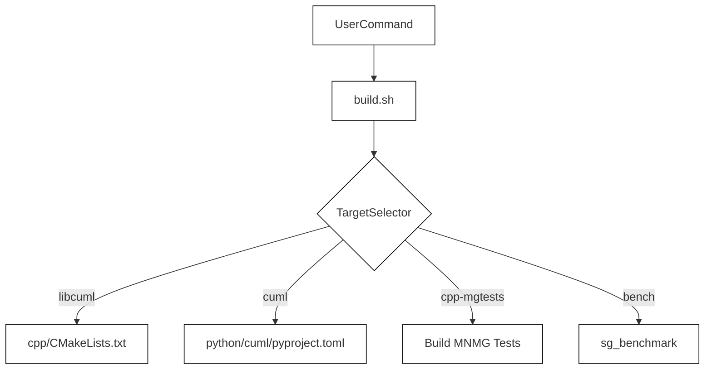
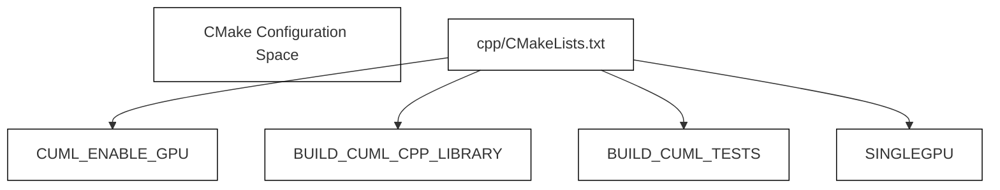
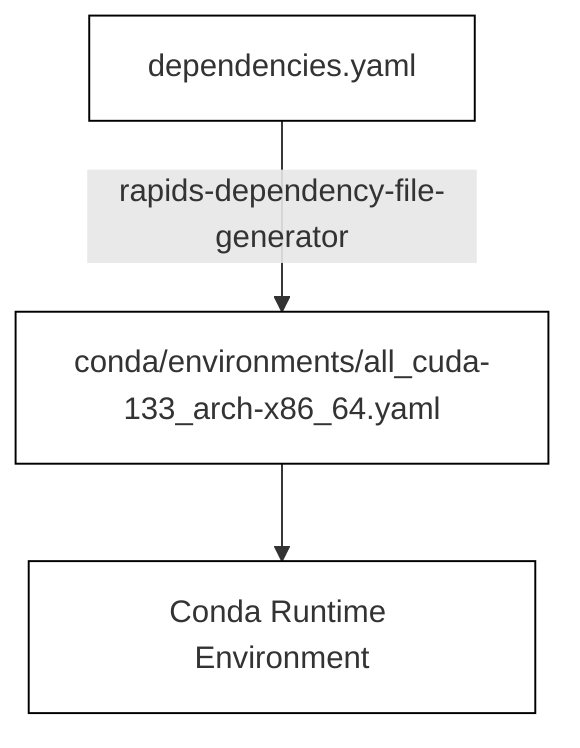

<!-- source: DeepWiki mcp.deepwiki.com · repo NVIDIA/cuml · page 1.1 Getting Started and Building from Source · fetched 2026-10-26 -->

# Getting Started and Building from Source

Relevant source files

The following files were used as context for generating this wiki page:

- [.devcontainer/Dockerfile](.devcontainer/Dockerfile)
- [.devcontainer/cuda12.9-conda/devcontainer.json](.devcontainer/cuda12.9-conda/devcontainer.json)
- [.devcontainer/cuda12.9-pip/devcontainer.json](.devcontainer/cuda12.9-pip/devcontainer.json)
- [.devcontainer/cuda13.3-conda/devcontainer.json](.devcontainer/cuda13.3-conda/devcontainer.json)
- [.devcontainer/cuda13.3-pip/devcontainer.json](.devcontainer/cuda13.3-pip/devcontainer.json)
- [BUILD.md](BUILD.md)
- [CHANGELOG.md](CHANGELOG.md)
- [CONTRIBUTING.md](CONTRIBUTING.md)
- [build.sh](build.sh)
- [conda/environments/all_cuda-129_arch-aarch64.yaml](conda/environments/all_cuda-129_arch-aarch64.yaml)
- [conda/environments/all_cuda-129_arch-x86_64.yaml](conda/environments/all_cuda-129_arch-x86_64.yaml)
- [conda/environments/all_cuda-133_arch-aarch64.yaml](conda/environments/all_cuda-133_arch-aarch64.yaml)
- [conda/environments/all_cuda-133_arch-x86_64.yaml](conda/environments/all_cuda-133_arch-x86_64.yaml)
- [conda/environments/clang_tidy_cuda-129_arch-x86_64.yaml](conda/environments/clang_tidy_cuda-129_arch-x86_64.yaml)
- [conda/environments/clang_tidy_cuda-133_arch-x86_64.yaml](conda/environments/clang_tidy_cuda-133_arch-x86_64.yaml)
- [conda/environments/cpp_all_cuda-129_arch-x86_64.yaml](conda/environments/cpp_all_cuda-129_arch-x86_64.yaml)
- [conda/environments/cpp_all_cuda-133_arch-x86_64.yaml](conda/environments/cpp_all_cuda-133_arch-x86_64.yaml)
- [conda/recipes/cuml/recipe.yaml](conda/recipes/cuml/recipe.yaml)
- [cpp/CMakeLists.txt](cpp/CMakeLists.txt)
- [cpp/README.md](cpp/README.md)
- [dependencies.yaml](dependencies.yaml)
- [docs/source/conf.py](docs/source/conf.py)
- [python/cuml/pyproject.toml](python/cuml/pyproject.toml)
- [python/libcuml/pyproject.toml](python/libcuml/pyproject.toml)

This page details the installation procedures, build script targets, CMake configuration flags, Conda environment specifications, devcontainer setups, and the architectural differences between Conda packages and Python wheels for NVIDIA cuML.

---

## 1. Build Infrastructure and `build.sh` Targets

The cuML repository provides a centralized bash automation script, `build.sh`, to compile and install both the C++ core library (`libcuml`) and the Python extension package (`cuml`) [build.sh:1-61]. 

The script parses target names and build flags, sets up environment variables like `CUDA_VERSION` and `INSTALL_PREFIX`, and invokes CMake or `pip` accordingly [build.sh:62-203].

*Figure 1: Mapping of build targets in `build.sh` to underlying build configurations.*

### Supported Targets and Flags
* `clean`: Removes existing build artifacts and configuration directories (`cpp/build`, `python/cuml/build`) [build.sh:27].
* `libcuml`: Builds and installs the C++ core shared library (`libcuml.so`) [build.sh:28].
* `cuml`: Builds and installs the `cuml` Python package using `scikit-build-core` [build.sh:29].
* `cpp-mgtests`: Compiles multi-GPU C++ tests requiring MPI and RAFT distributed bindings [build.sh:30].
* `bench`: Builds the single-GPU C++ benchmark executable (`sg_benchmark`) [build.sh:32].

Sources: `build.sh` [build.sh:1-380]

---

## 2. CMake Build System and Configuration Options

The core C++ library `libcuml` is governed by `cpp/CMakeLists.txt`, which utilizes `rapids-cmake` to configure dependencies like `libraft`, `libcuvs`, and `librmm` [cpp/CMakeLists.txt:1-48].

*Figure 2: Core configuration entry points defined in `cpp/CMakeLists.txt`.*

### Key CMake Options
* `CUML_ENABLE_GPU`: Enables building GPU-accelerated algorithms (default: `ON`) [cpp/CMakeLists.txt:47].
* `BUILD_CUML_CPP_LIBRARY`: Controls the compilation of `libcuml.so` (default: `ON`) [cpp/CMakeLists.txt:49].
* `SINGLEGPU`: Disables multi-node/multi-GPU (MNMG) components and communication dependencies (default: `OFF`) [cpp/CMakeLists.txt:61].
* `NVTX`: Enables NVTX profiling markers across execution routines (default: `OFF`) [cpp/CMakeLists.txt:60].
* `USE_CCACHE`: Caches compilation outputs using `ccache` (default: `OFF`) [cpp/CMakeLists.txt:62].

Sources: `cpp/CMakeLists.txt` [cpp/CMakeLists.txt:1-148], `cpp/README.md` [cpp/README.md:1-110]

---

## 3. Conda Environments and Dependency Management

Dependencies are centrally managed via `dependencies.yaml`, which drives the generation of Conda environment specification files for various architectures (`x86_64`, `aarch64`) and CUDA versions (`12.9`, `13.3`) using the `rapids-dependency-file-generator` [dependencies.yaml:1-50].

*Figure 3: Dependency pipeline flowing from `dependencies.yaml` to target environment files.*

### Environment Structure
The generated environment YAML files specify channels (`rapidsai`, `conda-forge`) and exact package compatibility bounds [conda/environments/all_cuda-133_arch-x86_64.yaml:3-95]:
* **Compilers**: `c-compiler`, `cxx-compiler`, `cuda-nvcc` [conda/environments/all_cuda-133_arch-x86_64.yaml:9-21]
* **RAPIDS Ecosystem**: `libraft`, `librmm`, `libcuvs`, `pylibraft`, `cudf` [conda/environments/all_cuda-133_arch-x86_64.yaml:18-45]
* **Python Stack**: `python>=3.12`, `scikit-learn>=1.6`, `numpy>=2.0` [conda/environments/all_cuda-133_arch-x86_64.yaml:53-81]

Sources: `dependencies.yaml` [dependencies.yaml:1-259], `conda/environments/all_cuda-133_arch-x86_64.yaml` [conda/environments/all_cuda-133_arch-x86_64.yaml:1-98]

---

## 4. Development Containers (Devcontainers)

Containerized development environments are provided under `.devcontainer/` for CUDA 12.9 and 13.3 configurations, supporting both Conda-based and pip-based workflows [.devcontainer/cuda13.3-conda/devcontainer.json]. These containers pre-configure CUDA toolkits, build dependencies, and system compilers to provide an isolated, consistent developer experience.

Sources: `.devcontainer/Dockerfile`, `.devcontainer/cuda13.3-conda/devcontainer.json`

---

## 5. Packaging Paradigms: Conda Packages vs. Python Wheels

cuML supports two primary packaging distributions: Conda packages and Python wheels.

| Feature / Aspect | Conda Package (`conda/recipes/cuml/recipe.yaml`) | Python Wheel (`python/cuml/pyproject.toml`) |
| :--- | :--- | :--- |
| **Build Backend** | `build.sh` via Conda build tools [conda/recipes/cuml/recipe.yaml:34] | `rapids_build_backend` / `scikit-build-core` [python/cuml/pyproject.toml:5-8] |
| **Dependency Resolution** | Condv-forge / RAPIDS channels | PyPI / CUDA wheel indexes |
| **Runtime Linking** | Dynamically links shared libraries (`libcuml.so`, `libraft.so`) from `$CONDA_PREFIX/lib` | Bundles or depends on pip-installable CUDA/RAPIDS wheel counterparts |
| **ABI Constraints** | Bound by Conda toolchain standard C++ ABI | Uses `abi3` limited API wheels where applicable [conda/recipes/cuml/recipe.yaml:26] |

Sources: `python/cuml/pyproject.toml` [python/cuml/pyproject.toml:1-198], `conda/recipes/cuml/recipe.yaml` [conda/recipes/cuml/recipe.yaml:1-136]

---

