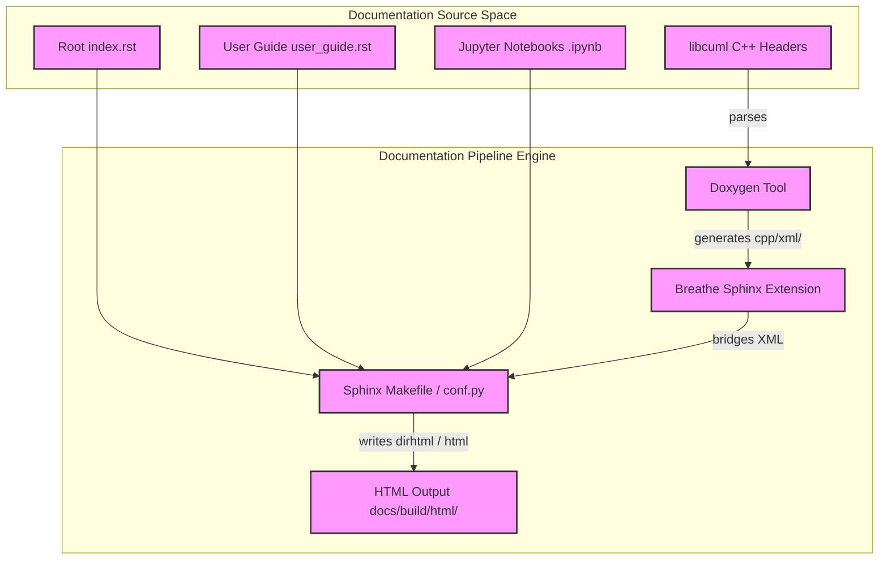
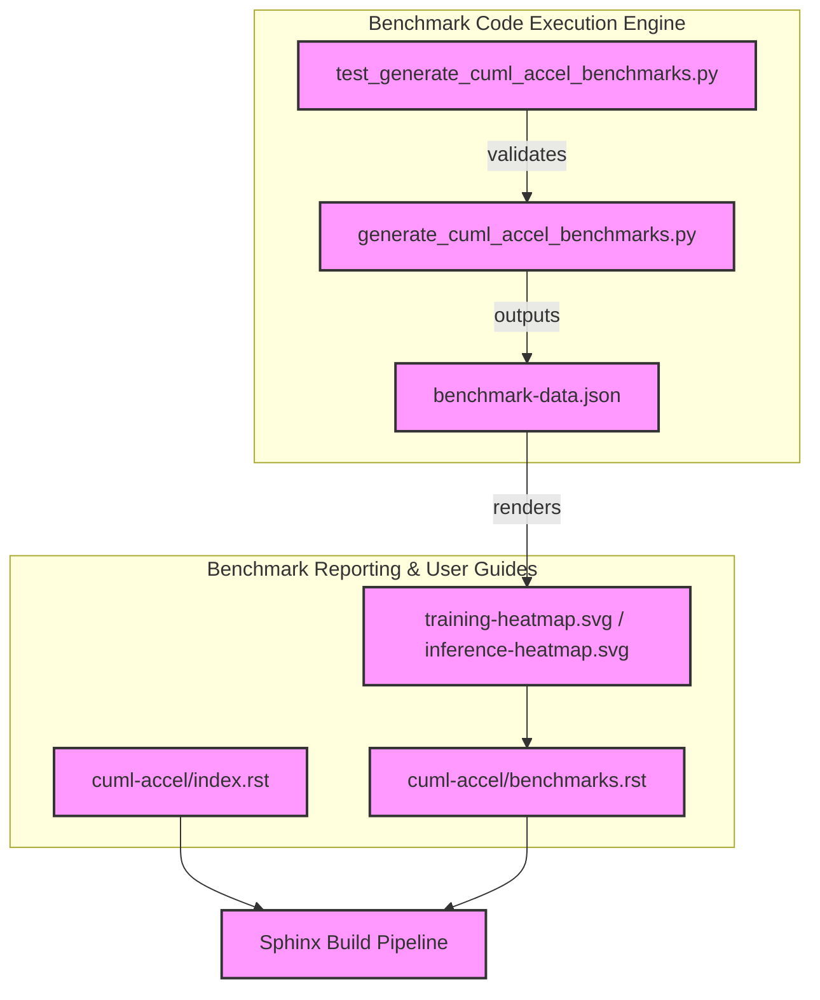

<!-- source: DeepWiki mcp.deepwiki.com · repo NVIDIA/cuml · page 1.2 Documentation, Notebooks and Examples · fetched 2026-10-26 -->

# Documentation, Notebooks and Examples

Relevant source files

The following files were used as context for generating this wiki page:

- [.gitignore](.gitignore)
- [docs/README.md](docs/README.md)
- [docs/benchmarks/cuml-accel/README.md](docs/benchmarks/cuml-accel/README.md)
- [docs/benchmarks/cuml-accel/benchmark-data.json](docs/benchmarks/cuml-accel/benchmark-data.json)
- [docs/benchmarks/generate_cuml_accel_benchmarks.py](docs/benchmarks/generate_cuml_accel_benchmarks.py)
- [docs/benchmarks/tests/test_generate_cuml_accel_benchmarks.py](docs/benchmarks/tests/test_generate_cuml_accel_benchmarks.py)
- [docs/source/_static/cuml-accel-benchmarks.css](docs/source/_static/cuml-accel-benchmarks.css)
- [docs/source/_static/cuml-accel-benchmarks.js](docs/source/_static/cuml-accel-benchmarks.js)
- [docs/source/_static/cuml-accel-benchmarks/inference-heatmap.svg](docs/source/_static/cuml-accel-benchmarks/inference-heatmap.svg)
- [docs/source/_static/cuml-accel-benchmarks/training-heatmap.svg](docs/source/_static/cuml-accel-benchmarks/training-heatmap.svg)
- [docs/source/advanced.rst](docs/source/advanced.rst)
- [docs/source/cuml-accel/benchmarks.rst](docs/source/cuml-accel/benchmarks.rst)
- [docs/source/cuml-accel/benchmarks.rst.in](docs/source/cuml-accel/benchmarks.rst.in)
- [docs/source/cuml-accel/examples/hyperparameter_search.ipynb](docs/source/cuml-accel/examples/hyperparameter_search.ipynb)
- [docs/source/cuml-accel/examples/index.rst](docs/source/cuml-accel/examples/index.rst)
- [docs/source/cuml-accel/examples/onnx_export.ipynb](docs/source/cuml-accel/examples/onnx_export.ipynb)
- [docs/source/cuml_intro.rst](docs/source/cuml_intro.rst)
- [docs/source/dask_multigpu_guide.ipynb](docs/source/dask_multigpu_guide.ipynb)
- [docs/source/estimator_intro.ipynb](docs/source/estimator_intro.ipynb)
- [docs/source/index.rst](docs/source/index.rst)
- [docs/source/pickling_cuml_models.ipynb](docs/source/pickling_cuml_models.ipynb)
- [docs/source/supported_versions.rst](docs/source/supported_versions.rst)
- [docs/source/user_guide.rst](docs/source/user_guide.rst)
- [notebooks/README.md](notebooks/README.md)
- [notebooks/kmeans_demo.ipynb](notebooks/kmeans_demo.ipynb)
- [notebooks/kmeans_mnmg_demo.ipynb](notebooks/kmeans_mnmg_demo.ipynb)
- [notebooks/linear_regression_demo.ipynb](notebooks/linear_regression_demo.ipynb)
- [notebooks/nearest_neighbors_demo.ipynb](notebooks/nearest_neighbors_demo.ipynb)
- [notebooks/random_forest_demo.ipynb](notebooks/random_forest_demo.ipynb)
- [notebooks/random_forest_mnmg_demo.ipynb](notebooks/random_forest_mnmg_demo.ipynb)
- [python/cuml/cuml/cluster/spectral_clustering.pyx](python/cuml/cuml/cluster/spectral_clustering.pyx)

This page details the documentation pipeline, repository structure for documentation sources (`docs/source`), example notebooks (`notebooks/`), user guides, and performance benchmarking documentation for `cuml.accel`. It covers how C++ source documentation is generated via Doxygen and Breathe, how Sphinx builds user-facing Python APIs, and how benchmark visualizations are generated for zero-code-change acceleration.

---

## 1. Documentation Build Pipeline and Source Layout

The cuML documentation pipeline integrates C++ source documentation (generated via Doxygen XML) and Sphinx Python documentation (using Breathe and Exhale to bridge C++ elements into Sphinx). 

Building documentation locally requires invoking build targets via `build.sh` or directly within the `docs/` directory. Doxygen parses `libcuml` C++ headers under `cpp/include/` and outputs XML files into `cpp/xml/`. Sphinx reads these XML sources using Breathe extensions to render the C++ API reference alongside standard Sphinx/reStructuredText (`.rst`) and Jupyter Notebook (`.ipynb`) documentation files.

*Diagram 1: Mapping documentation sources and C++ headers through Doxygen, Breathe, and Sphinx to generate final HTML artifacts.*

Sources: `docs/README.md:1-27`, `docs/source/index.rst:1-83`

---

## 2. User Guide and Documentation Structure (`docs/source/`)

The `docs/source/` directory serves as the root container for Sphinx documentation sources. Its key files and entry points include:

- `docs/source/index.rst`: The primary landing page defining global toctrees, installation guidelines, and quick start code snippets [docs/source/index.rst:1-83].
- `docs/source/cuml_intro.rst`: Outlines core cuML design principles: scikit-learn API parity, input flexibility (`__array__`, `__cuda_array_interface__`), and high-performance CUDA primitives [docs/source/cuml_intro.rst:1-119].
- `docs/source/user_guide.rst`: The central aggregator for tutorials, guides, and notebooks [docs/source/user_guide.rst:1-27]. It links to:
  - `estimator_intro.ipynb`: End-to-end examples of Random Forest Classification, UMAP, DBSCAN, and Linear Regression [docs/source/estimator_intro.ipynb:1-131].
  - `pickling_cuml_models.ipynb`: Demonstrates single-GPU and distributed model serialization using Python's `pickle` and `joblib` modules (emphasizing security warnings and protocol 5 optimizations) [docs/source/pickling_cuml_models.ipynb:1-179].
  - `dask_multigpu_guide.ipynb`: Multi-GPU and multi-node execution guides using Dask [docs/source/user_guide.rst:1-27].
  - `supported_versions.rst`: Runtime and build dependencies, adherence to SPEC 0 guidelines, NumPy/scikit-learn/scipy/numba/cupy version constraints [docs/source/supported_versions.rst:1-50].

Generated build artifacts such as model dumps (`*.model`, `*.pkl`, `*.tl`, `*.joblib`), autosummary stubs (`docs/source/api/generated/`), and Sphinx build caches (`docs/build/`) are ignored by version control [.gitignore:39-52].

Sources: `docs/source/index.rst:1-83`, `docs/source/cuml_intro.rst:1-119`, `docs/source/user_guide.rst:1-27`, `docs/source/supported_versions.rst:1-50`, `.gitignore:39-52`

---

## 3. Example Notebooks Collection (`notebooks/`)

In addition to documentation embedded in Sphinx, the `notebooks/` directory houses standalone example notebooks demonstrating standalone estimators and distributed execution workflows [notebooks/README.md:1-32].

Key notebooks maintained in the repository include:
- `notebooks/kmeans_demo.ipynb`: Single-GPU K-Means clustering compared against scikit-learn [notebooks/README.md:18-20].
- `notebooks/kmeans_mnmg_demo.ipynb`: Multi-node multi-GPU K-Means clustering using `dask_cudf` inputs [notebooks/README.md:18-21].
- `notebooks/linear_regression_demo.ipynb`: Ordinary Least Squares (OLS) linear regression workflows [notebooks/README.md:18-22].
- `notebooks/nearest_neighbors_demo.ipynb`: Approximate and exact nearest neighbors queries [notebooks/README.md:18-23].
- `notebooks/random_forest_demo.ipynb`: Single-GPU Random Forest classification and pickling persistence [notebooks/README.md:18-24].
- `notebooks/random_forest_mnmg_demo.ipynb`: Distributed multi-node multi-GPU Random Forest fitting utilizing `LocalCUDACluster` and `dask_cudf` partitioned DataFrames [notebooks/random_forest_mnmg_demo.ipynb:1-190].
- `notebooks/target_encoder_walkthrough.ipynb`: Target encoding workflows for click-through rate modeling compared to one-hot encoding [notebooks/README.md:18-26].

Sources: `notebooks/README.md:1-32`, `notebooks/random_forest_demo.ipynb:1-231`, `notebooks/random_forest_mnmg_demo.ipynb:1-190`

---

## 4. Acceleration Benchmarks and `cuml.accel` Documentation

The `docs/source/cuml-accel/` directory contains documentation and examples specific to zero-code-change acceleration [docs/source/cuml-accel/examples/index.rst:1-16]. 

### Benchmark Pipeline and Visualization
Benchmark data and automated comparison plots against scikit-learn are maintained under `docs/benchmarks/cuml-accel/`:
- `docs/benchmarks/generate_cuml_accel_benchmarks.py`: Harness script that executes performance tests and serializes metrics into JSON format.
- `docs/benchmarks/cuml-accel/benchmark-data.json`: Raw performance records across datasets and estimators.
- `docs/source/_static/cuml-accel-benchmarks/training-heatmap.svg` and `inference-heatmap.svg`: Scaled vector graphics displaying speedup ratios across estimators.

*Diagram 2: Relationship between benchmark generation scripts, JSON data stores, SVG heatmaps, and Sphinx documentation sources.*

Sources: `docs/source/cuml-accel/examples/index.rst:1-16`, `docs/benchmarks/generate_cuml_accel_benchmarks.py`, `docs/benchmarks/cuml-accel/README.md`

---

