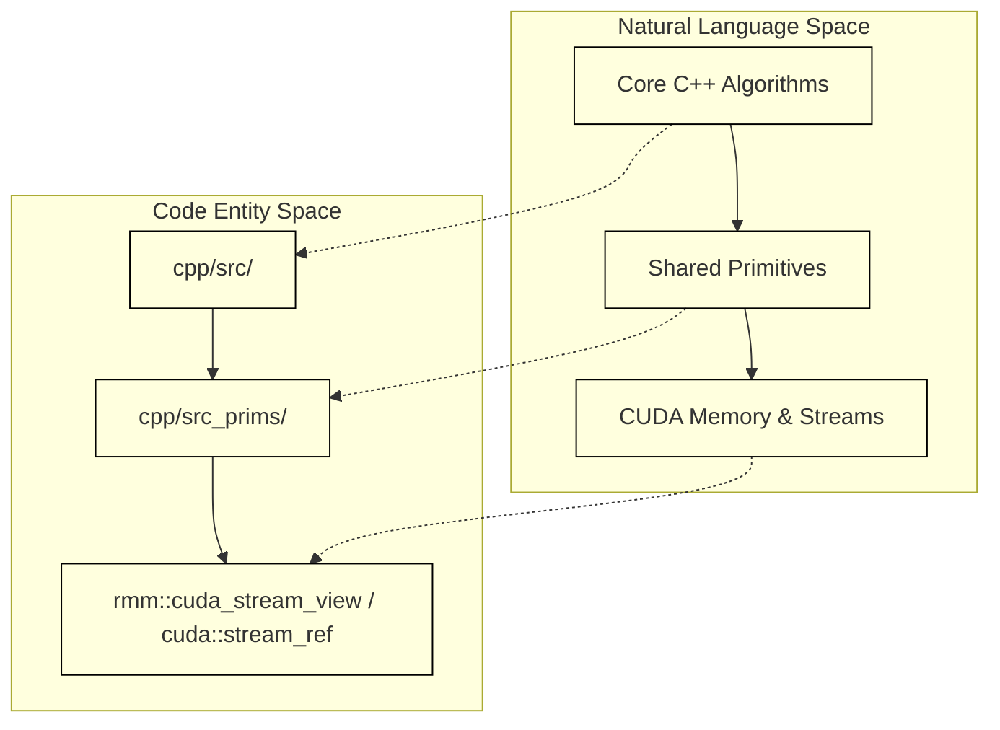
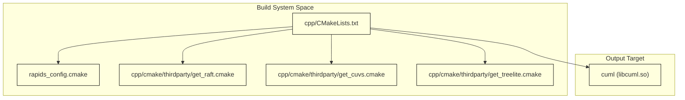

<!-- source: DeepWiki mcp.deepwiki.com · repo NVIDIA/cuml · page 2 C++ Core Library (libcuml) · fetched 2026-10-26 -->

# C++ Core Library (libcuml)

<details>
<summary>Relevant source files</summary>

The following files were used as context for generating this wiki page:

- [BUILD.md](BUILD.md)
- [CHANGELOG.md](CHANGELOG.md)
- [CONTRIBUTING.md](CONTRIBUTING.md)
- [build.sh](build.sh)
- [cpp/CMakeLists.txt](cpp/CMakeLists.txt)
- [cpp/README.md](cpp/README.md)
- [cpp/cmake/thirdparty/get_cuvs.cmake](cpp/cmake/thirdparty/get_cuvs.cmake)
- [cpp/cmake/thirdparty/get_raft.cmake](cpp/cmake/thirdparty/get_raft.cmake)
- [cpp/include/cuml/common/logger.hpp](cpp/include/cuml/common/logger.hpp)
- [docs/source/conf.py](docs/source/conf.py)
- [python/cuml/CMakeLists.txt](python/cuml/CMakeLists.txt)
- [python/libcuml/CMakeLists.txt](python/libcuml/CMakeLists.txt)
- [python/libcuml/libcuml/load.py](python/libcuml/libcuml/load.py)
- [python/libcuml/tests/test_libcuml_linkage.py](python/libcuml/tests/test_libcuml_linkage.py)

</details>


The `libcuml` library forms the performance-critical core of cuML, containing the C++ and CUDA implementations of machine learning algorithms, shared computational primitives, and multi-GPU infrastructure. Located entirely within the `cpp/` tree, `libcuml` compiles into the shared library `libcuml.so`, which can be consumed directly by standalone C++ applications or wrapped via Cython to power the Python estimator layer (`cpp/README.md:7-11`, `python/libcuml/CMakeLists.txt:70`).


*Diagram 1: Bridging cuML Algorithm Concepts to `cpp/` Code Entities.*
Sources: `cpp/README.md:7-11`, `CHANGELOG.md:9`

---

## 2.1 C++ Build System and Dependencies

The build configuration for `libcuml` is managed via CMake 4.0 (`cpp/CMakeLists.txt:8`), utilizing RAPIDS CMake infrastructure (`cpp/CMakeLists.txt:12-16`). Third-party dependencies such as `libraft` [cpp/cmake/thirdparty/get_raft.cmake:10-53] and `libcuvs` [cpp/cmake/thirdparty/get_cuvs.cmake:10-48] are dynamically fetched or configured via CPM. Option toggles allow selecting specific algorithm subsets (`CUML_ALGORITHMS`) and controlling static vs dynamic linking (`CUML_USE_CUVS_STATIC`, `CUML_USE_TREELITE_STATIC`) (`cpp/CMakeLists.txt:47-67`).


*Diagram 2: CMake Build Structure and Dependency Resolution.*
Sources: `cpp/CMakeLists.txt:10-16`, `cpp/cmake/thirdparty/get_raft.cmake:10-53`, `cpp/cmake/thirdparty/get_cuvs.cmake:10-48`

For full details on build configurations, targets, and CPM fetching logic, see [C++ Build System and Dependencies](#2.1).

Sources: `cpp/CMakeLists.txt:8-67`, `cpp/cmake/thirdparty/get_raft.cmake:10-53`, `cpp/cmake/thirdparty/get_cuvs.cmake:10-48`

---

## 2.2 Tree-Based Models (Decision Trees, Random Forest, Isolation Forest)

Tree-based algorithms within `libcuml` implement batched level-order tree building, custom quantile binning, and splitting objectives designed for GPU execution (`cpp/CMakeLists.txt:102-108`). Random Forest and Isolation Forest leverage these primitives inside `randomforest.cu` and integrate with Treelite for optimized model export and inference (`python/libcuml/CMakeLists.txt:62-72`).

For implementation details on tree building, binning, and export mechanisms, see [Tree-Based Models (Decision Trees, Random Forest, Isolation Forest)](#2.2).

Sources: `cpp/CMakeLists.txt:102-108`, `python/libcuml/CMakeLists.txt:62-72`

---

## 2.3 Clustering Algorithms (KMeans, DBSCAN, HDBSCAN, Hierarchy)

Clustering routines provide GPU-accelerated interfaces for unsupervised partition and density-based models. This includes KMeans iteration loops, DBSCAN adjacency graph generators and vertex degree calculators, as well as HDBSCAN condensation, stability extraction, and single-linkage hierarchy construction (`cpp/CMakeLists.txt:102-108`).

For architecture and algorithmic workflows of clustering implementations, see [Clustering Algorithms (KMeans, DBSCAN, HDBSCAN, Hierarchy)](#2.3).

Sources: `cpp/CMakeLists.txt:102-108`

---

## 2.4 Manifold Learning and Decomposition (UMAP, TSNE, PCA, TSVD, Spectral)

Dimensionality reduction modules encompass UMAP runners, fuzzy simplicial set constructors, and K-nearest-neighbor graph embedding kernels. It also includes exact, Barnes-Hut, and FFT-accelerated t-SNE implementations, alongside principal component analysis (PCA), truncated SVD (TSVD) solvers, and spectral embedding primitives (`cpp/CMakeLists.txt:102-108`).

For mathematical formulations and execution pipelines, see [Manifold Learning and Decomposition (UMAP, TSNE, PCA, TSVD, Spectral)](#2.4).

Sources: `cpp/CMakeLists.txt:102-108`

---

## 2.5 Linear Models, Solvers and SVM

Generalized linear models (GLMs such as OLS and Ridge), coordinate descent (CD), stochastic gradient descent (SGD), and LARS solvers provide foundational regression routines. Support Vector Machines utilize a Sequential Minimal Optimization (SMO) solver backed by a custom working set selection strategy and kernel cache (`CHANGELOG.md:29`).

For solver algorithms, working set logic, and optimization criteria, see [Linear Models, Solvers and SVM](#2.5).

Sources: `cpp/CMakeLists.txt:102-108`, `CHANGELOG.md:29`

---

## 2.6 Neighbors, Metrics, Datasets and Explainability

The neighbors and metrics package exposes brute-force and approximate K-nearest-neighbor search, Random Ball Cover (RBC), Kernel Density Estimation (KDE), pairwise distance metrics, and silhouette score calculators. It also supplies synthetic dataset generators (`make_blobs`, `make_regression`) and TreeSHAP/KernelSHAP attribution kernels (`cpp/CMakeLists.txt:102-108`).

For functional details on distance calculations, search indexes, and explainability APIs, see [Neighbors, Metrics, Datasets and Explainability](#2.6).

Sources: `cpp/CMakeLists.txt:102-108`

---

## 2.7 Multi-GPU (OPG/MNMG) C++ Layer

Multi-node multi-GPU (MNMG) capabilities are supported via distributed data structures and algorithm wrappers (`_mg` variants) that utilize RAFT communicator primitives for inter-GPU communication over NCCL and UCX (`cpp/README.md:12`, `BUILD.md:52-56`). These routines coordinate partitioned datasets across cluster ranks.

For distributed communication flows and multi-GPU test suites, see [Multi-GPU (OPG/MNMG) C++ Layer](#2.7).

Sources: `cpp/README.md:12`, `BUILD.md:52-56`

---

## 2.8 C++ Testing, Benchmarks and Utilities

Testing suites in `libcuml` are structured around Google Test (`BUILD.md:108-118`), covering single-GPU (`SG_`), multi-GPU (`MG_`), and primitive (`PRIMS_`) test targets (`cpp/README.md:58`). Utility headers such as `cuml/common/logger.hpp` integrate with `rapids_logger` to offer structured logging macros and stream configuration (`cpp/include/cuml/common/logger.hpp:11-53`).

```cpp
#include <cuml/common/logger.hpp>

int main(int argc, char *argv[]) {
  CUML_LOG_WARN("This is a warning from the cuML logger!");
  return 0;
}
```
*Example: Consuming `libcuml` logger utilities [cpp/README.md:86-93].*
Sources: `cpp/include/cuml/common/logger.hpp:11-53`, `cpp/README.md:58-93`

For details on test harnesses, benchmarking fixtures, code style validation, and diagnostic scripts, see [C++ Testing, Benchmarks and Utilities](#2.8).

Sources: `cpp/include/cuml/common/logger.hpp:11-53`, `cpp/README.md:58-93`

---

