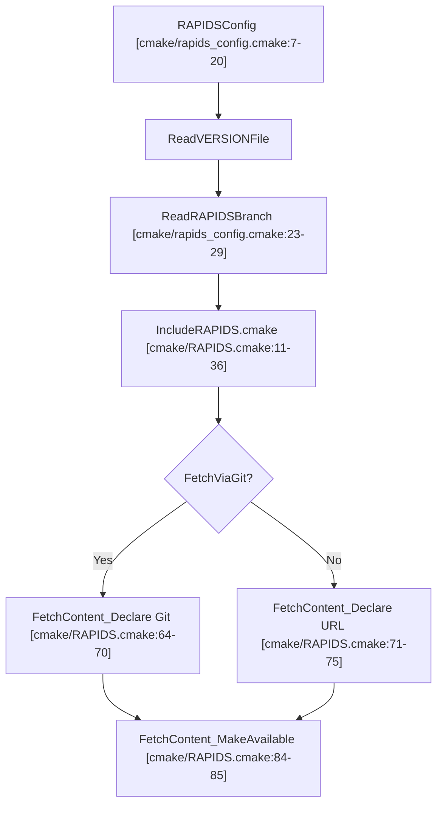
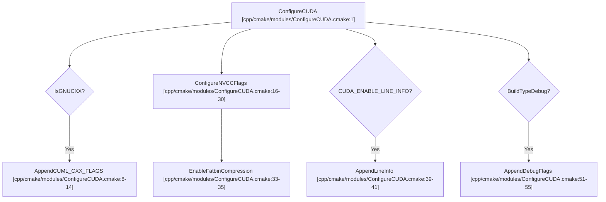
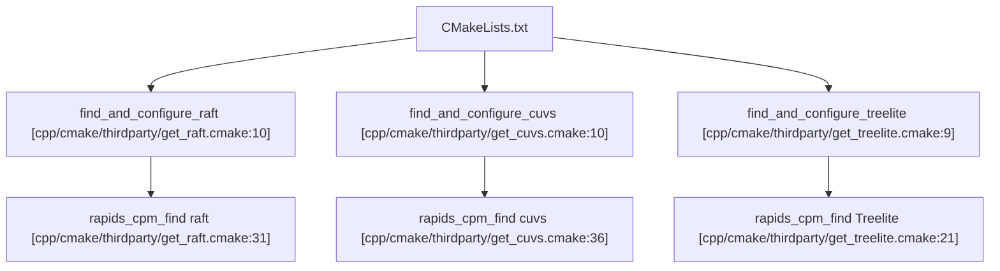
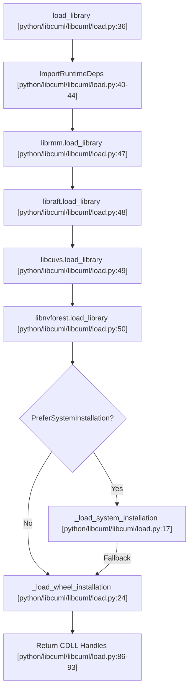

<!-- source: DeepWiki mcp.deepwiki.com · repo NVIDIA/cuml · page 2.1 C++ Build System and Dependencies · fetched 2026-10-26 -->

# C++ Build System and Dependencies

Relevant source files

The following files were used as context for generating this wiki page:

- [cmake/RAPIDS.cmake](cmake/RAPIDS.cmake)
- [cmake/rapids_config.cmake](cmake/rapids_config.cmake)
- [conda/recipes/cuml/conda_build_config.yaml](conda/recipes/cuml/conda_build_config.yaml)
- [conda/recipes/libcuml/conda_build_config.yaml](conda/recipes/libcuml/conda_build_config.yaml)
- [cpp/cmake/modules/ConfigureCUDA.cmake](cpp/cmake/modules/ConfigureCUDA.cmake)
- [cpp/cmake/thirdparty/get_cuvs.cmake](cpp/cmake/thirdparty/get_cuvs.cmake)
- [cpp/cmake/thirdparty/get_raft.cmake](cpp/cmake/thirdparty/get_raft.cmake)
- [cpp/cmake/thirdparty/get_treelite.cmake](cpp/cmake/thirdparty/get_treelite.cmake)
- [python/cuml/CMakeLists.txt](python/cuml/CMakeLists.txt)
- [python/libcuml/CMakeLists.txt](python/libcuml/CMakeLists.txt)
- [python/libcuml/libcuml/load.py](python/libcuml/libcuml/load.py)
- [python/libcuml/tests/test_libcuml_linkage.py](python/libcuml/tests/test_libcuml_linkage.py)

## Purpose and Scope
This document details the C++ build system and dependency management architecture for `libcuml`, the core C++/CUDA library underlying cuML. It covers CMake configuration workflows, integration with `rapids-cmake`, CUDA compilation flags (`ConfigureCUDA.cmake`), third-party dependency fetching (`get_raft.cmake`, `get_cuvs.cmake`, `get_treelite.cmake`), and how Python bindings (`python/cuml` and `python/libcuml`) consume these native artifacts via wheels and dynamic loading shims (`load.py`).

---

## 1. CMake Bootstrap and RAPIDS Core Configuration
The cuML build system relies heavily on `rapids-cmake` modules to standardize dependencies, compiler options, export sets, and packaging across the RAPIDS ecosystem. 

The build is bootstrapped via `cmake/rapids_config.cmake` [`cmake/rapids_config.cmake:1-41`](), which reads the project version from the root `VERSION` file, parses the release branch from `RAPIDS_BRANCH`, and includes `cmake/RAPIDS.cmake` [`cmake/RAPIDS.cmake:1-86`]().

`cmake/RAPIDS.cmake` manages fetching the `rapids-cmake` utility suite via CMake's `FetchContent` mechanism. It supports fetching via Git tags, branches, or exact SHAs depending on user configuration:

*Sources: `cmake/rapids_config.cmake:1-41`*, `cmake/RAPIDS.cmake:1-86`

---

## 2. CUDA Compilation and Algorithm Configuration
CUDA and C++ compilation flags are configured centrally in `cpp/cmake/modules/ConfigureCUDA.cmake` [`cpp/cmake/modules/ConfigureCUDA.cmake:1-56`](). This script defines standard compiler warnings, error policies, fatbin compression options, and debugging configurations.

Key configurations performed by `ConfigureCUDA.cmake`:
* **Compiler Flags & Warnings:** Appends `-Wall`, `-Werror`, and `-Wno-unknown-pragmas` for GNU Cxx, and enables extended lambdas (`--expt-extended-lambda`) and relaxed constexpr (`--expt-relaxed-constexpr`) for `nvcc` [`cpp/cmake/modules/ConfigureCUDA.cmake:8-16`]().
* **Fatbin Compression:** Integrates `rapids_cuda_enable_fatbin_compression` to optimize binary size [`cpp/cmake/modules/ConfigureCUDA.cmake:33-35`]().
* **Line Info & Profiling:** Conditionally appends `-lineinfo` when `CUDA_ENABLE_LINE_INFO` is active to assist profiling and memory checking [cpp/cmake/modules/ConfigureCUDA.cmake:37-41]().
* **Debug Symbols:** Appends `-G` and `-Xcompiler=-rdynamic` when `CMAKE_BUILD_TYPE` matches `Debug` [`cpp/cmake/modules/ConfigureCUDA.cmake:51-55`]().

*Sources: `cpp/cmake/modules/ConfigureCUDA.cmake:1-56`*

---

## 3. Third-Party Dependency Fetching and Management
cuML relies on external core libraries provided through RAPIDS and the broader ecosystem: **RAFT**, **cuVS**, and **Treelite**. These are fetched and configured using modular scripts via `rapids_cpm_find`.

### RAFT (`get_raft.cmake`)
The `find_and_configure_raft` function looks for `raft::raft` globally or downloads it via CPM using the pinned tag matching the `rapids-cmake-checkout-tag` [`cpp/cmake/thirdparty/get_raft.cmake:10-44`](). It configures distributed components when `BUILD_CUML_MG_TESTS` is enabled [`cpp/cmake/thirdparty/get_raft.cmake:20-23`]().

### cuVS (`get_cuvs.cmake`)
The `find_and_configure_cuvs` function locates or fetches `cuvs::cuvs` (or `cuvs::cuvs_static`) for vector search and nearest neighbor primitives [`cpp/cmake/thirdparty/get_cuvs.cmake:10-38`]. Multi-GPU algorithm support in cuVS (`BUILD_MG_ALGOS`) is conditionally enabled based on the `SINGLEGPU` option [`cpp/cmake/thirdparty/get_cuvs.cmake:31-35`].

### Treelite (`get_treelite.cmake`)
The `find_and_configure_treelite` function integrates `Treelite` for decision tree and tree ensemble compilation/inference [`cpp/cmake/thirdparty/get_treelite.cmake:9-32`]. It supports linking static or dynamic targets (`treelite::treelite` or `treelite::treelite_static`) [`cpp/cmake/thirdparty/get_treelite.cmake:15-19`] and exports target roots for downstream usage [`cpp/cmake/thirdparty/get_treelite.cmake:59-70`].

*Sources: `cpp/cmake/thirdparty/get_raft.cmake:1-68`*, `cpp/cmake/thirdparty/get_cuvs.cmake:1-72`*, `cpp/cmake/thirdparty/get_treelite.cmake:1-77`*

---

## 4. Python Integration, Wheel Packaging and Runtime Linkage
Python packages (`python/cuml` and `python/libcuml`) wrap `libcuml` and its dependencies. CMake builds orchestrate Cython extensions and link against native targets.

### Python CMake Structure
* `python/cuml/CMakeLists.txt` initializes the `cuml-python` project, processes `CUML_ALGORITHMS`, fetches Treelite, searches for `libcuml`, and adds subdirectories for Cython extension modules [`python/cuml/CMakeLists.txt:8-112`]().
* `python/libcuml/CMakeLists.txt` builds `libcuml` inside wheel packaging pipelines, enforcing `SINGLEGPU OFF` and setting up appropriate wheel `RPATH` entries for CUDA runtime libraries (`cublas`, `cufft`, `cusolver`, etc.) [`python/libcuml/CMakeLists.txt:15-95`]().

### Runtime Library Loading (`load.py`)
Because Python wheels bundle or depend on multiple shared libraries (`libcuvs`, `libraft`, `librmm`, `libcuml.so`), `python/libcuml/libcuml/load.py` manages loading order and flags using `ctypes.RTLD_LOCAL` [`python/libcuml/libcuml/load.py:1-94`]().

*Sources: `python/libcuml/libcuml/load.py:1-94`*, `python/libcuml/CMakeLists.txt:1-96`*, `python/cuml/CMakeLists.txt:1-115`*

---

