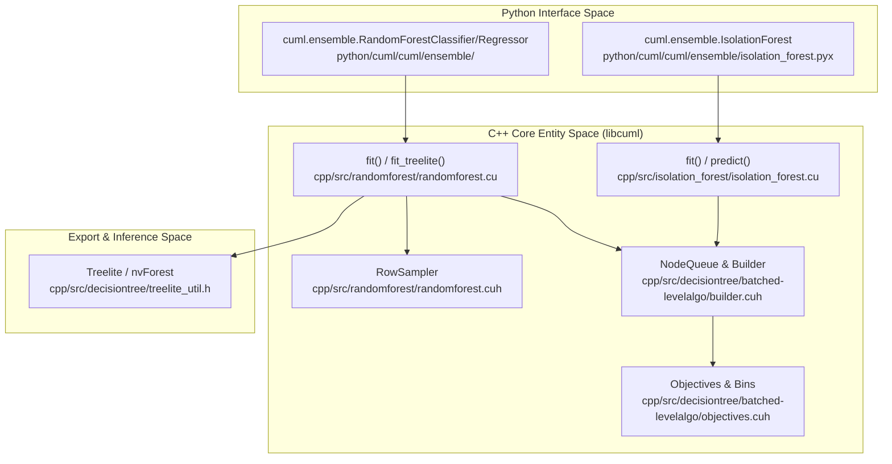
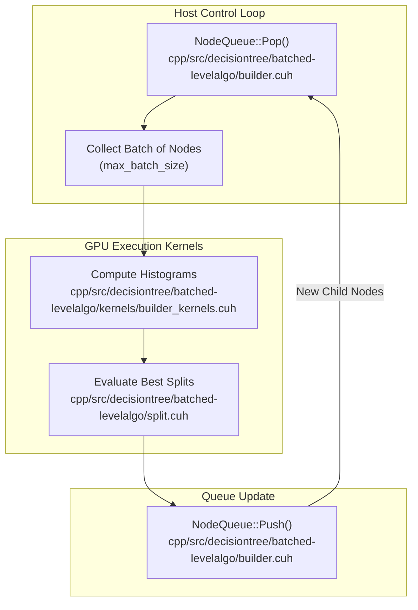
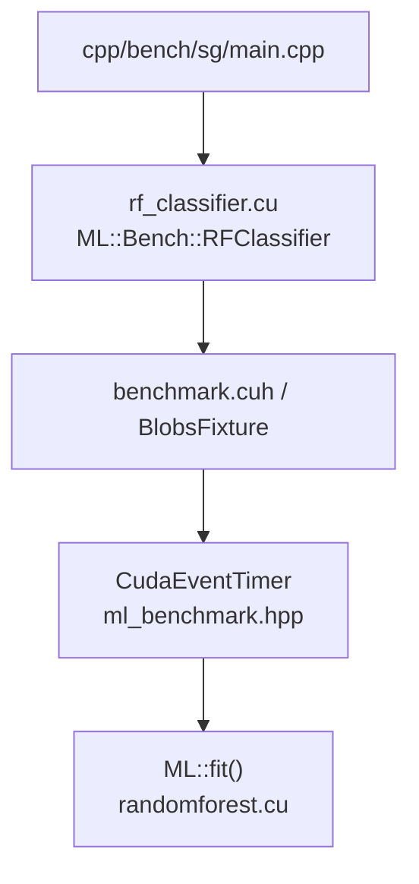

<!-- source: DeepWiki mcp.deepwiki.com · repo NVIDIA/cuml · page 2.2 Tree-Based Models (Decision Trees, Random Forest, Isolation Forest) · fetched 2026-10-26 -->

# Tree-Based Models (Decision Trees, Random Forest, Isolation Forest)

Relevant source files

The following files were used as context for generating this wiki page:

- [cpp/bench/CMakeLists.txt](cpp/bench/CMakeLists.txt)
- [cpp/bench/common/ml_benchmark.hpp](cpp/bench/common/ml_benchmark.hpp)
- [cpp/bench/sg/benchmark.cuh](cpp/bench/sg/benchmark.cuh)
- [cpp/bench/sg/dbscan.cu](cpp/bench/sg/dbscan.cu)
- [cpp/bench/sg/kmeans.cu](cpp/bench/sg/kmeans.cu)
- [cpp/bench/sg/main.cpp](cpp/bench/sg/main.cpp)
- [cpp/bench/sg/rf_classifier.cu](cpp/bench/sg/rf_classifier.cu)
- [cpp/bench/sg/rf_regressor.cu](cpp/bench/sg/rf_regressor.cu)
- [cpp/include/cuml/ensemble/isolation_forest.hpp](cpp/include/cuml/ensemble/isolation_forest.hpp)
- [cpp/include/cuml/ensemble/randomforest.hpp](cpp/include/cuml/ensemble/randomforest.hpp)
- [cpp/include/cuml/tree/decisiontree.hpp](cpp/include/cuml/tree/decisiontree.hpp)
- [cpp/src/decisiontree/batched-levelalgo/bins.cuh](cpp/src/decisiontree/batched-levelalgo/bins.cuh)
- [cpp/src/decisiontree/batched-levelalgo/builder.cuh](cpp/src/decisiontree/batched-levelalgo/builder.cuh)
- [cpp/src/decisiontree/batched-levelalgo/dataset.h](cpp/src/decisiontree/batched-levelalgo/dataset.h)
- [cpp/src/decisiontree/batched-levelalgo/kernels/builder_kernels.cuh](cpp/src/decisiontree/batched-levelalgo/kernels/builder_kernels.cuh)
- [cpp/src/decisiontree/batched-levelalgo/kernels/builder_kernels_impl.cuh](cpp/src/decisiontree/batched-levelalgo/kernels/builder_kernels_impl.cuh)
- [cpp/src/decisiontree/batched-levelalgo/kernels/classification-double.cu](cpp/src/decisiontree/batched-levelalgo/kernels/classification-double.cu)
- [cpp/src/decisiontree/batched-levelalgo/kernels/classification-float.cu](cpp/src/decisiontree/batched-levelalgo/kernels/classification-float.cu)
- [cpp/src/decisiontree/batched-levelalgo/kernels/regression-double.cu](cpp/src/decisiontree/batched-levelalgo/kernels/regression-double.cu)
- [cpp/src/decisiontree/batched-levelalgo/kernels/regression-float.cu](cpp/src/decisiontree/batched-levelalgo/kernels/regression-float.cu)
- [cpp/src/decisiontree/batched-levelalgo/kernels/weighted-classification-double.cu](cpp/src/decisiontree/batched-levelalgo/kernels/weighted-classification-double.cu)
- [cpp/src/decisiontree/batched-levelalgo/kernels/weighted-classification-float.cu](cpp/src/decisiontree/batched-levelalgo/kernels/weighted-classification-float.cu)
- [cpp/src/decisiontree/batched-levelalgo/kernels/weighted-regression-double.cu](cpp/src/decisiontree/batched-levelalgo/kernels/weighted-regression-double.cu)
- [cpp/src/decisiontree/batched-levelalgo/kernels/weighted-regression-float.cu](cpp/src/decisiontree/batched-levelalgo/kernels/weighted-regression-float.cu)
- [cpp/src/decisiontree/batched-levelalgo/objectives.cuh](cpp/src/decisiontree/batched-levelalgo/objectives.cuh)
- [cpp/src/decisiontree/batched-levelalgo/quantiles.cuh](cpp/src/decisiontree/batched-levelalgo/quantiles.cuh)
- [cpp/src/decisiontree/batched-levelalgo/split.cuh](cpp/src/decisiontree/batched-levelalgo/split.cuh)
- [cpp/src/decisiontree/decisiontree.cu](cpp/src/decisiontree/decisiontree.cu)
- [cpp/src/decisiontree/decisiontree.cuh](cpp/src/decisiontree/decisiontree.cuh)
- [cpp/src/isolation_forest/isolation_forest.cu](cpp/src/isolation_forest/isolation_forest.cu)
- [cpp/src/randomforest/randomforest.cu](cpp/src/randomforest/randomforest.cu)
- [cpp/src/randomforest/randomforest.cuh](cpp/src/randomforest/randomforest.cuh)
- [cpp/tests/sg/isolation_forest_test.cu](cpp/tests/sg/isolation_forest_test.cu)
- [cpp/tests/sg/rf_test.cu](cpp/tests/sg/rf_test.cu)
- [python/cuml/cuml/accel/_overrides/sklearn/ensemble.py](python/cuml/cuml/accel/_overrides/sklearn/ensemble.py)
- [python/cuml/cuml/ensemble/isolation_forest.pyx](python/cuml/cuml/ensemble/isolation_forest.pyx)
- [python/cuml/cuml_accel_tests/integration/test_isolation_forest.py](python/cuml/cuml_accel_tests/integration/test_isolation_forest.py)
- [python/cuml/tests/test_isolation_forest.py](python/cuml/tests/test_isolation_forest.py)

This page covers the technical design and GPU implementation of cuML's tree-based models within `libcuml` (`cpp/src/decisiontree`, `cpp/src/randomforest`, `cpp/src/isolation_forest`) and their integration with Python estimators. The core algorithms implement high-performance, batched level-order decision tree building, quantile-based binning, criterion optimization, Treelite/nvForest model exporting, and ensemble/anomaly detection models like Random Forests and Isolation Forests.

---

## 1. Architectural Overview and Code Entities

Tree building in cuML relies on a batched, level-order algorithmic builder that maps dataset rows and features into discrete bins to calculate split criteria efficiently on the GPU.

**Sources:** `cpp/src/randomforest/randomforest.cu`, `cpp/src/randomforest/randomforest.cuh`, `cpp/src/decisiontree/batched-levelalgo/builder.cuh`, `cpp/src/isolation_forest/isolation_forest.cu`, `python/cuml/cuml/ensemble/isolation_forest.pyx`

---

## 2. Batched Level-Order Algorithm Builder

The core tree building logic (`cpp/src/decisiontree/batched-levelalgo/builder.cuh`) processes decision tree construction level-by-level using an iterative host-driven `NodeQueue`. Instead of recursing per node, nodes belonging to the same tree depth are batched and launched across GPU streams via `Builder`.

**Sources:** `cpp/src/decisiontree/batched-levelalgo/builder.cuh`

- **`NodeQueue`**: Manages the host queue of nodes requiring expansion [cpp/src/decisiontree/batched-levelalgo/builder.cuh()]. It evaluates stopping criteria such as `max_depth`, `min_samples_split`, and `max_leaves` [cpp/src/decisiontree/batched-levelalgo/builder.cuh()].
- **Batching**: Up to `params.max_batch_size` nodes are evaluated concurrently in a single GPU pass to maintain high device utilization.

---

## 3. Objectives, Binning, and Split Criteria

Continuous feature values are converted into discrete bins to reduce memory traffic and accelerate histogram reduction during split evaluation.

### Quantile Binning and Bins
- **`Quantiles`** (`cpp/src/decisiontree/batched-levelalgo/quantiles.cuh`): Computes quantile split points for each feature, mapping continuous input features into `max_n_bins` (default up to `1024`, commonly `32` or `128`) [cpp/src/decisiontree/decisiontree.cu()].
- **Bins and Reductions** (`cpp/src/decisiontree/batched-levelalgo/bins.cuh`): Accumulates sample counts, weights, and label sums into discrete bin structures (`RegressionBin`, `WeightedRegressionBin`, etc.) [cpp/tests/sg/rf_test.cu()].

### Objectives and Criteria
- **`ObjectiveT`** (`cpp/src/decisiontree/batched-levelalgo/objectives.cuh`): Implements split criteria including Gini impurity, Entropy for classification, and Mean Squared Error (MSE) for regression [cpp/bench/sg/rf_classifier.cu()].
- **Specialized Kernels**: Performance-critical instantiations are compiled separately for float and double types [cpp/bench/sg/rf_classifier.cu()]:
  - `cpp/src/decisiontree/batched-levelalgo/kernels/classification-float.cu`
  - `cpp/src/decisiontree/batched-levelalgo/kernels/regression-float.cu`
  - Weighted variants (e.g., `weighted-classification-float.cu`) handle sample weight distributions.

---

## 4. Random Forest Implementation (`randomforest.cu`)

Random Forests aggregate multiple independent decision trees trained on bootstrapped samples.

### Data Flow and Row Sampling
The `RowSampler` (`cpp/src/randomforest/randomforest.cuh`) controls data selection per tree:
1. **Bootstrapping**: Draws random sample indices with replacement using Philox random number generators (`raft::random::RngState`) [cpp/src/randomforest/randomforest.cuh()].
2. **Weighted Bootstrapping**: If `sample_weight` is provided, an inclusive scan of cumulative weights (`sample_weight_cdf_`) is computed on the GPU, and `thrust::upper_bound` draws rows proportional to their weights [cpp/src/randomforest/randomforest.cuh()].

**Sources:** `cpp/src/randomforest/randomforest.cuh`, `cpp/include/cuml/ensemble/randomforest.hpp`

### Key Entry Points
- `ML::fit(...)`: Trains a Random Forest classifier or regressor using multi-stream parallelism across available GPU streams [cpp/include/cuml/ensemble/randomforest.hpp()].
- `ML::fit_treelite(...)`: Fits the random forest and directly constructs a Treelite model handle [cpp/include/cuml/ensemble/randomforest.hpp()].

---

## 5. Treelite and nvForest Export

To enable high-throughput inference, cuML models export trained decision trees into external inference runtimes.

- **Treelite Integration** (`cpp/src/randomforest/randomforest.cu`, `cpp/src/decisiontree/treelite_util.h`): `build_treelite_forest` converts `RandomForestMetaData` into a Treelite model handle (`TreeliteModelHandle`), allowing compilation into optimized predictor libraries [cpp/include/cuml/ensemble/randomforest.hpp()].
- **nvForest**: Internal headers (`cpp/tests/sg/rf_test.cu`) link Treelite models with `nvforest` device-side structures (`nvforest::treelite_importer.hpp`, `nvforest::tree_layout.hpp`) for native GPU accelerated tree traversal [cpp/tests/sg/rf_test.cu()].

---

## 6. Isolation Forest

Isolation Forest is an unsupervised anomaly detection model that isolates anomalies by randomly selecting a feature and a split value.

- **C++ Core** (`cpp/src/isolation_forest/isolation_forest.cu`, `cpp/include/cuml/ensemble/isolation_forest.hpp`): Builds an ensemble of isolation trees where splits are chosen randomly between the minimum and maximum values of selected features rather than optimizing impurity criteria.
- **Python API & Accel Integration**: 
  - `python/cuml/cuml/ensemble/isolation_forest.pyx` provides the Cython wrapper.
  - `python/cuml/cuml/accel/_overrides/sklearn/ensemble.py` intercepts scikit-learn's `IsolationForest` calls and dispatches them to the GPU accelerator.

---

## 7. C++ Benchmarks

Performance regression and execution speed for tree models are measured via Google Benchmark suites (`cpp/bench/CMakeLists.txt`):
- **Classifiers & Regressors**: `cpp/bench/sg/rf_classifier.cu` and `cpp/bench/sg/rf_regressor.cu` benchmark training throughput against synthetic blob and regression datasets [cpp/bench/sg/rf_classifier.cu()].
- **Fixture Design**: `ML::Bench::BlobsFixture` and `CudaEventTimer` manage CUDA stream pools, L2 cache flushing, and precise timing measurements [cpp/bench/sg/benchmark.cuh(), cpp/bench/common/ml_benchmark.hpp()].

**Sources:** `cpp/bench/CMakeLists.txt`, `cpp/bench/sg/rf_classifier.cu`, `cpp/bench/sg/benchmark.cuh`, `cpp/bench/common/ml_benchmark.hpp`

---

## Sources
- `cpp/src/randomforest/randomforest.cu`
- `cpp/src/randomforest/randomforest.cuh`
- `cpp/src/decisiontree/decisiontree.cu`
- `cpp/include/cuml/ensemble/randomforest.hpp`
- `cpp/src/decisiontree/batched-levelalgo/builder.cuh`
- `cpp/bench/CMakeLists.txt`
- `cpp/bench/sg/benchmark.cuh`
- `cpp/bench/common/ml_benchmark.hpp`
- `cpp/bench/sg/rf_classifier.cu`
- `cpp/tests/sg/rf_test.cu`

---

