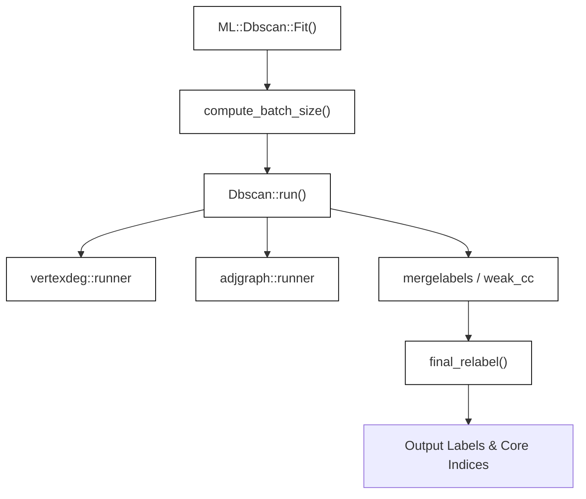
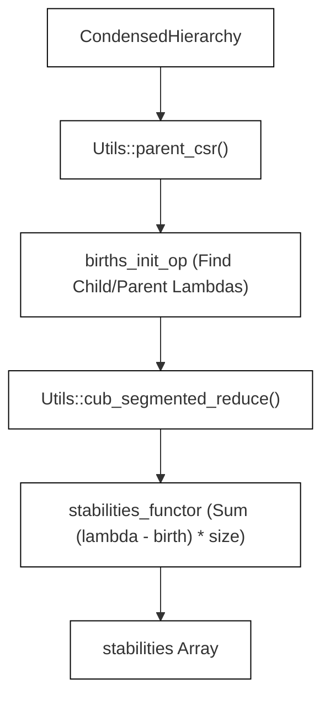

<!-- source: DeepWiki mcp.deepwiki.com · repo NVIDIA/cuml · page 2.3 Clustering Algorithms (KMeans, DBSCAN, HDBSCAN, Hierarchy) · fetched 2026-10-26 -->

# Clustering Algorithms (KMeans, DBSCAN, HDBSCAN, Hierarchy)

<details>
<summary>Relevant source files</summary>

The following files were used as context for generating this wiki page:

- [cpp/bench/sg/linkage.cu](cpp/bench/sg/linkage.cu)
- [cpp/examples/dbscan/dbscan_example.cpp](cpp/examples/dbscan/dbscan_example.cpp)
- [cpp/examples/kmeans/kmeans_example.cpp](cpp/examples/kmeans/kmeans_example.cpp)
- [cpp/include/cuml/cluster/dbscan.hpp](cpp/include/cuml/cluster/dbscan.hpp)
- [cpp/include/cuml/cluster/kmeans.hpp](cpp/include/cuml/cluster/kmeans.hpp)
- [cpp/include/cuml/cluster/kmeans_params.hpp](cpp/include/cuml/cluster/kmeans_params.hpp)
- [cpp/include/cuml/cluster/linkage.hpp](cpp/include/cuml/cluster/linkage.hpp)
- [cpp/src/dbscan/adjgraph/algo.cuh](cpp/src/dbscan/adjgraph/algo.cuh)
- [cpp/src/dbscan/adjgraph/pack.h](cpp/src/dbscan/adjgraph/pack.h)
- [cpp/src/dbscan/adjgraph/runner.cuh](cpp/src/dbscan/adjgraph/runner.cuh)
- [cpp/src/dbscan/dbscan.cu](cpp/src/dbscan/dbscan.cu)
- [cpp/src/dbscan/dbscan.cuh](cpp/src/dbscan/dbscan.cuh)
- [cpp/src/dbscan/runner.cuh](cpp/src/dbscan/runner.cuh)
- [cpp/src/dbscan/vertexdeg/algo.cuh](cpp/src/dbscan/vertexdeg/algo.cuh)
- [cpp/src/dbscan/vertexdeg/pack.h](cpp/src/dbscan/vertexdeg/pack.h)
- [cpp/src/dbscan/vertexdeg/precomputed.cuh](cpp/src/dbscan/vertexdeg/precomputed.cuh)
- [cpp/src/dbscan/vertexdeg/runner.cuh](cpp/src/dbscan/vertexdeg/runner.cuh)
- [cpp/src/hdbscan/condensed_hierarchy.cu](cpp/src/hdbscan/condensed_hierarchy.cu)
- [cpp/src/hdbscan/detail/condense.cuh](cpp/src/hdbscan/detail/condense.cuh)
- [cpp/src/hdbscan/detail/extract.cuh](cpp/src/hdbscan/detail/extract.cuh)
- [cpp/src/hdbscan/detail/membership.cuh](cpp/src/hdbscan/detail/membership.cuh)
- [cpp/src/hdbscan/detail/select.cuh](cpp/src/hdbscan/detail/select.cuh)
- [cpp/src/hdbscan/detail/stabilities.cuh](cpp/src/hdbscan/detail/stabilities.cuh)
- [cpp/src/hdbscan/detail/utils.cuh](cpp/src/hdbscan/detail/utils.cuh)
- [cpp/src/hdbscan/prediction_data.cu](cpp/src/hdbscan/prediction_data.cu)
- [cpp/src/hierarchy/linkage.cu](cpp/src/hierarchy/linkage.cu)
- [cpp/src/kmeans/kmeans_fit.cu](cpp/src/kmeans/kmeans_fit.cu)
- [cpp/src/kmeans/kmeans_params.hpp](cpp/src/kmeans/kmeans_params.hpp)
- [cpp/src/ml_cuda_utils.h](cpp/src/ml_cuda_utils.h)
- [python/cuml/cuml/cluster/agglomerative.pyx](python/cuml/cuml/cluster/agglomerative.pyx)
- [python/cuml/cuml/cluster/cpp/kmeans.pxd](python/cuml/cuml/cluster/cpp/kmeans.pxd)
- [python/cuml/cuml/cluster/kmeans.pyx](python/cuml/cuml/cluster/kmeans.pyx)
- [python/cuml/cuml/cluster/kmeans_mg.py](python/cuml/cuml/cluster/kmeans_mg.py)
- [python/cuml/cuml/dask/cluster/kmeans.py](python/cuml/cuml/dask/cluster/kmeans.py)
- [python/cuml/cuml/multiclass/__init__.py](python/cuml/cuml/multiclass/__init__.py)
- [python/cuml/cuml/multiclass/multiclass.py](python/cuml/cuml/multiclass/multiclass.py)
- [python/cuml/tests/dask/test_dask_kmeans.py](python/cuml/tests/dask/test_dask_kmeans.py)
- [python/cuml/tests/test_agglomerative.py](python/cuml/tests/test_agglomerative.py)
- [python/cuml/tests/test_kmeans.py](python/cuml/tests/test_kmeans.py)
- [python/cuml/tests/test_multiclass.py](python/cuml/tests/test_multiclass.py)

</details>


This page details the C++ (libcuml) implementations, CUDA primitives, and Cython/Python interfaces for cuML's core clustering algorithms: **KMeans**, **DBSCAN**, **HDBSCAN**, and **Agglomerative Hierarchical Clustering (Single-Linkage)**. 

---

## 1. KMeans Clustering

The cuML KMeans implementation provides high-performance GPU-accelerated clustering with support for single-GPU, multi-GPU (via distributed partitions), batching, sample weights, and multiple initialization strategies (such as `k-means++` / `k-means||`) [python/cuml/cuml/cluster/kmeans.pyx:44-93](), [cpp/include/cuml/cluster/kmeans.hpp:41-110]().

### C++ Interface and Parameters
The public C++ header `cpp/include/cuml/cluster/kmeans.hpp` defines overloaded `fit` and `predict` routines supporting both `float` and `double` precisions, as well as `int32_t` and `int64_t` index types [cpp/include/cuml/cluster/kmeans.hpp:41-172]().

```cpp
namespace ML {
namespace kmeans {
void fit(const raft::handle_t& handle,
         const KMeansParams& params,
         const float* X,
         int n_samples,
         int n_features,
         const float* sample_weight,
         float* centroids,
         float& inertia,
         int& n_iter);
// ...
}
}
```
*Sources: [cpp/include/cuml/cluster/kmeans.hpp:41-80]()*

### Cython Binding & Data Flow
The Cython module `python/cuml/cuml/cluster/kmeans.pyx` bridges Python estimators to `libcuml` primitives. It initializes `lib.KMeansParams` from Python configuration options and dispatches execution to `lib.fit` [python/cuml/cuml/cluster/kmeans.pyx:44-180]().

```mermaid
graph TD
    A["Python KMeans.fit()"] --> B["_kmeans_init_params()"]
    B --> C["_kmeans_fit()"]
    C -->|Values f32/f64 & Indices i32/i64| D["lib.fit() (libcuml C++)"]
    D --> E["GPU Centroids & Inertia"]
    
    sub: "Code Entities"
    style A fill:#fff,stroke:#000,stroke-width:1px
    style B fill:#fff,stroke:#000,stroke-width:1px
    style C fill:#fff,stroke:#000,stroke-width:1px
    style D fill:#fff,stroke:#000,stroke-width:1px
```
*Sources: [python/cuml/cuml/cluster/kmeans.pyx:44-180]*

---

## 2. DBSCAN Architecture

DBSCAN in cuML is decomposed into modular CUDA components housed under `cpp/src/dbscan/`: vertex degree computation (`vertexdeg`), adjacency graph construction (`adjgraph`), core point determination, and connected component relabeling [cpp/src/dbscan/runner.cuh:8-14]().

### C++ Interface
The DBSCAN API is exposed via `cpp/include/cuml/cluster/dbscan.hpp`, supporting `BRUTE_FORCE` and `RBC` ( র‍্যান্ডম বল কভার / Reduced Ball Cover) neighbor search methods [cpp/include/cuml/cluster/dbscan.hpp:22-110]().

```cpp
namespace ML {
namespace Dbscan {
enum EpsNnMethod { BRUTE_FORCE, RBC };

void fit(const raft::handle_t& handle,
         float* input,
         int n_rows,
         int n_cols,
         float eps,
         int min_pts,
         ML::distance::DistanceType metric,
         int* labels,
         int* core_sample_indices = nullptr,
         float* sample_weight = nullptr,
         size_t max_bytes_per_batch = 0,
         EpsNnMethod eps_nn_method = BRUTE_FORCE,
         rapids_logger::level_enum verbosity = rapids_logger::level_enum::info,
         bool opg = false);
}
}
```
*Sources: [cpp/include/cuml/cluster/dbscan.hpp:22-66]()*

### Runner and Batching Strategy
`cpp/src/dbscan/runner.cuh` orchestrates the execution pipeline, dynamically computing batch sizes based on available device memory and managing intermediate allocations for vertex degrees and adjacency matrices [cpp/src/dbscan/runner.cuh:100-173](). `cpp/src/dbscan/dbscan.cuh` calculates optimal memory utilization and validates parameters before launching kernels [cpp/src/dbscan/dbscan.cuh:23-170]().


*Sources: [cpp/src/dbscan/runner.cuh:100-173](), [cpp/src/dbscan/dbscan.cuh:23-170]*

---

## 3. HDBSCAN (Condensation, Selection, and Stabilities)

HDBSCAN extends DBSCAN by converting a hierarchy of clusterings into a condensed tree and extracting flat clusters based on stability scores.

### Stability Computation
The stability calculation evaluates excess of mass by measuring how long clusters persist across varying distance thresholds ($\lambda = 1 / \text{distance}$) [cpp/src/hdbscan/detail/stabilities.cuh:39-53]().

```cpp
template <typename value_idx, typename value_t>
void compute_stabilities(const raft::handle_t& handle,
                         Common::CondensedHierarchy<value_idx, value_t>& condensed_tree,
                         value_t* stabilities)
```
*Sources: [cpp/src/hdbscan/detail/stabilities.cuh:39-53]()*

Using Thrust execution policies and CUB segmented reductions, `compute_stabilities` gathers parent-child hierarchies, aggregates minimum births, and executes `stabilities_functor` across condensed edges [cpp/src/hdbscan/detail/stabilities.cuh:50-137]().


*Sources: [cpp/src/hdbscan/detail/stabilities.cuh:50-137]*

---

## 4. Agglomerative Hierarchical Clustering (Single-Linkage)

cuML's agglomerative clustering provides single-linkage hierarchical clustering capable of operating on fully pairwise distance matrices or sparsified `knn` connectivity graphs [python/cuml/cuml/cluster/agglomerative.pyx:47-109]().

### Cython and C++ Linkage Interface
The Cython wrapper `AgglomerativeClustering` calls the `single_linkage` kernel defined in `cuml/cluster/linkage.hpp` [python/cuml/cuml/cluster/agglomerative.pyx:20-35]():

```python
cdef extern from "cuml/cluster/linkage.hpp" namespace "ML::linkage" nogil:
    cdef void single_linkage(
        const handle_t &handle,
        const float *X,
        int n_rows,
        int n_cols,
        size_t n_clusters,
        DistanceType metric,
        int* children,
        int* labels,
        float* distances,
        bool use_knn,
        int c,
    ) except +
```
*Sources: [python/cuml/cuml/cluster/agglomerative.pyx:20-35]()*

### Execution Flow
1. **Input Validation**: `check_inputs` ensures continuous C-contiguous float32 data residency [python/cuml/cuml/cluster/agglomerative.pyx:150-162]().
2. **Connectivity Configuration**: Maps `connectivity="knn"` or `"pairwise"` alongside supported distance metrics (`euclidean`, `l1`, `manhattan`, `cosine`) [python/cuml/cuml/cluster/agglomerative.pyx:167-176]().
3. **Execution**: Allocates output buffers (`labels`, `children`, and optional `distances`) and invokes `ML::linkage::single_linkage` [python/cuml/cuml/cluster/agglomerative.pyx:184-191]().

---

## 5. Summary Table of Clustering Components

| Algorithm | C++ Header / Namespace | Key C++ Classes / Functions | Python Estimator Module |
| :--- | :--- | :--- | :--- |
| **KMeans** | `cuml/cluster/kmeans.hpp` (`ML::kmeans`) | `fit()`, `predict()`, `KMeansParams` | `cuml.cluster.KMeans`, `cuml.dask.cluster.KMeans` |
| **DBSCAN** | `cuml/cluster/dbscan.hpp` (`ML::Dbscan`) | `fit()`, `Dbscan::run()`, `compute_batch_size()` | `cuml.cluster.DBSCAN` |
| **HDBSCAN** | `cuml/cluster/hdbscan.hpp` (`ML::HDBSCAN`) | `CondensedHierarchy`, `compute_stabilities()` | `cuml.cluster.HDBSCAN` |
| **Hierarchy** | `cuml/cluster/linkage.hpp` (`ML::linkage`) | `single_linkage()` | `cuml.cluster.AgglomerativeClustering` |

*Sources: [cpp/include/cuml/cluster/kmeans.hpp:15-80](), [cpp/include/cuml/cluster/dbscan.hpp:19-66](), [python/cuml/cuml/cluster/agglomerative.pyx:20-47]*

---

