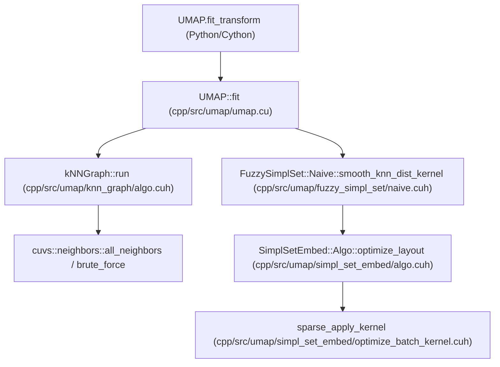
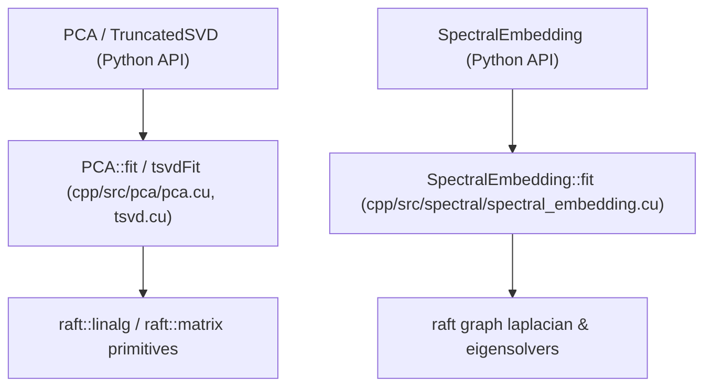

<!-- source: DeepWiki mcp.deepwiki.com · repo NVIDIA/cuml · page 2.4 Manifold Learning and Decomposition (UMAP, TSNE, PCA, TSVD, Spectral) · fetched 2026-10-26 -->

# Manifold Learning and Decomposition (UMAP, TSNE, PCA, TSVD, Spectral)

<details>
<summary>Relevant source files</summary>

The following files were used as context for generating this wiki page:

- [cpp/bench/sg/umap.cu](cpp/bench/sg/umap.cu)
- [cpp/cmake/thirdparty/get_gputreeshap.cmake](cpp/cmake/thirdparty/get_gputreeshap.cmake)
- [cpp/include/cuml/decomposition/params.hpp](cpp/include/cuml/decomposition/params.hpp)
- [cpp/include/cuml/decomposition/pca.hpp](cpp/include/cuml/decomposition/pca.hpp)
- [cpp/include/cuml/decomposition/tsvd.hpp](cpp/include/cuml/decomposition/tsvd.hpp)
- [cpp/include/cuml/manifold/common.hpp](cpp/include/cuml/manifold/common.hpp)
- [cpp/include/cuml/manifold/spectral_embedding.hpp](cpp/include/cuml/manifold/spectral_embedding.hpp)
- [cpp/include/cuml/manifold/tsne.h](cpp/include/cuml/manifold/tsne.h)
- [cpp/include/cuml/manifold/umap.hpp](cpp/include/cuml/manifold/umap.hpp)
- [cpp/include/cuml/manifold/umapparams.h](cpp/include/cuml/manifold/umapparams.h)
- [cpp/include/cuml/solvers/lars.hpp](cpp/include/cuml/solvers/lars.hpp)
- [cpp/include/cuml/solvers/solver.hpp](cpp/include/cuml/solvers/solver.hpp)
- [cpp/src/glm/qn/simple_mat/dense.hpp](cpp/src/glm/qn/simple_mat/dense.hpp)
- [cpp/src/glm/qn/simple_mat/sparse.hpp](cpp/src/glm/qn/simple_mat/sparse.hpp)
- [cpp/src/pca/pca.cu](cpp/src/pca/pca.cu)
- [cpp/src/solver/lars.cu](cpp/src/solver/lars.cu)
- [cpp/src/solver/lars_impl.cuh](cpp/src/solver/lars_impl.cuh)
- [cpp/src/spectral/spectral_embedding.cu](cpp/src/spectral/spectral_embedding.cu)
- [cpp/src/svm/smoblocksolve.cuh](cpp/src/svm/smoblocksolve.cuh)
- [cpp/src/svm/workingset.cuh](cpp/src/svm/workingset.cuh)
- [cpp/src/tsne/barnes_hut_kernels.cuh](cpp/src/tsne/barnes_hut_kernels.cuh)
- [cpp/src/tsne/barnes_hut_tsne.cuh](cpp/src/tsne/barnes_hut_tsne.cuh)
- [cpp/src/tsne/cannylab/bh.cu](cpp/src/tsne/cannylab/bh.cu)
- [cpp/src/tsne/cannylabs_tsne_license.txt](cpp/src/tsne/cannylabs_tsne_license.txt)
- [cpp/src/tsne/distances.cuh](cpp/src/tsne/distances.cuh)
- [cpp/src/tsne/exact_kernels.cuh](cpp/src/tsne/exact_kernels.cuh)
- [cpp/src/tsne/exact_tsne.cuh](cpp/src/tsne/exact_tsne.cuh)
- [cpp/src/tsne/fft_kernels.cuh](cpp/src/tsne/fft_kernels.cuh)
- [cpp/src/tsne/fft_tsne.cuh](cpp/src/tsne/fft_tsne.cuh)
- [cpp/src/tsne/tsne.cu](cpp/src/tsne/tsne.cu)
- [cpp/src/tsne/tsne_runner.cuh](cpp/src/tsne/tsne_runner.cuh)
- [cpp/src/tsne/utils.cuh](cpp/src/tsne/utils.cuh)
- [cpp/src/tsvd/tsvd.cu](cpp/src/tsvd/tsvd.cu)
- [cpp/src/umap/fuzzy_simpl_set/naive.cuh](cpp/src/umap/fuzzy_simpl_set/naive.cuh)
- [cpp/src/umap/fuzzy_simpl_set/runner.cuh](cpp/src/umap/fuzzy_simpl_set/runner.cuh)
- [cpp/src/umap/init_embed/random_algo.cuh](cpp/src/umap/init_embed/random_algo.cuh)
- [cpp/src/umap/init_embed/runner.cuh](cpp/src/umap/init_embed/runner.cuh)
- [cpp/src/umap/init_embed/spectral_algo.cuh](cpp/src/umap/init_embed/spectral_algo.cuh)
- [cpp/src/umap/knn_graph/algo.cuh](cpp/src/umap/knn_graph/algo.cuh)
- [cpp/src/umap/runner.cuh](cpp/src/umap/runner.cuh)
- [cpp/src/umap/simpl_set_embed/algo.cuh](cpp/src/umap/simpl_set_embed/algo.cuh)
- [cpp/src/umap/simpl_set_embed/optimize_batch_kernel.cuh](cpp/src/umap/simpl_set_embed/optimize_batch_kernel.cuh)
- [cpp/src/umap/simpl_set_embed/optimize_inverse_kernel.cuh](cpp/src/umap/simpl_set_embed/optimize_inverse_kernel.cuh)
- [cpp/src/umap/simpl_set_embed/runner.cuh](cpp/src/umap/simpl_set_embed/runner.cuh)
- [cpp/src/umap/supervised.cuh](cpp/src/umap/supervised.cuh)
- [cpp/src/umap/umap.cu](cpp/src/umap/umap.cu)
- [cpp/src/umap/umap.cuh](cpp/src/umap/umap.cuh)
- [cpp/tests/sg/pca_test.cu](cpp/tests/sg/pca_test.cu)
- [cpp/tests/sg/tsne_test.cu](cpp/tests/sg/tsne_test.cu)
- [cpp/tests/sg/tsvd_test.cu](cpp/tests/sg/tsvd_test.cu)
- [python/cuml/cuml/manifold/umap/lib.pxd](python/cuml/cuml/manifold/umap/lib.pxd)
- [python/cuml/tests/test_benchmark.py](python/cuml/tests/test_benchmark.py)
- [python/cuml/tests/test_spectral_clustering.py](python/cuml/tests/test_spectral_clustering.py)
- [python/cuml/tests/test_tsne.py](python/cuml/tests/test_tsne.py)

</details>


## Purpose and Scope
This page details the implementation of manifold learning and matrix decomposition algorithms in `libcuml` (`cpp/src/` and `cpp/include/cuml/`). It covers the end-to-end execution pipeline for UMAP (Uniform Manifold Approximation and Projection), t-SNE (t-Distributed Stochastic Neighbor Embedding) across exact, Barnes-Hut, and FFT modes, Principal Component Analysis (PCA), Truncated Singular Value Decomposition (TSVD), and Spectral Embedding. These algorithms leverage underlying primitives from `raft` and `cuvs` to accelerate GPU-based neighborhood searches, layout optimizations, and linear solvers.

Sources: 
- `cpp/include/cuml/manifold/umap.hpp:1-179` [()]
- `cpp/include/cuml/manifold/tsne.h:1-50` [()]
- `cpp/include/cuml/decomposition/pca.hpp:1-50` [()]
- `cpp/include/cuml/decomposition/tsvd.hpp:1-50` [()]
- `cpp/include/cuml/manifold/spectral_embedding.hpp:1-50` [()]

---

## 1. UMAP (Uniform Manifold Approximation and Projection)

The UMAP implementation in cuML is structured around a modular pipeline consisting of k-NN graph construction, fuzzy simplicial set fuzzy union/intersection, initialization, and stochastic gradient descent (SGD) layout optimization.

### 1.1 Runner & High-Level Pipeline
The primary orchestrator for UMAP fitting, transforming, and graph extraction resides in `cpp/src/umap/runner.cuh` and `cpp/src/umap/umap.cu`. The driver handles dense and sparse formats, dispatching index types (`int` vs `uint64_t`) based on dataset sizes.

```cpp
void fit(const raft::handle_t& handle,
         float* X, float* y, int n, int d,
         int64_t* knn_indices, float* knn_dists,
         UMAPParams* params,
         std::unique_ptr<rmm::device_buffer>& embeddings,
         raft::host_coo_matrix<float, int, int, uint64_t>& graph,
         float* sigmas, float* rhos);
```

Sources:
- `cpp/src/umap/runner.cuh:1-190` [()]
- `cpp/src/umap/umap.cu:1-199` [()]

### 1.2 k-NN Graph Construction
The k-NN graph step computes nearest neighbors using either brute-force search (`cuvs::neighbors::brute_force`) or graph-based approximate nearest neighbors (NN-Descent) via `cuvs::neighbors::all_neighbors`. 

- **Dense Inputs**: Checked for device vs host residency (`cudaPointerGetAttributes`). If metrics are supported by `cuvs`, batch all-neighbors builds are dispatched.
- **Transform Mode**: When projecting new data (`inputsA != inputsB`), brute-force search against the trained index is enforced.

```cpp
auto all_neighbors_params           = cuvs::neighbors::all_neighbors::all_neighbors_params{};
all_neighbors_params.overlap_factor = params->build_params.overlap_factor;
all_neighbors_params.n_clusters     = params->build_params.n_clusters;
all_neighbors_params.metric         = static_cast<cuvs::distance::DistanceType>(params->metric);
```

Sources:
- `cpp/src/umap/knn_graph/algo.cuh:1-157` [()]

### 1.3 Fuzzy Simplicial Set
Once nearest neighbors and distances are obtained, `smooth_knn_dist_kernel` calculates continuous $k$-neighbor distances ($\sigma_i$ and $\rho_i$) via binary search convergence to satisfy local connectivity constraints.

```cpp
template <typename value_t, typename nnz_t, int TPB_X>
CUML_KERNEL void smooth_knn_dist_kernel(const value_t* knn_dists,
                                        int n,
                                        float mean_dist,
                                        value_t* sigmas,
                                        value_t* rhos,
                                        int n_neighbors,
                                        float local_connectivity,
                                        int n_iter,
                                        float bandwidth)
```

Sources:
- `cpp/src/umap/fuzzy_simpl_set/naive.cuh:1-190` [()]

### 1.4 Layout Optimization and Embedding Kernels
Low-dimensional layout optimization uses stochastic gradient descent with negative sampling. The codebase implements reproducible sequential summation using dynamic rounding factors to guarantee deterministic floating-point reduction across blocks.

```cpp
template <typename T, typename nnz_t, int TPB_X = 256>
CUML_KERNEL void sparse_apply_kernel(
  T* embedding, T* buffer, uint32_t* flags, int n_vertices, int n_components)
```

Sources:
- `cpp/src/umap/simpl_set_embed/optimize_batch_kernel.cuh:1-76` [()]
- `cpp/src/umap/simpl_set_embed/algo.cuh:1-199` [()]

### 1.5 Natural Language to Code Entity Space: UMAP Pipeline


Sources:
- `cpp/src/umap/umap.cu:63-81` [()]
- `cpp/src/umap/knn_graph/algo.cuh:38-44` [()]
- `cpp/src/umap/fuzzy_simpl_set/naive.cuh:73-82` [()]
- `cpp/src/umap/simpl_set_embed/optimize_batch_kernel.cuh:43-46` [()]

---

## 2. t-SNE (t-Distributed Stochastic Neighbor Embedding)

t-SNE maps high-dimensional datasets into a lower-dimensional space while preserving local similarities. cuML supports dense and sparse inputs with exact, Barnes-Hut, and FFT-accelerated iterations.

### 2.1 Architectural Overview
The entry points `TSNE_fit` and `TSNE_fit_sparse` in `cpp/src/tsne/tsne.cu` validate inputs, establish distance matrices via `cuvs`, and instantiate `TSNE_runner`.

```cpp
void TSNE_fit(const raft::handle_t& handle,
              float* X, float* Y, int n, int p,
              int64_t* knn_indices, float* knn_dists,
              TSNEParams& params, float* kl_div, int* n_iter);
```

Distance calculation routines normalize distances to prevent exponential overflow during probability construction:

```cpp
template <typename value_t>
void normalize_distances(value_t* distances, const size_t total_nn, cudaStream_t stream)
```

Sources:
- `cpp/src/tsne/tsne.cu:28-50` [()]
- `cpp/src/tsne/distances.cuh:136-148` [()]

### 2.2 Execution Methods
Depending on `TSNEParams::method`, the runner delegates optimization to:
1. **Exact Method**: Computes pairwise forces directly.
2. **Barnes-Hut (`barnes_hut`)**: Approximates repulsive forces using quadtrees/octrees.
3. **Fast Fourier Transform (`fft`)**: Interpolates repulsive forces on a grid via FFT.

Sources:
- `cpp/src/tsne/tsne_runner.cuh:1-50` [()]
- `python/cuml/tests/test_tsne.py:42-73` [()]

---

## 3. Principal Component Analysis (PCA) and Truncated SVD (TSVD)

Linear decomposition methods project data onto orthogonal components capturing maximal variance.

### 3.1 PCA Solvers
PCA relies on Singular Value Decomposition (SVD) or eigen-decomposition of the covariance matrix. The primary C++ headers and source files expose fit and transform functions.

| Solver / Class | Purpose | Source File |
| :--- | :--- | :--- |
| `PCA::fit` | Computes mean, singular values, and components | `cpp/src/pca/pca.cu` |
| `PCA::transform` | Projects input data onto principal axes | `cpp/include/cuml/decomposition/pca.hpp` |

Sources:
- `cpp/include/cuml/decomposition/pca.hpp:1-60` [()]
- `cpp/src/pca/pca.cu:1-80` [()]

### 3.2 TSVD Solvers
Truncated SVD factorizes data matrix $X \approx U \Sigma V^T$ without centering the data.

```cpp
void tsvdFit(const raft::handle_t& handle, float* Input, float* comp,
             float* singular_vals, paramsTSVD& prms, bool trans);
```

Sources:
- `cpp/include/cuml/decomposition/tsvd.hpp:1-50` [()]
- `cpp/src/tsvd/tsvd.cu:1-80` [()]

---

## 4. Spectral Embedding

Spectral embedding uses the Laplacian of the affinity graph to find a low-dimensional embedding.

### 4.1 Implementation Details
The spectral embedding module builds an affinity/similarity graph and computes eigenvectors of the graph Laplacian.

```cpp
namespace ML {
namespace SpectralEmbedding {
void fit(const raft::handle_t& handle, const float* X, int n, int d,
         const SpectralEmbeddingParams& params, float* embedding);
}
}
```

Sources:
- `cpp/include/cuml/manifold/spectral_embedding.hpp:1-40` [()]
- `cpp/src/spectral/spectral_embedding.cu:1-60` [()]

### 4.2 Natural Language to Code Entity Space: Decomposition & Spectral


Sources:
- `cpp/src/pca/pca.cu:1-50` [()]
- `cpp/src/tsvd/tsvd.cu:1-50` [()]
- `cpp/src/spectral/spectral_embedding.cu:1-50` [()]

---

