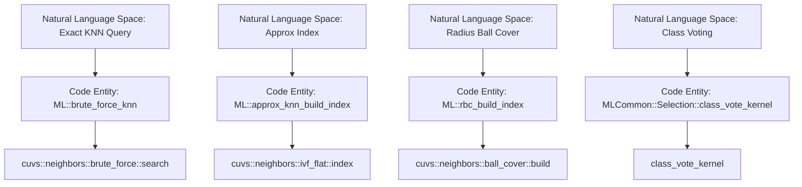
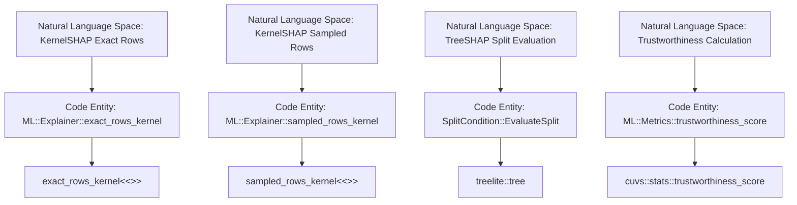

<!-- source: DeepWiki mcp.deepwiki.com · repo NVIDIA/cuml · page 2.6 Neighbors, Metrics, Datasets and Explainability · fetched 2026-10-26 -->

# Neighbors, Metrics, Datasets and Explainability

Relevant source files

The following files were used as context for generating this wiki page:

- [cpp/include/cuml/datasets/make_blobs.hpp](cpp/include/cuml/datasets/make_blobs.hpp)
- [cpp/include/cuml/datasets/make_regression.hpp](cpp/include/cuml/datasets/make_regression.hpp)
- [cpp/include/cuml/explainer/kernel_shap.hpp](cpp/include/cuml/explainer/kernel_shap.hpp)
- [cpp/include/cuml/explainer/permutation_shap.hpp](cpp/include/cuml/explainer/permutation_shap.hpp)
- [cpp/include/cuml/explainer/tree_shap.hpp](cpp/include/cuml/explainer/tree_shap.hpp)
- [cpp/include/cuml/metrics/metrics.hpp](cpp/include/cuml/metrics/metrics.hpp)
- [cpp/include/cuml/neighbors/kde.hpp](cpp/include/cuml/neighbors/kde.hpp)
- [cpp/include/cuml/neighbors/knn.hpp](cpp/include/cuml/neighbors/knn.hpp)
- [cpp/src/datasets/make_blobs.cu](cpp/src/datasets/make_blobs.cu)
- [cpp/src/datasets/make_regression.cu](cpp/src/datasets/make_regression.cu)
- [cpp/src/dbscan/mergelabels/tree_reduction.cuh](cpp/src/dbscan/mergelabels/tree_reduction.cuh)
- [cpp/src/explainer/kernel_shap.cu](cpp/src/explainer/kernel_shap.cu)
- [cpp/src/explainer/permutation_shap.cu](cpp/src/explainer/permutation_shap.cu)
- [cpp/src/explainer/tree_shap.cu](cpp/src/explainer/tree_shap.cu)
- [cpp/src/kde/kde.cu](cpp/src/kde/kde.cu)
- [cpp/src/knn/knn.cu](cpp/src/knn/knn.cu)
- [cpp/src/knn/knn_classify_mg.cu](cpp/src/knn/knn_classify_mg.cu)
- [cpp/src/knn/knn_opg_common.cuh](cpp/src/knn/knn_opg_common.cuh)
- [cpp/src/knn/knn_regress_mg.cu](cpp/src/knn/knn_regress_mg.cu)
- [cpp/src/metrics/pairwise_distance.cu](cpp/src/metrics/pairwise_distance.cu)
- [cpp/src/metrics/silhouette_score.cu](cpp/src/metrics/silhouette_score.cu)
- [cpp/src/metrics/silhouette_score_batched_double.cu](cpp/src/metrics/silhouette_score_batched_double.cu)
- [cpp/src/metrics/silhouette_score_batched_float.cu](cpp/src/metrics/silhouette_score_batched_float.cu)
- [cpp/src/metrics/trustworthiness.cu](cpp/src/metrics/trustworthiness.cu)
- [cpp/src_prims/selection/knn.cuh](cpp/src_prims/selection/knn.cuh)
- [python/cuml/cuml/dask/cluster/dbscan.py](python/cuml/cuml/dask/cluster/dbscan.py)
- [python/cuml/cuml/neighbors/CMakeLists.txt](python/cuml/cuml/neighbors/CMakeLists.txt)
- [python/cuml/cuml/neighbors/__init__.py](python/cuml/cuml/neighbors/__init__.py)
- [python/cuml/tests/test_kernel_density.py](python/cuml/tests/test_kernel_density.py)

This section covers the core C++/CUDA implementations within `libcuml` for nearest neighbor search algorithms (brute-force, approximate index building, and radius ball cover), kernel density estimation, distance and validation metrics (pairwise distances, silhouette score, trustworthiness), synthetic dataset generators (`make_blobs`, `make_regression`), and model explainability engines (TreeSHAP and KernelSHAP data preparation kernels).

---

## 1. Nearest Neighbors and Radius Ball Cover (RBC)

CuML provides both exact and approximate nearest neighbor primitives, leveraging underlying `cuvs` library components.

### Brute Force KNN and Approximate Indices
Exact nearest neighbors are implemented via `brute_force_knn()`, which manages multiple input arrays, index partitions, and dispatches to `cuvs::neighbors::brute_force::build` and `cuvs::neighbors::brute_force::search` [cpp/src/knn/knn.cu:50-150](). The API declaration is provided in `cpp/include/cuml/neighbors/knn.hpp` [cpp/include/cuml/neighbors/knn.hpp:44-57](). 

Approximate nearest neighbor search relies on `knnIndex` structures wrapping IVF-Flat and IVF-PQ implementations via `approx_knn_build_index()` and `approx_knn_search()` [cpp/include/cuml/neighbors/knn.hpp:116-185]().

### Radius Ball Cover (RBC)
Radius ball cover indexes query points within a specific radius metric space. RBC index building, querying, and adjacency graph construction are exposed through:
- `rbc_build_index()` [cpp/src/knn/knn.cu:173-183]()
- `rbc_knn_query()` [cpp/include/cuml/neighbors/knn.hpp:66-73]()
- `rbc_radius_neighbors_graph()` [cpp/include/cuml/neighbors/knn.hpp:97-105]()

### Voting and Regression Primitives
Classification voting and regression averaging operate directly on neighbor indices via CUDA kernels defined in `cpp/src_prims/selection/knn.cuh`:
- `class_probs_kernel()` computes class probabilities using uniform or weighted neighbor votes [cpp/src_prims/selection/knn.cuh:38-80]().
- `class_vote_kernel()` maps probabilities to discrete class labels [cpp/src_prims/selection/knn.cuh:83-118]().
- `regress_avg_kernel()` computes target averages for regression tasks [cpp/src_prims/selection/knn.cuh:121-156]().

*Figure 1: Bridging Natural Language Concepts to Code Entities in Nearest Neighbors.*

Sources: `cpp/src/knn/knn.cu`, `cpp/include/cuml/neighbors/knn.hpp`, `cpp/src_prims/selection/knn.cuh`

---

## 2. Kernel Density Estimation (KDE)

Kernel Density Estimation is implemented in `cpp/src/kde/kde.cu` and declared in `cpp/include/cuml/neighbors/kde.hpp`. It supports various density kernels (Gaussian, Tophat, Epanechnikov, Exponential, Linear, Cosine) and bandwidth selection heuristics (Scott, Silverman).

Sources: `cpp/include/cuml/neighbors/kde.hpp`, `cpp/src/kde/kde.cu`, `python/cuml/tests/test_kernel_density.py`

---

## 3. Metrics: Pairwise Distances, Silhouette & Trustworthiness

Metric computations leverage GPU-accelerated routines for model validation and distance geometry.

### Pairwise Distances
Pairwise distances between dense or sparse matrices are computed via `pairwise_distance()` and `pairwiseDistance_sparse()` over row-major and column-major memory layouts [cpp/src/metrics/pairwise_distance.cu:17-143](). These functions dispatch to `cuvs::distance::pairwise_distance` [cpp/src/metrics/pairwise_distance.cu:29-108]().

### Silhouette Score
The silhouette coefficient measures cluster separation using intra-cluster and nearest-cluster distances [cpp/include/cuml/metrics/metrics.hpp:74-90](). Batched computations (`Batched::silhouette_score()`) tile the pairwise distance matrix to prevent quadratic memory consumption on large datasets [cpp/include/cuml/metrics/metrics.hpp:100-140]().

### Trustworthiness Score
Trustworthiness evaluates manifold embedding quality by measuring local neighborhood preservation [cpp/src/metrics/trustworthiness.cu:18-30](). It wraps `cuvs::stats::trustworthiness_score()` [cpp/src/metrics/trustworthiness_score.hpp] [cpp/src/metrics/trustworthiness.cu:41-47]().

Sources: `cpp/include/cuml/metrics/metrics.hpp`, `cpp/src/metrics/pairwise_distance.cu`, `cpp/src/metrics/trustworthiness.cu`

---

## 4. Synthetic Datasets (`make_blobs` & `make_regression`)

Synthetic data generation utilities replicate scikit-learn dataset generation functions directly on device memory.

### Make Blobs
`make_blobs()` generates isotropic Gaussian blobs for clustering [cpp/include/cuml/datasets/make_blobs.hpp:19-50](). It supports single (`float`) and double (`double`) precision, arbitrary cluster standard deviations, row/column major layouts, and randomized bounding boxes [cpp/src/datasets/make_blobs.cu:14-136](). The implementation delegates directly to `raft::random::make_blobs` [cpp/src/datasets/make_blobs.cu:29-42]().

### Make Regression
`make_regression()` (declared in `cpp/include/cuml/datasets/make_regression.hpp`) generates random regression problems with specified informative features, noise, and rank.

Sources: `cpp/include/cuml/datasets/make_blobs.hpp`, `cpp/src/datasets/make_blobs.cu`

---

## 5. Explainability Kernels (TreeSHAP & KernelSHAP)

Model explainability components compute SHAP (SHapley Additive exPlanations) values for tree-based models and black-box estimators.

### TreeSHAP
TreeSHAP utilizes the `GPUTreeShap` library [cpp/src/explainer/tree_shap.cu:21](). Internal structures such as `BitField` and `SplitCondition` handle categorical and numerical splits during tree traversal [cpp/src/explainer/tree_shap.cu:47-197]().

### KernelSHAP Dataset Kernels
KernelSHAP prepares evaluation background and observation datasets through specialized CUDA kernels defined in `cpp/src/explainer/kernel_shap.cu`:
- `exact_rows_kernel()` maps deterministic background/observation permutations based on coalition matrices $X$ [cpp/src/explainer/kernel_shap.cu:40-71]().
- `sampled_rows_kernel()` utilizes Philox random number generators (`curandStatePhilox4_32_10_t`) to sample feature subsets for stochastic KernelSHAP approximations [cpp/src/explainer/kernel_shap.cu:97-158]().
- `kernel_dataset_impl()` coordinates kernel launches based on `len_samples` and total rows `nrows_X` [cpp/src/explainer/kernel_shap.cu:160-204]().

*Figure 2: Bridging Explainability and Metric Concepts to Code Entities.*

Sources: `cpp/src/explainer/tree_shap.cu`, `cpp/src/explainer/kernel_shap.cu`, `cpp/src/metrics/trustworthiness.cu`

---

