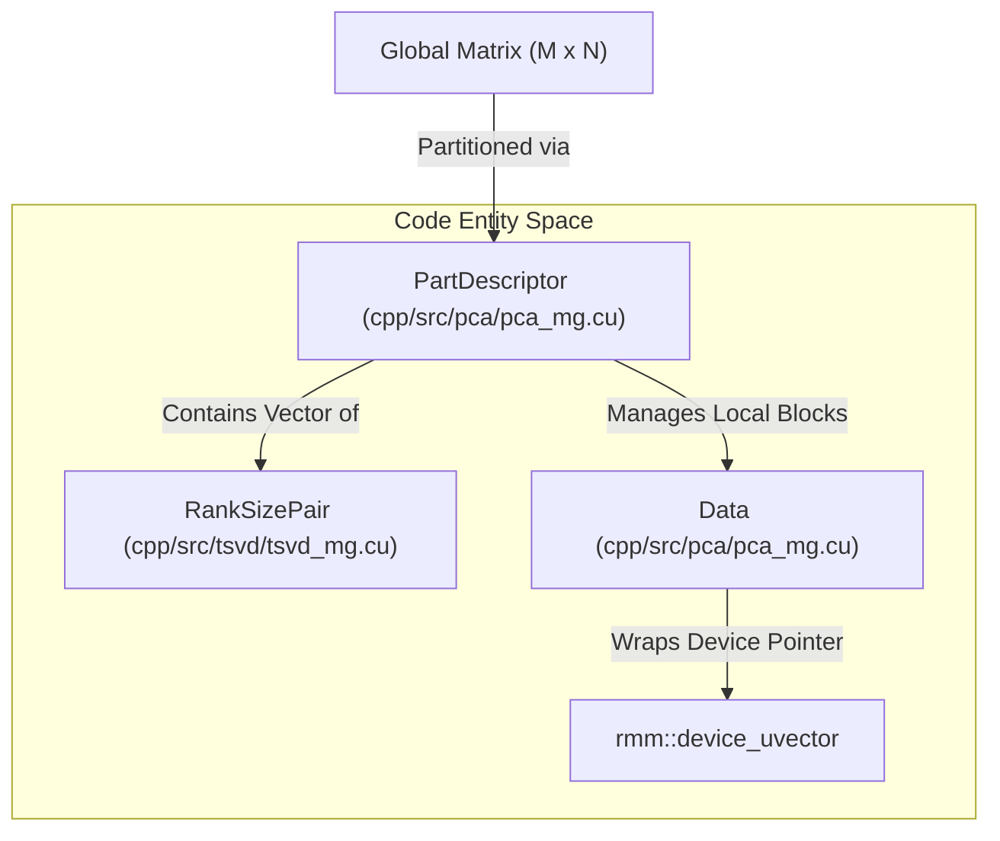
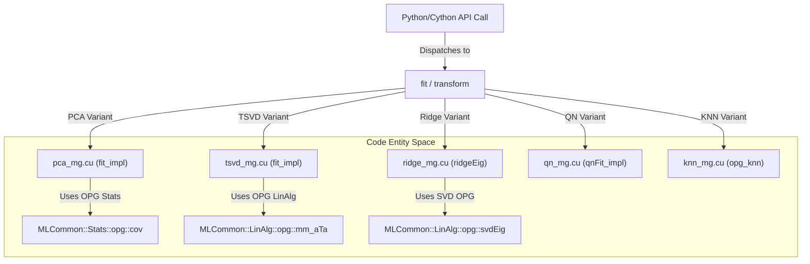

<!-- source: DeepWiki mcp.deepwiki.com · repo NVIDIA/cuml · page 2.7 Multi-GPU (OPG/MNMG) C++ Layer · fetched 2026-10-26 -->

# Multi-GPU (OPG/MNMG) C++ Layer

<details>
<summary>Relevant source files</summary>

The following files were used as context for generating this wiki page:

- [cpp/bench/sg/dataset.cuh](cpp/bench/sg/dataset.cuh)
- [cpp/include/cuml/common/utils.hpp](cpp/include/cuml/common/utils.hpp)
- [cpp/include/cuml/decomposition/pca_mg.hpp](cpp/include/cuml/decomposition/pca_mg.hpp)
- [cpp/include/cuml/decomposition/tsvd_mg.hpp](cpp/include/cuml/decomposition/tsvd_mg.hpp)
- [cpp/include/cuml/linear_model/ols_mg.hpp](cpp/include/cuml/linear_model/ols_mg.hpp)
- [cpp/include/cuml/linear_model/preprocess_mg.hpp](cpp/include/cuml/linear_model/preprocess_mg.hpp)
- [cpp/include/cuml/linear_model/qn_mg.hpp](cpp/include/cuml/linear_model/qn_mg.hpp)
- [cpp/include/cuml/linear_model/ridge_mg.hpp](cpp/include/cuml/linear_model/ridge_mg.hpp)
- [cpp/include/cuml/neighbors/knn_mg.hpp](cpp/include/cuml/neighbors/knn_mg.hpp)
- [cpp/include/cuml/solvers/cd_mg.hpp](cpp/include/cuml/solvers/cd_mg.hpp)
- [cpp/src/glm/ols_mg.cu](cpp/src/glm/ols_mg.cu)
- [cpp/src/glm/preprocess_mg.cu](cpp/src/glm/preprocess_mg.cu)
- [cpp/src/glm/qn/mg/glm_base_mg.cuh](cpp/src/glm/qn/mg/glm_base_mg.cuh)
- [cpp/src/glm/qn/mg/qn_mg.cuh](cpp/src/glm/qn/mg/qn_mg.cuh)
- [cpp/src/glm/qn/mg/standardization.cuh](cpp/src/glm/qn/mg/standardization.cuh)
- [cpp/src/glm/qn_mg.cu](cpp/src/glm/qn_mg.cu)
- [cpp/src/glm/ridge_mg.cu](cpp/src/glm/ridge_mg.cu)
- [cpp/src/hdbscan/runner.cuh](cpp/src/hdbscan/runner.cuh)
- [cpp/src/knn/knn_mg.cu](cpp/src/knn/knn_mg.cu)
- [cpp/src/pca/pca_mg.cu](cpp/src/pca/pca_mg.cu)
- [cpp/src/solver/cd_mg.cu](cpp/src/solver/cd_mg.cu)
- [cpp/src/tsvd/tsvd_mg.cu](cpp/src/tsvd/tsvd_mg.cu)
- [cpp/tests/mg/knn.cu](cpp/tests/mg/knn.cu)
- [cpp/tests/mg/knn_classify.cu](cpp/tests/mg/knn_classify.cu)
- [cpp/tests/mg/knn_regress.cu](cpp/tests/mg/knn_regress.cu)
- [cpp/tests/mg/knn_test_helper.cuh](cpp/tests/mg/knn_test_helper.cuh)
- [cpp/tests/mg/pca.cu](cpp/tests/mg/pca.cu)
- [python/cuml/tests/dask/test_dask_logistic_regression.py](python/cuml/tests/dask/test_dask_logistic_regression.py)

</details>


## Purpose and Scope

The Multi-GPU (OPG/MNMG) C++ Layer within `libcuml` provides scalable, distributed machine learning algorithms capable of running across multiple GPUs and multiple compute nodes. "OPG" refers to Over-Partitioned Grids, a data-layout framework where global matrices are divided into blocks assigned across ranks, while "MNMG" stands for Multi-Node Multi-GPU. This layer leverages RAFT communication primitives (`raft::comms::comms_t`) and RMM memory management to implement distributed solvers for linear models, dimensionality reduction, clustering, and nearest neighbors.

Sources:
- `cpp/include/cuml/decomposition/pca_mg.hpp:1-170`
- `cpp/include/cuml/linear_model/ridge_mg.hpp:1-94`

---

## 1. OPG Data Structures and Partitioning

Distributed matrices in cuML's C++ layer are abstracted using structural primitives that describe how global data is partitioned among MPI/RAFT ranks and local memory buffers.

| Class / Structure | File Path & Line Range | Role / Description |
| :--- | :--- | :--- |
| `MLCommon::Matrix::PartDescriptor` | `cpp/src/pca/pca_mg.cu:32-36` | Describes global matrix dimensions ($M \times N$) and partition ownership per rank. |
| `MLCommon::Matrix::RankSizePair` | `cpp/src/tsvd/tsvd_mg.cu:99-102` | Associates an MPI rank with the number of rows/columns owned in a specific partition. |
| `MLCommon::Matrix::Data<T>` | `cpp/src/pca/pca_mg.cu:32-35` | Wraps a device pointer (`T* ptr`) and total block size for a single local partition slice. |

### Diagram: OPG Data Structures Architecture


*Sources: `cpp/src/pca/pca_mg.cu:32-46`, `cpp/src/tsvd/tsvd_mg.cu:97-113`*

---

## 2. MNMG Algorithm Implementations (`_mg` Variants)

The C++ core implements dedicated multi-GPU variants for principal component analysis, singular value decomposition, linear regression models, nearest neighbors, and quasi-newton optimization.

### Principal Component Analysis (PCA) & Truncated SVD (TSVD)
Multi-GPU PCA (`fit_impl`) computes the column-wise mean using `MLCommon::Stats::opg::mean`, builds the covariance matrix via `MLCommon::Stats::opg::cov`, and uses RAFT eigenvalue solvers to extract principal components [cpp/src/pca/pca_mg.cu:32-96](). Similarly, TSVD accumulates cross-product matrices ($A^T A$) via `MLCommon::LinAlg::opg::mm_aTa` before performing eigen-decomposition [cpp/src/tsvd/tsvd_mg.cu:27-84]().

```cpp
// Example signature for PCA MG fit
void fit(raft::handle_t& handle,
         std::vector<MLCommon::Matrix::Data<float>*>& input_data,
         MLCommon::Matrix::PartDescriptor& input_desc,
         float* components,
         float* explained_var,
         float* explained_var_ratio,
         float* singular_vals,
         float* mu,
         float* noise_vars,
         paramsPCAMG prms,
         bool verbose);
```
*Sources: `cpp/src/pca/pca_mg.cu:32-158`, `cpp/src/tsvd/tsvd_mg.cu:27-131`, `cpp/include/cuml/decomposition/pca_mg.hpp:32-43`*

### Linear Models: OLS and Ridge Regression
Distributed Ordinary Least Squares (OLS) and Ridge regression solve linear systems across ranks. Ridge MG (`ridgeEig` and `ridgeSolve`) computes SVD across distributed partitions (`MLCommon::LinAlg::opg::svdEig`) and applies Tikhonov regularization in spectral space [cpp/src/glm/ridge_mg.cu:31-142]().

```cpp
// Example signature for Ridge MG fit
void fit(raft::handle_t& handle,
         std::vector<MLCommon::Matrix::Data<float>*>& input_data,
         MLCommon::Matrix::PartDescriptor& input_desc,
         std::vector<MLCommon::Matrix::Data<float>*>& labels,
         float* alpha,
         int n_alpha,
         float* coef,
         float* intercept,
         bool fit_intercept,
         int algo,
         bool verbose);
```
*Sources: `cpp/src/glm/ols_mg.cu:24-81`, `cpp/src/glm/ridge_mg.cu:30-142`, `cpp/include/cuml/linear_model/ridge_mg.hpp:32-42`*

### Nearest Neighbors (KNN)
Multi-GPU KNN (`ML::KNN::opg::knn`) performs distributed k-nearest neighbor queries and classification/regression by broadcasting query batches across ranks and computing pairwise distances [cpp/include/cuml/neighbors/knn_mg.hpp:38-50, cpp/src/knn/knn_mg.cu:16-43]().

### Quasi-Newton (QN) and Coordinate Descent (CD)
Distributed QN solvers (`qnFit_impl`) handle logistic regression and generalized linear models across multi-node cluster environments, utilizing distributed label uniqueness checks (`distinct_mg`) and standardization utilities [cpp/src/glm/qn_mg.cu:43-129]().

### Diagram: MNMG Algorithm Dispatch and Code Mapping


*Sources: `cpp/src/pca/pca_mg.cu:32-158`, `cpp/src/tsvd/tsvd_mg.cu:27-45`, `cpp/src/glm/ridge_mg.cu:95-142`, `cpp/src/glm/qn_mg.cu:87-129`, `cpp/src/knn/knn_mg.cu:16-43`*

Sources:
- `cpp/src/pca/pca_mg.cu:32-158`
- `cpp/src/tsvd/tsvd_mg.cu:27-131`
- `cpp/src/glm/ols_mg.cu:24-81`
- `cpp/src/glm/ridge_mg.cu:30-142`
- `cpp/include/cuml/neighbors/knn_mg.hpp:38-125`
- `cpp/src/knn/knn_mg.cu:16-43`
- `cpp/src/glm/qn_mg.cu:43-129`

---

## 3. Communication Usage and RAFT Integration

All distributed communication within `libcuml` relies on `raft::comms::comms_t` encapsulated inside `raft::handle_t`. 

- **Collectives**: Operations like `allgather` and `allgatherv` are heavily used for gathering unique class labels across workers [cpp/src/glm/qn_mg.cu:54-73]().
- **Streams & Synchronization**: Multi-GPU algorithms manage multiple CUDA streams per rank to overlap computation and communication, calling `handle.sync_stream(stream)` or explicit stream barriers before executing dependent kernels [cpp/src/pca/pca_mg.cu:86-88, cpp/src/glm/qn_mg.cu:46-57]().

Sources:
- `cpp/src/pca/pca_mg.cu:47-96`
- `cpp/src/glm/qn_mg.cu:43-84`

---

## 4. Multi-GPU (MG) Testing Framework

Multi-GPU algorithms are validated through dedicated C++ GTest suites and Python Dask-based test modules. These tests spin up local multi-GPU contexts or multi-process Dask clusters.

- **C++ MG Tests**: Test runners instantiate mock distributed partitions and verify numerical equivalence against single-GPU baselines (e.g., `cpp/tests/mg/pca.cu`, `cpp/tests/mg/knn.cu`).
- **Python Dask Tests**: Integration tests such as `test_dask_logistic_regression.py` test distributed QN/LBFGS solvers using `dask_cudf` DataFrames [python/cuml/tests/dask/test_dask_logistic_regression.py:32-147]().

```python
@pytest.mark.mg
@pytest.mark.parametrize("n_parts", [2])
@pytest.mark.parametrize("datatype", [np.float32, np.float64])
def test_lbfgs_toy(n_parts, datatype, client):
    X = np.array([(1, 2), (1, 3), (2, 1), (3, 1)], datatype)
    y = np.array([1.0, 1.0, 0.0, 0.0], datatype)
    from cuml.dask.linear_model import LogisticRegression as cumlLBFGS_dask
    X_df, y_df = _prep_training_data(client, X, y, n_parts)
    lr = cumlLBFGS_dask()
    lr.fit(X_df, y_df)
    ...
```
*Sources: `python/cuml/tests/dask/test_dask_logistic_regression.py:114-147`*

Sources:
- `python/cuml/tests/dask/test_dask_logistic_regression.py:1-222`
- `cpp/bench/sg/dataset.cuh:1-200`

---

