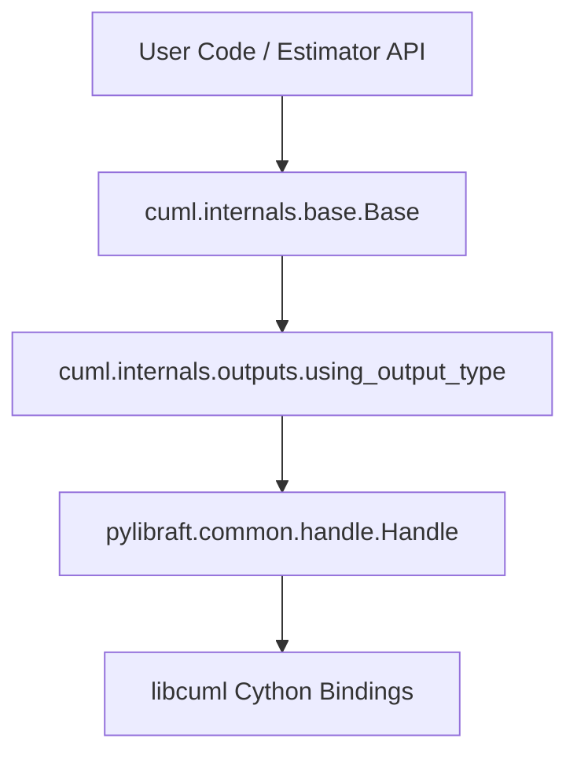
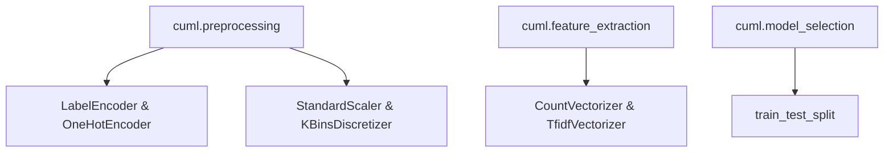

<!-- source: DeepWiki mcp.deepwiki.com · repo NVIDIA/cuml · page 3 Python Package (cuml) · fetched 2026-10-26 -->

# Python Package (cuml)

Relevant source files

The following files were used as context for generating this wiki page:

- [docs/source/api/cuml.ensemble.rst](docs/source/api/cuml.ensemble.rst)
- [docs/source/api/cuml.feature_extraction.rst](docs/source/api/cuml.feature_extraction.rst)
- [docs/source/api/cuml.metrics.rst](docs/source/api/cuml.metrics.rst)
- [docs/source/api/cuml.preprocessing.rst](docs/source/api/cuml.preprocessing.rst)
- [docs/source/api/index.rst](docs/source/api/index.rst)
- [python/cuml/cuml/__init__.py](python/cuml/cuml/__init__.py)
- [python/cuml/cuml/datasets/regression.pyx](python/cuml/cuml/datasets/regression.pyx)
- [python/cuml/cuml/internals/base.py](python/cuml/cuml/internals/base.py)
- [python/cuml/cuml/internals/outputs.py](python/cuml/cuml/internals/outputs.py)
- [python/cuml/cuml/metrics/__init__.py](python/cuml/cuml/metrics/__init__.py)
- [python/cuml/cuml/preprocessing/__init__.py](python/cuml/cuml/preprocessing/__init__.py)
- [python/cuml/cuml/preprocessing/label.py](python/cuml/cuml/preprocessing/label.py)
- [python/cuml/tests/explainer/test_sampling.py](python/cuml/tests/explainer/test_sampling.py)
- [python/cuml/tests/test_docs.py](python/cuml/tests/test_docs.py)
- [python/cuml/tests/test_label_binarizer.py](python/cuml/tests/test_label_binarizer.py)
- [python/cuml/tests/test_make_regression.py](python/cuml/tests/test_make_regression.py)
- [python/cuml/tests/test_reflection.py](python/cuml/tests/test_reflection.py)

The `python/cuml` package provides a scikit-learn-compatible Python API for cuML, serving as the primary bridge between high-level Python workloads and the high-performance C++/CUDA core library (`libcuml`). It handles data management across host and device memory, dispatches computations via Cython bindings, controls output data formats (`cupy`, `numpy`, `cudf`, `pandas`), and coordinates distributed execution.

Sources:
- `python/cuml/cuml/__init__.py` [python/cuml/cuml/__init__.py:1-164]()

---

## 3.1. Estimator Base and Internals Framework

All cuML estimators inherit from the core `Base` class, which standardizes parameter inspection, serialization, and input validation [python/cuml/cuml/internals/base.py:54-114](). The internals framework manages memory and device placement (`mem_type`, `device_type`) and provides robust output type coercion through functions like `set_global_output_type()` and context managers like `using_output_type()` [python/cuml/cuml/internals/outputs.py:34-125](). It also handles RMM (RAPIDS Memory Manager) integration for efficient GPU memory pooling during estimator lifecycle execution.

For detailed documentation, see [Estimator Base and Internals Framework](#3.1).

*Diagram 1: Core Internals Framework Dispatch Flow*

Sources:
- `python/cuml/cuml/internals/base.py` [python/cuml/cuml/internals/base.py:54-114]()
- `python/cuml/cuml/internals/outputs.py` [python/cuml/cuml/internals/outputs.py:34-125]()

---

## 3.2. Estimators by Family

The Python package exposes a broad spectrum of machine learning algorithms organized into modular sub-packages mirroring scikit-learn [docs/source/api/index.rst:12-39](). These estimators wrap underlying `libcuml` algorithms via Cython bindings, supporting classification, regression, clustering, decomposition, manifold learning, and nearest neighbors search.

For detailed documentation on specific families, see [Estimators by Family](#3.2).

### 3.2.1. Ensemble Estimators (Random Forest, Isolation Forest)
Ensemble models such as `RandomForestClassifier`, `RandomForestRegressor`, and `IsolationForest` wrap backend tree-building logic, supporting out-of-bag scoring and Treelite/nvForest-based high-throughput inference [python/cuml/cuml/__init__.py:31-33]().

### 3.2.2. Clustering and Neighbors Estimators
Includes single-GPU and accelerated clustering models (`KMeans`, `DBSCAN`, `HDBSCAN`, `AgglomerativeClustering`) alongside nearest neighbors search (`NearestNeighbors`, `KNeighborsClassifier`, `KNeighborsRegressor`, `KernelDensity`) [python/cuml/cuml/__init__.py:19-22,57-60]().

### 3.2.3. Linear Models, SVM and Solvers
Covers linear and ridge regression, elastic net, logistic regression, support vector machines (`SVC`, `SVR`, `LinearSVC`), naive Bayes (`MultinomialNB`), and lower-level optimization solvers (`CD`, `QN`, `SGD`) [python/cuml/cuml/__init__.py:43-51,56,67-70]().

### 3.2.4. Dimensionality Reduction and Manifold Estimators
Provides linear and non-linear feature extraction tools including `PCA`, `IncrementalPCA`, `TruncatedSVD`, `UMAP`, `TSNE`, and random projections [python/cuml/cuml/__init__.py:28-30,52-53,62-66]().

Sources:
- `python/cuml/cuml/__init__.py` [python/cuml/cuml/__init__.py:19-70]()
- `docs/source/api/index.rst` [docs/source/api/index.rst:12-39]()

---

## 3.3. Preprocessing, Feature Extraction and Model Selection

The preprocessing and utilities submodules implement GPU-accelerated versions of data transformation tools [docs/source/api/index.rst:65-216](). This includes label and categorical encoding (`LabelEncoder`, `OneHotEncoder`, `OrdinalEncoder`, `TargetEncoder`), scaling utilities (`StandardScaler`, `MinMaxScaler`), text feature extraction (`CountVectorizer`, `TfidfVectorizer`), and dataset generation utilities (`make_regression`, `make_blobs`, `train_test_split`) [python/cuml/cuml/__init__.py:25-27,55,61]().

For detailed documentation, see [Preprocessing, Feature Extraction and Model Selection](#3.3).

*Diagram 2: Preprocessing and Utility Modules*

Sources:
- `python/cuml/cuml/__init__.py` [python/cuml/cuml/__init__.py:25-27,55,61]()
- `python/cuml/cuml/preprocessing/label.py` [python/cuml/cuml/preprocessing/label.py:20-65]()
- `docs/source/api/index.rst` [docs/source/api/index.rst:65-216]()

---

## 3.4. Metrics and Explainability (SHAP)

The `cuml.metrics` module provides GPU-accelerated evaluation functions for regression, classification, ranking, pairwise distances, and clustering metrics (e.g., `adjusted_rand_score`, `r2_score`, `pairwise_distances`) [python/cuml/cuml/metrics/__init__.py:1-65](). Additionally, the `cuml.explainer` module supplies model interpretability tools such as `TreeExplainer`, `KernelExplainer`, and `PermutationExplainer` [python/cuml/cuml/__init__.py:34-36]().

For detailed documentation, see [Metrics and Explainability (SHAP)](#3.4).

Sources:
- `python/cuml/cuml/metrics/__init__.py` [python/cuml/cuml/metrics/__init__.py:1-65]()
- `python/cuml/cuml/__init__.py` [python/cuml/cuml/__init__.py:34-36]()

---

## 3.5. Python Build and Packaging (cuml / libcuml wheels)

The packaging infrastructure uses CMake along with `pyproject.toml` and `rapids-build-backend` to build `cuml` and `libcuml` Python wheels and conda packages. A dedicated runtime shim (`libcuml/load.py`) dynamically locates and loads shared object symbols when installed as a standalone wheel [python/cuml/cuml/__init__.py:6-14]().

For detailed documentation, see [Python Build and Packaging (cuml / libcuml wheels)](#3.5).

Sources:
- `python/cuml/cuml/__init__.py` [python/cuml/cuml/__init__.py:6-14]()

---

