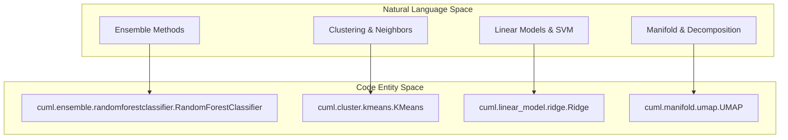
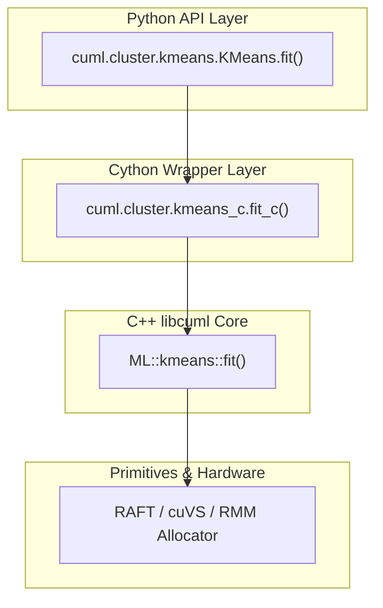

<!-- source: DeepWiki mcp.deepwiki.com · repo NVIDIA/cuml · page 3.2 Estimators by Family · fetched 2026-10-26 -->

# Estimators by Family

Relevant source files

The following files were used as context for generating this wiki page:

- [docs/source/api/cuml.ensemble.rst](docs/source/api/cuml.ensemble.rst)
- [docs/source/api/cuml.feature_extraction.rst](docs/source/api/cuml.feature_extraction.rst)
- [docs/source/api/cuml.preprocessing.rst](docs/source/api/cuml.preprocessing.rst)
- [docs/source/api/index.rst](docs/source/api/index.rst)
- [python/cuml/cuml/__init__.py](python/cuml/cuml/__init__.py)
- [python/cuml/cuml/preprocessing/__init__.py](python/cuml/cuml/preprocessing/__init__.py)
- [python/cuml/tests/test_docs.py](python/cuml/tests/test_docs.py)

## Purpose and Scope

This section provides a high-level overview of the Python estimator modules exposed by `cuml` (`python/cuml/cuml/__init__.py`) [python/cuml/cuml/__init__.py:16-70] and how they map to their underlying C++ `libcuml` backends and primitives. cuML organizes machine learning algorithms into logical families mirroring scikit-learn (`cuml.ensemble`, `cuml.cluster`, `cuml.linear_model`, `cuml.manifold`, `cuml.neighbors`, `cuml.svm`, and `cuml.decomposition`). 

As a PARENT page, this document outlines the architectural taxonomy and routing of estimators. For exhaustive implementation specifics, algorithm variations, and performance tuning, refer to the respective child pages:
- Ensemble Estimators: [Ensemble Estimators (Random Forest, Isolation Forest)](#3.2.1)
- Clustering and Neighbors: [Clustering and Neighbors Estimators](#3.2.2)
- Linear Models and SVM: [Linear Models, SVM and Solvers](#3.2.3)
- Dimensionality Reduction: [Dimensionality Reduction and Manifold Estimators](#3.2.4)

Sources: `python/cuml/cuml/__init__.py` [python/cuml/cuml/__init__.py:1-164], `docs/source/api/index.rst` [docs/source/api/index.rst:1-40]

---

## Estimator Family Taxonomy and Code Entity Mapping

The cuML Python layer exposes user-facing classes inheriting from `cuml.internals.base.Base` [python/cuml/cuml/__init__.py:37]. These classes wrap Cython bindings (`.pyx`) that interface directly with `libcuml` C++ routines and RAFT primitives.

*Figure 1: Mapping high-level machine learning families to core Python estimator classes.*

Sources: `python/cuml/cuml/__init__.py` [python/cuml/cuml/__init__.py:16-70], `python/cuml/tests/test_docs.py` [python/cuml/tests/test_docs.py:39-51]

---

## Core Estimator Families

### 1. Ensemble Estimators
Ensemble modules provide GPU-accelerated bagging and tree-based ensembles. These include `RandomForestClassifier`, `RandomForestRegressor`, and `IsolationForest` [python/cuml/cuml/__init__.py:31-33]. Training leverages batched histogram building and split evaluation, while inference utilizes optimized tree traversal formats such as Treelite and `nvforest`.

For comprehensive details on random forest internals, OOB scoring, and isolation forests, see [Ensemble Estimators (Random Forest, Isolation Forest)](#3.2.1).

Sources: `python/cuml/cuml/__init__.py` [python/cuml/cuml/__init__.py:31-33], `docs/source/api/cuml.ensemble.rst` [docs/source/api/cuml.ensemble.rst:1-16]

### 2. Clustering and Neighbors Estimators
The clustering and neighbors modules offer spatial partitioning, density-based grouping, and graph-based proximity search. Key estimators include `KMeans`, `DBSCAN`, `HDBSCAN`, `AgglomerativeClustering`, `NearestNeighbors`, `KNeighborsClassifier`, `KNeighborsRegressor`, and `KernelDensity` [python/cuml/cuml/__init__.py:19-22, 57-60]. These modules rely heavily on `cuVS` and RAFT primitives for fast nearest-neighbor graph construction.

For detailed breakdowns of clustering runner routines, vertex degree calculations, and neighbor indices, see [Clustering and Neighbors Estimators](#3.2.2).

Sources: `python/cuml/cuml/__init__.py` [python/cuml/cuml/__init__.py:19-22, 57-60], `docs/source/api/index.rst` [docs/source/api/index.rst:18-21, 34-35]

### 3. Linear Models, SVM, and Solvers
Linear modeling and support vector machines implement regression, classification, and regularized optimization. Supported estimators include `LinearRegression`, `Ridge`, `ElasticNet`, `Lasso`, `LogisticRegression`, `MBSGDClassifier`, `MBSGDRegressor`, `KernelRidge`, `MultinomialNB`, `SVC`, `SVR`, `LinearSVC`, and `LinearSVR` [python/cuml/cuml/__init__.py:43-51, 56, 70]. Optimization is delegated to specialized solvers like Quasi-Newton (`QN`), Coordinate Descent (`CD`), and Stochastic Gradient Descent (`SGD`) [python/cuml/cuml/__init__.py:67-69].

For deep dives into working sets, kernel caches, SMO solvers, and linear solvers, see [Linear Models, SVM and Solvers](#3.2.3).

Sources: `python/cuml/cuml/__init__.py` [python/cuml/cuml/__init__.py:43-51, 56, 67-70], `docs/source/api/index.rst` [docs/source/api/index.rst:27-28, 33, 37-38]

### 4. Dimensionality Reduction and Manifold Estimators
Dimensionality reduction techniques project high-dimensional features into lower-dimensional embedding spaces. Included estimators are `UMAP`, `TSNE`, `PCA`, `IncrementalPCA`, `TruncatedSVD`, and random projections (`GaussianRandomProjection`, `SparseRandomProjection`) [python/cuml/cuml/__init__.py:28-30, 52-53, 62-65].

For specifics on fuzzy simplicial sets, Barnes-Hut/FFT t-SNE kernels, and SVD solver mechanics, see [Dimensionality Reduction and Manifold Estimators](#3.2.4).

Sources: `python/cuml/cuml/__init__.py` [python/cuml/cuml/__init__.py:28-30, 52-53, 62-65], `docs/source/api/index.rst` [docs/source/api/index.rst:23, 29, 36]

---

## Execution Flow from Python to C++ Backend

*Figure 2: Execution path showing how Python estimator calls are routed through Cython bindings to `libcuml` and underlying hardware primitives.*

Sources: `python/cuml/cuml/__init__.py` [python/cuml/cuml/__init__.py:16-70], `docs/source/api/index.rst` [docs/source/api/index.rst:1-40]

---

