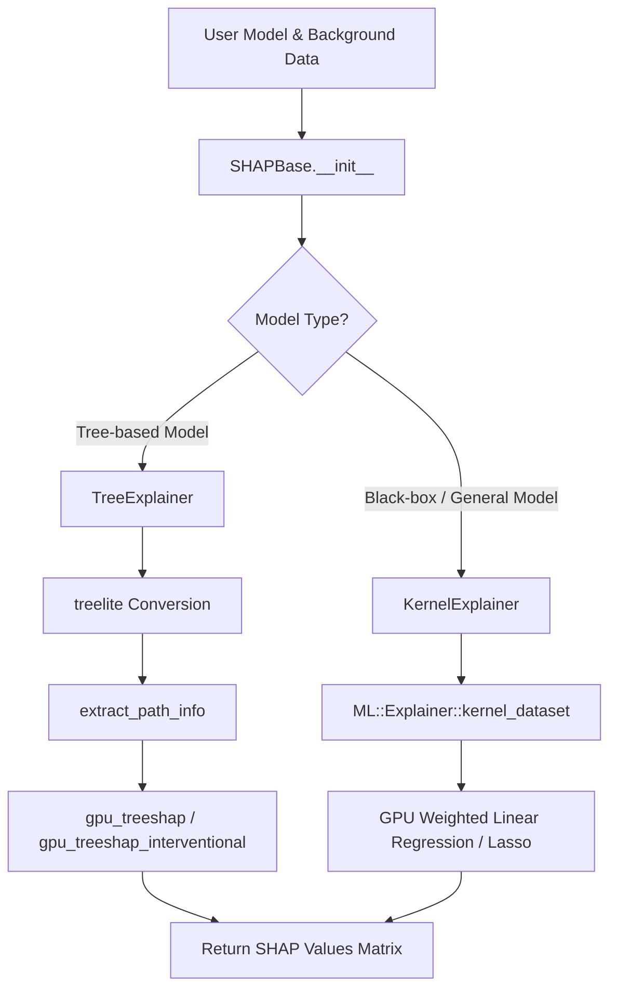

<!-- source: DeepWiki mcp.deepwiki.com · repo NVIDIA/cuml · page 3.4 Metrics and Explainability (SHAP) · fetched 2026-10-26 -->

# Metrics and Explainability (SHAP)

<details>
<summary>Relevant source files</summary>

The following files were used as context for generating this wiki page:

- [python/cuml/cuml/dask/metrics/confusion_matrix.py](python/cuml/cuml/dask/metrics/confusion_matrix.py)
- [python/cuml/cuml/explainer/base.pyx](python/cuml/cuml/explainer/base.pyx)
- [python/cuml/cuml/explainer/common.py](python/cuml/cuml/explainer/common.py)
- [python/cuml/cuml/explainer/kernel_shap.pyx](python/cuml/cuml/explainer/kernel_shap.pyx)
- [python/cuml/cuml/explainer/permutation_shap.pyx](python/cuml/cuml/explainer/permutation_shap.pyx)
- [python/cuml/cuml/explainer/tree_shap.pyx](python/cuml/cuml/explainer/tree_shap.pyx)
- [python/cuml/cuml/metrics/_classification.py](python/cuml/cuml/metrics/_classification.py)
- [python/cuml/cuml/metrics/_ranking.py](python/cuml/cuml/metrics/_ranking.py)
- [python/cuml/cuml/metrics/cluster/utils.py](python/cuml/cuml/metrics/cluster/utils.py)
- [python/cuml/cuml/metrics/confusion_matrix.py](python/cuml/cuml/metrics/confusion_matrix.py)
- [python/cuml/cuml/metrics/pairwise_distances.pyx](python/cuml/cuml/metrics/pairwise_distances.pyx)
- [python/cuml/cuml/metrics/regression.py](python/cuml/cuml/metrics/regression.py)
- [python/cuml/cuml/model_selection/__init__.py](python/cuml/cuml/model_selection/__init__.py)
- [python/cuml/cuml/neighbors/kernel_density.pyx](python/cuml/cuml/neighbors/kernel_density.pyx)
- [python/cuml/cuml/pipeline/__init__.py](python/cuml/cuml/pipeline/__init__.py)
- [python/cuml/cuml_accel_tests/integration/test_elastic_net.py](python/cuml/cuml_accel_tests/integration/test_elastic_net.py)
- [python/cuml/cuml_accel_tests/integration/test_hdbscan.py](python/cuml/cuml_accel_tests/integration/test_hdbscan.py)
- [python/cuml/cuml_accel_tests/integration/test_logistic_regression.py](python/cuml/cuml_accel_tests/integration/test_logistic_regression.py)
- [python/cuml/cuml_accel_tests/integration/test_umap.py](python/cuml/cuml_accel_tests/integration/test_umap.py)
- [python/cuml/cuml_accel_tests/test_sparse_dispatch.py](python/cuml/cuml_accel_tests/test_sparse_dispatch.py)
- [python/cuml/tests/explainer/test_shap_plotting.py](python/cuml/tests/explainer/test_shap_plotting.py)
- [python/cuml/tests/test_metrics.py](python/cuml/tests/test_metrics.py)
- [python/cuml/tests/test_trustworthiness.py](python/cuml/tests/test_trustworthiness.py)

</details>


## Purpose and Scope
This section details the implementation of performance metrics and model explainability tools within the cuML Python package (`cuml.metrics` and `cuml.explainer`). The `cuml.metrics` module provides GPU-accelerated equivalents of standard scikit-learn metrics spanning regression, classification, pairwise distances, clustering, and manifold evaluation (e.g., trustworthiness). The `cuml.explainer` module implements high-performance SHAP (Shapley Additive exPlanations) algorithms, leveraging CUDA primitives and bindings to `libcuml` to accelerate model interpretation for tree-based models and black-box estimators.

Sources: 
- `python/cuml/cuml/metrics/regression.py:1-451` [python/cuml/cuml/metrics/regression.py:1-450]()
- `python/cuml/cuml/metrics/_classification.py:1-211` [python/cuml/cuml/metrics/_classification.py:1-210]()
- `python/cuml/cuml/explainer/base.pyx:1-397` [python/cuml/cuml/explainer/base.pyx:1-396]()

---

## Regression and Classification Metrics
The `cuml.metrics` package implements metrics utilizing CuPy arrays and cuDF series to keep computations entirely on the GPU, avoiding unnecessary host-device data transfers.

### Regression Metrics
Regression metrics such as $R^2$ score (`r2_score`) and Mean Squared Error (`_mse`) are implemented in `python/cuml/cuml/metrics/regression.py`. Inputs are validated and coerced using `_normalize_regression_metric_args`, which verifies shapes, handles multi-output targets, and processes sample weights via `check_sample_weight` [python/cuml/cuml/metrics/regression.py:17-79](). Calculations are executed using native CuPy vectorized operations over GPU memory tensors.

### Classification Metrics
Classification evaluations, including `accuracy_score`, `log_loss`, and `confusion_matrix`, reside in `python/cuml/cuml/metrics/_classification.py` and `python/cuml/cuml/metrics/confusion_matrix.py`. 
- `accuracy_score`: Coerces inputs using `_input_to_cupy_or_cudf_series`, accounts for categorical string dtypes via cuDF support, and computes weighted or unweighted accuracy through boolean masking and reduction [python/cuml/cuml/metrics/_classification.py:54-109]().
- `log_loss`: Computes cross-entropy loss by clipping predicted probabilities against an epsilon threshold and indexing into ground-truth classes [python/cuml/cuml/metrics/_classification.py:111-201]().
- `confusion_matrix`: Leverages `cupyx.scipy.sparse.coo_matrix` to accumulate weighted occurrences of true and predicted label pairs on the GPU device, supporting normalization modes (`'true'`, `'pred'`, `'all'`) [python/cuml/cuml/metrics/confusion_matrix.py:16-134]().

```mermaid
graph TD
    A["User Call: accuracy_score / log_loss / r2_score"] --> B["Input Validation: check_array & check_consistent_length"]
    B --> C["Device Array Coercion: CuPy / cuDF Series"]
    C --> D["Vectorized GPU Reduction: cp.sum / cp.average"]
    D --> E["Scalar Return Value"]

    subpair["Pairwise and Confusion Matrix Pipeline"]
    F["confusion_matrix"] --> G["Label Binning via cp.searchsorted"]
    G --> H["Sparse COO Accumulation: cupyx.scipy.sparse.coo_matrix"]
    H --> I["Optional Normalization & NaN-to-Num"]
end
```
*Figure 1: Natural Language Space to Code Entity Space mapping for `cuml.metrics` evaluation functions.*

Sources:
- `python/cuml/cuml/metrics/regression.py:17-178` [python/cuml/cuml/metrics/regression.py:17-178]()
- `python/cuml/cuml/metrics/_classification.py:16-109` [python/cuml/cuml/metrics/_classification.py:16-109]()
- `python/cuml/cuml/metrics/confusion_matrix.py:16-134` [python/cuml/cuml/metrics/confusion_matrix.py:16-134]()

---

## Pairwise Distances and Trustworthiness Metrics
Distance computations and manifold validation metrics are exposed through Cython bindings to `libcuml`.

### Pairwise Distances
`pairwise_distances` and `nan_euclidean_distances` are implemented in `python/cuml/cuml/metrics/pairwise_distances.pyx`. The module maps string metric names (e.g., `"euclidean"`, `"cityblock"`, `"cosine"`, `"minkowski"`) to backend `DistanceType` enums. Dense and sparse inputs are dispatched to underlying C++ routines like `ML::Metrics::pairwise_distance` or `pairwiseDistance_sparse` [python/cuml/cuml/metrics/pairwise_distances.pyx:22-44]().

### Trustworthiness
Trustworthiness evaluates how well local neighborhood structures are preserved in dimensionality reduction techniques (such as UMAP or t-SNE). It is tested and validated against scikit-learn references in `python/cuml/tests/test_trustworthiness.py` [python/cuml/tests/test_trustworthiness.py:1-77]().

Sources:
- `python/cuml/cuml/metrics/pairwise_distances.pyx:22-82` [python/cuml/cuml/metrics/pairwise_distances.pyx:22-82]()
- `python/cuml/tests/test_trustworthiness.py:22-48` [python/cuml/tests/test_trustworthiness.py:22-48]()

---

## SHAP Explainability Framework (`cuml.explainer`)
The `cuml.explainer` package provides accelerated implementations of SHAP (Shapley Additive exPlanations) value calculators, minimizing host-device data transfers and offloading heavy kernel operations to C++ / CUDA primitives.

### Base Explainer Class (`SHAPBase`)
`SHAPBase` defined in `python/cuml/cuml/explainer/base.pyx` serves as the parent class for all explainers. It handles:
- Model tag inspection and input data ordering (`'C'` vs `'F'` major) [python/cuml/cuml/explainer/base.pyx:101-116]().
- Link function resolution (`link_fn`) [python/cuml/cuml/explainer/base.pyx:117-118]().
- Background dataset validation and calculation of expected base values (`expected_value`) by evaluating the model over background rows [python/cuml/cuml/explainer/base.pyx:139-164]().

### TreeExplainer
`TreeExplainer` in `python/cuml/cuml/explainer/tree_shap.pyx` integrates with Treelite models (supporting XGBoost, LightGBM, cuML Random Forest, and scikit-learn tree ensembles). It utilizes the GPUTreeShap backend via functions such as:
- `extract_path_info`: Preprocesses tree structures into path handle representations [python/cuml/cuml/explainer/tree_shap.pyx:29]()
- `gpu_treeshap`: Massively parallel exact tree path-dependent SHAP calculations [python/cuml/cuml/explainer/tree_shap.pyx:30-35]()
- `gpu_treeshap_interventional`: Interventional SHAP calculations utilizing background datasets [python/cuml/cuml/explainer/tree_shap.pyx:37-45]()
- `gpu_treeshap_interactions`: Computes Shapley interaction indices [python/cuml/cuml/explainer/tree_shap.pyx:47-59]()

### KernelExplainer
`KernelExplainer` in `python/cuml/cuml/explainer/kernel_shap.pyx` accelerates model-agnostic kernel SHAP. It wraps the C++ `ML::Explainer::kernel_dataset` primitive to generate permutation and combination constraint matrices on the GPU before fitting weighted linear surrogate models (Lasso / Ridge) [python/cuml/cuml/explainer/kernel_shap.pyx:23-36]().


*Figure 2: Natural Language Space to Code Entity Space mapping for `cuml.explainer` SHAP architectures.*

Sources:
- `python/cuml/cuml/explainer/base.pyx:38-164` [python/cuml/cuml/explainer/base.pyx:38-164]()
- `python/cuml/cuml/explainer/tree_shap.pyx:22-68` [python/cuml/cuml/explainer/tree_shap.pyx:22-68]()
- `python/cuml/cuml/explainer/kernel_shap.pyx:23-37` [python/cuml/cuml/explainer/kernel_shap.pyx:23-37]()

---

