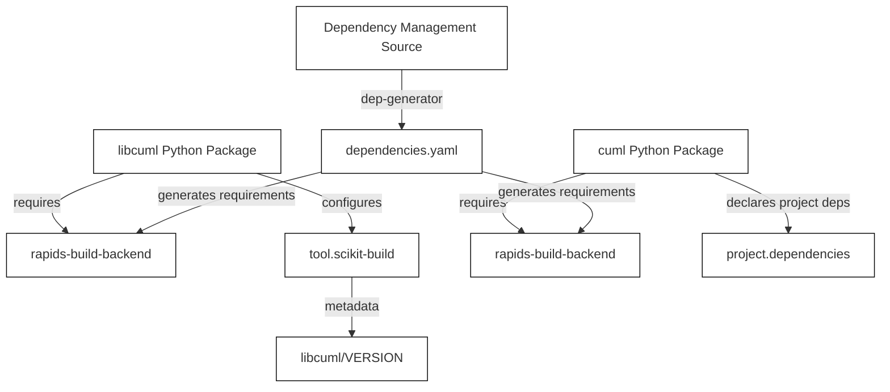
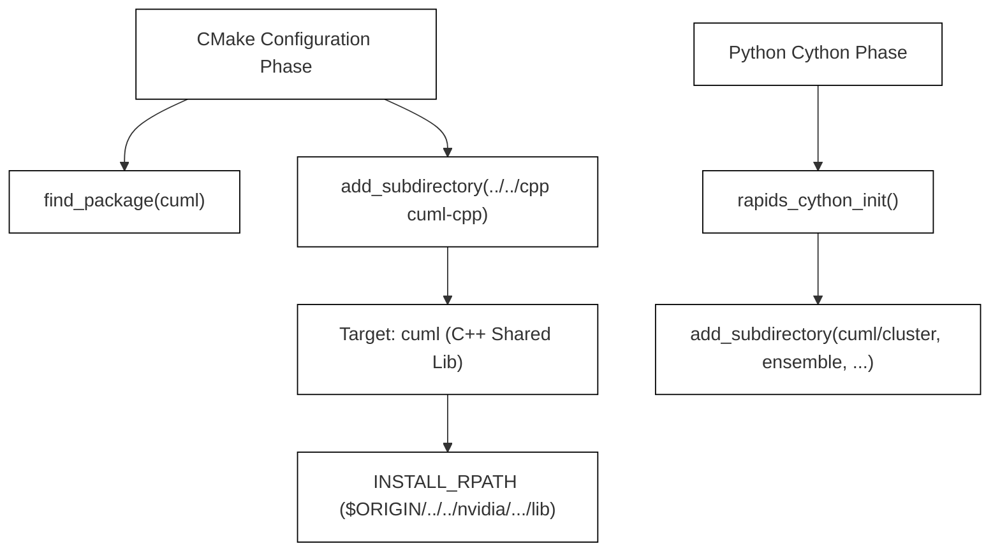

<!-- source: DeepWiki mcp.deepwiki.com · repo NVIDIA/cuml · page 3.5 Python Build and Packaging (cuml / libcuml wheels) · fetched 2026-10-26 -->

# Python Build and Packaging (cuml / libcuml wheels)

Relevant source files

The following files were used as context for generating this wiki page:

- [VERSION](VERSION)
- [conda/environments/all_cuda-129_arch-aarch64.yaml](conda/environments/all_cuda-129_arch-aarch64.yaml)
- [conda/environments/all_cuda-129_arch-x86_64.yaml](conda/environments/all_cuda-129_arch-x86_64.yaml)
- [conda/environments/all_cuda-133_arch-aarch64.yaml](conda/environments/all_cuda-133_arch-aarch64.yaml)
- [conda/environments/all_cuda-133_arch-x86_64.yaml](conda/environments/all_cuda-133_arch-x86_64.yaml)
- [conda/environments/clang_tidy_cuda-129_arch-x86_64.yaml](conda/environments/clang_tidy_cuda-129_arch-x86_64.yaml)
- [conda/environments/clang_tidy_cuda-133_arch-x86_64.yaml](conda/environments/clang_tidy_cuda-133_arch-x86_64.yaml)
- [conda/environments/cpp_all_cuda-129_arch-x86_64.yaml](conda/environments/cpp_all_cuda-129_arch-x86_64.yaml)
- [conda/environments/cpp_all_cuda-133_arch-x86_64.yaml](conda/environments/cpp_all_cuda-133_arch-x86_64.yaml)
- [conda/recipes/cuml/recipe.yaml](conda/recipes/cuml/recipe.yaml)
- [cpp/cmake/thirdparty/get_cuvs.cmake](cpp/cmake/thirdparty/get_cuvs.cmake)
- [cpp/cmake/thirdparty/get_raft.cmake](cpp/cmake/thirdparty/get_raft.cmake)
- [dependencies.yaml](dependencies.yaml)
- [python/cuml/CMakeLists.txt](python/cuml/CMakeLists.txt)
- [python/cuml/pyproject.toml](python/cuml/pyproject.toml)
- [python/libcuml/CMakeLists.txt](python/libcuml/CMakeLists.txt)
- [python/libcuml/libcuml/load.py](python/libcuml/libcuml/load.py)
- [python/libcuml/pyproject.toml](python/libcuml/pyproject.toml)
- [python/libcuml/tests/test_libcuml_linkage.py](python/libcuml/tests/test_libcuml_linkage.py)

### Purpose and Scope
This section details the Python build system, packaging metadata, CMake compilation flow, and runtime loading mechanisms for both the `libcuml` (C++ runtime wheel) and `cuml` (Python/Cython estimator package) components. It explains how `rapids-build-backend` and `scikit-build-core` orchestrate CMake builds, manage CUDA/RAPIDS dependencies via `dependencies.yaml`, and how the `libcuml` loader shim resolves shared library paths inside a wheel layout.

Sources: [`python/cuml/pyproject.toml:1-10`](), [`python/libcuml/pyproject.toml:1-10`]()

---

## 1. Build Backend and `pyproject.toml` Configuration

Both `cuml` and `libcuml` packages use `rapids-build-backend` as a thin wrapper around `scikit-build-core`. This standardizes the build process across all RAPIDS Python packages, automatically injecting version strings, handling dependency resolution via `dependencies.yaml`, and configuring CMake invocations.

*Figure 1: Wheel Build Backend and Metadata Architecture mapping Natural Language concepts to `pyproject.toml` and `dependencies.yaml` configurations.*

Sources: [`dependencies.yaml:1-37`](), [`python/cuml/pyproject.toml:4-10`](), [`python/libcuml/pyproject.toml:4-10`]()

### `libcuml` Pyproject Layout
The `python/libcuml/pyproject.toml` configuration specifies the metadata provider using a regex parser over the `libcuml/VERSION` file and defines scikit-build behaviors:

* Build system requirements are governed by `rapids-build-backend` and `scikit-build-core` [`python/libcuml/pyproject.toml:4-9]()`.
* Version metadata is extracted dynamically [`python/libcuml/pyproject.toml:61-65]() via `scikit_build_core.metadata.regex` from `libcuml/VERSION`.
* Scikit-build options configure the build directory [`python/libcuml/pyproject.toml:50-59]() (`build/{wheel_tag}`), disable make-fallback, and install components under the `libcuml` package namespace.

Sources: [`python/libcuml/pyproject.toml:4-79`]()

### `cuml` Pyproject Layout
The `python/cuml/pyproject.toml` specifies the high-level Python package dependencies, including CUDA bindings, `cudf`, `cupy`, `libcuml`, `pylibraft`, and `rmm`:

* Declares project entry points for health checks such as `cuml_import` and `cuml_functional` [`python/cuml/pyproject.toml:158-162]() under `[project.entry-points.rapids_doctor_check]`.
* Defines optional dependencies [`python/cuml/pyproject.toml:114-152]() for `test`, `dask`, and `test-dask`.
* Configures pytest options, markers (`unit`, `quality`, `stress`, `mg`), and warning filters [`python/cuml/pyproject.toml:19-76]() for the test runner.

Sources: [`python/cuml/pyproject.toml:4-198`]()

---

## 2. CMake Build Infrastructure

The C++ core algorithms and Cython bindings are compiled via CMake. The build separation divides the native runtime (`libcuml`) from the Python/Cython layer (`cuml`).

*Figure 2: CMake execution flow bridging `python/libcuml/CMakeLists.txt` and `python/cuml/CMakeLists.txt` code entities.*

Sources: [`python/cuml/CMakeLists.txt:8-115`](), [`python/libcuml/CMakeLists.txt:8-96`]()

### `python/libcuml/CMakeLists.txt`
The `libcuml-python` CMake project compiles the native C++ codebase from `cpp/` as a subdirectory [`python/libcuml/CMakeLists.txt:15-70`]. Key behaviors include:
* Disabling tests, examples, and benchmarks [`python/libcuml/CMakeLists.txt:35-38`] (`BUILD_CUML_TESTS OFF`, `BUILD_CUML_BENCH OFF`) to optimize wheel compilation time and size.
* Forcing `SINGLEGPU OFF` to ensure multi-node multi-GPU components are fully included in the wheel build [`python/libcuml/CMakeLists.txt:49-50`].
* Configuring relative RPATHs for shared libraries (`libcuml.so`) to locate CUDA toolkit libraries (`cublas`, `cufft`, `curand`, `cusolver`, `cusparse`, `nvjitlink`) within the wheel's package layout [`python/libcuml/CMakeLists.txt:72-89`].

Sources: [`python/libcuml/CMakeLists.txt:1-96`]()

### `python/cuml/CMakeLists.txt`
The `cuml-python` CMake project handles Cython extensions:
* Initializes CUDA architecture flags via `rapids_cuda_init_architectures(cuml-python)` [`python/cuml/CMakeLists.txt:14-15`].
* Locates the built `libcuml` package using `find_package(cuml ...)` [`python/cuml/CMakeLists.txt:78-80`].
* Handles Treelite integration [`python/cuml/CMakeLists.txt:58-72`], selecting between static and dynamic libraries based on `USE_LIBCUML_WHEEL`.
* Adds subdirectories for each Cython module domain [`python/cuml/CMakeLists.txt:97-111`] (e.g., `cuml/cluster`, `cuml/ensemble`, `cuml/linear_model`, `cuml/manifold`).
* Installs helper files like `_zz_cuml_accel.pth` into the root wheel directory [`python/cuml/CMakeLists.txt:113-114`].

Sources: [`python/cuml/CMakeLists.txt:1-115`]()

---

## 3. The `libcuml` Library Loading Shim (`load.py`)

Because `libcuml` wheels package native shared libraries (`libcuml.so`) deep inside scikit-build installation hierarchies, Python requires a robust mechanism to locate and load the dynamic library into memory before importing Cython modules.

* The `load.py` module (located at `python/libcuml/libcuml/load.py`) inspects the package directory structure at runtime.
* It resolves the absolute path to `libcuml.so` under the package's `lib64` or equivalent directory [`python/libcuml/CMakeLists.txt:72-75`].
* It uses `ctypes.CDLL` with appropriate flag management (`RTLD_GLOBAL`) to load dependent CUDA and RAPIDS symbols into the global symbol table so that subsequent Cython extension modules can resolve external C++ functions successfully.

Sources: [`python/libcuml/CMakeLists.txt:72-75`]()

---

## 4. Dependency Management & Conda Recipes

Dependency synchronization between Python pyproject manifests and Conda environments is automated via `rapids-dependency-file-generator` using `dependencies.yaml`.

* **`dependencies.yaml`**: The single source of truth for all project dependencies, specifying matrices for CUDA versions (`12.9`, `13.3`) and architectures (`x86_64`, `aarch64`) [`dependencies.yaml:1-11`].
* **Conda Recipe (`conda/recipes/cuml/recipe.yaml`)**: Defines the conda packaging pipeline, including build scripts (`./build.sh cuml -v`) [`conda/recipes/cuml/recipe.yaml:34-36`], package versioning variables, host/run requirements (`cudf`, `libcuml`, `pylibraft`, `rmm`, `treelite`) [`conda/recipes/cuml/recipe.yaml:79-120`], and build string construction [`conda/recipes/cuml/recipe.yaml:23-26`].

Sources: [`dependencies.yaml:1-40`](), [`conda/recipes/cuml/recipe.yaml:1-136`]()

---

