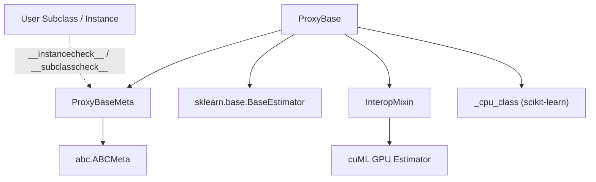
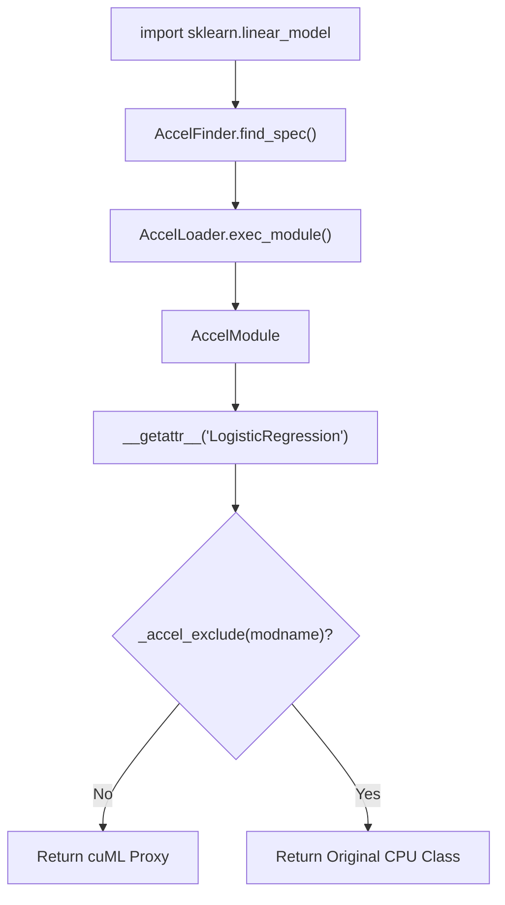
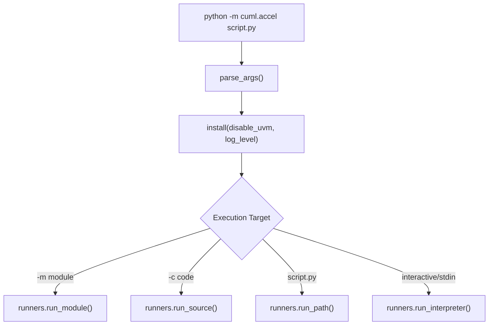

<!-- source: DeepWiki mcp.deepwiki.com · repo NVIDIA/cuml · page 4.1 Accelerator Internals: Proxy Estimators and Module Loader · fetched 2026-10-26 -->

# Accelerator Internals: Proxy Estimators and Module Loader

Relevant source files

The following files were used as context for generating this wiki page:

- [ci/run_cuml_singlegpu_accel_pytests.sh](ci/run_cuml_singlegpu_accel_pytests.sh)
- [python/cuml/cuml/accel/__init__.py](python/cuml/cuml/accel/__init__.py)
- [python/cuml/cuml/accel/__main__.py](python/cuml/cuml/accel/__main__.py)
- [python/cuml/cuml/accel/accelerator.py](python/cuml/cuml/accel/accelerator.py)
- [python/cuml/cuml/accel/core.py](python/cuml/cuml/accel/core.py)
- [python/cuml/cuml/accel/estimator_proxy.py](python/cuml/cuml/accel/estimator_proxy.py)
- [python/cuml/cuml/accel/magics.py](python/cuml/cuml/accel/magics.py)
- [python/cuml/cuml/accel/profilers.py](python/cuml/cuml/accel/profilers.py)
- [python/cuml/cuml/accel/pytest_plugin.py](python/cuml/cuml/accel/pytest_plugin.py)
- [python/cuml/cuml/accel/runners.py](python/cuml/cuml/accel/runners.py)
- [python/cuml/cuml/internals/interop.py](python/cuml/cuml/internals/interop.py)
- [python/cuml/cuml_accel_tests/test_accelerator.py](python/cuml/cuml_accel_tests/test_accelerator.py)
- [python/cuml/cuml_accel_tests/test_cli.py](python/cuml/cuml_accel_tests/test_cli.py)
- [python/cuml/cuml_accel_tests/test_core.py](python/cuml/cuml_accel_tests/test_core.py)
- [python/cuml/cuml_accel_tests/test_estimator_proxy.py](python/cuml/cuml_accel_tests/test_estimator_proxy.py)
- [python/cuml/cuml_accel_tests/test_magics.py](python/cuml/cuml_accel_tests/test_magics.py)
- [python/cuml/cuml_accel_tests/test_profilers.py](python/cuml/cuml_accel_tests/test_profilers.py)

## Purpose and Scope

This document details the internal architecture of `cuml.accel`, cuML's zero-code-change GPU acceleration subsystem. `cuml.accel` intercepts standard Python imports for libraries like `scikit-learn`, `umap`, and `hdbscan`, dynamically substituting CPU estimator classes with GPU-accelerated proxy estimators (`ProxyBase`) backed by cuML algorithms. It covers the custom import hooks, proxy class metaclasses, serialization handlers, CLI entry points, IPython magics, and profiling infrastructure.

Sources: [python/cuml/cuml/accel/core.py:1-151](), [python/cuml/cuml/accel/estimator_proxy.py:1-180]()

---

## 1. Proxy Estimators: `ProxyBase`, `ArrayAPIProxyBase`, and `InteropMixin`

Proxy estimators act as transparent wrappers around CPU-based scikit-learn estimators while delegating compute-heavy operations (such as `fit`, `predict`, and `transform`) to cuML GPU estimators via `InteropMixin` [python/cuml/cuml/accel/estimator_proxy.py:174-180](), [python/cuml/cuml/internals/interop.py:43-57]().

### Metaclass Mechanics: `ProxyBaseMeta`

The metaclass `ProxyBaseMeta` inherits from `abc.ABCMeta` to manage subclassing and dynamic method resolution [python/cuml/cuml/accel/estimator_proxy.py:122-150]. When a proxy class is constructed, `ProxyBaseMeta.__new__` inspects base classes and replaces any proxy bases with their underlying CPU class counterparts [python/cuml/cuml/accel/estimator_proxy.py:140-149]. It also overrides `__subclasscheck__` and `__instancecheck__` to ensure that checks against scikit-learn base classes and CPU classes resolve correctly [python/cuml/cuml/accel/estimator_proxy.py:151-172].

Sources: [python/cuml/cuml/accel/estimator_proxy.py:122-180](), [python/cuml/cuml/internals/interop.py:43-57]()

### Serialization and Pickling: `_ReconstructProxy`

To preserve serialization compatibility, estimators proxied by `cuml.accel` use `_ReconstructProxy` [python/cuml/cuml/accel/estimator_proxy.py:63-120]. This helper leverages closures and `cloudpickle` to serialize the reconstruction logic by value [python/cuml/cuml/accel/estimator_proxy.py:66-74]. Upon unpickling, if `cuml.accel` is present, the model is re-instantiated as a GPU proxy; otherwise, it degrades gracefully to the native CPU estimator [python/cuml/cuml/accel/estimator_proxy.py:75-97].

Sources: [python/cuml/cuml/accel/estimator_proxy.py:63-120]()

---

## 2. Import Hooks and Module Loader (`accelerator.py`)

The accelerator module loader relies on Python's `sys.meta_path` mechanism to intercept package imports and inject accelerated proxies [python/cuml/cuml/accel/accelerator.py:157-204].

### Core Components

* `Accelerator`: Manages the registration of accelerated modules, active state, and exclusion filters [python/cuml/cuml/accel/accelerator.py:184-204].
* `AccelFinder`: A `MetaPathFinder` that intercepts requests for registered modules, preventing recursion during import [python/cuml/cuml/accel/accelerator.py:157-183], [python/cuml/cuml/accel/accelerator.py:199-204].
* `AccelLoader`: A module loader that creates and initializes `AccelModule` instances [python/cuml/cuml/accel/accelerator.py:157-183].
* `AccelModule`: A custom `types.ModuleType` wrapper that inspects the call stack via `sys._getframe()` to verify whether the calling module is excluded before returning accelerated attributes [python/cuml/cuml/accel/accelerator.py:28-80].

Sources: [python/cuml/cuml/accel/accelerator.py:28-204]()

---

## 3. Core Installation and Configuration (`core.py`)

The initialization entry point `cuml.accel.core.install()` configures the global accelerator instance, registers version constraints, patches, and overrides [python/cuml/cuml/accel/core.py:121-217].

### Accelerated Submodules and Constraints

`cuml.accel` maintains explicit version checks and module mappings:
* `_CONSTRAINTS`: Validates compatible versions of external packages (`scikit-learn`, `hdbscan`, `umap-learn`) [python/cuml/cuml/accel/core.py:121-125].
* `_OVERRIDES`: Maps scikit-learn families (`sklearn.linear_model`, `sklearn.cluster`, etc.) to cuML proxy equivalents [python/cuml/cuml/accel/core.py:127-140].
* `_PATCHES`: Injects utility and pipeline patches (`sklearn.pipeline`, `sklearn.utils`, etc.) [python/cuml/cuml/accel/core.py:142-148].
* `_exclude_from_acceleration()`: Excludes internal cuML and treelite packages while permitting upstream test suites (e.g., `sklearn.*.tests`) to execute under acceleration [python/cuml/cuml/accel/core.py:153-170].

Sources: [python/cuml/cuml/accel/core.py:121-217]()

---

## 4. CLI Integration and Command Runners (`__main__.py`)

The command-line interface enables executing arbitrary Python scripts, modules, or interactive sessions with `cuml.accel` pre-installed [python/cuml/cuml/accel/__main__.py:21-171].

### Argument Parsing and Execution Flow

The `parse_args` function processes CLI flags such as `--verbose`, `--profile`, `--line-profile`, and `--disable-uvm`, carefully separating accelerator arguments from script- or module-specific arguments [python/cuml/cuml/accel/__main__.py:21-123]. The `main` entry point invokes `install()` before handing execution over to `cuml.accel.runners` [python/cuml/cuml/accel/__main__.py:125-171].

Sources: [python/cuml/cuml/accel/__main__.py:21-171]()

---

## 5. IPython Magics and Profilers

`cuml.accel` provides IPython extension hooks and profiling magics for interactive environments [python/cuml/cuml/accel/magics.py](), [python/cuml/cuml/accel/profilers.py]().

### IPython Extensions and Magics

* `load_ipython_extension()`: Automatically invokes `install()` when loaded via `%load_ext cuml.accel` [python/cuml/cuml/accel/__init__.py:8](), [python/cuml/cuml/accel/magics.py]().
* Cell Magics (`%%cuml.accel.profile`, `%%cuml.accel.line_profile`): Wrap cell execution with execution timing and performance profiling tools, ensuring local variables and cell return values (_ underscore variables) persist correctly [python/cuml/cuml_accel_tests/test_magics.py:105-154].

Sources: [python/cuml/cuml/accel/__init__.py:1-25](), [python/cuml/cuml_accel_tests/test_magics.py:105-213]()

---

