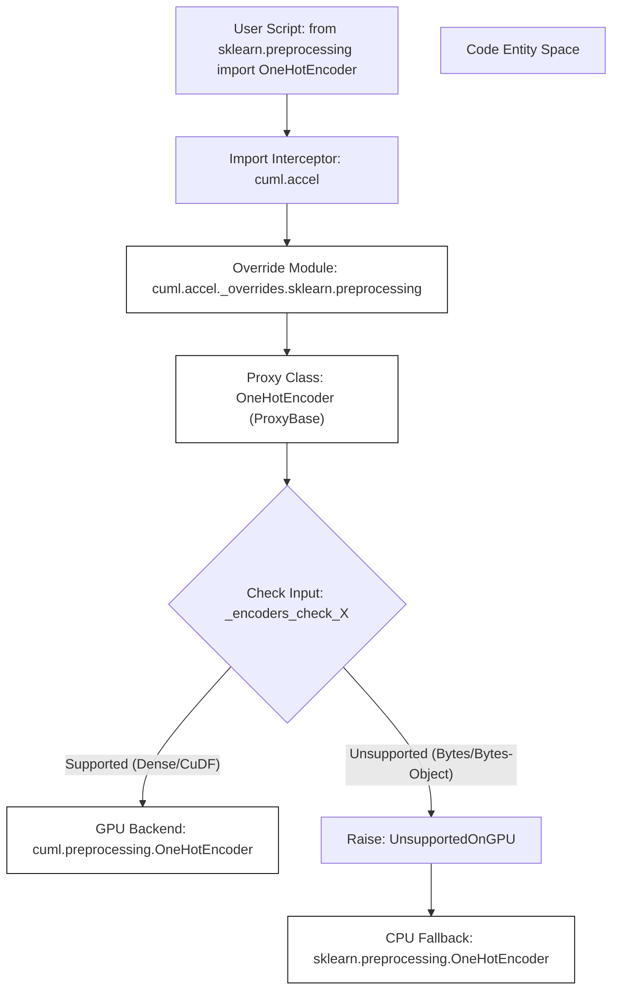
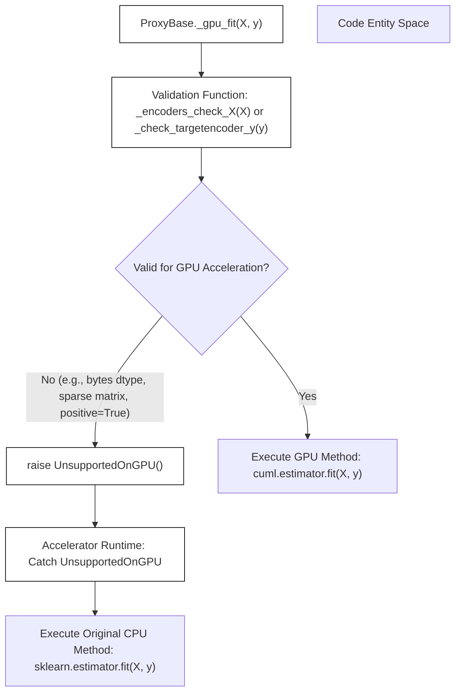

<!-- source: DeepWiki mcp.deepwiki.com · repo NVIDIA/cuml · page 4.2 Overrides and Compatibility Policy · fetched 2026-10-26 -->

# Overrides and Compatibility Policy

<details>
<summary>Relevant source files</summary>

The following files were used as context for generating this wiki page:

- [docs/source/_static/open-details-on-fragment.js](docs/source/_static/open-details-on-fragment.js)
- [docs/source/cuml-accel/compatibility.rst](docs/source/cuml-accel/compatibility.rst)
- [docs/source/cuml-accel/examples/getting_started.ipynb](docs/source/cuml-accel/examples/getting_started.ipynb)
- [docs/source/cuml-accel/examples/plot_kmeans_digits.ipynb](docs/source/cuml-accel/examples/plot_kmeans_digits.ipynb)
- [docs/source/cuml-accel/examples/third-party-apps.rst](docs/source/cuml-accel/examples/third-party-apps.rst)
- [docs/source/cuml-accel/faq.rst](docs/source/cuml-accel/faq.rst)
- [docs/source/cuml-accel/index.rst](docs/source/cuml-accel/index.rst)
- [docs/source/cuml-accel/logging-and-profiling.rst](docs/source/cuml-accel/logging-and-profiling.rst)
- [docs/source/cuml-accel/usage.rst](docs/source/cuml-accel/usage.rst)
- [python/cuml/cuml/accel/_overrides/sklearn/linear_model.py](python/cuml/cuml/accel/_overrides/sklearn/linear_model.py)
- [python/cuml/cuml/accel/_overrides/sklearn/preprocessing.py](python/cuml/cuml/accel/_overrides/sklearn/preprocessing.py)
- [python/cuml/cuml/internals/validation.py](python/cuml/cuml/internals/validation.py)
- [python/cuml/cuml_accel_tests/integration/test_preprocessing.py](python/cuml/cuml_accel_tests/integration/test_preprocessing.py)
- [python/cuml/cuml_accel_tests/test_logging.py](python/cuml/cuml_accel_tests/test_logging.py)
- [python/cuml/cuml_accel_tests/upstream/scikit-learn/xfail-list.yaml](python/cuml/cuml_accel_tests/upstream/scikit-learn/xfail-list.yaml)
- [python/cuml/tests/test_exceptions.py](python/cuml/tests/test_exceptions.py)
- [python/cuml/tests/test_sklearn_compatibility.py](python/cuml/tests/test_sklearn_compatibility.py)
- [python/cuml/tests/test_validation.py](python/cuml/tests/test_validation.py)

</details>


## Purpose and Scope

This page details the implementation architecture of `cuml.accel`'s scikit-learn module overrides (`_overrides/sklearn`), the dynamic fallback semantics driven by `UnsupportedOnGPU` exceptions, and the structural and numerical compatibility policy governing zero-code-change GPU acceleration. It outlines how upstream scikit-learn, UMAP, and HDBSCAN namespaces are intercepted, proxied to GPU-backed cuML estimators, and safely reverted to CPU implementations when encountering unsupported data types, sparse representations, or constrained hyperparameters.

---

## 1. Module Override Structure (`_overrides/sklearn`)

The `cuml.accel` package implements zero-code-change acceleration by overriding standard Python modules in `scikit-learn` with proxy namespaces. When `cuml.accel` is initialized, it dynamically injects module proxies from `python/cuml/cuml/accel/_overrides/sklearn/` into `sys.modules`. 

Each family submodule (e.g., `preprocessing.py`, `linear_model.py`, `ensemble.py`, `cluster.py`) defines estimator classes inheriting either from `ArrayAPIProxyBase` (for estimators leveraging scikit-learn's Array API support) or `ProxyBase` (for custom GPU dispatch wrappers) [python/cuml/cuml/accel/_overrides/sklearn/preprocessing.py:8-25]().


*Sources: `python/cuml/cuml/accel/_overrides/sklearn/preprocessing.py`, `docs/source/cuml-accel/compatibility.rst`*

### Proxy Base Classes and Metadata Synchronization
* **`ArrayAPIProxyBase`**: Automatically bridges estimators conforming to the array-API specification by mapping hyperparameters from the CPU model instance (`_params_from_cpu`) and routing execution through standard array interfaces [python/cuml/cuml/accel/_overrides/sklearn/preprocessing.py:29-59]().
* **`ProxyBase`**: Provides explicit method overloading (`_gpu_fit`, `_gpu_transform`, `_gpu_fit_transform`) to handle input conversions, cupy/cudf array marshalling, and attribute synchronization between the proxy instance and the underlying GPU estimator (`self._gpu`) [python/cuml/cuml/accel/_overrides/sklearn/preprocessing.py:79-112]().

---

## 2. `UnsupportedOnGPU` and Fallback Semantics

To ensure seamless execution when workflows utilize features outside cuML's current GPU capabilities, `cuml.accel` relies on explicit exception-driven fallback mechanisms. If an estimator method encounters an unsupported hyperparameter, sparse matrix layout, or data type (e.g., byte-strings or complex numbers), it raises `UnsupportedOnGPU`.


*Sources: `python/cuml/cuml/accel/_overrides/sklearn/preprocessing.py`, `docs/source/cuml-accel/logging-and-profiling.rst`*

### Examples of Fallback Triggers
1. **Data Types**: `OneHotEncoder` and `OrdinalEncoder` inspect input matrices via `_encoders_check_X`. If `X` contains `bytes` dtype or uncoercible object dtypes, `UnsupportedOnGPU` is raised [python/cuml/cuml/accel/_overrides/sklearn/preprocessing.py:61-76]().
2. **Target Types**: `TargetEncoder` validates `y` types via `_check_targetencoder_y`, restricting GPU acceleration to binary and continuous target variables [python/cuml/cuml/accel/_overrides/sklearn/preprocessing.py:114-127]().
3. **Hyperparameters**: Solvers such as `Ridge` fall back to the CPU implementation if positive constraints (`positive=True`) or incompatible solver options are specified [docs/source/cuml-accel/logging-and-profiling.rst:103-107]().

---

## 3. Compatibility Differences, Limitations, and Upstream Testing

While `cuml.accel` aims for drop-in compatibility, architectural differences between cuML's CUDA kernels and scikit-learn's NumPy/SciPy algorithms result in documented divergences.

### Summary of Compatibility Differences

| Category | scikit-learn Behavior | cuML / `cuml.accel` Behavior |
| :--- | :--- | :--- |
| **Numerical Precision** | Sequential floating-point reduction on CPU. | Parallel reductions on GPU; minor IEEE-754 rounding differences may occur [docs/source/cuml-accel/compatibility.rst:34-42](). |
| **Fitted Attributes** | Computes all inspection attributes (e.g., `n_iters_`, `affinity_matrix_`). | Ores/omits non-essential diagnostic attributes to optimize memory and kernel execution [docs/source/cuml-accel/compatibility.rst:38-42,96-99](). |
| **Sparse Support** | Native sparse support across most preprocessing and linear models. | Sparse matrices trigger CPU fallback for specific estimators (e.g., `KMeans`, `DBSCAN`, `TruncatedSVD`) [docs/source/cuml-accel/compatibility.rst:79-83,108-109,170-171](). |
| **Randomized Solvers** | Uses scikit-learn randomized SVD/decomposition routines. | Uses optimized cuML decomposition primitives; tuning parameters like `power_iteration_normalizer` may be ignored [docs/source/cuml-accel/compatibility.rst:133-138,150-152](). |

*Sources: `docs/source/cuml-accel/compatibility.rst`*

### Upstream Test Suite Integration and `xfail` Management
`cuml.accel` continuously validates its compatibility by running upstream scikit-learn, UMAP, and HDBSCAN test suites within the cuML test harness (`python/cuml/cuml_accel_tests/`). Known discrepancies, minor numerical tolerances, or expected GPU bypasses are tracked using conditional markers in `xfail-list.yaml` [python/cuml/cuml_accel_tests/upstream/scikit-learn/xfail-list.yaml:1-32]() and validated via `test_sklearn_compatibility.py` [python/cuml/tests/test_sklearn_compatibility.py:88-222]().

```yaml
# Example xfail entry for version-specific coordinate descent behavior
- reason: Coordinate descent sample-weight behavior differs with cuml.accel in sklearn 1.9
  marker: cuml_accel_bugs
  condition: scikit-learn>=1.9
  tests:
  - "sklearn.linear_model.tests.test_coordinate_descent::test_enet_alpha_max[sample_weight0-False-False-csc_array-ElasticNetCV-ElasticNet]"
```
*Sources: `python/cuml/cuml_accel_tests/upstream/scikit-learn/xfail-list.yaml`*

---

