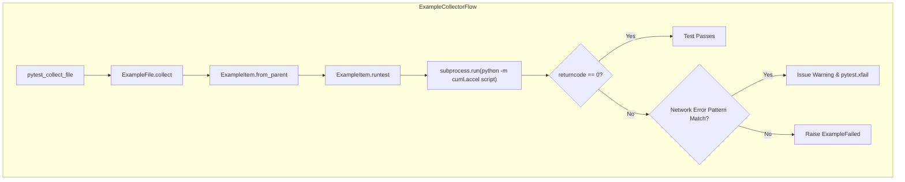
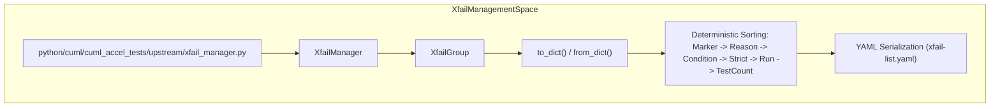

<!-- source: DeepWiki mcp.deepwiki.com · repo NVIDIA/cuml · page 4.3 Upstream Test Suite Harness and xfail Management · fetched 2026-10-26 -->

# Upstream Test Suite Harness and xfail Management

<details>
<summary>Relevant source files</summary>

The following files were used as context for generating this wiki page:

- [ci/test_python_scikit_learn_tests.sh](ci/test_python_scikit_learn_tests.sh)
- [ci/test_python_sklearn_examples.sh](ci/test_python_sklearn_examples.sh)
- [python/cuml/cuml_accel_tests/integration/test_spectral_clustering.py](python/cuml/cuml_accel_tests/integration/test_spectral_clustering.py)
- [python/cuml/cuml_accel_tests/upstream/README.md](python/cuml/cuml_accel_tests/upstream/README.md)
- [python/cuml/cuml_accel_tests/upstream/scikit-learn/example_collector.py](python/cuml/cuml_accel_tests/upstream/scikit-learn/example_collector.py)
- [python/cuml/cuml_accel_tests/upstream/scikit-learn/run-examples.sh](python/cuml/cuml_accel_tests/upstream/scikit-learn/run-examples.sh)
- [python/cuml/cuml_accel_tests/upstream/scikit-learn/run-tests.sh](python/cuml/cuml_accel_tests/upstream/scikit-learn/run-tests.sh)
- [python/cuml/cuml_accel_tests/upstream/scikit-learn/test_config.yaml](python/cuml/cuml_accel_tests/upstream/scikit-learn/test_config.yaml)
- [python/cuml/cuml_accel_tests/upstream/scikit-learn/xfail-examples.yaml](python/cuml/cuml_accel_tests/upstream/scikit-learn/xfail-examples.yaml)
- [python/cuml/cuml_accel_tests/upstream/summarize-results.py](python/cuml/cuml_accel_tests/upstream/summarize-results.py)
- [python/cuml/cuml_accel_tests/upstream/umap/run-tests.sh](python/cuml/cuml_accel_tests/upstream/umap/run-tests.sh)
- [python/cuml/cuml_accel_tests/upstream/umap/xfail-list.yaml](python/cuml/cuml_accel_tests/upstream/umap/xfail-list.yaml)
- [python/cuml/cuml_accel_tests/upstream/xfail_manager.py](python/cuml/cuml_accel_tests/upstream/xfail_manager.py)

</details>


The upstream test suite harness within `python/cuml/cuml_accel_tests/upstream/` provides an execution framework to validate `cuml.accel` zero-code-change acceleration against upstream machine learning packages—specifically `scikit-learn`, `umap-learn`, and `hdbscan` [python/cuml/cuml_accel_tests/upstream/README.md:1-14](). This harness manages dependency checkouts, test isolation, expected failure (`xfail`) configurations via YAML lists, custom example discovery plugins, and automated result summarization for CI pipelines.

---

## 1. Test Suite Wrappers and Shell Harnesses

Upstream test suites are invoked using suite-local shell wrappers located in package-specific subdirectories under `python/cuml/cuml_accel_tests/upstream/` [python/cuml/cuml_accel_tests/upstream/README.md:3-6](). 

For UMAP, the wrapper script `python/cuml/cuml_accel_tests/upstream/umap/run-tests.sh` dynamically checks the installed `umap` package version, clones the upstream `lmcinnes/umap` repository into an internal `umap-upstream` path if absent, checks out the tag corresponding to `release-${UMAP_VERSION}`, and invokes `pytest` with the `cuml.accel` plugin enabled [python/cuml/cuml_accel_tests/upstream/umap/run-tests.sh:13-34]():

```bash
pytest -p cuml.accel \
    "${UMAP_REPO}/umap/tests/" \
    --rootdir="${UMAP_REPO}" \
    --config-file="${THIS_DIRECTORY}/../pytest.ini" \
    --xfail-list="${THIS_DIRECTORY}/xfail-list.yaml" \
    "$@"
```

Similarly, the scikit-learn test runner `python/cuml/cuml_accel_tests/upstream/scikit-learn/run-tests.sh` executes the installed scikit-learn test suite by loading the `sklearn` package path and enforcing suite-local configuration options [python/cuml/cuml_accel_tests/upstream/scikit-learn/run-tests.sh:13-23]():

```bash
pytest -p cuml.accel \
    --pyargs sklearn \
    --rootdir="${THIS_DIRECTORY}" \
    --config-file="${THIS_DIRECTORY}/../pytest.ini" \
    --xfail-list="${THIS_DIRECTORY}/xfail-list.yaml" \
    "$@"
```

Sources: [python/cuml/cuml_accel_tests/upstream/README.md:1-35](), [python/cuml/cuml_accel_tests/upstream/umap/run-tests.sh:1-34](), [python/cuml/cuml_accel_tests/upstream/scikit-learn/run-tests.sh:1-23]()

---

## 2. Scikit-Learn Example Collector Plugin

To test that upstream scikit-learn example scripts function properly under acceleration, the harness implements a dedicated pytest plugin: `python/cuml/cuml_accel_tests/upstream/scikit-learn/example_collector.py` [python/cuml/cuml_accel_tests/upstream/scikit-learn/example_collector.py:5-10]().

### Plugin Implementation and Execution Flow

The collector intercepts files matching `.py` extensions within the target examples directory via `pytest_collect_file` [python/cuml/cuml_accel_tests/upstream/scikit-learn/example_collector.py:175-184](). Each example file is wrapped into an `ExampleFile` object which yields an `ExampleItem` [python/cuml/cuml_accel_tests/upstream/scikit-learn/example_collector.py:68-73]().



Sources: [python/cuml/cuml_accel_tests/upstream/scikit-learn/example_collector.py:5-184]()

### Isolation and Error Categorization

In `ExampleItem.runtest()`, each script executes as an isolated subprocess using `subprocess.run()` under the command `python -m cuml.accel <script>` with an environment configured for headless plotting (`MPLBACKEND="Agg"`) [python/cuml/cuml_accel_tests/upstream/scikit-learn/example_collector.py:75-109](). 

If a script exceeds the configured `--example-timeout` (defaulting to 300 seconds), a `ExampleTimedOut` warning is emitted and pytest marks the test as expected to fail (`pytest.xfail`) [python/cuml/cuml_accel_tests/upstream/scikit-learn/example_collector.py:96-115](). Furthermore, failures caused by remote connection drops or dataset download issues are intercepted by `_network_error_pattern()` matching against predefined patterns (`urllib.error.HTTPError`, `ConnectionError`, `OpenMLError`, etc.) and mapped to network-related xfails [python/cuml/cuml_accel_tests/upstream/scikit-learn/example_collector.py:31-58, 116-125]().

Sources: [python/cuml/cuml_accel_tests/upstream/scikit-learn/example_collector.py:19-129]()

---

## 3. Xfail List Management and YAML Schema

Upstream test suites utilize suite-local YAML files to track known numerical discrepancies, version-specific breaks, or flaky behaviors without breaking continuous integration runs.

### File Schemas and Group Structure

Test suites use structured YAML manifests such as `python/cuml/cuml_accel_tests/upstream/umap/xfail-list.yaml` and `python/cuml/cuml_accel_tests/upstream/scikit-learn/xfail-examples.yaml` [python/cuml/cuml_accel_tests/upstream/umap/xfail-list.yaml:1-65](), [python/cuml/cuml_accel_tests/upstream/scikit-learn/xfail-examples.yaml:1-9](). Each entry specifies a failure reason, optional conditional dependency strings, strictness flags, pytest markers, and an array of target node IDs:

```yaml
- reason: "Test fails with cuml.accel"
  marker: "cuml_accel_bugs"
  tests:
  - "umap.tests.test_composite_models::test_composite_trustworthiness"
  - "umap.tests.test_spectral::test_tsw_spectral_init"
- reason: "Tests are flaky"
  marker: "cuml_accel_flaky"
  strict: false
  tests:
  - "umap.tests.test_umap_on_iris::test_precomputed_transform_on_iris"
- reason: "UMAP using removed numpy function in1d"
  marker: "cuml_accel_no_numpy_in1d"
  condition: "umap-learn<=0.5.7 and numpy>=2.4"
  tests:
  - "umap.tests.test_aligned_umap::test_aligned_update"
```

Sources: [python/cuml/cuml_accel_tests/upstream/umap/xfail-list.yaml:1-65](), [python/cuml/cuml_accel_tests/upstream/scikit-learn/xfail-examples.yaml:1-9]()

### Programmatic Management with `XfailManager`

The `python/cuml/cuml_accel_tests/upstream/xfail_manager.py` utility module provides programmatic tools via `XfailGroup` and `XfailManager` to parse, validate, batch-modify, and deterministically re-sort xfail lists [python/cuml/cuml_accel_tests/upstream/xfail_manager.py:7-162](). 



Sources: [python/cuml/cuml_accel_tests/upstream/xfail_manager.py:59-160]()

---

## 4. Result Summarization and CI Pipeline Integration

Once pytest completes execution, JUnit XML reports are analyzed using `python/cuml/cuml_accel_tests/upstream/summarize-results.py` to enforce pass-rate thresholds and generate human-readable summaries [python/cuml/cuml_accel_tests/upstream/summarize-results.py:1-135]().

### Summarization Script Architecture

The summarization script parses JUnit XML element trees, extracts testcase states (`pass`, `fail`, `xfail`, `xpass`), and evaluates pass rates against threshold requirements defined in configuration files such as `python/cuml/cuml_accel_tests/upstream/scikit-learn/test_config.yaml` [python/cuml/cuml_accel_tests/upstream/summarize-results.py:38-135](), [python/cuml/cuml_accel_tests/upstream/scikit-learn/test_config.yaml:1-6]():

```yaml
threshold:
  fail_below: 85  # Minimum pass rate threshold [0-100]

test_id_prefix: "sklearn."
```

Sources: [python/cuml/cuml_accel_tests/upstream/summarize-results.py:38-135](), [python/cuml/cuml_accel_tests/upstream/scikit-learn/test_config.yaml:1-6]()

### CI Pipeline Scripts

CI job scripts orchestrate test execution, timeout bounds, xdist parallelism, and post-processing report aggregation. For example, `ci/test_python_scikit_learn_tests.sh` executes the scikit-learn upstream suite via `run-tests.sh` with 8-way worker parallelism and pipes the resulting JUnit XML report into `summarize-results.py` [ci/test_python_scikit_learn_tests.sh:16-26]():

```bash
timeout -v --signal=SIGINT --kill-after=60s 1h ./python/cuml/cuml_accel_tests/upstream/scikit-learn/run-tests.sh \
    --numprocesses=8 \
    --dist=worksteal \
    --junitxml="${RAPIDS_TESTS_DIR}/junit-cuml-accel-scikit-learn.xml"
TEST_EXITCODE=$?

./python/cuml/cuml_accel_tests/upstream/summarize-results.py \
    --config ./python/cuml/cuml_accel_tests/upstream/scikit-learn/test_config.yaml \
    "${RAPIDS_TESTS_DIR}/junit-cuml-accel-scikit-learn.xml"
```

Similarly, `ci/test_python_sklearn_examples.sh` executes example scripts and requires strict pass rates, excluding network failures from the primary denominator while tracking timeouts [ci/test_python_sklearn_examples.sh:25-44]():

```bash
timeout -v --signal=SIGINT --kill-after=60s 60m ./python/cuml/cuml_accel_tests/upstream/scikit-learn/run-examples.sh \
    -vv --durations=0 --durations-min=0 \
    -n 4 --dist worksteal \
    --example-timeout=300 \
    --junitxml="${SKLEARN_EXAMPLES_JUNITXML}"

./python/cuml/cuml_accel_tests/upstream/summarize-results.py \
    --fail-below 90 \
    --total-fail-below 80 \
    --exclude-xfail-reason "Network error:" \
    "${SKLEARN_EXAMPLES_JUNITXML}"
```

Sources: [ci/test_python_scikit_learn_tests.sh:1-30](), [ci/test_python_sklearn_examples.sh:1-46]()

---

