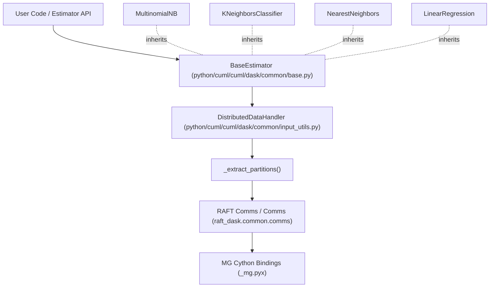
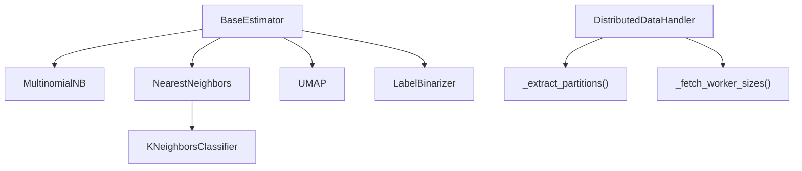

<!-- source: DeepWiki mcp.deepwiki.com · repo NVIDIA/cuml · page 5 Distributed Execution with Dask (cuml.dask) · fetched 2026-10-26 -->

# Distributed Execution with Dask (cuml.dask)

Relevant source files

The following files were used as context for generating this wiki page:

- [python/cuml/cuml/dask/common/base.py](python/cuml/cuml/dask/common/base.py)
- [python/cuml/cuml/dask/common/dask_arr_utils.py](python/cuml/cuml/dask/common/dask_arr_utils.py)
- [python/cuml/cuml/dask/common/input_utils.py](python/cuml/cuml/dask/common/input_utils.py)
- [python/cuml/cuml/dask/datasets/blobs.py](python/cuml/cuml/dask/datasets/blobs.py)
- [python/cuml/cuml/dask/datasets/classification.py](python/cuml/cuml/dask/datasets/classification.py)
- [python/cuml/cuml/dask/datasets/regression.py](python/cuml/cuml/dask/datasets/regression.py)
- [python/cuml/cuml/dask/manifold/umap.py](python/cuml/cuml/dask/manifold/umap.py)
- [python/cuml/cuml/dask/naive_bayes/naive_bayes.py](python/cuml/cuml/dask/naive_bayes/naive_bayes.py)
- [python/cuml/cuml/dask/neighbors/kneighbors_classifier.py](python/cuml/cuml/dask/neighbors/kneighbors_classifier.py)
- [python/cuml/cuml/dask/neighbors/nearest_neighbors.py](python/cuml/cuml/dask/neighbors/nearest_neighbors.py)
- [python/cuml/cuml/dask/preprocessing/label.py](python/cuml/cuml/dask/preprocessing/label.py)
- [python/cuml/tests/dask/test_dask_base.py](python/cuml/tests/dask/test_dask_base.py)

The `cuml.dask` module provides the Multi-Node Multi-GPU (MNMG) Python layer for cuML, enabling scalable machine learning workflows across clusters of GPUs using Dask and RAFT communication primitives. This package bridges high-level scikit-learn compatible estimator APIs with distributed execution primitives, handling data colocation, worker lifecycle management, and underlying C++ multi-GPU algorithms.

For deep technical details on infrastructure, data utilities, and lifecycle management, see [Dask Infrastructure and Data Handling](#5.1). For details on specific algorithm bindings and MG Cython wrappers, see [Distributed Estimators and MG Cython Bindings](#5.2).

---

## Architecture and Execution Model

Distributed estimators in `cuml.dask` are built on top of `BaseEstimator` [python/cuml/cuml/dask/common/base.py:25-40], which manages the Dask client connection, verbosity levels, and internal model states. Distributed inputs are coordinated via `DistributedDataHandler` [python/cuml/cuml/dask/common/input_utils.py:32-68], which inspects partitions, extracts GPU futures across cluster workers, and manages rank allocations.

*Figure 1: Control flow and component mapping from high-level distributed estimator APIs down to RAFT Comms and MG Cython bindings.*

Sources: `python/cuml/cuml/dask/common/base.py:25-40`, `python/cuml/cuml/dask/common/input_utils.py:32-68`

---

## Core Infrastructure and Base Classes

The foundation of `cuml.dask` relies on centralized utilities that abstract Dask cluster topology and memory management:
* **`BaseEstimator`**: Defined in `python/cuml/cuml/dask/common/base.py` [python/cuml/cuml/dask/common/base.py:25-40], it provides core functionality for attribute proxying (`__getattr__`) [python/cuml/cuml/dask/common/base.py:177-196], model serialization (`__getstate__` / `__setstate__`) [python/cuml/cuml/dask/common/base.py:41-56], and model retrieval (`get_combined_model()`) [python/cuml/cuml/dask/common/base.py:57-81].
* **`DistributedDataHandler`**: Defined in `python/cuml/cuml/dask/common/input_utils.py` [python/cuml/cuml/dask/common/input_utils.py:32-68], it manages input validation, maps worker partitions to ranks, and filters empty partitions [python/cuml/cuml/dask/common/input_utils.py:117-166].
* **Array Utilities**: `dask_arr_utils.py` provides validation functions such as `validate_dask_array()` [python/cuml/cuml/dask/common/dask_arr_utils.py:16-21] and sparse array conversion utilities like `to_sparse_dask_array()` [python/cuml/cuml/dask/common/dask_arr_utils.py:53-69].

*Figure 2: Class hierarchy relating `BaseEstimator` and `DistributedDataHandler` to specific distributed estimators.*

Sources: `python/cuml/cuml/dask/common/base.py:25-56`, `python/cuml/cuml/dask/common/input_utils.py:32-106`, `python/cuml/cuml/dask/common/dask_arr_utils.py:16-69`

For comprehensive details on communication setup, RAFT Comms lifecycle, and data handling internals, see [Dask Infrastructure and Data Handling](#5.1).

---

## Supported Distributed Estimators

`cuml.dask` offers distributed counterparts for major machine learning domains. These estimators distribute computation across cluster workers while maintaining scikit-learn compatible estimator signatures:

* **Linear Models & Classifiers**: Includes distributed `LinearRegression` [python/cuml/tests/dask/test_dask_base.py:22-48], `LogisticRegression` [python/cuml/tests/dask/test_dask_base.py:23-23], and `MultinomialNB` [python/cuml/dask/naive_bayes/naive_bayes.py:23-71], utilizing tree reductions and iterative solvers.
* **Clustering & Neighbors**: Includes `KMeans` [python/cuml/tests/dask/test_dask_base.py:19-19], `NearestNeighbors` [python/cuml/cuml/dask/neighbors/nearest_neighbors.py:20-40], and `KNeighborsClassifier` [python/cuml/cuml/dask/neighbors/kneighbors_classifier.py:24-50], which set up dedicated communication sessions (`Comms`) across index and query workers [python/cuml/cuml/dask/neighbors/nearest_neighbors.py:105-112].
* **Manifold Learning & Preprocessing**: Includes distributed inference wrappers like `UMAP` [python/cuml/cuml/dask/manifold/umap.py:9-83] and preprocessing utilities such as `LabelBinarizer` [python/cuml/cuml/preprocessing/label.py:11-67].
* **Synthetic Datasets**: Generator functions like `make_blobs` [python/cuml/cuml/dask/datasets/blobs.py:37-52], `make_regression` [python/cuml/tests/dask/test_dask_base.py:21-21], and `make_classification` [python/cuml/cuml/dask/datasets/classification.py:24-44] facilitate distributed data generation for benchmarking and testing.

Sources: `python/cuml/cuml/dask/naive_bayes/naive_bayes.py:23-71`, `python/cuml/cuml/dask/neighbors/nearest_neighbors.py:20-112`, `python/cuml/cuml/dask/neighbors/kneighbors_classifier.py:24-50`, `python/cuml/cuml/dask/manifold/umap.py:9-83`, `python/cuml/cuml/dask/preprocessing/label.py:11-67`

For implementation specifics on MG Cython bindings (`_mg.pyx`), worker-level model creation, and algorithm-specific reduction strategies, see [Distributed Estimators and MG Cython Bindings](#5.2).

---

