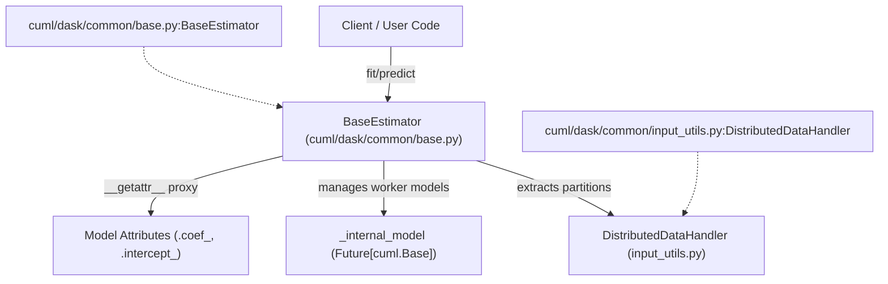
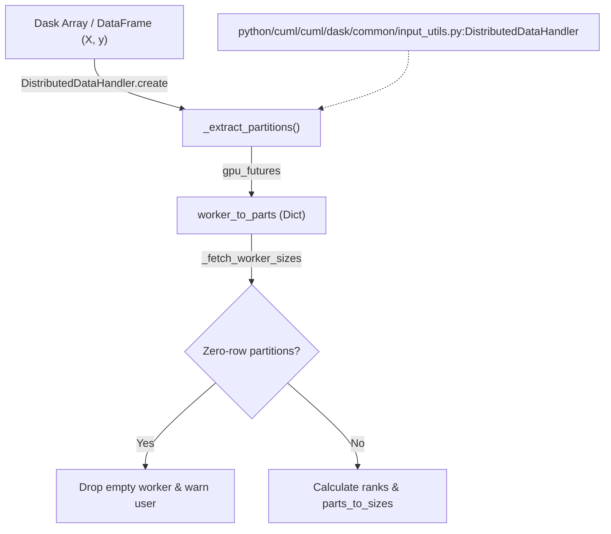
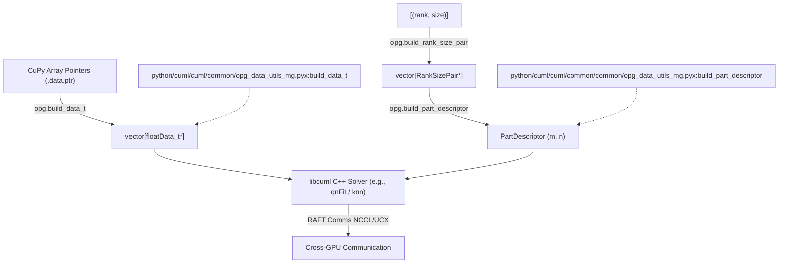

<!-- source: DeepWiki mcp.deepwiki.com · repo NVIDIA/cuml · page 5.1 Dask Infrastructure and Data Handling · fetched 2026-10-26 -->

# Dask Infrastructure and Data Handling

Relevant source files

The following files were used as context for generating this wiki page:

- [python/cuml/cuml/common/opg_data_utils_mg.pxd](python/cuml/cuml/common/opg_data_utils_mg.pxd)
- [python/cuml/cuml/common/opg_data_utils_mg.pyx](python/cuml/cuml/common/opg_data_utils_mg.pyx)
- [python/cuml/cuml/dask/common/base.py](python/cuml/cuml/dask/common/base.py)
- [python/cuml/cuml/dask/common/dask_arr_utils.py](python/cuml/cuml/dask/common/dask_arr_utils.py)
- [python/cuml/cuml/dask/common/input_utils.py](python/cuml/cuml/dask/common/input_utils.py)
- [python/cuml/cuml/dask/datasets/blobs.py](python/cuml/cuml/dask/datasets/blobs.py)
- [python/cuml/cuml/dask/datasets/classification.py](python/cuml/cuml/dask/datasets/classification.py)
- [python/cuml/cuml/dask/datasets/regression.py](python/cuml/cuml/dask/datasets/regression.py)
- [python/cuml/cuml/dask/manifold/umap.py](python/cuml/cuml/dask/manifold/umap.py)
- [python/cuml/cuml/dask/naive_bayes/naive_bayes.py](python/cuml/cuml/dask/naive_bayes/naive_bayes.py)
- [python/cuml/cuml/dask/neighbors/kneighbors_classifier.py](python/cuml/cuml/dask/neighbors/kneighbors_classifier.py)
- [python/cuml/cuml/dask/neighbors/nearest_neighbors.py](python/cuml/cuml/dask/neighbors/nearest_neighbors.py)
- [python/cuml/cuml/dask/preprocessing/label.py](python/cuml/cuml/dask/preprocessing/label.py)
- [python/cuml/cuml/linear_model/base_mg.py](python/cuml/cuml/linear_model/base_mg.py)
- [python/cuml/cuml/linear_model/logistic_regression_mg.pyx](python/cuml/cuml/linear_model/logistic_regression_mg.pyx)
- [python/cuml/cuml/neighbors/kneighbors_classifier_mg.pyx](python/cuml/cuml/neighbors/kneighbors_classifier_mg.pyx)
- [python/cuml/cuml/neighbors/kneighbors_regressor_mg.pyx](python/cuml/cuml/neighbors/kneighbors_regressor_mg.pyx)
- [python/cuml/cuml/neighbors/nearest_neighbors_mg.pyx](python/cuml/cuml/neighbors/nearest_neighbors_mg.pyx)
- [python/cuml/tests/dask/test_dask_base.py](python/cuml/tests/dask/test_dask_base.py)

## Purpose and Scope
This page details the underlying distributed infrastructure, data handling primitives, and communication lifecycle powering multi-node multi-GPU (MNMG) machine learning algorithms in `cuml.dask`. It covers the core estimator base classes (`BaseEstimator`), distributed metadata and partition management (`DistributedDataHandler`), array and sparse format utilities (`dask_arr_utils`), and the initialization of RAFT Communications (`Comms`) that bridge Python Dask workers to C++ cuML/libcuml primitives via Cython OPG (Over-Problem-Grid) data utilities.

---

## 1. Core Distributed Base Architecture (`cuml.dask.common.base`)

Distributed estimators in cuML inherit from `BaseEstimator` defined in `python/cuml/cuml/dask/common/base.py` [python/cuml/cuml/dask/common/base.py:25](). `BaseEstimator` standardizes interaction with the Dask `Client`, manages verbosity/keyword arguments passed down to worker processes, and coordinates single-GPU model aggregation via `get_combined_model()`.

### Key Responsibilities of `BaseEstimator`:
* **Client Binding**: Automatically fetches or binds to an active Dask client using `get_client` [python/cuml/cuml/dask/common/base.py:30]().
* **Serialization (`__getstate__` / `__setstate__`)**: Serializes internal models across the network by extracting futures or combining worker-local estimators [python/cuml/cuml/dask/common/base.py:41-56]().
* **Attribute Proxying (`__getattr__`)**: Dynamically proxies attribute lookups (such as fitted model parameters like `.coef_` or `.intercept_`) to the underlying `internal_model` [python/cuml/cuml/dask/common/base.py:177-196]().
* **Model Validation (`_check_internal_model`)**: Validates that worker futures or local models resolve strictly to instances of `cuml.internals.base.Base` [python/cuml/cuml/dask/common/base.py:113-148]().

*Sources: `python/cuml/cuml/dask/common/base.py` [python/cuml/cuml/dask/common/base.py:25-196]()*

---

## 2. Distributed Data Management and Validation (`input_utils` & `dask_arr_utils`)

Managing distributed datasets across multiple GPU workers requires tracking metadata, partition shapes, and worker placements without centralizing the massive array payloads on the client.

### `DistributedDataHandler`
Defined in `python/cuml/cuml/dask/common/input_utils.py` [python/cuml/cuml/dask/common/input_utils.py:32](), `DistributedDataHandler` acts as the central metadata registry for distributed inputs (`dask.array`, `dask.dataframe`, or sequences thereof).

* **`DistributedDataHandler.create()`**: Inspects input arrays/dataframes, determines the data type (`cupy` vs `cudf`), and extracts GPU futures asynchronously via `_extract_partitions` [python/cuml/cuml/dask/common/input_utils.py:76-106]().
* **Worker Size Fetching (`_fetch_worker_sizes`)**: Queries each worker partition for its local row count, automatically identifying and pruning empty partitions or workers holding zero rows to prevent synchronization hangs in downstream C++ routines [python/cuml/cuml/dask/common/input_utils.py:117-166]().

*Sources: `python/cuml/cuml/dask/common/input_utils.py` [python/cuml/cuml/dask/common/input_utils.py:32-180]()*

### Array and Sparse Utilities (`dask_arr_utils.py`)
`python/cuml/cuml/dask/common/dask_arr_utils.py` provides validation checks and conversion routines for distributed arrays:
* **`validate_dask_array()`**: Ensures Dask arrays do not exceed two dimensions and are strictly chunked along the row axis (axis 0) rather than multi-dimensionally or column-wise [python/cuml/cuml/dask/common/dask_arr_utils.py:16-21]().
* **`to_sparse_dask_array()`**: Converts dense or sparse inputs (including `scipy.sparse`, `cupyx.scipy.sparse`, and `cudf.DataFrame`) into a distributed Dask array backed by sparse CuPy CSR matrices (`cupyx.scipy.sparse.csr_matrix`) [python/cuml/cuml/dask/common/dask_arr_utils.py:53-87]().

---

## 3. RAFT Communications and C++/Cython Multi-GPU Bridges (`opg_data_utils_mg`)

Distributed execution relies on the RAFT Communications library (`raft_dask.common.comms.Comms`), which sets up NCCL/UCX communication channels across worker processes.

### RAFT Comms Lifecycle in Estimators
As demonstrated in `NearestNeighbors` [python/cuml/cuml/dask/neighbors/nearest_neighbors.py:105-111](), establishing communication requires:
1. **Gathering Workers**: Collecting unique worker addresses from index and query data handlers [python/cuml/cuml/dask/neighbors/nearest_neighbors.py:106-107]().
2. **Initializing `Comms`**: Instantiating `Comms(comms_p2p=True, streams_per_handle=...)` and calling `comms.init(workers=workers)` [python/cuml/cuml/dask/neighbors/nearest_neighbors.py:109-110]().
3. **Session Management**: Spawning worker-local estimator instances using session IDs retrieved via `get_raft_comm_state(sessionId, get_worker())["handle"]` [python/cuml/cuml/dask/neighbors/nearest_neighbors.py:70-77]().

### Cython Memory Bridges (`opg_data_utils_mg.pyx`)
To pass Python-managed CuPy memory partitions to `libcuml` C++ algorithms, cuML uses helper functions in `python/cuml/cuml/common/opg_data_utils_mg.pyx` [python/cuml/cuml/common/opg_data_utils_mg.pyx:1]():

| Function / Structure | Target C++ Type | Description |
| :--- | :--- | :--- |
| `build_data_t()` | `vector[floatData_t*]` / `vector[doubleData_t*]` | Wraps a list of CuPy array data pointers and sizes into a C++ vector [python/cuml/cuml/common/opg_data_utils_mg.pyx:19-52]() |
| `build_rank_size_pair()` | `vector[RankSizePair*]` | Maps Dask worker MPI ranks to their respective local partition row counts [python/cuml/cuml/dask/common/opg_data_utils_mg.pyx:85-104]() |
| `build_part_descriptor()` | `PartDescriptor` | Constructs the global-to-local partition descriptor defining global dimensions $m \times n$ across ranks [python/cuml/cuml/dask/common/opg_data_utils_mg.pyx:125-153]() |

*Sources: `python/cuml/cuml/common/opg_data_utils_mg.pyx` [python/cuml/cuml/common/opg_data_utils_mg.pyx:19-166](), `python/cuml/cuml/dask/neighbors/nearest_neighbors.py` [python/cuml/cuml/dask/neighbors/nearest_neighbors.py:105-111]()*

---

## 4. Distributed Dataset Generation (`cuml.dask.datasets`)

To test and benchmark distributed pipelines without external datasets, `cuml.dask.datasets` provides synthetic generators that distribute partitioned data directly across the Dask cluster workers:
* **`make_blobs`**: Generates isotropic Gaussian blobs across distributed chunks [python/cuml/tests/dask/test_dask_base.py:150-157]().
* **`make_regression`**: Generates random regression problems with configurable informative features [python/cuml/tests/dask/test_dask_base.py:28-31]().

---

## Sources
* `python/cuml/cuml/linear_model/logistic_regression_mg.pyx` [python/cuml/cuml/linear_model/logistic_regression_mg.pyx:1-214]()
* `python/cuml/cuml/neighbors/nearest_neighbors_mg.pyx` [python/cuml/cuml/neighbors/nearest_neighbors_mg.pyx:1-156]()
* `python/cuml/cuml/dask/common/base.py` [python/cuml/cuml/dask/common/base.py:25-196]()
* `python/cuml/cuml/common/opg_data_utils_mg.pyx` [python/cuml/cuml/common/opg_data_utils_mg.pyx:1-166]()
* `python/cuml/cuml/dask/naive_bayes/naive_bayes.py` [python/cuml/cuml/dask/naive_bayes/naive_bayes.py:1-216]()
* `python/cuml/cuml/neighbors/kneighbors_classifier_mg.pyx` [python/cuml/cuml/neighbors/kneighbors_classifier_mg.pyx:1-190]()
* `python/cuml/cuml/dask/common/input_utils.py` [python/cuml/cuml/dask/common/input_utils.py:32-216]()
* `python/cuml/cuml/dask/common/dask_arr_utils.py` [python/cuml/cuml/dask/common/dask_arr_utils.py:1-110]()
* `python/cuml/cuml/dask/neighbors/kneighbors_classifier.py` [python/cuml/cuml/dask/neighbors/kneighbors_classifier.py:1-199]()
* `python/cuml/cuml/dask/neighbors/nearest_neighbors.py` [python/cuml/cuml/dask/neighbors/nearest_neighbors.py:1-206]()
* `python/cuml/tests/dask/test_dask_base.py` [python/cuml/tests/dask/test_dask_base.py:1-200]()
* `python/cuml/cuml/dask/manifold/umap.py` [python/cuml/cuml/dask/manifold/umap.py:1-115]()

---

