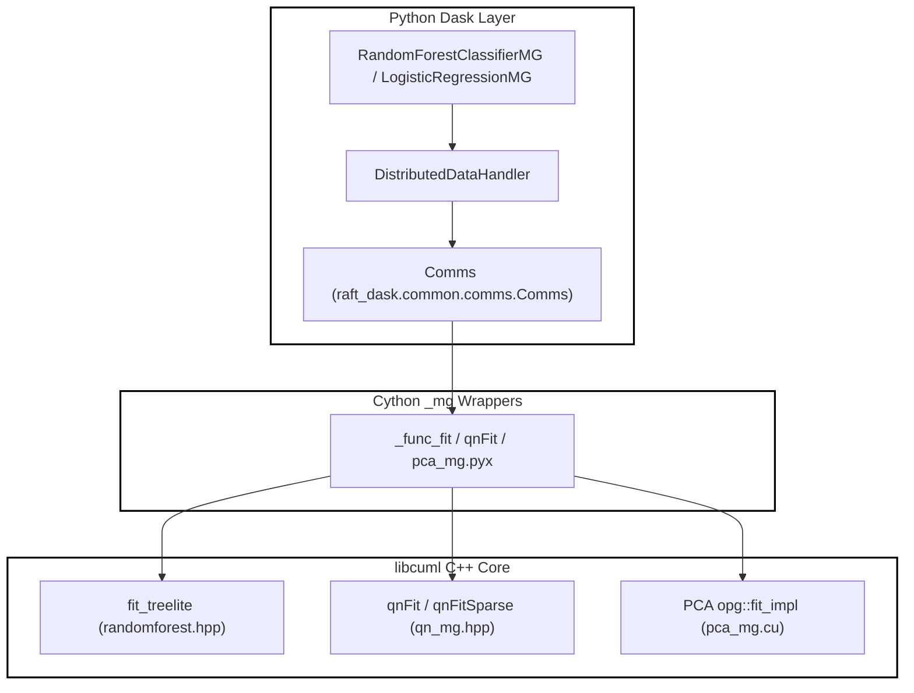
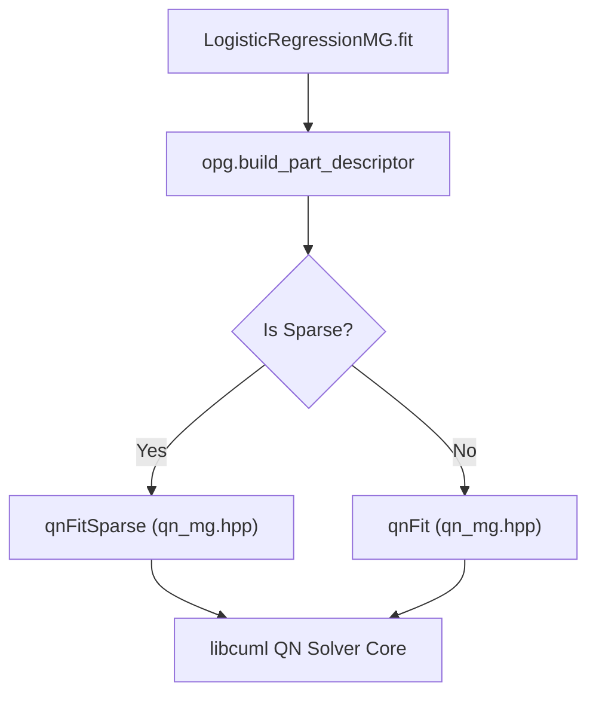
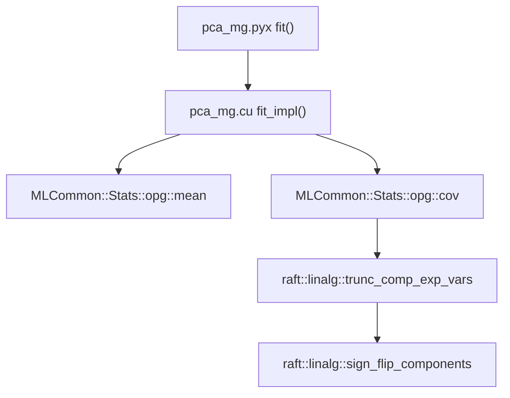

<!-- source: DeepWiki mcp.deepwiki.com · repo NVIDIA/cuml · page 5.2 Distributed Estimators and MG Cython Bindings · fetched 2026-10-26 -->

# Distributed Estimators and MG Cython Bindings

<details>
<summary>Relevant source files</summary>

The following files were used as context for generating this wiki page:

- [cpp/include/cuml/common/utils.hpp](cpp/include/cuml/common/utils.hpp)
- [cpp/include/cuml/decomposition/pca_mg.hpp](cpp/include/cuml/decomposition/pca_mg.hpp)
- [cpp/include/cuml/decomposition/tsvd_mg.hpp](cpp/include/cuml/decomposition/tsvd_mg.hpp)
- [cpp/include/cuml/neighbors/knn_mg.hpp](cpp/include/cuml/neighbors/knn_mg.hpp)
- [cpp/src/knn/knn_mg.cu](cpp/src/knn/knn_mg.cu)
- [cpp/src/pca/pca_mg.cu](cpp/src/pca/pca_mg.cu)
- [cpp/src/tsvd/tsvd_mg.cu](cpp/src/tsvd/tsvd_mg.cu)
- [python/cuml/cuml/common/opg_data_utils_mg.pxd](python/cuml/cuml/common/opg_data_utils_mg.pxd)
- [python/cuml/cuml/common/opg_data_utils_mg.pyx](python/cuml/cuml/common/opg_data_utils_mg.pyx)
- [python/cuml/cuml/dask/ensemble/base.py](python/cuml/cuml/dask/ensemble/base.py)
- [python/cuml/cuml/dask/ensemble/randomforestclassifier.py](python/cuml/cuml/dask/ensemble/randomforestclassifier.py)
- [python/cuml/cuml/dask/ensemble/randomforestregressor.py](python/cuml/cuml/dask/ensemble/randomforestregressor.py)
- [python/cuml/cuml/decomposition/base_mg.py](python/cuml/cuml/decomposition/base_mg.py)
- [python/cuml/cuml/decomposition/pca_mg.pyx](python/cuml/cuml/decomposition/pca_mg.pyx)
- [python/cuml/cuml/decomposition/tsvd_mg.pyx](python/cuml/cuml/decomposition/tsvd_mg.pyx)
- [python/cuml/cuml/ensemble/randomforest_common.pyx](python/cuml/cuml/ensemble/randomforest_common.pyx)
- [python/cuml/cuml/ensemble/randomforestclassifier.py](python/cuml/cuml/ensemble/randomforestclassifier.py)
- [python/cuml/cuml/ensemble/randomforestregressor.py](python/cuml/cuml/ensemble/randomforestregressor.py)
- [python/cuml/cuml/linear_model/base_mg.py](python/cuml/cuml/linear_model/base_mg.py)
- [python/cuml/cuml/linear_model/linear_regression_mg.pyx](python/cuml/cuml/linear_model/linear_regression_mg.pyx)
- [python/cuml/cuml/linear_model/logistic_regression_mg.pyx](python/cuml/cuml/linear_model/logistic_regression_mg.pyx)
- [python/cuml/cuml/linear_model/ridge_mg.pyx](python/cuml/cuml/linear_model/ridge_mg.pyx)
- [python/cuml/cuml/neighbors/kneighbors_classifier_mg.pyx](python/cuml/cuml/neighbors/kneighbors_classifier_mg.pyx)
- [python/cuml/cuml/neighbors/kneighbors_regressor_mg.pyx](python/cuml/cuml/neighbors/kneighbors_regressor_mg.pyx)
- [python/cuml/cuml/neighbors/nearest_neighbors_mg.pyx](python/cuml/cuml/neighbors/nearest_neighbors_mg.pyx)
- [python/cuml/cuml/solvers/cd_mg.pyx](python/cuml/cuml/solvers/cd_mg.pyx)
- [python/cuml/tests/dask/test_dask_coordinate_descent.py](python/cuml/tests/dask/test_dask_coordinate_descent.py)
- [python/cuml/tests/dask/test_dask_random_forest.py](python/cuml/tests/dask/test_dask_random_forest.py)
- [python/cuml/tests/dask/test_dask_tsvd.py](python/cuml/tests/dask/test_dask_tsvd.py)
- [python/cuml/tests/explainer/test_gpu_treeshap.py](python/cuml/tests/explainer/test_gpu_treeshap.py)
- [python/cuml/tests/test_random_forest.py](python/cuml/tests/test_random_forest.py)

</details>


## Purpose and Scope
This page covers the architecture, implementation, and data flow of multi-node multi-GPU (MNMG) distributed estimators in cuML (`cuml.dask`). It details how Python-level estimators leverage Dask and RAFT communications (`raft_dask.common.comms.Comms`), interact with Cython wrapper modules (`_mg.pyx`), and invoke underlying multi-GPU routines in the `libcuml` C++ core (`cpp/src/`).

---

## 1. Architecture of Multi-Node Multi-GPU (MNMG) Estimators in cuML
cuML's distributed execution model relies on Dask for task scheduling and data partitioning across multiple worker processes (potentially across multiple nodes), combined with RAFT for high-performance collective communication. 

Data is distributed using `DistributedDataHandler` to track worker-to-partition mappings [python/cuml/cuml/dask/common/input_utils.py](). Distributed estimators initialize a RAFT communication session via `Comms`, distribute parameters or invoke rank-local tasks via `dask.distributed.Client.submit`, and execute collective operations over CUDA streams.


*Figure 1: Control and data flow from Python distributed estimators down to `libcuml` C++ core.*

**Sources:**
- `python/cuml/cuml/dask/common/input_utils.py`
- `python/cuml/cuml/dask/ensemble/base.py`

---

## 2. Distributed Ensemble Estimators (Random Forest MG)
Distributed Random Forest classifiers and regressors (`RandomForestClassifier`, `RandomForestRegressor`) allow multiple workers holding partitioned training data to collectively build a single identical forest [python/cuml/cuml/dask/ensemble/randomforestclassifier.py](), [python/cuml/cuml/dask/ensemble/randomforestregressor.py]().

### Initialization and Fitting Data Flow
1. `BaseRandomForestModel._create_model()` submits `model_func` to each worker to construct rank-local single-GPU forest instances (`cuRFC` / `cuRFR`) [python/cuml/cuml/dask/ensemble/base.py:22-58]().
2. `BaseRandomForestModel._fit()` initializes a RAFT communication session across the selected workers [python/cuml/cuml/dask/ensemble/base.py:76-83]().
3. `_func_fit` extracts the RAFT `handle_t` from the worker state, concatenates worker-local partitions (`X` and `y`), validates inputs, and triggers rank-local `model.fit(X, y)` [python/cuml/cuml/dask/ensemble/base.py:146-175]().

```mermaid
sequenceDiagram
    participant Client as Dask Client
    participant Worker as Dask Worker
    participant Cython as randomforest_common.pyx
    participant Cpp as libcuml (randomforest.cu)

    Client->>Worker: Submit _func_fit() with session_id
    Worker->>Cython: Retrieve RAFT handle via get_raft_comm_state()
    Cython->>Cpp: Call fit_treelite() with distributed arrays
    Cpp--Y Worker: Return constructed Treelite model bytes
    Worker--Y Client: Return fitted model reference
```
*Figure 2: Sequence diagram for distributed Random Forest fitting across Dask workers.*

**Sources:**
- `python/cuml/cuml/dask/ensemble/base.py`
- `python/cuml/cuml/dask/ensemble/randomforestclassifier.py`
- `python/cuml/cuml/dask/ensemble/randomforestregressor.py`
- `python/cuml/cuml/ensemble/randomforestregressor.py`
- `python/cuml/cuml/ensemble/randomforest_common.pyx`

---

## 3. Distributed Linear and Logistic Regression MG Bindings
Distributed generalized linear models use Quasi-Newton (QN) or coordinate descent solvers. `LogisticRegressionMG` in `logistic_regression_mg.pyx` handles dense and sparse distributed matrices.

### Implementation Details
- **Descriptor Construction**: `opg.build_rank_size_pair` and `opg.build_part_descriptor` construct C++ `PartDescriptor` metadata structures from distributed partition info [python/cuml/cuml/linear_model/logistic_regression_mg.pyx:163-166]().
- **Data Pointers**: Dense arrays use `opg.build_data_t` to wrap local chunks into `vector[floatData_t*]` or `vector[doubleData_t*]`. Sparse inputs use CSR format (`indices`, `indptr`, `data`) passed to `qnFitSparse` [python/cuml/cuml/linear_model/logistic_regression_mg.pyx:175-186]().
- **C++ Dispatch**: Calls `qnFit` or `qnFitSparse` defined in `cuml/linear_model/qn_mg.hpp` under namespace `ML::GLM::opg` [python/cuml/cuml/linear_model/logistic_regression_mg.pyx:28-124]().


*Figure 3: Execution path for distributed Logistic Regression fitting.*

**Sources:**
- `python/cuml/cuml/linear_model/logistic_regression_mg.pyx`

---

## 4. Dimensionality Reduction MG Bindings (PCA and Truncated SVD)
Multi-GPU Principal Component Analysis (`pca_mg.pyx` / `pca_mg.cu`) and Truncated SVD (`tsvd_mg.pyx`) distribute matrix operations across worker devices.

### Principal Component Analysis (`pca_mg.cu`)
The C++ implementation `ML::PCA::opg::fit_impl` coordinates distributed statistical primitives [cpp/src/pca/pca_mg.cu:33-46]():
1. **Mean Calculation**: Computes column means across partitions using `MLCommon::Stats::opg::mean` [cpp/src/pca/pca_mg.cu:51]().
2. **Covariance**: Computes distributed covariance matrix using `MLCommon::Stats::opg::cov` [cpp/src/pca/pca_mg.cu:57]().
3. **Truncation & Sign Flip**: Invokes `raft::linalg::trunc_comp_exp_vars` and `raft::linalg::sign_flip_components` to extract principal components [cpp/src/pca/pca_mg.cu:63,89]().


*Figure 4: Data flow inside distributed PCA fitting.*

**Sources:**
- `cpp/src/pca/pca_mg.cu`
- `cpp/include/cuml/decomposition/pca_mg.hpp`

---

## 5. Distributed Neighbors and Clustering (KNN MG)
Multi-node multi-GPU K-Nearest Neighbors (`knn_mg.hpp` / `knn_mg.cu`) provides distributed spatial querying, classification, and regression [cpp/include/cuml/neighbors/knn_mg.hpp:38-125]().

### Key Functions
- `ML::KNN::opg::knn`: Performs MNMG K-nearest neighbor search given index partitions (`idx_data`, `idx_desc`) and query partitions (`query_data`, `query_desc`) [cpp/include/cuml/neighbors/knn_mg.hpp:38-49]().
- `ML::KNN::opg::knn_classify`: Performs distributed KNN classification, returning unique label arrays and optional probabilities [cpp/include/cuml/neighbors/knn_mg.hpp:75-90]().
- `ML::KNN::opg::knn_regress`: Performs distributed KNN regression across multiple target outputs [cpp/include/cuml/neighbors/knn_mg.hpp:113-125]().

**Sources:**
- `cpp/include/cuml/neighbors/knn_mg.hpp`
- `cpp/src/knn/knn_mg.cu`

---

