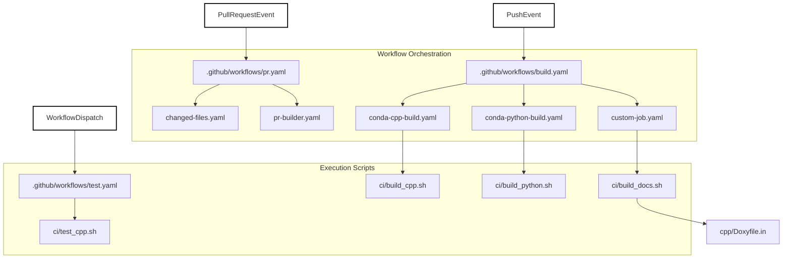
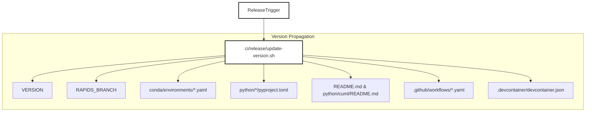

<!-- source: DeepWiki mcp.deepwiki.com · repo NVIDIA/cuml · page 6 CI/CD, Testing and Release Engineering · fetched 2026-10-26 -->

# CI/CD, Testing and Release Engineering

Relevant source files

The following files were used as context for generating this wiki page:

- [.github/scripts/sync_pr_project_fields.py](.github/scripts/sync_pr_project_fields.py)
- [.github/workflows/build.yaml](.github/workflows/build.yaml)
- [.github/workflows/pr.yaml](.github/workflows/pr.yaml)
- [.github/workflows/pr_issue_status_automation.yml](.github/workflows/pr_issue_status_automation.yml)
- [.github/workflows/test.yaml](.github/workflows/test.yaml)
- [.github/workflows/trigger-breaking-change-alert.yaml](.github/workflows/trigger-breaking-change-alert.yaml)
- [RAPIDS_BRANCH](RAPIDS_BRANCH)
- [README.md](README.md)
- [ci/build_docs.sh](ci/build_docs.sh)
- [ci/check_style.sh](ci/check_style.sh)
- [ci/release/update-version.sh](ci/release/update-version.sh)
- [ci/run_clang_tidy.sh](ci/run_clang_tidy.sh)
- [ci/test_cpp.sh](ci/test_cpp.sh)
- [ci/test_notebooks.sh](ci/test_notebooks.sh)
- [ci/test_python_common.sh](ci/test_python_common.sh)
- [cpp/Doxyfile.in](cpp/Doxyfile.in)
- [python/cuml/README.md](python/cuml/README.md)

The cuML continuous integration, testing, and release engineering framework automates software delivery, cross-platform compilation, validation, and release coordination. Built upon the RAPIDS shared-workflows infrastructure [ [.github/workflows/pr.yaml:45-48]() ], the automation pipeline ensures that every code change is thoroughly tested across single-GPU and multi-GPU environments, packaged into Conda and Python wheels [ [.github/workflows/build.yaml:63-186]() ], checked for code quality [ [.github/workflows/build.yaml:38-51]() ], and documented [ [.github/workflows/build.yaml:72-101]() ].

For detailed information on specific subsystems, consult the child pages:
- [GitHub Workflows and Repo Automation](#6.1) — Pipeline definitions (`pr.yaml`, `build.yaml`, `test.yaml`), labelers, bots, and project tracking automation.
- [CI Scripts: Builds, Wheels and Tests](#6.2) — Shell automation scripts (`ci/build_cpp.sh`, `ci/test_cpp.sh`, `ci/build_docs.sh`), packaging recipes, and notebook test runners.
- [Python Test Suite and Benchmarks](#6.3) — Pytest layouts (`tests/`, `cuml_accel_tests/`), fixtures, hypothesis strategies, and benchmarking harness.
- [Code Quality, Style and Developer Guide](#6.4) — Pre-commit configurations, `clang-format`, `clang-tidy`, header include checkers, and developer workflows.

---

## CI/CD Pipeline Overview

The CI/CD architecture bridges high-level development actions (such as opening a pull request or pushing to `main`) with concrete execution scripts and GitHub Actions workflow definitions.

*Sources: `[.github/workflows/pr.yaml:1-49]`, `[.github/workflows/build.yaml:54-101]`, `[.github/workflows/test.yaml:43-57]`, `[ci/build_docs.sh:36-39]`, `[ci/test_cpp.sh:18-47]()`*

---

## Release Automation and Version Management

Release engineering uses centralized scripts to bump versions across dependencies, documentation branch tags, Conda environments, Pyproject metadata, and container definitions.

*Sources: `[ci/release/update-version.sh:1-153]`, `[RAPIDS_BRANCH:1]()`*

---

## Child Pages Reference

- **6.1 GitHub Workflows and Repo Automation**: Covers [/.github/workflows/pr.yaml](), [/.github/workflows/build.yaml](), [/.github/workflows/test.yaml](), and project tracking automation scripts like `[.github/scripts/sync_pr_project_fields.py]()`.
- **6.2 CI Scripts: Builds, Wheels and Tests**: Details scripts in `ci/` including `ci/build_cpp.sh`, `ci/build_python.sh`, `ci/build_docs.sh`, `ci/test_cpp.sh`, and `ci/test_notebooks.sh`.
- **6.3 Python Test Suite and Benchmarks**: Details the structure of `python/cuml/tests/`, `cuml_accel_tests/`, and the `cuml.benchmark` module.
- **6.4 Code Quality, Style and Developer Guide**: Details `.pre-commit-config.yaml`, `ci/check_style.sh`, `ci/run_clang_tidy.sh`, and developer documentation guidelines.

---

