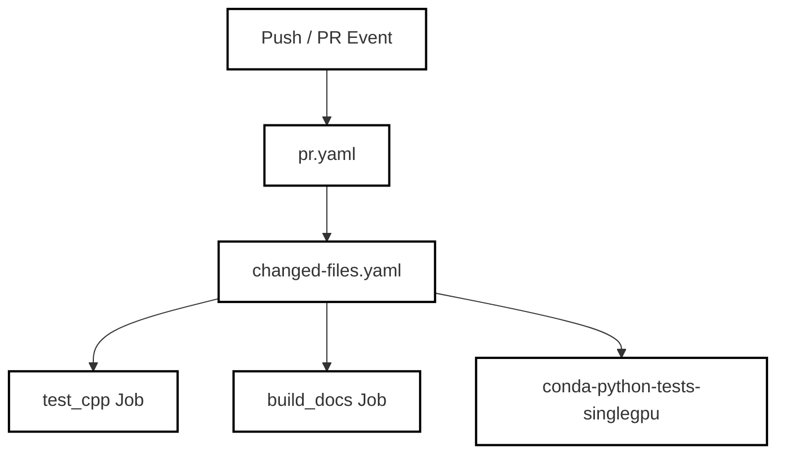
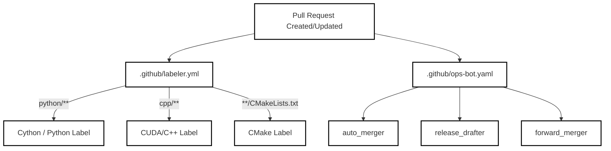

<!-- source: DeepWiki mcp.deepwiki.com · repo NVIDIA/cuml · page 6.1 GitHub Workflows and Repo Automation · fetched 2026-10-26 -->

# GitHub Workflows and Repo Automation

Relevant source files

The following files were used as context for generating this wiki page:

- [.github/ISSUE_TEMPLATE/ci-failure.md](.github/ISSUE_TEMPLATE/ci-failure.md)
- [.github/copy-pr-bot.yaml](.github/copy-pr-bot.yaml)
- [.github/labeler.yml](.github/labeler.yml)
- [.github/ops-bot.yaml](.github/ops-bot.yaml)
- [.github/scripts/sync_pr_project_fields.py](.github/scripts/sync_pr_project_fields.py)
- [.github/workflows/build.yaml](.github/workflows/build.yaml)
- [.github/workflows/labeler.yml](.github/workflows/labeler.yml)
- [.github/workflows/new-issues-to-triage-projects.yml](.github/workflows/new-issues-to-triage-projects.yml)
- [.github/workflows/pr.yaml](.github/workflows/pr.yaml)
- [.github/workflows/pr_assign_author.yml](.github/workflows/pr_assign_author.yml)
- [.github/workflows/pr_issue_status_automation.yml](.github/workflows/pr_issue_status_automation.yml)
- [.github/workflows/test.yaml](.github/workflows/test.yaml)
- [.github/workflows/trigger-breaking-change-alert.yaml](.github/workflows/trigger-breaking-change-alert.yaml)
- [.yamllint.yaml](.yamllint.yaml)
- [RAPIDS_BRANCH](RAPIDS_BRANCH)
- [README.md](README.md)
- [codecov.yml](codecov.yml)
- [python/cuml/README.md](python/cuml/README.md)

## Purpose and Scope
This page details the CI/CD pipelines, automated labeling, repository bots, issue tracking sync mechanisms, and governance structures defined in the cuML repository (`https://github.com/NVIDIA/cuml`). The automation infrastructure ensures rigorous code quality, continuous integration testing across single-GPU, multi-GPU (Dask), and containerized environments, and seamless GitHub project management.

Sources: `[.github/workflows/pr.yaml:1-50]`, `[.github/workflows/build.yaml:1-40]`

---

## 1. Core CI Workflows (`pr.yaml`, `build.yaml`, `test.yaml`)

The repository leverages GitHub Actions configured via workflow files that interface heavily with shared RAPIDS workflows (`rapidsai/shared-workflows`).

* **`pr.yaml`**: Automatically executed on pull request related events and branches matching `pull-request/[0-9]+`. It runs pre-checks, computes changed files, and delegates validation to `pr-builder.yaml` [`.github/workflows/pr.yaml:1-48`].
* **`build.yaml`**: Triggered on pushes to `main`, `release/*` branches, version tags, or manual workflow dispatch. It orchestrates C++ builds (`ci/build_cpp.sh`), Python builds (`ci/build_python.sh`), documentation builds (`ci/build_docs.sh`), and wheel builds (`ci/build_wheel_libcuml.sh`) [`.github/workflows/build.yaml:1-178`].
* **`test.yaml`**: Triggered via workflow dispatch to execute downstream tests, including post-build C++ checks (`conda-cpp-post-build-checks.yaml`), single-GPU Python tests, Dask distributed tests, scikit-learn acceleration tests, and notebook validation [`.github/workflows/test.yaml:1-167`].

### Changed Files Filtering (`changed-files`)
To optimize CI resource consumption, `pr.yaml` utilizes `changed-files.yaml` to selectively enable or disable testing blocks (e.g., `test_cpp`, `build_docs`, `test_notebooks`) based on file glob modifications [`.github/workflows/pr.yaml:81-199`].

*Figure 1: CI Workflow Routing and Filtering*

Sources: `[.github/workflows/pr.yaml:1-199]`, `[.github/workflows/build.yaml:1-186]`, `[.github/workflows/test.yaml:1-194]`

---

## 2. Automated Labeling and Repository Bot Management (`labeler.yml`, `ops-bot.yaml`)

### Automated Labeler
The labeler configuration (`.github/labeler.yml`) applies repository labels based on file glob modifications in pull requests:
* `Cython / Python`: Triggered by changes to `python/**` or `notebooks/**` [`.github/labeler.yml:5-9`].
* `CUDA/C++`: Triggered by changes to `cpp/**` [`.github/labeler.yml:11-15`].
* `CMake`: Triggered by modifications to `**/CMakeLists.txt` or `**/cmake/**` [`.github/labeler.yml:16-21`].
* `ci`: Triggered by changes to `ci/**` [`.github/labeler.yml:22-26`].
* `conda`: Triggered by changes to `conda/**` [`.github/labeler.yml:27-31`].

### Operations Bot (`ops-bot.yaml`)
Repository hygiene and maintenance are governed by `rapidsai/ops-bot`, enabled through `.github/ops-bot.yaml` [`.github/ops-bot.yaml:1-11`]:
* `auto_merger`: Automatically merges PRs meeting specific validation criteria.
* `branch_checker`: Ensures clean target branch policies.
* `label_checker`: Validates required label application.
* `release_drafter`: Manages automated release notes.
* `forward_merger`: Handles automatic forward-merging of release branches into main.
* `merge_barriers`: Enforces synchronization locks.

*Figure 2: Mapping Repository Automation Systems to Configuration Files*

Sources: `[.github/labeler.yml:1-31]`, `[.github/ops-bot.yaml:1-11]`

---

## 3. Project Field Sync & Issue Automation

Project board tracking and PR lifecycle management are automated via dedicated workflows and helper scripts.

### PR and Issue Status Automation (`pr_issue_status_automation.yml`)
Triggered on `pull_request_target` (`opened`, `edited`, `synchronize`, `reopened`, `ready_for_review`), this workflow performs three primary tasks:
1. **Get Project ID**: Calls `rapidsai/shared-workflows/.github/workflows/project-get-item-id.yaml@main` using project identifier `PVT_kwDOABpemM4BgFBJ` [`.github/workflows/pr_issue_status_automation.yml:15-28`].
2. **Update Status**: Automatically sets the project board item status field (`PVTSSF_lADOABpemM4BgFBJzhaTRPI`) to `"In Progress"` when a PR is opened or edited [`.github/workflows/pr_issue_status_automation.yml:29-50`].
3. **Sync Planning Fields**: Executes `.github/scripts/sync_pr_project_fields.py` to inherit metadata (Release and Priority) from associated issues [`.github/workflows/pr_issue_status_automation.yml:51-83`].

### Field Synchronization Script (`sync_pr_project_fields.py`)
The Python script `.github/scripts/sync_pr_project_fields.py` interfaces with the GitHub API to query linked issues, parse priority/release fields, and propagate them to the parent pull request item [`.github/workflows/pr_issue_status_automation.yml:76-82`].

### Author Assignment (`pr_assign_author.yml`)
Upon the `opened` event of a pull request, `.github/workflows/pr_assign_author.yml` invokes the GitHub CLI (`gh pr edit`) to assign the PR directly to its submitter [`.github/workflows/pr_assign_author.yml:1-33`].

Sources: `[.github/workflows/pr_issue_status_automation.yml:1-83]`, `[.github/workflows/pr_assign_author.yml:1-33]`

---

## 4. Notification and Alert Workflows

Critical notifications, such as breaking API changes, are dispatched via specialized event-driven workflows.

### Breaking Change Alerts (`trigger-breaking-change-alert.yaml`)
Triggered on `pull_request_target` actions (`closed`, `reopened`, `labeled`, `unlabeled`), this workflow checks if the PR carries the `breaking` label [`.github/workflows/trigger-breaking-change-alert.yaml:1-18`]. If present, it executes `rapidsai/shared-workflows/.github/workflows/breaking-change-alert.yaml@main`, forwarding metadata (PR title, body, author, base ref, action) to Slack via the `NV_SLACK_BREAKING_CHANGE_NOTIFIER_APP` webhook secret [`.github/workflows/trigger-breaking-change-alert.yaml:19-35`].

Sources: `[.github/workflows/trigger-breaking-change-alert.yaml:1-35]`

---

## 5. Issue Templates, Code Ownership, and Quality Gates

* **Issue Templates**: Structured templates under `.github/ISSUE_TEMPLATE/` (such as `ci-failure.md`) standardize bug reports, feature requests, and CI investigation logs.
* **Code Coverage (`codecov.yml`)**: Configures Codecov integration. It explicitly disables mandatory project and patch status checks (`project: off`, `patch: off`) and enables `allow_coverage_offsets: true` to mitigate missing base report issues common with squash-and-merge strategies [`codecov.yml:1-14`].
* **Code Ownership (`CODEOWNERS`)**: Defines review requirements and module maintainers across C++, Python, documentation, and CI directories.

Sources: `[codecov.yml:1-14]`

---

