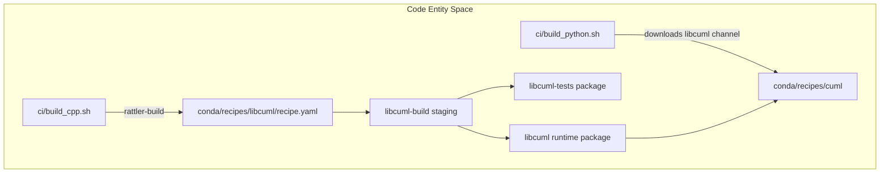
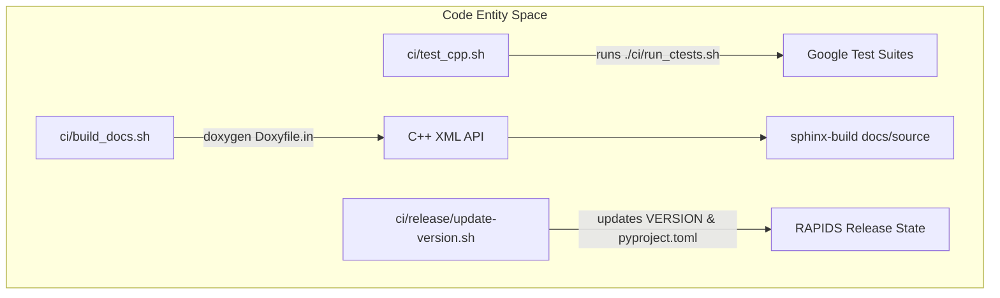

<!-- source: DeepWiki mcp.deepwiki.com · repo NVIDIA/cuml · page 6.2 CI Scripts: Builds, Wheels and Tests · fetched 2026-10-26 -->

# CI Scripts: Builds, Wheels and Tests

<details>
<summary>Relevant source files</summary>

The following files were used as context for generating this wiki page:

- [ci/build_cpp.sh](ci/build_cpp.sh)
- [ci/build_docs.sh](ci/build_docs.sh)
- [ci/build_python.sh](ci/build_python.sh)
- [ci/build_wheel.sh](ci/build_wheel.sh)
- [ci/build_wheel_cuml.sh](ci/build_wheel_cuml.sh)
- [ci/build_wheel_libcuml.sh](ci/build_wheel_libcuml.sh)
- [ci/check_style.sh](ci/check_style.sh)
- [ci/release/update-version.sh](ci/release/update-version.sh)
- [ci/run_clang_tidy.sh](ci/run_clang_tidy.sh)
- [ci/run_cuml_dask_pytests.sh](ci/run_cuml_dask_pytests.sh)
- [ci/run_cuml_integration_pytests.sh](ci/run_cuml_integration_pytests.sh)
- [ci/run_cuml_singlegpu_pytests.sh](ci/run_cuml_singlegpu_pytests.sh)
- [ci/test_cpp.sh](ci/test_cpp.sh)
- [ci/test_notebooks.sh](ci/test_notebooks.sh)
- [ci/test_python_common.sh](ci/test_python_common.sh)
- [ci/test_python_cuml_accel_upstream.sh](ci/test_python_cuml_accel_upstream.sh)
- [ci/test_python_dask.sh](ci/test_python_dask.sh)
- [ci/test_python_integration.sh](ci/test_python_integration.sh)
- [ci/test_python_singlegpu.sh](ci/test_python_singlegpu.sh)
- [ci/test_wheel.sh](ci/test_wheel.sh)
- [ci/test_wheel_dask.sh](ci/test_wheel_dask.sh)
- [ci/test_wheel_integrations.sh](ci/test_wheel_integrations.sh)
- [conda/recipes/libcuml/recipe.yaml](conda/recipes/libcuml/recipe.yaml)
- [cpp/Doxyfile.in](cpp/Doxyfile.in)

</details>


The `ci/` directory contains the automation scripts, pipeline definitions, and recipe hooks required to build, package, test, and release `libcuml` (the C++ core) and `cuml` (the Python package) across both Conda and PyPI wheel ecosystems. This page details the implementation, data flows, and operational semantics of the core build, packaging, wheel generation, and test invocation scripts.

---

## 1. Conda Build Scripts and Recipes (`libcuml` and `cuml`)

The Conda build pipelines rely on `rattler-build` combined with shell orchestrators (`ci/build_cpp.sh` and `ci/build_python.sh`) and unified recipes stored under `conda/recipes/`. 

### C++ Core Build Orchestration (`ci/build_cpp.sh`)
`ci/build_cpp.sh` configures SCCACHE, sets up Ninja as the default CMake generator [ci/build_cpp.sh:10](), determines the package version via `rapids-generate-version` [ci/build_cpp.sh:18](), and executes `rattler-build` using `conda/recipes/libcuml` [ci/build_cpp.sh:27]().

```bash
# Example invocation pattern inside ci/build_cpp.sh
rattler-build build --recipe conda/recipes/libcuml \
                    "${RATTLER_ARGS[@]}" \
                    "${RATTLER_CHANNELS[@]}"
```
*(See `ci/build_cpp.sh` [ci/build_cpp.sh:27-29]())*

### Python Package Build Orchestration (`ci/build_python.sh`)
`ci/build_python.sh` handles the downstream Python package compilation. It downloads the prebuilt `libcuml` Conda artifact from the C++ build job, prepends its channel to `RATTLER_CHANNELS`, and invokes `rattler-build` for `conda/recipes/cuml` [ci/build_python.sh:18-39]().

### Recipe Configuration (`conda/recipes/libcuml/recipe.yaml`)
`conda/recipes/libcuml/recipe.yaml` defines a split package (`libcuml-split`) producing `libcuml-build` (staging), `libcuml` (runtime library), and `libcuml-tests` (GTest binaries) [conda/recipes/libcuml/recipe.yaml:14-170](). 

- **Staging Step**: The build script strips `-fdebug-prefix-map` flags to optimize SCCACHE cache hits [conda/recipes/libcuml/recipe.yaml:25-31]() and calls `./build.sh` with `-n libcuml prims cpp-mgtests` [conda/recipes/libcuml/recipe.yaml:33]().
- **Runtime Step**: Installs compiled targets via `cmake --install cpp/build --component cuml` [conda/recipes/libcuml/recipe.yaml:97]().
- **Testing Step**: Installs test binaries via `cmake --install cpp/build --component testing` [conda/recipes/libcuml/recipe.yaml:159]().

Sources: [ci/build_cpp.sh:1-39](), [ci/build_python.sh:1-49](), [conda/recipes/libcuml/recipe.yaml:1-170]()


*Diagram 1: Conda Build and Packaging Data Flow*  
Sources: [ci/build_cpp.sh:27-29](), [ci/build_python.sh:18-39](), [conda/recipes/libcuml/recipe.yaml:20-170]()

---

## 2. Wheel Building and Validation Scripts

PyPI wheels for `libcuml` and `cuml` are built using isolated environments orchestrated by `ci/build_wheel.sh`, specialized package wrappers (`ci/build_wheel_libcuml.sh` and `ci/build_wheel_cuml.sh`), and validated through integration tests (`ci/test_wheel.sh` and `ci/test_wheel_integrations.sh`).

### `libcuml` Wheel Construction (`ci/build_wheel_libcuml.sh`)
`ci/build_wheel_libcuml.sh` generates build dependencies via `rapids-dependency-file-generator` [ci/build_wheel_libcuml.sh:14-19](), defines exclusion filters for system and sibling RAPIDS libraries using `auditwheel` `--exclude` flags [ci/build_wheel_libcuml.sh:27-41](), invokes `ci/build_wheel.sh` [ci/build_wheel_libcuml.sh:44](), and repairs the resulting wheel [ci/build_wheel_libcuml.sh:47-50]().

### `cuml` Python Wheel Construction (`ci/build_wheel_cuml.sh`)
`ci/build_wheel_cuml.sh` links against the prebuilt `libcuml` wheel by appending a file reference to `PIP_CONSTRAINT` [ci/build_wheel_cuml.sh:20-21](), exports stable ABI configurations (`RAPIDS_PY_API`) [ci/build_wheel_cuml.sh:41-42](), passes CMake options `-DSINGLEGPU=OFF -DUSE_LIBCUML_WHEEL=ON` [ci/build_wheel_cuml.sh:44](), and runs `auditwheel` with appropriate exclusions [ci/build_wheel_cuml.sh:23-51]().

### Wheel Testing Pipelines (`ci/test_wheel.sh` and `ci/test_wheel_integrations.sh`)
`ci/test_wheel.sh` installs the generated wheels inside a virtual environment, validates C++ linkage via `python -m pytest python/libcuml/tests/test_libcuml_linkage.py` [ci/test_wheel.sh:64](), runs single-GPU pytest suites [ci/test_wheel.sh:67-71](), and executes accelerator smoke tests if configured [ci/test_wheel.sh:73-79](). Additionally, `ci/test_wheel_integrations.sh` verifies downstream project compatibility such as BERTopic integration [ci/test_wheel_integrations.sh:19-82]().

Sources: [ci/build_wheel.sh:1-70](), [ci/build_wheel_libcuml.sh:1-55](), [ci/build_wheel_cuml.sh:1-56](), [ci/test_wheel.sh:1-87](), [ci/test_wheel_integrations.sh:1-85]()

---

## 3. Test Runner and Auxiliary Scripts

Beyond Conda and wheel pipelines, specialized scripts handle C++ test suites, documentation generation, and release version updates.

### C++ Test Execution (`ci/test_cpp.sh`)
`ci/test_cpp.sh` downloads the `conda_cpp` artifact, provisions a temporary Conda test environment using `rapids-dependency-file-generator` with key `test_cpp` [ci/test_cpp.sh:19-25](), exports `GTEST_OUTPUT=xml` [ci/test_cpp.sh:41](), and executes Google Test binaries via `./ci/run_ctests.sh` (excluding multi-GPU MG tests requiring MPI setup) [ci/test_cpp.sh:44]().

### Documentation Pipeline (`ci/build_docs.sh`)
`ci/build_docs.sh` generates API reference documentation. It retrieves C++ and Python conda channels [ci/build_docs.sh:6-8](), provisions a `docs` environment [ci/build_docs.sh:20-29](), runs `doxygen Doxyfile.in` to produce XML for Breathe [ci/build_docs.sh:36-39](), executes Sphinx (`sphinx-build -b dirhtml ./source _html -W`) [ci/build_docs.sh:43](), and uploads the artifacts via `rapids-upload-docs` [ci/build_docs.sh:48]().

### Version Management Automation (`ci/release/update-version.sh`)
`ci/release/update-version.sh` parses a new version string and run-context (`main` or `release`) [ci/release/update-version.sh:20-54](), updates `VERSION` and `RAPIDS_BRANCH` files [ci/release/update-version.sh:97-98](), and executes in-place `sed` substitutions across `dependencies.yaml`, `conda/environments/*.yaml`, Python `pyproject.toml` files, GitHub Actions workflows, and `.devcontainer` configurations [ci/release/update-version.sh:100-152]().

Sources: [ci/test_cpp.sh:1-47](), [ci/build_docs.sh:1-48](), [ci/release/update-version.sh:1-152]()


*Diagram 2: Test Execution and Documentation Pipeline Data Flow*  
Sources: [ci/test_cpp.sh:40-44](), [ci/build_docs.sh:36-43](), [ci/release/update-version.sh:97-126]()

---

