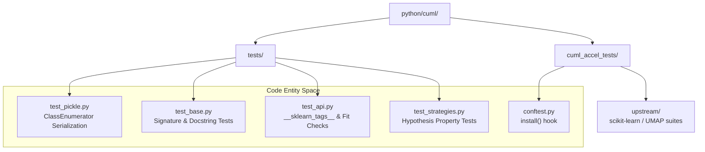
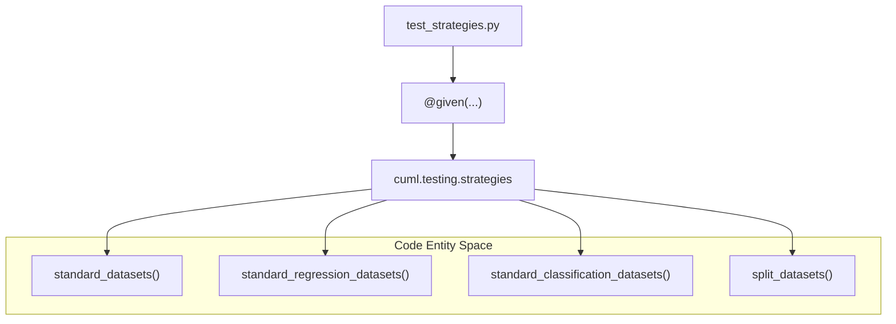
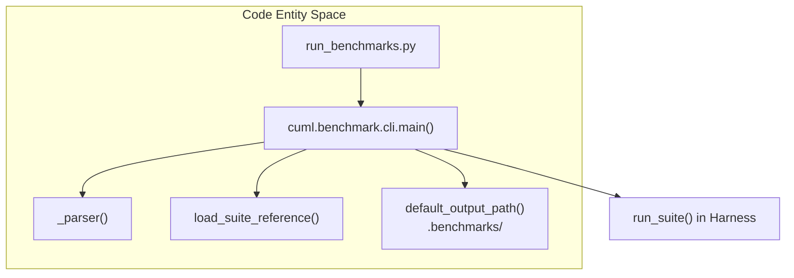

<!-- source: DeepWiki mcp.deepwiki.com · repo NVIDIA/cuml · page 6.3 Python Test Suite and Benchmarks · fetched 2026-10-26 -->

# Python Test Suite and Benchmarks

<details>
<summary>Relevant source files</summary>

The following files were used as context for generating this wiki page:

- [python/cuml/cuml/benchmark/cli.py](python/cuml/cuml/benchmark/cli.py)
- [python/cuml/cuml/benchmark/run_benchmarks.py](python/cuml/cuml/benchmark/run_benchmarks.py)
- [python/cuml/cuml/testing/plugins/restart_corrupted_xdist_worker.py](python/cuml/cuml/testing/plugins/restart_corrupted_xdist_worker.py)
- [python/cuml/cuml_accel_tests/conftest.py](python/cuml/cuml_accel_tests/conftest.py)
- [python/cuml/tests/conftest.py](python/cuml/tests/conftest.py)
- [python/cuml/tests/explainer/test_explainer_common.py](python/cuml/tests/explainer/test_explainer_common.py)
- [python/cuml/tests/explainer/test_explainer_kernel_shap.py](python/cuml/tests/explainer/test_explainer_kernel_shap.py)
- [python/cuml/tests/test_api.py](python/cuml/tests/test_api.py)
- [python/cuml/tests/test_base.py](python/cuml/tests/test_base.py)
- [python/cuml/tests/test_common.py](python/cuml/tests/test_common.py)
- [python/cuml/tests/test_lars.py](python/cuml/tests/test_lars.py)
- [python/cuml/tests/test_pickle.py](python/cuml/tests/test_pickle.py)
- [python/cuml/tests/test_strategies.py](python/cuml/tests/test_strategies.py)

</details>


The purpose of this page is to document the architecture, layout, configuration, and execution mechanics of cuML's Python test suite and benchmarking framework. This encompasses pytest test directory structures (`tests/` and `cuml_accel_tests/`), test runner configuration and custom fixtures in `conftest.py`, property-based testing via Hypothesis strategies, testing utilities (`ClassEnumerator`), and the standalone `cuml.benchmark` runner harness.

---

## 1. Pytest Layout and Directory Structure

cuML's Python testing infrastructure is split into core package unit/stress/quality tests and zero-code-change accelerator integration tests.

```
python/cuml/
├── tests/                  # Core cuML estimator, metric, and utility test suites
│   ├── conftest.py         # Global pytest configuration, CLI flags, and Hypothesis profiles
│   ├── test_api.py         # Estimator API contract, tags, and inheritance checks
│   ├── test_base.py        # Base class, docstring matching, and signature validation
│   ├── test_lars.py        # Least Angle Regression solver precision and boundary tests
│   ├── test_pickle.py      # Estimator serialization and roundtrip integrity
│   ├── test_strategies.py  # Property-based testing validation using Hypothesis
│   └── explainer/          # KernelSHAP and tree SHAP validation suites
└── cuml_accel_tests/       # Integration test suite for cuml.accel proxy dispatch
    ├── conftest.py         # Accelerator bootstrap and worker log isolation
    └── upstream/           # Upstream scikit-learn / UMAP validation harnesses
```

### Core Test Modules
* **`tests/test_base.py`**: Verifies that estimator subclass signatures and docstrings conform to `cuml.Base` requirements and standard scikit-learn mixin expectations [python/cuml/tests/test_base.py:28-112]().
* **`tests/test_pickle.py`**: Utilizes `ClassEnumerator` to dynamically discover estimators across `cuml.linear_model`, `cuml.cluster`, `cuml.decomposition`, and `cuml.ensemble` to test pickle serialization safety [python/cuml/tests/test_pickle.py:31-77]().
* **`tests/test_api.py`**: Validates scikit-learn 1.6+ metadata routing tags (`__sklearn_tags__`), F/C-major input ordering constraints, and fit-method return contracts [python/cuml/tests/test_api.py:94-200]().
* **`cuml_accel_tests/`**: Installs `cuml.accel` via `install()` inside `conftest.py` to intercept scikit-learn estimator calls and route them to cuML implementations [python/cuml/cuml_accel_tests/conftest.py:13-19]().


*Sources: [python/cuml/tests/test_pickle.py:31-77](), [python/cuml/tests/test_base.py:28-112](), [python/cuml/tests/test_api.py:94-200](), [python/cuml/cuml_accel_tests/conftest.py:1-37]()*

---

## 2. Conftest Configuration, Custom Options, and Hypothesis Profiles

Global configuration, pytest hooks, and Hypothesis environment setups reside in `python/cuml/tests/conftest.py`.

### CUDA JIT Cache Isolation per Worker
When running tests under `pytest-xdist`, concurrent access to the shared CUDA JIT cache directory can trigger file corruption or race conditions. cuML isolates workers by assigning a dedicated subdirectory based on the `workerid` prior to CUDA initialization [python/cuml/tests/conftest.py:22-45]():

```python
def _set_cuda_cache_path_per_xdist_worker(config):
    workerinput = getattr(config, "workerinput", None)
    if workerinput is None:
        return
    workerid = workerinput["workerid"]
    safe = "".join(c if c.isalnum() or c in "-_" else "_" for c in str(workerid))
    cache_dir = os.path.join(tempfile.gettempdir(), "cuml-pytest-cuda-cache", safe)
    os.makedirs(cache_dir, exist_ok=True)
    os.environ["CUDA_CACHE_PATH"] = cache_dir
```

### Custom Pytest CLI Flags
`pytest_addoption()` injects custom categories to govern test intensity [python/cuml/tests/conftest.py:125-174]():
* `--run_unit`: Quick correctness and accuracy checks.
* `--run_quality`: Medium-intensity tests.
* `--run_stress`: Heavy computation tests designed to stress hardware resources.
* `--run_memleak`: Long-running memory leak verification tests.

### Hypothesis Settings Profiles
cuML registers three Hypothesis profiles (`unit`, `quality`, and `stress`) inside `conftest.py` with tailored `max_examples`, phase restrictions, and health checks [python/cuml/tests/conftest.py:96-119]():

```python
hypothesis.settings.register_profile(
    name="unit",
    deadline=None if CI else timedelta(milliseconds=5000),
    parent=hypothesis.settings.get_profile("default"),
    phases=HYPOTHESIS_DEFAULT_PHASES,
    max_examples=20,
    report_multiple_bugs=False,
    suppress_health_check=HEALTH_CHECKS_SUPPRESSED_BY_DEFAULT,
)
```

Additionally, `pytest_collection_modifyitems()` ensures that any test decorated with `@given` also provides explicit `@example` cases, raising a `pytest.UsageError` if examples are missing [python/cuml/tests/conftest.py:175-202]().

*Sources: [python/cuml/tests/conftest.py:22-202]()*

---

## 3. Hypothesis Strategies and Testing Utilities

Property-based tests leverage custom data generation strategies housed in `cuml.testing.strategies` and verified in `python/cuml/tests/test_strategies.py` [python/cuml/tests/test_strategies.py:1-16]().

### Available Strategies
* `standard_datasets()`: Generates arbitrary 2D float arrays and label arrays for general estimator testing.
* `regression_datasets()` / `standard_regression_datasets()`: Generates input features `X` and continuous targets `y` matching scikit-learn regression specifications [python/cuml/tests/test_strategies.py:86-145]().
* `standard_classification_datasets()`: Generates floating-point feature arrays paired with integer label arrays [python/cuml/tests/test_strategies.py:167-205]().
* `split_datasets()`: Automatically splits generated datasets into train and test tuples [python/cuml/tests/test_strategies.py:66-78]().

### Testing Utilities (`cuml.testing.utils`)
* **`ClassEnumerator`**: Dynamically inspects a module (e.g., `cuml.linear_model`, `cuml.cluster`) to instantiate all estimator subclasses for parameterized loop execution [python/cuml/tests/test_pickle.py:31-61]().
* **`array_equal`**: Compares NumPy and CuPy arrays under specified floating-point tolerances (`unit_tol`, `total_tol`) [python/cuml/tests/test_lars.py:174-177]().


*Sources: [python/cuml/tests/test_strategies.py:1-205](), [python/cuml/tests/test_pickle.py:31-61]()*

---

## 4. Benchmark Harness (`cuml.benchmark`)

The `cuml.benchmark` package provides a standalone framework to evaluate and compare estimator throughput, execution time, and memory usage across providers (such as cuML, scikit-learn, and cuML-accelerated sklearn).

### Execution Architecture
* **`run_benchmarks.py`**: Acts as a lightweight entrypoint that adjusts `sys.path` and launches the command-line interface without importing GPU-dependent modules prematurely [python/cuml/cuml/benchmark/run_benchmarks.py:4-18]().
* **`cli.py`**: Defines argument parsing, suite profile loading, process isolation for providers, and timestamped output directory generation under `.benchmarks/` [python/cuml/cuml/benchmark/cli.py:42-134]().

### Key CLI Functions
* `_parser()`: Constructs the argument parser supporting `--suite`, `--output`, `--resume`, `--provider`, and `--profile` options [python/cuml/cuml/benchmark/cli.py:42-96]().
* `default_output_path()`: Generates unique timestamped output directories for benchmark JSON artifacts [python/cuml/cuml/benchmark/cli.py:111-134]().
* `main()`: Coordinates argument parsing, console logging redirection, and suite run execution [python/cuml/cuml/benchmark/cli.py:174-211]().


*Sources: [python/cuml/cuml/benchmark/run_benchmarks.py:1-18](), [python/cuml/cuml/benchmark/cli.py:32-211]()*

---

