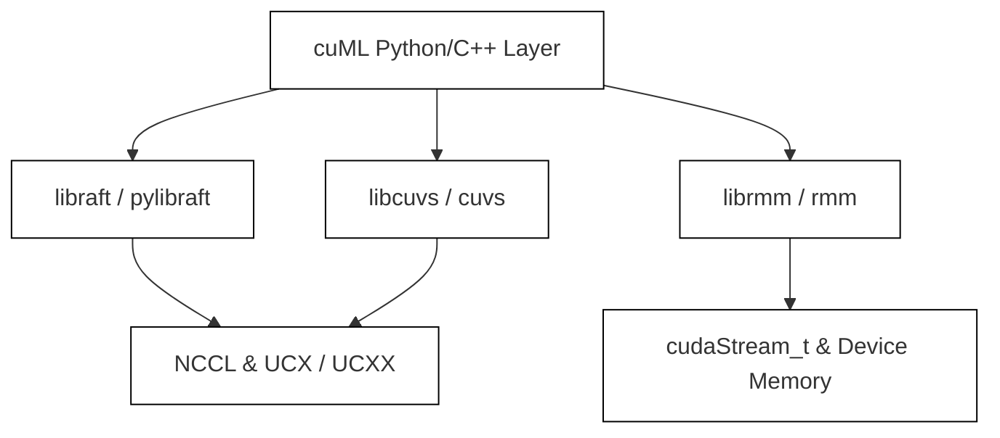
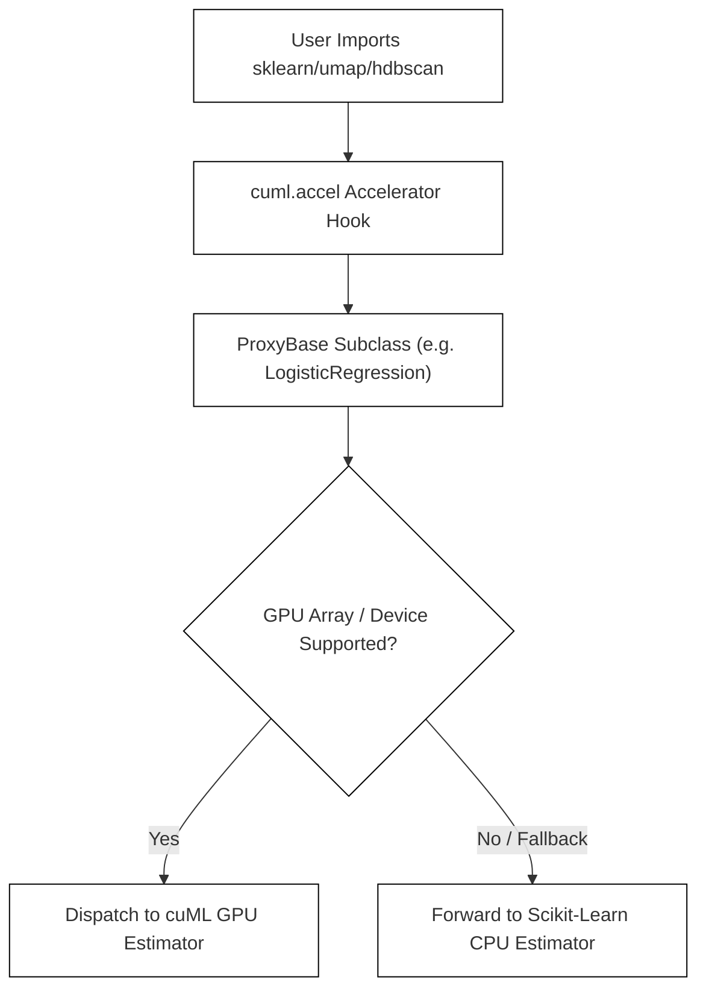

<!-- source: DeepWiki mcp.deepwiki.com · repo NVIDIA/cuml · page 7 Glossary · fetched 2026-10-26 -->

# Glossary

Relevant source files

The following files were used as context for generating this wiki page:

- [BUILD.md](BUILD.md)
- [CHANGELOG.md](CHANGELOG.md)
- [CONTRIBUTING.md](CONTRIBUTING.md)
- [build.sh](build.sh)
- [ci/run_cuml_singlegpu_accel_pytests.sh](ci/run_cuml_singlegpu_accel_pytests.sh)
- [cpp/CMakeLists.txt](cpp/CMakeLists.txt)
- [cpp/README.md](cpp/README.md)
- [cpp/include/cuml/common/logger.hpp](cpp/include/cuml/common/logger.hpp)
- [docs/source/api/cuml.metrics.rst](docs/source/api/cuml.metrics.rst)
- [docs/source/conf.py](docs/source/conf.py)
- [python/cuml/cuml/accel/__init__.py](python/cuml/cuml/accel/__init__.py)
- [python/cuml/cuml/accel/__main__.py](python/cuml/cuml/accel/__main__.py)
- [python/cuml/cuml/accel/accelerator.py](python/cuml/cuml/accel/accelerator.py)
- [python/cuml/cuml/accel/core.py](python/cuml/cuml/accel/core.py)
- [python/cuml/cuml/accel/estimator_proxy.py](python/cuml/cuml/accel/estimator_proxy.py)
- [python/cuml/cuml/datasets/regression.pyx](python/cuml/cuml/datasets/regression.pyx)
- [python/cuml/cuml/internals/base.py](python/cuml/cuml/internals/base.py)
- [python/cuml/cuml/internals/interop.py](python/cuml/cuml/internals/interop.py)
- [python/cuml/cuml/internals/outputs.py](python/cuml/cuml/internals/outputs.py)
- [python/cuml/cuml/metrics/__init__.py](python/cuml/cuml/metrics/__init__.py)
- [python/cuml/cuml/preprocessing/label.py](python/cuml/cuml/preprocessing/label.py)
- [python/cuml/cuml_accel_tests/test_accelerator.py](python/cuml/cuml_accel_tests/test_accelerator.py)
- [python/cuml/cuml_accel_tests/test_cli.py](python/cuml/cuml_accel_tests/test_cli.py)
- [python/cuml/cuml_accel_tests/test_core.py](python/cuml/cuml_accel_tests/test_core.py)
- [python/cuml/cuml_accel_tests/test_estimator_proxy.py](python/cuml/cuml_accel_tests/test_estimator_proxy.py)
- [python/cuml/tests/explainer/test_sampling.py](python/cuml/tests/explainer/test_sampling.py)
- [python/cuml/tests/test_label_binarizer.py](python/cuml/tests/test_label_binarizer.py)
- [python/cuml/tests/test_make_regression.py](python/cuml/tests/test_make_regression.py)
- [python/cuml/tests/test_reflection.py](python/cuml/tests/test_reflection.py)

This wiki page provides formal definitions, architectural context, and code pointers for key terms, libraries, internal frameworks, and algorithms specific to the NVIDIA cuML codebase.

---

## 1. Core C++ Architecture (`libcuml`, `src_prims`)

### `libcuml`
The primary C++ and CUDA shared library (`libcuml.so`) containing the core machine learning algorithm implementations and public C++ APIs [cpp/README.md:7-9](). It is consumed directly by C++ applications or wrapped via Cython to power the Python `cuml` package.
* **Code Pointer**: [cpp/CMakeLists.txt:144]() (`CUML_CPP_TARGET`), [cpp/README.md:9-10]()

### `src_prims`
A collection of common components, computational primitives, and helper functions that form the building blocks of cuML's machine learning algorithms [cpp/README.md:10-11](). Structured primarily as a header-only or template-heavy C++ library within the source tree.
* **Code Pointer**: [cpp/README.md:10-11]()

Sources: [cpp/README.md:7-11](), [cpp/CMakeLists.txt:144]()

---

## 2. RAPIDS Ecosystem Dependencies (`RAFT`, `cuVS`, `RMM`)

*Title: cuML Ecosystem Dependencies Mapping*

### `RAFT` (`libraft` / `pylibraft`)
Reusable Accelerated Functions and Datatypes (`libraft` for C++, `pylibraft` for Python). A foundational RAPIDS library providing matrix operations, random number generators, distance metrics, sparse data structures, and multi-GPU communication helpers.
* **Code Pointer**: [BUILD.md:30-35]()

### `cuVS` (`libcuvs`)
CUDA Vector Search library [BUILD.md:31](). Provides state-of-the-art GPU-accelerated similarity search and vector indexing algorithms (such as CAGRA, IVF-PQ) integrated into cuML's nearest neighbors and UMAP workflows.
* **Code Pointer**: [BUILD.md:31](), [cpp/CMakeLists.txt:64]()

### `RMM` (`librmm` / `rmm`)
RAPIDS Memory Manager. Provides centralized, high-performance CUDA memory allocation, device memory pooling, and stream-ordered memory allocation abstractions used across `libcuml` and Python layers.
* **Code Pointer**: [BUILD.md:29,34]()

Sources: [BUILD.md:29-35](), [cpp/CMakeLists.txt:64]()

---

## 3. Distributed Execution (`OPG/MNMG`)

### `OPG / MNMG`
**O**perations **P**er **G**roup / **M**ulti-**N**ode **M**ulti-**G**roup. Refers to cuML's distributed execution architecture, which combines Dask for task scheduling and orchestration with NCCL/UCX-backed RAFT communicators to scale machine learning algorithms across multiple GPUs and nodes.
* **Code Pointer**: [cpp/CMakeLists.txt:61]() (`SINGLEGPU` option disabling MNMG components), [cpp/README.md:12]()

Sources: [cpp/CMakeLists.txt:61](), [cpp/README.md:12]()

---

## 4. Tree Inference and Export (`FIL/nvForest`, `Treelite`)

### `FIL / nvForest`
Forest Inference Library (now superseded or integrated via `nvForest` components). High-performance GPU inference engine for tree-based ensemble models (Random Forests, Gradient Boosted Decision Trees).
* **Code Pointer**: [cpp/CMakeLists.txt:75]() (`CUML_EXCLUDE_NVFOREST_FROM_ALL`), [CHANGELOG.md:56]()

### `Treelite`
A model compiler and serialization format for decision tree ensemble models. Used in cuML to export and interoperate trained tree structures across various runtime backends.
* **Code Pointer**: [cpp/CMakeLists.txt:65]() (`CUML_USE_TREELITE_STATIC`), [BUILD.md:47]()

Sources: [cpp/CMakeLists.txt:65,75](), [BUILD.md:47]()

---

## 5. Zero-Code Acceleration (`cuml.accel`, `ProxyBase`, `xfail-list`)

*Title: `cuml.accel` Proxy Dispatched Execution Flow*

### `cuml.accel`
A drop-in acceleration module enabling zero-code-change GPU acceleration for scikit-learn, HDBSCAN, and UMAP workflows by intercepting standard library imports and substituting GPU-backed proxy estimators.
* **Code Pointer**: [python/cuml/cuml/accel/core.py:150-183]()

### `ProxyBase`
The meta-programming base class in `cuml.accel` that dynamically wraps CPU estimators (from scikit-learn), forwarding hyperparameter validation and state management while routing execution calls to GPU-accelerated backends when possible.
* **Code Pointer**: [python/cuml/cuml/accel/estimator_proxy.py:174]()

### `xfail-list`
YAML configuration or test marker lists specifying upstream scikit-learn, UMAP, or HDBSCAN test cases that are expected to fail or exhibit numerical discrepancies under `cuml.accel`, ensuring robust CI tracking.
* **Code Pointer**: [ci/run_cuml_singlegpu_accel_pytests.sh]()

Sources: [python/cuml/cuml/accel/core.py:127-183](), [python/cuml/cuml/accel/estimator_proxy.py:174]()

---

## 6. Runtime, Configuration, and Solvers

### `mem_type` / `output_type`
* **`mem_type`**: Specifies memory residency (host vs. device) for input and intermediate buffers in low-level routines.
* **`output_type`**: Configures the container type for estimator predictions and attributes in Python (`'input'`, `'numpy'`, `'cupy'`, `'cudf'`, `'pandas'`).
* **Code Pointer**: [python/cuml/cuml/internals/outputs.py:31-44]()

### `CUML_LOG` / Logger
The centralized logging framework in cuML, built on top of `rapids_logger`. Supports configurable sink redirection (e.g., stderr or file via `CUML_DEBUG_LOG_FILE`) and discrete verbosity levels.
* **Code Pointer**: [cpp/include/cuml/common/logger.hpp:23-30]()

### `quantile binning`
A discretization preprocessing technique used in tree-based algorithms (like Random Forest decision tree builders) to partition continuous features into bins based on empirical quantiles.
* **Code Pointer**: [CHANGELOG.md:15]() (`KBinsDiscretizer`)

### `knnIndex`
An encapsulated data structure or reference representing pre-computed or indexed K-Nearest Neighbors graphs, frequently utilized in manifold learning (UMAP, t-SNE) and clustering algorithms.
* **Code Pointer**: [CHANGELOG.md:26]()

### `RBC`
Random Ball Cover. An approximate nearest neighbors indexing and search algorithm used for high-dimensional metric spaces.
* **Code Pointer**: [cpp/CMakeLists.txt:102]() (Algorithm group configuration)

### `QN solver`
Quasi-Newton Solver (e.g., L-BFGS). An optimization solver used in linear and logistic regression models to find the minimum of objective functions without requiring explicit Hessian evaluations.
* **Code Pointer**: [cpp/CMakeLists.txt:102]()

### `SMO`
Sequential Minimal Optimization. An iterative optimization algorithm used for training Support Vector Machines (SVMs) by breaking down the large Quadratic Programming (QP) optimization problem into smallest possible sub-problems.
* **Code Pointer**: [CHANGELOG.md:29]() (SVM solver stagnation handling)

### `rapids-dependency-file-generator`
A utility tool used across RAPIDS repositories to automatically generate and synchronize Conda `environment.yaml` and dependency specification files from a central `dependencies.yaml` definition.
* **Code Pointer**: [BUILD.md:7-8]()

Sources: [python/cuml/cuml/internals/outputs.py:31-44](), [cpp/include/cuml/common/logger.hpp:23-53](), [CHANGELOG.md:15,26,29]()