# Page: Overview

# Overview

<details>
<summary>Relevant source files</summary>

The following files were used as context for generating this wiki page:

- [.github/scripts/sync_pr_project_fields.py](.github/scripts/sync_pr_project_fields.py)
- [.github/workflows/build.yaml](.github/workflows/build.yaml)
- [.github/workflows/pr.yaml](.github/workflows/pr.yaml)
- [.github/workflows/pr_issue_status_automation.yml](.github/workflows/pr_issue_status_automation.yml)
- [.github/workflows/test.yaml](.github/workflows/test.yaml)
- [.github/workflows/trigger-breaking-change-alert.yaml](.github/workflows/trigger-breaking-change-alert.yaml)
- [BUILD.md](BUILD.md)
- [CHANGELOG.md](CHANGELOG.md)
- [CONTRIBUTING.md](CONTRIBUTING.md)
- [RAPIDS_BRANCH](RAPIDS_BRANCH)
- [README.md](README.md)
- [build.sh](build.sh)
- [cpp/CMakeLists.txt](cpp/CMakeLists.txt)
- [cpp/README.md](cpp/README.md)
- [docs/source/api/cuml.ensemble.rst](docs/source/api/cuml.ensemble.rst)
- [docs/source/api/cuml.feature_extraction.rst](docs/source/api/cuml.feature_extraction.rst)
- [docs/source/api/cuml.preprocessing.rst](docs/source/api/cuml.preprocessing.rst)
- [docs/source/api/index.rst](docs/source/api/index.rst)
- [docs/source/conf.py](docs/source/conf.py)
- [python/cuml/README.md](python/cuml/README.md)
- [python/cuml/cuml/__init__.py](python/cuml/cuml/__init__.py)
- [python/cuml/cuml/preprocessing/__init__.py](python/cuml/cuml/preprocessing/__init__.py)
- [python/cuml/tests/test_docs.py](python/cuml/tests/test_docs.py)

</details>


NVIDIA cuML is an open-source CUDA-X Data Science library designed to provide GPU-accelerated machine learning algorithms with familiar scikit-learn-style interfaces [README.md:1-8]. The repository provides two primary Python paradigms—GPU-native estimators and zero-code-change acceleration via `cuml.accel`—backed by a robust C++ and CUDA core library (`libcuml`) and distributed multi-GPU capabilities (`cuml.dask`) [README.md:3-10, 63-68].

This page serves as a high-level parent guide to the cuML architecture and repository layout. For installation, build targets, and source compilation details, see [Getting Started and Building from Source](#1.1). For documentation pipelines, benchmark guides, and example notebooks, see [Documentation, Notebooks and Examples](#1.2).

---

## What is cuML?

cuML accelerates traditional machine learning pipelines by keeping data and computation entirely on NVIDIA GPUs [README.md:1-19]. It minimizes host-device data transfers and leverages optimized primitives from RAPIDS libraries such as RAFT and cuVS [BUILD.md:28-31]. 

Key features include:
* **GPU-Native Estimators**: Python estimators in `python/cuml` implementing standard scikit-learn patterns (`fit`, `predict`, `transform`, `fit_transform`) [README.md:7-8, 17-19].
* **Zero-Code-Change Acceleration (`cuml.accel`)**: Dynamically intercepts upstream scikit-learn, UMAP, and HDBSCAN imports and dispatches workloads to GPU hardware with transparent CPU fallbacks [README.md:9-10, 40-61].
* **Distributed Multi-GPU (`cuml.dask`)**: Scales computation across multiple GPUs and nodes using Dask and RAFT communication primitives [README.md:63-68, cpp/README.md:12].

Sources: `README.md:1-16`, `BUILD.md:24-37`

---

## High-Level Architecture

cuML's architecture is layered across C++ hardware-accelerated primitives, compiled shared libraries, Python/Cython bindings, and distributed orchestrators.

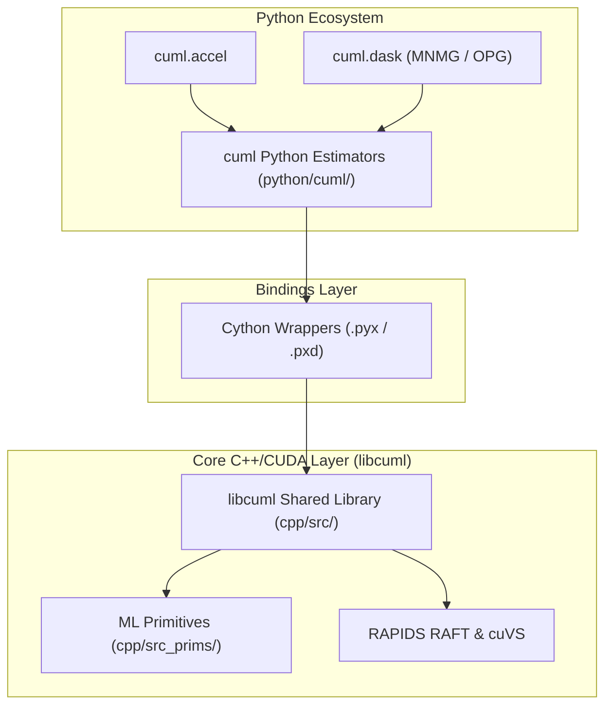

### Architectural Layers
1. **`libcuml` Core (`cpp/`)**: Written in C++ and CUDA, providing high-performance implementations of machine learning algorithms (`cpp/src/`) and foundational computational primitives (`cpp/src_prims/`) [cpp/README.md:5-11].
2. **Cython Bindings & Python Estimators (`python/cuml/`)**: Exposes `libcuml` functionality to Python via Cython modules, wrapping them in classes that adhere strictly to scikit-learn API specifications [README.md:7-8].
3. **Accelerator Layer (`cuml.accel`)**: Intercepts standard library imports (`sklearn`, `umap`, `hdbscan`) to route execution through GPU-accelerated proxy estimators [README.md:9-10, 40-61].
4. **Distributed Layer (`cuml.dask`)**: Manages multi-GPU and multi-node execution graphs using Dask arrays/dataframes and NCCL/UCX communication abstractions via RAFT [README.md:63-68, BUILD.md:52-55].

Sources: `README.md:7-10, 63-68`, `cpp/README.md:5-12`

---

## Repository Layout

The cuML codebase is organized into modular directories separating C++ core logic, Python packages, build configurations, and tests:

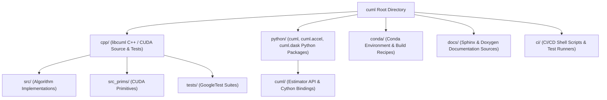

* `cpp/`: Contains all C++ algorithm implementations (`src/`), header-only primitives (`src_prims/`), C++ benchmarks, and GoogleTest suites [cpp/README.md:5-13].
* `python/`: Contains the primary `cuml` Python library, packaging configurations, and test files [python/cuml/README.md].
* `conda/`: Environment files and conda-forge packaging metadata [BUILD.md:7].
* `docs/`: Sphinx documentation sources, API reference structures, and developer guides [docs/source/conf.py:33-63].
* `ci/`: Shell scripts invoked by GitHub Actions workflows for compiling binaries, building Python wheels, and running test suites [.github/workflows/build.yaml:70-174, .github/workflows/test.yaml:56-167].

Sources: `cpp/CMakeLists.txt:23-28`, `cpp/README.md:5-13`, `build.sh:20-65`

---

## Child Pages

For more detailed technical documentation, proceed to the following child pages:

* **1.1 Getting Started and Building from Source**: Comprehensive guide covering system requirements, `build.sh` compilation targets (`libcuml`, `cuml`, `bench`, etc.), CMake parameters, conda environment setup, and wheel vs. conda distribution structures.
* **1.2 Documentation, Notebooks and Examples**: Details on the Sphinx/Doxygen documentation pipeline, `docs/source` directory layout, sample Jupyter notebooks, `cuml.accel` benchmark reports, and developer utility scripts.

Sources: `BUILD.md:1-153`, `docs/source/conf.py:33-78`, `cpp/README.md:1-111`

---

# Page: Getting Started and Building from Source

# Getting Started and Building from Source

<details>
<summary>Relevant source files</summary>

The following files were used as context for generating this wiki page:

- [.devcontainer/Dockerfile](.devcontainer/Dockerfile)
- [.devcontainer/cuda12.9-conda/devcontainer.json](.devcontainer/cuda12.9-conda/devcontainer.json)
- [.devcontainer/cuda12.9-pip/devcontainer.json](.devcontainer/cuda12.9-pip/devcontainer.json)
- [.devcontainer/cuda13.3-conda/devcontainer.json](.devcontainer/cuda13.3-conda/devcontainer.json)
- [.devcontainer/cuda13.3-pip/devcontainer.json](.devcontainer/cuda13.3-pip/devcontainer.json)
- [BUILD.md](BUILD.md)
- [CHANGELOG.md](CHANGELOG.md)
- [CONTRIBUTING.md](CONTRIBUTING.md)
- [build.sh](build.sh)
- [conda/environments/all_cuda-129_arch-aarch64.yaml](conda/environments/all_cuda-129_arch-aarch64.yaml)
- [conda/environments/all_cuda-129_arch-x86_64.yaml](conda/environments/all_cuda-129_arch-x86_64.yaml)
- [conda/environments/all_cuda-133_arch-aarch64.yaml](conda/environments/all_cuda-133_arch-aarch64.yaml)
- [conda/environments/all_cuda-133_arch-x86_64.yaml](conda/environments/all_cuda-133_arch-x86_64.yaml)
- [conda/environments/clang_tidy_cuda-129_arch-x86_64.yaml](conda/environments/clang_tidy_cuda-129_arch-x86_64.yaml)
- [conda/environments/clang_tidy_cuda-133_arch-x86_64.yaml](conda/environments/clang_tidy_cuda-133_arch-x86_64.yaml)
- [conda/environments/cpp_all_cuda-129_arch-x86_64.yaml](conda/environments/cpp_all_cuda-129_arch-x86_64.yaml)
- [conda/environments/cpp_all_cuda-133_arch-x86_64.yaml](conda/environments/cpp_all_cuda-133_arch-x86_64.yaml)
- [conda/recipes/cuml/recipe.yaml](conda/recipes/cuml/recipe.yaml)
- [cpp/CMakeLists.txt](cpp/CMakeLists.txt)
- [cpp/README.md](cpp/README.md)
- [dependencies.yaml](dependencies.yaml)
- [docs/source/conf.py](docs/source/conf.py)
- [python/cuml/pyproject.toml](python/cuml/pyproject.toml)
- [python/libcuml/pyproject.toml](python/libcuml/pyproject.toml)

</details>


This page details the installation procedures, build script targets, CMake configuration flags, Conda environment specifications, devcontainer setups, and the architectural differences between Conda packages and Python wheels for NVIDIA cuML.

---

## 1. Build Infrastructure and `build.sh` Targets

The cuML repository provides a centralized bash automation script, `build.sh`, to compile and install both the C++ core library (`libcuml`) and the Python extension package (`cuml`) [build.sh:1-61]. 

The script parses target names and build flags, sets up environment variables like `CUDA_VERSION` and `INSTALL_PREFIX`, and invokes CMake or `pip` accordingly [build.sh:62-203].

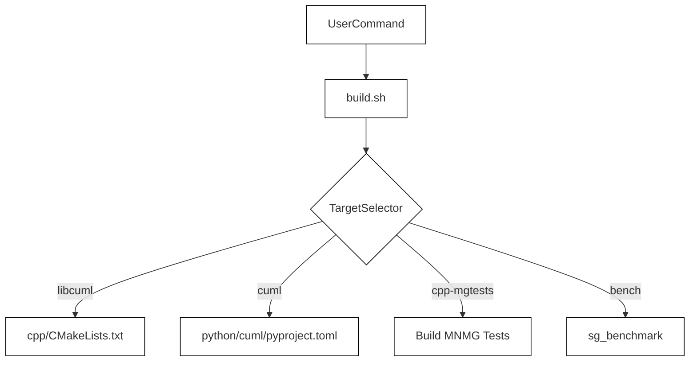
*Figure 1: Mapping of build targets in `build.sh` to underlying build configurations.*

### Supported Targets and Flags
* `clean`: Removes existing build artifacts and configuration directories (`cpp/build`, `python/cuml/build`) [build.sh:27].
* `libcuml`: Builds and installs the C++ core shared library (`libcuml.so`) [build.sh:28].
* `cuml`: Builds and installs the `cuml` Python package using `scikit-build-core` [build.sh:29].
* `cpp-mgtests`: Compiles multi-GPU C++ tests requiring MPI and RAFT distributed bindings [build.sh:30].
* `bench`: Builds the single-GPU C++ benchmark executable (`sg_benchmark`) [build.sh:32].

Sources: `build.sh` [build.sh:1-380]

---

## 2. CMake Build System and Configuration Options

The core C++ library `libcuml` is governed by `cpp/CMakeLists.txt`, which utilizes `rapids-cmake` to configure dependencies like `libraft`, `libcuvs`, and `librmm` [cpp/CMakeLists.txt:1-48].

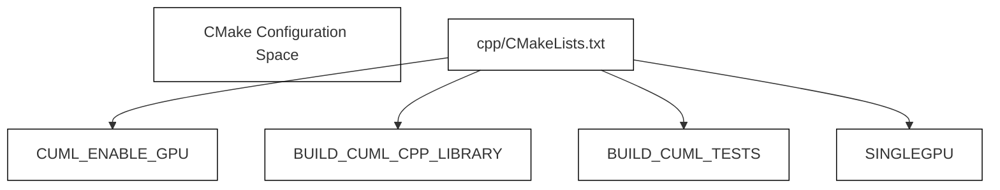
*Figure 2: Core configuration entry points defined in `cpp/CMakeLists.txt`.*

### Key CMake Options
* `CUML_ENABLE_GPU`: Enables building GPU-accelerated algorithms (default: `ON`) [cpp/CMakeLists.txt:47].
* `BUILD_CUML_CPP_LIBRARY`: Controls the compilation of `libcuml.so` (default: `ON`) [cpp/CMakeLists.txt:49].
* `SINGLEGPU`: Disables multi-node/multi-GPU (MNMG) components and communication dependencies (default: `OFF`) [cpp/CMakeLists.txt:61].
* `NVTX`: Enables NVTX profiling markers across execution routines (default: `OFF`) [cpp/CMakeLists.txt:60].
* `USE_CCACHE`: Caches compilation outputs using `ccache` (default: `OFF`) [cpp/CMakeLists.txt:62].

Sources: `cpp/CMakeLists.txt` [cpp/CMakeLists.txt:1-148], `cpp/README.md` [cpp/README.md:1-110]

---

## 3. Conda Environments and Dependency Management

Dependencies are centrally managed via `dependencies.yaml`, which drives the generation of Conda environment specification files for various architectures (`x86_64`, `aarch64`) and CUDA versions (`12.9`, `13.3`) using the `rapids-dependency-file-generator` [dependencies.yaml:1-50].

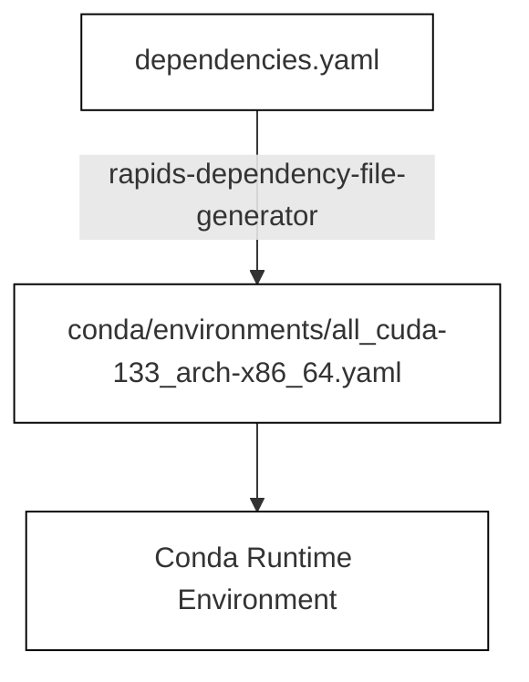
*Figure 3: Dependency pipeline flowing from `dependencies.yaml` to target environment files.*

### Environment Structure
The generated environment YAML files specify channels (`rapidsai`, `conda-forge`) and exact package compatibility bounds [conda/environments/all_cuda-133_arch-x86_64.yaml:3-95]:
* **Compilers**: `c-compiler`, `cxx-compiler`, `cuda-nvcc` [conda/environments/all_cuda-133_arch-x86_64.yaml:9-21]
* **RAPIDS Ecosystem**: `libraft`, `librmm`, `libcuvs`, `pylibraft`, `cudf` [conda/environments/all_cuda-133_arch-x86_64.yaml:18-45]
* **Python Stack**: `python>=3.12`, `scikit-learn>=1.6`, `numpy>=2.0` [conda/environments/all_cuda-133_arch-x86_64.yaml:53-81]

Sources: `dependencies.yaml` [dependencies.yaml:1-259], `conda/environments/all_cuda-133_arch-x86_64.yaml` [conda/environments/all_cuda-133_arch-x86_64.yaml:1-98]

---

## 4. Development Containers (Devcontainers)

Containerized development environments are provided under `.devcontainer/` for CUDA 12.9 and 13.3 configurations, supporting both Conda-based and pip-based workflows [.devcontainer/cuda13.3-conda/devcontainer.json]. These containers pre-configure CUDA toolkits, build dependencies, and system compilers to provide an isolated, consistent developer experience.

Sources: `.devcontainer/Dockerfile`, `.devcontainer/cuda13.3-conda/devcontainer.json`

---

## 5. Packaging Paradigms: Conda Packages vs. Python Wheels

cuML supports two primary packaging distributions: Conda packages and Python wheels.

| Feature / Aspect | Conda Package (`conda/recipes/cuml/recipe.yaml`) | Python Wheel (`python/cuml/pyproject.toml`) |
| :--- | :--- | :--- |
| **Build Backend** | `build.sh` via Conda build tools [conda/recipes/cuml/recipe.yaml:34] | `rapids_build_backend` / `scikit-build-core` [python/cuml/pyproject.toml:5-8] |
| **Dependency Resolution** | Condv-forge / RAPIDS channels | PyPI / CUDA wheel indexes |
| **Runtime Linking** | Dynamically links shared libraries (`libcuml.so`, `libraft.so`) from `$CONDA_PREFIX/lib` | Bundles or depends on pip-installable CUDA/RAPIDS wheel counterparts |
| **ABI Constraints** | Bound by Conda toolchain standard C++ ABI | Uses `abi3` limited API wheels where applicable [conda/recipes/cuml/recipe.yaml:26] |

Sources: `python/cuml/pyproject.toml` [python/cuml/pyproject.toml:1-198], `conda/recipes/cuml/recipe.yaml` [conda/recipes/cuml/recipe.yaml:1-136]

---

# Page: Documentation, Notebooks and Examples

# Documentation, Notebooks and Examples

<details>
<summary>Relevant source files</summary>

The following files were used as context for generating this wiki page:

- [.gitignore](.gitignore)
- [docs/README.md](docs/README.md)
- [docs/benchmarks/cuml-accel/README.md](docs/benchmarks/cuml-accel/README.md)
- [docs/benchmarks/cuml-accel/benchmark-data.json](docs/benchmarks/cuml-accel/benchmark-data.json)
- [docs/benchmarks/generate_cuml_accel_benchmarks.py](docs/benchmarks/generate_cuml_accel_benchmarks.py)
- [docs/benchmarks/tests/test_generate_cuml_accel_benchmarks.py](docs/benchmarks/tests/test_generate_cuml_accel_benchmarks.py)
- [docs/source/_static/cuml-accel-benchmarks.css](docs/source/_static/cuml-accel-benchmarks.css)
- [docs/source/_static/cuml-accel-benchmarks.js](docs/source/_static/cuml-accel-benchmarks.js)
- [docs/source/_static/cuml-accel-benchmarks/inference-heatmap.svg](docs/source/_static/cuml-accel-benchmarks/inference-heatmap.svg)
- [docs/source/_static/cuml-accel-benchmarks/training-heatmap.svg](docs/source/_static/cuml-accel-benchmarks/training-heatmap.svg)
- [docs/source/advanced.rst](docs/source/advanced.rst)
- [docs/source/cuml-accel/benchmarks.rst](docs/source/cuml-accel/benchmarks.rst)
- [docs/source/cuml-accel/benchmarks.rst.in](docs/source/cuml-accel/benchmarks.rst.in)
- [docs/source/cuml-accel/examples/hyperparameter_search.ipynb](docs/source/cuml-accel/examples/hyperparameter_search.ipynb)
- [docs/source/cuml-accel/examples/index.rst](docs/source/cuml-accel/examples/index.rst)
- [docs/source/cuml-accel/examples/onnx_export.ipynb](docs/source/cuml-accel/examples/onnx_export.ipynb)
- [docs/source/cuml_intro.rst](docs/source/cuml_intro.rst)
- [docs/source/dask_multigpu_guide.ipynb](docs/source/dask_multigpu_guide.ipynb)
- [docs/source/estimator_intro.ipynb](docs/source/estimator_intro.ipynb)
- [docs/source/index.rst](docs/source/index.rst)
- [docs/source/pickling_cuml_models.ipynb](docs/source/pickling_cuml_models.ipynb)
- [docs/source/supported_versions.rst](docs/source/supported_versions.rst)
- [docs/source/user_guide.rst](docs/source/user_guide.rst)
- [notebooks/README.md](notebooks/README.md)
- [notebooks/kmeans_demo.ipynb](notebooks/kmeans_demo.ipynb)
- [notebooks/kmeans_mnmg_demo.ipynb](notebooks/kmeans_mnmg_demo.ipynb)
- [notebooks/linear_regression_demo.ipynb](notebooks/linear_regression_demo.ipynb)
- [notebooks/nearest_neighbors_demo.ipynb](notebooks/nearest_neighbors_demo.ipynb)
- [notebooks/random_forest_demo.ipynb](notebooks/random_forest_demo.ipynb)
- [notebooks/random_forest_mnmg_demo.ipynb](notebooks/random_forest_mnmg_demo.ipynb)
- [python/cuml/cuml/cluster/spectral_clustering.pyx](python/cuml/cuml/cluster/spectral_clustering.pyx)

</details>


This page details the documentation pipeline, repository structure for documentation sources (`docs/source`), example notebooks (`notebooks/`), user guides, and performance benchmarking documentation for `cuml.accel`. It covers how C++ source documentation is generated via Doxygen and Breathe, how Sphinx builds user-facing Python APIs, and how benchmark visualizations are generated for zero-code-change acceleration.

---

## 1. Documentation Build Pipeline and Source Layout

The cuML documentation pipeline integrates C++ source documentation (generated via Doxygen XML) and Sphinx Python documentation (using Breathe and Exhale to bridge C++ elements into Sphinx). 

Building documentation locally requires invoking build targets via `build.sh` or directly within the `docs/` directory. Doxygen parses `libcuml` C++ headers under `cpp/include/` and outputs XML files into `cpp/xml/`. Sphinx reads these XML sources using Breathe extensions to render the C++ API reference alongside standard Sphinx/reStructuredText (`.rst`) and Jupyter Notebook (`.ipynb`) documentation files.

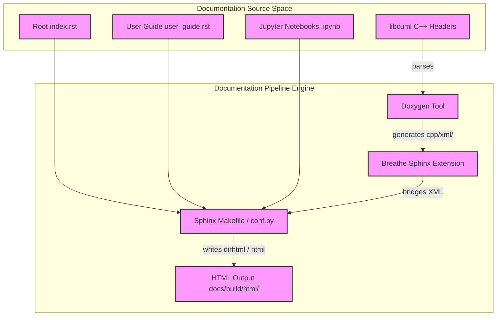
*Diagram 1: Mapping documentation sources and C++ headers through Doxygen, Breathe, and Sphinx to generate final HTML artifacts.*

Sources: `docs/README.md:1-27`, `docs/source/index.rst:1-83`

---

## 2. User Guide and Documentation Structure (`docs/source/`)

The `docs/source/` directory serves as the root container for Sphinx documentation sources. Its key files and entry points include:

- `docs/source/index.rst`: The primary landing page defining global toctrees, installation guidelines, and quick start code snippets [docs/source/index.rst:1-83].
- `docs/source/cuml_intro.rst`: Outlines core cuML design principles: scikit-learn API parity, input flexibility (`__array__`, `__cuda_array_interface__`), and high-performance CUDA primitives [docs/source/cuml_intro.rst:1-119].
- `docs/source/user_guide.rst`: The central aggregator for tutorials, guides, and notebooks [docs/source/user_guide.rst:1-27]. It links to:
  - `estimator_intro.ipynb`: End-to-end examples of Random Forest Classification, UMAP, DBSCAN, and Linear Regression [docs/source/estimator_intro.ipynb:1-131].
  - `pickling_cuml_models.ipynb`: Demonstrates single-GPU and distributed model serialization using Python's `pickle` and `joblib` modules (emphasizing security warnings and protocol 5 optimizations) [docs/source/pickling_cuml_models.ipynb:1-179].
  - `dask_multigpu_guide.ipynb`: Multi-GPU and multi-node execution guides using Dask [docs/source/user_guide.rst:1-27].
  - `supported_versions.rst`: Runtime and build dependencies, adherence to SPEC 0 guidelines, NumPy/scikit-learn/scipy/numba/cupy version constraints [docs/source/supported_versions.rst:1-50].

Generated build artifacts such as model dumps (`*.model`, `*.pkl`, `*.tl`, `*.joblib`), autosummary stubs (`docs/source/api/generated/`), and Sphinx build caches (`docs/build/`) are ignored by version control [.gitignore:39-52].

Sources: `docs/source/index.rst:1-83`, `docs/source/cuml_intro.rst:1-119`, `docs/source/user_guide.rst:1-27`, `docs/source/supported_versions.rst:1-50`, `.gitignore:39-52`

---

## 3. Example Notebooks Collection (`notebooks/`)

In addition to documentation embedded in Sphinx, the `notebooks/` directory houses standalone example notebooks demonstrating standalone estimators and distributed execution workflows [notebooks/README.md:1-32].

Key notebooks maintained in the repository include:
- `notebooks/kmeans_demo.ipynb`: Single-GPU K-Means clustering compared against scikit-learn [notebooks/README.md:18-20].
- `notebooks/kmeans_mnmg_demo.ipynb`: Multi-node multi-GPU K-Means clustering using `dask_cudf` inputs [notebooks/README.md:18-21].
- `notebooks/linear_regression_demo.ipynb`: Ordinary Least Squares (OLS) linear regression workflows [notebooks/README.md:18-22].
- `notebooks/nearest_neighbors_demo.ipynb`: Approximate and exact nearest neighbors queries [notebooks/README.md:18-23].
- `notebooks/random_forest_demo.ipynb`: Single-GPU Random Forest classification and pickling persistence [notebooks/README.md:18-24].
- `notebooks/random_forest_mnmg_demo.ipynb`: Distributed multi-node multi-GPU Random Forest fitting utilizing `LocalCUDACluster` and `dask_cudf` partitioned DataFrames [notebooks/random_forest_mnmg_demo.ipynb:1-190].
- `notebooks/target_encoder_walkthrough.ipynb`: Target encoding workflows for click-through rate modeling compared to one-hot encoding [notebooks/README.md:18-26].

Sources: `notebooks/README.md:1-32`, `notebooks/random_forest_demo.ipynb:1-231`, `notebooks/random_forest_mnmg_demo.ipynb:1-190`

---

## 4. Acceleration Benchmarks and `cuml.accel` Documentation

The `docs/source/cuml-accel/` directory contains documentation and examples specific to zero-code-change acceleration [docs/source/cuml-accel/examples/index.rst:1-16]. 

### Benchmark Pipeline and Visualization
Benchmark data and automated comparison plots against scikit-learn are maintained under `docs/benchmarks/cuml-accel/`:
- `docs/benchmarks/generate_cuml_accel_benchmarks.py`: Harness script that executes performance tests and serializes metrics into JSON format.
- `docs/benchmarks/cuml-accel/benchmark-data.json`: Raw performance records across datasets and estimators.
- `docs/source/_static/cuml-accel-benchmarks/training-heatmap.svg` and `inference-heatmap.svg`: Scaled vector graphics displaying speedup ratios across estimators.

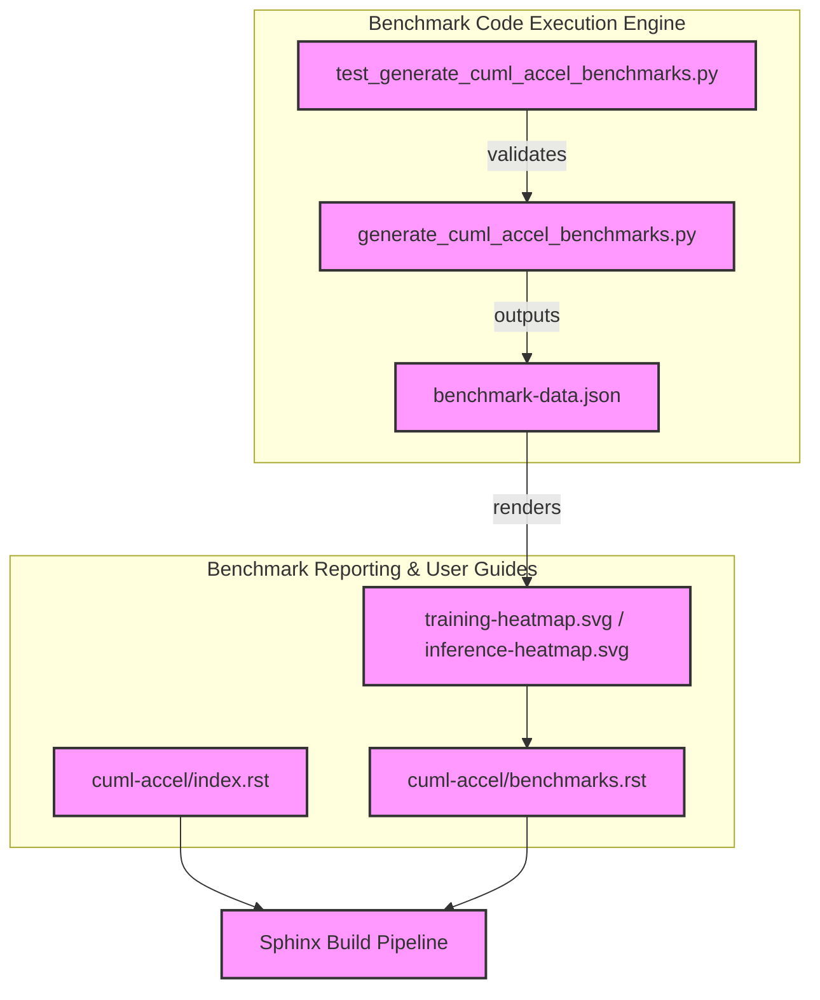
*Diagram 2: Relationship between benchmark generation scripts, JSON data stores, SVG heatmaps, and Sphinx documentation sources.*

Sources: `docs/source/cuml-accel/examples/index.rst:1-16`, `docs/benchmarks/generate_cuml_accel_benchmarks.py`, `docs/benchmarks/cuml-accel/README.md`

---

# Page: C++ Core Library (libcuml)

# C++ Core Library (libcuml)

<details>
<summary>Relevant source files</summary>

The following files were used as context for generating this wiki page:

- [BUILD.md](BUILD.md)
- [CHANGELOG.md](CHANGELOG.md)
- [CONTRIBUTING.md](CONTRIBUTING.md)
- [build.sh](build.sh)
- [cpp/CMakeLists.txt](cpp/CMakeLists.txt)
- [cpp/README.md](cpp/README.md)
- [cpp/cmake/thirdparty/get_cuvs.cmake](cpp/cmake/thirdparty/get_cuvs.cmake)
- [cpp/cmake/thirdparty/get_raft.cmake](cpp/cmake/thirdparty/get_raft.cmake)
- [cpp/include/cuml/common/logger.hpp](cpp/include/cuml/common/logger.hpp)
- [docs/source/conf.py](docs/source/conf.py)
- [python/cuml/CMakeLists.txt](python/cuml/CMakeLists.txt)
- [python/libcuml/CMakeLists.txt](python/libcuml/CMakeLists.txt)
- [python/libcuml/libcuml/load.py](python/libcuml/libcuml/load.py)
- [python/libcuml/tests/test_libcuml_linkage.py](python/libcuml/tests/test_libcuml_linkage.py)

</details>


The `libcuml` library forms the performance-critical core of cuML, containing the C++ and CUDA implementations of machine learning algorithms, shared computational primitives, and multi-GPU infrastructure. Located entirely within the `cpp/` tree, `libcuml` compiles into the shared library `libcuml.so`, which can be consumed directly by standalone C++ applications or wrapped via Cython to power the Python estimator layer (`cpp/README.md:7-11`, `python/libcuml/CMakeLists.txt:70`).

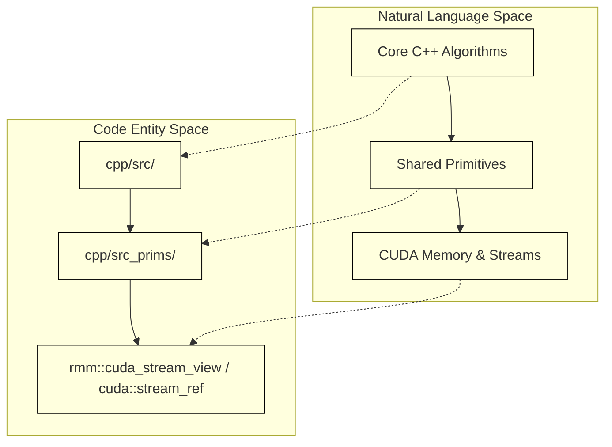
*Diagram 1: Bridging cuML Algorithm Concepts to `cpp/` Code Entities.*
Sources: `cpp/README.md:7-11`, `CHANGELOG.md:9`

---

## 2.1 C++ Build System and Dependencies

The build configuration for `libcuml` is managed via CMake 4.0 (`cpp/CMakeLists.txt:8`), utilizing RAPIDS CMake infrastructure (`cpp/CMakeLists.txt:12-16`). Third-party dependencies such as `libraft` [cpp/cmake/thirdparty/get_raft.cmake:10-53] and `libcuvs` [cpp/cmake/thirdparty/get_cuvs.cmake:10-48] are dynamically fetched or configured via CPM. Option toggles allow selecting specific algorithm subsets (`CUML_ALGORITHMS`) and controlling static vs dynamic linking (`CUML_USE_CUVS_STATIC`, `CUML_USE_TREELITE_STATIC`) (`cpp/CMakeLists.txt:47-67`).

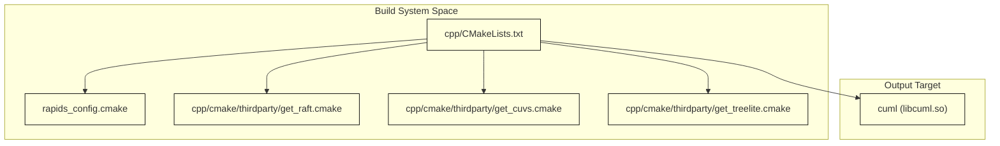
*Diagram 2: CMake Build Structure and Dependency Resolution.*
Sources: `cpp/CMakeLists.txt:10-16`, `cpp/cmake/thirdparty/get_raft.cmake:10-53`, `cpp/cmake/thirdparty/get_cuvs.cmake:10-48`

For full details on build configurations, targets, and CPM fetching logic, see [C++ Build System and Dependencies](#2.1).

Sources: `cpp/CMakeLists.txt:8-67`, `cpp/cmake/thirdparty/get_raft.cmake:10-53`, `cpp/cmake/thirdparty/get_cuvs.cmake:10-48`

---

## 2.2 Tree-Based Models (Decision Trees, Random Forest, Isolation Forest)

Tree-based algorithms within `libcuml` implement batched level-order tree building, custom quantile binning, and splitting objectives designed for GPU execution (`cpp/CMakeLists.txt:102-108`). Random Forest and Isolation Forest leverage these primitives inside `randomforest.cu` and integrate with Treelite for optimized model export and inference (`python/libcuml/CMakeLists.txt:62-72`).

For implementation details on tree building, binning, and export mechanisms, see [Tree-Based Models (Decision Trees, Random Forest, Isolation Forest)](#2.2).

Sources: `cpp/CMakeLists.txt:102-108`, `python/libcuml/CMakeLists.txt:62-72`

---

## 2.3 Clustering Algorithms (KMeans, DBSCAN, HDBSCAN, Hierarchy)

Clustering routines provide GPU-accelerated interfaces for unsupervised partition and density-based models. This includes KMeans iteration loops, DBSCAN adjacency graph generators and vertex degree calculators, as well as HDBSCAN condensation, stability extraction, and single-linkage hierarchy construction (`cpp/CMakeLists.txt:102-108`).

For architecture and algorithmic workflows of clustering implementations, see [Clustering Algorithms (KMeans, DBSCAN, HDBSCAN, Hierarchy)](#2.3).

Sources: `cpp/CMakeLists.txt:102-108`

---

## 2.4 Manifold Learning and Decomposition (UMAP, TSNE, PCA, TSVD, Spectral)

Dimensionality reduction modules encompass UMAP runners, fuzzy simplicial set constructors, and K-nearest-neighbor graph embedding kernels. It also includes exact, Barnes-Hut, and FFT-accelerated t-SNE implementations, alongside principal component analysis (PCA), truncated SVD (TSVD) solvers, and spectral embedding primitives (`cpp/CMakeLists.txt:102-108`).

For mathematical formulations and execution pipelines, see [Manifold Learning and Decomposition (UMAP, TSNE, PCA, TSVD, Spectral)](#2.4).

Sources: `cpp/CMakeLists.txt:102-108`

---

## 2.5 Linear Models, Solvers and SVM

Generalized linear models (GLMs such as OLS and Ridge), coordinate descent (CD), stochastic gradient descent (SGD), and LARS solvers provide foundational regression routines. Support Vector Machines utilize a Sequential Minimal Optimization (SMO) solver backed by a custom working set selection strategy and kernel cache (`CHANGELOG.md:29`).

For solver algorithms, working set logic, and optimization criteria, see [Linear Models, Solvers and SVM](#2.5).

Sources: `cpp/CMakeLists.txt:102-108`, `CHANGELOG.md:29`

---

## 2.6 Neighbors, Metrics, Datasets and Explainability

The neighbors and metrics package exposes brute-force and approximate K-nearest-neighbor search, Random Ball Cover (RBC), Kernel Density Estimation (KDE), pairwise distance metrics, and silhouette score calculators. It also supplies synthetic dataset generators (`make_blobs`, `make_regression`) and TreeSHAP/KernelSHAP attribution kernels (`cpp/CMakeLists.txt:102-108`).

For functional details on distance calculations, search indexes, and explainability APIs, see [Neighbors, Metrics, Datasets and Explainability](#2.6).

Sources: `cpp/CMakeLists.txt:102-108`

---

## 2.7 Multi-GPU (OPG/MNMG) C++ Layer

Multi-node multi-GPU (MNMG) capabilities are supported via distributed data structures and algorithm wrappers (`_mg` variants) that utilize RAFT communicator primitives for inter-GPU communication over NCCL and UCX (`cpp/README.md:12`, `BUILD.md:52-56`). These routines coordinate partitioned datasets across cluster ranks.

For distributed communication flows and multi-GPU test suites, see [Multi-GPU (OPG/MNMG) C++ Layer](#2.7).

Sources: `cpp/README.md:12`, `BUILD.md:52-56`

---

## 2.8 C++ Testing, Benchmarks and Utilities

Testing suites in `libcuml` are structured around Google Test (`BUILD.md:108-118`), covering single-GPU (`SG_`), multi-GPU (`MG_`), and primitive (`PRIMS_`) test targets (`cpp/README.md:58`). Utility headers such as `cuml/common/logger.hpp` integrate with `rapids_logger` to offer structured logging macros and stream configuration (`cpp/include/cuml/common/logger.hpp:11-53`).

```cpp
#include <cuml/common/logger.hpp>

int main(int argc, char *argv[]) {
  CUML_LOG_WARN("This is a warning from the cuML logger!");
  return 0;
}
```
*Example: Consuming `libcuml` logger utilities [cpp/README.md:86-93].*
Sources: `cpp/include/cuml/common/logger.hpp:11-53`, `cpp/README.md:58-93`

For details on test harnesses, benchmarking fixtures, code style validation, and diagnostic scripts, see [C++ Testing, Benchmarks and Utilities](#2.8).

Sources: `cpp/include/cuml/common/logger.hpp:11-53`, `cpp/README.md:58-93`

---

# Page: C++ Build System and Dependencies

# C++ Build System and Dependencies

<details>
<summary>Relevant source files</summary>

The following files were used as context for generating this wiki page:

- [cmake/RAPIDS.cmake](cmake/RAPIDS.cmake)
- [cmake/rapids_config.cmake](cmake/rapids_config.cmake)
- [conda/recipes/cuml/conda_build_config.yaml](conda/recipes/cuml/conda_build_config.yaml)
- [conda/recipes/libcuml/conda_build_config.yaml](conda/recipes/libcuml/conda_build_config.yaml)
- [cpp/cmake/modules/ConfigureCUDA.cmake](cpp/cmake/modules/ConfigureCUDA.cmake)
- [cpp/cmake/thirdparty/get_cuvs.cmake](cpp/cmake/thirdparty/get_cuvs.cmake)
- [cpp/cmake/thirdparty/get_raft.cmake](cpp/cmake/thirdparty/get_raft.cmake)
- [cpp/cmake/thirdparty/get_treelite.cmake](cpp/cmake/thirdparty/get_treelite.cmake)
- [python/cuml/CMakeLists.txt](python/cuml/CMakeLists.txt)
- [python/libcuml/CMakeLists.txt](python/libcuml/CMakeLists.txt)
- [python/libcuml/libcuml/load.py](python/libcuml/libcuml/load.py)
- [python/libcuml/tests/test_libcuml_linkage.py](python/libcuml/tests/test_libcuml_linkage.py)

</details>


## Purpose and Scope
This document details the C++ build system and dependency management architecture for `libcuml`, the core C++/CUDA library underlying cuML. It covers CMake configuration workflows, integration with `rapids-cmake`, CUDA compilation flags (`ConfigureCUDA.cmake`), third-party dependency fetching (`get_raft.cmake`, `get_cuvs.cmake`, `get_treelite.cmake`), and how Python bindings (`python/cuml` and `python/libcuml`) consume these native artifacts via wheels and dynamic loading shims (`load.py`).

---

## 1. CMake Bootstrap and RAPIDS Core Configuration
The cuML build system relies heavily on `rapids-cmake` modules to standardize dependencies, compiler options, export sets, and packaging across the RAPIDS ecosystem. 

The build is bootstrapped via `cmake/rapids_config.cmake` [`cmake/rapids_config.cmake:1-41`](), which reads the project version from the root `VERSION` file, parses the release branch from `RAPIDS_BRANCH`, and includes `cmake/RAPIDS.cmake` [`cmake/RAPIDS.cmake:1-86`]().

`cmake/RAPIDS.cmake` manages fetching the `rapids-cmake` utility suite via CMake's `FetchContent` mechanism. It supports fetching via Git tags, branches, or exact SHAs depending on user configuration:

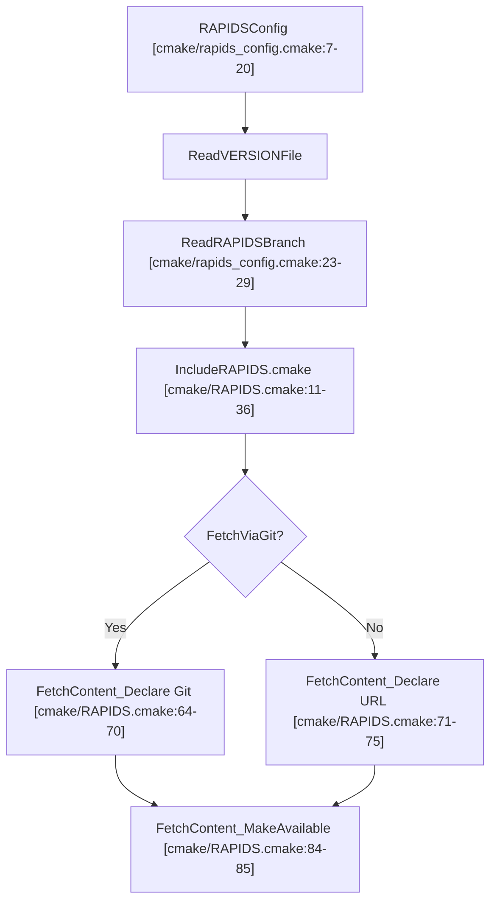
*Sources: `cmake/rapids_config.cmake:1-41`*, `cmake/RAPIDS.cmake:1-86`

---

## 2. CUDA Compilation and Algorithm Configuration
CUDA and C++ compilation flags are configured centrally in `cpp/cmake/modules/ConfigureCUDA.cmake` [`cpp/cmake/modules/ConfigureCUDA.cmake:1-56`](). This script defines standard compiler warnings, error policies, fatbin compression options, and debugging configurations.

Key configurations performed by `ConfigureCUDA.cmake`:
* **Compiler Flags & Warnings:** Appends `-Wall`, `-Werror`, and `-Wno-unknown-pragmas` for GNU Cxx, and enables extended lambdas (`--expt-extended-lambda`) and relaxed constexpr (`--expt-relaxed-constexpr`) for `nvcc` [`cpp/cmake/modules/ConfigureCUDA.cmake:8-16`]().
* **Fatbin Compression:** Integrates `rapids_cuda_enable_fatbin_compression` to optimize binary size [`cpp/cmake/modules/ConfigureCUDA.cmake:33-35`]().
* **Line Info & Profiling:** Conditionally appends `-lineinfo` when `CUDA_ENABLE_LINE_INFO` is active to assist profiling and memory checking [cpp/cmake/modules/ConfigureCUDA.cmake:37-41]().
* **Debug Symbols:** Appends `-G` and `-Xcompiler=-rdynamic` when `CMAKE_BUILD_TYPE` matches `Debug` [`cpp/cmake/modules/ConfigureCUDA.cmake:51-55`]().

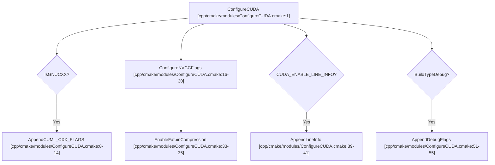
*Sources: `cpp/cmake/modules/ConfigureCUDA.cmake:1-56`*

---

## 3. Third-Party Dependency Fetching and Management
cuML relies on external core libraries provided through RAPIDS and the broader ecosystem: **RAFT**, **cuVS**, and **Treelite**. These are fetched and configured using modular scripts via `rapids_cpm_find`.

### RAFT (`get_raft.cmake`)
The `find_and_configure_raft` function looks for `raft::raft` globally or downloads it via CPM using the pinned tag matching the `rapids-cmake-checkout-tag` [`cpp/cmake/thirdparty/get_raft.cmake:10-44`](). It configures distributed components when `BUILD_CUML_MG_TESTS` is enabled [`cpp/cmake/thirdparty/get_raft.cmake:20-23`]().

### cuVS (`get_cuvs.cmake`)
The `find_and_configure_cuvs` function locates or fetches `cuvs::cuvs` (or `cuvs::cuvs_static`) for vector search and nearest neighbor primitives [`cpp/cmake/thirdparty/get_cuvs.cmake:10-38`]. Multi-GPU algorithm support in cuVS (`BUILD_MG_ALGOS`) is conditionally enabled based on the `SINGLEGPU` option [`cpp/cmake/thirdparty/get_cuvs.cmake:31-35`].

### Treelite (`get_treelite.cmake`)
The `find_and_configure_treelite` function integrates `Treelite` for decision tree and tree ensemble compilation/inference [`cpp/cmake/thirdparty/get_treelite.cmake:9-32`]. It supports linking static or dynamic targets (`treelite::treelite` or `treelite::treelite_static`) [`cpp/cmake/thirdparty/get_treelite.cmake:15-19`] and exports target roots for downstream usage [`cpp/cmake/thirdparty/get_treelite.cmake:59-70`].

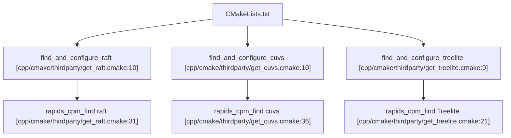
*Sources: `cpp/cmake/thirdparty/get_raft.cmake:1-68`*, `cpp/cmake/thirdparty/get_cuvs.cmake:1-72`*, `cpp/cmake/thirdparty/get_treelite.cmake:1-77`*

---

## 4. Python Integration, Wheel Packaging and Runtime Linkage
Python packages (`python/cuml` and `python/libcuml`) wrap `libcuml` and its dependencies. CMake builds orchestrate Cython extensions and link against native targets.

### Python CMake Structure
* `python/cuml/CMakeLists.txt` initializes the `cuml-python` project, processes `CUML_ALGORITHMS`, fetches Treelite, searches for `libcuml`, and adds subdirectories for Cython extension modules [`python/cuml/CMakeLists.txt:8-112`]().
* `python/libcuml/CMakeLists.txt` builds `libcuml` inside wheel packaging pipelines, enforcing `SINGLEGPU OFF` and setting up appropriate wheel `RPATH` entries for CUDA runtime libraries (`cublas`, `cufft`, `cusolver`, etc.) [`python/libcuml/CMakeLists.txt:15-95`]().

### Runtime Library Loading (`load.py`)
Because Python wheels bundle or depend on multiple shared libraries (`libcuvs`, `libraft`, `librmm`, `libcuml.so`), `python/libcuml/libcuml/load.py` manages loading order and flags using `ctypes.RTLD_LOCAL` [`python/libcuml/libcuml/load.py:1-94`]().

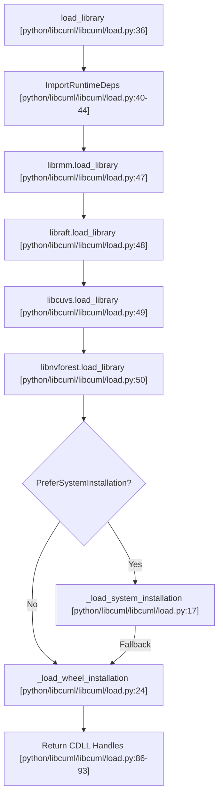
*Sources: `python/libcuml/libcuml/load.py:1-94`*, `python/libcuml/CMakeLists.txt:1-96`*, `python/cuml/CMakeLists.txt:1-115`*

---

# Page: Tree-Based Models (Decision Trees, Random Forest, Isolation Forest)

# Tree-Based Models (Decision Trees, Random Forest, Isolation Forest)

<details>
<summary>Relevant source files</summary>

The following files were used as context for generating this wiki page:

- [cpp/bench/CMakeLists.txt](cpp/bench/CMakeLists.txt)
- [cpp/bench/common/ml_benchmark.hpp](cpp/bench/common/ml_benchmark.hpp)
- [cpp/bench/sg/benchmark.cuh](cpp/bench/sg/benchmark.cuh)
- [cpp/bench/sg/dbscan.cu](cpp/bench/sg/dbscan.cu)
- [cpp/bench/sg/kmeans.cu](cpp/bench/sg/kmeans.cu)
- [cpp/bench/sg/main.cpp](cpp/bench/sg/main.cpp)
- [cpp/bench/sg/rf_classifier.cu](cpp/bench/sg/rf_classifier.cu)
- [cpp/bench/sg/rf_regressor.cu](cpp/bench/sg/rf_regressor.cu)
- [cpp/include/cuml/ensemble/isolation_forest.hpp](cpp/include/cuml/ensemble/isolation_forest.hpp)
- [cpp/include/cuml/ensemble/randomforest.hpp](cpp/include/cuml/ensemble/randomforest.hpp)
- [cpp/include/cuml/tree/decisiontree.hpp](cpp/include/cuml/tree/decisiontree.hpp)
- [cpp/src/decisiontree/batched-levelalgo/bins.cuh](cpp/src/decisiontree/batched-levelalgo/bins.cuh)
- [cpp/src/decisiontree/batched-levelalgo/builder.cuh](cpp/src/decisiontree/batched-levelalgo/builder.cuh)
- [cpp/src/decisiontree/batched-levelalgo/dataset.h](cpp/src/decisiontree/batched-levelalgo/dataset.h)
- [cpp/src/decisiontree/batched-levelalgo/kernels/builder_kernels.cuh](cpp/src/decisiontree/batched-levelalgo/kernels/builder_kernels.cuh)
- [cpp/src/decisiontree/batched-levelalgo/kernels/builder_kernels_impl.cuh](cpp/src/decisiontree/batched-levelalgo/kernels/builder_kernels_impl.cuh)
- [cpp/src/decisiontree/batched-levelalgo/kernels/classification-double.cu](cpp/src/decisiontree/batched-levelalgo/kernels/classification-double.cu)
- [cpp/src/decisiontree/batched-levelalgo/kernels/classification-float.cu](cpp/src/decisiontree/batched-levelalgo/kernels/classification-float.cu)
- [cpp/src/decisiontree/batched-levelalgo/kernels/regression-double.cu](cpp/src/decisiontree/batched-levelalgo/kernels/regression-double.cu)
- [cpp/src/decisiontree/batched-levelalgo/kernels/regression-float.cu](cpp/src/decisiontree/batched-levelalgo/kernels/regression-float.cu)
- [cpp/src/decisiontree/batched-levelalgo/kernels/weighted-classification-double.cu](cpp/src/decisiontree/batched-levelalgo/kernels/weighted-classification-double.cu)
- [cpp/src/decisiontree/batched-levelalgo/kernels/weighted-classification-float.cu](cpp/src/decisiontree/batched-levelalgo/kernels/weighted-classification-float.cu)
- [cpp/src/decisiontree/batched-levelalgo/kernels/weighted-regression-double.cu](cpp/src/decisiontree/batched-levelalgo/kernels/weighted-regression-double.cu)
- [cpp/src/decisiontree/batched-levelalgo/kernels/weighted-regression-float.cu](cpp/src/decisiontree/batched-levelalgo/kernels/weighted-regression-float.cu)
- [cpp/src/decisiontree/batched-levelalgo/objectives.cuh](cpp/src/decisiontree/batched-levelalgo/objectives.cuh)
- [cpp/src/decisiontree/batched-levelalgo/quantiles.cuh](cpp/src/decisiontree/batched-levelalgo/quantiles.cuh)
- [cpp/src/decisiontree/batched-levelalgo/split.cuh](cpp/src/decisiontree/batched-levelalgo/split.cuh)
- [cpp/src/decisiontree/decisiontree.cu](cpp/src/decisiontree/decisiontree.cu)
- [cpp/src/decisiontree/decisiontree.cuh](cpp/src/decisiontree/decisiontree.cuh)
- [cpp/src/isolation_forest/isolation_forest.cu](cpp/src/isolation_forest/isolation_forest.cu)
- [cpp/src/randomforest/randomforest.cu](cpp/src/randomforest/randomforest.cu)
- [cpp/src/randomforest/randomforest.cuh](cpp/src/randomforest/randomforest.cuh)
- [cpp/tests/sg/isolation_forest_test.cu](cpp/tests/sg/isolation_forest_test.cu)
- [cpp/tests/sg/rf_test.cu](cpp/tests/sg/rf_test.cu)
- [python/cuml/cuml/accel/_overrides/sklearn/ensemble.py](python/cuml/cuml/accel/_overrides/sklearn/ensemble.py)
- [python/cuml/cuml/ensemble/isolation_forest.pyx](python/cuml/cuml/ensemble/isolation_forest.pyx)
- [python/cuml/cuml_accel_tests/integration/test_isolation_forest.py](python/cuml/cuml_accel_tests/integration/test_isolation_forest.py)
- [python/cuml/tests/test_isolation_forest.py](python/cuml/tests/test_isolation_forest.py)

</details>


This page covers the technical design and GPU implementation of cuML's tree-based models within `libcuml` (`cpp/src/decisiontree`, `cpp/src/randomforest`, `cpp/src/isolation_forest`) and their integration with Python estimators. The core algorithms implement high-performance, batched level-order decision tree building, quantile-based binning, criterion optimization, Treelite/nvForest model exporting, and ensemble/anomaly detection models like Random Forests and Isolation Forests.

---

## 1. Architectural Overview and Code Entities

Tree building in cuML relies on a batched, level-order algorithmic builder that maps dataset rows and features into discrete bins to calculate split criteria efficiently on the GPU.

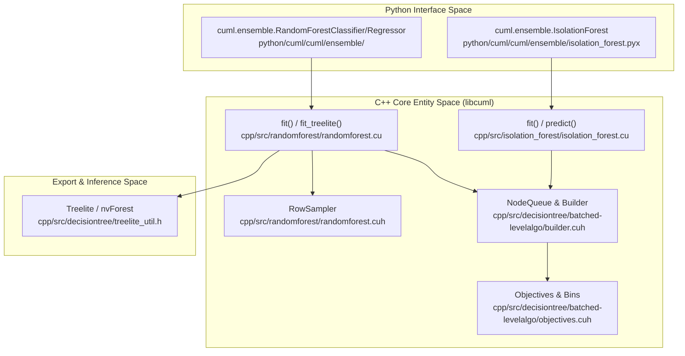
**Sources:** `cpp/src/randomforest/randomforest.cu`, `cpp/src/randomforest/randomforest.cuh`, `cpp/src/decisiontree/batched-levelalgo/builder.cuh`, `cpp/src/isolation_forest/isolation_forest.cu`, `python/cuml/cuml/ensemble/isolation_forest.pyx`

---

## 2. Batched Level-Order Algorithm Builder

The core tree building logic (`cpp/src/decisiontree/batched-levelalgo/builder.cuh`) processes decision tree construction level-by-level using an iterative host-driven `NodeQueue`. Instead of recursing per node, nodes belonging to the same tree depth are batched and launched across GPU streams via `Builder`.

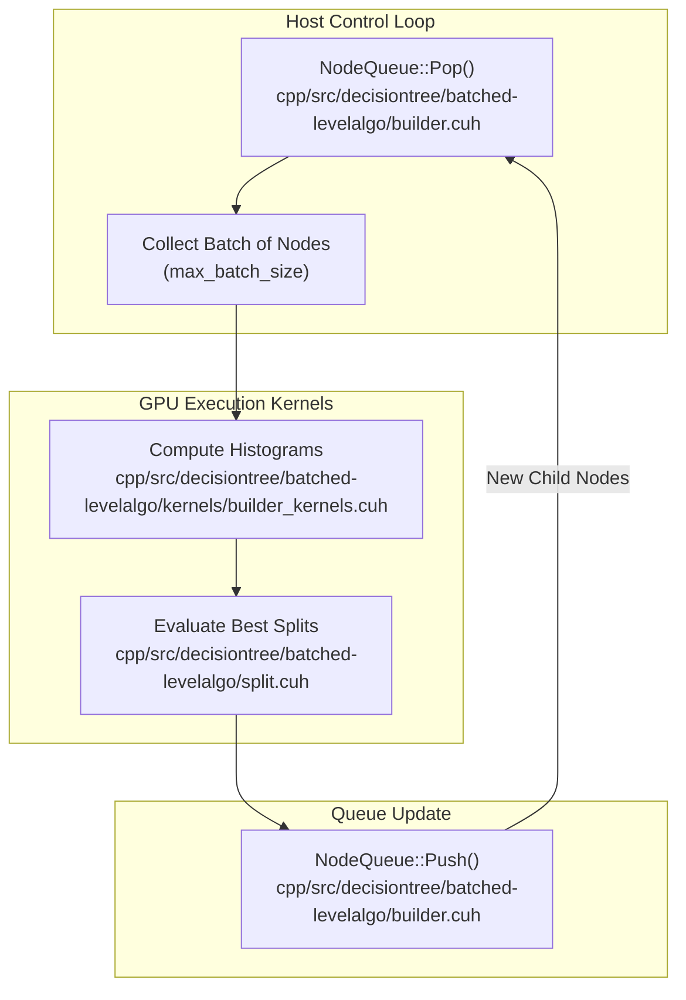
**Sources:** `cpp/src/decisiontree/batched-levelalgo/builder.cuh`

- **`NodeQueue`**: Manages the host queue of nodes requiring expansion [cpp/src/decisiontree/batched-levelalgo/builder.cuh()]. It evaluates stopping criteria such as `max_depth`, `min_samples_split`, and `max_leaves` [cpp/src/decisiontree/batched-levelalgo/builder.cuh()].
- **Batching**: Up to `params.max_batch_size` nodes are evaluated concurrently in a single GPU pass to maintain high device utilization.

---

## 3. Objectives, Binning, and Split Criteria

Continuous feature values are converted into discrete bins to reduce memory traffic and accelerate histogram reduction during split evaluation.

### Quantile Binning and Bins
- **`Quantiles`** (`cpp/src/decisiontree/batched-levelalgo/quantiles.cuh`): Computes quantile split points for each feature, mapping continuous input features into `max_n_bins` (default up to `1024`, commonly `32` or `128`) [cpp/src/decisiontree/decisiontree.cu()].
- **Bins and Reductions** (`cpp/src/decisiontree/batched-levelalgo/bins.cuh`): Accumulates sample counts, weights, and label sums into discrete bin structures (`RegressionBin`, `WeightedRegressionBin`, etc.) [cpp/tests/sg/rf_test.cu()].

### Objectives and Criteria
- **`ObjectiveT`** (`cpp/src/decisiontree/batched-levelalgo/objectives.cuh`): Implements split criteria including Gini impurity, Entropy for classification, and Mean Squared Error (MSE) for regression [cpp/bench/sg/rf_classifier.cu()].
- **Specialized Kernels**: Performance-critical instantiations are compiled separately for float and double types [cpp/bench/sg/rf_classifier.cu()]:
  - `cpp/src/decisiontree/batched-levelalgo/kernels/classification-float.cu`
  - `cpp/src/decisiontree/batched-levelalgo/kernels/regression-float.cu`
  - Weighted variants (e.g., `weighted-classification-float.cu`) handle sample weight distributions.

---

## 4. Random Forest Implementation (`randomforest.cu`)

Random Forests aggregate multiple independent decision trees trained on bootstrapped samples.

### Data Flow and Row Sampling
The `RowSampler` (`cpp/src/randomforest/randomforest.cuh`) controls data selection per tree:
1. **Bootstrapping**: Draws random sample indices with replacement using Philox random number generators (`raft::random::RngState`) [cpp/src/randomforest/randomforest.cuh()].
2. **Weighted Bootstrapping**: If `sample_weight` is provided, an inclusive scan of cumulative weights (`sample_weight_cdf_`) is computed on the GPU, and `thrust::upper_bound` draws rows proportional to their weights [cpp/src/randomforest/randomforest.cuh()].


**Sources:** `cpp/src/randomforest/randomforest.cuh`, `cpp/include/cuml/ensemble/randomforest.hpp`

### Key Entry Points
- `ML::fit(...)`: Trains a Random Forest classifier or regressor using multi-stream parallelism across available GPU streams [cpp/include/cuml/ensemble/randomforest.hpp()].
- `ML::fit_treelite(...)`: Fits the random forest and directly constructs a Treelite model handle [cpp/include/cuml/ensemble/randomforest.hpp()].

---

## 5. Treelite and nvForest Export

To enable high-throughput inference, cuML models export trained decision trees into external inference runtimes.

- **Treelite Integration** (`cpp/src/randomforest/randomforest.cu`, `cpp/src/decisiontree/treelite_util.h`): `build_treelite_forest` converts `RandomForestMetaData` into a Treelite model handle (`TreeliteModelHandle`), allowing compilation into optimized predictor libraries [cpp/include/cuml/ensemble/randomforest.hpp()].
- **nvForest**: Internal headers (`cpp/tests/sg/rf_test.cu`) link Treelite models with `nvforest` device-side structures (`nvforest::treelite_importer.hpp`, `nvforest::tree_layout.hpp`) for native GPU accelerated tree traversal [cpp/tests/sg/rf_test.cu()].

---

## 6. Isolation Forest

Isolation Forest is an unsupervised anomaly detection model that isolates anomalies by randomly selecting a feature and a split value.

- **C++ Core** (`cpp/src/isolation_forest/isolation_forest.cu`, `cpp/include/cuml/ensemble/isolation_forest.hpp`): Builds an ensemble of isolation trees where splits are chosen randomly between the minimum and maximum values of selected features rather than optimizing impurity criteria.
- **Python API & Accel Integration**: 
  - `python/cuml/cuml/ensemble/isolation_forest.pyx` provides the Cython wrapper.
  - `python/cuml/cuml/accel/_overrides/sklearn/ensemble.py` intercepts scikit-learn's `IsolationForest` calls and dispatches them to the GPU accelerator.

---

## 7. C++ Benchmarks

Performance regression and execution speed for tree models are measured via Google Benchmark suites (`cpp/bench/CMakeLists.txt`):
- **Classifiers & Regressors**: `cpp/bench/sg/rf_classifier.cu` and `cpp/bench/sg/rf_regressor.cu` benchmark training throughput against synthetic blob and regression datasets [cpp/bench/sg/rf_classifier.cu()].
- **Fixture Design**: `ML::Bench::BlobsFixture` and `CudaEventTimer` manage CUDA stream pools, L2 cache flushing, and precise timing measurements [cpp/bench/sg/benchmark.cuh(), cpp/bench/common/ml_benchmark.hpp()].

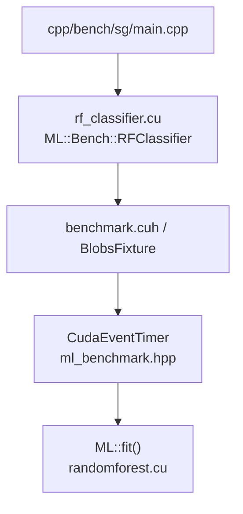
**Sources:** `cpp/bench/CMakeLists.txt`, `cpp/bench/sg/rf_classifier.cu`, `cpp/bench/sg/benchmark.cuh`, `cpp/bench/common/ml_benchmark.hpp`

---

## Sources
- `cpp/src/randomforest/randomforest.cu`
- `cpp/src/randomforest/randomforest.cuh`
- `cpp/src/decisiontree/decisiontree.cu`
- `cpp/include/cuml/ensemble/randomforest.hpp`
- `cpp/src/decisiontree/batched-levelalgo/builder.cuh`
- `cpp/bench/CMakeLists.txt`
- `cpp/bench/sg/benchmark.cuh`
- `cpp/bench/common/ml_benchmark.hpp`
- `cpp/bench/sg/rf_classifier.cu`
- `cpp/tests/sg/rf_test.cu`

---

# Page: Clustering Algorithms (KMeans, DBSCAN, HDBSCAN, Hierarchy)

# Clustering Algorithms (KMeans, DBSCAN, HDBSCAN, Hierarchy)

<details>
<summary>Relevant source files</summary>

The following files were used as context for generating this wiki page:

- [cpp/bench/sg/linkage.cu](cpp/bench/sg/linkage.cu)
- [cpp/examples/dbscan/dbscan_example.cpp](cpp/examples/dbscan/dbscan_example.cpp)
- [cpp/examples/kmeans/kmeans_example.cpp](cpp/examples/kmeans/kmeans_example.cpp)
- [cpp/include/cuml/cluster/dbscan.hpp](cpp/include/cuml/cluster/dbscan.hpp)
- [cpp/include/cuml/cluster/kmeans.hpp](cpp/include/cuml/cluster/kmeans.hpp)
- [cpp/include/cuml/cluster/kmeans_params.hpp](cpp/include/cuml/cluster/kmeans_params.hpp)
- [cpp/include/cuml/cluster/linkage.hpp](cpp/include/cuml/cluster/linkage.hpp)
- [cpp/src/dbscan/adjgraph/algo.cuh](cpp/src/dbscan/adjgraph/algo.cuh)
- [cpp/src/dbscan/adjgraph/pack.h](cpp/src/dbscan/adjgraph/pack.h)
- [cpp/src/dbscan/adjgraph/runner.cuh](cpp/src/dbscan/adjgraph/runner.cuh)
- [cpp/src/dbscan/dbscan.cu](cpp/src/dbscan/dbscan.cu)
- [cpp/src/dbscan/dbscan.cuh](cpp/src/dbscan/dbscan.cuh)
- [cpp/src/dbscan/runner.cuh](cpp/src/dbscan/runner.cuh)
- [cpp/src/dbscan/vertexdeg/algo.cuh](cpp/src/dbscan/vertexdeg/algo.cuh)
- [cpp/src/dbscan/vertexdeg/pack.h](cpp/src/dbscan/vertexdeg/pack.h)
- [cpp/src/dbscan/vertexdeg/precomputed.cuh](cpp/src/dbscan/vertexdeg/precomputed.cuh)
- [cpp/src/dbscan/vertexdeg/runner.cuh](cpp/src/dbscan/vertexdeg/runner.cuh)
- [cpp/src/hdbscan/condensed_hierarchy.cu](cpp/src/hdbscan/condensed_hierarchy.cu)
- [cpp/src/hdbscan/detail/condense.cuh](cpp/src/hdbscan/detail/condense.cuh)
- [cpp/src/hdbscan/detail/extract.cuh](cpp/src/hdbscan/detail/extract.cuh)
- [cpp/src/hdbscan/detail/membership.cuh](cpp/src/hdbscan/detail/membership.cuh)
- [cpp/src/hdbscan/detail/select.cuh](cpp/src/hdbscan/detail/select.cuh)
- [cpp/src/hdbscan/detail/stabilities.cuh](cpp/src/hdbscan/detail/stabilities.cuh)
- [cpp/src/hdbscan/detail/utils.cuh](cpp/src/hdbscan/detail/utils.cuh)
- [cpp/src/hdbscan/prediction_data.cu](cpp/src/hdbscan/prediction_data.cu)
- [cpp/src/hierarchy/linkage.cu](cpp/src/hierarchy/linkage.cu)
- [cpp/src/kmeans/kmeans_fit.cu](cpp/src/kmeans/kmeans_fit.cu)
- [cpp/src/kmeans/kmeans_params.hpp](cpp/src/kmeans/kmeans_params.hpp)
- [cpp/src/ml_cuda_utils.h](cpp/src/ml_cuda_utils.h)
- [python/cuml/cuml/cluster/agglomerative.pyx](python/cuml/cuml/cluster/agglomerative.pyx)
- [python/cuml/cuml/cluster/cpp/kmeans.pxd](python/cuml/cuml/cluster/cpp/kmeans.pxd)
- [python/cuml/cuml/cluster/kmeans.pyx](python/cuml/cuml/cluster/kmeans.pyx)
- [python/cuml/cuml/cluster/kmeans_mg.py](python/cuml/cuml/cluster/kmeans_mg.py)
- [python/cuml/cuml/dask/cluster/kmeans.py](python/cuml/cuml/dask/cluster/kmeans.py)
- [python/cuml/cuml/multiclass/__init__.py](python/cuml/cuml/multiclass/__init__.py)
- [python/cuml/cuml/multiclass/multiclass.py](python/cuml/cuml/multiclass/multiclass.py)
- [python/cuml/tests/dask/test_dask_kmeans.py](python/cuml/tests/dask/test_dask_kmeans.py)
- [python/cuml/tests/test_agglomerative.py](python/cuml/tests/test_agglomerative.py)
- [python/cuml/tests/test_kmeans.py](python/cuml/tests/test_kmeans.py)
- [python/cuml/tests/test_multiclass.py](python/cuml/tests/test_multiclass.py)

</details>


This page details the C++ (libcuml) implementations, CUDA primitives, and Cython/Python interfaces for cuML's core clustering algorithms: **KMeans**, **DBSCAN**, **HDBSCAN**, and **Agglomerative Hierarchical Clustering (Single-Linkage)**. 

---

## 1. KMeans Clustering

The cuML KMeans implementation provides high-performance GPU-accelerated clustering with support for single-GPU, multi-GPU (via distributed partitions), batching, sample weights, and multiple initialization strategies (such as `k-means++` / `k-means||`) [python/cuml/cuml/cluster/kmeans.pyx:44-93](), [cpp/include/cuml/cluster/kmeans.hpp:41-110]().

### C++ Interface and Parameters
The public C++ header `cpp/include/cuml/cluster/kmeans.hpp` defines overloaded `fit` and `predict` routines supporting both `float` and `double` precisions, as well as `int32_t` and `int64_t` index types [cpp/include/cuml/cluster/kmeans.hpp:41-172]().

```cpp
namespace ML {
namespace kmeans {
void fit(const raft::handle_t& handle,
         const KMeansParams& params,
         const float* X,
         int n_samples,
         int n_features,
         const float* sample_weight,
         float* centroids,
         float& inertia,
         int& n_iter);
// ...
}
}
```
*Sources: [cpp/include/cuml/cluster/kmeans.hpp:41-80]()*

### Cython Binding & Data Flow
The Cython module `python/cuml/cuml/cluster/kmeans.pyx` bridges Python estimators to `libcuml` primitives. It initializes `lib.KMeansParams` from Python configuration options and dispatches execution to `lib.fit` [python/cuml/cuml/cluster/kmeans.pyx:44-180]().

```mermaid
graph TD
    A["Python KMeans.fit()"] --> B["_kmeans_init_params()"]
    B --> C["_kmeans_fit()"]
    C -->|Values f32/f64 & Indices i32/i64| D["lib.fit() (libcuml C++)"]
    D --> E["GPU Centroids & Inertia"]
    
    sub: "Code Entities"
    style A fill:#fff,stroke:#000,stroke-width:1px
    style B fill:#fff,stroke:#000,stroke-width:1px
    style C fill:#fff,stroke:#000,stroke-width:1px
    style D fill:#fff,stroke:#000,stroke-width:1px
```
*Sources: [python/cuml/cuml/cluster/kmeans.pyx:44-180]*

---

## 2. DBSCAN Architecture

DBSCAN in cuML is decomposed into modular CUDA components housed under `cpp/src/dbscan/`: vertex degree computation (`vertexdeg`), adjacency graph construction (`adjgraph`), core point determination, and connected component relabeling [cpp/src/dbscan/runner.cuh:8-14]().

### C++ Interface
The DBSCAN API is exposed via `cpp/include/cuml/cluster/dbscan.hpp`, supporting `BRUTE_FORCE` and `RBC` ( র‍্যান্ডম বল কভার / Reduced Ball Cover) neighbor search methods [cpp/include/cuml/cluster/dbscan.hpp:22-110]().

```cpp
namespace ML {
namespace Dbscan {
enum EpsNnMethod { BRUTE_FORCE, RBC };

void fit(const raft::handle_t& handle,
         float* input,
         int n_rows,
         int n_cols,
         float eps,
         int min_pts,
         ML::distance::DistanceType metric,
         int* labels,
         int* core_sample_indices = nullptr,
         float* sample_weight = nullptr,
         size_t max_bytes_per_batch = 0,
         EpsNnMethod eps_nn_method = BRUTE_FORCE,
         rapids_logger::level_enum verbosity = rapids_logger::level_enum::info,
         bool opg = false);
}
}
```
*Sources: [cpp/include/cuml/cluster/dbscan.hpp:22-66]()*

### Runner and Batching Strategy
`cpp/src/dbscan/runner.cuh` orchestrates the execution pipeline, dynamically computing batch sizes based on available device memory and managing intermediate allocations for vertex degrees and adjacency matrices [cpp/src/dbscan/runner.cuh:100-173](). `cpp/src/dbscan/dbscan.cuh` calculates optimal memory utilization and validates parameters before launching kernels [cpp/src/dbscan/dbscan.cuh:23-170]().

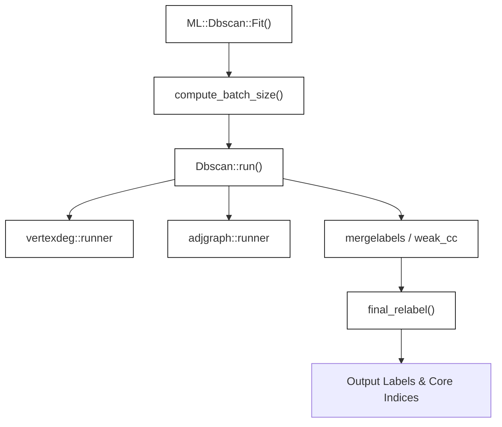
*Sources: [cpp/src/dbscan/runner.cuh:100-173](), [cpp/src/dbscan/dbscan.cuh:23-170]*

---

## 3. HDBSCAN (Condensation, Selection, and Stabilities)

HDBSCAN extends DBSCAN by converting a hierarchy of clusterings into a condensed tree and extracting flat clusters based on stability scores.

### Stability Computation
The stability calculation evaluates excess of mass by measuring how long clusters persist across varying distance thresholds ($\lambda = 1 / \text{distance}$) [cpp/src/hdbscan/detail/stabilities.cuh:39-53]().

```cpp
template <typename value_idx, typename value_t>
void compute_stabilities(const raft::handle_t& handle,
                         Common::CondensedHierarchy<value_idx, value_t>& condensed_tree,
                         value_t* stabilities)
```
*Sources: [cpp/src/hdbscan/detail/stabilities.cuh:39-53]()*

Using Thrust execution policies and CUB segmented reductions, `compute_stabilities` gathers parent-child hierarchies, aggregates minimum births, and executes `stabilities_functor` across condensed edges [cpp/src/hdbscan/detail/stabilities.cuh:50-137]().

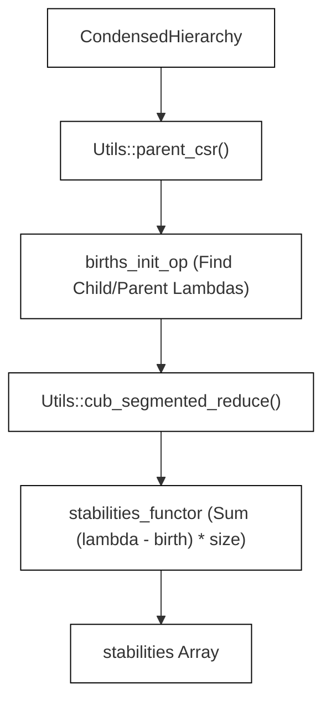
*Sources: [cpp/src/hdbscan/detail/stabilities.cuh:50-137]*

---

## 4. Agglomerative Hierarchical Clustering (Single-Linkage)

cuML's agglomerative clustering provides single-linkage hierarchical clustering capable of operating on fully pairwise distance matrices or sparsified `knn` connectivity graphs [python/cuml/cuml/cluster/agglomerative.pyx:47-109]().

### Cython and C++ Linkage Interface
The Cython wrapper `AgglomerativeClustering` calls the `single_linkage` kernel defined in `cuml/cluster/linkage.hpp` [python/cuml/cuml/cluster/agglomerative.pyx:20-35]():

```python
cdef extern from "cuml/cluster/linkage.hpp" namespace "ML::linkage" nogil:
    cdef void single_linkage(
        const handle_t &handle,
        const float *X,
        int n_rows,
        int n_cols,
        size_t n_clusters,
        DistanceType metric,
        int* children,
        int* labels,
        float* distances,
        bool use_knn,
        int c,
    ) except +
```
*Sources: [python/cuml/cuml/cluster/agglomerative.pyx:20-35]()*

### Execution Flow
1. **Input Validation**: `check_inputs` ensures continuous C-contiguous float32 data residency [python/cuml/cuml/cluster/agglomerative.pyx:150-162]().
2. **Connectivity Configuration**: Maps `connectivity="knn"` or `"pairwise"` alongside supported distance metrics (`euclidean`, `l1`, `manhattan`, `cosine`) [python/cuml/cuml/cluster/agglomerative.pyx:167-176]().
3. **Execution**: Allocates output buffers (`labels`, `children`, and optional `distances`) and invokes `ML::linkage::single_linkage` [python/cuml/cuml/cluster/agglomerative.pyx:184-191]().

---

## 5. Summary Table of Clustering Components

| Algorithm | C++ Header / Namespace | Key C++ Classes / Functions | Python Estimator Module |
| :--- | :--- | :--- | :--- |
| **KMeans** | `cuml/cluster/kmeans.hpp` (`ML::kmeans`) | `fit()`, `predict()`, `KMeansParams` | `cuml.cluster.KMeans`, `cuml.dask.cluster.KMeans` |
| **DBSCAN** | `cuml/cluster/dbscan.hpp` (`ML::Dbscan`) | `fit()`, `Dbscan::run()`, `compute_batch_size()` | `cuml.cluster.DBSCAN` |
| **HDBSCAN** | `cuml/cluster/hdbscan.hpp` (`ML::HDBSCAN`) | `CondensedHierarchy`, `compute_stabilities()` | `cuml.cluster.HDBSCAN` |
| **Hierarchy** | `cuml/cluster/linkage.hpp` (`ML::linkage`) | `single_linkage()` | `cuml.cluster.AgglomerativeClustering` |

*Sources: [cpp/include/cuml/cluster/kmeans.hpp:15-80](), [cpp/include/cuml/cluster/dbscan.hpp:19-66](), [python/cuml/cuml/cluster/agglomerative.pyx:20-47]*

---

# Page: Manifold Learning and Decomposition (UMAP, TSNE, PCA, TSVD, Spectral)

# Manifold Learning and Decomposition (UMAP, TSNE, PCA, TSVD, Spectral)

<details>
<summary>Relevant source files</summary>

The following files were used as context for generating this wiki page:

- [cpp/bench/sg/umap.cu](cpp/bench/sg/umap.cu)
- [cpp/cmake/thirdparty/get_gputreeshap.cmake](cpp/cmake/thirdparty/get_gputreeshap.cmake)
- [cpp/include/cuml/decomposition/params.hpp](cpp/include/cuml/decomposition/params.hpp)
- [cpp/include/cuml/decomposition/pca.hpp](cpp/include/cuml/decomposition/pca.hpp)
- [cpp/include/cuml/decomposition/tsvd.hpp](cpp/include/cuml/decomposition/tsvd.hpp)
- [cpp/include/cuml/manifold/common.hpp](cpp/include/cuml/manifold/common.hpp)
- [cpp/include/cuml/manifold/spectral_embedding.hpp](cpp/include/cuml/manifold/spectral_embedding.hpp)
- [cpp/include/cuml/manifold/tsne.h](cpp/include/cuml/manifold/tsne.h)
- [cpp/include/cuml/manifold/umap.hpp](cpp/include/cuml/manifold/umap.hpp)
- [cpp/include/cuml/manifold/umapparams.h](cpp/include/cuml/manifold/umapparams.h)
- [cpp/include/cuml/solvers/lars.hpp](cpp/include/cuml/solvers/lars.hpp)
- [cpp/include/cuml/solvers/solver.hpp](cpp/include/cuml/solvers/solver.hpp)
- [cpp/src/glm/qn/simple_mat/dense.hpp](cpp/src/glm/qn/simple_mat/dense.hpp)
- [cpp/src/glm/qn/simple_mat/sparse.hpp](cpp/src/glm/qn/simple_mat/sparse.hpp)
- [cpp/src/pca/pca.cu](cpp/src/pca/pca.cu)
- [cpp/src/solver/lars.cu](cpp/src/solver/lars.cu)
- [cpp/src/solver/lars_impl.cuh](cpp/src/solver/lars_impl.cuh)
- [cpp/src/spectral/spectral_embedding.cu](cpp/src/spectral/spectral_embedding.cu)
- [cpp/src/svm/smoblocksolve.cuh](cpp/src/svm/smoblocksolve.cuh)
- [cpp/src/svm/workingset.cuh](cpp/src/svm/workingset.cuh)
- [cpp/src/tsne/barnes_hut_kernels.cuh](cpp/src/tsne/barnes_hut_kernels.cuh)
- [cpp/src/tsne/barnes_hut_tsne.cuh](cpp/src/tsne/barnes_hut_tsne.cuh)
- [cpp/src/tsne/cannylab/bh.cu](cpp/src/tsne/cannylab/bh.cu)
- [cpp/src/tsne/cannylabs_tsne_license.txt](cpp/src/tsne/cannylabs_tsne_license.txt)
- [cpp/src/tsne/distances.cuh](cpp/src/tsne/distances.cuh)
- [cpp/src/tsne/exact_kernels.cuh](cpp/src/tsne/exact_kernels.cuh)
- [cpp/src/tsne/exact_tsne.cuh](cpp/src/tsne/exact_tsne.cuh)
- [cpp/src/tsne/fft_kernels.cuh](cpp/src/tsne/fft_kernels.cuh)
- [cpp/src/tsne/fft_tsne.cuh](cpp/src/tsne/fft_tsne.cuh)
- [cpp/src/tsne/tsne.cu](cpp/src/tsne/tsne.cu)
- [cpp/src/tsne/tsne_runner.cuh](cpp/src/tsne/tsne_runner.cuh)
- [cpp/src/tsne/utils.cuh](cpp/src/tsne/utils.cuh)
- [cpp/src/tsvd/tsvd.cu](cpp/src/tsvd/tsvd.cu)
- [cpp/src/umap/fuzzy_simpl_set/naive.cuh](cpp/src/umap/fuzzy_simpl_set/naive.cuh)
- [cpp/src/umap/fuzzy_simpl_set/runner.cuh](cpp/src/umap/fuzzy_simpl_set/runner.cuh)
- [cpp/src/umap/init_embed/random_algo.cuh](cpp/src/umap/init_embed/random_algo.cuh)
- [cpp/src/umap/init_embed/runner.cuh](cpp/src/umap/init_embed/runner.cuh)
- [cpp/src/umap/init_embed/spectral_algo.cuh](cpp/src/umap/init_embed/spectral_algo.cuh)
- [cpp/src/umap/knn_graph/algo.cuh](cpp/src/umap/knn_graph/algo.cuh)
- [cpp/src/umap/runner.cuh](cpp/src/umap/runner.cuh)
- [cpp/src/umap/simpl_set_embed/algo.cuh](cpp/src/umap/simpl_set_embed/algo.cuh)
- [cpp/src/umap/simpl_set_embed/optimize_batch_kernel.cuh](cpp/src/umap/simpl_set_embed/optimize_batch_kernel.cuh)
- [cpp/src/umap/simpl_set_embed/optimize_inverse_kernel.cuh](cpp/src/umap/simpl_set_embed/optimize_inverse_kernel.cuh)
- [cpp/src/umap/simpl_set_embed/runner.cuh](cpp/src/umap/simpl_set_embed/runner.cuh)
- [cpp/src/umap/supervised.cuh](cpp/src/umap/supervised.cuh)
- [cpp/src/umap/umap.cu](cpp/src/umap/umap.cu)
- [cpp/src/umap/umap.cuh](cpp/src/umap/umap.cuh)
- [cpp/tests/sg/pca_test.cu](cpp/tests/sg/pca_test.cu)
- [cpp/tests/sg/tsne_test.cu](cpp/tests/sg/tsne_test.cu)
- [cpp/tests/sg/tsvd_test.cu](cpp/tests/sg/tsvd_test.cu)
- [python/cuml/cuml/manifold/umap/lib.pxd](python/cuml/cuml/manifold/umap/lib.pxd)
- [python/cuml/tests/test_benchmark.py](python/cuml/tests/test_benchmark.py)
- [python/cuml/tests/test_spectral_clustering.py](python/cuml/tests/test_spectral_clustering.py)
- [python/cuml/tests/test_tsne.py](python/cuml/tests/test_tsne.py)

</details>


## Purpose and Scope
This page details the implementation of manifold learning and matrix decomposition algorithms in `libcuml` (`cpp/src/` and `cpp/include/cuml/`). It covers the end-to-end execution pipeline for UMAP (Uniform Manifold Approximation and Projection), t-SNE (t-Distributed Stochastic Neighbor Embedding) across exact, Barnes-Hut, and FFT modes, Principal Component Analysis (PCA), Truncated Singular Value Decomposition (TSVD), and Spectral Embedding. These algorithms leverage underlying primitives from `raft` and `cuvs` to accelerate GPU-based neighborhood searches, layout optimizations, and linear solvers.

Sources: 
- `cpp/include/cuml/manifold/umap.hpp:1-179` [()]
- `cpp/include/cuml/manifold/tsne.h:1-50` [()]
- `cpp/include/cuml/decomposition/pca.hpp:1-50` [()]
- `cpp/include/cuml/decomposition/tsvd.hpp:1-50` [()]
- `cpp/include/cuml/manifold/spectral_embedding.hpp:1-50` [()]

---

## 1. UMAP (Uniform Manifold Approximation and Projection)

The UMAP implementation in cuML is structured around a modular pipeline consisting of k-NN graph construction, fuzzy simplicial set fuzzy union/intersection, initialization, and stochastic gradient descent (SGD) layout optimization.

### 1.1 Runner & High-Level Pipeline
The primary orchestrator for UMAP fitting, transforming, and graph extraction resides in `cpp/src/umap/runner.cuh` and `cpp/src/umap/umap.cu`. The driver handles dense and sparse formats, dispatching index types (`int` vs `uint64_t`) based on dataset sizes.

```cpp
void fit(const raft::handle_t& handle,
         float* X, float* y, int n, int d,
         int64_t* knn_indices, float* knn_dists,
         UMAPParams* params,
         std::unique_ptr<rmm::device_buffer>& embeddings,
         raft::host_coo_matrix<float, int, int, uint64_t>& graph,
         float* sigmas, float* rhos);
```

Sources:
- `cpp/src/umap/runner.cuh:1-190` [()]
- `cpp/src/umap/umap.cu:1-199` [()]

### 1.2 k-NN Graph Construction
The k-NN graph step computes nearest neighbors using either brute-force search (`cuvs::neighbors::brute_force`) or graph-based approximate nearest neighbors (NN-Descent) via `cuvs::neighbors::all_neighbors`. 

- **Dense Inputs**: Checked for device vs host residency (`cudaPointerGetAttributes`). If metrics are supported by `cuvs`, batch all-neighbors builds are dispatched.
- **Transform Mode**: When projecting new data (`inputsA != inputsB`), brute-force search against the trained index is enforced.

```cpp
auto all_neighbors_params           = cuvs::neighbors::all_neighbors::all_neighbors_params{};
all_neighbors_params.overlap_factor = params->build_params.overlap_factor;
all_neighbors_params.n_clusters     = params->build_params.n_clusters;
all_neighbors_params.metric         = static_cast<cuvs::distance::DistanceType>(params->metric);
```

Sources:
- `cpp/src/umap/knn_graph/algo.cuh:1-157` [()]

### 1.3 Fuzzy Simplicial Set
Once nearest neighbors and distances are obtained, `smooth_knn_dist_kernel` calculates continuous $k$-neighbor distances ($\sigma_i$ and $\rho_i$) via binary search convergence to satisfy local connectivity constraints.

```cpp
template <typename value_t, typename nnz_t, int TPB_X>
CUML_KERNEL void smooth_knn_dist_kernel(const value_t* knn_dists,
                                        int n,
                                        float mean_dist,
                                        value_t* sigmas,
                                        value_t* rhos,
                                        int n_neighbors,
                                        float local_connectivity,
                                        int n_iter,
                                        float bandwidth)
```

Sources:
- `cpp/src/umap/fuzzy_simpl_set/naive.cuh:1-190` [()]

### 1.4 Layout Optimization and Embedding Kernels
Low-dimensional layout optimization uses stochastic gradient descent with negative sampling. The codebase implements reproducible sequential summation using dynamic rounding factors to guarantee deterministic floating-point reduction across blocks.

```cpp
template <typename T, typename nnz_t, int TPB_X = 256>
CUML_KERNEL void sparse_apply_kernel(
  T* embedding, T* buffer, uint32_t* flags, int n_vertices, int n_components)
```

Sources:
- `cpp/src/umap/simpl_set_embed/optimize_batch_kernel.cuh:1-76` [()]
- `cpp/src/umap/simpl_set_embed/algo.cuh:1-199` [()]

### 1.5 Natural Language to Code Entity Space: UMAP Pipeline

```mermaid
graph TD
    UserAPI["UMAP.fit_transform (Python/Cython)"] --> CppRunner["UMAP::fit (cpp/src/umap/umap.cu)"]
    CppRunner --> KNNGraph["kNNGraph::run (cpp/src/umap/knn_graph/algo.cuh)"]
    KNNGraph --> CUVS["cuvs::neighbors::all_neighbors / brute_force"]
    CppRunner --> FuzzySet["FuzzySimplSet::Naive::smooth_knn_dist_kernel (cpp/src/umap/fuzzy_simpl_set/naive.cuh)"]
    FuzzySet --> OptLayout["SimplSetEmbed::Algo::optimize_layout (cpp/src/umap/simpl_set_embed/algo.cuh)"]
    OptLayout --> SparseApply["sparse_apply_kernel (cpp/src/umap/simpl_set_embed/optimize_batch_kernel.cuh)"]
```
Sources:
- `cpp/src/umap/umap.cu:63-81` [()]
- `cpp/src/umap/knn_graph/algo.cuh:38-44` [()]
- `cpp/src/umap/fuzzy_simpl_set/naive.cuh:73-82` [()]
- `cpp/src/umap/simpl_set_embed/optimize_batch_kernel.cuh:43-46` [()]

---

## 2. t-SNE (t-Distributed Stochastic Neighbor Embedding)

t-SNE maps high-dimensional datasets into a lower-dimensional space while preserving local similarities. cuML supports dense and sparse inputs with exact, Barnes-Hut, and FFT-accelerated iterations.

### 2.1 Architectural Overview
The entry points `TSNE_fit` and `TSNE_fit_sparse` in `cpp/src/tsne/tsne.cu` validate inputs, establish distance matrices via `cuvs`, and instantiate `TSNE_runner`.

```cpp
void TSNE_fit(const raft::handle_t& handle,
              float* X, float* Y, int n, int p,
              int64_t* knn_indices, float* knn_dists,
              TSNEParams& params, float* kl_div, int* n_iter);
```

Distance calculation routines normalize distances to prevent exponential overflow during probability construction:

```cpp
template <typename value_t>
void normalize_distances(value_t* distances, const size_t total_nn, cudaStream_t stream)
```

Sources:
- `cpp/src/tsne/tsne.cu:28-50` [()]
- `cpp/src/tsne/distances.cuh:136-148` [()]

### 2.2 Execution Methods
Depending on `TSNEParams::method`, the runner delegates optimization to:
1. **Exact Method**: Computes pairwise forces directly.
2. **Barnes-Hut (`barnes_hut`)**: Approximates repulsive forces using quadtrees/octrees.
3. **Fast Fourier Transform (`fft`)**: Interpolates repulsive forces on a grid via FFT.

Sources:
- `cpp/src/tsne/tsne_runner.cuh:1-50` [()]
- `python/cuml/tests/test_tsne.py:42-73` [()]

---

## 3. Principal Component Analysis (PCA) and Truncated SVD (TSVD)

Linear decomposition methods project data onto orthogonal components capturing maximal variance.

### 3.1 PCA Solvers
PCA relies on Singular Value Decomposition (SVD) or eigen-decomposition of the covariance matrix. The primary C++ headers and source files expose fit and transform functions.

| Solver / Class | Purpose | Source File |
| :--- | :--- | :--- |
| `PCA::fit` | Computes mean, singular values, and components | `cpp/src/pca/pca.cu` |
| `PCA::transform` | Projects input data onto principal axes | `cpp/include/cuml/decomposition/pca.hpp` |

Sources:
- `cpp/include/cuml/decomposition/pca.hpp:1-60` [()]
- `cpp/src/pca/pca.cu:1-80` [()]

### 3.2 TSVD Solvers
Truncated SVD factorizes data matrix $X \approx U \Sigma V^T$ without centering the data.

```cpp
void tsvdFit(const raft::handle_t& handle, float* Input, float* comp,
             float* singular_vals, paramsTSVD& prms, bool trans);
```

Sources:
- `cpp/include/cuml/decomposition/tsvd.hpp:1-50` [()]
- `cpp/src/tsvd/tsvd.cu:1-80` [()]

---

## 4. Spectral Embedding

Spectral embedding uses the Laplacian of the affinity graph to find a low-dimensional embedding.

### 4.1 Implementation Details
The spectral embedding module builds an affinity/similarity graph and computes eigenvectors of the graph Laplacian.

```cpp
namespace ML {
namespace SpectralEmbedding {
void fit(const raft::handle_t& handle, const float* X, int n, int d,
         const SpectralEmbeddingParams& params, float* embedding);
}
}
```

Sources:
- `cpp/include/cuml/manifold/spectral_embedding.hpp:1-40` [()]
- `cpp/src/spectral/spectral_embedding.cu:1-60` [()]

### 4.2 Natural Language to Code Entity Space: Decomposition & Spectral

```mermaid
graph TD
    PyPCA["PCA / TruncatedSVD (Python API)"] --> CppPCA["PCA::fit / tsvdFit (cpp/src/pca/pca.cu, tsvd.cu)"]
    PySpectral["SpectralEmbedding (Python API)"] --> CppSpectral["SpectralEmbedding::fit (cpp/src/spectral/spectral_embedding.cu)"]
    CppPCA --> RaftLinalg["raft::linalg / raft::matrix primitives"]
    CppSpectral --> RaftMatrix["raft graph laplacian & eigensolvers"]
```
Sources:
- `cpp/src/pca/pca.cu:1-50` [()]
- `cpp/src/tsvd/tsvd.cu:1-50` [()]
- `cpp/src/spectral/spectral_embedding.cu:1-50` [()]

---

# Page: Linear Models, Solvers and SVM

# Linear Models, Solvers and SVM

<details>
<summary>Relevant source files</summary>

The following files were used as context for generating this wiki page:

- [cpp/bench/sg/svc.cu](cpp/bench/sg/svc.cu)
- [cpp/bench/sg/svr.cu](cpp/bench/sg/svr.cu)
- [cpp/include/cuml/linear_model/glm.hpp](cpp/include/cuml/linear_model/glm.hpp)
- [cpp/include/cuml/matrix/kernel_params.hpp](cpp/include/cuml/matrix/kernel_params.hpp)
- [cpp/include/cuml/svm/linear.hpp](cpp/include/cuml/svm/linear.hpp)
- [cpp/include/cuml/svm/svc.hpp](cpp/include/cuml/svm/svc.hpp)
- [cpp/include/cuml/svm/svm_model.h](cpp/include/cuml/svm/svm_model.h)
- [cpp/include/cuml/svm/svm_parameter.h](cpp/include/cuml/svm/svm_parameter.h)
- [cpp/include/cuml/svm/svr.hpp](cpp/include/cuml/svm/svr.hpp)
- [cpp/src/glm/glm.cu](cpp/src/glm/glm.cu)
- [cpp/src/glm/ols.cuh](cpp/src/glm/ols.cuh)
- [cpp/src/glm/preprocess.cuh](cpp/src/glm/preprocess.cuh)
- [cpp/src/glm/qn/glm_base.cuh](cpp/src/glm/qn/glm_base.cuh)
- [cpp/src/glm/qn/glm_linear.cuh](cpp/src/glm/qn/glm_linear.cuh)
- [cpp/src/glm/qn/glm_logistic.cuh](cpp/src/glm/qn/glm_logistic.cuh)
- [cpp/src/glm/qn/glm_regularizer.cuh](cpp/src/glm/qn/glm_regularizer.cuh)
- [cpp/src/glm/qn/glm_softmax.cuh](cpp/src/glm/qn/glm_softmax.cuh)
- [cpp/src/glm/qn/glm_svm.cuh](cpp/src/glm/qn/glm_svm.cuh)
- [cpp/src/glm/qn/qn.cuh](cpp/src/glm/qn/qn.cuh)
- [cpp/src/glm/qn/qn_linesearch.cuh](cpp/src/glm/qn/qn_linesearch.cuh)
- [cpp/src/glm/qn/qn_solvers.cuh](cpp/src/glm/qn/qn_solvers.cuh)
- [cpp/src/glm/qn/qn_util.cuh](cpp/src/glm/qn/qn_util.cuh)
- [cpp/src/glm/ridge.cuh](cpp/src/glm/ridge.cuh)
- [cpp/src/solver/cd.cuh](cpp/src/solver/cd.cuh)
- [cpp/src/solver/sgd.cuh](cpp/src/solver/sgd.cuh)
- [cpp/src/solver/solver.cu](cpp/src/solver/solver.cu)
- [cpp/src/svm/kernelcache.cuh](cpp/src/svm/kernelcache.cuh)
- [cpp/src/svm/linear.cu](cpp/src/svm/linear.cu)
- [cpp/src/svm/results.cuh](cpp/src/svm/results.cuh)
- [cpp/src/svm/smosolver.cuh](cpp/src/svm/smosolver.cuh)
- [cpp/src/svm/smosolver.h](cpp/src/svm/smosolver.h)
- [cpp/src/svm/sparse_util.cuh](cpp/src/svm/sparse_util.cuh)
- [cpp/src/svm/svc.cu](cpp/src/svm/svc.cu)
- [cpp/src/svm/svc_impl.cuh](cpp/src/svm/svc_impl.cuh)
- [cpp/src/svm/svr.cu](cpp/src/svm/svr.cu)
- [cpp/src/svm/svr_impl.cuh](cpp/src/svm/svr_impl.cuh)
- [cpp/src/svm/workingset.h](cpp/src/svm/workingset.h)
- [cpp/tests/sg/svc_test.cu](cpp/tests/sg/svc_test.cu)
- [python/cuml/cuml/svm/linear.pyx](python/cuml/cuml/svm/linear.pyx)
- [python/cuml/cuml/svm/linear_svr.py](python/cuml/cuml/svm/linear_svr.py)

</details>


This wiki page covers the technical implementation details of Linear Models, Solvers, and Support Vector Machines (SVM) within `libcuml` and its Python bindings. This encompasses Generalized Linear Models (OLS, Ridge, Quasi-Newton solvers), iterative solvers (Coordinate Descent, SGD, LARS), and the Support Vector Machine (SMO solver, working set selection, kernel cache, and linear SVM).

---

## 1. Generalized Linear Models (GLM) and Solvers

The GLM module provides high-performance implementations for Ordinary Least Squares (OLS) regression, Ridge regression (L2 regularized least squares), and generalized models optimized via Quasi-Newton methods.

### OLS and Ridge Solvers
- **Entry points**: `olsFit` and `ridgeFit` are defined in `cpp/include/cuml/linear_model/glm.hpp` and implemented via backend routines in `cpp/src/glm/ols.cuh` and `cpp/src/glm/ridge.cuh`.
- **Algorithms**: Support multiple matrix factorization backends controlled by the `algo` parameter (e.g., SVD, Eigendecomposition, QR decomposition).
- **Prediction**: Evaluated via `gemmPredict` using batched BLAS/GEMM routines (`cpp/include/cuml/linear_model/glm.hpp:105-118`()).

### Quasi-Newton (QN) Solvers
- **Overview**: Solves unconstrained optimization problems and L1-regularized models (`L-BFGS` and `OWL-QN`) for generalized linear models (logistic regression, squared loss, hinge loss, and epsilon-insensitive SVR loss).
- **Implementation**: Defined in `cpp/src/glm/qn/qn_solvers.cuh` and exposed via `qnFit` / `qnFitSparse` (`cpp/include/cuml/linear_model/glm.hpp:140-203`()).
- **Workspace Management**: Calculates explicit scratch memory footprints (`lbfgs_workspace_size` and `owlqn_workspace_size`) for storing history matrices $S$ and $Y$ alongside directional gradients and vectors (`cpp/src/glm/qn/qn_solvers.cuh:50-63`()).

```
+-------------------------------------------------------------+
|                     Python Estimator Layer                  |
|     (LinearRegression, Ridge, LogisticRegression)           |
+-------------------------------------------------------------+
                              |
                              v
+-------------------------------------------------------------+
|                 libcuml C++ API (GLM / Solvers)             |
|  - olsFit() / ridgeFit() [cpp/include/cuml/linear_model/glm.hpp]()|
|  - qnFit() / qnFitSparse() [cpp/src/glm/qn/qn_solvers.cuh]()  |
|  - cdFit() [cpp/src/solver/cd.cuh]()                        |
+-------------------------------------------------------------+
                              |
                              v
+-------------------------------------------------------------+
|                RAFT Linear Algebra Primitives               |
|            (raft::linalg::gemm, raft::stats::sum)           |
+-------------------------------------------------------------+
```

Sources:
- `cpp/include/cuml/linear_model/glm.hpp`
- `cpp/src/glm/glm.cu`
- `cpp/src/glm/qn/qn_solvers.cuh`

---

## 2. Coordinate Descent (CD), SGD, and LARS Solvers

Iterative optimization solvers handle loss objectives with explicit regularization penalties.

### Coordinate Descent (`cdFit`)
- **Objective Function**: Minimizes the penalized loss:
  $$\mathcal{f}(\text{coef}) = \frac{1}{2} \|\mathbf{labels} - \mathbf{input} \cdot \text{coef}\|^2 + \frac{1}{2} \alpha (1 - \text{l1\_ratio}) \|\text{coef}\|^2 + \alpha \cdot \text{l1\_ratio} \|\text{coef}\|_1$$
- **Core Update Kernel**: Updates individual coefficients using soft-thresholding operations via `cdUpdateCoefKernel` (`cpp/src/solver/cd.cuh:60-75`()).
- **Execution Flow**: Preprocesses feature matrices/labels, scales sample weights, computes residual errors, and iteratively sweeps through coordinate indices until convergence or max epochs (`cpp/src/solver/cd.cuh:127-142`()).

Sources:
- `cpp/src/solver/cd.cuh`
- `cpp/src/solver/sgd.cuh`

---

## 3. Support Vector Machine (SVM) SMO Solver

Support Vector Classification (SVC) and Regression (SVR) are solved in `libcuml` via Sequential Minimal Optimization (SMO) combined with a two-level hierarchical decomposition.

### Two-Level Decomposition and SMO
- **Outer Iteration ($q_1$)**: Selects a working set of size $q_1 = 1024$ using `WorkingSet::Select` (`cpp/src/svm/workingset.h:148-179`()).
- **Inner Iteration ($q_2$)**: Optimizes sub-problems of size $q_2 = 2$ using block solver routines inside `SmoSolver::Solve` (`cpp/src/svm/smosolver.h:95-130`()).
- **Optimality Indicator Vector ($f$)**: Tracks gradient updates dynamically across iterations via `UpdateF` (`cpp/src/svm/smosolver.h:146`()):
  $$f_i = f_i + \sum_{k \in WS} K_{i,k} \cdot \Delta \alpha_k$$

```
Diagram: SMO Solver Architecture and Control Flow
-------------------------------------------------
+-----------------------------------------------------------------+
|                        SmoSolver::Solve()                       |
|                 [cpp/src/svm/smosolver.h:95-130]()              |
+-----------------------------------------------------------------+
                                 |
                                 v
+-----------------------------------------------------------------+
|                   WorkingSet::Select()                          |
|         Selects working set (default 1024 elements)             |
|               [cpp/src/svm/workingset.h:148-179]()              |
+-----------------------------------------------------------------+
         |                                               |
         | (Fetch cache tile)                            | (Compute sub-problem)
         v                                               v
+------------------------+                     +------------------+
|      BatchCache        |                     |   SmoBlockSolve  |
| [cpp/src/svm/          |                     |  (Optimizes q=2) |
|  kernelcache.cuh:138]()|                     +------------------+
+------------------------+                              |
         |                                              |
         +----------------------->----------------------+
                                 |
                                 v
+-----------------------------------------------------------------+
|                   Results::Get() Collection                     |
|           Extracts dual coefs, support vectors, and bias        |
|                [cpp/src/svm/results.cuh:113-134]()              |
+-----------------------------------------------------------------+
```

Sources:
- `cpp/src/svm/smosolver.h`
- `cpp/src/svm/workingset.h`
- `cpp/src/svm/results.cuh`

---

## 4. Working Set Selection and Kernel Cache

### Working Set Selection (`WorkingSet`)
- Implements Joachims' strategy combined with a FIFO retention policy or priority-based selection (`PrioritySelect`) to prevent training vectors from oscillating in and out of the active working set (`cpp/src/svm/workingset.h:105-199`()).

### Kernel Cache (`BatchCache`)
- **Batch Processing**: Manages partial row updates and kernel evaluations against cached tiles via `BatchCache` extending `raft::cache::Cache` (`cpp/src/svm/kernelcache.cuh:138-153`()).
- **Precomputed Kernels**: Supports `PRECOMPUTED` kernel matrices, extracting columns directly via `extractColumnsForPrecomputed` to avoid redundant kernel evaluations (`cpp/src/svm/kernelcache.cuh:75-87`()).

Sources:
- `cpp/src/svm/workingset.h`
- `cpp/src/svm/kernelcache.cuh`

---

## 5. Linear SVM

- **Overview**: Implements linear SVM classification and regression via `ML::SVM::linear::fit` (`cpp/src/svm/linear.cu:126-136`()).
- **Backend Mapping**: Translates high-level loss settings (`HINGE`, `SQUARED_HINGE`, `EPSILON_INSENSITIVE`) into Quasi-Newton loss targets (`QN_LOSS_SVC_L1`, `QN_LOSS_SVC_L2`, etc.) (`cpp/src/svm/linear.cu:165-172`()).
- **Prediction**: Computes matrix products using `predictLinear`, combining GEMM projections with bias adjustments (`cpp/src/svm/linear.cu:70-95`()).

Sources:
- `cpp/src/svm/linear.cu`
- `cpp/include/cuml/svm/linear.hpp`

---

# Page: Neighbors, Metrics, Datasets and Explainability

# Neighbors, Metrics, Datasets and Explainability

<details>
<summary>Relevant source files</summary>

The following files were used as context for generating this wiki page:

- [cpp/include/cuml/datasets/make_blobs.hpp](cpp/include/cuml/datasets/make_blobs.hpp)
- [cpp/include/cuml/datasets/make_regression.hpp](cpp/include/cuml/datasets/make_regression.hpp)
- [cpp/include/cuml/explainer/kernel_shap.hpp](cpp/include/cuml/explainer/kernel_shap.hpp)
- [cpp/include/cuml/explainer/permutation_shap.hpp](cpp/include/cuml/explainer/permutation_shap.hpp)
- [cpp/include/cuml/explainer/tree_shap.hpp](cpp/include/cuml/explainer/tree_shap.hpp)
- [cpp/include/cuml/metrics/metrics.hpp](cpp/include/cuml/metrics/metrics.hpp)
- [cpp/include/cuml/neighbors/kde.hpp](cpp/include/cuml/neighbors/kde.hpp)
- [cpp/include/cuml/neighbors/knn.hpp](cpp/include/cuml/neighbors/knn.hpp)
- [cpp/src/datasets/make_blobs.cu](cpp/src/datasets/make_blobs.cu)
- [cpp/src/datasets/make_regression.cu](cpp/src/datasets/make_regression.cu)
- [cpp/src/dbscan/mergelabels/tree_reduction.cuh](cpp/src/dbscan/mergelabels/tree_reduction.cuh)
- [cpp/src/explainer/kernel_shap.cu](cpp/src/explainer/kernel_shap.cu)
- [cpp/src/explainer/permutation_shap.cu](cpp/src/explainer/permutation_shap.cu)
- [cpp/src/explainer/tree_shap.cu](cpp/src/explainer/tree_shap.cu)
- [cpp/src/kde/kde.cu](cpp/src/kde/kde.cu)
- [cpp/src/knn/knn.cu](cpp/src/knn/knn.cu)
- [cpp/src/knn/knn_classify_mg.cu](cpp/src/knn/knn_classify_mg.cu)
- [cpp/src/knn/knn_opg_common.cuh](cpp/src/knn/knn_opg_common.cuh)
- [cpp/src/knn/knn_regress_mg.cu](cpp/src/knn/knn_regress_mg.cu)
- [cpp/src/metrics/pairwise_distance.cu](cpp/src/metrics/pairwise_distance.cu)
- [cpp/src/metrics/silhouette_score.cu](cpp/src/metrics/silhouette_score.cu)
- [cpp/src/metrics/silhouette_score_batched_double.cu](cpp/src/metrics/silhouette_score_batched_double.cu)
- [cpp/src/metrics/silhouette_score_batched_float.cu](cpp/src/metrics/silhouette_score_batched_float.cu)
- [cpp/src/metrics/trustworthiness.cu](cpp/src/metrics/trustworthiness.cu)
- [cpp/src_prims/selection/knn.cuh](cpp/src_prims/selection/knn.cuh)
- [python/cuml/cuml/dask/cluster/dbscan.py](python/cuml/cuml/dask/cluster/dbscan.py)
- [python/cuml/cuml/neighbors/CMakeLists.txt](python/cuml/cuml/neighbors/CMakeLists.txt)
- [python/cuml/cuml/neighbors/__init__.py](python/cuml/cuml/neighbors/__init__.py)
- [python/cuml/tests/test_kernel_density.py](python/cuml/tests/test_kernel_density.py)

</details>


This section covers the core C++/CUDA implementations within `libcuml` for nearest neighbor search algorithms (brute-force, approximate index building, and radius ball cover), kernel density estimation, distance and validation metrics (pairwise distances, silhouette score, trustworthiness), synthetic dataset generators (`make_blobs`, `make_regression`), and model explainability engines (TreeSHAP and KernelSHAP data preparation kernels).

---

## 1. Nearest Neighbors and Radius Ball Cover (RBC)

CuML provides both exact and approximate nearest neighbor primitives, leveraging underlying `cuvs` library components.

### Brute Force KNN and Approximate Indices
Exact nearest neighbors are implemented via `brute_force_knn()`, which manages multiple input arrays, index partitions, and dispatches to `cuvs::neighbors::brute_force::build` and `cuvs::neighbors::brute_force::search` [cpp/src/knn/knn.cu:50-150](). The API declaration is provided in `cpp/include/cuml/neighbors/knn.hpp` [cpp/include/cuml/neighbors/knn.hpp:44-57](). 

Approximate nearest neighbor search relies on `knnIndex` structures wrapping IVF-Flat and IVF-PQ implementations via `approx_knn_build_index()` and `approx_knn_search()` [cpp/include/cuml/neighbors/knn.hpp:116-185]().

### Radius Ball Cover (RBC)
Radius ball cover indexes query points within a specific radius metric space. RBC index building, querying, and adjacency graph construction are exposed through:
- `rbc_build_index()` [cpp/src/knn/knn.cu:173-183]()
- `rbc_knn_query()` [cpp/include/cuml/neighbors/knn.hpp:66-73]()
- `rbc_radius_neighbors_graph()` [cpp/include/cuml/neighbors/knn.hpp:97-105]()

### Voting and Regression Primitives
Classification voting and regression averaging operate directly on neighbor indices via CUDA kernels defined in `cpp/src_prims/selection/knn.cuh`:
- `class_probs_kernel()` computes class probabilities using uniform or weighted neighbor votes [cpp/src_prims/selection/knn.cuh:38-80]().
- `class_vote_kernel()` maps probabilities to discrete class labels [cpp/src_prims/selection/knn.cuh:83-118]().
- `regress_avg_kernel()` computes target averages for regression tasks [cpp/src_prims/selection/knn.cuh:121-156]().

```mermaid
graph TD
    sub5["Natural Language Space: Exact KNN Query"] --> code5["Code Entity: ML::brute_force_knn"]
    sub6["Natural Language Space: Approx Index"] --> code6["Code Entity: ML::approx_knn_build_index"]
    sub7["Natural Language Space: Radius Ball Cover"] --> code7["Code Entity: ML::rbc_build_index"]
    sub8["Natural Language Space: Class Voting"] --> code8["Code Entity: MLCommon::Selection::class_vote_kernel"]

    code5 --> cuvs_bf["cuvs::neighbors::brute_force::search"]
    code6 --> cuvs_ivf["cuvs::neighbors::ivf_flat::index"]
    code7 --> cuvs_rbc["cuvs::neighbors::ball_cover::build"]
    code8 --> cuda_vote["class_vote_kernel"]
```
*Figure 1: Bridging Natural Language Concepts to Code Entities in Nearest Neighbors.*

Sources: `cpp/src/knn/knn.cu`, `cpp/include/cuml/neighbors/knn.hpp`, `cpp/src_prims/selection/knn.cuh`

---

## 2. Kernel Density Estimation (KDE)

Kernel Density Estimation is implemented in `cpp/src/kde/kde.cu` and declared in `cpp/include/cuml/neighbors/kde.hpp`. It supports various density kernels (Gaussian, Tophat, Epanechnikov, Exponential, Linear, Cosine) and bandwidth selection heuristics (Scott, Silverman).

Sources: `cpp/include/cuml/neighbors/kde.hpp`, `cpp/src/kde/kde.cu`, `python/cuml/tests/test_kernel_density.py`

---

## 3. Metrics: Pairwise Distances, Silhouette & Trustworthiness

Metric computations leverage GPU-accelerated routines for model validation and distance geometry.

### Pairwise Distances
Pairwise distances between dense or sparse matrices are computed via `pairwise_distance()` and `pairwiseDistance_sparse()` over row-major and column-major memory layouts [cpp/src/metrics/pairwise_distance.cu:17-143](). These functions dispatch to `cuvs::distance::pairwise_distance` [cpp/src/metrics/pairwise_distance.cu:29-108]().

### Silhouette Score
The silhouette coefficient measures cluster separation using intra-cluster and nearest-cluster distances [cpp/include/cuml/metrics/metrics.hpp:74-90](). Batched computations (`Batched::silhouette_score()`) tile the pairwise distance matrix to prevent quadratic memory consumption on large datasets [cpp/include/cuml/metrics/metrics.hpp:100-140]().

### Trustworthiness Score
Trustworthiness evaluates manifold embedding quality by measuring local neighborhood preservation [cpp/src/metrics/trustworthiness.cu:18-30](). It wraps `cuvs::stats::trustworthiness_score()` [cpp/src/metrics/trustworthiness_score.hpp] [cpp/src/metrics/trustworthiness.cu:41-47]().

Sources: `cpp/include/cuml/metrics/metrics.hpp`, `cpp/src/metrics/pairwise_distance.cu`, `cpp/src/metrics/trustworthiness.cu`

---

## 4. Synthetic Datasets (`make_blobs` & `make_regression`)

Synthetic data generation utilities replicate scikit-learn dataset generation functions directly on device memory.

### Make Blobs
`make_blobs()` generates isotropic Gaussian blobs for clustering [cpp/include/cuml/datasets/make_blobs.hpp:19-50](). It supports single (`float`) and double (`double`) precision, arbitrary cluster standard deviations, row/column major layouts, and randomized bounding boxes [cpp/src/datasets/make_blobs.cu:14-136](). The implementation delegates directly to `raft::random::make_blobs` [cpp/src/datasets/make_blobs.cu:29-42]().

### Make Regression
`make_regression()` (declared in `cpp/include/cuml/datasets/make_regression.hpp`) generates random regression problems with specified informative features, noise, and rank.

Sources: `cpp/include/cuml/datasets/make_blobs.hpp`, `cpp/src/datasets/make_blobs.cu`

---

## 5. Explainability Kernels (TreeSHAP & KernelSHAP)

Model explainability components compute SHAP (SHapley Additive exPlanations) values for tree-based models and black-box estimators.

### TreeSHAP
TreeSHAP utilizes the `GPUTreeShap` library [cpp/src/explainer/tree_shap.cu:21](). Internal structures such as `BitField` and `SplitCondition` handle categorical and numerical splits during tree traversal [cpp/src/explainer/tree_shap.cu:47-197]().

### KernelSHAP Dataset Kernels
KernelSHAP prepares evaluation background and observation datasets through specialized CUDA kernels defined in `cpp/src/explainer/kernel_shap.cu`:
- `exact_rows_kernel()` maps deterministic background/observation permutations based on coalition matrices $X$ [cpp/src/explainer/kernel_shap.cu:40-71]().
- `sampled_rows_kernel()` utilizes Philox random number generators (`curandStatePhilox4_32_10_t`) to sample feature subsets for stochastic KernelSHAP approximations [cpp/src/explainer/kernel_shap.cu:97-158]().
- `kernel_dataset_impl()` coordinates kernel launches based on `len_samples` and total rows `nrows_X` [cpp/src/explainer/kernel_shap.cu:160-204]().

```mermaid
graph TD
    sub1["Natural Language Space: KernelSHAP Exact Rows"] --> code1["Code Entity: ML::Explainer::exact_rows_kernel"]
    sub2["Natural Language Space: KernelSHAP Sampled Rows"] --> code2["Code Entity: ML::Explainer::sampled_rows_kernel"]
    sub3["Natural Language Space: TreeSHAP Split Evaluation"] --> code3["Code Entity: SplitCondition::EvaluateSplit"]
    sub4["Natural Language Space: Trustworthiness Calculation"] --> code4["Code Entity: ML::Metrics::trustworthiness_score"]

    code1 --> kernel_exec_exact["exact_rows_kernel<<<nblks, nthreads>>>"]
    code2 --> kernel_exec_sample["sampled_rows_kernel<<<nblks, nthreads>>>"]
    code3 --> treelite_eval["treelite::tree"]
    code4 --> cuvs_trust["cuvs::stats::trustworthiness_score"]
```
*Figure 2: Bridging Explainability and Metric Concepts to Code Entities.*

Sources: `cpp/src/explainer/tree_shap.cu`, `cpp/src/explainer/kernel_shap.cu`, `cpp/src/metrics/trustworthiness.cu`

---

# Page: Multi-GPU (OPG/MNMG) C++ Layer

# Multi-GPU (OPG/MNMG) C++ Layer

<details>
<summary>Relevant source files</summary>

The following files were used as context for generating this wiki page:

- [cpp/bench/sg/dataset.cuh](cpp/bench/sg/dataset.cuh)
- [cpp/include/cuml/common/utils.hpp](cpp/include/cuml/common/utils.hpp)
- [cpp/include/cuml/decomposition/pca_mg.hpp](cpp/include/cuml/decomposition/pca_mg.hpp)
- [cpp/include/cuml/decomposition/tsvd_mg.hpp](cpp/include/cuml/decomposition/tsvd_mg.hpp)
- [cpp/include/cuml/linear_model/ols_mg.hpp](cpp/include/cuml/linear_model/ols_mg.hpp)
- [cpp/include/cuml/linear_model/preprocess_mg.hpp](cpp/include/cuml/linear_model/preprocess_mg.hpp)
- [cpp/include/cuml/linear_model/qn_mg.hpp](cpp/include/cuml/linear_model/qn_mg.hpp)
- [cpp/include/cuml/linear_model/ridge_mg.hpp](cpp/include/cuml/linear_model/ridge_mg.hpp)
- [cpp/include/cuml/neighbors/knn_mg.hpp](cpp/include/cuml/neighbors/knn_mg.hpp)
- [cpp/include/cuml/solvers/cd_mg.hpp](cpp/include/cuml/solvers/cd_mg.hpp)
- [cpp/src/glm/ols_mg.cu](cpp/src/glm/ols_mg.cu)
- [cpp/src/glm/preprocess_mg.cu](cpp/src/glm/preprocess_mg.cu)
- [cpp/src/glm/qn/mg/glm_base_mg.cuh](cpp/src/glm/qn/mg/glm_base_mg.cuh)
- [cpp/src/glm/qn/mg/qn_mg.cuh](cpp/src/glm/qn/mg/qn_mg.cuh)
- [cpp/src/glm/qn/mg/standardization.cuh](cpp/src/glm/qn/mg/standardization.cuh)
- [cpp/src/glm/qn_mg.cu](cpp/src/glm/qn_mg.cu)
- [cpp/src/glm/ridge_mg.cu](cpp/src/glm/ridge_mg.cu)
- [cpp/src/hdbscan/runner.cuh](cpp/src/hdbscan/runner.cuh)
- [cpp/src/knn/knn_mg.cu](cpp/src/knn/knn_mg.cu)
- [cpp/src/pca/pca_mg.cu](cpp/src/pca/pca_mg.cu)
- [cpp/src/solver/cd_mg.cu](cpp/src/solver/cd_mg.cu)
- [cpp/src/tsvd/tsvd_mg.cu](cpp/src/tsvd/tsvd_mg.cu)
- [cpp/tests/mg/knn.cu](cpp/tests/mg/knn.cu)
- [cpp/tests/mg/knn_classify.cu](cpp/tests/mg/knn_classify.cu)
- [cpp/tests/mg/knn_regress.cu](cpp/tests/mg/knn_regress.cu)
- [cpp/tests/mg/knn_test_helper.cuh](cpp/tests/mg/knn_test_helper.cuh)
- [cpp/tests/mg/pca.cu](cpp/tests/mg/pca.cu)
- [python/cuml/tests/dask/test_dask_logistic_regression.py](python/cuml/tests/dask/test_dask_logistic_regression.py)

</details>


## Purpose and Scope

The Multi-GPU (OPG/MNMG) C++ Layer within `libcuml` provides scalable, distributed machine learning algorithms capable of running across multiple GPUs and multiple compute nodes. "OPG" refers to Over-Partitioned Grids, a data-layout framework where global matrices are divided into blocks assigned across ranks, while "MNMG" stands for Multi-Node Multi-GPU. This layer leverages RAFT communication primitives (`raft::comms::comms_t`) and RMM memory management to implement distributed solvers for linear models, dimensionality reduction, clustering, and nearest neighbors.

Sources:
- `cpp/include/cuml/decomposition/pca_mg.hpp:1-170`
- `cpp/include/cuml/linear_model/ridge_mg.hpp:1-94`

---

## 1. OPG Data Structures and Partitioning

Distributed matrices in cuML's C++ layer are abstracted using structural primitives that describe how global data is partitioned among MPI/RAFT ranks and local memory buffers.

| Class / Structure | File Path & Line Range | Role / Description |
| :--- | :--- | :--- |
| `MLCommon::Matrix::PartDescriptor` | `cpp/src/pca/pca_mg.cu:32-36` | Describes global matrix dimensions ($M \times N$) and partition ownership per rank. |
| `MLCommon::Matrix::RankSizePair` | `cpp/src/tsvd/tsvd_mg.cu:99-102` | Associates an MPI rank with the number of rows/columns owned in a specific partition. |
| `MLCommon::Matrix::Data<T>` | `cpp/src/pca/pca_mg.cu:32-35` | Wraps a device pointer (`T* ptr`) and total block size for a single local partition slice. |

### Diagram: OPG Data Structures Architecture

```mermaid
graph TD
    A["Global Matrix (M x N)"] -->|Partitioned via| B["PartDescriptor (cpp/src/pca/pca_mg.cu)"]
    B -->|Contains Vector of| C["RankSizePair (cpp/src/tsvd/tsvd_mg.cu)"]
    B -->|Manages Local Blocks| D["Data<T> (cpp/src/pca/pca_mg.cu)"]
    D -->|Wraps Device Pointer| E["rmm::device_uvector<T>"]
    
    subgraph "Code Entity Space"
        B
        C
        D
        E
    end
```
*Sources: `cpp/src/pca/pca_mg.cu:32-46`, `cpp/src/tsvd/tsvd_mg.cu:97-113`*

---

## 2. MNMG Algorithm Implementations (`_mg` Variants)

The C++ core implements dedicated multi-GPU variants for principal component analysis, singular value decomposition, linear regression models, nearest neighbors, and quasi-newton optimization.

### Principal Component Analysis (PCA) & Truncated SVD (TSVD)
Multi-GPU PCA (`fit_impl`) computes the column-wise mean using `MLCommon::Stats::opg::mean`, builds the covariance matrix via `MLCommon::Stats::opg::cov`, and uses RAFT eigenvalue solvers to extract principal components [cpp/src/pca/pca_mg.cu:32-96](). Similarly, TSVD accumulates cross-product matrices ($A^T A$) via `MLCommon::LinAlg::opg::mm_aTa` before performing eigen-decomposition [cpp/src/tsvd/tsvd_mg.cu:27-84]().

```cpp
// Example signature for PCA MG fit
void fit(raft::handle_t& handle,
         std::vector<MLCommon::Matrix::Data<float>*>& input_data,
         MLCommon::Matrix::PartDescriptor& input_desc,
         float* components,
         float* explained_var,
         float* explained_var_ratio,
         float* singular_vals,
         float* mu,
         float* noise_vars,
         paramsPCAMG prms,
         bool verbose);
```
*Sources: `cpp/src/pca/pca_mg.cu:32-158`, `cpp/src/tsvd/tsvd_mg.cu:27-131`, `cpp/include/cuml/decomposition/pca_mg.hpp:32-43`*

### Linear Models: OLS and Ridge Regression
Distributed Ordinary Least Squares (OLS) and Ridge regression solve linear systems across ranks. Ridge MG (`ridgeEig` and `ridgeSolve`) computes SVD across distributed partitions (`MLCommon::LinAlg::opg::svdEig`) and applies Tikhonov regularization in spectral space [cpp/src/glm/ridge_mg.cu:31-142]().

```cpp
// Example signature for Ridge MG fit
void fit(raft::handle_t& handle,
         std::vector<MLCommon::Matrix::Data<float>*>& input_data,
         MLCommon::Matrix::PartDescriptor& input_desc,
         std::vector<MLCommon::Matrix::Data<float>*>& labels,
         float* alpha,
         int n_alpha,
         float* coef,
         float* intercept,
         bool fit_intercept,
         int algo,
         bool verbose);
```
*Sources: `cpp/src/glm/ols_mg.cu:24-81`, `cpp/src/glm/ridge_mg.cu:30-142`, `cpp/include/cuml/linear_model/ridge_mg.hpp:32-42`*

### Nearest Neighbors (KNN)
Multi-GPU KNN (`ML::KNN::opg::knn`) performs distributed k-nearest neighbor queries and classification/regression by broadcasting query batches across ranks and computing pairwise distances [cpp/include/cuml/neighbors/knn_mg.hpp:38-50, cpp/src/knn/knn_mg.cu:16-43]().

### Quasi-Newton (QN) and Coordinate Descent (CD)
Distributed QN solvers (`qnFit_impl`) handle logistic regression and generalized linear models across multi-node cluster environments, utilizing distributed label uniqueness checks (`distinct_mg`) and standardization utilities [cpp/src/glm/qn_mg.cu:43-129]().

### Diagram: MNMG Algorithm Dispatch and Code Mapping

```mermaid
graph TD
    A["Python/Cython API Call"] -->|Dispatches to| B["fit / transform"]
    B -->|PCA Variant| C["pca_mg.cu (fit_impl)"]
    B -->|TSVD Variant| D["tsvd_mg.cu (fit_impl)"]
    B -->|Ridge Variant| E["ridge_mg.cu (ridgeEig)"]
    B -->|QN Variant| F["qn_mg.cu (qnFit_impl)"]
    B -->|KNN Variant| G["knn_mg.cu (opg_knn)"]

    C -->|Uses OPG Stats| H["MLCommon::Stats::opg::cov"]
    D -->|Uses OPG LinAlg| I["MLCommon::LinAlg::opg::mm_aTa"]
    E -->|Uses SVD OPG| J["MLCommon::LinAlg::opg::svdEig"]

    subgraph "Code Entity Space"
        C
        D
        E
        F
        G
        H
        I
        J
    end
```
*Sources: `cpp/src/pca/pca_mg.cu:32-158`, `cpp/src/tsvd/tsvd_mg.cu:27-45`, `cpp/src/glm/ridge_mg.cu:95-142`, `cpp/src/glm/qn_mg.cu:87-129`, `cpp/src/knn/knn_mg.cu:16-43`*

Sources:
- `cpp/src/pca/pca_mg.cu:32-158`
- `cpp/src/tsvd/tsvd_mg.cu:27-131`
- `cpp/src/glm/ols_mg.cu:24-81`
- `cpp/src/glm/ridge_mg.cu:30-142`
- `cpp/include/cuml/neighbors/knn_mg.hpp:38-125`
- `cpp/src/knn/knn_mg.cu:16-43`
- `cpp/src/glm/qn_mg.cu:43-129`

---

## 3. Communication Usage and RAFT Integration

All distributed communication within `libcuml` relies on `raft::comms::comms_t` encapsulated inside `raft::handle_t`. 

- **Collectives**: Operations like `allgather` and `allgatherv` are heavily used for gathering unique class labels across workers [cpp/src/glm/qn_mg.cu:54-73]().
- **Streams & Synchronization**: Multi-GPU algorithms manage multiple CUDA streams per rank to overlap computation and communication, calling `handle.sync_stream(stream)` or explicit stream barriers before executing dependent kernels [cpp/src/pca/pca_mg.cu:86-88, cpp/src/glm/qn_mg.cu:46-57]().

Sources:
- `cpp/src/pca/pca_mg.cu:47-96`
- `cpp/src/glm/qn_mg.cu:43-84`

---

## 4. Multi-GPU (MG) Testing Framework

Multi-GPU algorithms are validated through dedicated C++ GTest suites and Python Dask-based test modules. These tests spin up local multi-GPU contexts or multi-process Dask clusters.

- **C++ MG Tests**: Test runners instantiate mock distributed partitions and verify numerical equivalence against single-GPU baselines (e.g., `cpp/tests/mg/pca.cu`, `cpp/tests/mg/knn.cu`).
- **Python Dask Tests**: Integration tests such as `test_dask_logistic_regression.py` test distributed QN/LBFGS solvers using `dask_cudf` DataFrames [python/cuml/tests/dask/test_dask_logistic_regression.py:32-147]().

```python
@pytest.mark.mg
@pytest.mark.parametrize("n_parts", [2])
@pytest.mark.parametrize("datatype", [np.float32, np.float64])
def test_lbfgs_toy(n_parts, datatype, client):
    X = np.array([(1, 2), (1, 3), (2, 1), (3, 1)], datatype)
    y = np.array([1.0, 1.0, 0.0, 0.0], datatype)
    from cuml.dask.linear_model import LogisticRegression as cumlLBFGS_dask
    X_df, y_df = _prep_training_data(client, X, y, n_parts)
    lr = cumlLBFGS_dask()
    lr.fit(X_df, y_df)
    ...
```
*Sources: `python/cuml/tests/dask/test_dask_logistic_regression.py:114-147`*

Sources:
- `python/cuml/tests/dask/test_dask_logistic_regression.py:1-222`
- `cpp/bench/sg/dataset.cuh:1-200`

---

# Page: C++ Testing, Benchmarks and Utilities

# C++ Testing, Benchmarks and Utilities

<details>
<summary>Relevant source files</summary>

The following files were used as context for generating this wiki page:

- [LICENSE](LICENSE)
- [cpp/.clang-tidy](cpp/.clang-tidy)
- [cpp/bench/CMakeLists.txt](cpp/bench/CMakeLists.txt)
- [cpp/bench/common/ml_benchmark.hpp](cpp/bench/common/ml_benchmark.hpp)
- [cpp/bench/sg/benchmark.cuh](cpp/bench/sg/benchmark.cuh)
- [cpp/bench/sg/dbscan.cu](cpp/bench/sg/dbscan.cu)
- [cpp/bench/sg/kmeans.cu](cpp/bench/sg/kmeans.cu)
- [cpp/bench/sg/main.cpp](cpp/bench/sg/main.cpp)
- [cpp/bench/sg/rf_classifier.cu](cpp/bench/sg/rf_classifier.cu)
- [cpp/bench/sg/rf_regressor.cu](cpp/bench/sg/rf_regressor.cu)
- [cpp/cmake/modules/ConfigureAlgorithms.cmake](cpp/cmake/modules/ConfigureAlgorithms.cmake)
- [cpp/include/cuml/prims/opg/linalg/norm.hpp](cpp/include/cuml/prims/opg/linalg/norm.hpp)
- [cpp/scripts/cuda-memcheck.py](cpp/scripts/cuda-memcheck.py)
- [cpp/scripts/include_checker.py](cpp/scripts/include_checker.py)
- [cpp/scripts/run-clang-tidy.py](cpp/scripts/run-clang-tidy.py)
- [cpp/src/common/nvtx.hpp](cpp/src/common/nvtx.hpp)
- [cpp/src/decisiontree/batched-levelalgo/bins.cuh](cpp/src/decisiontree/batched-levelalgo/bins.cuh)
- [cpp/src/decisiontree/batched-levelalgo/objectives.cuh](cpp/src/decisiontree/batched-levelalgo/objectives.cuh)
- [cpp/src/decisiontree/batched-levelalgo/split.cuh](cpp/src/decisiontree/batched-levelalgo/split.cuh)
- [cpp/src/isolation_forest/isolation_forest.cuh](cpp/src/isolation_forest/isolation_forest.cuh)
- [cpp/src/isolation_forest/isolation_tree_builder.cuh](cpp/src/isolation_forest/isolation_tree_builder.cuh)
- [cpp/src_prims/common/device_loads_stores.cuh](cpp/src_prims/common/device_loads_stores.cuh)
- [cpp/src_prims/opg/matrix/matrix_utils.cu](cpp/src_prims/opg/matrix/matrix_utils.cu)
- [cpp/src_prims/opg/stats/stddev.cu](cpp/src_prims/opg/stats/stddev.cu)
- [cpp/tests/CMakeLists.txt](cpp/tests/CMakeLists.txt)
- [cpp/tests/prims/knn_classify.cu](cpp/tests/prims/knn_classify.cu)
- [cpp/tests/prims/knn_regression.cu](cpp/tests/prims/knn_regression.cu)
- [cpp/tests/prims/kselection.cu](cpp/tests/prims/kselection.cu)
- [cpp/tests/sg/dbscan_test.cu](cpp/tests/sg/dbscan_test.cu)
- [cpp/tests/sg/hdbscan_test.cu](cpp/tests/sg/hdbscan_test.cu)
- [cpp/tests/sg/umap_parametrizable_test.cu](cpp/tests/sg/umap_parametrizable_test.cu)
- [python/cuml/cuml/ensemble/CMakeLists.txt](python/cuml/cuml/ensemble/CMakeLists.txt)
- [python/cuml/cuml/ensemble/__init__.py](python/cuml/cuml/ensemble/__init__.py)

</details>


This section details the C++ testing framework, benchmarking infrastructure, logging and NVTX instrumentation utilities, and static analysis/code quality scripts in `libcuml`. 

---

## 2.8.1 C++ Unit Testing Architecture (`cpp/tests/`)

The `libcuml` unit testing suite relies on Google Test (`GTest`) and is integrated through `rapids-cmake` testing facilities [cpp/tests/CMakeLists.txt:9-16](). Tests are organized into single-GPU (`sg/`), multi-gpu (`mg/`), and primitive (`prims/`) directories.

The `ConfigureTest` CMake function defines how individual test executables are built, linking against `GTest::gtest`, `GTest::gtest_main`, `GTest::gmock`, `rmm::rmm`, `raft::raft`, and algorithm-specific dependencies [cpp/tests/CMakeLists.txt:18-59](). It uses `rapids_test_add` to manage concurrent GPU test execution and prevent out-of-memory (OOM) conditions by allocating percentages of available GPUs [cpp/tests/CMakeLists.txt:9-16, 88-94]().

Certain tests require exclusive GPU access to verify resource cleanup or memory leaks. For example, `SG_SVC_TEST` sets the `RUN_SERIAL` property to ensure no other GPU tests run concurrently while memory usage is measured post-execution [cpp/tests/CMakeLists.txt:170-181]().

```mermaid
graph TD
    CMake["cpp/tests/CMakeLists.txt"] -->|Calls ConfigureTest| TestExec["Test Executable SG_SVC_TEST"]
    TestExec -->|Links Dependencies| GTest["GTest::gtest / GTest::gtest_main"]
    TestExec -->|Links Runtime| RMM["rmm::rmm"]
    TestExec -->|Links Core| RAFT["raft::raft"]
    TestExec -->|Registers via rapids-test| RapidsTest["rapids_test_add()"]
    
    subclass CodeEntitySpace [Test Framework Entities]
    class TestExec,GTest,RMM,RAFT,RapidsTest CodeEntitySpace
```
*Title: C++ Unit Testing Build Pipeline*

Sources: [cpp/tests/CMakeLists.txt:1-190]()

---

## 2.8.2 Benchmark Harness and Fixtures (`cpp/bench/`)

The C++ benchmarking harness leverages Google Benchmark (`benchmark::benchmark`) to measure algorithm performance under various data scales and configurations [cpp/bench/CMakeLists.txt:13-29]() [cpp/bench/common/ml_benchmark.hpp:18-18]().

### Benchmark Fixtures and Timers

The base benchmark fixture `MLCommon::Bench::Fixture` manages stream allocation, device attributes, L2 cache sizing, and buffer recycling [cpp/bench/common/ml_benchmark.hpp:83-177](). It defines the `loopOnState` method, which integrates `CudaEventTimer` to record precise GPU elapsed time using CUDA events while optionally flushing the L2 cache between benchmark iterations [cpp/bench/common/ml_benchmark.hpp:140-156]().

`ML::Bench::Fixture` extends the common fixture to introduce `raft::handle_t` initialization with an RMM CUDA stream pool (`rmm::cuda_stream_pool`) [cpp/bench/sg/benchmark.cuh:27-90](). Specialized data generation fixtures include `BlobsFixture` (using `make_blobs`) [cpp/bench/sg/benchmark.cuh:96-121]() and `RegressionFixture` (using `make_regression`) [cpp/bench/sg/benchmark.cuh:127-153]().

```mermaid
graph TD
    State["benchmark::State"] -->|Loops via loopOnState| Timer["MLCommon::Bench::CudaEventTimer"]
    Timer -->|Records Start Event| StartEvt["cudaEventRecord(start)"]
    Timer -->|Records Stop Event| StopEvt["cudaEventRecord(stop)"]
    Timer -->|Computes Elapsed Time| Elapsed["cudaEventElapsedTime()"]
    Elapsed -->|Updates State| State
    
    subclass CodeEntitySpace [Benchmark Timer Entities]
    class State,Timer,StartEvt,StopEvt,Elapsed CodeEntitySpace
```
*Title: CUDA Event Timer Data Flow in Benchmarks*

Sources: [cpp/bench/common/ml_benchmark.hpp:32-156](), [cpp/bench/sg/benchmark.cuh:27-90]()

### Algorithm Benchmarks

Algorithm benchmarks inherit from these fixtures and define parameter grids via `getInputs()` functions. Registered benchmarks include:
- `ML::Bench::kmeans::KMeans` [cpp/bench/sg/kmeans.cu:30-80]()
- `ML::Bench::rf::RFClassifier` [cpp/bench/sg/rf_classifier.cu:37-70]()
- `ML::Bench::dbscan::Dbscan` [cpp/bench/sg/dbscan.cu:31-74]()
- `ML::Bench::rf::RFRegressor` [cpp/bench/sg/rf_regressor.cu:37-70]()

Benchmarks are registered via the `ML_BENCH_REGISTER` macro, which instantiates `internal::Registrar` to configure manual timing and millisecond units [cpp/bench/common/ml_benchmark.hpp:180-201]().

Sources: [cpp/bench/CMakeLists.txt:13-50](), [cpp/bench/sg/benchmark.cuh:27-153](), [cpp/bench/sg/kmeans.cu:23-125](), [cpp/bench/sg/rf_classifier.cu:37-138](), [cpp/bench/sg/dbscan.cu:31-118](), [cpp/bench/sg/rf_regressor.cu:37-128](), [cpp/bench/common/ml_benchmark.hpp:32-208]()

---

## 2.8.3 NVTX and Logger Utilities

`libcuml` provides internal logging facilities and NVTX (Nvidia Tools Extension) ranges to assist in profiling and debugging. Logging integrates with `rapids_logger` [cpp/bench/sg/kmeans.cu:15-15]() and provides severity levels (`rapids_logger::level_enum::info`, etc.) across single-GPU algorithm parameters [cpp/bench/sg/kmeans.cu:95-95]() and training routines [cpp/bench/sg/rf_classifier.cu:58-60](). NVTX annotations are encapsulated in headers such as `cpp/src/common/nvtx.hpp` to mark execution boundaries for GPU profilers (Nsight Systems).

Sources: [cpp/src/common/nvtx.hpp:1-1](), [cpp/bench/sg/kmeans.cu:11-15](), [cpp/bench/sg/rf_classifier.cu:58-60]()

---

## 2.8.4 Code Quality and Static Analysis Scripts (`cpp/scripts/`)

To enforce coding standards and detect memory errors, the repository includes python-driven automation scripts:

- **`run-clang-tidy.py`**: Parses the CMake-generated compilation database (`compile_commands.json`) [cpp/scripts/run-clang-tidy.py:41-48](), validates that the `clang-tidy` executable matches `EXPECTED_VERSION = "20.1.8"` [cpp/scripts/run-clang-tidy.py:17-100](), translates NVCC-specific flags like `-gencode` into clang-compatible `--cuda-gpu-arch` parameters [cpp/scripts/run-clang-tidy.py:187-200](), and injects Clang/LLVM header paths [cpp/scripts/run-clang-tidy.py:153-166]().
- **`cuda-memcheck.py`**: Automates running memory and race checks on test binaries.
- **`include_checker.py`**: Verifies header inclusion hygiene across C++ source files.

```mermaid
graph TD
    CDB["cpp/build/compile_commands.json"] -->|Loaded by| Script["cpp/scripts/run-clang-tidy.py"]
    Script -->|Validates Version 20.1.8| TidyExe["clang-tidy Executable"]
    Script -->|Translates Flags|- NVCC2Clang["Convert -gencode to --cuda-gpu-arch"]
    NVCC2Clang -->|Executes Parallel Jobs| TidyExe
    TidyExe -->|Inspects TU| SourceFiles[".cu / .cpp Files"]
    
    subclass CodeEntitySpace [Static Analysis Entities]
    class CDB,Script,TidyExe,NVCC2Clang,SourceFiles CodeEntitySpace
```
*Title: Clang-Tidy Execution and Compilation Database Pipeline*

Sources: [cpp/scripts/run-clang-tidy.py:1-203]()

---

# Page: Python Package (cuml)

# Python Package (cuml)

<details>
<summary>Relevant source files</summary>

The following files were used as context for generating this wiki page:

- [docs/source/api/cuml.ensemble.rst](docs/source/api/cuml.ensemble.rst)
- [docs/source/api/cuml.feature_extraction.rst](docs/source/api/cuml.feature_extraction.rst)
- [docs/source/api/cuml.metrics.rst](docs/source/api/cuml.metrics.rst)
- [docs/source/api/cuml.preprocessing.rst](docs/source/api/cuml.preprocessing.rst)
- [docs/source/api/index.rst](docs/source/api/index.rst)
- [python/cuml/cuml/__init__.py](python/cuml/cuml/__init__.py)
- [python/cuml/cuml/datasets/regression.pyx](python/cuml/cuml/datasets/regression.pyx)
- [python/cuml/cuml/internals/base.py](python/cuml/cuml/internals/base.py)
- [python/cuml/cuml/internals/outputs.py](python/cuml/cuml/internals/outputs.py)
- [python/cuml/cuml/metrics/__init__.py](python/cuml/cuml/metrics/__init__.py)
- [python/cuml/cuml/preprocessing/__init__.py](python/cuml/cuml/preprocessing/__init__.py)
- [python/cuml/cuml/preprocessing/label.py](python/cuml/cuml/preprocessing/label.py)
- [python/cuml/tests/explainer/test_sampling.py](python/cuml/tests/explainer/test_sampling.py)
- [python/cuml/tests/test_docs.py](python/cuml/tests/test_docs.py)
- [python/cuml/tests/test_label_binarizer.py](python/cuml/tests/test_label_binarizer.py)
- [python/cuml/tests/test_make_regression.py](python/cuml/tests/test_make_regression.py)
- [python/cuml/tests/test_reflection.py](python/cuml/tests/test_reflection.py)

</details>


The `python/cuml` package provides a scikit-learn-compatible Python API for cuML, serving as the primary bridge between high-level Python workloads and the high-performance C++/CUDA core library (`libcuml`). It handles data management across host and device memory, dispatches computations via Cython bindings, controls output data formats (`cupy`, `numpy`, `cudf`, `pandas`), and coordinates distributed execution.

Sources:
- `python/cuml/cuml/__init__.py` [python/cuml/cuml/__init__.py:1-164]()

---

## 3.1. Estimator Base and Internals Framework

All cuML estimators inherit from the core `Base` class, which standardizes parameter inspection, serialization, and input validation [python/cuml/cuml/internals/base.py:54-114](). The internals framework manages memory and device placement (`mem_type`, `device_type`) and provides robust output type coercion through functions like `set_global_output_type()` and context managers like `using_output_type()` [python/cuml/cuml/internals/outputs.py:34-125](). It also handles RMM (RAPIDS Memory Manager) integration for efficient GPU memory pooling during estimator lifecycle execution.

For detailed documentation, see [Estimator Base and Internals Framework](#3.1).

```mermaid
graph TD
    sub5["User Code / Estimator API"] --> sub6["cuml.internals.base.Base"]
    sub6 --> sub7["cuml.internals.outputs.using_output_type"]
    sub7 --> sub8["pylibraft.common.handle.Handle"]
    sub8 --> sub9["libcuml Cython Bindings"]
```
*Diagram 1: Core Internals Framework Dispatch Flow*

Sources:
- `python/cuml/cuml/internals/base.py` [python/cuml/cuml/internals/base.py:54-114]()
- `python/cuml/cuml/internals/outputs.py` [python/cuml/cuml/internals/outputs.py:34-125]()

---

## 3.2. Estimators by Family

The Python package exposes a broad spectrum of machine learning algorithms organized into modular sub-packages mirroring scikit-learn [docs/source/api/index.rst:12-39](). These estimators wrap underlying `libcuml` algorithms via Cython bindings, supporting classification, regression, clustering, decomposition, manifold learning, and nearest neighbors search.

For detailed documentation on specific families, see [Estimators by Family](#3.2).

### 3.2.1. Ensemble Estimators (Random Forest, Isolation Forest)
Ensemble models such as `RandomForestClassifier`, `RandomForestRegressor`, and `IsolationForest` wrap backend tree-building logic, supporting out-of-bag scoring and Treelite/nvForest-based high-throughput inference [python/cuml/cuml/__init__.py:31-33]().

### 3.2.2. Clustering and Neighbors Estimators
Includes single-GPU and accelerated clustering models (`KMeans`, `DBSCAN`, `HDBSCAN`, `AgglomerativeClustering`) alongside nearest neighbors search (`NearestNeighbors`, `KNeighborsClassifier`, `KNeighborsRegressor`, `KernelDensity`) [python/cuml/cuml/__init__.py:19-22,57-60]().

### 3.2.3. Linear Models, SVM and Solvers
Covers linear and ridge regression, elastic net, logistic regression, support vector machines (`SVC`, `SVR`, `LinearSVC`), naive Bayes (`MultinomialNB`), and lower-level optimization solvers (`CD`, `QN`, `SGD`) [python/cuml/cuml/__init__.py:43-51,56,67-70]().

### 3.2.4. Dimensionality Reduction and Manifold Estimators
Provides linear and non-linear feature extraction tools including `PCA`, `IncrementalPCA`, `TruncatedSVD`, `UMAP`, `TSNE`, and random projections [python/cuml/cuml/__init__.py:28-30,52-53,62-66]().

Sources:
- `python/cuml/cuml/__init__.py` [python/cuml/cuml/__init__.py:19-70]()
- `docs/source/api/index.rst` [docs/source/api/index.rst:12-39]()

---

## 3.3. Preprocessing, Feature Extraction and Model Selection

The preprocessing and utilities submodules implement GPU-accelerated versions of data transformation tools [docs/source/api/index.rst:65-216](). This includes label and categorical encoding (`LabelEncoder`, `OneHotEncoder`, `OrdinalEncoder`, `TargetEncoder`), scaling utilities (`StandardScaler`, `MinMaxScaler`), text feature extraction (`CountVectorizer`, `TfidfVectorizer`), and dataset generation utilities (`make_regression`, `make_blobs`, `train_test_split`) [python/cuml/cuml/__init__.py:25-27,55,61]().

For detailed documentation, see [Preprocessing, Feature Extraction and Model Selection](#3.3).

```mermaid
graph TD
    sub10["cuml.preprocessing"] --> sub11["LabelEncoder & OneHotEncoder"]
    sub10 --> sub12["StandardScaler & KBinsDiscretizer"]
    sub13["cuml.feature_extraction"] --> sub14["CountVectorizer & TfidfVectorizer"]
    sub15["cuml.model_selection"] --> sub16["train_test_split"]
```
*Diagram 2: Preprocessing and Utility Modules*

Sources:
- `python/cuml/cuml/__init__.py` [python/cuml/cuml/__init__.py:25-27,55,61]()
- `python/cuml/cuml/preprocessing/label.py` [python/cuml/cuml/preprocessing/label.py:20-65]()
- `docs/source/api/index.rst` [docs/source/api/index.rst:65-216]()

---

## 3.4. Metrics and Explainability (SHAP)

The `cuml.metrics` module provides GPU-accelerated evaluation functions for regression, classification, ranking, pairwise distances, and clustering metrics (e.g., `adjusted_rand_score`, `r2_score`, `pairwise_distances`) [python/cuml/cuml/metrics/__init__.py:1-65](). Additionally, the `cuml.explainer` module supplies model interpretability tools such as `TreeExplainer`, `KernelExplainer`, and `PermutationExplainer` [python/cuml/cuml/__init__.py:34-36]().

For detailed documentation, see [Metrics and Explainability (SHAP)](#3.4).

Sources:
- `python/cuml/cuml/metrics/__init__.py` [python/cuml/cuml/metrics/__init__.py:1-65]()
- `python/cuml/cuml/__init__.py` [python/cuml/cuml/__init__.py:34-36]()

---

## 3.5. Python Build and Packaging (cuml / libcuml wheels)

The packaging infrastructure uses CMake along with `pyproject.toml` and `rapids-build-backend` to build `cuml` and `libcuml` Python wheels and conda packages. A dedicated runtime shim (`libcuml/load.py`) dynamically locates and loads shared object symbols when installed as a standalone wheel [python/cuml/cuml/__init__.py:6-14]().

For detailed documentation, see [Python Build and Packaging (cuml / libcuml wheels)](#3.5).

Sources:
- `python/cuml/cuml/__init__.py` [python/cuml/cuml/__init__.py:6-14]()

---

# Page: Estimator Base and Internals Framework

# Estimator Base and Internals Framework

<details>
<summary>Relevant source files</summary>

The following files were used as context for generating this wiki page:

- [docs/source/api/cuml.metrics.rst](docs/source/api/cuml.metrics.rst)
- [docs/source/cuml-accel/compatibility.rst](docs/source/cuml-accel/compatibility.rst)
- [python/cuml/cuml/accel/_overrides/sklearn/linear_model.py](python/cuml/cuml/accel/_overrides/sklearn/linear_model.py)
- [python/cuml/cuml/accel/_overrides/sklearn/preprocessing.py](python/cuml/cuml/accel/_overrides/sklearn/preprocessing.py)
- [python/cuml/cuml/datasets/regression.pyx](python/cuml/cuml/datasets/regression.pyx)
- [python/cuml/cuml/internals/base.py](python/cuml/cuml/internals/base.py)
- [python/cuml/cuml/internals/outputs.py](python/cuml/cuml/internals/outputs.py)
- [python/cuml/cuml/internals/validation.py](python/cuml/cuml/internals/validation.py)
- [python/cuml/cuml/metrics/__init__.py](python/cuml/cuml/metrics/__init__.py)
- [python/cuml/cuml/preprocessing/label.py](python/cuml/cuml/preprocessing/label.py)
- [python/cuml/cuml_accel_tests/integration/test_preprocessing.py](python/cuml/cuml_accel_tests/integration/test_preprocessing.py)
- [python/cuml/cuml_accel_tests/upstream/scikit-learn/xfail-list.yaml](python/cuml/cuml_accel_tests/upstream/scikit-learn/xfail-list.yaml)
- [python/cuml/tests/explainer/test_explainer_common.py](python/cuml/tests/explainer/test_explainer_common.py)
- [python/cuml/tests/explainer/test_explainer_kernel_shap.py](python/cuml/tests/explainer/test_explainer_kernel_shap.py)
- [python/cuml/tests/explainer/test_sampling.py](python/cuml/tests/explainer/test_sampling.py)
- [python/cuml/tests/test_api.py](python/cuml/tests/test_api.py)
- [python/cuml/tests/test_base.py](python/cuml/tests/test_base.py)
- [python/cuml/tests/test_common.py](python/cuml/tests/test_common.py)
- [python/cuml/tests/test_exceptions.py](python/cuml/tests/test_exceptions.py)
- [python/cuml/tests/test_label_binarizer.py](python/cuml/tests/test_label_binarizer.py)
- [python/cuml/tests/test_make_regression.py](python/cuml/tests/test_make_regression.py)
- [python/cuml/tests/test_pickle.py](python/cuml/tests/test_pickle.py)
- [python/cuml/tests/test_reflection.py](python/cuml/tests/test_reflection.py)
- [python/cuml/tests/test_sklearn_compatibility.py](python/cuml/tests/test_sklearn_compatibility.py)
- [python/cuml/tests/test_validation.py](python/cuml/tests/test_validation.py)

</details>


This section details the architectural foundations of the cuML Python package (`cuml`), focusing on the core base estimator framework (`cuml.internals.base.Base`), output type management (`cuml.internals.outputs`), input validation and coercion (`cuml.internals.validation`), and interoperability with scikit-learn. These internal modules provide a unified interface across diverse GPU-accelerated backends while preserving familiar Python and scikit-learn semantics.

---

## 1. The Core Estimator Base Class (`cuml.internals.base.Base`)

All public cuML estimators inherit from `cuml.internals.base.Base` [python/cuml/cuml/internals/base.py:54](), which itself inherits from `TagsMixin` [python/cuml/cuml/internals/base.py:17]() to provide scikit-learn compatible estimator tags. The `Base` class manages common estimator states such as verbosity (`verbose`), output formatting (`output_type`), input type tracking (`_input_type`), and execution context tracking.

### RAFT Handle Management
cuML relies heavily on RAPIDS Analytics Framework Toolkit (RAFT) handles (`pylibraft.common.handle.Handle`) to manage CUDA streams and device resources. The `get_handle` function in `cuml.internals.base.Base` implements a thread-local handle cache or allocates multi-GPU contexts (`DeviceResourcesSNMG`) [python/cuml/cuml/internals/base.py:23-51]():
- If `n_streams == 0` and `device_ids is None`, a thread-local handle stored in `_THREAD_STATE.handle` is returned [python/cuml/cuml/internals/base.py:37-40]().
- If `device_ids` is specified (e.g., a list of GPU IDs or `"all"`), a `DeviceResourcesSNMG` handle is initialized for multi-device execution [python/cuml/cuml/internals/base.py:41-49]().
- If `n_streams > 0`, a temporary `Handle` with an active stream pool is constructed [python/cuml/cuml/internals/base.py:50]().

### Estimator Representation and Parameter Extraction
`Base` overrides `__repr__` to match scikit-learn's formatting conventions, inspecting constructor signatures to display only parameters that differ from their default values [python/cuml/cuml/internals/base.py:130-154](). It also relies on `_get_param_names` to enumerate hyperparameters [python/cuml/cuml/internals/base.py:182-185](), allowing helper functions like `get_params()` and `set_params()` to function seamlessly.

Sources:
- `python/cuml/cuml/internals/base.py`

---

## 2. Output Type Management and Reflection Framework

cuML estimators can accept and return various array containers (NumPy, CuPy, cuDF, Pandas) without requiring manual data conversion by the user. This is implemented in `cuml.internals.outputs` through global settings, context managers, and method decorators.

### Supported Output Types
The supported output types defined by `OUTPUT_TYPES` are [python/cuml/cuml/internals/outputs.py:31]():
- `"input"`: Returns arrays matching the container type of the input data `X`.
- `"cupy"`: Returns `cupy.ndarray` or `cupyx.scipy.sparse` matrices.
- `"numpy"`: Returns `numpy.ndarray` or `scipy.sparse` matrices (triggers device-to-host transfers).
- `"cudf"`: Returns `cudf.Series` or `cudf.DataFrame`.
- `"pandas"`: Returns `pandas.Series` or `pandas.DataFrame` (triggers device-to-host transfers).

### Global Settings and Contexts
The active output type can be controlled globally via `set_global_output_type(output_type)` [python/cuml/cuml/internals/outputs.py:47-125]() or contextually via the `using_output_type` context manager [python/cuml/cuml/internals/outputs.py:127-189](). 

### The `mlfunc` Decorator and `ReflectedAttr`
Methods returning array-like objects or fitted attributes are wrapped with `cuml.internals.outputs.mlfunc`. This decorator handles automatic input type registration (`set_input_type=True`) and coerces return values to the requested output format. Fitted attributes use the `ReflectedAttr` descriptor [python/cuml/tests/test_reflection.py:91](), which dynamically reflects stored device arrays into the user's preferred output format upon attribute access.

```
title "Output Type Coercion Flow in mlfunc and ReflectedAttr"

graph TD
    A["UserCallsEstimatorMethod"] --> B["cuml.internals.outputs.mlfunc"]
    B --> C["CumlAlgorithmExecution"]
    C --> D["InferOutputTypeFromInput"]
    D --> E{"CheckGlobalOrEstimatorOutputType"}
    E -->|cupy| F["ReturnCuPyArray"]
    E -->|numpy| G["TransferToHostAndReturnNumPy"]
    E -->|cudf| H["CoerceToCuDFDataFrameOrSeries"]
    E -->|input| I["CoerceToOriginalInputType"]
```

Sources:
- `python/cuml/cuml/internals/outputs.py`
- `python/cuml/tests/test_reflection.py`

---

## 3. Input Validation and Coercion Framework

Input validation in cuML is handled by `cuml.internals.validation`, providing robust checks and coercion routines for features (`X`), targets (`y`), and sample weights (`sample_weight`) across NumPy, CuPy, cuDF, pandas, and sparse formats [python/cuml/cuml/internals/validation.py:21-35]().

### Key Validation Functions
- `check_array`: Validates dense or sparse inputs, checking finiteness (`check_all_finite`), dimensions (`_check_shape`), and contiguity requirements [python/cuml/cuml/internals/validation.py:29]().
- `check_y`: Validates target vectors or matrices for regression and classification tasks [python/cuml/cuml/internals/validation.py:31]().
- `check_sample_weight`: Ensures sample weights are non-negative 1D arrays matching the number of samples [python/cuml/cuml/internals/validation.py:32]().
- `check_random_seed`: Normalizes `random_state` arguments into a valid 32-bit unsigned integer seed [python/cuml/cuml/internals/validation.py:40-75]().
- `_get_n_features` / `_get_n_samples`: Inspect shapes of arbitrary array-like containers (including CUDA array interface objects) without triggering full copies [python/cuml/cuml/internals/validation.py:140-185]().

```
title "Input Validation Pipeline"

graph TD
    A["UserProvidedInput"] --> B["cuml.internals.validation.check_inputs"]
    B --> C["_get_n_samples / _get_n_features"]
    C --> D["check_array / check_y"]
    D --> E{"CheckFinenessAndDtype"}
    E -->|Invalid| F["RaiseValueErrorOrTypeError"]
    E -->|Valid| G["ReturnValidatedGPUOrHostArray"]
```

Sources:
- `python/cuml/cuml/internals/validation.py`
- `python/cuml/tests/test_validation.py`

---

## 4. Scikit-Learn Interoperability, Mixins, and Serialization

To integrate smoothly with scikit-learn pipelines, grid searches, and cross-validation utilities, cuML estimators implement scikit-learn's standard API conventions while adapting them to GPU execution.

### Tags and Mixins
`TagsMixin` and associated tag inspection utilities (`_ensure_transformer_tags`) expose estimator capabilities (such as sparse matrix support, multi-output handling, and NaN tolerance) to scikit-learn's test suites and meta-estimators [python/cuml/cuml/internals/base.py:17]().

### Serialization (`pickle`)
cuML estimators support standard Python `pickle` roundtrips [python/cuml/tests/test_pickle.py](). Because trained models may store pointers or device-allocated buffers (such as RAFT handles or device arrays), custom serialization hooks ensure that state is safely serialized and restored across process boundaries.

Sources:
- `python/cuml/cuml/internals/base.py`
- `python/cuml/cuml/internals/mixins.py`
- `python/cuml/tests/test_pickle.py`
- `python/cuml/tests/test_sklearn_compatibility.py`

---

# Page: Estimators by Family

# Estimators by Family

<details>
<summary>Relevant source files</summary>

The following files were used as context for generating this wiki page:

- [docs/source/api/cuml.ensemble.rst](docs/source/api/cuml.ensemble.rst)
- [docs/source/api/cuml.feature_extraction.rst](docs/source/api/cuml.feature_extraction.rst)
- [docs/source/api/cuml.preprocessing.rst](docs/source/api/cuml.preprocessing.rst)
- [docs/source/api/index.rst](docs/source/api/index.rst)
- [python/cuml/cuml/__init__.py](python/cuml/cuml/__init__.py)
- [python/cuml/cuml/preprocessing/__init__.py](python/cuml/cuml/preprocessing/__init__.py)
- [python/cuml/tests/test_docs.py](python/cuml/tests/test_docs.py)

</details>


## Purpose and Scope

This section provides a high-level overview of the Python estimator modules exposed by `cuml` (`python/cuml/cuml/__init__.py`) [python/cuml/cuml/__init__.py:16-70] and how they map to their underlying C++ `libcuml` backends and primitives. cuML organizes machine learning algorithms into logical families mirroring scikit-learn (`cuml.ensemble`, `cuml.cluster`, `cuml.linear_model`, `cuml.manifold`, `cuml.neighbors`, `cuml.svm`, and `cuml.decomposition`). 

As a PARENT page, this document outlines the architectural taxonomy and routing of estimators. For exhaustive implementation specifics, algorithm variations, and performance tuning, refer to the respective child pages:
- Ensemble Estimators: [Ensemble Estimators (Random Forest, Isolation Forest)](#3.2.1)
- Clustering and Neighbors: [Clustering and Neighbors Estimators](#3.2.2)
- Linear Models and SVM: [Linear Models, SVM and Solvers](#3.2.3)
- Dimensionality Reduction: [Dimensionality Reduction and Manifold Estimators](#3.2.4)

Sources: `python/cuml/cuml/__init__.py` [python/cuml/cuml/__init__.py:1-164], `docs/source/api/index.rst` [docs/source/api/index.rst:1-40]

---

## Estimator Family Taxonomy and Code Entity Mapping

The cuML Python layer exposes user-facing classes inheriting from `cuml.internals.base.Base` [python/cuml/cuml/__init__.py:37]. These classes wrap Cython bindings (`.pyx`) that interface directly with `libcuml` C++ routines and RAFT primitives.

```mermaid
graph TD
    subgraph "Natural Language Space"
        A["Ensemble Methods"]
        B["Clustering & Neighbors"]
        C["Linear Models & SVM"]
        D["Manifold & Decomposition"]
    end

    subgraph "Code Entity Space"
        E["cuml.ensemble.randomforestclassifier.RandomForestClassifier"]
        F["cuml.cluster.kmeans.KMeans"]
        G["cuml.linear_model.ridge.Ridge"]
        H["cuml.manifold.umap.UMAP"]
    end

    A --> E
    B --> F
    C --> G
    D --> H
```
*Figure 1: Mapping high-level machine learning families to core Python estimator classes.*

Sources: `python/cuml/cuml/__init__.py` [python/cuml/cuml/__init__.py:16-70], `python/cuml/tests/test_docs.py` [python/cuml/tests/test_docs.py:39-51]

---

## Core Estimator Families

### 1. Ensemble Estimators
Ensemble modules provide GPU-accelerated bagging and tree-based ensembles. These include `RandomForestClassifier`, `RandomForestRegressor`, and `IsolationForest` [python/cuml/cuml/__init__.py:31-33]. Training leverages batched histogram building and split evaluation, while inference utilizes optimized tree traversal formats such as Treelite and `nvforest`.

For comprehensive details on random forest internals, OOB scoring, and isolation forests, see [Ensemble Estimators (Random Forest, Isolation Forest)](#3.2.1).

Sources: `python/cuml/cuml/__init__.py` [python/cuml/cuml/__init__.py:31-33], `docs/source/api/cuml.ensemble.rst` [docs/source/api/cuml.ensemble.rst:1-16]

### 2. Clustering and Neighbors Estimators
The clustering and neighbors modules offer spatial partitioning, density-based grouping, and graph-based proximity search. Key estimators include `KMeans`, `DBSCAN`, `HDBSCAN`, `AgglomerativeClustering`, `NearestNeighbors`, `KNeighborsClassifier`, `KNeighborsRegressor`, and `KernelDensity` [python/cuml/cuml/__init__.py:19-22, 57-60]. These modules rely heavily on `cuVS` and RAFT primitives for fast nearest-neighbor graph construction.

For detailed breakdowns of clustering runner routines, vertex degree calculations, and neighbor indices, see [Clustering and Neighbors Estimators](#3.2.2).

Sources: `python/cuml/cuml/__init__.py` [python/cuml/cuml/__init__.py:19-22, 57-60], `docs/source/api/index.rst` [docs/source/api/index.rst:18-21, 34-35]

### 3. Linear Models, SVM, and Solvers
Linear modeling and support vector machines implement regression, classification, and regularized optimization. Supported estimators include `LinearRegression`, `Ridge`, `ElasticNet`, `Lasso`, `LogisticRegression`, `MBSGDClassifier`, `MBSGDRegressor`, `KernelRidge`, `MultinomialNB`, `SVC`, `SVR`, `LinearSVC`, and `LinearSVR` [python/cuml/cuml/__init__.py:43-51, 56, 70]. Optimization is delegated to specialized solvers like Quasi-Newton (`QN`), Coordinate Descent (`CD`), and Stochastic Gradient Descent (`SGD`) [python/cuml/cuml/__init__.py:67-69].

For deep dives into working sets, kernel caches, SMO solvers, and linear solvers, see [Linear Models, SVM and Solvers](#3.2.3).

Sources: `python/cuml/cuml/__init__.py` [python/cuml/cuml/__init__.py:43-51, 56, 67-70], `docs/source/api/index.rst` [docs/source/api/index.rst:27-28, 33, 37-38]

### 4. Dimensionality Reduction and Manifold Estimators
Dimensionality reduction techniques project high-dimensional features into lower-dimensional embedding spaces. Included estimators are `UMAP`, `TSNE`, `PCA`, `IncrementalPCA`, `TruncatedSVD`, and random projections (`GaussianRandomProjection`, `SparseRandomProjection`) [python/cuml/cuml/__init__.py:28-30, 52-53, 62-65].

For specifics on fuzzy simplicial sets, Barnes-Hut/FFT t-SNE kernels, and SVD solver mechanics, see [Dimensionality Reduction and Manifold Estimators](#3.2.4).

Sources: `python/cuml/cuml/__init__.py` [python/cuml/cuml/__init__.py:28-30, 52-53, 62-65], `docs/source/api/index.rst` [docs/source/api/index.rst:23, 29, 36]

---

## Execution Flow from Python to C++ Backend

```mermaid
graph TD
    subgraph "Python API Layer"
        I["cuml.cluster.kmeans.KMeans.fit()"]
    end

    subgraph "Cython Wrapper Layer"
        J["cuml.cluster.kmeans_c.fit_c()"]
    end

    subgraph "C++ libcuml Core"
        K["ML::kmeans::fit()"]
    end

    subgraph "Primitives & Hardware"
        L["RAFT / cuVS / RMM Allocator"]
    end

    I --> J
    J --> K
    K --> L
```
*Figure 2: Execution path showing how Python estimator calls are routed through Cython bindings to `libcuml` and underlying hardware primitives.*

Sources: `python/cuml/cuml/__init__.py` [python/cuml/cuml/__init__.py:16-70], `docs/source/api/index.rst` [docs/source/api/index.rst:1-40]

---

# Page: Ensemble Estimators (Random Forest, Isolation Forest)

# Ensemble Estimators (Random Forest, Isolation Forest)

<details>
<summary>Relevant source files</summary>

The following files were used as context for generating this wiki page:

- [cpp/include/cuml/ensemble/isolation_forest.hpp](cpp/include/cuml/ensemble/isolation_forest.hpp)
- [cpp/src/isolation_forest/isolation_forest.cu](cpp/src/isolation_forest/isolation_forest.cu)
- [cpp/tests/sg/isolation_forest_test.cu](cpp/tests/sg/isolation_forest_test.cu)
- [python/cuml/cuml/accel/_overrides/sklearn/ensemble.py](python/cuml/cuml/accel/_overrides/sklearn/ensemble.py)
- [python/cuml/cuml/dask/ensemble/base.py](python/cuml/cuml/dask/ensemble/base.py)
- [python/cuml/cuml/dask/ensemble/randomforestclassifier.py](python/cuml/cuml/dask/ensemble/randomforestclassifier.py)
- [python/cuml/cuml/dask/ensemble/randomforestregressor.py](python/cuml/cuml/dask/ensemble/randomforestregressor.py)
- [python/cuml/cuml/ensemble/isolation_forest.pyx](python/cuml/cuml/ensemble/isolation_forest.pyx)
- [python/cuml/cuml/ensemble/randomforest_common.pyx](python/cuml/cuml/ensemble/randomforest_common.pyx)
- [python/cuml/cuml/ensemble/randomforestclassifier.py](python/cuml/cuml/ensemble/randomforestclassifier.py)
- [python/cuml/cuml/ensemble/randomforestregressor.py](python/cuml/cuml/ensemble/randomforestregressor.py)
- [python/cuml/cuml_accel_tests/integration/test_isolation_forest.py](python/cuml/cuml_accel_tests/integration/test_isolation_forest.py)
- [python/cuml/tests/dask/test_dask_random_forest.py](python/cuml/tests/dask/test_dask_random_forest.py)
- [python/cuml/tests/explainer/test_gpu_treeshap.py](python/cuml/tests/explainer/test_gpu_treeshap.py)
- [python/cuml/tests/test_isolation_forest.py](python/cuml/tests/test_isolation_forest.py)
- [python/cuml/tests/test_random_forest.py](python/cuml/tests/test_random_forest.py)

</details>


## Purpose and Scope

This wiki page covers the technical implementation, architecture, and APIs for cuML’s ensemble estimators, focusing on **Random Forest Classifiers**, **Random Forest Regressors**, and **Isolation Forests**. It details the shared Cython foundation (`randomforest_common.pyx`), model fitting and hyperparameter translation, out-of-bag (OOB) score evaluation, Treelite and `nvforest` inference mechanisms, Isolation Forest anomaly detection algorithms, and distributed Multi-Node Multi-GPU (MNMG) execution using Dask.

---

## 1. Shared Forest Infrastructure and Cython Base (`randomforest_common.pyx`)

The foundational base class for all cuML tree ensemble models is `BaseRandomForestModel`, defined in `python/cuml/cuml/ensemble/randomforest_common.pyx` [python/cuml/cuml/ensemble/randomforest_common.pyx:192](). It inherits from `InteropMixin` and `Base`, providing scikit-learn interop, parameter normalization, and C++ interop bindings to `libcuml`'s random forest routines (`fit_treelite`) [python/cuml/cuml/ensemble/randomforest_common.pyx:19-22, 56-101]().

Key capabilities implemented in this module include:
- **Parameter Normalization**: Translating scikit-learn criterion strings (e.g., `'gini'`, `'entropy'`, `'squared_error'`, `'poisson'`) into internal `CRITERION` enums via `_normalize_split_criterion()` [python/cuml/cuml/ensemble/randomforest_common.pyx:119-168]().
- **Feature Count Computation**: `compute_max_features()` converts `'sqrt'`, `'log2'`, integer counts, or float fractions into explicit column ratios [python/cuml/cuml/ensemble/randomforest_common.pyx:171-190]().
- **CPU-to-GPU Model Conversion**: `_params_from_cpu()` validates scikit-learn models before conversion, raising `UnsupportedOnGPU` exceptions for unsupported features such as monotonic constraints, `warm_start=True`, or `ccp_alpha` pruning [python/cuml/cuml/ensemble/randomforest_common.pyx:216-236]().

```mermaid
graph TD
    A["UserPythonEstimator"] --> B["BaseRandomForestModel::_params_from_cpu"]
    B --> C["_normalize_split_criterion"]
    B --> D["compute_max_features"]
    C --> E["set_rf_params"]
    D --> E["set_rf_params"]
    E --> F["fit_treelite"]

    classDef default stroke:#000,fill:none;
```
*Figure 1: Code entity data flow from Python estimator configuration to libcuml C++ binding `fit_treelite`.*

Sources:
- `python/cuml/cuml/ensemble/randomforest_common.pyx` [python/cuml/cuml/ensemble/randomforest_common.pyx:1-236]()

---

## 2. Estimator APIs: Classifier and Regressor

CuML provides public estimators `RandomForestClassifier` and `RandomForestRegressor` which expose APIs compatible with scikit-learn while leveraging GPU acceleration for quantile-based tree building [python/cuml/cuml/ensemble/randomforestclassifier.py:16](), [python/cuml/cuml/ensemble/randomforestregressor.py:11]().

### Quantile-Based Splitting
Unlike scikit-learn, which tests exact thresholds by sorting feature values, cuML uses a quantile-based histogram binning algorithm governed by the `n_bins` parameter (default 128) [python/cuml/cuml/ensemble/randomforestclassifier.py:21-25, 90](). This limits memory consumption and speeds up split evaluation on large GPU datasets.

### Out-Of-Bag (OOB) Scoring
When `bootstrap=True` and `oob_score=True`, cuML computes generalization metrics using out-of-bag samples without a validation split:
- **Classifier**: Computes OOB accuracy and populates `oob_score_` and `oob_decision_function_` [python/cuml/cuml/ensemble/randomforestclassifier.py:117-145]().
- **Regressor**: Computes $R^2$ (coefficient of determination) score, populating `oob_score_` and `oob_prediction_` [python/cuml/cuml/ensemble/randomforestregressor.py:119-140]().

Sources:
- `python/cuml/cuml/ensemble/randomforestclassifier.py` [python/cuml/cuml/ensemble/randomforestclassifier.py:16-145]()
- `python/cuml/cuml/ensemble/randomforestregressor.py` [python/cuml/cuml/ensemble/randomforestregressor.py:11-140]()

---

## 3. Inference Mechanisms: Treelite and nvforest

Inference for cuML random forests is decoupled from training via model serialization and export pipelines:

1. **Treelite Export**: During training, cuML constructs trees directly into Treelite model handles via `fit_treelite` [python/cuml/cuml/ensemble/randomforest_common.pyx:87-116](). This allows models to be serialized to bytes (`_treelite_model_bytes`) and run on CPU or GPU targets via Treelite runtimes [python/cuml/tests/test_random_forest.py:44-46]().
2. **`nvforest` Inference**: For high-performance GPU prediction, cuML leverages the `nvforest` package, which executes parallel tree traversal kernels directly on device memory arrays without host-device roundtrips.

```mermaid
graph TD
    A["TrainingData"] --> B["fit_treelite"]
    B --> C["TreeliteModelHandle"]
    C --> D["TreeliteSerializeModelToBytes"]
    C --> E["nvforest Inference Kernels"]
    D --> F["CPU/GPU Portable Prediction"]

    classDef default stroke:#000,fill:none;
```
*Figure 2: Inference architecture linking `fit_treelite` to Treelite serialization and `nvforest` execution.*

Sources:
- `python/cuml/cuml/ensemble/randomforest_common.pyx` [python/cuml/cuml/ensemble/randomforest_common.pyx:31-38, 87-116]()
- `python/cuml/tests/test_random_forest.py` [python/cuml/tests/test_random_forest.py:44-46]()

---

## 4. Isolation Forest for Anomaly Detection

CuML implements GPU-accelerated anomaly detection via `IsolationForest` in `python/cuml/cuml/ensemble/isolation_forest.pyx` [python/cuml/cuml/ensemble/isolation_forest.pyx:7]() backed by C++ routines defined in `cpp/include/cuml/ensemble/isolation_forest.hpp` [cpp/include/cuml/ensemble/isolation_forest.hpp:22]().

### Mathematical Formulation & C++ Structures
Isolation forests isolate anomalies by randomly selecting a feature and split value. Anomalies have shorter average path lengths $E[h(x)]$ across the forest. The anomaly score is computed as:
$$s(x, n) = 2^{-\frac{E[h(x)]}{c(n)}}$$
where $c(n)$ is the average path length of unsuccessful searches in a Binary Search Tree given $n$ samples [cpp/include/cuml/ensemble/isolation_forest.hpp:92-110]().

Key C++ structures include:
- `IF_params`: Stores hyperparameters such as `n_estimators`, `max_samples`, `max_depth`, `max_features`, and `bootstrap` [cpp/include/cuml/ensemble/isolation_forest.hpp:27-34]().
- `IsolationForestModel`: Manages device buffers for `global_nodes`, `global_tree_offsets`, and `global_feature_indices` [cpp/include/cuml/ensemble/isolation_forest.hpp:37-50]().
- `IFNodeCompact`: Compact node layout where internal nodes store `feature_idx >= 0` and leaves store precomputed path length thresholds (`feature_idx = -1`) [cpp/include/cuml/ensemble/isolation_forest.hpp:61-67]().

### Scikit-Learn Interoperability & Sample Count Recovery
Because Treelite exports isolation forests without per-node sample counts, cuML includes recovery utilities in `isolation_forest.pyx`:
- `_invert_average_path_length()`: Recovers integer sample count $n$ from leaf average path lengths [python/cuml/cuml/ensemble/isolation_forest.pyx:74-120]().
- `_recover_node_sample_counts()`: Rebuilds bottom-up sample counts for every node, validating against root sample counts [python/cuml/cuml/ensemble/isolation_forest.pyx:122-154]().
- `_isolation_tree_to_sklearn()`: Rebuilds scikit-learn `ExtraTreeRegressor` trees from Treelite exports for scikit-learn interop [python/cuml/cuml/ensemble/isolation_forest.pyx:156-192]().

Sources:
- `python/cuml/cuml/ensemble/isolation_forest.pyx` [python/cuml/cuml/ensemble/isolation_forest.pyx:1-192]()
- `cpp/include/cuml/ensemble/isolation_forest.hpp` [cpp/include/cuml/ensemble/isolation_forest.hpp:1-171]()

---

## 5. Distributed Execution and Dask Ensemble (`cuml.dask`)

Distributed multi-GPU random forest models (`cuml.dask.ensemble.RandomForestClassifier` and `RandomForestRegressor`) coordinate training across cluster workers using RAFT communications (`Comms`) [python/cuml/cuml/dask/ensemble/base.py:13-81]().

### Distributed Fitting Lifecycle (`BaseRandomForestModel`)
1. **Model Initialization**: `_create_model()` instantiates single-GPU proxy forest models across selected Dask workers [python/cuml/cuml/dask/ensemble/base.py:22-58]().
2. **Data Partitioning Validation**: `DistributedDataHandler` inspects input Dask arrays/dataframes to ensure proper partitioning across workers holding training rows [python/cuml/cuml/dask/ensemble/base.py:62-74]().
3. **RAFT Comms Initialization**: A distributed NCCL communicator session is initialized via `Comms(client=self.client)` [python/cuml/cuml/dask/ensemble/base.py:76-83]().
4. **Collective Fitting (`_func_fit`)**: Workers invoke `model.fit(X, y)` concurrently within the collective communication context, validating inputs across ranks via allreduce status checks before constructing the final forest [python/cuml/cuml/dask/ensemble/base.py:146-175]().

```mermaid
graph TD
    A["ClientCall: fit(X, y)"] --> B["DistributedDataHandler"]
    B --> C["Comms.init(workers)"]
    C --> D["_func_fit (Worker 1)"]
    C --> E["_func_fit (Worker 2)"]
    D --> F["cuRFC.fit(X, y)"]
    E --> F["cuRFC.fit(X, y)"]
    F --> G["Synchronized Forest Output"]

    classDef default stroke:#000,fill:none;
```
*Figure 3: Distributed Dask ensemble fitting workflow utilizing RAFT Comms.*

Sources:
- `python/cuml/cuml/dask/ensemble/base.py` [python/cuml/cuml/dask/ensemble/base.py:1-189]()
- `python/cuml/cuml/dask/ensemble/randomforestclassifier.py` [python/cuml/cuml/dask/ensemble/randomforestclassifier.py:18-125]()
- `python/cuml/cuml/dask/ensemble/randomforestregressor.py` [python/cuml/cuml/dask/ensemble/randomforestregressor.py:11-114]()

---

# Page: Clustering and Neighbors Estimators

# Clustering and Neighbors Estimators

<details>
<summary>Relevant source files</summary>

The following files were used as context for generating this wiki page:

- [cpp/bench/sg/linkage.cu](cpp/bench/sg/linkage.cu)
- [cpp/include/cuml/cluster/hdbscan.hpp](cpp/include/cuml/cluster/hdbscan.hpp)
- [cpp/include/cuml/cluster/kmeans.hpp](cpp/include/cuml/cluster/kmeans.hpp)
- [cpp/include/cuml/cluster/kmeans_params.hpp](cpp/include/cuml/cluster/kmeans_params.hpp)
- [cpp/include/cuml/cluster/linkage.hpp](cpp/include/cuml/cluster/linkage.hpp)
- [cpp/include/cuml/neighbors/kde.hpp](cpp/include/cuml/neighbors/kde.hpp)
- [cpp/src/hdbscan/detail/kernels/soft_clustering.cuh](cpp/src/hdbscan/detail/kernels/soft_clustering.cuh)
- [cpp/src/hdbscan/detail/predict.cuh](cpp/src/hdbscan/detail/predict.cuh)
- [cpp/src/hdbscan/detail/soft_clustering.cuh](cpp/src/hdbscan/detail/soft_clustering.cuh)
- [cpp/src/hdbscan/hdbscan.cu](cpp/src/hdbscan/hdbscan.cu)
- [cpp/src/hierarchy/linkage.cu](cpp/src/hierarchy/linkage.cu)
- [cpp/src/kde/kde.cu](cpp/src/kde/kde.cu)
- [cpp/src/kmeans/kmeans_fit.cu](cpp/src/kmeans/kmeans_fit.cu)
- [cpp/src/kmeans/kmeans_params.hpp](cpp/src/kmeans/kmeans_params.hpp)
- [cpp/src/ml_cuda_utils.h](cpp/src/ml_cuda_utils.h)
- [python/cuml/cuml/accel/_overrides/sklearn/manifold.py](python/cuml/cuml/accel/_overrides/sklearn/manifold.py)
- [python/cuml/cuml/accel/_overrides/sklearn/neighbors.py](python/cuml/cuml/accel/_overrides/sklearn/neighbors.py)
- [python/cuml/cuml/cluster/agglomerative.pyx](python/cuml/cuml/cluster/agglomerative.pyx)
- [python/cuml/cuml/cluster/cpp/kmeans.pxd](python/cuml/cuml/cluster/cpp/kmeans.pxd)
- [python/cuml/cuml/cluster/dbscan.pyx](python/cuml/cuml/cluster/dbscan.pyx)
- [python/cuml/cuml/cluster/hdbscan/hdbscan.pyx](python/cuml/cuml/cluster/hdbscan/hdbscan.pyx)
- [python/cuml/cuml/cluster/kmeans.pyx](python/cuml/cuml/cluster/kmeans.pyx)
- [python/cuml/cuml/cluster/kmeans_mg.py](python/cuml/cuml/cluster/kmeans_mg.py)
- [python/cuml/cuml/common/sparse.py](python/cuml/cuml/common/sparse.py)
- [python/cuml/cuml/dask/cluster/kmeans.py](python/cuml/cuml/dask/cluster/kmeans.py)
- [python/cuml/cuml/multiclass/__init__.py](python/cuml/cuml/multiclass/__init__.py)
- [python/cuml/cuml/multiclass/multiclass.py](python/cuml/cuml/multiclass/multiclass.py)
- [python/cuml/cuml/neighbors/CMakeLists.txt](python/cuml/cuml/neighbors/CMakeLists.txt)
- [python/cuml/cuml/neighbors/__init__.py](python/cuml/cuml/neighbors/__init__.py)
- [python/cuml/cuml/neighbors/kneighbors_classifier.pyx](python/cuml/cuml/neighbors/kneighbors_classifier.pyx)
- [python/cuml/cuml/neighbors/kneighbors_regressor.pyx](python/cuml/cuml/neighbors/kneighbors_regressor.pyx)
- [python/cuml/cuml/neighbors/nearest_neighbors.pyx](python/cuml/cuml/neighbors/nearest_neighbors.pyx)
- [python/cuml/cuml/neighbors/weights.py](python/cuml/cuml/neighbors/weights.py)
- [python/cuml/tests/dask/test_dask_kmeans.py](python/cuml/tests/dask/test_dask_kmeans.py)
- [python/cuml/tests/test_agglomerative.py](python/cuml/tests/test_agglomerative.py)
- [python/cuml/tests/test_hdbscan.py](python/cuml/tests/test_hdbscan.py)
- [python/cuml/tests/test_kernel_density.py](python/cuml/tests/test_kernel_density.py)
- [python/cuml/tests/test_kmeans.py](python/cuml/tests/test_kmeans.py)
- [python/cuml/tests/test_kneighbors_classifier.py](python/cuml/tests/test_kneighbors_classifier.py)
- [python/cuml/tests/test_kneighbors_regressor.py](python/cuml/tests/test_kneighbors_regressor.py)
- [python/cuml/tests/test_multiclass.py](python/cuml/tests/test_multiclass.py)
- [python/cuml/tests/test_nearest_neighbors.py](python/cuml/tests/test_nearest_neighbors.py)
- [python/cuml/tests/test_no_cuinit.py](python/cuml/tests/test_no_cuinit.py)

</details>


## Purpose and Scope
This page details the implementation, architecture, and data flow of clustering and nearest-neighbor estimators in cuML (`python/cuml/cuml/cluster/` and `python/cuml/cuml/neighbors/`). These estimators bridge high-level Python scikit-learn compatible APIs with GPU-accelerated C++/CUDA routines inside `libcuml` and RAFT primitives. The scope covers partition-based clustering (`KMeans`), density-based clustering (`DBSCAN`, `HDBSCAN`), hierarchical/agglomerative clustering, instance-based nearest neighbors (`NearestNeighbors`, `KNeighborsClassifier`, `KNeighborsRegressor`), and Kernel Density Estimation (`KDE`).

---

## 1. Partition-Based and Density-Based Clustering

### KMeans
The cuML `KMeans` estimator (`python/cuml/cuml/cluster/kmeans.pyx:103-1200`) provides single-GPU and multi-GPU (via Dask) accelerated k-means and k-means|| (scalable k-means++) clustering. 

- **Initialization**: Supports `k-means++`, `k-means||` (`scalable-k-means++`), `random`, or pre-computed array initialization mapped to `lib.InitMethod` [python/cuml/cuml/cluster/kmeans.pyx:67-79]().
- **C++ Backend**: Fits models by invoking `ML::kmeans::fit` defined in `cpp/include/cuml/cluster/kmeans.hpp:41-50` and implemented in `cpp/src/kmeans/kmeans_fit.cu`. Iterative expectation-maximization (EM) leverages batched pairwise distance calculations governed by `batch_samples` (`max_samples_per_batch`) [python/cuml/cuml/cluster/kmeans.pyx:44-57]().
- **Multi-GPU / Dask Integration**: `KMeansMG` (`python/cuml/cuml/cluster/kmeans_mg.py`) and `cuml.dask.cluster.KMeans` (`python/cuml/cuml/dask/cluster/kmeans.py:46-100`) coordinate distributed partitions using NCCL via RAFT communicators, passing only centroids across ranks during EM iterations.

```mermaid
graph TD
    A["Python KMeans fit()" ] --> B["_kmeans_fit() cython wrapper" python/cuml/cuml/cluster/kmeans.pyx:94-180]
    B --> C["ML::kmeans::fit() C++ core" cpp/include/cuml/cluster/kmeans.hpp:41-50]
    C --> D["Expectation-Maximization Batches" cpp/src/kmeans/kmeans_fit.cu]
    D --> E["Centroid Updates & Inertia Calculation" cpp/src/kmeans/kmeans_fit.cu]
```
*Sources: `python/cuml/cuml/cluster/kmeans.pyx`, `cpp/include/cuml/cluster/kmeans.hpp`, `cpp/src/kmeans/kmeans_fit.cu`, `python/cuml/cuml/dask/cluster/kmeans.py`*

### DBSCAN
The `DBSCAN` estimator (`python/cuml/cuml/cluster/dbscan.pyx:103-501`) constructs adjacency graphs and calculates core sample neighborhoods on the GPU.

- **Algorithms**: Supported neighborhood search methods (`algorithm` parameter) map to `EpsNnMethod::BRUTE_FORCE` and `EpsNnMethod::RBC` (Random Ball Cover) [python/cuml/cuml/cluster/dbscan.pyx:97-100]().
- **C++ Interface**: Invokes `ML::Dbscan::fit` (`cpp/src/cluster/dbscan.hpp`), supporting single-precision and double-precision data alongside sample weights and memory-budgeted batching via `max_mbytes_per_batch` [python/cuml/cuml/cluster/dbscan.pyx:29-88]().

```mermaid
graph TD
    A["DBSCAN.fit()" python/cuml/cuml/cluster/dbscan.pyx:103] --> B["_SUPPORTED_ALGOS mapping" python/cuml/cuml/cluster/dbscan.pyx:97-100]
    B --> C["ML::Dbscan::fit()" cpp/src/cluster/dbscan.hpp]
    C --> D["EpsNnMethod::BRUTE_FORCE or RBC" python/cuml/cuml/cluster/dbscan.pyx:25-28]
    D --> E["Adjacency Graph & Label Generation" python/cuml/cuml/cluster/dbscan.pyx:29-88]
```
*Sources: `python/cuml/cuml/cluster/dbscan.pyx`*

### HDBSCAN
The `HDBSCAN` implementation (`python/cuml/cuml/cluster/hdbscan/hdbscan.pyx`) computes hierarchical density-based clustering, condensed trees, and soft membership vectors.

- **State Management**: Encapsulates C++ backing objects inside `_HDBSCANState` (`python/cuml/cuml/cluster/hdbscan/hdbscan.pyx:63-122`), managing `hdbscan_output`, `CondensedHierarchy`, and `PredictionData` pointers.
- **Soft Clustering**: Soft and outlier membership vectors are computed via distance-based metrics and exemplar extractions in `cpp/src/hdbscan/detail/soft_clustering.cuh:45-148`.

```mermaid
graph TD
    A["HDBSCAN.fit()" python/cuml/cuml/cluster/hdbscan/hdbscan.pyx] --> B["_HDBSCANState container" python/cuml/cuml/cluster/hdbscan/hdbscan.pyx:63]
    B --> C["CondensedHierarchy generation" cpp/src/hdbscan/hdbscan.cu]
    C --> D["ML::HDBSCAN::detail::Predict::dist_membership_vector()" cpp/src/hdbscan/detail/soft_clustering.cuh:46-60]
    D --> E["cuvs::distance::pairwise_distance" cpp/src/hdbscan/detail/soft_clustering.cuh:87-93]
```
*Sources: `python/cuml/cuml/cluster/hdbscan/hdbscan.pyx`, `cpp/src/hdbscan/detail/soft_clustering.cuh`, `cpp/src/hdbscan/hdbscan.cu`*

### Agglomerative and Spectral Clustering
Agglomerative hierarchical clustering and spectral embedding wrap linkage routines (`cpp/include/cuml/cluster/linkage.hpp`, `cpp/src/hierarchy/linkage.cu`) to build tree hierarchies and cluster graphs on GPU memory.

*Sources: `python/cuml/cuml/cluster/agglomerative.pyx`, `cpp/include/cuml/cluster/linkage.hpp`, `cpp/src/hierarchy/linkage.cu`*

---

## 2. Nearest Neighbors and Metric Estimators

### NearestNeighbors and KNN Classifiers/Regressors
The base class `NeighborsBase` and concrete estimators `KNeighborsClassifier` (`python/cuml/cuml/neighbors/kneighbors_classifier.pyx`) and `KNeighborsRegressor` (`python/cuml/cuml/neighbors/kneighbors_regressor.pyx`) provide instance-based learning.

- **Search Algorithms**: Supports brute-force (`brute_force_knn`), Random Ball Cover (`rbc_build_index`, `rbc_knn_query`), and approximate nearest neighbors via inverted file indexes (`approx_knn_build_index`, `approx_knn_search` with IVF-Flat or IVF-PQ parameters) [python/cuml/cuml/neighbors/nearest_neighbors.pyx:33-125]().
- **Sparse Support**: Sparse matrix operations are routed through `ML::Sparse::brute_force_knn` (`python/cuml/cuml/neighbors/nearest_neighbors.pyx:126-146`).
- **Classification/Regression Kernels**: `knn_classify`, `knn_class_proba`, and `knn_regress` aggregate neighbor weights (`uniform` or `distance`) on the device [python/cuml/cuml/neighbors/kneighbors_classifier.pyx:23-43](), [python/cuml/cuml/neighbors/kneighbors_regressor.pyx:23-44]().

```mermaid
graph TD
    A["KNeighborsClassifier.predict()" python/cuml/cuml/neighbors/kneighbors_classifier.pyx] --> B["brute_force_knn / approx search" python/cuml/cuml/neighbors/nearest_neighbors.pyx:33-106]
    B --> C["ML::knn_classify()" python/cuml/cuml/neighbors/kneighbors_classifier.pyx:23-33]
    C --> D["Class Labels & Probabilities Output" python/cuml/cuml/neighbors/kneighbors_classifier.pyx:34-44]
```
*Sources: `python/cuml/cuml/neighbors/nearest_neighbors.pyx`, `python/cuml/cuml/neighbors/kneighbors_classifier.pyx`, `python/cuml/cuml/neighbors/kneighbors_regressor.pyx`*

### Kernel Density Estimation (KDE)
KDE estimates probability density functions using GPU acceleration via `ML::KDE` APIs defined in `cpp/include/cuml/neighbors/kde.hpp` and implemented in `cpp/src/kde/kde.cu`.

*Sources: `cpp/include/cuml/neighbors/kde.hpp`, `cpp/src/kde/kde.cu`*

---

## 3. Natural Language to Code Entity Space Mappings

The following diagrams bridge natural language descriptions of clustering and neighbor operations directly to their underlying code structures and functions.

### Clustering Architecture Mapping
```mermaid
graph LR
    NL1["K-Means Clustering"] --> CE1["cuml.cluster.kmeans.KMeans" python/cuml/cuml/cluster/kmeans.pyx]
    NL2["DBSCAN Density Clustering"] --> CE2["cuml.cluster.dbscan.DBSCAN" python/cuml/cuml/cluster/dbscan.pyx]
    NL3["HDBSCAN Hierarchical Clustering"] --> CE3["cuml.cluster.hdbscan.HDBSCAN" python/cuml/cuml/cluster/hdbscan/hdbscan.pyx]
    CE1 --> CC1["ML::kmeans::fit" cpp/include/cuml/cluster/kmeans.hpp:41]
    CE2 --> CC2["ML::Dbscan::fit" cpp/src/cluster/dbscan.hpp]
    CE3 --> CC3["ML::HDBSCAN::detail::Predict::dist_membership_vector" cpp/src/hdbscan/detail/soft_clustering.cuh:46]
```
*Sources: `python/cuml/cuml/cluster/kmeans.pyx`, `python/cuml/cuml/cluster/dbscan.pyx`, `python/cuml/cuml/cluster/hdbscan/hdbscan.pyx`, `cpp/include/cuml/cluster/kmeans.hpp`, `cpp/src/cluster/dbscan.hpp`, `cpp/src/hdbscan/detail/soft_clustering.cuh`*

### Neighbors and Metric Estimators Mapping
```mermaid
graph LR
    NL4["Nearest Neighbors Search"] --> CE4["cuml.neighbors.NearestNeighbors" python/cuml/cuml/neighbors/nearest_neighbors.pyx]
    NL5["KNN Classification"] --> CE5["cuml.neighbors.KNeighborsClassifier" python/cuml/cuml/neighbors/kneighbors_classifier.pyx]
    NL6["KNN Regression"] --> CE6["cuml.neighbors.KNeighborsRegressor" python/cuml/cuml/neighbors/kneighbors_regressor.pyx]
    CE4 --> CC4["ML::brute_force_knn" python/cuml/cuml/neighbors/nearest_neighbors.pyx:34]
    CE5 --> CC5["ML::knn_classify" python/cuml/cuml/neighbors/kneighbors_classifier.pyx:23]
    CE6 --> CC6["ML::knn_regress" python/cuml/cuml/neighbors/kneighbors_regressor.pyx:23]
```
*Sources: `python/cuml/cuml/neighbors/nearest_neighbors.pyx`, `python/cuml/cuml/neighbors/kneighbors_classifier.pyx`, `python/cuml/cuml/neighbors/kneighbors_regressor.pyx`*

---

# Page: Linear Models, SVM and Solvers

# Linear Models, SVM and Solvers

<details>
<summary>Relevant source files</summary>

The following files were used as context for generating this wiki page:

- [python/cuml/cuml/common/classification.py](python/cuml/cuml/common/classification.py)
- [python/cuml/cuml/common/kernel_utils.py](python/cuml/cuml/common/kernel_utils.py)
- [python/cuml/cuml/internals/callbacks_implems.h](python/cuml/cuml/internals/callbacks_implems.h)
- [python/cuml/cuml/internals/internals.pyx](python/cuml/cuml/internals/internals.pyx)
- [python/cuml/cuml/kernel_ridge/kernel_ridge.py](python/cuml/cuml/kernel_ridge/kernel_ridge.py)
- [python/cuml/cuml/linear_model/base.py](python/cuml/cuml/linear_model/base.py)
- [python/cuml/cuml/linear_model/elastic_net.py](python/cuml/cuml/linear_model/elastic_net.py)
- [python/cuml/cuml/linear_model/linear_regression.pyx](python/cuml/cuml/linear_model/linear_regression.pyx)
- [python/cuml/cuml/linear_model/logistic_regression.py](python/cuml/cuml/linear_model/logistic_regression.py)
- [python/cuml/cuml/linear_model/mbsgd_classifier.py](python/cuml/cuml/linear_model/mbsgd_classifier.py)
- [python/cuml/cuml/linear_model/mbsgd_regressor.py](python/cuml/cuml/linear_model/mbsgd_regressor.py)
- [python/cuml/cuml/linear_model/ridge.pyx](python/cuml/cuml/linear_model/ridge.pyx)
- [python/cuml/cuml/metrics/hinge_loss.py](python/cuml/cuml/metrics/hinge_loss.py)
- [python/cuml/cuml/metrics/pairwise_kernels.py](python/cuml/cuml/metrics/pairwise_kernels.py)
- [python/cuml/cuml/metrics/trustworthiness.pyx](python/cuml/cuml/metrics/trustworthiness.pyx)
- [python/cuml/cuml/naive_bayes/naive_bayes.py](python/cuml/cuml/naive_bayes/naive_bayes.py)
- [python/cuml/cuml/solvers/cd.pyx](python/cuml/cuml/solvers/cd.pyx)
- [python/cuml/cuml/solvers/qn.pyx](python/cuml/cuml/solvers/qn.pyx)
- [python/cuml/cuml/solvers/sgd.pyx](python/cuml/cuml/solvers/sgd.pyx)
- [python/cuml/cuml/svm/linear_svc.py](python/cuml/cuml/svm/linear_svc.py)
- [python/cuml/cuml/svm/svc.py](python/cuml/cuml/svm/svc.py)
- [python/cuml/cuml/svm/svm_base.pyx](python/cuml/cuml/svm/svm_base.pyx)
- [python/cuml/cuml/svm/svr.py](python/cuml/cuml/svm/svr.py)
- [python/cuml/cuml/thirdparty_adapters/sparsefuncs_fast.py](python/cuml/cuml/thirdparty_adapters/sparsefuncs_fast.py)
- [python/cuml/cuml_accel_tests/integration/test_svc.py](python/cuml/cuml_accel_tests/integration/test_svc.py)
- [python/cuml/cuml_accel_tests/upstream/pytest.ini](python/cuml/cuml_accel_tests/upstream/pytest.ini)
- [python/cuml/tests/dask/test_dask_metrics.py](python/cuml/tests/dask/test_dask_metrics.py)
- [python/cuml/tests/explainer/test_explainer_permutation_shap.py](python/cuml/tests/explainer/test_explainer_permutation_shap.py)
- [python/cuml/tests/test_kernel_ridge.py](python/cuml/tests/test_kernel_ridge.py)
- [python/cuml/tests/test_linear_svm.py](python/cuml/tests/test_linear_svm.py)
- [python/cuml/tests/test_mbsgd_classifier.py](python/cuml/tests/test_mbsgd_classifier.py)
- [python/cuml/tests/test_naive_bayes.py](python/cuml/tests/test_naive_bayes.py)
- [python/cuml/tests/test_sklearn_import_export.py](python/cuml/tests/test_sklearn_import_export.py)
- [python/cuml/tests/test_svm.py](python/cuml/tests/test_svm.py)

</details>


This page provides full technical documentation for cuML's linear models, support vector machines (SVM), optimization solvers, kernel ridge regression, and naive bayes estimators. It covers how high-level scikit-learn compatible Python APIs map to underlying `libcuml` C++ algorithms and specialized CUDA solvers.

---

## 1. Linear Models and Solvers

cuML implements classic linear models for regression and classification by binding directly to optimized `libcuml` routines or invoking custom GPU solvers like Quasi-Newton (QN), Coordinate Descent (CD), and Stochastic Gradient Descent (SGD).

### Ordinary Least Squares (OLS) and Ridge Regression
`LinearRegression` and `Ridge` interface with `ML::GLM::olsFit` and `ML::GLM::ridgeFit` declared in C++ headers. 
- `LinearRegression` supports algorithms such as SVD, EIG, QR, SVD-QR, and LSMR via `python/cuml/cuml/linear_model/linear_regression.pyx:31-74`().
- `Ridge` supports L2 regularization with solvers like `'auto'`, `'eig'`, `'svd'`, and `'lsmr'` via `python/cuml/cuml/linear_model/ridge.pyx:30-103`().

Sources: `python/cuml/cuml/linear_model/linear_regression.pyx`, `python/cuml/cuml/linear_model/ridge.pyx`

### ElasticNet and Logistic Regression
- `ElasticNet` handles combined L1 and L2 penalties using coordinate descent solvers [python/cuml/cuml/linear_model/elastic_net.py]().
- `LogisticRegression` utilizes the Quasi-Newton (`qn`) solver (`fit_qn`) supporting L1, L2, and Elastic-Net penalties via `python/cuml/cuml/linear_model/logistic_regression.py:16-74`().

Sources: `python/cuml/cuml/linear_model/logistic_regression.py`, `python/cuml/cuml/linear_model/elastic_net.py`

### Mini-Batch SGD (`MBSGD`)
`MBSGDClassifier` and `MBSGDRegressor` minimize regularized empirical loss using mini-batch stochastic gradient descent on the GPU, driven by `fit_sgd` (`python/cuml/cuml/solvers/sgd.pyx`) with support for hinge, log, and squared loss functions [python/cuml/cuml/linear_model/mbsgd_classifier.py:15-188]().

Sources: `python/cuml/cuml/linear_model/mbsgd_classifier.py`, `python/cuml/cuml/solvers/sgd.pyx`

```mermaid
graph TD
    subgraph "Natural Language Space"
        A["Ordinary Least Squares"]
        B["Ridge L2 Regression"]
        C["Logistic Regression"]
        D["Mini-batch SGD Solver"]
    end
    subgraph "Code Entity Space"
        E["LinearRegression in python/cuml/cuml/linear_model/linear_regression.pyx"]
        F["Ridge in python/cuml/cuml/linear_model/ridge.pyx"]
        G["LogisticRegression in python/cuml/cuml/linear_model/logistic_regression.py"]
        H["fit_sgd in python/cuml/cuml/solvers/sgd.pyx"]
        I["fit_qn in python/cuml/cuml/solvers/qn.pyx"]
    end
    A --> E
    B --> F
    C --> G
    G --> I
    D --> H
```
Sources: `python/cuml/cuml/linear_model/linear_regression.pyx`, `python/cuml/cuml/linear_model/ridge.pyx`, `python/cuml/cuml/linear_model/logistic_regression.py`, `python/cuml/cuml/solvers/sgd.pyx`, `python/cuml/cuml/solvers/qn.pyx`

---

## 2. Support Vector Machines (SVM)

cuML provides high-performance GPU implementations of Support Vector Classification (`SVC`), Support Vector Regression (`SVR`), and `LinearSVC`.

### SVC and SVR Architecture
- `SVC` and `SVR` inherit from `SVMBase` (`python/cuml/cuml/svm/svm_base.pyx:121-124`()) and implement the Sequential Minimal Optimization (SMO) algorithm using an Optimized Hierarchical Decomposition variant [python/cuml/cuml/svm/svc.py:18-150]().
- `_SVMModel` manages underlying C++ `SvmModel` memory buffers and provides zero-copy conversions to CuPy arrays via `python/cuml/cuml/svm/svm_base.pyx:23-54`().

Sources: `python/cuml/cuml/svm/svc.py`, `python/cuml/cuml/svm/svr.py`, `python/cuml/cuml/svm/svm_base.pyx`

### LinearSVC
`LinearSVC` optimizes the primal objective directly using the Quasi-Newton (L-BFGS / OWL-QN) solver rather than solving the dual problem, allowing it to scale effectively for large linear problems with L1 or L2 penalties [python/cuml/cuml/svm/linear_svc.py:19-90]().

Sources: `python/cuml/cuml/svm/linear_svc.py`

---

## 3. Kernel Ridge and Naive Bayes

### Kernel Ridge Regression (`KernelRidge`)
`KernelRidge` performs kernelized ridge regression by computing pairwise kernel matrices via `cuml.metrics.pairwise_kernels` and solving the dual problem using Cholesky factorization (`lapack.posv`) with automatic fallback to least squares (`linalg.lstsq`) for singular matrices [python/cuml/cuml/kernel_ridge/kernel_ridge.py:28-88]().

Sources: `python/cuml/cuml/kernel_ridge/kernel_ridge.py`, `python/cuml/cuml/metrics/pairwise_kernels.py`

### Naive Bayes
The naive bayes module implements `MultinomialNB`, `BernoulliNB`, `ComplementNB`, `GaussianNB`, and `CategoricalNB` inheriting from `_BaseNB` (`python/cuml/cuml/naive_bayes/naive_bayes.py:56-116`()). They leverage custom CuPy elementwise kernels (e.g., `_binarize`) and `cp.bincount` for rapid GPU-accelerated conditional probability accumulation and support both `fit` and `partial_fit` pipelines.

Sources: `python/cuml/cuml/naive_bayes/naive_bayes.py`

```mermaid
graph TD
    subgraph "Natural Language Space"
        A["C-Support Vector Classification"]
        B["Linear Support Vector Classification"]
        C["Kernel Ridge Regression"]
        D["Naive Bayes Classifiers"]
    end
    subgraph "Code Entity Space"
        E["SVC in python/cuml/cuml/svm/svc.py"]
        F["LinearSVC in python/cuml/cuml/svm/linear_svc.py"]
        G["KernelRidge in python/cuml/cuml/kernel_ridge/kernel_ridge.py"]
        H["_BaseNB in python/cuml/cuml/naive_bayes/naive_bayes.py"]
        I["SVMBase in python/cuml/cuml/svm/svm_base.pyx"]
    end
    A --> E
    A --> I
    B --> F
    C --> G
    D --> H
```
Sources: `python/cuml/cuml/svm/svc.py`, `python/cuml/cuml/svm/linear_svc.py`, `python/cuml/cuml/kernel_ridge/kernel_ridge.py`, `python/cuml/cuml/naive_bayes/naive_bayes.py`, `python/cuml/cuml/svm/svm_base.pyx`

---

# Page: Dimensionality Reduction and Manifold Estimators

# Dimensionality Reduction and Manifold Estimators

<details>
<summary>Relevant source files</summary>

The following files were used as context for generating this wiki page:

- [python/cuml/cuml/accel/_overrides/sklearn/svm.py](python/cuml/cuml/accel/_overrides/sklearn/svm.py)
- [python/cuml/cuml/decomposition/incremental_pca.py](python/cuml/cuml/decomposition/incremental_pca.py)
- [python/cuml/cuml/decomposition/pca.pyx](python/cuml/cuml/decomposition/pca.pyx)
- [python/cuml/cuml/decomposition/tsvd.pyx](python/cuml/cuml/decomposition/tsvd.pyx)
- [python/cuml/cuml/manifold/spectral_embedding.pyx](python/cuml/cuml/manifold/spectral_embedding.pyx)
- [python/cuml/cuml/manifold/t_sne.pyx](python/cuml/cuml/manifold/t_sne.pyx)
- [python/cuml/cuml/manifold/umap/umap.pyx](python/cuml/cuml/manifold/umap/umap.pyx)
- [python/cuml/cuml/preprocessing/_target_encoder.py](python/cuml/cuml/preprocessing/_target_encoder.py)
- [python/cuml/cuml/random_projection/random_projection.py](python/cuml/cuml/random_projection/random_projection.py)
- [python/cuml/cuml_accel_tests/test_onnx.py](python/cuml/cuml_accel_tests/test_onnx.py)
- [python/cuml/tests/test_incremental_pca.py](python/cuml/tests/test_incremental_pca.py)
- [python/cuml/tests/test_pca.py](python/cuml/tests/test_pca.py)
- [python/cuml/tests/test_random_projection.py](python/cuml/tests/test_random_projection.py)
- [python/cuml/tests/test_simpl_set.py](python/cuml/tests/test_simpl_set.py)
- [python/cuml/tests/test_spectral_embedding.py](python/cuml/tests/test_spectral_embedding.py)
- [python/cuml/tests/test_target_encoder.py](python/cuml/tests/test_target_encoder.py)
- [python/cuml/tests/test_tsvd.py](python/cuml/tests/test_tsvd.py)
- [python/cuml/tests/test_umap.py](python/cuml/tests/test_umap.py)

</details>


This page covers the Python APIs and C++ backend integrations for dimensionality reduction and manifold learning estimators in cuML (`cuml.manifold`, `cuml.decomposition`, and `cuml.random_projection`). It details the implementation patterns, Cython bindings, algorithmic variants (such as UMAP, t-SNE, PCA, Incremental PCA, Truncated SVD, Spectral Embedding, and Random Projections), and data flows.

---

## 1. Manifold Learning Estimators

Manifold learning algorithms capture non-linear low-dimensional structures from high-dimensional feature spaces. cuML provides accelerated Cython/C++ implementations for UMAP, t-SNE, and Spectral Embedding.

### UMAP (`cuml.manifold.UMAP`)
The UMAP estimator [python/cuml/cuml/manifold/umap/umap.pyx:45]() implements Uniform Manifold Approximation and Projection. It constructs fuzzy simplicial sets and optimizes low-dimensional layouts using cross-entropy objectives. 
- Supports supervised and semi-supervised metric learning via target constraints [python/cuml/tests/test_umap.py:103-125]().
- Accepts dense or sparse inputs (CuPy ndarrays, SciPy/CuPy sparse matrices) [python/cuml/tests/test_umap.py:163-204]().
- Relies on helper utilities such as `find_ab_params` [python/cuml/cuml/manifold/umap/umap.pyx:63-95]() for curve fitting and `_breadth_first_search` for inverse transform neighborhood calculations [python/cuml/cuml/manifold/umap/umap.pyx:98-136]().

### t-SNE (`cuml.manifold.TSNE`)
The t-SNE estimator [python/cuml/cuml/manifold/t_sne.pyx:25-92]() binds directly to the underlying `ML::TSNE_fit` and `ML::TSNE_fit_sparse` routines. 
- Configured through `TSNEParams` [python/cuml/cuml/manifold/t_sne.pyx:36-61](), which exposes algorithm selection (`EXACT`, `BARNES_HUT`, `FFT`), initialization modes (`RANDOM`, `PCA`), perplexity tolerances, and learning rates.
- Supports metric choices mapped via `_SUPPORTED_METRICS` [python/cuml/cuml/manifold/t_sne.pyx:93-104]().

### Spectral Embedding (`cuml.manifold.SpectralEmbedding`)
Implemented in `python/cuml/cuml/manifold/spectral_embedding.pyx` [python/cuml/cuml/manifold/spectral_embedding.pyx:54-59](), this estimator applies spectral decomposition to graph Laplacians (Laplacian Eigenmaps) [python/cuml/cuml/manifold/spectral_embedding.pyx:60-68]().
- Interacts with `ML::SpectralEmbedding::transform` [python/cuml/cuml/manifold/spectral_embedding.pyx:29-53]() taking either dense dataset views or sparse CSR graph structures (`rows`, `cols`, `vals`).
- Exposes attributes such as `embedding_` and `n_neighbors_` [python/cuml/cuml/manifold/spectral_embedding.pyx:93-99]().

Sources:
- `python/cuml/cuml/manifold/umap/umap.pyx` [python/cuml/cuml/manifold/umap/umap.pyx:1-197]()
- `python/cuml/tests/test_umap.py` [python/cuml/tests/test_umap.py:1-219]()
- `python/cuml/cuml/manifold/t_sne.pyx` [python/cuml/cuml/manifold/t_sne.pyx:1-197]()
- `python/cuml/cuml/manifold/spectral_embedding.pyx` [python/cuml/cuml/manifold/spectral_embedding.pyx:1-189]()

---

## 2. Linear Decomposition Estimators

Linear decomposition techniques project high-dimensional data onto orthogonal linear subspaces while maximizing variance or preserving singular values.

### PCA (`cuml.decomposition.PCA`)
Principal Component Analysis is implemented in `python/cuml/cuml/decomposition/pca.pyx` [python/cuml/cuml/decomposition/pca.pyx:84-88]() and wraps core C++ routines `pcaFit`, `pcaTransform`, and `pcaInverseTransform` [python/cuml/cuml/decomposition/pca.pyx:29-82]().
- Supports `'full'` and `'jacobi'` solvers via `paramsPCA` configuration structures [python/cuml/decomposition/pca.pyx:26]().
- Computes components, explained variance, explained variance ratio, singular values, data mean, and noise variance [python/cuml/decomposition/pca.pyx:31-39]().

### Incremental PCA (`cuml.decomposition.IncrementalPCA`)
The `IncrementalPCA` class inherits from `PCA` [python/cuml/cuml/decomposition/incremental_pca.py:23-44]() to process datasets in constant memory blocks (`batch_size * n_features`).
- Implements `partial_fit` to incrementally update mean, variance, and singular value decompositions across batches [python/cuml/tests/test_incremental_pca.py:88-113]().
- Handles both dense arrays and sparse representations by converting sparse batches dynamically during mean subtraction [python/cuml/decomposition/incremental_pca.py:36-38]().

### Truncated SVD (`cuml.decomposition.TruncatedSVD`)
Implemented in `python/cuml/cuml/decomposition/tsvd.pyx` [python/cuml/cuml/decomposition/tsvd.pyx:72-75](), Truncated SVD computes top-$K$ singular values and vectors without centering the data.
- Binds to `tsvdFitTransform`, `tsvdTransform`, and `tsvdInverseTransform` [python/cuml/cuml/decomposition/tsvd.pyx:27-70]() using `paramsTSVD` [python/cuml/decomposition/tsvd.pyx:24]().

Sources:
- `python/cuml/cuml/decomposition/pca.pyx` [python/cuml/cuml/decomposition/pca.pyx:1-177]()
- `python/cuml/cuml/decomposition/incremental_pca.py` [python/cuml/cuml/decomposition/incremental_pca.py:1-150]()
- `python/cuml/tests/test_incremental_pca.py` [python/cuml/tests/test_incremental_pca.py:1-216]()
- `python/cuml/cuml/decomposition/tsvd.pyx` [python/cuml/cuml/decomposition/tsvd.pyx:1-164]()

---

## 3. Random Projection Estimators

Random projection estimators reduce dimensionality by projecting input matrices via randomly generated distribution matrices.

- **Base Class (`_BaseRandomProjection`)**: Defined in `python/cuml/cuml/random_projection/random_projection.py` [python/cuml/cuml/random_projection/random_projection.py:49-53]() inheriting from `SparseInputTagMixin` and `Base`. Handles automatic dimension sizing using the Johnson-Lindenstrauss lemma (`johnson_lindenstrauss_min_dim`) [python/cuml/cuml/random_projection/random_projection.py:19-46]() and matrix multiplication transforms (`X @ self.components_.T`) [python/cuml/cuml/random_projection/random_projection.py:146]().
- **Gaussian Random Projection (`GaussianRandomProjection`)**: Draws projection matrix components from a Gaussian distribution $N(0, 1 / \text{n\_components})$ [python/cuml/cuml/random_projection/random_projection.py:168-172]().

Sources:
- `python/cuml/cuml/random_projection/random_projection.py` [python/cuml/cuml/random_projection/random_projection.py:1-200]()

---

## 4. Execution Flow and Architecture Integration

The following diagrams map natural language concepts and execution requests to the concrete code entities (classes, modules, and C++ routines) responsible for dimensionality reduction and manifold learning within cuML.

### Diagram: Manifold and Decomposition Execution Pipeline
This diagram bridges high-level user tasks to specific Python classes and underlying C++ functions.

```mermaid
graph TD
    subgraph "User_Python_Layer"
        A1["UMAP_Fit_Transform" / cuml.manifold.umap.umap.pyx]
        A2["TSNE_Fit" / cuml.manifold.t_sne.pyx]
        A3["PCA_Fit" / cuml.decomposition.pca.pyx]
        A4["IPCA_PartialFit" / cuml.decomposition.incremental_pca.py]
    end

    subgraph "Cython_Validation_and_Interop"
        B1["check_inputs / cuml.internals.validation"]
        B2["_init_params / cuml.manifold.t_sne.pyx"]
    end

    subgraph "libcuml_Core_CPP"
        C1["TSNE_fit / cuml/manifold/tsne.h"]
        C2["pcaFit / cuml/decomposition/pca.hpp"]
        C3["tsvdFitTransform / cuml/decomposition/tsvd.hpp"]
    end

    A1 --> B1
    A2 --> B2
    A3 --> B1
    A4 --> B1
    B2 --> C1
    A3 --> C2
    A4 --> C2
    
    classDef default fill:#fff,stroke:#333,stroke-width:2px;
```
Sources:
- `python/cuml/cuml/manifold/umap/umap.pyx` [python/cuml/cuml/manifold/umap/umap.pyx:1-45]()
- `python/cuml/cuml/manifold/t_sne.pyx` [python/cuml/cuml/manifold/t_sne.pyx:25-92]()
- `python/cuml/cuml/decomposition/pca.pyx` [python/cuml/cuml/decomposition/pca.pyx:29-82]()
- `python/cuml/cuml/decomposition/incremental_pca.py` [python/cuml/cuml/decomposition/incremental_pca.py:23-44]()

### Diagram: Estimator Dispatch and SVD Data Flow
This diagram details how input tensors traverse validation checks and map to backend solvers.

```mermaid
graph TD
    subgraph "Input_Handling"
        D1["UserDataset / cupy.ndarray"] --> D2["check_inputs / cuml.internals.validation"]
    end

    subgraph "Estimator_Dispatch"
        D2 -->|PCA| D3["PCA.fit / cuml.decomposition.pca.pyx"]
        D2 -->|TSNE| D4["TSNE.fit / cuml.manifold.t_sne.pyx"]
        D2 -->|IncrementalPCA| D5["IncrementalPCA.partial_fit / cuml.decomposition.incremental_pca.py"]
    end

    subgraph "Backend_Execution"
        D3 -->|pcaFit| D6["C++ Eigendecomposition / libcuml"]
        D4 -->|TSNE_fit| D7["Barnes-Hut/Exact Kernel / libcuml"]
        D5 -->|Batch SVD| D8["Iterative Mean/Variance Update"]
    end

    classDef default fill:#fff,stroke:#333,stroke-width:2px;
```
Sources:
- `python/cuml/cuml/decomposition/pca.pyx` [python/cuml/cuml/decomposition/pca.pyx:31-40]()
- `python/cuml/cuml/manifold/t_sne.pyx` [python/cuml/cuml/manifold/t_sne.pyx:65-76]()
- `python/cuml/cuml/decomposition/incremental_pca.py` [python/cuml/cuml/decomposition/incremental_pca.py:88-101]()

---

# Page: Preprocessing, Feature Extraction and Model Selection

# Preprocessing, Feature Extraction and Model Selection

<details>
<summary>Relevant source files</summary>

The following files were used as context for generating this wiki page:

- [docs/source/api/cuml.covariance.rst](docs/source/api/cuml.covariance.rst)
- [python/cuml/cuml/_thirdparty/sklearn/preprocessing/_column_transformer.py](python/cuml/cuml/_thirdparty/sklearn/preprocessing/_column_transformer.py)
- [python/cuml/cuml/_thirdparty/sklearn/preprocessing/_data.py](python/cuml/cuml/_thirdparty/sklearn/preprocessing/_data.py)
- [python/cuml/cuml/_thirdparty/sklearn/preprocessing/_discretization.py](python/cuml/cuml/_thirdparty/sklearn/preprocessing/_discretization.py)
- [python/cuml/cuml/_thirdparty/sklearn/preprocessing/_function_transformer.py](python/cuml/cuml/_thirdparty/sklearn/preprocessing/_function_transformer.py)
- [python/cuml/cuml/_thirdparty/sklearn/preprocessing/_imputation.py](python/cuml/cuml/_thirdparty/sklearn/preprocessing/_imputation.py)
- [python/cuml/cuml/accel/_overrides/sklearn/covariance.py](python/cuml/cuml/accel/_overrides/sklearn/covariance.py)
- [python/cuml/cuml/covariance/__init__.py](python/cuml/cuml/covariance/__init__.py)
- [python/cuml/cuml/covariance/empirical_covariance.py](python/cuml/cuml/covariance/empirical_covariance.py)
- [python/cuml/cuml/dask/preprocessing/_label.py](python/cuml/cuml/dask/preprocessing/_label.py)
- [python/cuml/cuml/dask/preprocessing/encoders.py](python/cuml/cuml/dask/preprocessing/encoders.py)
- [python/cuml/cuml/feature_extraction/text.py](python/cuml/cuml/feature_extraction/text.py)
- [python/cuml/cuml/internals/mixins.py](python/cuml/cuml/internals/mixins.py)
- [python/cuml/cuml/model_selection/_split.py](python/cuml/cuml/model_selection/_split.py)
- [python/cuml/cuml/preprocessing/_label.py](python/cuml/cuml/preprocessing/_label.py)
- [python/cuml/cuml/preprocessing/encoders.py](python/cuml/cuml/preprocessing/encoders.py)
- [python/cuml/cuml/testing/test_preproc_utils.py](python/cuml/cuml/testing/test_preproc_utils.py)
- [python/cuml/cuml/testing/utils.py](python/cuml/cuml/testing/utils.py)
- [python/cuml/cuml_accel_tests/integration/test_empirical_covariance.py](python/cuml/cuml_accel_tests/integration/test_empirical_covariance.py)
- [python/cuml/tests/dask/test_dask_label_encoder.py](python/cuml/tests/dask/test_dask_label_encoder.py)
- [python/cuml/tests/dask/test_dask_one_hot_encoder.py](python/cuml/tests/dask/test_dask_one_hot_encoder.py)
- [python/cuml/tests/dask/test_dask_ordinal_encoder.py](python/cuml/tests/dask/test_dask_ordinal_encoder.py)
- [python/cuml/tests/test_compose.py](python/cuml/tests/test_compose.py)
- [python/cuml/tests/test_doctest.py](python/cuml/tests/test_doctest.py)
- [python/cuml/tests/test_empirical_covariance.py](python/cuml/tests/test_empirical_covariance.py)
- [python/cuml/tests/test_label_encoder.py](python/cuml/tests/test_label_encoder.py)
- [python/cuml/tests/test_one_hot_encoder.py](python/cuml/tests/test_one_hot_encoder.py)
- [python/cuml/tests/test_ordinal_encoder.py](python/cuml/tests/test_ordinal_encoder.py)
- [python/cuml/tests/test_preprocessing.py](python/cuml/tests/test_preprocessing.py)
- [python/cuml/tests/test_split.py](python/cuml/tests/test_split.py)
- [python/cuml/tests/test_text_feature_extraction.py](python/cuml/tests/test_text_feature_extraction.py)
- [python/cuml/tests/test_train_test_split.py](python/cuml/tests/test_train_test_split.py)

</details>


## Purpose and Scope
This section covers the GPU-accelerated data preprocessing, categorical encoding, text feature extraction, and model selection utilities provided in the cuML Python package (`python/cuml/cuml/`). These modules bridge raw datasets (tabular DataFrames, text corpora, and raw arrays) into numerical representations suitable for GPU-accelerated estimators, maintaining strict API compatibility with scikit-learn while leveraging `cudf`, `cupy`, and custom CUDA kernels for performance.

Sources:
- `python/cuml/cuml/preprocessing/encoders.py` [python/cuml/cuml/preprocessing/encoders.py:1-24]()
- `python/cuml/cuml/_thirdparty/sklearn/preprocessing/_data.py` [python/cuml/cuml/_thirdparty/sklearn/preprocessing/_data.py:22-58]()

---

## 1. Categorical Encoders (`OneHotEncoder`, `OrdinalEncoder`)

cuML implements GPU-accelerated categorical encoders designed to process high-cardinality strings, integers, and mixed-dtype tabular columns using `cudf` and `cupy`.

### Core Classes and Functions
- **`OneHotEncoder`**: Encodes categorical features as a one-hot numeric array or sparse matrix (`cupyx.scipy.sparse`). Defined in `python/cuml/cuml/preprocessing/encoders.py`.
- **`OrdinalEncoder`**: Encodes categorical features as an integer array. Supports unknown category handling and inverse transformations.
- **`_compute_categories()`**: Utility function that extracts unique categories per column, handling floating-point NaN/null equivalencies and string type coercion [python/cuml/cuml/preprocessing/encoders.py:64-86]().

### Data Flow for Encoders

```mermaid
graph TD
    InputData["Input Data (cudf.DataFrame / numpy / cupy)"] --> CheckInput["check_array / check_cudf"]
    CheckInput --> ComputeCats["_compute_categories()"]
    ComputeCats --> HandleUnknown{"handle_unknown strategy?"}
    HandleUnknown -->|Error| RaiseErr["Raise ValueError on unknown"]
    HandleUnknown -->|Ignore| MapCats["Map Categories to Indices"]
    MapCats --> OutputFormat{"Output Format?"}
    OutputFormat -->|Sparse| SparseOut["cupyx.scipy.sparse matrix"]
    OutputFormat -->|Dense| DenseOut["cupy.ndarray / cudf.DataFrame"]

    sub-graph "Code Entity Space"
        ComputeCats
        OneHotEncoder
        OrdinalEncoder
    end
```
Sources:
- `python/cuml/cuml/preprocessing/encoders.py` [python/cuml/cuml/preprocessing/encoders.py:64-173]()
- `python/cuml/tests/test_one_hot_encoder.py` [python/cuml/tests/test_one_hot_encoder.py:17-57]()
- `python/cuml/tests/test_ordinal_encoder.py` [python/cuml/tests/test_ordinal_encoder.py:13-42]()

---

## 2. Label Handling (`LabelEncoder`)

The `LabelEncoder` utility encodes target labels with value between `0` and `n_classes-1`. Unlike feature encoders, `LabelEncoder` operates strictly on 1D arrays or series and does not track feature metadata (`n_features_in_`).

### Key Methods
- `fit(y)`: Extracts unique classes from target vector `y`.
- `transform(y)`: Maps input labels to integer codes, raising a `ValueError` on unseen labels [python/cuml/tests/test_label_encoder.py:57-65]().
- `inverse_transform(y)`: Reverts integer codes back to original categorical labels [python/cuml/tests/test_label_encoder.py:107-125]().

Sources:
- `python/cuml/cuml/preprocessing/_label.py` [python/cuml/cuml/preprocessing/_label.py:1-45]()
- `python/cuml/tests/test_label_encoder.py` [python/cuml/tests/test_label_encoder.py:20-75]()

---

## 3. Third-Party Scikit-Learn Preprocessing Port (`_thirdparty`)

To provide drop-in GPU acceleration for standard scikit-learn preprocessing workflows while retaining exact mathematical and behavioral parity, cuML ports and adapts selected modules under `python/cuml/cuml/_thirdparty/sklearn/preprocessing/`.

### Key Ported Components
- **Scalers**: `StandardScaler`, `MinMaxScaler`, `MaxAbsScaler`, `RobustScaler`, `Normalizer` (ported in `_data.py`) [python/cuml/cuml/_thirdparty/sklearn/preprocessing/_data.py:61-75]().
- **Discretization**: `KBinsDiscretizer` which bins continuous data using uniform, quantile, or k-means strategies [python/cuml/cuml/_thirdparty/sklearn/preprocessing/_discretization.py:39-82]().
- **Composition**: `ColumnTransformer` for applying different preprocessing steps to subsets of columns [python/cuml/cuml/_thirdparty/sklearn/preprocessing/_column_transformer.py:1-50]().

### Preprocessing and Column Transformation Architecture

```mermaid
graph TD
    RawData["Raw Input (Array / DataFrame)"] --> ColTrans["cuml.compose.ColumnTransformer"]
    ColTrans --> SelectCols["_get_column_indices()"]
    SelectCols --> SubTransformer1["Sub-Transformer A (e.g., StandardScaler)"]
    SelectCols --> SubTransformer2["Sub-Transformer B (e.g., OneHotEncoder)"]
    SubTransformer1 --> ScaleData["_data.scale() / CuPy Ops"]
    SubTransformer2 --> EncodeData["encoders.py / cudf Ops"]
    ScaleData --> Combine["Concatenate / Sparse Merge"]
    EncodeData --> Combine
    Combine --> FinalOutput["Transformed GPU Array / Sparse Matrix"]

    sub-graph "Code Entity Space"
        ColTrans["_column_transformer.ColumnTransformer"]
        SelectCols["_column_transformer._get_column_indices"]
        SubTransformer1["_data.StandardScaler"]
        SubTransformer2["encoders.OneHotEncoder"]
        ScaleData["_data.scale"]
    end
```
Sources:
- `python/cuml/cuml/_thirdparty/sklearn/preprocessing/_data.py` [python/cuml/cuml/_thirdparty/sklearn/preprocessing/_data.py:96-156]()
- `python/cuml/cuml/_thirdparty/sklearn/preprocessing/_column_transformer.py` [python/cuml/cuml/_thirdparty/sklearn/preprocessing/_column_transformer.py:124-179]()
- `python/cuml/cuml/_thirdparty/sklearn/preprocessing/_discretization.py` [python/cuml/cuml/_thirdparty/sklearn/preprocessing/_discretization.py:149-168]()

---

## 4. Text Feature Extraction (`CountVectorizer`, `TfidfVectorizer`, `HashingVectorizer`)

cuML provides GPU-accelerated text feature extraction classes located in `python/cuml/cuml/feature_extraction/text.py`. These modules leverage `cudf` string methods and `cupyx.scipy.sparse` to tokenize, count, and compute TF-IDF transformations on large text corpora directly in device memory.

### Supported Vectorizers
- **`CountVectorizer`**: Converts a collection of text documents to a matrix of token counts. Supports custom tokenizers, n-gram ranges (`ngram_range`), stop words removal, and vocabulary pruning (`max_df`, `min_df`, `max_features`) [python/cuml/tests/test_text_feature_extraction.py:60-177]().
- **`TfidfVectorizer`**: Combines `CountVectorizer` frequency calculations with Term Frequency-Inverse Document Frequency (TF-IDF) weighting.
- **`HashingVectorizer`**: Converts a collection of text documents to a matrix of token counts using the murmurhash3 hashing trick.

Sources:
- `python/cuml/cuml/feature_extraction/text.py` [python/cuml/cuml/feature_extraction/text.py:1-60]()
- `python/cuml/tests/test_text_feature_extraction.py` [python/cuml/tests/test_text_feature_extraction.py:22-140]()

---

## 5. Model Selection (`train_test_split`, Cross-Validation)

Model selection utilities in `python/cuml/cuml/model_selection/_split.py` provide dataset splitting and cross-validation helper functions that accept GPU array-likes and `cudf` data structures.

### Key Functions and Classes
- **`train_test_split(*arrays, test_size=None, train_size=None, random_state=None, shuffle=True, stratify=None)`**: Splits arrays or matrices into random train and test subsets while preserving input types (`cudf`, `cupy`, numpy) [python/cuml/cuml/model_selection/_split.py:20-68]().
- **`KFold`**: K-Folds cross-validator inheriting from `_KFoldBase` [python/cuml/cuml/model_selection/_split.py:105-180](). Generates training and testing indices as CuPy arrays [python/cuml/cuml/model_selection/_split.py:118-137]().

Sources:
- `python/cuml/cuml/model_selection/_split.py` [python/cuml/cuml/model_selection/_split.py:20-180]()
- `python/cuml/tests/test_split.py` [python/cuml/tests/test_split.py:1-50]()

---

# Page: Metrics and Explainability (SHAP)

# Metrics and Explainability (SHAP)

<details>
<summary>Relevant source files</summary>

The following files were used as context for generating this wiki page:

- [python/cuml/cuml/dask/metrics/confusion_matrix.py](python/cuml/cuml/dask/metrics/confusion_matrix.py)
- [python/cuml/cuml/explainer/base.pyx](python/cuml/cuml/explainer/base.pyx)
- [python/cuml/cuml/explainer/common.py](python/cuml/cuml/explainer/common.py)
- [python/cuml/cuml/explainer/kernel_shap.pyx](python/cuml/cuml/explainer/kernel_shap.pyx)
- [python/cuml/cuml/explainer/permutation_shap.pyx](python/cuml/cuml/explainer/permutation_shap.pyx)
- [python/cuml/cuml/explainer/tree_shap.pyx](python/cuml/cuml/explainer/tree_shap.pyx)
- [python/cuml/cuml/metrics/_classification.py](python/cuml/cuml/metrics/_classification.py)
- [python/cuml/cuml/metrics/_ranking.py](python/cuml/cuml/metrics/_ranking.py)
- [python/cuml/cuml/metrics/cluster/utils.py](python/cuml/cuml/metrics/cluster/utils.py)
- [python/cuml/cuml/metrics/confusion_matrix.py](python/cuml/cuml/metrics/confusion_matrix.py)
- [python/cuml/cuml/metrics/pairwise_distances.pyx](python/cuml/cuml/metrics/pairwise_distances.pyx)
- [python/cuml/cuml/metrics/regression.py](python/cuml/cuml/metrics/regression.py)
- [python/cuml/cuml/model_selection/__init__.py](python/cuml/cuml/model_selection/__init__.py)
- [python/cuml/cuml/neighbors/kernel_density.pyx](python/cuml/cuml/neighbors/kernel_density.pyx)
- [python/cuml/cuml/pipeline/__init__.py](python/cuml/cuml/pipeline/__init__.py)
- [python/cuml/cuml_accel_tests/integration/test_elastic_net.py](python/cuml/cuml_accel_tests/integration/test_elastic_net.py)
- [python/cuml/cuml_accel_tests/integration/test_hdbscan.py](python/cuml/cuml_accel_tests/integration/test_hdbscan.py)
- [python/cuml/cuml_accel_tests/integration/test_logistic_regression.py](python/cuml/cuml_accel_tests/integration/test_logistic_regression.py)
- [python/cuml/cuml_accel_tests/integration/test_umap.py](python/cuml/cuml_accel_tests/integration/test_umap.py)
- [python/cuml/cuml_accel_tests/test_sparse_dispatch.py](python/cuml/cuml_accel_tests/test_sparse_dispatch.py)
- [python/cuml/tests/explainer/test_shap_plotting.py](python/cuml/tests/explainer/test_shap_plotting.py)
- [python/cuml/tests/test_metrics.py](python/cuml/tests/test_metrics.py)
- [python/cuml/tests/test_trustworthiness.py](python/cuml/tests/test_trustworthiness.py)

</details>


## Purpose and Scope
This section details the implementation of performance metrics and model explainability tools within the cuML Python package (`cuml.metrics` and `cuml.explainer`). The `cuml.metrics` module provides GPU-accelerated equivalents of standard scikit-learn metrics spanning regression, classification, pairwise distances, clustering, and manifold evaluation (e.g., trustworthiness). The `cuml.explainer` module implements high-performance SHAP (Shapley Additive exPlanations) algorithms, leveraging CUDA primitives and bindings to `libcuml` to accelerate model interpretation for tree-based models and black-box estimators.

Sources: 
- `python/cuml/cuml/metrics/regression.py:1-451` [python/cuml/cuml/metrics/regression.py:1-450]()
- `python/cuml/cuml/metrics/_classification.py:1-211` [python/cuml/cuml/metrics/_classification.py:1-210]()
- `python/cuml/cuml/explainer/base.pyx:1-397` [python/cuml/cuml/explainer/base.pyx:1-396]()

---

## Regression and Classification Metrics
The `cuml.metrics` package implements metrics utilizing CuPy arrays and cuDF series to keep computations entirely on the GPU, avoiding unnecessary host-device data transfers.

### Regression Metrics
Regression metrics such as $R^2$ score (`r2_score`) and Mean Squared Error (`_mse`) are implemented in `python/cuml/cuml/metrics/regression.py`. Inputs are validated and coerced using `_normalize_regression_metric_args`, which verifies shapes, handles multi-output targets, and processes sample weights via `check_sample_weight` [python/cuml/cuml/metrics/regression.py:17-79](). Calculations are executed using native CuPy vectorized operations over GPU memory tensors.

### Classification Metrics
Classification evaluations, including `accuracy_score`, `log_loss`, and `confusion_matrix`, reside in `python/cuml/cuml/metrics/_classification.py` and `python/cuml/cuml/metrics/confusion_matrix.py`. 
- `accuracy_score`: Coerces inputs using `_input_to_cupy_or_cudf_series`, accounts for categorical string dtypes via cuDF support, and computes weighted or unweighted accuracy through boolean masking and reduction [python/cuml/cuml/metrics/_classification.py:54-109]().
- `log_loss`: Computes cross-entropy loss by clipping predicted probabilities against an epsilon threshold and indexing into ground-truth classes [python/cuml/cuml/metrics/_classification.py:111-201]().
- `confusion_matrix`: Leverages `cupyx.scipy.sparse.coo_matrix` to accumulate weighted occurrences of true and predicted label pairs on the GPU device, supporting normalization modes (`'true'`, `'pred'`, `'all'`) [python/cuml/cuml/metrics/confusion_matrix.py:16-134]().

```mermaid
graph TD
    A["User Call: accuracy_score / log_loss / r2_score"] --> B["Input Validation: check_array & check_consistent_length"]
    B --> C["Device Array Coercion: CuPy / cuDF Series"]
    C --> D["Vectorized GPU Reduction: cp.sum / cp.average"]
    D --> E["Scalar Return Value"]

    subpair["Pairwise and Confusion Matrix Pipeline"]
    F["confusion_matrix"] --> G["Label Binning via cp.searchsorted"]
    G --> H["Sparse COO Accumulation: cupyx.scipy.sparse.coo_matrix"]
    H --> I["Optional Normalization & NaN-to-Num"]
end
```
*Figure 1: Natural Language Space to Code Entity Space mapping for `cuml.metrics` evaluation functions.*

Sources:
- `python/cuml/cuml/metrics/regression.py:17-178` [python/cuml/cuml/metrics/regression.py:17-178]()
- `python/cuml/cuml/metrics/_classification.py:16-109` [python/cuml/cuml/metrics/_classification.py:16-109]()
- `python/cuml/cuml/metrics/confusion_matrix.py:16-134` [python/cuml/cuml/metrics/confusion_matrix.py:16-134]()

---

## Pairwise Distances and Trustworthiness Metrics
Distance computations and manifold validation metrics are exposed through Cython bindings to `libcuml`.

### Pairwise Distances
`pairwise_distances` and `nan_euclidean_distances` are implemented in `python/cuml/cuml/metrics/pairwise_distances.pyx`. The module maps string metric names (e.g., `"euclidean"`, `"cityblock"`, `"cosine"`, `"minkowski"`) to backend `DistanceType` enums. Dense and sparse inputs are dispatched to underlying C++ routines like `ML::Metrics::pairwise_distance` or `pairwiseDistance_sparse` [python/cuml/cuml/metrics/pairwise_distances.pyx:22-44]().

### Trustworthiness
Trustworthiness evaluates how well local neighborhood structures are preserved in dimensionality reduction techniques (such as UMAP or t-SNE). It is tested and validated against scikit-learn references in `python/cuml/tests/test_trustworthiness.py` [python/cuml/tests/test_trustworthiness.py:1-77]().

Sources:
- `python/cuml/cuml/metrics/pairwise_distances.pyx:22-82` [python/cuml/cuml/metrics/pairwise_distances.pyx:22-82]()
- `python/cuml/tests/test_trustworthiness.py:22-48` [python/cuml/tests/test_trustworthiness.py:22-48]()

---

## SHAP Explainability Framework (`cuml.explainer`)
The `cuml.explainer` package provides accelerated implementations of SHAP (Shapley Additive exPlanations) value calculators, minimizing host-device data transfers and offloading heavy kernel operations to C++ / CUDA primitives.

### Base Explainer Class (`SHAPBase`)
`SHAPBase` defined in `python/cuml/cuml/explainer/base.pyx` serves as the parent class for all explainers. It handles:
- Model tag inspection and input data ordering (`'C'` vs `'F'` major) [python/cuml/cuml/explainer/base.pyx:101-116]().
- Link function resolution (`link_fn`) [python/cuml/cuml/explainer/base.pyx:117-118]().
- Background dataset validation and calculation of expected base values (`expected_value`) by evaluating the model over background rows [python/cuml/cuml/explainer/base.pyx:139-164]().

### TreeExplainer
`TreeExplainer` in `python/cuml/cuml/explainer/tree_shap.pyx` integrates with Treelite models (supporting XGBoost, LightGBM, cuML Random Forest, and scikit-learn tree ensembles). It utilizes the GPUTreeShap backend via functions such as:
- `extract_path_info`: Preprocesses tree structures into path handle representations [python/cuml/cuml/explainer/tree_shap.pyx:29]()
- `gpu_treeshap`: Massively parallel exact tree path-dependent SHAP calculations [python/cuml/cuml/explainer/tree_shap.pyx:30-35]()
- `gpu_treeshap_interventional`: Interventional SHAP calculations utilizing background datasets [python/cuml/cuml/explainer/tree_shap.pyx:37-45]()
- `gpu_treeshap_interactions`: Computes Shapley interaction indices [python/cuml/cuml/explainer/tree_shap.pyx:47-59]()

### KernelExplainer
`KernelExplainer` in `python/cuml/cuml/explainer/kernel_shap.pyx` accelerates model-agnostic kernel SHAP. It wraps the C++ `ML::Explainer::kernel_dataset` primitive to generate permutation and combination constraint matrices on the GPU before fitting weighted linear surrogate models (Lasso / Ridge) [python/cuml/cuml/explainer/kernel_shap.pyx:23-36]().

```mermaid
graph TD
    A["User Model & Background Data"] --> B["SHAPBase.__init__"]
    B --> C{"Model Type?"}
    
    C -->|Tree-based Model| D["TreeExplainer"]
    D --> E["treelite Conversion"]
    E --> F["extract_path_info"]
    F --> G["gpu_treeshap / gpu_treeshap_interventional"]

    C -->|Black-box / General Model| H["KernelExplainer"]
    H --> I["ML::Explainer::kernel_dataset"]
    I --> J["GPU Weighted Linear Regression / Lasso"]

    G --> K["Return SHAP Values Matrix"]
    J --> K
```
*Figure 2: Natural Language Space to Code Entity Space mapping for `cuml.explainer` SHAP architectures.*

Sources:
- `python/cuml/cuml/explainer/base.pyx:38-164` [python/cuml/cuml/explainer/base.pyx:38-164]()
- `python/cuml/cuml/explainer/tree_shap.pyx:22-68` [python/cuml/cuml/explainer/tree_shap.pyx:22-68]()
- `python/cuml/cuml/explainer/kernel_shap.pyx:23-37` [python/cuml/cuml/explainer/kernel_shap.pyx:23-37]()

---

# Page: Python Build and Packaging (cuml / libcuml wheels)

# Python Build and Packaging (cuml / libcuml wheels)

<details>
<summary>Relevant source files</summary>

The following files were used as context for generating this wiki page:

- [VERSION](VERSION)
- [conda/environments/all_cuda-129_arch-aarch64.yaml](conda/environments/all_cuda-129_arch-aarch64.yaml)
- [conda/environments/all_cuda-129_arch-x86_64.yaml](conda/environments/all_cuda-129_arch-x86_64.yaml)
- [conda/environments/all_cuda-133_arch-aarch64.yaml](conda/environments/all_cuda-133_arch-aarch64.yaml)
- [conda/environments/all_cuda-133_arch-x86_64.yaml](conda/environments/all_cuda-133_arch-x86_64.yaml)
- [conda/environments/clang_tidy_cuda-129_arch-x86_64.yaml](conda/environments/clang_tidy_cuda-129_arch-x86_64.yaml)
- [conda/environments/clang_tidy_cuda-133_arch-x86_64.yaml](conda/environments/clang_tidy_cuda-133_arch-x86_64.yaml)
- [conda/environments/cpp_all_cuda-129_arch-x86_64.yaml](conda/environments/cpp_all_cuda-129_arch-x86_64.yaml)
- [conda/environments/cpp_all_cuda-133_arch-x86_64.yaml](conda/environments/cpp_all_cuda-133_arch-x86_64.yaml)
- [conda/recipes/cuml/recipe.yaml](conda/recipes/cuml/recipe.yaml)
- [cpp/cmake/thirdparty/get_cuvs.cmake](cpp/cmake/thirdparty/get_cuvs.cmake)
- [cpp/cmake/thirdparty/get_raft.cmake](cpp/cmake/thirdparty/get_raft.cmake)
- [dependencies.yaml](dependencies.yaml)
- [python/cuml/CMakeLists.txt](python/cuml/CMakeLists.txt)
- [python/cuml/pyproject.toml](python/cuml/pyproject.toml)
- [python/libcuml/CMakeLists.txt](python/libcuml/CMakeLists.txt)
- [python/libcuml/libcuml/load.py](python/libcuml/libcuml/load.py)
- [python/libcuml/pyproject.toml](python/libcuml/pyproject.toml)
- [python/libcuml/tests/test_libcuml_linkage.py](python/libcuml/tests/test_libcuml_linkage.py)

</details>


### Purpose and Scope
This section details the Python build system, packaging metadata, CMake compilation flow, and runtime loading mechanisms for both the `libcuml` (C++ runtime wheel) and `cuml` (Python/Cython estimator package) components. It explains how `rapids-build-backend` and `scikit-build-core` orchestrate CMake builds, manage CUDA/RAPIDS dependencies via `dependencies.yaml`, and how the `libcuml` loader shim resolves shared library paths inside a wheel layout.

Sources: [`python/cuml/pyproject.toml:1-10`](), [`python/libcuml/pyproject.toml:1-10`]()

---

## 1. Build Backend and `pyproject.toml` Configuration

Both `cuml` and `libcuml` packages use `rapids-build-backend` as a thin wrapper around `scikit-build-core`. This standardizes the build process across all RAPIDS Python packages, automatically injecting version strings, handling dependency resolution via `dependencies.yaml`, and configuring CMake invocations.

```mermaid
graph TD
    sub5["Dependency Management Source"]
    sub5 -->|dep-generator| depYAML["dependencies.yaml"]
    
    sub1["libcuml Python Package"] -->|requires| sb1["rapids-build-backend"]
    sub1 -->|configures| sk1["tool.scikit-build"]
    sk1 -->|metadata| reg1["libcuml/VERSION"]
    
    sub2["cuml Python Package"] -->|requires| sb2["rapids-build-backend"]
    sub2 -->|declares project deps| pd2["project.dependencies"]
    
    depYAML -->|generates requirements| sb1
    depYAML -->|generates requirements| sb2

    classDef default fill:#fff,stroke:#000,stroke-width:1px;
```
*Figure 1: Wheel Build Backend and Metadata Architecture mapping Natural Language concepts to `pyproject.toml` and `dependencies.yaml` configurations.*

Sources: [`dependencies.yaml:1-37`](), [`python/cuml/pyproject.toml:4-10`](), [`python/libcuml/pyproject.toml:4-10`]()

### `libcuml` Pyproject Layout
The `python/libcuml/pyproject.toml` configuration specifies the metadata provider using a regex parser over the `libcuml/VERSION` file and defines scikit-build behaviors:

* Build system requirements are governed by `rapids-build-backend` and `scikit-build-core` [`python/libcuml/pyproject.toml:4-9]()`.
* Version metadata is extracted dynamically [`python/libcuml/pyproject.toml:61-65]() via `scikit_build_core.metadata.regex` from `libcuml/VERSION`.
* Scikit-build options configure the build directory [`python/libcuml/pyproject.toml:50-59]() (`build/{wheel_tag}`), disable make-fallback, and install components under the `libcuml` package namespace.

Sources: [`python/libcuml/pyproject.toml:4-79`]()

### `cuml` Pyproject Layout
The `python/cuml/pyproject.toml` specifies the high-level Python package dependencies, including CUDA bindings, `cudf`, `cupy`, `libcuml`, `pylibraft`, and `rmm`:

* Declares project entry points for health checks such as `cuml_import` and `cuml_functional` [`python/cuml/pyproject.toml:158-162]() under `[project.entry-points.rapids_doctor_check]`.
* Defines optional dependencies [`python/cuml/pyproject.toml:114-152]() for `test`, `dask`, and `test-dask`.
* Configures pytest options, markers (`unit`, `quality`, `stress`, `mg`), and warning filters [`python/cuml/pyproject.toml:19-76]() for the test runner.

Sources: [`python/cuml/pyproject.toml:4-198`]()

---

## 2. CMake Build Infrastructure

The C++ core algorithms and Cython bindings are compiled via CMake. The build separation divides the native runtime (`libcuml`) from the Python/Cython layer (`cuml`).

```mermaid
graph TD
    sub6["CMake Configuration Phase"] --> findLib["find_package(cuml)"]
    sub6 --> addCpp["add_subdirectory(../../cpp cuml-cpp)"]
    
    addCpp --> targetCuml["Target: cuml (C++ Shared Lib)"]
    targetCuml --> setRpath["INSTALL_RPATH ($ORIGIN/../../nvidia/.../lib)"]
    
    sub7["Python Cython Phase"] --> cythonCore["rapids_cython_init()"]
    cythonCore --> subDirs["add_subdirectory(cuml/cluster, ensemble, ...)"]

    classDef default fill:#fff,stroke:#000,stroke-width:1px;
```
*Figure 2: CMake execution flow bridging `python/libcuml/CMakeLists.txt` and `python/cuml/CMakeLists.txt` code entities.*

Sources: [`python/cuml/CMakeLists.txt:8-115`](), [`python/libcuml/CMakeLists.txt:8-96`]()

### `python/libcuml/CMakeLists.txt`
The `libcuml-python` CMake project compiles the native C++ codebase from `cpp/` as a subdirectory [`python/libcuml/CMakeLists.txt:15-70`]. Key behaviors include:
* Disabling tests, examples, and benchmarks [`python/libcuml/CMakeLists.txt:35-38`] (`BUILD_CUML_TESTS OFF`, `BUILD_CUML_BENCH OFF`) to optimize wheel compilation time and size.
* Forcing `SINGLEGPU OFF` to ensure multi-node multi-GPU components are fully included in the wheel build [`python/libcuml/CMakeLists.txt:49-50`].
* Configuring relative RPATHs for shared libraries (`libcuml.so`) to locate CUDA toolkit libraries (`cublas`, `cufft`, `curand`, `cusolver`, `cusparse`, `nvjitlink`) within the wheel's package layout [`python/libcuml/CMakeLists.txt:72-89`].

Sources: [`python/libcuml/CMakeLists.txt:1-96`]()

### `python/cuml/CMakeLists.txt`
The `cuml-python` CMake project handles Cython extensions:
* Initializes CUDA architecture flags via `rapids_cuda_init_architectures(cuml-python)` [`python/cuml/CMakeLists.txt:14-15`].
* Locates the built `libcuml` package using `find_package(cuml ...)` [`python/cuml/CMakeLists.txt:78-80`].
* Handles Treelite integration [`python/cuml/CMakeLists.txt:58-72`], selecting between static and dynamic libraries based on `USE_LIBCUML_WHEEL`.
* Adds subdirectories for each Cython module domain [`python/cuml/CMakeLists.txt:97-111`] (e.g., `cuml/cluster`, `cuml/ensemble`, `cuml/linear_model`, `cuml/manifold`).
* Installs helper files like `_zz_cuml_accel.pth` into the root wheel directory [`python/cuml/CMakeLists.txt:113-114`].

Sources: [`python/cuml/CMakeLists.txt:1-115`]()

---

## 3. The `libcuml` Library Loading Shim (`load.py`)

Because `libcuml` wheels package native shared libraries (`libcuml.so`) deep inside scikit-build installation hierarchies, Python requires a robust mechanism to locate and load the dynamic library into memory before importing Cython modules.

* The `load.py` module (located at `python/libcuml/libcuml/load.py`) inspects the package directory structure at runtime.
* It resolves the absolute path to `libcuml.so` under the package's `lib64` or equivalent directory [`python/libcuml/CMakeLists.txt:72-75`].
* It uses `ctypes.CDLL` with appropriate flag management (`RTLD_GLOBAL`) to load dependent CUDA and RAPIDS symbols into the global symbol table so that subsequent Cython extension modules can resolve external C++ functions successfully.

Sources: [`python/libcuml/CMakeLists.txt:72-75`]()

---

## 4. Dependency Management & Conda Recipes

Dependency synchronization between Python pyproject manifests and Conda environments is automated via `rapids-dependency-file-generator` using `dependencies.yaml`.

* **`dependencies.yaml`**: The single source of truth for all project dependencies, specifying matrices for CUDA versions (`12.9`, `13.3`) and architectures (`x86_64`, `aarch64`) [`dependencies.yaml:1-11`].
* **Conda Recipe (`conda/recipes/cuml/recipe.yaml`)**: Defines the conda packaging pipeline, including build scripts (`./build.sh cuml -v`) [`conda/recipes/cuml/recipe.yaml:34-36`], package versioning variables, host/run requirements (`cudf`, `libcuml`, `pylibraft`, `rmm`, `treelite`) [`conda/recipes/cuml/recipe.yaml:79-120`], and build string construction [`conda/recipes/cuml/recipe.yaml:23-26`].

Sources: [`dependencies.yaml:1-40`](), [`conda/recipes/cuml/recipe.yaml:1-136`]()

---

# Page: cuml.accel — Zero Code Change Acceleration

# cuml.accel — Zero Code Change Acceleration

<details>
<summary>Relevant source files</summary>

The following files were used as context for generating this wiki page:

- [ci/run_cuml_singlegpu_accel_pytests.sh](ci/run_cuml_singlegpu_accel_pytests.sh)
- [docs/source/_static/open-details-on-fragment.js](docs/source/_static/open-details-on-fragment.js)
- [docs/source/cuml-accel/examples/getting_started.ipynb](docs/source/cuml-accel/examples/getting_started.ipynb)
- [docs/source/cuml-accel/examples/plot_kmeans_digits.ipynb](docs/source/cuml-accel/examples/plot_kmeans_digits.ipynb)
- [docs/source/cuml-accel/examples/third-party-apps.rst](docs/source/cuml-accel/examples/third-party-apps.rst)
- [docs/source/cuml-accel/faq.rst](docs/source/cuml-accel/faq.rst)
- [docs/source/cuml-accel/index.rst](docs/source/cuml-accel/index.rst)
- [docs/source/cuml-accel/logging-and-profiling.rst](docs/source/cuml-accel/logging-and-profiling.rst)
- [docs/source/cuml-accel/usage.rst](docs/source/cuml-accel/usage.rst)
- [python/cuml/cuml/accel/__init__.py](python/cuml/cuml/accel/__init__.py)
- [python/cuml/cuml/accel/__main__.py](python/cuml/cuml/accel/__main__.py)
- [python/cuml/cuml/accel/accelerator.py](python/cuml/cuml/accel/accelerator.py)
- [python/cuml/cuml/accel/core.py](python/cuml/cuml/accel/core.py)
- [python/cuml/cuml/accel/estimator_proxy.py](python/cuml/cuml/accel/estimator_proxy.py)
- [python/cuml/cuml/internals/interop.py](python/cuml/cuml/internals/interop.py)
- [python/cuml/cuml_accel_tests/test_accelerator.py](python/cuml/cuml_accel_tests/test_accelerator.py)
- [python/cuml/cuml_accel_tests/test_cli.py](python/cuml/cuml_accel_tests/test_cli.py)
- [python/cuml/cuml_accel_tests/test_core.py](python/cuml/cuml_accel_tests/test_core.py)
- [python/cuml/cuml_accel_tests/test_estimator_proxy.py](python/cuml/cuml_accel_tests/test_estimator_proxy.py)
- [python/cuml/cuml_accel_tests/test_logging.py](python/cuml/cuml_accel_tests/test_logging.py)

</details>


## Purpose and Scope

`cuml.accel` provides zero-code-change GPU acceleration for popular machine learning libraries—specifically scikit-learn, UMAP (`umap-learn`), and HDBSCAN—by intercepting Python module imports and dispatching estimator calls to cuML's GPU backends with transparent CPU fallback [docs/source/cuml-accel/index.rst:4-40](). 

This page serves as a high-level parent overview of the accelerator architecture. For comprehensive technical details, consult the following child pages:
- **4.1 Accelerator Internals: Proxy Estimators and Module Loader** — Detailed breakdown of `ProxyBase`, `ArrayAPIProxyBase`, import hooks in `accelerator.py`, `core.install()`, CLI `__main__`, IPython magics, and profilers.
- **4.2 Overrides and Compatibility Policy** — Family-specific `_overrides/sklearn` modules, `UnsupportedOnGPU` fallback semantics, and documented behavior differences.
- **4.3 Upstream Test Suite Harness and xfail Management** — Execution mechanics for upstream scikit-learn and UMAP test suites under `cuml.accel`, `xfail-list.yaml` management, and result summarization.

---

## High-Level Architecture and Import Interception

When enabled, `cuml.accel` registers custom import hooks via an `Accelerator` instance defined in `python/cuml/cuml/accel/core.py` [python/cuml/cuml/accel/core.py:172-183](). When a user imports modules such as `sklearn.linear_model`, `umap`, or `hdbscan`, the module loader intercepts the import and substitutes accelerated proxy classes (`ProxyBase`) that wrap underlying GPU-accelerated cuML estimators.

```mermaid
graph TD
    UserScript["User Code\n\"from sklearn.linear_model import LogisticRegression\""] --> ImportSystem["Python Import System"]
    ImportSystem --> AccelHook["cuml.accel.core.ACCEL\n\"Accelerator(exclude=_exclude_from_acceleration)\""]
    
    AccelHook --> CheckModule{"Module in _OVERRIDES?"}
    CheckModule -- Yes --> LoadOverride["Load Override Module\n\"cuml.accel._overrides.sklearn.linear_model\""]
    CheckModule -- No --> LoadStandard["Load Standard CPU Module"]
    
    LoadOverride --> ProxyClass["ProxyEstimator\n\"ProxyBase\" subclass"]
    ProxyClass --> GPUBackend["cuML GPU Estimator\n\"InteropMixin\""]
    
    Sources["Sources: python/cuml/cuml/accel/core.py:153-183, python/cuml/cuml/accel/estimator_proxy.py:174-180"]
```

Sources: `python/cuml/cuml/accel/core.py:153-183`, `python/cuml/cuml/accel/estimator_proxy.py:174-180`

---

## Dispatch Mechanism and CPU Fallback

Estimators managed by `cuml.accel` maintain hyperparameters and metadata through a paired CPU estimator instance while delegating heavy computational tasks (such as `fit`, `predict`, and `transform`) to GPU implementations [python/cuml/cuml/accel/estimator_proxy.py:180](). 

If an unsupported hyperparameter, data format, or edge case is encountered, the GPU implementation raises `UnsupportedOnGPU`. The proxy layer transparently catches this exception, synchronizes state, and falls back to the native CPU estimator execution path without interrupting the user workflow [docs/source/cuml-accel/index.rst:37-43]().

```mermaid
graph TD
    MethodCall["User calls \"model.fit(X, y)\""] --> ProxyMethod["ProxyBase Method Dispatch"]
    ProxyMethod --> TryGPU{"GPU Implementation\n\"_gpu_class\" available & supported?"}
    
    TryGPU -- Yes --> ExecGPU["Execute on GPU\n(cuML libcuml / RAFT)"]
    ExecGPU --> CheckSuccess{"Succeeds?"}
    CheckSuccess -- Yes --> ReturnGPU["Return GPU Results"]
    CheckSuccess -- No / Unsupported --> Fallback["Raise \"UnsupportedOnGPU\""]
    
    TryGPU -- No --> Fallback
    
    Fallback --> ExecCPU["Execute on CPU\n(\"_cpu_class\" model)"]
    ExecCPU --> ReturnCPU["Return CPU Results"]
    
    Sources["Sources: python/cuml/cuml/accel/estimator_proxy.py:174-180, python/cuml/cuml/internals/interop.py:17-105"]
```

Sources: `python/cuml/cuml/accel/estimator_proxy.py:174-180`, `python/cuml/cuml/internals/interop.py:17-105`

---

## Activation Methods

`cuml.accel` supports multiple activation entry points to accommodate scripts, interactive notebooks, and automated testing pipelines:

1. **Command-Line Interface (CLI)**: Invoke scripts or modules using the accelerator runner wrapper [python/cuml/cuml/accel/__main__.py:21-48]().
   ```bash
   python -m cuml.accel myscript.py
   python -m cuml.accel -m mymodule --option
   ```
2. **Jupyter / IPython Magics**: Load the extension at the start of a notebook session [python/cuml/cuml/accel/__init__.py:8]().
   ```ipython
   %load_ext cuml.accel
   ```
3. **Programmatic Installation**: Enable acceleration explicitly inside Python code [python/cuml/cuml/core.py]().
   ```python
   import cuml.accel
   cuml.accel.install(log_level="info")
   ```
4. **Environment Variable**: Automatically enable acceleration via environment configuration [python/cuml/cuml_accel_tests/test_cli.py:180-198]().
   ```bash
   export CUML_ACCEL_ENABLED=true
   ```

Sources: `python/cuml/cuml/accel/__main__.py:21-48`, `python/cuml/cuml/accel/__init__.py:6-9`, `python/cuml/cuml/accel/core.py:212-217`, `python/cuml/cuml_accel_tests/test_cli.py:180-198`

---

## Child Pages

For further technical depth, refer to the child documentation modules:
- [Accelerator Internals: Proxy Estimators and Module Loader](#4.1)
- [Overrides and Compatibility Policy](#4.2)
- [Upstream Test Suite Harness and xfail Management](#4.3)

Sources: `docs/source/cuml-accel/index.rst:62-72`

---

# Page: Accelerator Internals: Proxy Estimators and Module Loader

# Accelerator Internals: Proxy Estimators and Module Loader

<details>
<summary>Relevant source files</summary>

The following files were used as context for generating this wiki page:

- [ci/run_cuml_singlegpu_accel_pytests.sh](ci/run_cuml_singlegpu_accel_pytests.sh)
- [python/cuml/cuml/accel/__init__.py](python/cuml/cuml/accel/__init__.py)
- [python/cuml/cuml/accel/__main__.py](python/cuml/cuml/accel/__main__.py)
- [python/cuml/cuml/accel/accelerator.py](python/cuml/cuml/accel/accelerator.py)
- [python/cuml/cuml/accel/core.py](python/cuml/cuml/accel/core.py)
- [python/cuml/cuml/accel/estimator_proxy.py](python/cuml/cuml/accel/estimator_proxy.py)
- [python/cuml/cuml/accel/magics.py](python/cuml/cuml/accel/magics.py)
- [python/cuml/cuml/accel/profilers.py](python/cuml/cuml/accel/profilers.py)
- [python/cuml/cuml/accel/pytest_plugin.py](python/cuml/cuml/accel/pytest_plugin.py)
- [python/cuml/cuml/accel/runners.py](python/cuml/cuml/accel/runners.py)
- [python/cuml/cuml/internals/interop.py](python/cuml/cuml/internals/interop.py)
- [python/cuml/cuml_accel_tests/test_accelerator.py](python/cuml/cuml_accel_tests/test_accelerator.py)
- [python/cuml/cuml_accel_tests/test_cli.py](python/cuml/cuml_accel_tests/test_cli.py)
- [python/cuml/cuml_accel_tests/test_core.py](python/cuml/cuml_accel_tests/test_core.py)
- [python/cuml/cuml_accel_tests/test_estimator_proxy.py](python/cuml/cuml_accel_tests/test_estimator_proxy.py)
- [python/cuml/cuml_accel_tests/test_magics.py](python/cuml/cuml_accel_tests/test_magics.py)
- [python/cuml/cuml_accel_tests/test_profilers.py](python/cuml/cuml_accel_tests/test_profilers.py)

</details>


## Purpose and Scope

This document details the internal architecture of `cuml.accel`, cuML's zero-code-change GPU acceleration subsystem. `cuml.accel` intercepts standard Python imports for libraries like `scikit-learn`, `umap`, and `hdbscan`, dynamically substituting CPU estimator classes with GPU-accelerated proxy estimators (`ProxyBase`) backed by cuML algorithms. It covers the custom import hooks, proxy class metaclasses, serialization handlers, CLI entry points, IPython magics, and profiling infrastructure.

Sources: [python/cuml/cuml/accel/core.py:1-151](), [python/cuml/cuml/accel/estimator_proxy.py:1-180]()

---

## 1. Proxy Estimators: `ProxyBase`, `ArrayAPIProxyBase`, and `InteropMixin`

Proxy estimators act as transparent wrappers around CPU-based scikit-learn estimators while delegating compute-heavy operations (such as `fit`, `predict`, and `transform`) to cuML GPU estimators via `InteropMixin` [python/cuml/cuml/accel/estimator_proxy.py:174-180](), [python/cuml/cuml/internals/interop.py:43-57]().

### Metaclass Mechanics: `ProxyBaseMeta`

The metaclass `ProxyBaseMeta` inherits from `abc.ABCMeta` to manage subclassing and dynamic method resolution [python/cuml/cuml/accel/estimator_proxy.py:122-150]. When a proxy class is constructed, `ProxyBaseMeta.__new__` inspects base classes and replaces any proxy bases with their underlying CPU class counterparts [python/cuml/cuml/accel/estimator_proxy.py:140-149]. It also overrides `__subclasscheck__` and `__instancecheck__` to ensure that checks against scikit-learn base classes and CPU classes resolve correctly [python/cuml/cuml/accel/estimator_proxy.py:151-172].

```mermaid
graph TD
    PB["ProxyBase"] --> PBM["ProxyBaseMeta"]
    PBM --> ABC["abc.ABCMeta"]
    PB --> BE["sklearn.base.BaseEstimator"]
    PB --> IM["InteropMixin"]
    IM --> GPU["cuML GPU Estimator"]
    PB --> CPU["_cpu_class (scikit-learn)"]

    subclass["User Subclass / Instance"] -.->|__instancecheck__ / __subclasscheck__| PBM
```
Sources: [python/cuml/cuml/accel/estimator_proxy.py:122-180](), [python/cuml/cuml/internals/interop.py:43-57]()

### Serialization and Pickling: `_ReconstructProxy`

To preserve serialization compatibility, estimators proxied by `cuml.accel` use `_ReconstructProxy` [python/cuml/cuml/accel/estimator_proxy.py:63-120]. This helper leverages closures and `cloudpickle` to serialize the reconstruction logic by value [python/cuml/cuml/accel/estimator_proxy.py:66-74]. Upon unpickling, if `cuml.accel` is present, the model is re-instantiated as a GPU proxy; otherwise, it degrades gracefully to the native CPU estimator [python/cuml/cuml/accel/estimator_proxy.py:75-97].

Sources: [python/cuml/cuml/accel/estimator_proxy.py:63-120]()

---

## 2. Import Hooks and Module Loader (`accelerator.py`)

The accelerator module loader relies on Python's `sys.meta_path` mechanism to intercept package imports and inject accelerated proxies [python/cuml/cuml/accel/accelerator.py:157-204].

### Core Components

* `Accelerator`: Manages the registration of accelerated modules, active state, and exclusion filters [python/cuml/cuml/accel/accelerator.py:184-204].
* `AccelFinder`: A `MetaPathFinder` that intercepts requests for registered modules, preventing recursion during import [python/cuml/cuml/accel/accelerator.py:157-183], [python/cuml/cuml/accel/accelerator.py:199-204].
* `AccelLoader`: A module loader that creates and initializes `AccelModule` instances [python/cuml/cuml/accel/accelerator.py:157-183].
* `AccelModule`: A custom `types.ModuleType` wrapper that inspects the call stack via `sys._getframe()` to verify whether the calling module is excluded before returning accelerated attributes [python/cuml/cuml/accel/accelerator.py:28-80].

```mermaid
graph TD
    Import["import sklearn.linear_model"] --> AF["AccelFinder.find_spec()"]
    AF --> AL["AccelLoader.exec_module()"]
    AL --> AM["AccelModule"]
    AM --> AttrAccess["__getattr__('LogisticRegression')"]
    AttrAccess --> StackCheck{"_accel_exclude(modname)?"}
    StackCheck -->|No| GPUProxy["Return cuML Proxy"]
    StackCheck -->|Yes| CPUOriginal["Return Original CPU Class"]
```
Sources: [python/cuml/cuml/accel/accelerator.py:28-204]()

---

## 3. Core Installation and Configuration (`core.py`)

The initialization entry point `cuml.accel.core.install()` configures the global accelerator instance, registers version constraints, patches, and overrides [python/cuml/cuml/accel/core.py:121-217].

### Accelerated Submodules and Constraints

`cuml.accel` maintains explicit version checks and module mappings:
* `_CONSTRAINTS`: Validates compatible versions of external packages (`scikit-learn`, `hdbscan`, `umap-learn`) [python/cuml/cuml/accel/core.py:121-125].
* `_OVERRIDES`: Maps scikit-learn families (`sklearn.linear_model`, `sklearn.cluster`, etc.) to cuML proxy equivalents [python/cuml/cuml/accel/core.py:127-140].
* `_PATCHES`: Injects utility and pipeline patches (`sklearn.pipeline`, `sklearn.utils`, etc.) [python/cuml/cuml/accel/core.py:142-148].
* `_exclude_from_acceleration()`: Excludes internal cuML and treelite packages while permitting upstream test suites (e.g., `sklearn.*.tests`) to execute under acceleration [python/cuml/cuml/accel/core.py:153-170].

Sources: [python/cuml/cuml/accel/core.py:121-217]()

---

## 4. CLI Integration and Command Runners (`__main__.py`)

The command-line interface enables executing arbitrary Python scripts, modules, or interactive sessions with `cuml.accel` pre-installed [python/cuml/cuml/accel/__main__.py:21-171].

### Argument Parsing and Execution Flow

The `parse_args` function processes CLI flags such as `--verbose`, `--profile`, `--line-profile`, and `--disable-uvm`, carefully separating accelerator arguments from script- or module-specific arguments [python/cuml/cuml/accel/__main__.py:21-123]. The `main` entry point invokes `install()` before handing execution over to `cuml.accel.runners` [python/cuml/cuml/accel/__main__.py:125-171].

```mermaid
graph TD
    CLI["python -m cuml.accel script.py"] --> Parse["parse_args()"]
    Parse --> Inst["install(disable_uvm, log_level)"]
    Inst --> RunChoice{Execution Target}
    RunChoice -->|"-m module"| ModRunner["runners.run_module()"]
    RunChoice -->|"-c code"| CmdRunner["runners.run_source()"]
    RunChoice -->|"script.py"| ScriptRunner["runners.run_path()"]
    RunChoice -->|interactive/stdin| Interactive["runners.run_interpreter()"]
```
Sources: [python/cuml/cuml/accel/__main__.py:21-171]()

---

## 5. IPython Magics and Profilers

`cuml.accel` provides IPython extension hooks and profiling magics for interactive environments [python/cuml/cuml/accel/magics.py](), [python/cuml/cuml/accel/profilers.py]().

### IPython Extensions and Magics

* `load_ipython_extension()`: Automatically invokes `install()` when loaded via `%load_ext cuml.accel` [python/cuml/cuml/accel/__init__.py:8](), [python/cuml/cuml/accel/magics.py]().
* Cell Magics (`%%cuml.accel.profile`, `%%cuml.accel.line_profile`): Wrap cell execution with execution timing and performance profiling tools, ensuring local variables and cell return values (_ underscore variables) persist correctly [python/cuml/cuml_accel_tests/test_magics.py:105-154].

Sources: [python/cuml/cuml/accel/__init__.py:1-25](), [python/cuml/cuml_accel_tests/test_magics.py:105-213]()

---

# Page: Overrides and Compatibility Policy

# Overrides and Compatibility Policy

<details>
<summary>Relevant source files</summary>

The following files were used as context for generating this wiki page:

- [docs/source/_static/open-details-on-fragment.js](docs/source/_static/open-details-on-fragment.js)
- [docs/source/cuml-accel/compatibility.rst](docs/source/cuml-accel/compatibility.rst)
- [docs/source/cuml-accel/examples/getting_started.ipynb](docs/source/cuml-accel/examples/getting_started.ipynb)
- [docs/source/cuml-accel/examples/plot_kmeans_digits.ipynb](docs/source/cuml-accel/examples/plot_kmeans_digits.ipynb)
- [docs/source/cuml-accel/examples/third-party-apps.rst](docs/source/cuml-accel/examples/third-party-apps.rst)
- [docs/source/cuml-accel/faq.rst](docs/source/cuml-accel/faq.rst)
- [docs/source/cuml-accel/index.rst](docs/source/cuml-accel/index.rst)
- [docs/source/cuml-accel/logging-and-profiling.rst](docs/source/cuml-accel/logging-and-profiling.rst)
- [docs/source/cuml-accel/usage.rst](docs/source/cuml-accel/usage.rst)
- [python/cuml/cuml/accel/_overrides/sklearn/linear_model.py](python/cuml/cuml/accel/_overrides/sklearn/linear_model.py)
- [python/cuml/cuml/accel/_overrides/sklearn/preprocessing.py](python/cuml/cuml/accel/_overrides/sklearn/preprocessing.py)
- [python/cuml/cuml/internals/validation.py](python/cuml/cuml/internals/validation.py)
- [python/cuml/cuml_accel_tests/integration/test_preprocessing.py](python/cuml/cuml_accel_tests/integration/test_preprocessing.py)
- [python/cuml/cuml_accel_tests/test_logging.py](python/cuml/cuml_accel_tests/test_logging.py)
- [python/cuml/cuml_accel_tests/upstream/scikit-learn/xfail-list.yaml](python/cuml/cuml_accel_tests/upstream/scikit-learn/xfail-list.yaml)
- [python/cuml/tests/test_exceptions.py](python/cuml/tests/test_exceptions.py)
- [python/cuml/tests/test_sklearn_compatibility.py](python/cuml/tests/test_sklearn_compatibility.py)
- [python/cuml/tests/test_validation.py](python/cuml/tests/test_validation.py)

</details>


## Purpose and Scope

This page details the implementation architecture of `cuml.accel`'s scikit-learn module overrides (`_overrides/sklearn`), the dynamic fallback semantics driven by `UnsupportedOnGPU` exceptions, and the structural and numerical compatibility policy governing zero-code-change GPU acceleration. It outlines how upstream scikit-learn, UMAP, and HDBSCAN namespaces are intercepted, proxied to GPU-backed cuML estimators, and safely reverted to CPU implementations when encountering unsupported data types, sparse representations, or constrained hyperparameters.

---

## 1. Module Override Structure (`_overrides/sklearn`)

The `cuml.accel` package implements zero-code-change acceleration by overriding standard Python modules in `scikit-learn` with proxy namespaces. When `cuml.accel` is initialized, it dynamically injects module proxies from `python/cuml/cuml/accel/_overrides/sklearn/` into `sys.modules`. 

Each family submodule (e.g., `preprocessing.py`, `linear_model.py`, `ensemble.py`, `cluster.py`) defines estimator classes inheriting either from `ArrayAPIProxyBase` (for estimators leveraging scikit-learn's Array API support) or `ProxyBase` (for custom GPU dispatch wrappers) [python/cuml/cuml/accel/_overrides/sklearn/preprocessing.py:8-25]().

```mermaid
graph TD
    UserScript["User Script: from sklearn.preprocessing import OneHotEncoder"] --> ImportHook["Import Interceptor: cuml.accel"]
    ImportHook --> ModuleOverride["Override Module: cuml.accel._overrides.sklearn.preprocessing"]
    ModuleOverride --> ProxyClass["Proxy Class: OneHotEncoder (ProxyBase)"]
    ProxyClass --> CheckInput{"Check Input: _encoders_check_X"}
    CheckInput -- "Supported (Dense/CuDF)" --> GPUBackend["GPU Backend: cuml.preprocessing.OneHotEncoder"]
    CheckInput -- "Unsupported (Bytes/Bytes-Object)" --> RaiseUnsupported["Raise: UnsupportedOnGPU"]
    RaiseUnsupported --> CPUFallback["CPU Fallback: sklearn.preprocessing.OneHotEncoder"]

    subCode["Code Entity Space"]
    style ModuleOverride fill:#fff,stroke:#000,stroke-width:1px
    style ProxyClass fill:#fff,stroke:#000,stroke-width:1px
    style GPUBackend fill:#fff,stroke:#000,stroke-width:1px
    style CPUFallback fill:#fff,stroke:#000,stroke-width:1px
```
*Sources: `python/cuml/cuml/accel/_overrides/sklearn/preprocessing.py`, `docs/source/cuml-accel/compatibility.rst`*

### Proxy Base Classes and Metadata Synchronization
* **`ArrayAPIProxyBase`**: Automatically bridges estimators conforming to the array-API specification by mapping hyperparameters from the CPU model instance (`_params_from_cpu`) and routing execution through standard array interfaces [python/cuml/cuml/accel/_overrides/sklearn/preprocessing.py:29-59]().
* **`ProxyBase`**: Provides explicit method overloading (`_gpu_fit`, `_gpu_transform`, `_gpu_fit_transform`) to handle input conversions, cupy/cudf array marshalling, and attribute synchronization between the proxy instance and the underlying GPU estimator (`self._gpu`) [python/cuml/cuml/accel/_overrides/sklearn/preprocessing.py:79-112]().

---

## 2. `UnsupportedOnGPU` and Fallback Semantics

To ensure seamless execution when workflows utilize features outside cuML's current GPU capabilities, `cuml.accel` relies on explicit exception-driven fallback mechanisms. If an estimator method encounters an unsupported hyperparameter, sparse matrix layout, or data type (e.g., byte-strings or complex numbers), it raises `UnsupportedOnGPU`.

```mermaid
graph TD
    MethodCall["ProxyBase._gpu_fit(X, y)"] --> InputCheck["Validation Function: _encoders_check_X(X) or _check_targetencoder_y(y)"]
    InputCheck --> ConditionCheck{"Valid for GPU Acceleration?"}
    ConditionCheck -- "No (e.g., bytes dtype, sparse matrix, positive=True)" --> RaiseException["raise UnsupportedOnGPU()"]
    RaiseException --> FallbackHandler["Accelerator Runtime: Catch UnsupportedOnGPU"]
    FallbackHandler --> CPUExecute["Execute Original CPU Method: sklearn.estimator.fit(X, y)"]
    ConditionCheck -- "Yes" --> GPUExecuteDirect["Execute GPU Method: cuml.estimator.fit(X, y)"]

    subCode["Code Entity Space"]
    style MethodCall fill:#fff,stroke:#000,stroke-width:1px
    style InputCheck fill:#fff,stroke:#000,stroke-width:1px
    style RaiseException fill:#fff,stroke:#000,stroke-width:1px
    style FallbackHandler fill:#fff,stroke:#000,stroke-width:1px
```
*Sources: `python/cuml/cuml/accel/_overrides/sklearn/preprocessing.py`, `docs/source/cuml-accel/logging-and-profiling.rst`*

### Examples of Fallback Triggers
1. **Data Types**: `OneHotEncoder` and `OrdinalEncoder` inspect input matrices via `_encoders_check_X`. If `X` contains `bytes` dtype or uncoercible object dtypes, `UnsupportedOnGPU` is raised [python/cuml/cuml/accel/_overrides/sklearn/preprocessing.py:61-76]().
2. **Target Types**: `TargetEncoder` validates `y` types via `_check_targetencoder_y`, restricting GPU acceleration to binary and continuous target variables [python/cuml/cuml/accel/_overrides/sklearn/preprocessing.py:114-127]().
3. **Hyperparameters**: Solvers such as `Ridge` fall back to the CPU implementation if positive constraints (`positive=True`) or incompatible solver options are specified [docs/source/cuml-accel/logging-and-profiling.rst:103-107]().

---

## 3. Compatibility Differences, Limitations, and Upstream Testing

While `cuml.accel` aims for drop-in compatibility, architectural differences between cuML's CUDA kernels and scikit-learn's NumPy/SciPy algorithms result in documented divergences.

### Summary of Compatibility Differences

| Category | scikit-learn Behavior | cuML / `cuml.accel` Behavior |
| :--- | :--- | :--- |
| **Numerical Precision** | Sequential floating-point reduction on CPU. | Parallel reductions on GPU; minor IEEE-754 rounding differences may occur [docs/source/cuml-accel/compatibility.rst:34-42](). |
| **Fitted Attributes** | Computes all inspection attributes (e.g., `n_iters_`, `affinity_matrix_`). | Ores/omits non-essential diagnostic attributes to optimize memory and kernel execution [docs/source/cuml-accel/compatibility.rst:38-42,96-99](). |
| **Sparse Support** | Native sparse support across most preprocessing and linear models. | Sparse matrices trigger CPU fallback for specific estimators (e.g., `KMeans`, `DBSCAN`, `TruncatedSVD`) [docs/source/cuml-accel/compatibility.rst:79-83,108-109,170-171](). |
| **Randomized Solvers** | Uses scikit-learn randomized SVD/decomposition routines. | Uses optimized cuML decomposition primitives; tuning parameters like `power_iteration_normalizer` may be ignored [docs/source/cuml-accel/compatibility.rst:133-138,150-152](). |

*Sources: `docs/source/cuml-accel/compatibility.rst`*

### Upstream Test Suite Integration and `xfail` Management
`cuml.accel` continuously validates its compatibility by running upstream scikit-learn, UMAP, and HDBSCAN test suites within the cuML test harness (`python/cuml/cuml_accel_tests/`). Known discrepancies, minor numerical tolerances, or expected GPU bypasses are tracked using conditional markers in `xfail-list.yaml` [python/cuml/cuml_accel_tests/upstream/scikit-learn/xfail-list.yaml:1-32]() and validated via `test_sklearn_compatibility.py` [python/cuml/tests/test_sklearn_compatibility.py:88-222]().

```yaml
# Example xfail entry for version-specific coordinate descent behavior
- reason: Coordinate descent sample-weight behavior differs with cuml.accel in sklearn 1.9
  marker: cuml_accel_bugs
  condition: scikit-learn>=1.9
  tests:
  - "sklearn.linear_model.tests.test_coordinate_descent::test_enet_alpha_max[sample_weight0-False-False-csc_array-ElasticNetCV-ElasticNet]"
```
*Sources: `python/cuml/cuml_accel_tests/upstream/scikit-learn/xfail-list.yaml`*

---

# Page: Upstream Test Suite Harness and xfail Management

# Upstream Test Suite Harness and xfail Management

<details>
<summary>Relevant source files</summary>

The following files were used as context for generating this wiki page:

- [ci/test_python_scikit_learn_tests.sh](ci/test_python_scikit_learn_tests.sh)
- [ci/test_python_sklearn_examples.sh](ci/test_python_sklearn_examples.sh)
- [python/cuml/cuml_accel_tests/integration/test_spectral_clustering.py](python/cuml/cuml_accel_tests/integration/test_spectral_clustering.py)
- [python/cuml/cuml_accel_tests/upstream/README.md](python/cuml/cuml_accel_tests/upstream/README.md)
- [python/cuml/cuml_accel_tests/upstream/scikit-learn/example_collector.py](python/cuml/cuml_accel_tests/upstream/scikit-learn/example_collector.py)
- [python/cuml/cuml_accel_tests/upstream/scikit-learn/run-examples.sh](python/cuml/cuml_accel_tests/upstream/scikit-learn/run-examples.sh)
- [python/cuml/cuml_accel_tests/upstream/scikit-learn/run-tests.sh](python/cuml/cuml_accel_tests/upstream/scikit-learn/run-tests.sh)
- [python/cuml/cuml_accel_tests/upstream/scikit-learn/test_config.yaml](python/cuml/cuml_accel_tests/upstream/scikit-learn/test_config.yaml)
- [python/cuml/cuml_accel_tests/upstream/scikit-learn/xfail-examples.yaml](python/cuml/cuml_accel_tests/upstream/scikit-learn/xfail-examples.yaml)
- [python/cuml/cuml_accel_tests/upstream/summarize-results.py](python/cuml/cuml_accel_tests/upstream/summarize-results.py)
- [python/cuml/cuml_accel_tests/upstream/umap/run-tests.sh](python/cuml/cuml_accel_tests/upstream/umap/run-tests.sh)
- [python/cuml/cuml_accel_tests/upstream/umap/xfail-list.yaml](python/cuml/cuml_accel_tests/upstream/umap/xfail-list.yaml)
- [python/cuml/cuml_accel_tests/upstream/xfail_manager.py](python/cuml/cuml_accel_tests/upstream/xfail_manager.py)

</details>


The upstream test suite harness within `python/cuml/cuml_accel_tests/upstream/` provides an execution framework to validate `cuml.accel` zero-code-change acceleration against upstream machine learning packages—specifically `scikit-learn`, `umap-learn`, and `hdbscan` [python/cuml/cuml_accel_tests/upstream/README.md:1-14](). This harness manages dependency checkouts, test isolation, expected failure (`xfail`) configurations via YAML lists, custom example discovery plugins, and automated result summarization for CI pipelines.

---

## 1. Test Suite Wrappers and Shell Harnesses

Upstream test suites are invoked using suite-local shell wrappers located in package-specific subdirectories under `python/cuml/cuml_accel_tests/upstream/` [python/cuml/cuml_accel_tests/upstream/README.md:3-6](). 

For UMAP, the wrapper script `python/cuml/cuml_accel_tests/upstream/umap/run-tests.sh` dynamically checks the installed `umap` package version, clones the upstream `lmcinnes/umap` repository into an internal `umap-upstream` path if absent, checks out the tag corresponding to `release-${UMAP_VERSION}`, and invokes `pytest` with the `cuml.accel` plugin enabled [python/cuml/cuml_accel_tests/upstream/umap/run-tests.sh:13-34]():

```bash
pytest -p cuml.accel \
    "${UMAP_REPO}/umap/tests/" \
    --rootdir="${UMAP_REPO}" \
    --config-file="${THIS_DIRECTORY}/../pytest.ini" \
    --xfail-list="${THIS_DIRECTORY}/xfail-list.yaml" \
    "$@"
```

Similarly, the scikit-learn test runner `python/cuml/cuml_accel_tests/upstream/scikit-learn/run-tests.sh` executes the installed scikit-learn test suite by loading the `sklearn` package path and enforcing suite-local configuration options [python/cuml/cuml_accel_tests/upstream/scikit-learn/run-tests.sh:13-23]():

```bash
pytest -p cuml.accel \
    --pyargs sklearn \
    --rootdir="${THIS_DIRECTORY}" \
    --config-file="${THIS_DIRECTORY}/../pytest.ini" \
    --xfail-list="${THIS_DIRECTORY}/xfail-list.yaml" \
    "$@"
```

Sources: [python/cuml/cuml_accel_tests/upstream/README.md:1-35](), [python/cuml/cuml_accel_tests/upstream/umap/run-tests.sh:1-34](), [python/cuml/cuml_accel_tests/upstream/scikit-learn/run-tests.sh:1-23]()

---

## 2. Scikit-Learn Example Collector Plugin

To test that upstream scikit-learn example scripts function properly under acceleration, the harness implements a dedicated pytest plugin: `python/cuml/cuml_accel_tests/upstream/scikit-learn/example_collector.py` [python/cuml/cuml_accel_tests/upstream/scikit-learn/example_collector.py:5-10]().

### Plugin Implementation and Execution Flow

The collector intercepts files matching `.py` extensions within the target examples directory via `pytest_collect_file` [python/cuml/cuml_accel_tests/upstream/scikit-learn/example_collector.py:175-184](). Each example file is wrapped into an `ExampleFile` object which yields an `ExampleItem` [python/cuml/cuml_accel_tests/upstream/scikit-learn/example_collector.py:68-73]().

```mermaid
graph TD
  subgraph ExampleCollectorFlow
    A["pytest_collect_file"] --> B["ExampleFile.collect"]
    B --> C["ExampleItem.from_parent"]
    C --> D["ExampleItem.runtest"]
    D --> E["subprocess.run(python -m cuml.accel script)"]
    E --> F{"returncode == 0?"}
    F -->|Yes| G["Test Passes"]
    F -->|No| H{"Network Error Pattern Match?"}
    H -->|Yes| I["Issue Warning & pytest.xfail"]
    H -->|No| J["Raise ExampleFailed"]
  end
```

Sources: [python/cuml/cuml_accel_tests/upstream/scikit-learn/example_collector.py:5-184]()

### Isolation and Error Categorization

In `ExampleItem.runtest()`, each script executes as an isolated subprocess using `subprocess.run()` under the command `python -m cuml.accel <script>` with an environment configured for headless plotting (`MPLBACKEND="Agg"`) [python/cuml/cuml_accel_tests/upstream/scikit-learn/example_collector.py:75-109](). 

If a script exceeds the configured `--example-timeout` (defaulting to 300 seconds), a `ExampleTimedOut` warning is emitted and pytest marks the test as expected to fail (`pytest.xfail`) [python/cuml/cuml_accel_tests/upstream/scikit-learn/example_collector.py:96-115](). Furthermore, failures caused by remote connection drops or dataset download issues are intercepted by `_network_error_pattern()` matching against predefined patterns (`urllib.error.HTTPError`, `ConnectionError`, `OpenMLError`, etc.) and mapped to network-related xfails [python/cuml/cuml_accel_tests/upstream/scikit-learn/example_collector.py:31-58, 116-125]().

Sources: [python/cuml/cuml_accel_tests/upstream/scikit-learn/example_collector.py:19-129]()

---

## 3. Xfail List Management and YAML Schema

Upstream test suites utilize suite-local YAML files to track known numerical discrepancies, version-specific breaks, or flaky behaviors without breaking continuous integration runs.

### File Schemas and Group Structure

Test suites use structured YAML manifests such as `python/cuml/cuml_accel_tests/upstream/umap/xfail-list.yaml` and `python/cuml/cuml_accel_tests/upstream/scikit-learn/xfail-examples.yaml` [python/cuml/cuml_accel_tests/upstream/umap/xfail-list.yaml:1-65](), [python/cuml/cuml_accel_tests/upstream/scikit-learn/xfail-examples.yaml:1-9](). Each entry specifies a failure reason, optional conditional dependency strings, strictness flags, pytest markers, and an array of target node IDs:

```yaml
- reason: "Test fails with cuml.accel"
  marker: "cuml_accel_bugs"
  tests:
  - "umap.tests.test_composite_models::test_composite_trustworthiness"
  - "umap.tests.test_spectral::test_tsw_spectral_init"
- reason: "Tests are flaky"
  marker: "cuml_accel_flaky"
  strict: false
  tests:
  - "umap.tests.test_umap_on_iris::test_precomputed_transform_on_iris"
- reason: "UMAP using removed numpy function in1d"
  marker: "cuml_accel_no_numpy_in1d"
  condition: "umap-learn<=0.5.7 and numpy>=2.4"
  tests:
  - "umap.tests.test_aligned_umap::test_aligned_update"
```

Sources: [python/cuml/cuml_accel_tests/upstream/umap/xfail-list.yaml:1-65](), [python/cuml/cuml_accel_tests/upstream/scikit-learn/xfail-examples.yaml:1-9]()

### Programmatic Management with `XfailManager`

The `python/cuml/cuml_accel_tests/upstream/xfail_manager.py` utility module provides programmatic tools via `XfailGroup` and `XfailManager` to parse, validate, batch-modify, and deterministically re-sort xfail lists [python/cuml/cuml_accel_tests/upstream/xfail_manager.py:7-162](). 

```mermaid
graph TD
  subgraph XfailManagementSpace
    A["python/cuml/cuml_accel_tests/upstream/xfail_manager.py"] --> B["XfailManager"]
    B --> C["XfailGroup"]
    C --> D["to_dict() / from_dict()"]
    D --> E["Deterministic Sorting: Marker -> Reason -> Condition -> Strict -> Run -> TestCount"]
    E --> F["YAML Serialization (xfail-list.yaml)"]
  end
```

Sources: [python/cuml/cuml_accel_tests/upstream/xfail_manager.py:59-160]()

---

## 4. Result Summarization and CI Pipeline Integration

Once pytest completes execution, JUnit XML reports are analyzed using `python/cuml/cuml_accel_tests/upstream/summarize-results.py` to enforce pass-rate thresholds and generate human-readable summaries [python/cuml/cuml_accel_tests/upstream/summarize-results.py:1-135]().

### Summarization Script Architecture

The summarization script parses JUnit XML element trees, extracts testcase states (`pass`, `fail`, `xfail`, `xpass`), and evaluates pass rates against threshold requirements defined in configuration files such as `python/cuml/cuml_accel_tests/upstream/scikit-learn/test_config.yaml` [python/cuml/cuml_accel_tests/upstream/summarize-results.py:38-135](), [python/cuml/cuml_accel_tests/upstream/scikit-learn/test_config.yaml:1-6]():

```yaml
threshold:
  fail_below: 85  # Minimum pass rate threshold [0-100]

test_id_prefix: "sklearn."
```

Sources: [python/cuml/cuml_accel_tests/upstream/summarize-results.py:38-135](), [python/cuml/cuml_accel_tests/upstream/scikit-learn/test_config.yaml:1-6]()

### CI Pipeline Scripts

CI job scripts orchestrate test execution, timeout bounds, xdist parallelism, and post-processing report aggregation. For example, `ci/test_python_scikit_learn_tests.sh` executes the scikit-learn upstream suite via `run-tests.sh` with 8-way worker parallelism and pipes the resulting JUnit XML report into `summarize-results.py` [ci/test_python_scikit_learn_tests.sh:16-26]():

```bash
timeout -v --signal=SIGINT --kill-after=60s 1h ./python/cuml/cuml_accel_tests/upstream/scikit-learn/run-tests.sh \
    --numprocesses=8 \
    --dist=worksteal \
    --junitxml="${RAPIDS_TESTS_DIR}/junit-cuml-accel-scikit-learn.xml"
TEST_EXITCODE=$?

./python/cuml/cuml_accel_tests/upstream/summarize-results.py \
    --config ./python/cuml/cuml_accel_tests/upstream/scikit-learn/test_config.yaml \
    "${RAPIDS_TESTS_DIR}/junit-cuml-accel-scikit-learn.xml"
```

Similarly, `ci/test_python_sklearn_examples.sh` executes example scripts and requires strict pass rates, excluding network failures from the primary denominator while tracking timeouts [ci/test_python_sklearn_examples.sh:25-44]():

```bash
timeout -v --signal=SIGINT --kill-after=60s 60m ./python/cuml/cuml_accel_tests/upstream/scikit-learn/run-examples.sh \
    -vv --durations=0 --durations-min=0 \
    -n 4 --dist worksteal \
    --example-timeout=300 \
    --junitxml="${SKLEARN_EXAMPLES_JUNITXML}"

./python/cuml/cuml_accel_tests/upstream/summarize-results.py \
    --fail-below 90 \
    --total-fail-below 80 \
    --exclude-xfail-reason "Network error:" \
    "${SKLEARN_EXAMPLES_JUNITXML}"
```

Sources: [ci/test_python_scikit_learn_tests.sh:1-30](), [ci/test_python_sklearn_examples.sh:1-46]()

---

# Page: Distributed Execution with Dask (cuml.dask)

# Distributed Execution with Dask (cuml.dask)

<details>
<summary>Relevant source files</summary>

The following files were used as context for generating this wiki page:

- [python/cuml/cuml/dask/common/base.py](python/cuml/cuml/dask/common/base.py)
- [python/cuml/cuml/dask/common/dask_arr_utils.py](python/cuml/cuml/dask/common/dask_arr_utils.py)
- [python/cuml/cuml/dask/common/input_utils.py](python/cuml/cuml/dask/common/input_utils.py)
- [python/cuml/cuml/dask/datasets/blobs.py](python/cuml/cuml/dask/datasets/blobs.py)
- [python/cuml/cuml/dask/datasets/classification.py](python/cuml/cuml/dask/datasets/classification.py)
- [python/cuml/cuml/dask/datasets/regression.py](python/cuml/cuml/dask/datasets/regression.py)
- [python/cuml/cuml/dask/manifold/umap.py](python/cuml/cuml/dask/manifold/umap.py)
- [python/cuml/cuml/dask/naive_bayes/naive_bayes.py](python/cuml/cuml/dask/naive_bayes/naive_bayes.py)
- [python/cuml/cuml/dask/neighbors/kneighbors_classifier.py](python/cuml/cuml/dask/neighbors/kneighbors_classifier.py)
- [python/cuml/cuml/dask/neighbors/nearest_neighbors.py](python/cuml/cuml/dask/neighbors/nearest_neighbors.py)
- [python/cuml/cuml/dask/preprocessing/label.py](python/cuml/cuml/dask/preprocessing/label.py)
- [python/cuml/tests/dask/test_dask_base.py](python/cuml/tests/dask/test_dask_base.py)

</details>


The `cuml.dask` module provides the Multi-Node Multi-GPU (MNMG) Python layer for cuML, enabling scalable machine learning workflows across clusters of GPUs using Dask and RAFT communication primitives. This package bridges high-level scikit-learn compatible estimator APIs with distributed execution primitives, handling data colocation, worker lifecycle management, and underlying C++ multi-GPU algorithms.

For deep technical details on infrastructure, data utilities, and lifecycle management, see [Dask Infrastructure and Data Handling](#5.1). For details on specific algorithm bindings and MG Cython wrappers, see [Distributed Estimators and MG Cython Bindings](#5.2).

---

## Architecture and Execution Model

Distributed estimators in `cuml.dask` are built on top of `BaseEstimator` [python/cuml/cuml/dask/common/base.py:25-40], which manages the Dask client connection, verbosity levels, and internal model states. Distributed inputs are coordinated via `DistributedDataHandler` [python/cuml/cuml/dask/common/input_utils.py:32-68], which inspects partitions, extracts GPU futures across cluster workers, and manages rank allocations.

```mermaid
graph TD
    UserAPI["User Code / Estimator API"] --> BaseClass["BaseEstimator (python/cuml/cuml/dask/common/base.py)"]
    BaseClass --> DataHandler["DistributedDataHandler (python/cuml/cuml/dask/common/input_utils.py)"]
    DataHandler --> Extractor["_extract_partitions()"]
    Extractor --> WorkerComms["RAFT Comms / Comms (raft_dask.common.comms)"]
    WorkerComms --> MGModels["MG Cython Bindings (_mg.pyx)"]

    subclass1["MultinomialNB"] -. inherits .- BaseClass
    subclass2["KNeighborsClassifier"] -. inherits .- BaseClass
    subclass3["NearestNeighbors"] -. inherits .- BaseClass
    subclass4["LinearRegression"] -. inherits .- BaseClass
```
*Figure 1: Control flow and component mapping from high-level distributed estimator APIs down to RAFT Comms and MG Cython bindings.*

Sources: `python/cuml/cuml/dask/common/base.py:25-40`, `python/cuml/cuml/dask/common/input_utils.py:32-68`

---

## Core Infrastructure and Base Classes

The foundation of `cuml.dask` relies on centralized utilities that abstract Dask cluster topology and memory management:
* **`BaseEstimator`**: Defined in `python/cuml/cuml/dask/common/base.py` [python/cuml/cuml/dask/common/base.py:25-40], it provides core functionality for attribute proxying (`__getattr__`) [python/cuml/cuml/dask/common/base.py:177-196], model serialization (`__getstate__` / `__setstate__`) [python/cuml/cuml/dask/common/base.py:41-56], and model retrieval (`get_combined_model()`) [python/cuml/cuml/dask/common/base.py:57-81].
* **`DistributedDataHandler`**: Defined in `python/cuml/cuml/dask/common/input_utils.py` [python/cuml/cuml/dask/common/input_utils.py:32-68], it manages input validation, maps worker partitions to ranks, and filters empty partitions [python/cuml/cuml/dask/common/input_utils.py:117-166].
* **Array Utilities**: `dask_arr_utils.py` provides validation functions such as `validate_dask_array()` [python/cuml/cuml/dask/common/dask_arr_utils.py:16-21] and sparse array conversion utilities like `to_sparse_dask_array()` [python/cuml/cuml/dask/common/dask_arr_utils.py:53-69].

```mermaid
graph TD
    BaseEstimator["BaseEstimator"] --> SubClassNB["MultinomialNB"]
    BaseEstimator --> SubClassNN["NearestNeighbors"]
    SubClassNN --> SubClassKNC["KNeighborsClassifier"]
    BaseEstimator --> SubClassUMAP["UMAP"]
    BaseEstimator --> SubClassLB["LabelBinarizer"]
    
    DataHandler["DistributedDataHandler"] --> ExtractParts["_extract_partitions()"]
    DataHandler --> WorkerSizes["_fetch_worker_sizes()"]
```
*Figure 2: Class hierarchy relating `BaseEstimator` and `DistributedDataHandler` to specific distributed estimators.*

Sources: `python/cuml/cuml/dask/common/base.py:25-56`, `python/cuml/cuml/dask/common/input_utils.py:32-106`, `python/cuml/cuml/dask/common/dask_arr_utils.py:16-69`

For comprehensive details on communication setup, RAFT Comms lifecycle, and data handling internals, see [Dask Infrastructure and Data Handling](#5.1).

---

## Supported Distributed Estimators

`cuml.dask` offers distributed counterparts for major machine learning domains. These estimators distribute computation across cluster workers while maintaining scikit-learn compatible estimator signatures:

* **Linear Models & Classifiers**: Includes distributed `LinearRegression` [python/cuml/tests/dask/test_dask_base.py:22-48], `LogisticRegression` [python/cuml/tests/dask/test_dask_base.py:23-23], and `MultinomialNB` [python/cuml/dask/naive_bayes/naive_bayes.py:23-71], utilizing tree reductions and iterative solvers.
* **Clustering & Neighbors**: Includes `KMeans` [python/cuml/tests/dask/test_dask_base.py:19-19], `NearestNeighbors` [python/cuml/cuml/dask/neighbors/nearest_neighbors.py:20-40], and `KNeighborsClassifier` [python/cuml/cuml/dask/neighbors/kneighbors_classifier.py:24-50], which set up dedicated communication sessions (`Comms`) across index and query workers [python/cuml/cuml/dask/neighbors/nearest_neighbors.py:105-112].
* **Manifold Learning & Preprocessing**: Includes distributed inference wrappers like `UMAP` [python/cuml/cuml/dask/manifold/umap.py:9-83] and preprocessing utilities such as `LabelBinarizer` [python/cuml/cuml/preprocessing/label.py:11-67].
* **Synthetic Datasets**: Generator functions like `make_blobs` [python/cuml/cuml/dask/datasets/blobs.py:37-52], `make_regression` [python/cuml/tests/dask/test_dask_base.py:21-21], and `make_classification` [python/cuml/cuml/dask/datasets/classification.py:24-44] facilitate distributed data generation for benchmarking and testing.

Sources: `python/cuml/cuml/dask/naive_bayes/naive_bayes.py:23-71`, `python/cuml/cuml/dask/neighbors/nearest_neighbors.py:20-112`, `python/cuml/cuml/dask/neighbors/kneighbors_classifier.py:24-50`, `python/cuml/cuml/dask/manifold/umap.py:9-83`, `python/cuml/cuml/dask/preprocessing/label.py:11-67`

For implementation specifics on MG Cython bindings (`_mg.pyx`), worker-level model creation, and algorithm-specific reduction strategies, see [Distributed Estimators and MG Cython Bindings](#5.2).

---

# Page: Dask Infrastructure and Data Handling

# Dask Infrastructure and Data Handling

<details>
<summary>Relevant source files</summary>

The following files were used as context for generating this wiki page:

- [python/cuml/cuml/common/opg_data_utils_mg.pxd](python/cuml/cuml/common/opg_data_utils_mg.pxd)
- [python/cuml/cuml/common/opg_data_utils_mg.pyx](python/cuml/cuml/common/opg_data_utils_mg.pyx)
- [python/cuml/cuml/dask/common/base.py](python/cuml/cuml/dask/common/base.py)
- [python/cuml/cuml/dask/common/dask_arr_utils.py](python/cuml/cuml/dask/common/dask_arr_utils.py)
- [python/cuml/cuml/dask/common/input_utils.py](python/cuml/cuml/dask/common/input_utils.py)
- [python/cuml/cuml/dask/datasets/blobs.py](python/cuml/cuml/dask/datasets/blobs.py)
- [python/cuml/cuml/dask/datasets/classification.py](python/cuml/cuml/dask/datasets/classification.py)
- [python/cuml/cuml/dask/datasets/regression.py](python/cuml/cuml/dask/datasets/regression.py)
- [python/cuml/cuml/dask/manifold/umap.py](python/cuml/cuml/dask/manifold/umap.py)
- [python/cuml/cuml/dask/naive_bayes/naive_bayes.py](python/cuml/cuml/dask/naive_bayes/naive_bayes.py)
- [python/cuml/cuml/dask/neighbors/kneighbors_classifier.py](python/cuml/cuml/dask/neighbors/kneighbors_classifier.py)
- [python/cuml/cuml/dask/neighbors/nearest_neighbors.py](python/cuml/cuml/dask/neighbors/nearest_neighbors.py)
- [python/cuml/cuml/dask/preprocessing/label.py](python/cuml/cuml/dask/preprocessing/label.py)
- [python/cuml/cuml/linear_model/base_mg.py](python/cuml/cuml/linear_model/base_mg.py)
- [python/cuml/cuml/linear_model/logistic_regression_mg.pyx](python/cuml/cuml/linear_model/logistic_regression_mg.pyx)
- [python/cuml/cuml/neighbors/kneighbors_classifier_mg.pyx](python/cuml/cuml/neighbors/kneighbors_classifier_mg.pyx)
- [python/cuml/cuml/neighbors/kneighbors_regressor_mg.pyx](python/cuml/cuml/neighbors/kneighbors_regressor_mg.pyx)
- [python/cuml/cuml/neighbors/nearest_neighbors_mg.pyx](python/cuml/cuml/neighbors/nearest_neighbors_mg.pyx)
- [python/cuml/tests/dask/test_dask_base.py](python/cuml/tests/dask/test_dask_base.py)

</details>


## Purpose and Scope
This page details the underlying distributed infrastructure, data handling primitives, and communication lifecycle powering multi-node multi-GPU (MNMG) machine learning algorithms in `cuml.dask`. It covers the core estimator base classes (`BaseEstimator`), distributed metadata and partition management (`DistributedDataHandler`), array and sparse format utilities (`dask_arr_utils`), and the initialization of RAFT Communications (`Comms`) that bridge Python Dask workers to C++ cuML/libcuml primitives via Cython OPG (Over-Problem-Grid) data utilities.

---

## 1. Core Distributed Base Architecture (`cuml.dask.common.base`)

Distributed estimators in cuML inherit from `BaseEstimator` defined in `python/cuml/cuml/dask/common/base.py` [python/cuml/cuml/dask/common/base.py:25](). `BaseEstimator` standardizes interaction with the Dask `Client`, manages verbosity/keyword arguments passed down to worker processes, and coordinates single-GPU model aggregation via `get_combined_model()`.

### Key Responsibilities of `BaseEstimator`:
* **Client Binding**: Automatically fetches or binds to an active Dask client using `get_client` [python/cuml/cuml/dask/common/base.py:30]().
* **Serialization (`__getstate__` / `__setstate__`)**: Serializes internal models across the network by extracting futures or combining worker-local estimators [python/cuml/cuml/dask/common/base.py:41-56]().
* **Attribute Proxying (`__getattr__`)**: Dynamically proxies attribute lookups (such as fitted model parameters like `.coef_` or `.intercept_`) to the underlying `internal_model` [python/cuml/cuml/dask/common/base.py:177-196]().
* **Model Validation (`_check_internal_model`)**: Validates that worker futures or local models resolve strictly to instances of `cuml.internals.base.Base` [python/cuml/cuml/dask/common/base.py:113-148]().

```mermaid
graph TD
    Client["Client / User Code"] -->|fit/predict| BaseEst["BaseEstimator (cuml/dask/common/base.py)"]
    BaseEst -->|extracts partitions| DDH["DistributedDataHandler (input_utils.py)"]
    BaseEst -->|manages worker models| InternalModel["_internal_model (Future[cuml.Base])"]
    BaseEst -->|__getattr__ proxy| AttrLookup["Model Attributes (.coef_, .intercept_)"]

    subCode1["cuml/dask/common/base.py:BaseEstimator"] -.-> BaseEst
    subCode2["cuml/dask/common/input_utils.py:DistributedDataHandler"] -.-> DDH
```
*Sources: `python/cuml/cuml/dask/common/base.py` [python/cuml/cuml/dask/common/base.py:25-196]()*

---

## 2. Distributed Data Management and Validation (`input_utils` & `dask_arr_utils`)

Managing distributed datasets across multiple GPU workers requires tracking metadata, partition shapes, and worker placements without centralizing the massive array payloads on the client.

### `DistributedDataHandler`
Defined in `python/cuml/cuml/dask/common/input_utils.py` [python/cuml/cuml/dask/common/input_utils.py:32](), `DistributedDataHandler` acts as the central metadata registry for distributed inputs (`dask.array`, `dask.dataframe`, or sequences thereof).

* **`DistributedDataHandler.create()`**: Inspects input arrays/dataframes, determines the data type (`cupy` vs `cudf`), and extracts GPU futures asynchronously via `_extract_partitions` [python/cuml/cuml/dask/common/input_utils.py:76-106]().
* **Worker Size Fetching (`_fetch_worker_sizes`)**: Queries each worker partition for its local row count, automatically identifying and pruning empty partitions or workers holding zero rows to prevent synchronization hangs in downstream C++ routines [python/cuml/cuml/dask/common/input_utils.py:117-166]().

```mermaid
graph TD
    InputData["Dask Array / DataFrame (X, y)"] -->|DistributedDataHandler.create| Extract["_extract_partitions()"]
    Extract -->|gpu_futures| WorkerMap["worker_to_parts (Dict)"]
    WorkerMap -->|_fetch_worker_sizes| CheckEmpty{"Zero-row partitions?"}
    CheckEmpty -->|Yes| Prune["Drop empty worker & warn user"]
    CheckEmpty -->|No| FinalRanks["Calculate ranks & parts_to_sizes"]

    subCode1["python/cuml/cuml/dask/common/input_utils.py:DistributedDataHandler"] -.-> Extract
```
*Sources: `python/cuml/cuml/dask/common/input_utils.py` [python/cuml/cuml/dask/common/input_utils.py:32-180]()*

### Array and Sparse Utilities (`dask_arr_utils.py`)
`python/cuml/cuml/dask/common/dask_arr_utils.py` provides validation checks and conversion routines for distributed arrays:
* **`validate_dask_array()`**: Ensures Dask arrays do not exceed two dimensions and are strictly chunked along the row axis (axis 0) rather than multi-dimensionally or column-wise [python/cuml/cuml/dask/common/dask_arr_utils.py:16-21]().
* **`to_sparse_dask_array()`**: Converts dense or sparse inputs (including `scipy.sparse`, `cupyx.scipy.sparse`, and `cudf.DataFrame`) into a distributed Dask array backed by sparse CuPy CSR matrices (`cupyx.scipy.sparse.csr_matrix`) [python/cuml/cuml/dask/common/dask_arr_utils.py:53-87]().

---

## 3. RAFT Communications and C++/Cython Multi-GPU Bridges (`opg_data_utils_mg`)

Distributed execution relies on the RAFT Communications library (`raft_dask.common.comms.Comms`), which sets up NCCL/UCX communication channels across worker processes.

### RAFT Comms Lifecycle in Estimators
As demonstrated in `NearestNeighbors` [python/cuml/cuml/dask/neighbors/nearest_neighbors.py:105-111](), establishing communication requires:
1. **Gathering Workers**: Collecting unique worker addresses from index and query data handlers [python/cuml/cuml/dask/neighbors/nearest_neighbors.py:106-107]().
2. **Initializing `Comms`**: Instantiating `Comms(comms_p2p=True, streams_per_handle=...)` and calling `comms.init(workers=workers)` [python/cuml/cuml/dask/neighbors/nearest_neighbors.py:109-110]().
3. **Session Management**: Spawning worker-local estimator instances using session IDs retrieved via `get_raft_comm_state(sessionId, get_worker())["handle"]` [python/cuml/cuml/dask/neighbors/nearest_neighbors.py:70-77]().

### Cython Memory Bridges (`opg_data_utils_mg.pyx`)
To pass Python-managed CuPy memory partitions to `libcuml` C++ algorithms, cuML uses helper functions in `python/cuml/cuml/common/opg_data_utils_mg.pyx` [python/cuml/cuml/common/opg_data_utils_mg.pyx:1]():

| Function / Structure | Target C++ Type | Description |
| :--- | :--- | :--- |
| `build_data_t()` | `vector[floatData_t*]` / `vector[doubleData_t*]` | Wraps a list of CuPy array data pointers and sizes into a C++ vector [python/cuml/cuml/common/opg_data_utils_mg.pyx:19-52]() |
| `build_rank_size_pair()` | `vector[RankSizePair*]` | Maps Dask worker MPI ranks to their respective local partition row counts [python/cuml/cuml/dask/common/opg_data_utils_mg.pyx:85-104]() |
| `build_part_descriptor()` | `PartDescriptor` | Constructs the global-to-local partition descriptor defining global dimensions $m \times n$ across ranks [python/cuml/cuml/dask/common/opg_data_utils_mg.pyx:125-153]() |

```mermaid
graph TD
    PythonCuPy["CuPy Array Pointers (.data.ptr)"] -->|opg.build_data_t| VectorData["vector[floatData_t*]"]
    RanksList["[(rank, size)]"] -->|opg.build_rank_size_pair| VectorRank["vector[RankSizePair*]"]
    VectorRank -->|opg.build_part_descriptor| PartDesc["PartDescriptor (m, n)"]
    VectorData --> CppCall["libcuml C++ Solver (e.g., qnFit / knn)"]
    PartDesc --> CppCall
    CppCall -->|RAFT Comms NCCL/UCX| NCCL["Cross-GPU Communication"]

    subCode1["python/cuml/cuml/common/opg_data_utils_mg.pyx:build_data_t"] -.-> VectorData
    subCode2["python/cuml/cuml/common/common/opg_data_utils_mg.pyx:build_part_descriptor"] -.-> PartDesc
```
*Sources: `python/cuml/cuml/common/opg_data_utils_mg.pyx` [python/cuml/cuml/common/opg_data_utils_mg.pyx:19-166](), `python/cuml/cuml/dask/neighbors/nearest_neighbors.py` [python/cuml/cuml/dask/neighbors/nearest_neighbors.py:105-111]()*

---

## 4. Distributed Dataset Generation (`cuml.dask.datasets`)

To test and benchmark distributed pipelines without external datasets, `cuml.dask.datasets` provides synthetic generators that distribute partitioned data directly across the Dask cluster workers:
* **`make_blobs`**: Generates isotropic Gaussian blobs across distributed chunks [python/cuml/tests/dask/test_dask_base.py:150-157]().
* **`make_regression`**: Generates random regression problems with configurable informative features [python/cuml/tests/dask/test_dask_base.py:28-31]().

---

## Sources
* `python/cuml/cuml/linear_model/logistic_regression_mg.pyx` [python/cuml/cuml/linear_model/logistic_regression_mg.pyx:1-214]()
* `python/cuml/cuml/neighbors/nearest_neighbors_mg.pyx` [python/cuml/cuml/neighbors/nearest_neighbors_mg.pyx:1-156]()
* `python/cuml/cuml/dask/common/base.py` [python/cuml/cuml/dask/common/base.py:25-196]()
* `python/cuml/cuml/common/opg_data_utils_mg.pyx` [python/cuml/cuml/common/opg_data_utils_mg.pyx:1-166]()
* `python/cuml/cuml/dask/naive_bayes/naive_bayes.py` [python/cuml/cuml/dask/naive_bayes/naive_bayes.py:1-216]()
* `python/cuml/cuml/neighbors/kneighbors_classifier_mg.pyx` [python/cuml/cuml/neighbors/kneighbors_classifier_mg.pyx:1-190]()
* `python/cuml/cuml/dask/common/input_utils.py` [python/cuml/cuml/dask/common/input_utils.py:32-216]()
* `python/cuml/cuml/dask/common/dask_arr_utils.py` [python/cuml/cuml/dask/common/dask_arr_utils.py:1-110]()
* `python/cuml/cuml/dask/neighbors/kneighbors_classifier.py` [python/cuml/cuml/dask/neighbors/kneighbors_classifier.py:1-199]()
* `python/cuml/cuml/dask/neighbors/nearest_neighbors.py` [python/cuml/cuml/dask/neighbors/nearest_neighbors.py:1-206]()
* `python/cuml/tests/dask/test_dask_base.py` [python/cuml/tests/dask/test_dask_base.py:1-200]()
* `python/cuml/cuml/dask/manifold/umap.py` [python/cuml/cuml/dask/manifold/umap.py:1-115]()

---

# Page: Distributed Estimators and MG Cython Bindings

# Distributed Estimators and MG Cython Bindings

<details>
<summary>Relevant source files</summary>

The following files were used as context for generating this wiki page:

- [cpp/include/cuml/common/utils.hpp](cpp/include/cuml/common/utils.hpp)
- [cpp/include/cuml/decomposition/pca_mg.hpp](cpp/include/cuml/decomposition/pca_mg.hpp)
- [cpp/include/cuml/decomposition/tsvd_mg.hpp](cpp/include/cuml/decomposition/tsvd_mg.hpp)
- [cpp/include/cuml/neighbors/knn_mg.hpp](cpp/include/cuml/neighbors/knn_mg.hpp)
- [cpp/src/knn/knn_mg.cu](cpp/src/knn/knn_mg.cu)
- [cpp/src/pca/pca_mg.cu](cpp/src/pca/pca_mg.cu)
- [cpp/src/tsvd/tsvd_mg.cu](cpp/src/tsvd/tsvd_mg.cu)
- [python/cuml/cuml/common/opg_data_utils_mg.pxd](python/cuml/cuml/common/opg_data_utils_mg.pxd)
- [python/cuml/cuml/common/opg_data_utils_mg.pyx](python/cuml/cuml/common/opg_data_utils_mg.pyx)
- [python/cuml/cuml/dask/ensemble/base.py](python/cuml/cuml/dask/ensemble/base.py)
- [python/cuml/cuml/dask/ensemble/randomforestclassifier.py](python/cuml/cuml/dask/ensemble/randomforestclassifier.py)
- [python/cuml/cuml/dask/ensemble/randomforestregressor.py](python/cuml/cuml/dask/ensemble/randomforestregressor.py)
- [python/cuml/cuml/decomposition/base_mg.py](python/cuml/cuml/decomposition/base_mg.py)
- [python/cuml/cuml/decomposition/pca_mg.pyx](python/cuml/cuml/decomposition/pca_mg.pyx)
- [python/cuml/cuml/decomposition/tsvd_mg.pyx](python/cuml/cuml/decomposition/tsvd_mg.pyx)
- [python/cuml/cuml/ensemble/randomforest_common.pyx](python/cuml/cuml/ensemble/randomforest_common.pyx)
- [python/cuml/cuml/ensemble/randomforestclassifier.py](python/cuml/cuml/ensemble/randomforestclassifier.py)
- [python/cuml/cuml/ensemble/randomforestregressor.py](python/cuml/cuml/ensemble/randomforestregressor.py)
- [python/cuml/cuml/linear_model/base_mg.py](python/cuml/cuml/linear_model/base_mg.py)
- [python/cuml/cuml/linear_model/linear_regression_mg.pyx](python/cuml/cuml/linear_model/linear_regression_mg.pyx)
- [python/cuml/cuml/linear_model/logistic_regression_mg.pyx](python/cuml/cuml/linear_model/logistic_regression_mg.pyx)
- [python/cuml/cuml/linear_model/ridge_mg.pyx](python/cuml/cuml/linear_model/ridge_mg.pyx)
- [python/cuml/cuml/neighbors/kneighbors_classifier_mg.pyx](python/cuml/cuml/neighbors/kneighbors_classifier_mg.pyx)
- [python/cuml/cuml/neighbors/kneighbors_regressor_mg.pyx](python/cuml/cuml/neighbors/kneighbors_regressor_mg.pyx)
- [python/cuml/cuml/neighbors/nearest_neighbors_mg.pyx](python/cuml/cuml/neighbors/nearest_neighbors_mg.pyx)
- [python/cuml/cuml/solvers/cd_mg.pyx](python/cuml/cuml/solvers/cd_mg.pyx)
- [python/cuml/tests/dask/test_dask_coordinate_descent.py](python/cuml/tests/dask/test_dask_coordinate_descent.py)
- [python/cuml/tests/dask/test_dask_random_forest.py](python/cuml/tests/dask/test_dask_random_forest.py)
- [python/cuml/tests/dask/test_dask_tsvd.py](python/cuml/tests/dask/test_dask_tsvd.py)
- [python/cuml/tests/explainer/test_gpu_treeshap.py](python/cuml/tests/explainer/test_gpu_treeshap.py)
- [python/cuml/tests/test_random_forest.py](python/cuml/tests/test_random_forest.py)

</details>


## Purpose and Scope
This page covers the architecture, implementation, and data flow of multi-node multi-GPU (MNMG) distributed estimators in cuML (`cuml.dask`). It details how Python-level estimators leverage Dask and RAFT communications (`raft_dask.common.comms.Comms`), interact with Cython wrapper modules (`_mg.pyx`), and invoke underlying multi-GPU routines in the `libcuml` C++ core (`cpp/src/`).

---

## 1. Architecture of Multi-Node Multi-GPU (MNMG) Estimators in cuML
cuML's distributed execution model relies on Dask for task scheduling and data partitioning across multiple worker processes (potentially across multiple nodes), combined with RAFT for high-performance collective communication. 

Data is distributed using `DistributedDataHandler` to track worker-to-partition mappings [python/cuml/cuml/dask/common/input_utils.py](). Distributed estimators initialize a RAFT communication session via `Comms`, distribute parameters or invoke rank-local tasks via `dask.distributed.Client.submit`, and execute collective operations over CUDA streams.

```mermaid
graph TD
    subgraph PythonSpace ["Python Dask Layer"]
        A["RandomForestClassifierMG / LogisticRegressionMG"] --> B["DistributedDataHandler"]
        B --> C["Comms (raft_dask.common.comms.Comms)"]
    end
    subgraph CythonSpace ["Cython _mg Wrappers"]
        C --> D["_func_fit / qnFit / pca_mg.pyx"]
    end
    subgraph CppSpace ["libcuml C++ Core"]
        D --> E["fit_treelite (randomforest.hpp)"]
        D --> F["qnFit / qnFitSparse (qn_mg.hpp)"]
        D --> G["PCA opg::fit_impl (pca_mg.cu)"]
    end

    style PythonSpace fill:none,stroke:black,stroke-width:2px
    style CythonSpace fill:none,stroke:black,stroke-width:2px
    style CppSpace fill:none,stroke:black,stroke-width:2px
```
*Figure 1: Control and data flow from Python distributed estimators down to `libcuml` C++ core.*

**Sources:**
- `python/cuml/cuml/dask/common/input_utils.py`
- `python/cuml/cuml/dask/ensemble/base.py`

---

## 2. Distributed Ensemble Estimators (Random Forest MG)
Distributed Random Forest classifiers and regressors (`RandomForestClassifier`, `RandomForestRegressor`) allow multiple workers holding partitioned training data to collectively build a single identical forest [python/cuml/cuml/dask/ensemble/randomforestclassifier.py](), [python/cuml/cuml/dask/ensemble/randomforestregressor.py]().

### Initialization and Fitting Data Flow
1. `BaseRandomForestModel._create_model()` submits `model_func` to each worker to construct rank-local single-GPU forest instances (`cuRFC` / `cuRFR`) [python/cuml/cuml/dask/ensemble/base.py:22-58]().
2. `BaseRandomForestModel._fit()` initializes a RAFT communication session across the selected workers [python/cuml/cuml/dask/ensemble/base.py:76-83]().
3. `_func_fit` extracts the RAFT `handle_t` from the worker state, concatenates worker-local partitions (`X` and `y`), validates inputs, and triggers rank-local `model.fit(X, y)` [python/cuml/cuml/dask/ensemble/base.py:146-175]().

```mermaid
sequenceDiagram
    participant Client as Dask Client
    participant Worker as Dask Worker
    participant Cython as randomforest_common.pyx
    participant Cpp as libcuml (randomforest.cu)

    Client->>Worker: Submit _func_fit() with session_id
    Worker->>Cython: Retrieve RAFT handle via get_raft_comm_state()
    Cython->>Cpp: Call fit_treelite() with distributed arrays
    Cpp--Y Worker: Return constructed Treelite model bytes
    Worker--Y Client: Return fitted model reference
```
*Figure 2: Sequence diagram for distributed Random Forest fitting across Dask workers.*

**Sources:**
- `python/cuml/cuml/dask/ensemble/base.py`
- `python/cuml/cuml/dask/ensemble/randomforestclassifier.py`
- `python/cuml/cuml/dask/ensemble/randomforestregressor.py`
- `python/cuml/cuml/ensemble/randomforestregressor.py`
- `python/cuml/cuml/ensemble/randomforest_common.pyx`

---

## 3. Distributed Linear and Logistic Regression MG Bindings
Distributed generalized linear models use Quasi-Newton (QN) or coordinate descent solvers. `LogisticRegressionMG` in `logistic_regression_mg.pyx` handles dense and sparse distributed matrices.

### Implementation Details
- **Descriptor Construction**: `opg.build_rank_size_pair` and `opg.build_part_descriptor` construct C++ `PartDescriptor` metadata structures from distributed partition info [python/cuml/cuml/linear_model/logistic_regression_mg.pyx:163-166]().
- **Data Pointers**: Dense arrays use `opg.build_data_t` to wrap local chunks into `vector[floatData_t*]` or `vector[doubleData_t*]`. Sparse inputs use CSR format (`indices`, `indptr`, `data`) passed to `qnFitSparse` [python/cuml/cuml/linear_model/logistic_regression_mg.pyx:175-186]().
- **C++ Dispatch**: Calls `qnFit` or `qnFitSparse` defined in `cuml/linear_model/qn_mg.hpp` under namespace `ML::GLM::opg` [python/cuml/cuml/linear_model/logistic_regression_mg.pyx:28-124]().

```mermaid
graph TD
    A[LogisticRegressionMG.fit] --> B["opg.build_part_descriptor"]
    B --> C{Is Sparse?}
    C -->|Yes| D["qnFitSparse (qn_mg.hpp)"]
    C -->|No| E["qnFit (qn_mg.hpp)"]
    D --> F[libcuml QN Solver Core]
    E --> F
```
*Figure 3: Execution path for distributed Logistic Regression fitting.*

**Sources:**
- `python/cuml/cuml/linear_model/logistic_regression_mg.pyx`

---

## 4. Dimensionality Reduction MG Bindings (PCA and Truncated SVD)
Multi-GPU Principal Component Analysis (`pca_mg.pyx` / `pca_mg.cu`) and Truncated SVD (`tsvd_mg.pyx`) distribute matrix operations across worker devices.

### Principal Component Analysis (`pca_mg.cu`)
The C++ implementation `ML::PCA::opg::fit_impl` coordinates distributed statistical primitives [cpp/src/pca/pca_mg.cu:33-46]():
1. **Mean Calculation**: Computes column means across partitions using `MLCommon::Stats::opg::mean` [cpp/src/pca/pca_mg.cu:51]().
2. **Covariance**: Computes distributed covariance matrix using `MLCommon::Stats::opg::cov` [cpp/src/pca/pca_mg.cu:57]().
3. **Truncation & Sign Flip**: Invokes `raft::linalg::trunc_comp_exp_vars` and `raft::linalg::sign_flip_components` to extract principal components [cpp/src/pca/pca_mg.cu:63,89]().

```mermaid
graph TD
    A["pca_mg.pyx fit()"] --> B["pca_mg.cu fit_impl()"]
    B --> C["MLCommon::Stats::opg::mean"]
    B --> D["MLCommon::Stats::opg::cov"]
    D --> E["raft::linalg::trunc_comp_exp_vars"]
    E --> F["raft::linalg::sign_flip_components"]
```
*Figure 4: Data flow inside distributed PCA fitting.*

**Sources:**
- `cpp/src/pca/pca_mg.cu`
- `cpp/include/cuml/decomposition/pca_mg.hpp`

---

## 5. Distributed Neighbors and Clustering (KNN MG)
Multi-node multi-GPU K-Nearest Neighbors (`knn_mg.hpp` / `knn_mg.cu`) provides distributed spatial querying, classification, and regression [cpp/include/cuml/neighbors/knn_mg.hpp:38-125]().

### Key Functions
- `ML::KNN::opg::knn`: Performs MNMG K-nearest neighbor search given index partitions (`idx_data`, `idx_desc`) and query partitions (`query_data`, `query_desc`) [cpp/include/cuml/neighbors/knn_mg.hpp:38-49]().
- `ML::KNN::opg::knn_classify`: Performs distributed KNN classification, returning unique label arrays and optional probabilities [cpp/include/cuml/neighbors/knn_mg.hpp:75-90]().
- `ML::KNN::opg::knn_regress`: Performs distributed KNN regression across multiple target outputs [cpp/include/cuml/neighbors/knn_mg.hpp:113-125]().

**Sources:**
- `cpp/include/cuml/neighbors/knn_mg.hpp`
- `cpp/src/knn/knn_mg.cu`

---

# Page: CI/CD, Testing and Release Engineering

# CI/CD, Testing and Release Engineering

<details>
<summary>Relevant source files</summary>

The following files were used as context for generating this wiki page:

- [.github/scripts/sync_pr_project_fields.py](.github/scripts/sync_pr_project_fields.py)
- [.github/workflows/build.yaml](.github/workflows/build.yaml)
- [.github/workflows/pr.yaml](.github/workflows/pr.yaml)
- [.github/workflows/pr_issue_status_automation.yml](.github/workflows/pr_issue_status_automation.yml)
- [.github/workflows/test.yaml](.github/workflows/test.yaml)
- [.github/workflows/trigger-breaking-change-alert.yaml](.github/workflows/trigger-breaking-change-alert.yaml)
- [RAPIDS_BRANCH](RAPIDS_BRANCH)
- [README.md](README.md)
- [ci/build_docs.sh](ci/build_docs.sh)
- [ci/check_style.sh](ci/check_style.sh)
- [ci/release/update-version.sh](ci/release/update-version.sh)
- [ci/run_clang_tidy.sh](ci/run_clang_tidy.sh)
- [ci/test_cpp.sh](ci/test_cpp.sh)
- [ci/test_notebooks.sh](ci/test_notebooks.sh)
- [ci/test_python_common.sh](ci/test_python_common.sh)
- [cpp/Doxyfile.in](cpp/Doxyfile.in)
- [python/cuml/README.md](python/cuml/README.md)

</details>


The cuML continuous integration, testing, and release engineering framework automates software delivery, cross-platform compilation, validation, and release coordination. Built upon the RAPIDS shared-workflows infrastructure [ [.github/workflows/pr.yaml:45-48]() ], the automation pipeline ensures that every code change is thoroughly tested across single-GPU and multi-GPU environments, packaged into Conda and Python wheels [ [.github/workflows/build.yaml:63-186]() ], checked for code quality [ [.github/workflows/build.yaml:38-51]() ], and documented [ [.github/workflows/build.yaml:72-101]() ].

For detailed information on specific subsystems, consult the child pages:
- [GitHub Workflows and Repo Automation](#6.1) — Pipeline definitions (`pr.yaml`, `build.yaml`, `test.yaml`), labelers, bots, and project tracking automation.
- [CI Scripts: Builds, Wheels and Tests](#6.2) — Shell automation scripts (`ci/build_cpp.sh`, `ci/test_cpp.sh`, `ci/build_docs.sh`), packaging recipes, and notebook test runners.
- [Python Test Suite and Benchmarks](#6.3) — Pytest layouts (`tests/`, `cuml_accel_tests/`), fixtures, hypothesis strategies, and benchmarking harness.
- [Code Quality, Style and Developer Guide](#6.4) — Pre-commit configurations, `clang-format`, `clang-tidy`, header include checkers, and developer workflows.

---

## CI/CD Pipeline Overview

The CI/CD architecture bridges high-level development actions (such as opening a pull request or pushing to `main`) with concrete execution scripts and GitHub Actions workflow definitions.

```mermaid
graph TD
    PR[PullRequestEvent] --> PRWorkflow[".github/workflows/pr.yaml"]
    Push[PushEvent] --> BuildWorkflow[".github/workflows/build.yaml"]
    Manual[WorkflowDispatch] --> TestWorkflow[".github/workflows/test.yaml"]

    subgraph "Workflow Orchestration"
        PRWorkflow --> ChangedFiles["changed-files.yaml"]
        PRWorkflow --> PrBuilder["pr-builder.yaml"]
        BuildWorkflow --> CppBuild["conda-cpp-build.yaml"]
        BuildWorkflow --> PyBuild["conda-python-build.yaml"]
        BuildWorkflow --> DocsBuild["custom-job.yaml"]
    end

    subgraph "Execution Scripts"
        CppBuild --> BuildCppScript["ci/build_cpp.sh"]
        PyBuild --> BuildPyScript["ci/build_python.sh"]
        DocsBuild --> BuildDocsScript["ci/build_docs.sh"]
        TestWorkflow --> TestCppScript["ci/test_cpp.sh"]
    end

    BuildDocsScript --> Doxyfile["cpp/Doxyfile.in"]

    style PR fill:#FFFFFF,stroke:#000000,stroke-width:2px
    style Push fill:#FFFFFF,stroke:#000000,stroke-width:2px
    style Manual fill:#FFFFFF,stroke:#000000,stroke-width:2px
```
*Sources: `[.github/workflows/pr.yaml:1-49]`, `[.github/workflows/build.yaml:54-101]`, `[.github/workflows/test.yaml:43-57]`, `[ci/build_docs.sh:36-39]`, `[ci/test_cpp.sh:18-47]()`*

---

## Release Automation and Version Management

Release engineering uses centralized scripts to bump versions across dependencies, documentation branch tags, Conda environments, Pyproject metadata, and container definitions.

```mermaid
graph TD
    Trigger[ReleaseTrigger] --> UpdateScript["ci/release/update-version.sh"]
    
    subgraph "Version Propagation"
        UpdateScript --> CentralVersion["VERSION"]
        UpdateScript --> CentralBranch["RAPIDS_BRANCH"]
        UpdateScript --> CondaYAML["conda/environments/*.yaml"]
        UpdateScript --> PyprojectToml["python/*/pyproject.toml"]
        UpdateScript --> ReadmeFiles["README.md & python/cuml/README.md"]
        UpdateScript --> Workflows[".github/workflows/*.yaml"]
        UpdateScript --> Devcontainer[".devcontainer/devcontainer.json"]
    end

    style Trigger fill:#FFFFFF,stroke:#000000,stroke-width:2px
    style UpdateScript fill:#FFFFFF,stroke:#000000,stroke-width:2px
```
*Sources: `[ci/release/update-version.sh:1-153]`, `[RAPIDS_BRANCH:1]()`*

---

## Child Pages Reference

- **6.1 GitHub Workflows and Repo Automation**: Covers [/.github/workflows/pr.yaml](), [/.github/workflows/build.yaml](), [/.github/workflows/test.yaml](), and project tracking automation scripts like `[.github/scripts/sync_pr_project_fields.py]()`.
- **6.2 CI Scripts: Builds, Wheels and Tests**: Details scripts in `ci/` including `ci/build_cpp.sh`, `ci/build_python.sh`, `ci/build_docs.sh`, `ci/test_cpp.sh`, and `ci/test_notebooks.sh`.
- **6.3 Python Test Suite and Benchmarks**: Details the structure of `python/cuml/tests/`, `cuml_accel_tests/`, and the `cuml.benchmark` module.
- **6.4 Code Quality, Style and Developer Guide**: Details `.pre-commit-config.yaml`, `ci/check_style.sh`, `ci/run_clang_tidy.sh`, and developer documentation guidelines.

---

# Page: GitHub Workflows and Repo Automation

# GitHub Workflows and Repo Automation

<details>
<summary>Relevant source files</summary>

The following files were used as context for generating this wiki page:

- [.github/ISSUE_TEMPLATE/ci-failure.md](.github/ISSUE_TEMPLATE/ci-failure.md)
- [.github/copy-pr-bot.yaml](.github/copy-pr-bot.yaml)
- [.github/labeler.yml](.github/labeler.yml)
- [.github/ops-bot.yaml](.github/ops-bot.yaml)
- [.github/scripts/sync_pr_project_fields.py](.github/scripts/sync_pr_project_fields.py)
- [.github/workflows/build.yaml](.github/workflows/build.yaml)
- [.github/workflows/labeler.yml](.github/workflows/labeler.yml)
- [.github/workflows/new-issues-to-triage-projects.yml](.github/workflows/new-issues-to-triage-projects.yml)
- [.github/workflows/pr.yaml](.github/workflows/pr.yaml)
- [.github/workflows/pr_assign_author.yml](.github/workflows/pr_assign_author.yml)
- [.github/workflows/pr_issue_status_automation.yml](.github/workflows/pr_issue_status_automation.yml)
- [.github/workflows/test.yaml](.github/workflows/test.yaml)
- [.github/workflows/trigger-breaking-change-alert.yaml](.github/workflows/trigger-breaking-change-alert.yaml)
- [.yamllint.yaml](.yamllint.yaml)
- [RAPIDS_BRANCH](RAPIDS_BRANCH)
- [README.md](README.md)
- [codecov.yml](codecov.yml)
- [python/cuml/README.md](python/cuml/README.md)

</details>


## Purpose and Scope
This page details the CI/CD pipelines, automated labeling, repository bots, issue tracking sync mechanisms, and governance structures defined in the cuML repository (`https://github.com/NVIDIA/cuml`). The automation infrastructure ensures rigorous code quality, continuous integration testing across single-GPU, multi-GPU (Dask), and containerized environments, and seamless GitHub project management.

Sources: `[.github/workflows/pr.yaml:1-50]`, `[.github/workflows/build.yaml:1-40]`

---

## 1. Core CI Workflows (`pr.yaml`, `build.yaml`, `test.yaml`)

The repository leverages GitHub Actions configured via workflow files that interface heavily with shared RAPIDS workflows (`rapidsai/shared-workflows`).

* **`pr.yaml`**: Automatically executed on pull request related events and branches matching `pull-request/[0-9]+`. It runs pre-checks, computes changed files, and delegates validation to `pr-builder.yaml` [`.github/workflows/pr.yaml:1-48`].
* **`build.yaml`**: Triggered on pushes to `main`, `release/*` branches, version tags, or manual workflow dispatch. It orchestrates C++ builds (`ci/build_cpp.sh`), Python builds (`ci/build_python.sh`), documentation builds (`ci/build_docs.sh`), and wheel builds (`ci/build_wheel_libcuml.sh`) [`.github/workflows/build.yaml:1-178`].
* **`test.yaml`**: Triggered via workflow dispatch to execute downstream tests, including post-build C++ checks (`conda-cpp-post-build-checks.yaml`), single-GPU Python tests, Dask distributed tests, scikit-learn acceleration tests, and notebook validation [`.github/workflows/test.yaml:1-167`].

### Changed Files Filtering (`changed-files`)
To optimize CI resource consumption, `pr.yaml` utilizes `changed-files.yaml` to selectively enable or disable testing blocks (e.g., `test_cpp`, `build_docs`, `test_notebooks`) based on file glob modifications [`.github/workflows/pr.yaml:81-199`].

```mermaid
graph TD
    A["Push / PR Event"] --> B["pr.yaml"]
    B --> C["changed-files.yaml"]
    C --> D["test_cpp Job"]
    C --> E["build_docs Job"]
    C --> F["conda-python-tests-singlegpu"]
    
    style A fill:#fff,stroke:#000,stroke-width:2px
    style B fill:#fff,stroke:#000,stroke-width:2px
    style C fill:#fff,stroke:#000,stroke-width:2px
    style D fill:#fff,stroke:#000,stroke-width:2px
    style E fill:#fff,stroke:#000,stroke-width:2px
    style F fill:#fff,stroke:#000,stroke-width:2px
```
*Figure 1: CI Workflow Routing and Filtering*

Sources: `[.github/workflows/pr.yaml:1-199]`, `[.github/workflows/build.yaml:1-186]`, `[.github/workflows/test.yaml:1-194]`

---

## 2. Automated Labeling and Repository Bot Management (`labeler.yml`, `ops-bot.yaml`)

### Automated Labeler
The labeler configuration (`.github/labeler.yml`) applies repository labels based on file glob modifications in pull requests:
* `Cython / Python`: Triggered by changes to `python/**` or `notebooks/**` [`.github/labeler.yml:5-9`].
* `CUDA/C++`: Triggered by changes to `cpp/**` [`.github/labeler.yml:11-15`].
* `CMake`: Triggered by modifications to `**/CMakeLists.txt` or `**/cmake/**` [`.github/labeler.yml:16-21`].
* `ci`: Triggered by changes to `ci/**` [`.github/labeler.yml:22-26`].
* `conda`: Triggered by changes to `conda/**` [`.github/labeler.yml:27-31`].

### Operations Bot (`ops-bot.yaml`)
Repository hygiene and maintenance are governed by `rapidsai/ops-bot`, enabled through `.github/ops-bot.yaml` [`.github/ops-bot.yaml:1-11`]:
* `auto_merger`: Automatically merges PRs meeting specific validation criteria.
* `branch_checker`: Ensures clean target branch policies.
* `label_checker`: Validates required label application.
* `release_drafter`: Manages automated release notes.
* `forward_merger`: Handles automatic forward-merging of release branches into main.
* `merge_barriers`: Enforces synchronization locks.

```mermaid
graph TD
    PR["Pull Request Created/Updated"] --> L[.github/labeler.yml]
    L -->|"python/**"| P["Cython / Python Label"]
    L -->|"cpp/**"| C["CUDA/C++ Label"]
    L -->|"**/CMakeLists.txt"| M["CMake Label"]
    
    PR --> OB[.github/ops-bot.yaml]
    OB --> AM["auto_merger"]
    OB --> RD["release_drafter"]
    OB --> FM["forward_merger"]
    
    style PR fill:#fff,stroke:#000,stroke-width:2px
    style L fill:#fff,stroke:#000,stroke-width:2px
    style P fill:#fff,stroke:#000,stroke-width:2px
    style C fill:#fff,stroke:#000,stroke-width:2px
    style M fill:#fff,stroke:#000,stroke-width:2px
    style OB fill:#fff,stroke:#000,stroke-width:2px
    style AM fill:#fff,stroke:#000,stroke-width:2px
    style RD fill:#fff,stroke:#000,stroke-width:2px
    style FM fill:#fff,stroke:#000,stroke-width:2px
```
*Figure 2: Mapping Repository Automation Systems to Configuration Files*

Sources: `[.github/labeler.yml:1-31]`, `[.github/ops-bot.yaml:1-11]`

---

## 3. Project Field Sync & Issue Automation

Project board tracking and PR lifecycle management are automated via dedicated workflows and helper scripts.

### PR and Issue Status Automation (`pr_issue_status_automation.yml`)
Triggered on `pull_request_target` (`opened`, `edited`, `synchronize`, `reopened`, `ready_for_review`), this workflow performs three primary tasks:
1. **Get Project ID**: Calls `rapidsai/shared-workflows/.github/workflows/project-get-item-id.yaml@main` using project identifier `PVT_kwDOABpemM4BgFBJ` [`.github/workflows/pr_issue_status_automation.yml:15-28`].
2. **Update Status**: Automatically sets the project board item status field (`PVTSSF_lADOABpemM4BgFBJzhaTRPI`) to `"In Progress"` when a PR is opened or edited [`.github/workflows/pr_issue_status_automation.yml:29-50`].
3. **Sync Planning Fields**: Executes `.github/scripts/sync_pr_project_fields.py` to inherit metadata (Release and Priority) from associated issues [`.github/workflows/pr_issue_status_automation.yml:51-83`].

### Field Synchronization Script (`sync_pr_project_fields.py`)
The Python script `.github/scripts/sync_pr_project_fields.py` interfaces with the GitHub API to query linked issues, parse priority/release fields, and propagate them to the parent pull request item [`.github/workflows/pr_issue_status_automation.yml:76-82`].

### Author Assignment (`pr_assign_author.yml`)
Upon the `opened` event of a pull request, `.github/workflows/pr_assign_author.yml` invokes the GitHub CLI (`gh pr edit`) to assign the PR directly to its submitter [`.github/workflows/pr_assign_author.yml:1-33`].

Sources: `[.github/workflows/pr_issue_status_automation.yml:1-83]`, `[.github/workflows/pr_assign_author.yml:1-33]`

---

## 4. Notification and Alert Workflows

Critical notifications, such as breaking API changes, are dispatched via specialized event-driven workflows.

### Breaking Change Alerts (`trigger-breaking-change-alert.yaml`)
Triggered on `pull_request_target` actions (`closed`, `reopened`, `labeled`, `unlabeled`), this workflow checks if the PR carries the `breaking` label [`.github/workflows/trigger-breaking-change-alert.yaml:1-18`]. If present, it executes `rapidsai/shared-workflows/.github/workflows/breaking-change-alert.yaml@main`, forwarding metadata (PR title, body, author, base ref, action) to Slack via the `NV_SLACK_BREAKING_CHANGE_NOTIFIER_APP` webhook secret [`.github/workflows/trigger-breaking-change-alert.yaml:19-35`].

Sources: `[.github/workflows/trigger-breaking-change-alert.yaml:1-35]`

---

## 5. Issue Templates, Code Ownership, and Quality Gates

* **Issue Templates**: Structured templates under `.github/ISSUE_TEMPLATE/` (such as `ci-failure.md`) standardize bug reports, feature requests, and CI investigation logs.
* **Code Coverage (`codecov.yml`)**: Configures Codecov integration. It explicitly disables mandatory project and patch status checks (`project: off`, `patch: off`) and enables `allow_coverage_offsets: true` to mitigate missing base report issues common with squash-and-merge strategies [`codecov.yml:1-14`].
* **Code Ownership (`CODEOWNERS`)**: Defines review requirements and module maintainers across C++, Python, documentation, and CI directories.

Sources: `[codecov.yml:1-14]`

---

# Page: CI Scripts: Builds, Wheels and Tests

# CI Scripts: Builds, Wheels and Tests

<details>
<summary>Relevant source files</summary>

The following files were used as context for generating this wiki page:

- [ci/build_cpp.sh](ci/build_cpp.sh)
- [ci/build_docs.sh](ci/build_docs.sh)
- [ci/build_python.sh](ci/build_python.sh)
- [ci/build_wheel.sh](ci/build_wheel.sh)
- [ci/build_wheel_cuml.sh](ci/build_wheel_cuml.sh)
- [ci/build_wheel_libcuml.sh](ci/build_wheel_libcuml.sh)
- [ci/check_style.sh](ci/check_style.sh)
- [ci/release/update-version.sh](ci/release/update-version.sh)
- [ci/run_clang_tidy.sh](ci/run_clang_tidy.sh)
- [ci/run_cuml_dask_pytests.sh](ci/run_cuml_dask_pytests.sh)
- [ci/run_cuml_integration_pytests.sh](ci/run_cuml_integration_pytests.sh)
- [ci/run_cuml_singlegpu_pytests.sh](ci/run_cuml_singlegpu_pytests.sh)
- [ci/test_cpp.sh](ci/test_cpp.sh)
- [ci/test_notebooks.sh](ci/test_notebooks.sh)
- [ci/test_python_common.sh](ci/test_python_common.sh)
- [ci/test_python_cuml_accel_upstream.sh](ci/test_python_cuml_accel_upstream.sh)
- [ci/test_python_dask.sh](ci/test_python_dask.sh)
- [ci/test_python_integration.sh](ci/test_python_integration.sh)
- [ci/test_python_singlegpu.sh](ci/test_python_singlegpu.sh)
- [ci/test_wheel.sh](ci/test_wheel.sh)
- [ci/test_wheel_dask.sh](ci/test_wheel_dask.sh)
- [ci/test_wheel_integrations.sh](ci/test_wheel_integrations.sh)
- [conda/recipes/libcuml/recipe.yaml](conda/recipes/libcuml/recipe.yaml)
- [cpp/Doxyfile.in](cpp/Doxyfile.in)

</details>


The `ci/` directory contains the automation scripts, pipeline definitions, and recipe hooks required to build, package, test, and release `libcuml` (the C++ core) and `cuml` (the Python package) across both Conda and PyPI wheel ecosystems. This page details the implementation, data flows, and operational semantics of the core build, packaging, wheel generation, and test invocation scripts.

---

## 1. Conda Build Scripts and Recipes (`libcuml` and `cuml`)

The Conda build pipelines rely on `rattler-build` combined with shell orchestrators (`ci/build_cpp.sh` and `ci/build_python.sh`) and unified recipes stored under `conda/recipes/`. 

### C++ Core Build Orchestration (`ci/build_cpp.sh`)
`ci/build_cpp.sh` configures SCCACHE, sets up Ninja as the default CMake generator [ci/build_cpp.sh:10](), determines the package version via `rapids-generate-version` [ci/build_cpp.sh:18](), and executes `rattler-build` using `conda/recipes/libcuml` [ci/build_cpp.sh:27]().

```bash
# Example invocation pattern inside ci/build_cpp.sh
rattler-build build --recipe conda/recipes/libcuml \
                    "${RATTLER_ARGS[@]}" \
                    "${RATTLER_CHANNELS[@]}"
```
*(See `ci/build_cpp.sh` [ci/build_cpp.sh:27-29]())*

### Python Package Build Orchestration (`ci/build_python.sh`)
`ci/build_python.sh` handles the downstream Python package compilation. It downloads the prebuilt `libcuml` Conda artifact from the C++ build job, prepends its channel to `RATTLER_CHANNELS`, and invokes `rattler-build` for `conda/recipes/cuml` [ci/build_python.sh:18-39]().

### Recipe Configuration (`conda/recipes/libcuml/recipe.yaml`)
`conda/recipes/libcuml/recipe.yaml` defines a split package (`libcuml-split`) producing `libcuml-build` (staging), `libcuml` (runtime library), and `libcuml-tests` (GTest binaries) [conda/recipes/libcuml/recipe.yaml:14-170](). 

- **Staging Step**: The build script strips `-fdebug-prefix-map` flags to optimize SCCACHE cache hits [conda/recipes/libcuml/recipe.yaml:25-31]() and calls `./build.sh` with `-n libcuml prims cpp-mgtests` [conda/recipes/libcuml/recipe.yaml:33]().
- **Runtime Step**: Installs compiled targets via `cmake --install cpp/build --component cuml` [conda/recipes/libcuml/recipe.yaml:97]().
- **Testing Step**: Installs test binaries via `cmake --install cpp/build --component testing` [conda/recipes/libcuml/recipe.yaml:159]().

Sources: [ci/build_cpp.sh:1-39](), [ci/build_python.sh:1-49](), [conda/recipes/libcuml/recipe.yaml:1-170]()

```mermaid
graph TD
    A["ci/build_cpp.sh"] -->|"rattler-build"| B["conda/recipes/libcuml/recipe.yaml"]
    B --> C["libcuml-build staging"]
    C --> D["libcuml runtime package"]
    C --> E["libcuml-tests package"]
    F["ci/build_python.sh"] -->|"downloads libcuml channel"| G["conda/recipes/cuml"]
    D --> G
    
    subgraph "Code Entity Space"
      A
      B
      C
      D
      E
      F
      G
    end
```
*Diagram 1: Conda Build and Packaging Data Flow*  
Sources: [ci/build_cpp.sh:27-29](), [ci/build_python.sh:18-39](), [conda/recipes/libcuml/recipe.yaml:20-170]()

---

## 2. Wheel Building and Validation Scripts

PyPI wheels for `libcuml` and `cuml` are built using isolated environments orchestrated by `ci/build_wheel.sh`, specialized package wrappers (`ci/build_wheel_libcuml.sh` and `ci/build_wheel_cuml.sh`), and validated through integration tests (`ci/test_wheel.sh` and `ci/test_wheel_integrations.sh`).

### `libcuml` Wheel Construction (`ci/build_wheel_libcuml.sh`)
`ci/build_wheel_libcuml.sh` generates build dependencies via `rapids-dependency-file-generator` [ci/build_wheel_libcuml.sh:14-19](), defines exclusion filters for system and sibling RAPIDS libraries using `auditwheel` `--exclude` flags [ci/build_wheel_libcuml.sh:27-41](), invokes `ci/build_wheel.sh` [ci/build_wheel_libcuml.sh:44](), and repairs the resulting wheel [ci/build_wheel_libcuml.sh:47-50]().

### `cuml` Python Wheel Construction (`ci/build_wheel_cuml.sh`)
`ci/build_wheel_cuml.sh` links against the prebuilt `libcuml` wheel by appending a file reference to `PIP_CONSTRAINT` [ci/build_wheel_cuml.sh:20-21](), exports stable ABI configurations (`RAPIDS_PY_API`) [ci/build_wheel_cuml.sh:41-42](), passes CMake options `-DSINGLEGPU=OFF -DUSE_LIBCUML_WHEEL=ON` [ci/build_wheel_cuml.sh:44](), and runs `auditwheel` with appropriate exclusions [ci/build_wheel_cuml.sh:23-51]().

### Wheel Testing Pipelines (`ci/test_wheel.sh` and `ci/test_wheel_integrations.sh`)
`ci/test_wheel.sh` installs the generated wheels inside a virtual environment, validates C++ linkage via `python -m pytest python/libcuml/tests/test_libcuml_linkage.py` [ci/test_wheel.sh:64](), runs single-GPU pytest suites [ci/test_wheel.sh:67-71](), and executes accelerator smoke tests if configured [ci/test_wheel.sh:73-79](). Additionally, `ci/test_wheel_integrations.sh` verifies downstream project compatibility such as BERTopic integration [ci/test_wheel_integrations.sh:19-82]().

Sources: [ci/build_wheel.sh:1-70](), [ci/build_wheel_libcuml.sh:1-55](), [ci/build_wheel_cuml.sh:1-56](), [ci/test_wheel.sh:1-87](), [ci/test_wheel_integrations.sh:1-85]()

---

## 3. Test Runner and Auxiliary Scripts

Beyond Conda and wheel pipelines, specialized scripts handle C++ test suites, documentation generation, and release version updates.

### C++ Test Execution (`ci/test_cpp.sh`)
`ci/test_cpp.sh` downloads the `conda_cpp` artifact, provisions a temporary Conda test environment using `rapids-dependency-file-generator` with key `test_cpp` [ci/test_cpp.sh:19-25](), exports `GTEST_OUTPUT=xml` [ci/test_cpp.sh:41](), and executes Google Test binaries via `./ci/run_ctests.sh` (excluding multi-GPU MG tests requiring MPI setup) [ci/test_cpp.sh:44]().

### Documentation Pipeline (`ci/build_docs.sh`)
`ci/build_docs.sh` generates API reference documentation. It retrieves C++ and Python conda channels [ci/build_docs.sh:6-8](), provisions a `docs` environment [ci/build_docs.sh:20-29](), runs `doxygen Doxyfile.in` to produce XML for Breathe [ci/build_docs.sh:36-39](), executes Sphinx (`sphinx-build -b dirhtml ./source _html -W`) [ci/build_docs.sh:43](), and uploads the artifacts via `rapids-upload-docs` [ci/build_docs.sh:48]().

### Version Management Automation (`ci/release/update-version.sh`)
`ci/release/update-version.sh` parses a new version string and run-context (`main` or `release`) [ci/release/update-version.sh:20-54](), updates `VERSION` and `RAPIDS_BRANCH` files [ci/release/update-version.sh:97-98](), and executes in-place `sed` substitutions across `dependencies.yaml`, `conda/environments/*.yaml`, Python `pyproject.toml` files, GitHub Actions workflows, and `.devcontainer` configurations [ci/release/update-version.sh:100-152]().

Sources: [ci/test_cpp.sh:1-47](), [ci/build_docs.sh:1-48](), [ci/release/update-version.sh:1-152]()

```mermaid
graph TD
    A["ci/test_cpp.sh"] -->|"runs ./ci/run_ctests.sh"| B["Google Test Suites"]
    C["ci/build_docs.sh"] -->|"doxygen Doxyfile.in"| D["C++ XML API"]
    D --> E["sphinx-build docs/source"]
    F["ci/release/update-version.sh"] -->|"updates VERSION & pyproject.toml"| G["RAPIDS Release State"]

    subgraph "Code Entity Space"
      A
      B
      C
      D
      E
      F
      G
    end
```
*Diagram 2: Test Execution and Documentation Pipeline Data Flow*  
Sources: [ci/test_cpp.sh:40-44](), [ci/build_docs.sh:36-43](), [ci/release/update-version.sh:97-126]()

---

# Page: Python Test Suite and Benchmarks

# Python Test Suite and Benchmarks

<details>
<summary>Relevant source files</summary>

The following files were used as context for generating this wiki page:

- [python/cuml/cuml/benchmark/cli.py](python/cuml/cuml/benchmark/cli.py)
- [python/cuml/cuml/benchmark/run_benchmarks.py](python/cuml/cuml/benchmark/run_benchmarks.py)
- [python/cuml/cuml/testing/plugins/restart_corrupted_xdist_worker.py](python/cuml/cuml/testing/plugins/restart_corrupted_xdist_worker.py)
- [python/cuml/cuml_accel_tests/conftest.py](python/cuml/cuml_accel_tests/conftest.py)
- [python/cuml/tests/conftest.py](python/cuml/tests/conftest.py)
- [python/cuml/tests/explainer/test_explainer_common.py](python/cuml/tests/explainer/test_explainer_common.py)
- [python/cuml/tests/explainer/test_explainer_kernel_shap.py](python/cuml/tests/explainer/test_explainer_kernel_shap.py)
- [python/cuml/tests/test_api.py](python/cuml/tests/test_api.py)
- [python/cuml/tests/test_base.py](python/cuml/tests/test_base.py)
- [python/cuml/tests/test_common.py](python/cuml/tests/test_common.py)
- [python/cuml/tests/test_lars.py](python/cuml/tests/test_lars.py)
- [python/cuml/tests/test_pickle.py](python/cuml/tests/test_pickle.py)
- [python/cuml/tests/test_strategies.py](python/cuml/tests/test_strategies.py)

</details>


The purpose of this page is to document the architecture, layout, configuration, and execution mechanics of cuML's Python test suite and benchmarking framework. This encompasses pytest test directory structures (`tests/` and `cuml_accel_tests/`), test runner configuration and custom fixtures in `conftest.py`, property-based testing via Hypothesis strategies, testing utilities (`ClassEnumerator`), and the standalone `cuml.benchmark` runner harness.

---

## 1. Pytest Layout and Directory Structure

cuML's Python testing infrastructure is split into core package unit/stress/quality tests and zero-code-change accelerator integration tests.

```
python/cuml/
├── tests/                  # Core cuML estimator, metric, and utility test suites
│   ├── conftest.py         # Global pytest configuration, CLI flags, and Hypothesis profiles
│   ├── test_api.py         # Estimator API contract, tags, and inheritance checks
│   ├── test_base.py        # Base class, docstring matching, and signature validation
│   ├── test_lars.py        # Least Angle Regression solver precision and boundary tests
│   ├── test_pickle.py      # Estimator serialization and roundtrip integrity
│   ├── test_strategies.py  # Property-based testing validation using Hypothesis
│   └── explainer/          # KernelSHAP and tree SHAP validation suites
└── cuml_accel_tests/       # Integration test suite for cuml.accel proxy dispatch
    ├── conftest.py         # Accelerator bootstrap and worker log isolation
    └── upstream/           # Upstream scikit-learn / UMAP validation harnesses
```

### Core Test Modules
* **`tests/test_base.py`**: Verifies that estimator subclass signatures and docstrings conform to `cuml.Base` requirements and standard scikit-learn mixin expectations [python/cuml/tests/test_base.py:28-112]().
* **`tests/test_pickle.py`**: Utilizes `ClassEnumerator` to dynamically discover estimators across `cuml.linear_model`, `cuml.cluster`, `cuml.decomposition`, and `cuml.ensemble` to test pickle serialization safety [python/cuml/tests/test_pickle.py:31-77]().
* **`tests/test_api.py`**: Validates scikit-learn 1.6+ metadata routing tags (`__sklearn_tags__`), F/C-major input ordering constraints, and fit-method return contracts [python/cuml/tests/test_api.py:94-200]().
* **`cuml_accel_tests/`**: Installs `cuml.accel` via `install()` inside `conftest.py` to intercept scikit-learn estimator calls and route them to cuML implementations [python/cuml/cuml_accel_tests/conftest.py:13-19]().

```mermaid
graph TD
    Root["python/cuml/"] --> Tests["tests/"]
    Root --> Accel["cuml_accel_tests/"]
    
    Tests --> TestPickle["test_pickle.py\nClassEnumerator Serialization"]
    Tests --> TestBase["test_base.py\nSignature & Docstring Tests"]
    Tests --> TestAPI["test_api.py\n__sklearn_tags__ & Fit Checks"]
    Tests --> TestStrategies["test_strategies.py\nHypothesis Property Tests"]
    
    Accel --> AccelConftest["conftest.py\ninstall() hook"]
    Accel --> Upstream["upstream/\nscikit-learn / UMAP suites"]

    subgraph "Code Entity Space"
      TestPickle
      TestBase
      TestAPI
      TestStrategies
      AccelConftest
    end
```
*Sources: [python/cuml/tests/test_pickle.py:31-77](), [python/cuml/tests/test_base.py:28-112](), [python/cuml/tests/test_api.py:94-200](), [python/cuml/cuml_accel_tests/conftest.py:1-37]()*

---

## 2. Conftest Configuration, Custom Options, and Hypothesis Profiles

Global configuration, pytest hooks, and Hypothesis environment setups reside in `python/cuml/tests/conftest.py`.

### CUDA JIT Cache Isolation per Worker
When running tests under `pytest-xdist`, concurrent access to the shared CUDA JIT cache directory can trigger file corruption or race conditions. cuML isolates workers by assigning a dedicated subdirectory based on the `workerid` prior to CUDA initialization [python/cuml/tests/conftest.py:22-45]():

```python
def _set_cuda_cache_path_per_xdist_worker(config):
    workerinput = getattr(config, "workerinput", None)
    if workerinput is None:
        return
    workerid = workerinput["workerid"]
    safe = "".join(c if c.isalnum() or c in "-_" else "_" for c in str(workerid))
    cache_dir = os.path.join(tempfile.gettempdir(), "cuml-pytest-cuda-cache", safe)
    os.makedirs(cache_dir, exist_ok=True)
    os.environ["CUDA_CACHE_PATH"] = cache_dir
```

### Custom Pytest CLI Flags
`pytest_addoption()` injects custom categories to govern test intensity [python/cuml/tests/conftest.py:125-174]():
* `--run_unit`: Quick correctness and accuracy checks.
* `--run_quality`: Medium-intensity tests.
* `--run_stress`: Heavy computation tests designed to stress hardware resources.
* `--run_memleak`: Long-running memory leak verification tests.

### Hypothesis Settings Profiles
cuML registers three Hypothesis profiles (`unit`, `quality`, and `stress`) inside `conftest.py` with tailored `max_examples`, phase restrictions, and health checks [python/cuml/tests/conftest.py:96-119]():

```python
hypothesis.settings.register_profile(
    name="unit",
    deadline=None if CI else timedelta(milliseconds=5000),
    parent=hypothesis.settings.get_profile("default"),
    phases=HYPOTHESIS_DEFAULT_PHASES,
    max_examples=20,
    report_multiple_bugs=False,
    suppress_health_check=HEALTH_CHECKS_SUPPRESSED_BY_DEFAULT,
)
```

Additionally, `pytest_collection_modifyitems()` ensures that any test decorated with `@given` also provides explicit `@example` cases, raising a `pytest.UsageError` if examples are missing [python/cuml/tests/conftest.py:175-202]().

*Sources: [python/cuml/tests/conftest.py:22-202]()*

---

## 3. Hypothesis Strategies and Testing Utilities

Property-based tests leverage custom data generation strategies housed in `cuml.testing.strategies` and verified in `python/cuml/tests/test_strategies.py` [python/cuml/tests/test_strategies.py:1-16]().

### Available Strategies
* `standard_datasets()`: Generates arbitrary 2D float arrays and label arrays for general estimator testing.
* `regression_datasets()` / `standard_regression_datasets()`: Generates input features `X` and continuous targets `y` matching scikit-learn regression specifications [python/cuml/tests/test_strategies.py:86-145]().
* `standard_classification_datasets()`: Generates floating-point feature arrays paired with integer label arrays [python/cuml/tests/test_strategies.py:167-205]().
* `split_datasets()`: Automatically splits generated datasets into train and test tuples [python/cuml/tests/test_strategies.py:66-78]().

### Testing Utilities (`cuml.testing.utils`)
* **`ClassEnumerator`**: Dynamically inspects a module (e.g., `cuml.linear_model`, `cuml.cluster`) to instantiate all estimator subclasses for parameterized loop execution [python/cuml/tests/test_pickle.py:31-61]().
* **`array_equal`**: Compares NumPy and CuPy arrays under specified floating-point tolerances (`unit_tol`, `total_tol`) [python/cuml/tests/test_lars.py:174-177]().

```mermaid
graph TD
    HypothesisTest["test_strategies.py"] --> GivenDecorator["@given(...)"]
    GivenDecorator --> StrategyModule["cuml.testing.strategies"]
    
    StrategyModule --> StdDS["standard_datasets()"]
    StrategyModule --> RegDS["standard_regression_datasets()"]
    StrategyModule --> ClsDS["standard_classification_datasets()"]
    StrategyModule --> SplitDS["split_datasets()"]

    subgraph "Code Entity Space"
      StdDS
      RegDS
      ClsDS
      SplitDS
    end
```
*Sources: [python/cuml/tests/test_strategies.py:1-205](), [python/cuml/tests/test_pickle.py:31-61]()*

---

## 4. Benchmark Harness (`cuml.benchmark`)

The `cuml.benchmark` package provides a standalone framework to evaluate and compare estimator throughput, execution time, and memory usage across providers (such as cuML, scikit-learn, and cuML-accelerated sklearn).

### Execution Architecture
* **`run_benchmarks.py`**: Acts as a lightweight entrypoint that adjusts `sys.path` and launches the command-line interface without importing GPU-dependent modules prematurely [python/cuml/cuml/benchmark/run_benchmarks.py:4-18]().
* **`cli.py`**: Defines argument parsing, suite profile loading, process isolation for providers, and timestamped output directory generation under `.benchmarks/` [python/cuml/cuml/benchmark/cli.py:42-134]().

### Key CLI Functions
* `_parser()`: Constructs the argument parser supporting `--suite`, `--output`, `--resume`, `--provider`, and `--profile` options [python/cuml/cuml/benchmark/cli.py:42-96]().
* `default_output_path()`: Generates unique timestamped output directories for benchmark JSON artifacts [python/cuml/cuml/benchmark/cli.py:111-134]().
* `main()`: Coordinates argument parsing, console logging redirection, and suite run execution [python/cuml/cuml/benchmark/cli.py:174-211]().

```mermaid
graph TD
    CLIEntry["run_benchmarks.py"] --> CLIModule["cuml.benchmark.cli.main()"]
    CLIModule --> Parser["_parser()"]
    CLIModule --> SuiteLoader["load_suite_reference()"]
    CLIModule --> OutPath["default_output_path()\n.benchmarks/"]
    CLIModule --> WorkerExec["run_suite() in Harness"]

    subgraph "Code Entity Space"
      CLIEntry
      CLIModule
      Parser
      SuiteLoader
      OutPath
    end
```
*Sources: [python/cuml/cuml/benchmark/run_benchmarks.py:1-18](), [python/cuml/cuml/benchmark/cli.py:32-211]()*

---

# Page: Code Quality, Style and Developer Guide

# Code Quality, Style and Developer Guide

<details>
<summary>Relevant source files</summary>

The following files were used as context for generating this wiki page:

- [.github/CODEOWNERS](.github/CODEOWNERS)
- [.github/ISSUE_TEMPLATE/bug_report.md](.github/ISSUE_TEMPLATE/bug_report.md)
- [.github/pull_request_template.md](.github/pull_request_template.md)
- [.pre-commit-config.yaml](.pre-commit-config.yaml)
- [LICENSE](LICENSE)
- [cpp/.clang-format](cpp/.clang-format)
- [cpp/.clang-tidy](cpp/.clang-tidy)
- [cpp/scripts/run-clang-tidy.py](cpp/scripts/run-clang-tidy.py)
- [docs/source/developer_guide/code_quality.md](docs/source/developer_guide/code_quality.md)
- [docs/source/developer_guide/contributing.rst](docs/source/developer_guide/contributing.rst)
- [docs/source/developer_guide/cpp/development.md](docs/source/developer_guide/cpp/development.md)
- [docs/source/developer_guide/index.rst](docs/source/developer_guide/index.rst)
- [docs/source/developer_guide/python/development.md](docs/source/developer_guide/python/development.md)
- [pyproject.toml](pyproject.toml)

</details>


## Purpose and Scope

This document specifies the code quality gates, formatting standards, static analysis configurations, and developer workflows enforced across the cuML codebase. It covers pre-commit hook configurations (`[.pre-commit-config.yaml]()`), C++ formatting and static analysis rules (`[cpp/.clang-format]()`, `[cpp/.clang-tidy](), [cpp/scripts/run-clang-tidy.py]()`), Python/Cython linting rules (`[pyproject.toml]()`), and repository governance policies such as code ownership (`[.github/CODEOWNERS]()`).

Sources: `[.pre-commit-config.yaml:1-179]`, `[cpp/scripts/run-clang-tidy.py:1-103]`, `[.github/CODEOWNERS:1-42]`, `[cpp/.clang-tidy:1-5]`, `[cpp/.clang-format:1-60]`, `[pyproject.toml:1-18]`

---

## 1. Pre-Commit Framework and Quality Gates

cuML relies heavily on `pre-commit` to enforce formatting, linting, spelling, copyright headers, and custom compliance checks before code enters the repository. The pipeline is defined in `[.pre-commit-config.yaml]()`.

```mermaid
graph TD
    sub5["Developer Workstation"]
    sub5 -->| "git commit" | node1["pre-commit run"]
    
    sub1["Python & Cython Linters"]
    node1 --> node2["ruff-check & ruff-format\n[.pre-commit-config.yaml:11-17]()"]
    node1 --> node3["isort\n[.pre-commit-config.yaml:22-28]()"]
    node1 --> node4["cython-lint\n[.pre-commit-config.yaml:29-32]()"]

    sub2["C++ & CUDA Linters"]
    node1 --> node5["clang-format\n[.pre-commit-config.yaml:33-38]()"]

    sub3["Custom Repository Gates"]
    node1 --> node6["include-check\n[cpp/scripts/include_checker.py]()\n[.pre-commit-config.yaml:85-100]()"]
    node1 --> node7["xfail-format\n[python/cuml/cuml_accel_tests/upstream/xfail_manager.py]()\n[.pre-commit-config.yaml:101-108]()"]
    node1 --> node8["verify-copyright & verify-codeowners\n[rapidsai/pre-commit-hooks]()\n[.pre-commit-config.yaml:109-168]()"]

    style node1 fill:none,stroke:black
    style node2 fill:none,stroke:black
    style node3 fill:none,stroke:black
    style node4 fill:none,stroke:black
    style node5 fill:none,stroke:black
    style node6 fill:none,stroke:black
    style node7 fill:none,stroke:black
    style node8 fill:none,stroke:black
```
*Figure 1: Pre-commit Hook Pipeline mapping quality gates to their underlying script and configuration handlers.*

Sources: `[.pre-commit-config.yaml:5-179]`

---

## 2. C++ and CUDA Code Quality and Style

C++ and CUDA source files under `cpp/` must adhere strictly to formatting rules specified in `[cpp/.clang-format]()` and static analysis guidelines enforced via `[cpp/.clang-tidy]()`.

### C++ Formatting (`clang-format`)
The formatting style is configured in `[cpp/.clang-format]()` using LLVM/Google hybrid parameters adapted for RAPIDS projects:
- **Column Limit**: 100 characters (`[cpp/.clang-format:58]`).
- **Indentation**: 2 spaces, no tabs (`[cpp/.clang-format:96-173]`).
- **Pointer Alignment**: Left-aligned (`[cpp/.clang-format:117]`).
- **Include Categorization**: Strict regrouping categories separating quoted headers, benchmarks/tests, cuML headers, other RAPIDS dependencies (`cudf`, `raft`), RMM, CCCL, CUDA runtime, and STL headers (`[cpp/.clang-format:74-93]`).

### C++ Static Analysis (`clang-tidy`)
Clang-tidy is configured via `[cpp/.clang-tidy]()` and executed across the compilation database via `[cpp/scripts/run-clang-tidy.py]()`. 

```mermaid
graph TD
    sub4["Build Output"]
    sub4 -->| "cmake build" | node1["compile_commands.json\n[cpp/scripts/run-clang-tidy.py:43]()"]
    
    sub5["Execution Pipeline"]
    node1 --> node2["get_all_commands()\n[cpp/scripts/run-clang-tidy.py:106-108]()"]
    node2 --> node3["get_tidy_args()\n[cpp/scripts/run-clang-tidy.py:169-203]()"]
    node3 --> node4["run_clang_tidy_command()\n[cpp/scripts/run-clang-tidy.py:206-215]()"]
    
    sub6["Rules Engine"]
    node3 -.->| "Checks & Warnings" | node5["[cpp/.clang-tidy]()"]
    node3 -.->| "Format Standards" | node6["[cpp/.clang-format]()"]

    style node1 fill:none,stroke:black
    style node2 fill:none,stroke:black
    style node3 fill:none,stroke:black
    style node4 fill:none,stroke:black
    style node5 fill:none,stroke:black
    style node6 fill:none,stroke:black
```
*Figure 2: Clang-Tidy execution workflow translating compilation database entries into targeted static checks.*

`[cpp/.clang-tidy]()` enables diagnostics such as `clang-diagnostic-*` and `clang-analyzer-*`, while treating warnings as errors (`WarningsAsErrors: '*'`) (`[cpp/.clang-tidy:2-3]`). It enforces specific identifier naming conventions via `readability-identifier-naming`, requiring `CamelCase` for classes, structs, functions, and global constants prefixed with `k`, while private members use a trailing underscore suffix (`[cpp/.clang-tidy:57-142]()`).

Sources: `[cpp/.clang-format:1-174]`, `[cpp/.clang-tidy:1-143]`, `[cpp/scripts/run-clang-tidy.py:1-220]`

---

## 3. Python and Cython Code Quality

Python and Cython code standards are managed via `[pyproject.toml]()` and linting hooks in pre-commit.

### Ruff Linting and Formatting
- **Line Length**: Set to 79 characters for Python files (`[pyproject.toml:54]`).
- **Cython Inclusion**: Ruff extends linting rules to `.pyx` and `.pxd` files (`[pyproject.toml:55]`).
- **Per-file Ignores**: Syntax errors (`E999`) and whitespace checks (`E225`, `E226`, `E227`) are relaxed in Cython definition files (`[pyproject.toml:63-65]`).

### Cython Standards (`cython-lint`)
Cython files are evaluated using `cython-lint` (`[.pre-commit-config.yaml:29-32]`), with line length capped at 105 characters (`[pyproject.toml:16-17]`). Additionally, the `no-import-in-pxd` local hook enforces that `.pxd` interface files rely exclusively on `cimport` statements rather than `import` (`[.pre-commit-config.yaml:79-84]`).

Sources: `[pyproject.toml:1-68]`, `[.pre-commit-config.yaml:29-84]`

---

## 4. Repository Governance and Code Ownership

Repository ownership and code review routing are governed by `[.github/CODEOWNERS]`. This file delegates review responsibilities across major subsystem boundaries:

| Subsystem Path | Code Owners Group |
| :--- | :--- |
| `cpp/` | `@NVIDIA/cuml-cpp-codeowners` (`[.github/CODEOWNERS:5]()`) |
| `python/`, `notebooks/`, `skills/` | `@NVIDIA/cuml-python-codeowners` (`[.github/CODEOWNERS:14-16]()`) |
| `CMakeLists.txt`, `*.cmake`, `**/cmake/` | `@NVIDIA/cuml-cmake-codeowners` (`[.github/CODEOWNERS:19-21]()`) |
| `ci/`, `/.github/` | `@NVIDIA/adi-ci-codeowners` (`[.github/CODEOWNERS:24-30]()`) |
| `.pre-commit-config.yaml`, `conda/`, `dependencies.yaml`, `pyproject.toml` | `@NVIDIA/adi-packaging-codeowners` (`[.github/CODEOWNERS:33-38]()`) |

Sources: `[.github/CODEOWNERS:1-42]`

---
Sources: `[.pre-commit-config.yaml:1-179]`, `[cpp/scripts/run-clang-tidy.py:1-103]`, `[.github/CODEOWNERS:1-42]`, `[cpp/.clang-tidy:1-143]`, `[cpp/.clang-format:1-174]`, `[pyproject.toml:1-68]`

---

# Page: Glossary

# Glossary

<details>
<summary>Relevant source files</summary>

The following files were used as context for generating this wiki page:

- [BUILD.md](BUILD.md)
- [CHANGELOG.md](CHANGELOG.md)
- [CONTRIBUTING.md](CONTRIBUTING.md)
- [build.sh](build.sh)
- [ci/run_cuml_singlegpu_accel_pytests.sh](ci/run_cuml_singlegpu_accel_pytests.sh)
- [cpp/CMakeLists.txt](cpp/CMakeLists.txt)
- [cpp/README.md](cpp/README.md)
- [cpp/include/cuml/common/logger.hpp](cpp/include/cuml/common/logger.hpp)
- [docs/source/api/cuml.metrics.rst](docs/source/api/cuml.metrics.rst)
- [docs/source/conf.py](docs/source/conf.py)
- [python/cuml/cuml/accel/__init__.py](python/cuml/cuml/accel/__init__.py)
- [python/cuml/cuml/accel/__main__.py](python/cuml/cuml/accel/__main__.py)
- [python/cuml/cuml/accel/accelerator.py](python/cuml/cuml/accel/accelerator.py)
- [python/cuml/cuml/accel/core.py](python/cuml/cuml/accel/core.py)
- [python/cuml/cuml/accel/estimator_proxy.py](python/cuml/cuml/accel/estimator_proxy.py)
- [python/cuml/cuml/datasets/regression.pyx](python/cuml/cuml/datasets/regression.pyx)
- [python/cuml/cuml/internals/base.py](python/cuml/cuml/internals/base.py)
- [python/cuml/cuml/internals/interop.py](python/cuml/cuml/internals/interop.py)
- [python/cuml/cuml/internals/outputs.py](python/cuml/cuml/internals/outputs.py)
- [python/cuml/cuml/metrics/__init__.py](python/cuml/cuml/metrics/__init__.py)
- [python/cuml/cuml/preprocessing/label.py](python/cuml/cuml/preprocessing/label.py)
- [python/cuml/cuml_accel_tests/test_accelerator.py](python/cuml/cuml_accel_tests/test_accelerator.py)
- [python/cuml/cuml_accel_tests/test_cli.py](python/cuml/cuml_accel_tests/test_cli.py)
- [python/cuml/cuml_accel_tests/test_core.py](python/cuml/cuml_accel_tests/test_core.py)
- [python/cuml/cuml_accel_tests/test_estimator_proxy.py](python/cuml/cuml_accel_tests/test_estimator_proxy.py)
- [python/cuml/tests/explainer/test_sampling.py](python/cuml/tests/explainer/test_sampling.py)
- [python/cuml/tests/test_label_binarizer.py](python/cuml/tests/test_label_binarizer.py)
- [python/cuml/tests/test_make_regression.py](python/cuml/tests/test_make_regression.py)
- [python/cuml/tests/test_reflection.py](python/cuml/tests/test_reflection.py)

</details>


This wiki page provides formal definitions, architectural context, and code pointers for key terms, libraries, internal frameworks, and algorithms specific to the NVIDIA cuML codebase.

---

## 1. Core C++ Architecture (`libcuml`, `src_prims`)

### `libcuml`
The primary C++ and CUDA shared library (`libcuml.so`) containing the core machine learning algorithm implementations and public C++ APIs [cpp/README.md:7-9](). It is consumed directly by C++ applications or wrapped via Cython to power the Python `cuml` package.
* **Code Pointer**: [cpp/CMakeLists.txt:144]() (`CUML_CPP_TARGET`), [cpp/README.md:9-10]()

### `src_prims`
A collection of common components, computational primitives, and helper functions that form the building blocks of cuML's machine learning algorithms [cpp/README.md:10-11](). Structured primarily as a header-only or template-heavy C++ library within the source tree.
* **Code Pointer**: [cpp/README.md:10-11]()

Sources: [cpp/README.md:7-11](), [cpp/CMakeLists.txt:144]()

---

## 2. RAPIDS Ecosystem Dependencies (`RAFT`, `cuVS`, `RMM`)

```mermaid
graph TD
    A["cuML Python/C++ Layer"] --> B["libraft / pylibraft"]
    A --> C["libcuvs / cuvs"]
    A --> D["librmm / rmm"]
    B --> E["NCCL & UCX / UCXX"]
    C --> E
    D --> F["cudaStream_t & Device Memory"]

    classDef default stroke:#000,fill:none;
```
*Title: cuML Ecosystem Dependencies Mapping*

### `RAFT` (`libraft` / `pylibraft`)
Reusable Accelerated Functions and Datatypes (`libraft` for C++, `pylibraft` for Python). A foundational RAPIDS library providing matrix operations, random number generators, distance metrics, sparse data structures, and multi-GPU communication helpers.
* **Code Pointer**: [BUILD.md:30-35]()

### `cuVS` (`libcuvs`)
CUDA Vector Search library [BUILD.md:31](). Provides state-of-the-art GPU-accelerated similarity search and vector indexing algorithms (such as CAGRA, IVF-PQ) integrated into cuML's nearest neighbors and UMAP workflows.
* **Code Pointer**: [BUILD.md:31](), [cpp/CMakeLists.txt:64]()

### `RMM` (`librmm` / `rmm`)
RAPIDS Memory Manager. Provides centralized, high-performance CUDA memory allocation, device memory pooling, and stream-ordered memory allocation abstractions used across `libcuml` and Python layers.
* **Code Pointer**: [BUILD.md:29,34]()

Sources: [BUILD.md:29-35](), [cpp/CMakeLists.txt:64]()

---

## 3. Distributed Execution (`OPG/MNMG`)

### `OPG / MNMG`
**O**perations **P**er **G**roup / **M**ulti-**N**ode **M**ulti-**G**roup. Refers to cuML's distributed execution architecture, which combines Dask for task scheduling and orchestration with NCCL/UCX-backed RAFT communicators to scale machine learning algorithms across multiple GPUs and nodes.
* **Code Pointer**: [cpp/CMakeLists.txt:61]() (`SINGLEGPU` option disabling MNMG components), [cpp/README.md:12]()

Sources: [cpp/CMakeLists.txt:61](), [cpp/README.md:12]()

---

## 4. Tree Inference and Export (`FIL/nvForest`, `Treelite`)

### `FIL / nvForest`
Forest Inference Library (now superseded or integrated via `nvForest` components). High-performance GPU inference engine for tree-based ensemble models (Random Forests, Gradient Boosted Decision Trees).
* **Code Pointer**: [cpp/CMakeLists.txt:75]() (`CUML_EXCLUDE_NVFOREST_FROM_ALL`), [CHANGELOG.md:56]()

### `Treelite`
A model compiler and serialization format for decision tree ensemble models. Used in cuML to export and interoperate trained tree structures across various runtime backends.
* **Code Pointer**: [cpp/CMakeLists.txt:65]() (`CUML_USE_TREELITE_STATIC`), [BUILD.md:47]()

Sources: [cpp/CMakeLists.txt:65,75](), [BUILD.md:47]()

---

## 5. Zero-Code Acceleration (`cuml.accel`, `ProxyBase`, `xfail-list`)

```mermaid
graph TD
    A["User Imports sklearn/umap/hdbscan"] --> B["cuml.accel Accelerator Hook"]
    B --> C["ProxyBase Subclass (e.g. LogisticRegression)"]
    C --> D{"GPU Array / Device Supported?"}
    D -- "Yes" --> E["Dispatch to cuML GPU Estimator"]
    D -- "No / Fallback" --> F["Forward to Scikit-Learn CPU Estimator"]

    classDef default stroke:#000,fill:none;
```
*Title: `cuml.accel` Proxy Dispatched Execution Flow*

### `cuml.accel`
A drop-in acceleration module enabling zero-code-change GPU acceleration for scikit-learn, HDBSCAN, and UMAP workflows by intercepting standard library imports and substituting GPU-backed proxy estimators.
* **Code Pointer**: [python/cuml/cuml/accel/core.py:150-183]()

### `ProxyBase`
The meta-programming base class in `cuml.accel` that dynamically wraps CPU estimators (from scikit-learn), forwarding hyperparameter validation and state management while routing execution calls to GPU-accelerated backends when possible.
* **Code Pointer**: [python/cuml/cuml/accel/estimator_proxy.py:174]()

### `xfail-list`
YAML configuration or test marker lists specifying upstream scikit-learn, UMAP, or HDBSCAN test cases that are expected to fail or exhibit numerical discrepancies under `cuml.accel`, ensuring robust CI tracking.
* **Code Pointer**: [ci/run_cuml_singlegpu_accel_pytests.sh]()

Sources: [python/cuml/cuml/accel/core.py:127-183](), [python/cuml/cuml/accel/estimator_proxy.py:174]()

---

## 6. Runtime, Configuration, and Solvers

### `mem_type` / `output_type`
* **`mem_type`**: Specifies memory residency (host vs. device) for input and intermediate buffers in low-level routines.
* **`output_type`**: Configures the container type for estimator predictions and attributes in Python (`'input'`, `'numpy'`, `'cupy'`, `'cudf'`, `'pandas'`).
* **Code Pointer**: [python/cuml/cuml/internals/outputs.py:31-44]()

### `CUML_LOG` / Logger
The centralized logging framework in cuML, built on top of `rapids_logger`. Supports configurable sink redirection (e.g., stderr or file via `CUML_DEBUG_LOG_FILE`) and discrete verbosity levels.
* **Code Pointer**: [cpp/include/cuml/common/logger.hpp:23-30]()

### `quantile binning`
A discretization preprocessing technique used in tree-based algorithms (like Random Forest decision tree builders) to partition continuous features into bins based on empirical quantiles.
* **Code Pointer**: [CHANGELOG.md:15]() (`KBinsDiscretizer`)

### `knnIndex`
An encapsulated data structure or reference representing pre-computed or indexed K-Nearest Neighbors graphs, frequently utilized in manifold learning (UMAP, t-SNE) and clustering algorithms.
* **Code Pointer**: [CHANGELOG.md:26]()

### `RBC`
Random Ball Cover. An approximate nearest neighbors indexing and search algorithm used for high-dimensional metric spaces.
* **Code Pointer**: [cpp/CMakeLists.txt:102]() (Algorithm group configuration)

### `QN solver`
Quasi-Newton Solver (e.g., L-BFGS). An optimization solver used in linear and logistic regression models to find the minimum of objective functions without requiring explicit Hessian evaluations.
* **Code Pointer**: [cpp/CMakeLists.txt:102]()

### `SMO`
Sequential Minimal Optimization. An iterative optimization algorithm used for training Support Vector Machines (SVMs) by breaking down the large Quadratic Programming (QP) optimization problem into smallest possible sub-problems.
* **Code Pointer**: [CHANGELOG.md:29]() (SVM solver stagnation handling)

### `rapids-dependency-file-generator`
A utility tool used across RAPIDS repositories to automatically generate and synchronize Conda `environment.yaml` and dependency specification files from a central `dependencies.yaml` definition.
* **Code Pointer**: [BUILD.md:7-8]()

Sources: [python/cuml/cuml/internals/outputs.py:31-44](), [cpp/include/cuml/common/logger.hpp:23-53](), [CHANGELOG.md:15,26,29]()