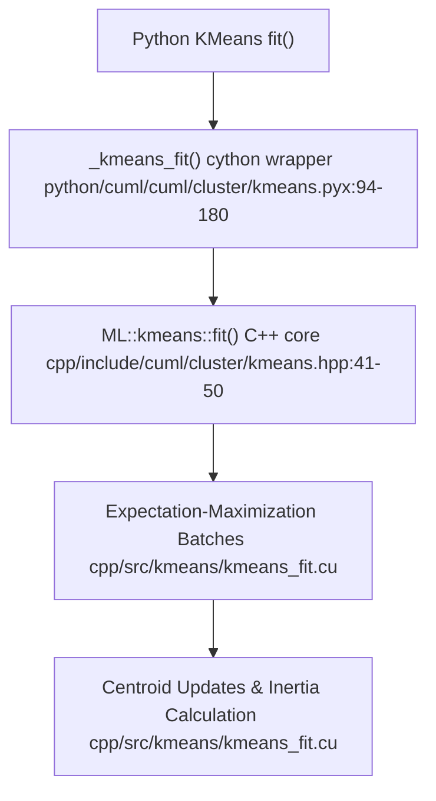
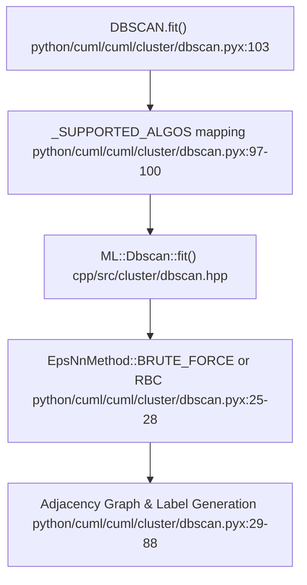
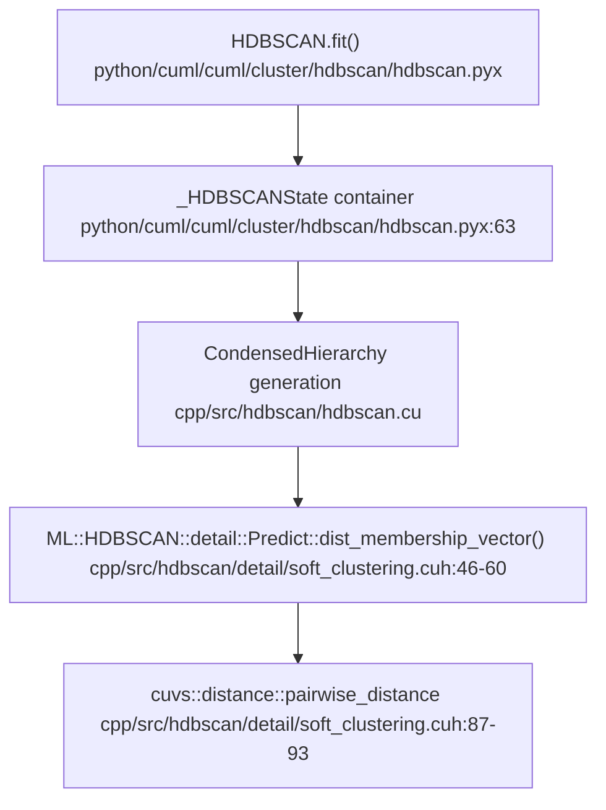
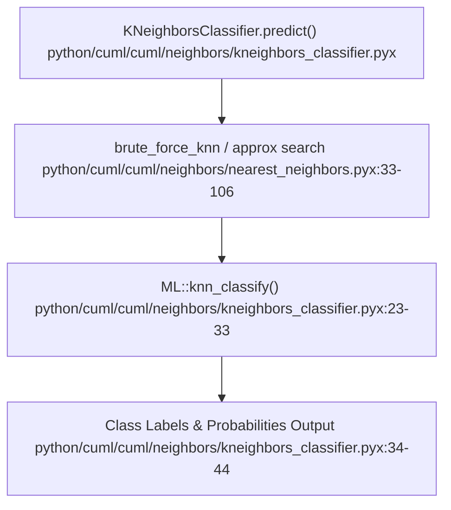
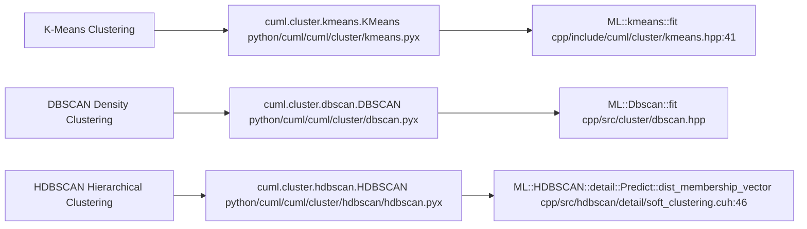
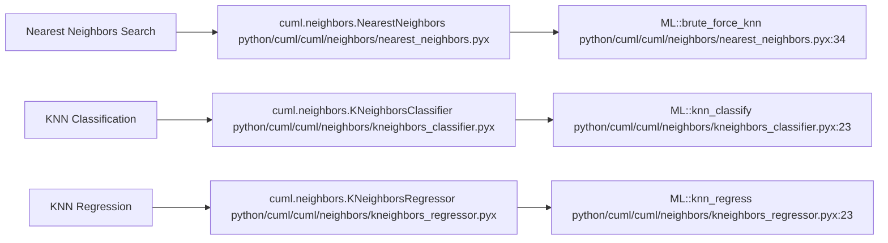

<!-- source: DeepWiki mcp.deepwiki.com · repo NVIDIA/cuml · extra page Clustering and Neighbors Estimators · fetched 2026-10-26 -->

# Clustering and Neighbors Estimators

Relevant source files

The following files were used as context for generating this wiki page:

- [cpp/bench/sg/linkage.cu](cpp/bench/sg/linkage.cu)
- [cpp/include/cuml/cluster/hdbscan.hpp](cpp/include/cuml/cluster/hdbscan.hpp)
- [cpp/include/cuml/cluster/kmeans.hpp](cpp/include/cuml/cluster/kmeans.hpp)
- [cpp/include/cuml/cluster/kmeans_params.hpp](cpp/include/cuml/cluster/kmeans_params.hpp)
- [cpp/include/cuml/cluster/linkage.hpp](cpp/include/cuml/cluster/linkage.hpp)
- [cpp/include/cuml/neighbors/kde.hpp](cpp/include/cuml/neighbors/kde.hpp)
- [cpp/src/hdbscan/detail/kernels/soft_clustering.cuh](cpp/src/hdbscan/detail/kernels/soft_clustering.cuh)
- [cpp/src/hdbscan/detail/predict.cuh](cpp/src/hdbscan/detail/predict.cuh)
- [cpp/src/hdbscan/detail/soft_clustering.cuh](cpp/src/hdbscan/detail/soft_clustering.cuh)
- [cpp/src/hdbscan/hdbscan.cu](cpp/src/hdbscan/hdbscan.cu)
- [cpp/src/hierarchy/linkage.cu](cpp/src/hierarchy/linkage.cu)
- [cpp/src/kde/kde.cu](cpp/src/kde/kde.cu)
- [cpp/src/kmeans/kmeans_fit.cu](cpp/src/kmeans/kmeans_fit.cu)
- [cpp/src/kmeans/kmeans_params.hpp](cpp/src/kmeans/kmeans_params.hpp)
- [cpp/src/ml_cuda_utils.h](cpp/src/ml_cuda_utils.h)
- [python/cuml/cuml/accel/_overrides/sklearn/manifold.py](python/cuml/cuml/accel/_overrides/sklearn/manifold.py)
- [python/cuml/cuml/accel/_overrides/sklearn/neighbors.py](python/cuml/cuml/accel/_overrides/sklearn/neighbors.py)
- [python/cuml/cuml/cluster/agglomerative.pyx](python/cuml/cuml/cluster/agglomerative.pyx)
- [python/cuml/cuml/cluster/cpp/kmeans.pxd](python/cuml/cuml/cluster/cpp/kmeans.pxd)
- [python/cuml/cuml/cluster/dbscan.pyx](python/cuml/cuml/cluster/dbscan.pyx)
- [python/cuml/cuml/cluster/hdbscan/hdbscan.pyx](python/cuml/cuml/cluster/hdbscan/hdbscan.pyx)
- [python/cuml/cuml/cluster/kmeans.pyx](python/cuml/cuml/cluster/kmeans.pyx)
- [python/cuml/cuml/cluster/kmeans_mg.py](python/cuml/cuml/cluster/kmeans_mg.py)
- [python/cuml/cuml/common/sparse.py](python/cuml/cuml/common/sparse.py)
- [python/cuml/cuml/dask/cluster/kmeans.py](python/cuml/cuml/dask/cluster/kmeans.py)
- [python/cuml/cuml/multiclass/__init__.py](python/cuml/cuml/multiclass/__init__.py)
- [python/cuml/cuml/multiclass/multiclass.py](python/cuml/cuml/multiclass/multiclass.py)
- [python/cuml/cuml/neighbors/CMakeLists.txt](python/cuml/cuml/neighbors/CMakeLists.txt)
- [python/cuml/cuml/neighbors/__init__.py](python/cuml/cuml/neighbors/__init__.py)
- [python/cuml/cuml/neighbors/kneighbors_classifier.pyx](python/cuml/cuml/neighbors/kneighbors_classifier.pyx)
- [python/cuml/cuml/neighbors/kneighbors_regressor.pyx](python/cuml/cuml/neighbors/kneighbors_regressor.pyx)
- [python/cuml/cuml/neighbors/nearest_neighbors.pyx](python/cuml/cuml/neighbors/nearest_neighbors.pyx)
- [python/cuml/cuml/neighbors/weights.py](python/cuml/cuml/neighbors/weights.py)
- [python/cuml/tests/dask/test_dask_kmeans.py](python/cuml/tests/dask/test_dask_kmeans.py)
- [python/cuml/tests/test_agglomerative.py](python/cuml/tests/test_agglomerative.py)
- [python/cuml/tests/test_hdbscan.py](python/cuml/tests/test_hdbscan.py)
- [python/cuml/tests/test_kernel_density.py](python/cuml/tests/test_kernel_density.py)
- [python/cuml/tests/test_kmeans.py](python/cuml/tests/test_kmeans.py)
- [python/cuml/tests/test_kneighbors_classifier.py](python/cuml/tests/test_kneighbors_classifier.py)
- [python/cuml/tests/test_kneighbors_regressor.py](python/cuml/tests/test_kneighbors_regressor.py)
- [python/cuml/tests/test_multiclass.py](python/cuml/tests/test_multiclass.py)
- [python/cuml/tests/test_nearest_neighbors.py](python/cuml/tests/test_nearest_neighbors.py)
- [python/cuml/tests/test_no_cuinit.py](python/cuml/tests/test_no_cuinit.py)

## Purpose and Scope
This page details the implementation, architecture, and data flow of clustering and nearest-neighbor estimators in cuML (`python/cuml/cuml/cluster/` and `python/cuml/cuml/neighbors/`). These estimators bridge high-level Python scikit-learn compatible APIs with GPU-accelerated C++/CUDA routines inside `libcuml` and RAFT primitives. The scope covers partition-based clustering (`KMeans`), density-based clustering (`DBSCAN`, `HDBSCAN`), hierarchical/agglomerative clustering, instance-based nearest neighbors (`NearestNeighbors`, `KNeighborsClassifier`, `KNeighborsRegressor`), and Kernel Density Estimation (`KDE`).

---

## 1. Partition-Based and Density-Based Clustering

### KMeans
The cuML `KMeans` estimator (`python/cuml/cuml/cluster/kmeans.pyx:103-1200`) provides single-GPU and multi-GPU (via Dask) accelerated k-means and k-means|| (scalable k-means++) clustering. 

- **Initialization**: Supports `k-means++`, `k-means||` (`scalable-k-means++`), `random`, or pre-computed array initialization mapped to `lib.InitMethod` [python/cuml/cuml/cluster/kmeans.pyx:67-79]().
- **C++ Backend**: Fits models by invoking `ML::kmeans::fit` defined in `cpp/include/cuml/cluster/kmeans.hpp:41-50` and implemented in `cpp/src/kmeans/kmeans_fit.cu`. Iterative expectation-maximization (EM) leverages batched pairwise distance calculations governed by `batch_samples` (`max_samples_per_batch`) [python/cuml/cuml/cluster/kmeans.pyx:44-57]().
- **Multi-GPU / Dask Integration**: `KMeansMG` (`python/cuml/cuml/cluster/kmeans_mg.py`) and `cuml.dask.cluster.KMeans` (`python/cuml/cuml/dask/cluster/kmeans.py:46-100`) coordinate distributed partitions using NCCL via RAFT communicators, passing only centroids across ranks during EM iterations.

*Sources: `python/cuml/cuml/cluster/kmeans.pyx`, `cpp/include/cuml/cluster/kmeans.hpp`, `cpp/src/kmeans/kmeans_fit.cu`, `python/cuml/cuml/dask/cluster/kmeans.py`*

### DBSCAN
The `DBSCAN` estimator (`python/cuml/cuml/cluster/dbscan.pyx:103-501`) constructs adjacency graphs and calculates core sample neighborhoods on the GPU.

- **Algorithms**: Supported neighborhood search methods (`algorithm` parameter) map to `EpsNnMethod::BRUTE_FORCE` and `EpsNnMethod::RBC` (Random Ball Cover) [python/cuml/cuml/cluster/dbscan.pyx:97-100]().
- **C++ Interface**: Invokes `ML::Dbscan::fit` (`cpp/src/cluster/dbscan.hpp`), supporting single-precision and double-precision data alongside sample weights and memory-budgeted batching via `max_mbytes_per_batch` [python/cuml/cuml/cluster/dbscan.pyx:29-88]().

*Sources: `python/cuml/cuml/cluster/dbscan.pyx`*

### HDBSCAN
The `HDBSCAN` implementation (`python/cuml/cuml/cluster/hdbscan/hdbscan.pyx`) computes hierarchical density-based clustering, condensed trees, and soft membership vectors.

- **State Management**: Encapsulates C++ backing objects inside `_HDBSCANState` (`python/cuml/cuml/cluster/hdbscan/hdbscan.pyx:63-122`), managing `hdbscan_output`, `CondensedHierarchy`, and `PredictionData` pointers.
- **Soft Clustering**: Soft and outlier membership vectors are computed via distance-based metrics and exemplar extractions in `cpp/src/hdbscan/detail/soft_clustering.cuh:45-148`.

*Sources: `python/cuml/cuml/cluster/hdbscan/hdbscan.pyx`, `cpp/src/hdbscan/detail/soft_clustering.cuh`, `cpp/src/hdbscan/hdbscan.cu`*

### Agglomerative and Spectral Clustering
Agglomerative hierarchical clustering and spectral embedding wrap linkage routines (`cpp/include/cuml/cluster/linkage.hpp`, `cpp/src/hierarchy/linkage.cu`) to build tree hierarchies and cluster graphs on GPU memory.

*Sources: `python/cuml/cuml/cluster/agglomerative.pyx`, `cpp/include/cuml/cluster/linkage.hpp`, `cpp/src/hierarchy/linkage.cu`*

---

## 2. Nearest Neighbors and Metric Estimators

### NearestNeighbors and KNN Classifiers/Regressors
The base class `NeighborsBase` and concrete estimators `KNeighborsClassifier` (`python/cuml/cuml/neighbors/kneighbors_classifier.pyx`) and `KNeighborsRegressor` (`python/cuml/cuml/neighbors/kneighbors_regressor.pyx`) provide instance-based learning.

- **Search Algorithms**: Supports brute-force (`brute_force_knn`), Random Ball Cover (`rbc_build_index`, `rbc_knn_query`), and approximate nearest neighbors via inverted file indexes (`approx_knn_build_index`, `approx_knn_search` with IVF-Flat or IVF-PQ parameters) [python/cuml/cuml/neighbors/nearest_neighbors.pyx:33-125]().
- **Sparse Support**: Sparse matrix operations are routed through `ML::Sparse::brute_force_knn` (`python/cuml/cuml/neighbors/nearest_neighbors.pyx:126-146`).
- **Classification/Regression Kernels**: `knn_classify`, `knn_class_proba`, and `knn_regress` aggregate neighbor weights (`uniform` or `distance`) on the device [python/cuml/cuml/neighbors/kneighbors_classifier.pyx:23-43](), [python/cuml/cuml/neighbors/kneighbors_regressor.pyx:23-44]().

*Sources: `python/cuml/cuml/neighbors/nearest_neighbors.pyx`, `python/cuml/cuml/neighbors/kneighbors_classifier.pyx`, `python/cuml/cuml/neighbors/kneighbors_regressor.pyx`*

### Kernel Density Estimation (KDE)
KDE estimates probability density functions using GPU acceleration via `ML::KDE` APIs defined in `cpp/include/cuml/neighbors/kde.hpp` and implemented in `cpp/src/kde/kde.cu`.

*Sources: `cpp/include/cuml/neighbors/kde.hpp`, `cpp/src/kde/kde.cu`*

---

## 3. Natural Language to Code Entity Space Mappings

The following diagrams bridge natural language descriptions of clustering and neighbor operations directly to their underlying code structures and functions.

### Clustering Architecture Mapping

*Sources: `python/cuml/cuml/cluster/kmeans.pyx`, `python/cuml/cuml/cluster/dbscan.pyx`, `python/cuml/cuml/cluster/hdbscan/hdbscan.pyx`, `cpp/include/cuml/cluster/kmeans.hpp`, `cpp/src/cluster/dbscan.hpp`, `cpp/src/hdbscan/detail/soft_clustering.cuh`*

### Neighbors and Metric Estimators Mapping

*Sources: `python/cuml/cuml/neighbors/nearest_neighbors.pyx`, `python/cuml/cuml/neighbors/kneighbors_classifier.pyx`, `python/cuml/cuml/neighbors/kneighbors_regressor.pyx`*

---

