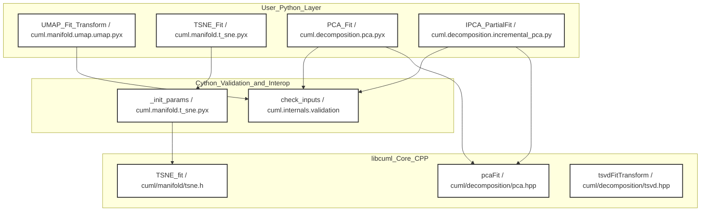
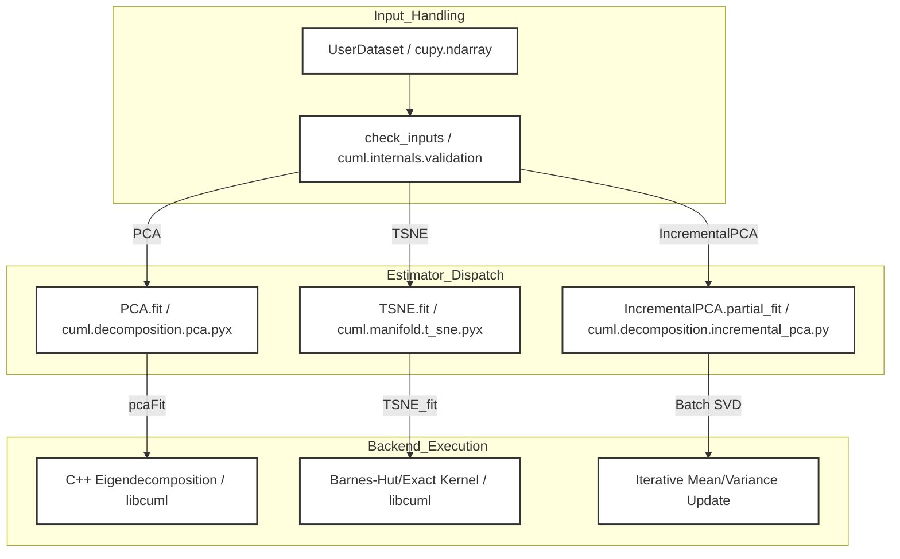

<!-- source: DeepWiki mcp.deepwiki.com · repo NVIDIA/cuml · extra page Dimensionality Reduction and Manifold Estimators · fetched 2026-10-26 -->

# Dimensionality Reduction and Manifold Estimators

Relevant source files

The following files were used as context for generating this wiki page:

- [python/cuml/cuml/accel/_overrides/sklearn/svm.py](python/cuml/cuml/accel/_overrides/sklearn/svm.py)
- [python/cuml/cuml/decomposition/incremental_pca.py](python/cuml/cuml/decomposition/incremental_pca.py)
- [python/cuml/cuml/decomposition/pca.pyx](python/cuml/cuml/decomposition/pca.pyx)
- [python/cuml/cuml/decomposition/tsvd.pyx](python/cuml/cuml/decomposition/tsvd.pyx)
- [python/cuml/cuml/manifold/spectral_embedding.pyx](python/cuml/cuml/manifold/spectral_embedding.pyx)
- [python/cuml/cuml/manifold/t_sne.pyx](python/cuml/cuml/manifold/t_sne.pyx)
- [python/cuml/cuml/manifold/umap/umap.pyx](python/cuml/cuml/manifold/umap/umap.pyx)
- [python/cuml/cuml/preprocessing/_target_encoder.py](python/cuml/cuml/preprocessing/_target_encoder.py)
- [python/cuml/cuml/random_projection/random_projection.py](python/cuml/cuml/random_projection/random_projection.py)
- [python/cuml/cuml_accel_tests/test_onnx.py](python/cuml/cuml_accel_tests/test_onnx.py)
- [python/cuml/tests/test_incremental_pca.py](python/cuml/tests/test_incremental_pca.py)
- [python/cuml/tests/test_pca.py](python/cuml/tests/test_pca.py)
- [python/cuml/tests/test_random_projection.py](python/cuml/tests/test_random_projection.py)
- [python/cuml/tests/test_simpl_set.py](python/cuml/tests/test_simpl_set.py)
- [python/cuml/tests/test_spectral_embedding.py](python/cuml/tests/test_spectral_embedding.py)
- [python/cuml/tests/test_target_encoder.py](python/cuml/tests/test_target_encoder.py)
- [python/cuml/tests/test_tsvd.py](python/cuml/tests/test_tsvd.py)
- [python/cuml/tests/test_umap.py](python/cuml/tests/test_umap.py)

This page covers the Python APIs and C++ backend integrations for dimensionality reduction and manifold learning estimators in cuML (`cuml.manifold`, `cuml.decomposition`, and `cuml.random_projection`). It details the implementation patterns, Cython bindings, algorithmic variants (such as UMAP, t-SNE, PCA, Incremental PCA, Truncated SVD, Spectral Embedding, and Random Projections), and data flows.

---

## 1. Manifold Learning Estimators

Manifold learning algorithms capture non-linear low-dimensional structures from high-dimensional feature spaces. cuML provides accelerated Cython/C++ implementations for UMAP, t-SNE, and Spectral Embedding.

### UMAP (`cuml.manifold.UMAP`)
The UMAP estimator [python/cuml/cuml/manifold/umap/umap.pyx:45]() implements Uniform Manifold Approximation and Projection. It constructs fuzzy simplicial sets and optimizes low-dimensional layouts using cross-entropy objectives. 
- Supports supervised and semi-supervised metric learning via target constraints [python/cuml/tests/test_umap.py:103-125]().
- Accepts dense or sparse inputs (CuPy ndarrays, SciPy/CuPy sparse matrices) [python/cuml/tests/test_umap.py:163-204]().
- Relies on helper utilities such as `find_ab_params` [python/cuml/cuml/manifold/umap/umap.pyx:63-95]() for curve fitting and `_breadth_first_search` for inverse transform neighborhood calculations [python/cuml/cuml/manifold/umap/umap.pyx:98-136]().

### t-SNE (`cuml.manifold.TSNE`)
The t-SNE estimator [python/cuml/cuml/manifold/t_sne.pyx:25-92]() binds directly to the underlying `ML::TSNE_fit` and `ML::TSNE_fit_sparse` routines. 
- Configured through `TSNEParams` [python/cuml/cuml/manifold/t_sne.pyx:36-61](), which exposes algorithm selection (`EXACT`, `BARNES_HUT`, `FFT`), initialization modes (`RANDOM`, `PCA`), perplexity tolerances, and learning rates.
- Supports metric choices mapped via `_SUPPORTED_METRICS` [python/cuml/cuml/manifold/t_sne.pyx:93-104]().

### Spectral Embedding (`cuml.manifold.SpectralEmbedding`)
Implemented in `python/cuml/cuml/manifold/spectral_embedding.pyx` [python/cuml/cuml/manifold/spectral_embedding.pyx:54-59](), this estimator applies spectral decomposition to graph Laplacians (Laplacian Eigenmaps) [python/cuml/cuml/manifold/spectral_embedding.pyx:60-68]().
- Interacts with `ML::SpectralEmbedding::transform` [python/cuml/cuml/manifold/spectral_embedding.pyx:29-53]() taking either dense dataset views or sparse CSR graph structures (`rows`, `cols`, `vals`).
- Exposes attributes such as `embedding_` and `n_neighbors_` [python/cuml/cuml/manifold/spectral_embedding.pyx:93-99]().

Sources:
- `python/cuml/cuml/manifold/umap/umap.pyx` [python/cuml/cuml/manifold/umap/umap.pyx:1-197]()
- `python/cuml/tests/test_umap.py` [python/cuml/tests/test_umap.py:1-219]()
- `python/cuml/cuml/manifold/t_sne.pyx` [python/cuml/cuml/manifold/t_sne.pyx:1-197]()
- `python/cuml/cuml/manifold/spectral_embedding.pyx` [python/cuml/cuml/manifold/spectral_embedding.pyx:1-189]()

---

## 2. Linear Decomposition Estimators

Linear decomposition techniques project high-dimensional data onto orthogonal linear subspaces while maximizing variance or preserving singular values.

### PCA (`cuml.decomposition.PCA`)
Principal Component Analysis is implemented in `python/cuml/cuml/decomposition/pca.pyx` [python/cuml/cuml/decomposition/pca.pyx:84-88]() and wraps core C++ routines `pcaFit`, `pcaTransform`, and `pcaInverseTransform` [python/cuml/cuml/decomposition/pca.pyx:29-82]().
- Supports `'full'` and `'jacobi'` solvers via `paramsPCA` configuration structures [python/cuml/decomposition/pca.pyx:26]().
- Computes components, explained variance, explained variance ratio, singular values, data mean, and noise variance [python/cuml/decomposition/pca.pyx:31-39]().

### Incremental PCA (`cuml.decomposition.IncrementalPCA`)
The `IncrementalPCA` class inherits from `PCA` [python/cuml/cuml/decomposition/incremental_pca.py:23-44]() to process datasets in constant memory blocks (`batch_size * n_features`).
- Implements `partial_fit` to incrementally update mean, variance, and singular value decompositions across batches [python/cuml/tests/test_incremental_pca.py:88-113]().
- Handles both dense arrays and sparse representations by converting sparse batches dynamically during mean subtraction [python/cuml/decomposition/incremental_pca.py:36-38]().

### Truncated SVD (`cuml.decomposition.TruncatedSVD`)
Implemented in `python/cuml/cuml/decomposition/tsvd.pyx` [python/cuml/cuml/decomposition/tsvd.pyx:72-75](), Truncated SVD computes top-$K$ singular values and vectors without centering the data.
- Binds to `tsvdFitTransform`, `tsvdTransform`, and `tsvdInverseTransform` [python/cuml/cuml/decomposition/tsvd.pyx:27-70]() using `paramsTSVD` [python/cuml/decomposition/tsvd.pyx:24]().

Sources:
- `python/cuml/cuml/decomposition/pca.pyx` [python/cuml/cuml/decomposition/pca.pyx:1-177]()
- `python/cuml/cuml/decomposition/incremental_pca.py` [python/cuml/cuml/decomposition/incremental_pca.py:1-150]()
- `python/cuml/tests/test_incremental_pca.py` [python/cuml/tests/test_incremental_pca.py:1-216]()
- `python/cuml/cuml/decomposition/tsvd.pyx` [python/cuml/cuml/decomposition/tsvd.pyx:1-164]()

---

## 3. Random Projection Estimators

Random projection estimators reduce dimensionality by projecting input matrices via randomly generated distribution matrices.

- **Base Class (`_BaseRandomProjection`)**: Defined in `python/cuml/cuml/random_projection/random_projection.py` [python/cuml/cuml/random_projection/random_projection.py:49-53]() inheriting from `SparseInputTagMixin` and `Base`. Handles automatic dimension sizing using the Johnson-Lindenstrauss lemma (`johnson_lindenstrauss_min_dim`) [python/cuml/cuml/random_projection/random_projection.py:19-46]() and matrix multiplication transforms (`X @ self.components_.T`) [python/cuml/cuml/random_projection/random_projection.py:146]().
- **Gaussian Random Projection (`GaussianRandomProjection`)**: Draws projection matrix components from a Gaussian distribution $N(0, 1 / \text{n\_components})$ [python/cuml/cuml/random_projection/random_projection.py:168-172]().

Sources:
- `python/cuml/cuml/random_projection/random_projection.py` [python/cuml/cuml/random_projection/random_projection.py:1-200]()

---

## 4. Execution Flow and Architecture Integration

The following diagrams map natural language concepts and execution requests to the concrete code entities (classes, modules, and C++ routines) responsible for dimensionality reduction and manifold learning within cuML.

### Diagram: Manifold and Decomposition Execution Pipeline
This diagram bridges high-level user tasks to specific Python classes and underlying C++ functions.

Sources:
- `python/cuml/cuml/manifold/umap/umap.pyx` [python/cuml/cuml/manifold/umap/umap.pyx:1-45]()
- `python/cuml/cuml/manifold/t_sne.pyx` [python/cuml/cuml/manifold/t_sne.pyx:25-92]()
- `python/cuml/cuml/decomposition/pca.pyx` [python/cuml/cuml/decomposition/pca.pyx:29-82]()
- `python/cuml/cuml/decomposition/incremental_pca.py` [python/cuml/cuml/decomposition/incremental_pca.py:23-44]()

### Diagram: Estimator Dispatch and SVD Data Flow
This diagram details how input tensors traverse validation checks and map to backend solvers.

Sources:
- `python/cuml/cuml/decomposition/pca.pyx` [python/cuml/cuml/decomposition/pca.pyx:31-40]()
- `python/cuml/cuml/manifold/t_sne.pyx` [python/cuml/cuml/manifold/t_sne.pyx:65-76]()
- `python/cuml/cuml/decomposition/incremental_pca.py` [python/cuml/cuml/decomposition/incremental_pca.py:88-101]()

---

