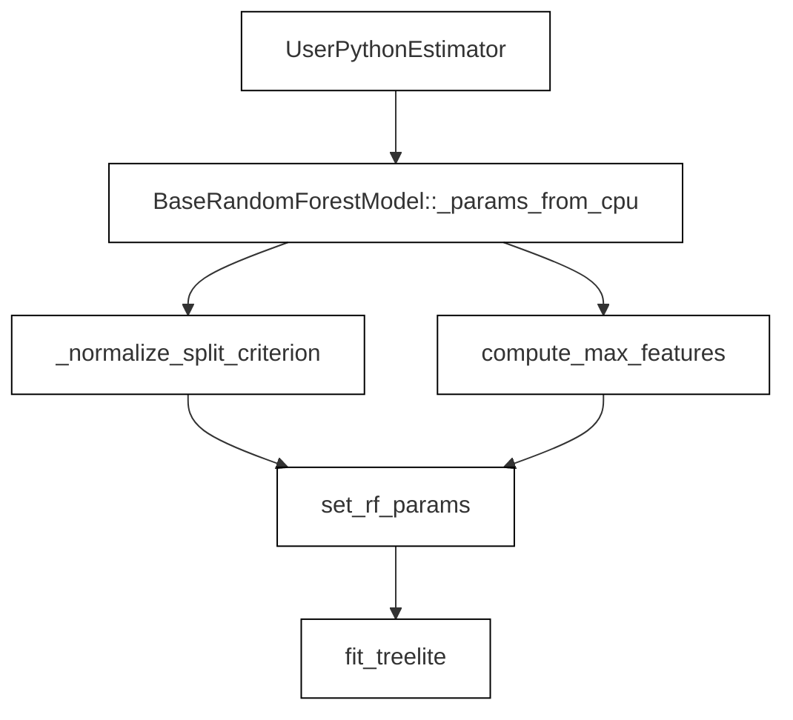
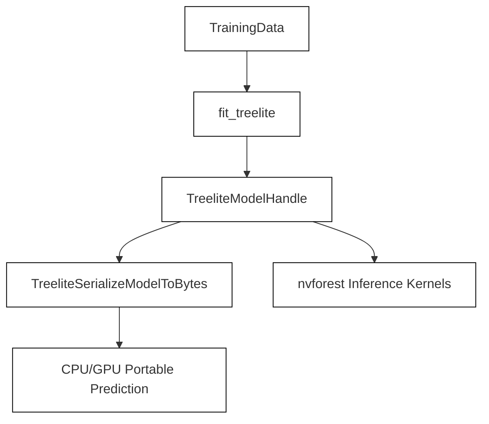
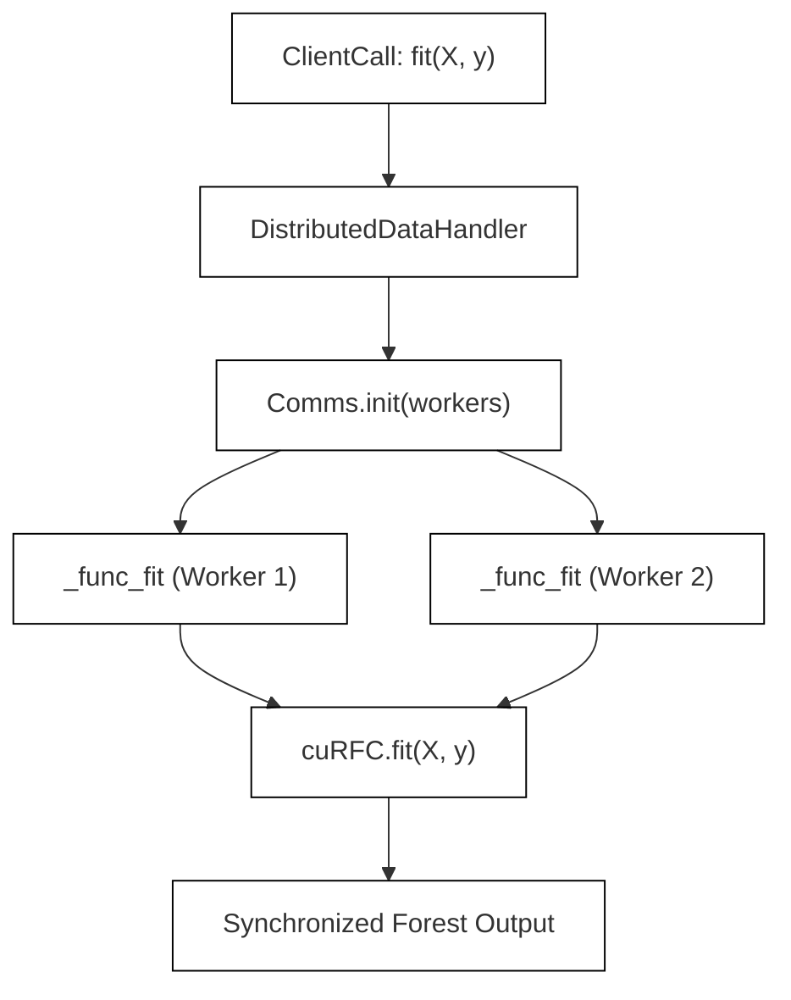

<!-- source: DeepWiki mcp.deepwiki.com · repo NVIDIA/cuml · extra page Ensemble Estimators (Random Forest, Isolation Forest) · fetched 2026-10-26 -->

# Ensemble Estimators (Random Forest, Isolation Forest)

Relevant source files

The following files were used as context for generating this wiki page:

- [cpp/include/cuml/ensemble/isolation_forest.hpp](cpp/include/cuml/ensemble/isolation_forest.hpp)
- [cpp/src/isolation_forest/isolation_forest.cu](cpp/src/isolation_forest/isolation_forest.cu)
- [cpp/tests/sg/isolation_forest_test.cu](cpp/tests/sg/isolation_forest_test.cu)
- [python/cuml/cuml/accel/_overrides/sklearn/ensemble.py](python/cuml/cuml/accel/_overrides/sklearn/ensemble.py)
- [python/cuml/cuml/dask/ensemble/base.py](python/cuml/cuml/dask/ensemble/base.py)
- [python/cuml/cuml/dask/ensemble/randomforestclassifier.py](python/cuml/cuml/dask/ensemble/randomforestclassifier.py)
- [python/cuml/cuml/dask/ensemble/randomforestregressor.py](python/cuml/cuml/dask/ensemble/randomforestregressor.py)
- [python/cuml/cuml/ensemble/isolation_forest.pyx](python/cuml/cuml/ensemble/isolation_forest.pyx)
- [python/cuml/cuml/ensemble/randomforest_common.pyx](python/cuml/cuml/ensemble/randomforest_common.pyx)
- [python/cuml/cuml/ensemble/randomforestclassifier.py](python/cuml/cuml/ensemble/randomforestclassifier.py)
- [python/cuml/cuml/ensemble/randomforestregressor.py](python/cuml/cuml/ensemble/randomforestregressor.py)
- [python/cuml/cuml_accel_tests/integration/test_isolation_forest.py](python/cuml/cuml_accel_tests/integration/test_isolation_forest.py)
- [python/cuml/tests/dask/test_dask_random_forest.py](python/cuml/tests/dask/test_dask_random_forest.py)
- [python/cuml/tests/explainer/test_gpu_treeshap.py](python/cuml/tests/explainer/test_gpu_treeshap.py)
- [python/cuml/tests/test_isolation_forest.py](python/cuml/tests/test_isolation_forest.py)
- [python/cuml/tests/test_random_forest.py](python/cuml/tests/test_random_forest.py)

## Purpose and Scope

This wiki page covers the technical implementation, architecture, and APIs for cuML’s ensemble estimators, focusing on **Random Forest Classifiers**, **Random Forest Regressors**, and **Isolation Forests**. It details the shared Cython foundation (`randomforest_common.pyx`), model fitting and hyperparameter translation, out-of-bag (OOB) score evaluation, Treelite and `nvforest` inference mechanisms, Isolation Forest anomaly detection algorithms, and distributed Multi-Node Multi-GPU (MNMG) execution using Dask.

---

## 1. Shared Forest Infrastructure and Cython Base (`randomforest_common.pyx`)

The foundational base class for all cuML tree ensemble models is `BaseRandomForestModel`, defined in `python/cuml/cuml/ensemble/randomforest_common.pyx` [python/cuml/cuml/ensemble/randomforest_common.pyx:192](). It inherits from `InteropMixin` and `Base`, providing scikit-learn interop, parameter normalization, and C++ interop bindings to `libcuml`'s random forest routines (`fit_treelite`) [python/cuml/cuml/ensemble/randomforest_common.pyx:19-22, 56-101]().

Key capabilities implemented in this module include:
- **Parameter Normalization**: Translating scikit-learn criterion strings (e.g., `'gini'`, `'entropy'`, `'squared_error'`, `'poisson'`) into internal `CRITERION` enums via `_normalize_split_criterion()` [python/cuml/cuml/ensemble/randomforest_common.pyx:119-168]().
- **Feature Count Computation**: `compute_max_features()` converts `'sqrt'`, `'log2'`, integer counts, or float fractions into explicit column ratios [python/cuml/cuml/ensemble/randomforest_common.pyx:171-190]().
- **CPU-to-GPU Model Conversion**: `_params_from_cpu()` validates scikit-learn models before conversion, raising `UnsupportedOnGPU` exceptions for unsupported features such as monotonic constraints, `warm_start=True`, or `ccp_alpha` pruning [python/cuml/cuml/ensemble/randomforest_common.pyx:216-236]().

*Figure 1: Code entity data flow from Python estimator configuration to libcuml C++ binding `fit_treelite`.*

Sources:
- `python/cuml/cuml/ensemble/randomforest_common.pyx` [python/cuml/cuml/ensemble/randomforest_common.pyx:1-236]()

---

## 2. Estimator APIs: Classifier and Regressor

CuML provides public estimators `RandomForestClassifier` and `RandomForestRegressor` which expose APIs compatible with scikit-learn while leveraging GPU acceleration for quantile-based tree building [python/cuml/cuml/ensemble/randomforestclassifier.py:16](), [python/cuml/cuml/ensemble/randomforestregressor.py:11]().

### Quantile-Based Splitting
Unlike scikit-learn, which tests exact thresholds by sorting feature values, cuML uses a quantile-based histogram binning algorithm governed by the `n_bins` parameter (default 128) [python/cuml/cuml/ensemble/randomforestclassifier.py:21-25, 90](). This limits memory consumption and speeds up split evaluation on large GPU datasets.

### Out-Of-Bag (OOB) Scoring
When `bootstrap=True` and `oob_score=True`, cuML computes generalization metrics using out-of-bag samples without a validation split:
- **Classifier**: Computes OOB accuracy and populates `oob_score_` and `oob_decision_function_` [python/cuml/cuml/ensemble/randomforestclassifier.py:117-145]().
- **Regressor**: Computes $R^2$ (coefficient of determination) score, populating `oob_score_` and `oob_prediction_` [python/cuml/cuml/ensemble/randomforestregressor.py:119-140]().

Sources:
- `python/cuml/cuml/ensemble/randomforestclassifier.py` [python/cuml/cuml/ensemble/randomforestclassifier.py:16-145]()
- `python/cuml/cuml/ensemble/randomforestregressor.py` [python/cuml/cuml/ensemble/randomforestregressor.py:11-140]()

---

## 3. Inference Mechanisms: Treelite and nvforest

Inference for cuML random forests is decoupled from training via model serialization and export pipelines:

1. **Treelite Export**: During training, cuML constructs trees directly into Treelite model handles via `fit_treelite` [python/cuml/cuml/ensemble/randomforest_common.pyx:87-116](). This allows models to be serialized to bytes (`_treelite_model_bytes`) and run on CPU or GPU targets via Treelite runtimes [python/cuml/tests/test_random_forest.py:44-46]().
2. **`nvforest` Inference**: For high-performance GPU prediction, cuML leverages the `nvforest` package, which executes parallel tree traversal kernels directly on device memory arrays without host-device roundtrips.

*Figure 2: Inference architecture linking `fit_treelite` to Treelite serialization and `nvforest` execution.*

Sources:
- `python/cuml/cuml/ensemble/randomforest_common.pyx` [python/cuml/cuml/ensemble/randomforest_common.pyx:31-38, 87-116]()
- `python/cuml/tests/test_random_forest.py` [python/cuml/tests/test_random_forest.py:44-46]()

---

## 4. Isolation Forest for Anomaly Detection

CuML implements GPU-accelerated anomaly detection via `IsolationForest` in `python/cuml/cuml/ensemble/isolation_forest.pyx` [python/cuml/cuml/ensemble/isolation_forest.pyx:7]() backed by C++ routines defined in `cpp/include/cuml/ensemble/isolation_forest.hpp` [cpp/include/cuml/ensemble/isolation_forest.hpp:22]().

### Mathematical Formulation & C++ Structures
Isolation forests isolate anomalies by randomly selecting a feature and split value. Anomalies have shorter average path lengths $E[h(x)]$ across the forest. The anomaly score is computed as:
$$s(x, n) = 2^{-\frac{E[h(x)]}{c(n)}}$$
where $c(n)$ is the average path length of unsuccessful searches in a Binary Search Tree given $n$ samples [cpp/include/cuml/ensemble/isolation_forest.hpp:92-110]().

Key C++ structures include:
- `IF_params`: Stores hyperparameters such as `n_estimators`, `max_samples`, `max_depth`, `max_features`, and `bootstrap` [cpp/include/cuml/ensemble/isolation_forest.hpp:27-34]().
- `IsolationForestModel`: Manages device buffers for `global_nodes`, `global_tree_offsets`, and `global_feature_indices` [cpp/include/cuml/ensemble/isolation_forest.hpp:37-50]().
- `IFNodeCompact`: Compact node layout where internal nodes store `feature_idx >= 0` and leaves store precomputed path length thresholds (`feature_idx = -1`) [cpp/include/cuml/ensemble/isolation_forest.hpp:61-67]().

### Scikit-Learn Interoperability & Sample Count Recovery
Because Treelite exports isolation forests without per-node sample counts, cuML includes recovery utilities in `isolation_forest.pyx`:
- `_invert_average_path_length()`: Recovers integer sample count $n$ from leaf average path lengths [python/cuml/cuml/ensemble/isolation_forest.pyx:74-120]().
- `_recover_node_sample_counts()`: Rebuilds bottom-up sample counts for every node, validating against root sample counts [python/cuml/cuml/ensemble/isolation_forest.pyx:122-154]().
- `_isolation_tree_to_sklearn()`: Rebuilds scikit-learn `ExtraTreeRegressor` trees from Treelite exports for scikit-learn interop [python/cuml/cuml/ensemble/isolation_forest.pyx:156-192]().

Sources:
- `python/cuml/cuml/ensemble/isolation_forest.pyx` [python/cuml/cuml/ensemble/isolation_forest.pyx:1-192]()
- `cpp/include/cuml/ensemble/isolation_forest.hpp` [cpp/include/cuml/ensemble/isolation_forest.hpp:1-171]()

---

## 5. Distributed Execution and Dask Ensemble (`cuml.dask`)

Distributed multi-GPU random forest models (`cuml.dask.ensemble.RandomForestClassifier` and `RandomForestRegressor`) coordinate training across cluster workers using RAFT communications (`Comms`) [python/cuml/cuml/dask/ensemble/base.py:13-81]().

### Distributed Fitting Lifecycle (`BaseRandomForestModel`)
1. **Model Initialization**: `_create_model()` instantiates single-GPU proxy forest models across selected Dask workers [python/cuml/cuml/dask/ensemble/base.py:22-58]().
2. **Data Partitioning Validation**: `DistributedDataHandler` inspects input Dask arrays/dataframes to ensure proper partitioning across workers holding training rows [python/cuml/cuml/dask/ensemble/base.py:62-74]().
3. **RAFT Comms Initialization**: A distributed NCCL communicator session is initialized via `Comms(client=self.client)` [python/cuml/cuml/dask/ensemble/base.py:76-83]().
4. **Collective Fitting (`_func_fit`)**: Workers invoke `model.fit(X, y)` concurrently within the collective communication context, validating inputs across ranks via allreduce status checks before constructing the final forest [python/cuml/cuml/dask/ensemble/base.py:146-175]().

*Figure 3: Distributed Dask ensemble fitting workflow utilizing RAFT Comms.*

Sources:
- `python/cuml/cuml/dask/ensemble/base.py` [python/cuml/cuml/dask/ensemble/base.py:1-189]()
- `python/cuml/cuml/dask/ensemble/randomforestclassifier.py` [python/cuml/cuml/dask/ensemble/randomforestclassifier.py:18-125]()
- `python/cuml/cuml/dask/ensemble/randomforestregressor.py` [python/cuml/cuml/dask/ensemble/randomforestregressor.py:11-114]()

---

