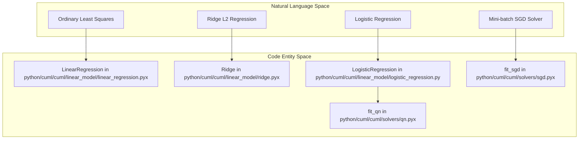
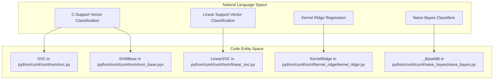

<!-- source: DeepWiki mcp.deepwiki.com · repo NVIDIA/cuml · extra page Linear Models, SVM and Solvers · fetched 2026-10-26 -->

# Linear Models, SVM and Solvers

Relevant source files

The following files were used as context for generating this wiki page:

- [python/cuml/cuml/common/classification.py](python/cuml/cuml/common/classification.py)
- [python/cuml/cuml/common/kernel_utils.py](python/cuml/cuml/common/kernel_utils.py)
- [python/cuml/cuml/internals/callbacks_implems.h](python/cuml/cuml/internals/callbacks_implems.h)
- [python/cuml/cuml/internals/internals.pyx](python/cuml/cuml/internals/internals.pyx)
- [python/cuml/cuml/kernel_ridge/kernel_ridge.py](python/cuml/cuml/kernel_ridge/kernel_ridge.py)
- [python/cuml/cuml/linear_model/base.py](python/cuml/cuml/linear_model/base.py)
- [python/cuml/cuml/linear_model/elastic_net.py](python/cuml/cuml/linear_model/elastic_net.py)
- [python/cuml/cuml/linear_model/linear_regression.pyx](python/cuml/cuml/linear_model/linear_regression.pyx)
- [python/cuml/cuml/linear_model/logistic_regression.py](python/cuml/cuml/linear_model/logistic_regression.py)
- [python/cuml/cuml/linear_model/mbsgd_classifier.py](python/cuml/cuml/linear_model/mbsgd_classifier.py)
- [python/cuml/cuml/linear_model/mbsgd_regressor.py](python/cuml/cuml/linear_model/mbsgd_regressor.py)
- [python/cuml/cuml/linear_model/ridge.pyx](python/cuml/cuml/linear_model/ridge.pyx)
- [python/cuml/cuml/metrics/hinge_loss.py](python/cuml/cuml/metrics/hinge_loss.py)
- [python/cuml/cuml/metrics/pairwise_kernels.py](python/cuml/cuml/metrics/pairwise_kernels.py)
- [python/cuml/cuml/metrics/trustworthiness.pyx](python/cuml/cuml/metrics/trustworthiness.pyx)
- [python/cuml/cuml/naive_bayes/naive_bayes.py](python/cuml/cuml/naive_bayes/naive_bayes.py)
- [python/cuml/cuml/solvers/cd.pyx](python/cuml/cuml/solvers/cd.pyx)
- [python/cuml/cuml/solvers/qn.pyx](python/cuml/cuml/solvers/qn.pyx)
- [python/cuml/cuml/solvers/sgd.pyx](python/cuml/cuml/solvers/sgd.pyx)
- [python/cuml/cuml/svm/linear_svc.py](python/cuml/cuml/svm/linear_svc.py)
- [python/cuml/cuml/svm/svc.py](python/cuml/cuml/svm/svc.py)
- [python/cuml/cuml/svm/svm_base.pyx](python/cuml/cuml/svm/svm_base.pyx)
- [python/cuml/cuml/svm/svr.py](python/cuml/cuml/svm/svr.py)
- [python/cuml/cuml/thirdparty_adapters/sparsefuncs_fast.py](python/cuml/cuml/thirdparty_adapters/sparsefuncs_fast.py)
- [python/cuml/cuml_accel_tests/integration/test_svc.py](python/cuml/cuml_accel_tests/integration/test_svc.py)
- [python/cuml/cuml_accel_tests/upstream/pytest.ini](python/cuml/cuml_accel_tests/upstream/pytest.ini)
- [python/cuml/tests/dask/test_dask_metrics.py](python/cuml/tests/dask/test_dask_metrics.py)
- [python/cuml/tests/explainer/test_explainer_permutation_shap.py](python/cuml/tests/explainer/test_explainer_permutation_shap.py)
- [python/cuml/tests/test_kernel_ridge.py](python/cuml/tests/test_kernel_ridge.py)
- [python/cuml/tests/test_linear_svm.py](python/cuml/tests/test_linear_svm.py)
- [python/cuml/tests/test_mbsgd_classifier.py](python/cuml/tests/test_mbsgd_classifier.py)
- [python/cuml/tests/test_naive_bayes.py](python/cuml/tests/test_naive_bayes.py)
- [python/cuml/tests/test_sklearn_import_export.py](python/cuml/tests/test_sklearn_import_export.py)
- [python/cuml/tests/test_svm.py](python/cuml/tests/test_svm.py)

This page provides full technical documentation for cuML's linear models, support vector machines (SVM), optimization solvers, kernel ridge regression, and naive bayes estimators. It covers how high-level scikit-learn compatible Python APIs map to underlying `libcuml` C++ algorithms and specialized CUDA solvers.

---

## 1. Linear Models and Solvers

cuML implements classic linear models for regression and classification by binding directly to optimized `libcuml` routines or invoking custom GPU solvers like Quasi-Newton (QN), Coordinate Descent (CD), and Stochastic Gradient Descent (SGD).

### Ordinary Least Squares (OLS) and Ridge Regression
`LinearRegression` and `Ridge` interface with `ML::GLM::olsFit` and `ML::GLM::ridgeFit` declared in C++ headers. 
- `LinearRegression` supports algorithms such as SVD, EIG, QR, SVD-QR, and LSMR via `python/cuml/cuml/linear_model/linear_regression.pyx:31-74`().
- `Ridge` supports L2 regularization with solvers like `'auto'`, `'eig'`, `'svd'`, and `'lsmr'` via `python/cuml/cuml/linear_model/ridge.pyx:30-103`().

Sources: `python/cuml/cuml/linear_model/linear_regression.pyx`, `python/cuml/cuml/linear_model/ridge.pyx`

### ElasticNet and Logistic Regression
- `ElasticNet` handles combined L1 and L2 penalties using coordinate descent solvers [python/cuml/cuml/linear_model/elastic_net.py]().
- `LogisticRegression` utilizes the Quasi-Newton (`qn`) solver (`fit_qn`) supporting L1, L2, and Elastic-Net penalties via `python/cuml/cuml/linear_model/logistic_regression.py:16-74`().

Sources: `python/cuml/cuml/linear_model/logistic_regression.py`, `python/cuml/cuml/linear_model/elastic_net.py`

### Mini-Batch SGD (`MBSGD`)
`MBSGDClassifier` and `MBSGDRegressor` minimize regularized empirical loss using mini-batch stochastic gradient descent on the GPU, driven by `fit_sgd` (`python/cuml/cuml/solvers/sgd.pyx`) with support for hinge, log, and squared loss functions [python/cuml/cuml/linear_model/mbsgd_classifier.py:15-188]().

Sources: `python/cuml/cuml/linear_model/mbsgd_classifier.py`, `python/cuml/cuml/solvers/sgd.pyx`

Sources: `python/cuml/cuml/linear_model/linear_regression.pyx`, `python/cuml/cuml/linear_model/ridge.pyx`, `python/cuml/cuml/linear_model/logistic_regression.py`, `python/cuml/cuml/solvers/sgd.pyx`, `python/cuml/cuml/solvers/qn.pyx`

---

## 2. Support Vector Machines (SVM)

cuML provides high-performance GPU implementations of Support Vector Classification (`SVC`), Support Vector Regression (`SVR`), and `LinearSVC`.

### SVC and SVR Architecture
- `SVC` and `SVR` inherit from `SVMBase` (`python/cuml/cuml/svm/svm_base.pyx:121-124`()) and implement the Sequential Minimal Optimization (SMO) algorithm using an Optimized Hierarchical Decomposition variant [python/cuml/cuml/svm/svc.py:18-150]().
- `_SVMModel` manages underlying C++ `SvmModel` memory buffers and provides zero-copy conversions to CuPy arrays via `python/cuml/cuml/svm/svm_base.pyx:23-54`().

Sources: `python/cuml/cuml/svm/svc.py`, `python/cuml/cuml/svm/svr.py`, `python/cuml/cuml/svm/svm_base.pyx`

### LinearSVC
`LinearSVC` optimizes the primal objective directly using the Quasi-Newton (L-BFGS / OWL-QN) solver rather than solving the dual problem, allowing it to scale effectively for large linear problems with L1 or L2 penalties [python/cuml/cuml/svm/linear_svc.py:19-90]().

Sources: `python/cuml/cuml/svm/linear_svc.py`

---

## 3. Kernel Ridge and Naive Bayes

### Kernel Ridge Regression (`KernelRidge`)
`KernelRidge` performs kernelized ridge regression by computing pairwise kernel matrices via `cuml.metrics.pairwise_kernels` and solving the dual problem using Cholesky factorization (`lapack.posv`) with automatic fallback to least squares (`linalg.lstsq`) for singular matrices [python/cuml/cuml/kernel_ridge/kernel_ridge.py:28-88]().

Sources: `python/cuml/cuml/kernel_ridge/kernel_ridge.py`, `python/cuml/cuml/metrics/pairwise_kernels.py`

### Naive Bayes
The naive bayes module implements `MultinomialNB`, `BernoulliNB`, `ComplementNB`, `GaussianNB`, and `CategoricalNB` inheriting from `_BaseNB` (`python/cuml/cuml/naive_bayes/naive_bayes.py:56-116`()). They leverage custom CuPy elementwise kernels (e.g., `_binarize`) and `cp.bincount` for rapid GPU-accelerated conditional probability accumulation and support both `fit` and `partial_fit` pipelines.

Sources: `python/cuml/cuml/naive_bayes/naive_bayes.py`

Sources: `python/cuml/cuml/svm/svc.py`, `python/cuml/cuml/svm/linear_svc.py`, `python/cuml/cuml/kernel_ridge/kernel_ridge.py`, `python/cuml/cuml/naive_bayes/naive_bayes.py`, `python/cuml/cuml/svm/svm_base.pyx`

---

