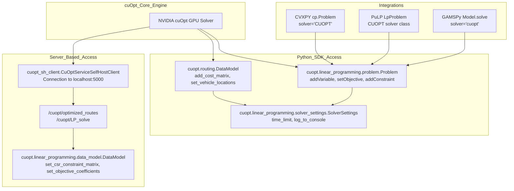
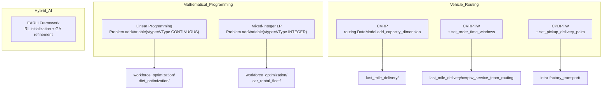
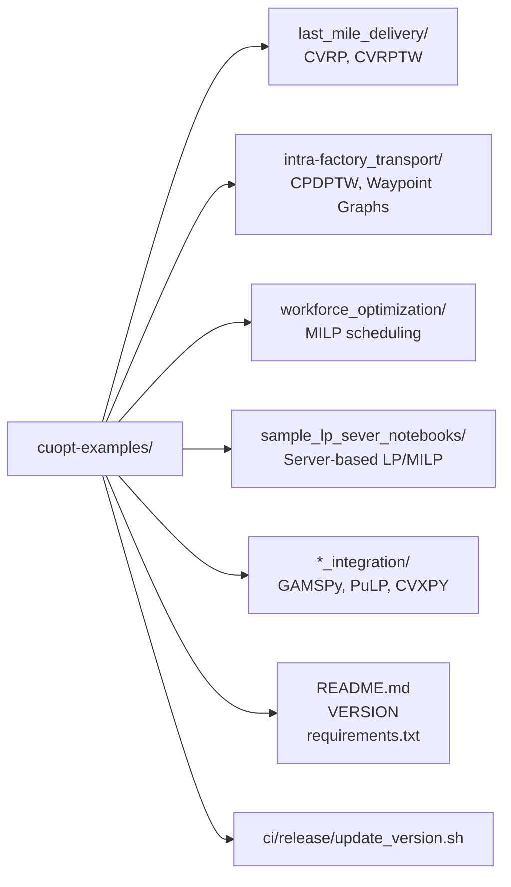

<!-- source: DeepWiki mcp.deepwiki.com · repo NVIDIA/cuopt-examples · page 1 Overview · fetched 2026-10-26 -->

# Overview

<details>
<summary>Relevant source files</summary>

The following files were used as context for generating this wiki page:

- [README.md](README.md)
- [VERSION](VERSION)
- [ci/release/update_version.sh](ci/release/update_version.sh)
- [intra-factory_transport/README.md](intra-factory_transport/README.md)
- [last_mile_delivery/README.md](last_mile_delivery/README.md)
- [routing_optimization_over_server/README.md](routing_optimization_over_server/README.md)
- [sample_lp_sever_notebooks/README.md](sample_lp_sever_notebooks/README.md)
- [workforce_optimization/workforce_optimization_milp.ipynb](workforce_optimization/workforce_optimization_milp.ipynb)

</details>


This page introduces the cuopt-examples repository, explaining its purpose as a collection of GPU-accelerated optimization examples, the types of problems it addresses, and the overall architecture. For detailed environment setup instructions, see **Getting Started**. For specific problem types, see **Vehicle Routing Problems**, **Portfolio Optimization**, or **Linear and Mixed-Integer Programming**.

## Purpose and Scope

The `cuopt-examples` repository is a comprehensive collection of examples demonstrating NVIDIA® cuOpt™, an open-source GPU-accelerated engine for solving complex decision optimization problems. The repository provides example notebooks and implementation references covering three primary optimization domains:

- **Vehicle Routing Problems (VRP)**: Including Capacitated VRP (CVRP), VRP with Time Windows (CVRPTW), and Pickup and Delivery (CPDPTW) for logistics and factory automation [last_mile_delivery/README.md:1-64](), [intra-factory_transport/README.md:9-17]().
- **Mathematical Programming**: Linear Programming (LP) and Mixed-Integer Linear Programming (MILP) for resource allocation, scheduling, and operational optimization [sample_lp_sever_notebooks/README.md:1-48](), [workforce_optimization/workforce_optimization_milp.ipynb:7-18]().
- **Portfolio Optimization**: Advanced financial modeling including Conditional Value at Risk (CVaR) and mean-variance approaches.

The repository is distributed under the [Apache 2.0 License](LICENSE.md) and serves as both a learning resource and production-ready implementation reference [README.md:1-8]().

**Sources:** [README.md:1-83](), [last_mile_delivery/README.md:1-64](), [workforce_optimization/workforce_optimization_milp.ipynb:7-18]()

## Repository Architecture

The `cuopt-examples` repository is organized around three primary access patterns to the cuOpt optimization engine: direct SDK access, server-based deployment, and integration through third-party modeling languages.

### System Architecture: Code Entity Mapping

The following diagram bridges the natural language concepts to the specific code entities used in the repository:



**Sources:** [README.md:1-83](), [workforce_optimization/workforce_optimization_milp.ipynb:107-112](), [sample_lp_sever_notebooks/README.md:1-58](), [routing_optimization_over_server/README.md:1-18]()

### Access Pattern Details

The repository provides three primary access methods, each suited to different deployment scenarios:

| Access Method | Primary Classes/APIs | Use Cases | Example Locations |
|--------------|---------------------|-----------|-------------------|
| **Direct SDK** | `Problem`, `DataModel`, `SolverSettings` | Programmatic problem construction, embedded optimization | `workforce_optimization/`, `intra-factory_transport/` |
| **Server-Based** | `CuOptServiceSelfHostClient`, `/cuopt/*` endpoints | Client-server architecture, remote solving, microservices | `routing_optimization_over_server/`, `sample_lp_sever_notebooks/` |
| **Modeling Languages** | CVXPY, PuLP, GAMSPy, AMPL, Julia, GAMS | Declarative modeling, integration with existing workflows | `gamspy_integration/`, `pulp_integration/`, `cvxpy_integration/` |

The **Direct SDK** approach uses two primary APIs:
- `cuopt.linear_programming.problem.Problem`: For general LP/MILP problems with methods like `addVariable()`, `setObjective()`, and `addConstraint()` [workforce_optimization/workforce_optimization_milp.ipynb:107-112]().
- `cuopt.routing.DataModel`: For vehicle routing problems with methods like `add_cost_matrix()` and `set_vehicle_locations()` [last_mile_delivery/README.md:20-26]().

The **Server-Based** approach deploys cuOpt as a service (typically on `localhost:5000`) and uses `CuOptServiceSelfHostClient` to submit problems. It supports endpoints such as `/cuopt/optimized_routes` and `/cuopt/LP_solve` [sample_lp_sever_notebooks/README.md:1-58]().

**Sources:** [README.md:65-78](), [sample_lp_sever_notebooks/README.md:1-58](), [workforce_optimization/workforce_optimization_milp.ipynb:107-112]()

## Problem Type Classification

The repository categorizes optimization problems into logical domains, each utilizing specific cuOpt SDK features:



### Key SDK Implementations
- **Mathematical Programming**: Uses the `Problem` class with `VType.CONTINUOUS` for LP or `VType.INTEGER` for MILP [workforce_optimization/workforce_optimization_milp.ipynb:107-112, 209-221]().
- **Vehicle Routing**: Uses the `routing.DataModel` class.
    - **CVRP**: Basic capacity via `add_capacity_dimension()` [last_mile_delivery/README.md:20-26]().
    - **CVRPTW**: Adds temporal constraints via `set_order_time_windows()` [last_mile_delivery/README.md:40-44]().
    - **CPDPTW**: Adds pickup-delivery pairing and graph-based navigation via `distance_engine.WaypointMatrix` [intra-factory_transport/README.md:9-24]().

**Sources:** [workforce_optimization/workforce_optimization_milp.ipynb:107-112, 209-221](), [last_mile_delivery/README.md:11-64](), [intra-factory_transport/README.md:9-24]()

## Example Directory Organization

The repository is organized by use case, with each directory containing self-contained examples and documentation:



The root directory contains:
- **README.md**: Quick start guide with Docker instructions [README.md:1-83]().
- **VERSION**: Current release version (e.g., `25.12.00`) [VERSION:1-2]().
- **ci/release/update_version.sh**: Script for maintaining version consistency across the codebase and Docker tags [ci/release/update_version.sh:1-130]().

**Sources:** [README.md:65-78](), [last_mile_delivery/README.md:1-88](), [intra-factory_transport/README.md:1-43](), [workforce_optimization/workforce_optimization_milp.ipynb:1-172](), [sample_lp_sever_notebooks/README.md:1-58]()

## Docker-Based Deployment

The repository is designed for Docker-first deployment, providing pre-configured containers with cuOpt and all dependencies [README.md:9-58]().

**Image Tags:**
- **CUDA 12**: `nvidia/cuopt:25.12.0a-cuda12.9-py3.13` [README.md:42]()
- **CUDA 13**: `nvidia/cuopt:25.12.0a-cuda13.0-py3.13` [README.md:37]()

**Container Execution:**
```bash
docker run -it --rm --gpus all --network=host \
  -v $(pwd):/workspace -w /workspace \
  nvidia/cuopt:25.12.0a-cuda13.0-py3.13 \
  /bin/bash -c "pip install -r requirements.txt; jupyter-notebook"
```
[README.md:49]()

**Version Management:**
The `update_version.sh` script transforms versions (e.g., `26.02.00` → `26.2.0a`) to denote pre-release status for the main branch [ci/release/update_version.sh:76-89]().

**Sources:** [README.md:9-58](), [VERSION:1-2](), [ci/release/update_version.sh:1-130]()

## Key Components and Code Entities

| Concept | Primary Classes/Modules | Key Methods/Attributes |
|---------|------------------------|------------------------|
| **Problem Construction** | `cuopt.linear_programming.problem.Problem` | `addVariable()`, `setObjective()`, `addConstraint()` |
| **Variable Types** | `cuopt.linear_programming.problem.VType` | `VType.CONTINUOUS`, `VType.INTEGER` |
| **Solver Configuration** | `cuopt.linear_programming.solver_settings.SolverSettings` | `time_limit`, `log_to_console` |
| **Routing Data** | `cuopt.routing.DataModel` | `add_cost_matrix()`, `add_capacity_dimension()` |
| **Server Client** | `cuopt_sh_client.CuOptServiceSelfHostClient` | `solve()`, connection to `localhost:5000` |

**Sources:** [workforce_optimization/workforce_optimization_milp.ipynb:107-313](), [last_mile_delivery/README.md:20-44](), [sample_lp_sever_notebooks/README.md:1-58]()

## Supported Problem Scales

The examples demonstrate cuOpt's ability to handle large-scale problems:
- **Large-Scale VRP**: The Gehring & Homberger benchmark demonstrates solving problems with **1000 locations** and **250 vehicles** [last_mile_delivery/README.md:48-64]().
- **Workforce Scheduling**: A MILP example with 7 workers and 14 shifts [workforce_optimization/workforce_optimization_milp.ipynb:169-171]().
- **Intra-Factory Transport**: CPDPTW using waypoint graphs for AMR navigation [intra-factory_transport/README.md:9-24]().

**Sources:** [last_mile_delivery/README.md:46-64](), [workforce_optimization/workforce_optimization_milp.ipynb:169-171](), [intra-factory_transport/README.md:9-24]()

---

