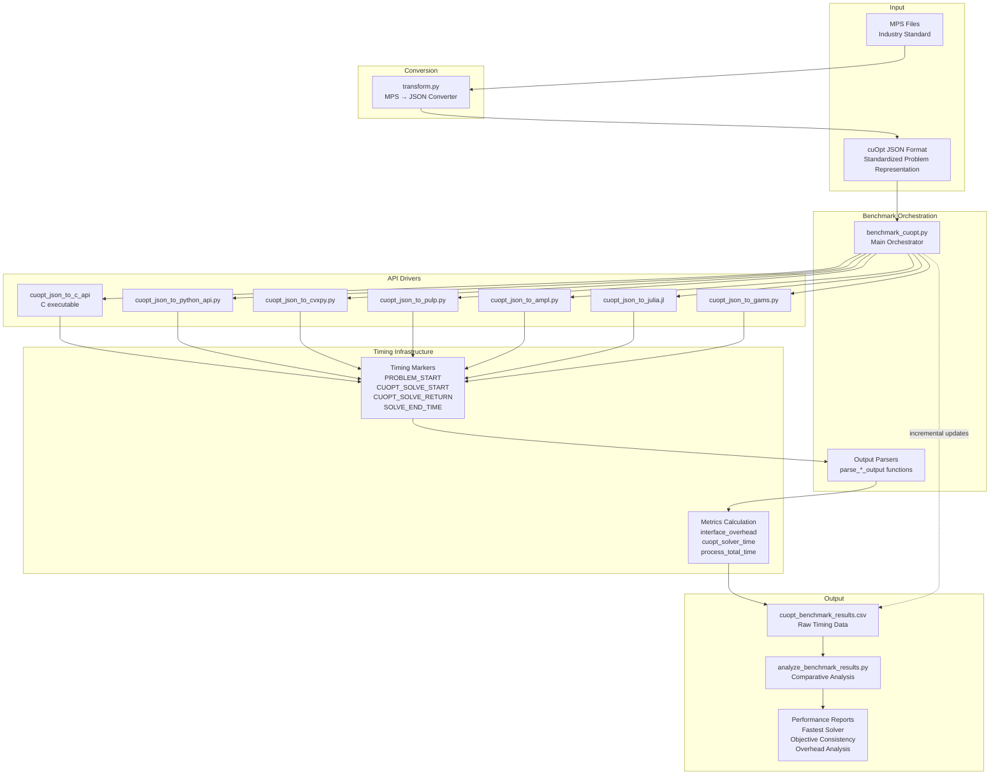
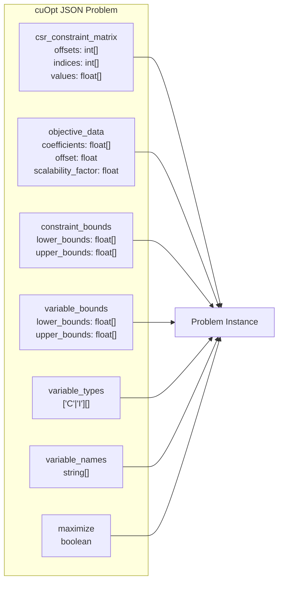
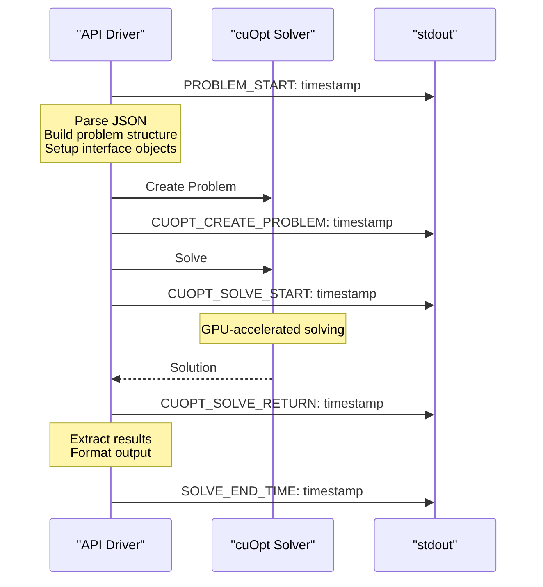
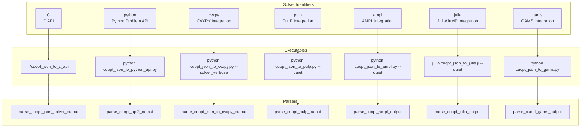
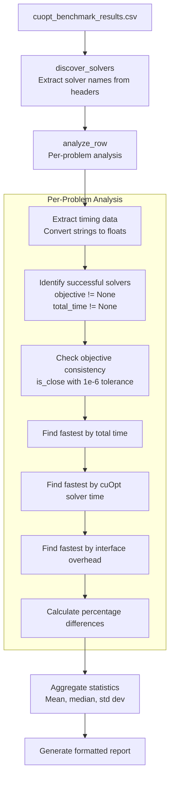
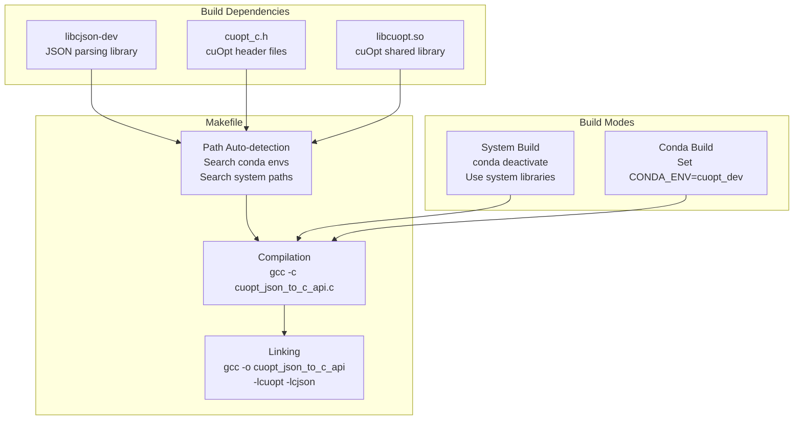

<!-- source: DeepWiki mcp.deepwiki.com · repo NVIDIA/cuopt-examples · page 10 Benchmarking and Performance · fetched 2026-10-26 -->

# Benchmarking and Performance

Relevant source files

The following files were used as context for generating this wiki page:

- [benchmark_apis/README.md](benchmark_apis/README.md)
- [benchmark_apis/analyze_benchmark_results.py](benchmark_apis/analyze_benchmark_results.py)
- [benchmark_apis/benchmark_cuopt.py](benchmark_apis/benchmark_cuopt.py)
- [benchmark_apis/c_api_driver/BUILD_GUIDE.md](benchmark_apis/c_api_driver/BUILD_GUIDE.md)
- [benchmark_apis/c_api_driver/Makefile](benchmark_apis/c_api_driver/Makefile)
- [benchmark_apis/c_api_driver/README.md](benchmark_apis/c_api_driver/README.md)
- [benchmark_apis/c_api_driver/cuopt_json_to_c_api.c](benchmark_apis/c_api_driver/cuopt_json_to_c_api.c)
- [benchmark_apis/c_api_driver/test_problem.json](benchmark_apis/c_api_driver/test_problem.json)
- [benchmark_apis/cuopt_json_to_ampl.py](benchmark_apis/cuopt_json_to_ampl.py)
- [benchmark_apis/cuopt_json_to_cvxpy.py](benchmark_apis/cuopt_json_to_cvxpy.py)
- [benchmark_apis/cuopt_json_to_gams.py](benchmark_apis/cuopt_json_to_gams.py)
- [benchmark_apis/cuopt_json_to_julia.jl](benchmark_apis/cuopt_json_to_julia.jl)
- [benchmark_apis/cuopt_json_to_pulp.py](benchmark_apis/cuopt_json_to_pulp.py)
- [benchmark_apis/cuopt_json_to_python_api.py](benchmark_apis/cuopt_json_to_python_api.py)
- [benchmark_apis/transform.py](benchmark_apis/transform.py)

This page documents the benchmarking infrastructure for comparing cuOpt performance across different modeling frameworks and APIs. The system measures interface overhead, cuOpt solver time, and end-to-end performance for the same problems solved through different access patterns.

For general cuOpt API usage, see the Python API documentation at [#3.1](). For specific integration examples with modeling languages, see [#8](). For VRP-specific performance considerations, see [#4]().

---

## Purpose and Architecture

The benchmarking system provides standardized performance measurement across seven cuOpt interfaces: C API, Python Problem API, CVXPY, PuLP, AMPL, Julia/JuMP, and GAMS. The architecture uses a common JSON problem format, standardized timing markers, and automated result analysis to enable apples-to-apples performance comparisons.

**Benchmarking System Components**

Sources: [benchmark_apis/benchmark_cuopt.py:18-45](), [benchmark_apis/analyze_benchmark_results.py:18-35](), [benchmark_apis/transform.py:18-42]()

---

## cuOpt JSON Format

The benchmarking system uses a standardized JSON format to represent LP and MILP problems. This format eliminates modeling language differences and enables direct comparison of solver performance. For detailed technical specifications, see [cuOpt JSON Format](#10.1).

### Schema Structure

Sources: [benchmark_apis/c_api_driver/test_problem.json:1-24](), [benchmark_apis/cuopt_json_to_python_api.py:31-45]()

### Infinity Handling

All API drivers must handle string representations of infinity. The `handle_infinity_values` function converts strings like `"inf"` or `"ninf"` back to their float equivalents.

Sources: [benchmark_apis/cuopt_json_to_python_api.py:60-82](), [benchmark_apis/cuopt_json_to_pulp.py:48-77](), [benchmark_apis/cuopt_json_to_julia.jl:38-70]()

### MPS to JSON Conversion

The `transform.py` utility converts industry-standard MPS files to cuOpt JSON format using the `cuopt_mps_parser`.

Sources: [benchmark_apis/transform.py:23-41](), [benchmark_apis/transform.py:45-91]()

---

## Timing Infrastructure

The benchmarking system uses standardized timing markers embedded in API driver output to decompose end-to-end execution time into measurable components.

### Timing Markers

**Timing Marker Flow**

Sources: [benchmark_apis/benchmark_cuopt.py:57-91]()

### Computed Metrics

The `calculate_timing_metrics` function computes three key performance indicators: `interface_overhead`, `cuopt_solver_time`, and `total_time`.

Sources: [benchmark_apis/benchmark_cuopt.py:93-121]()

---

## Running Benchmarks

The `benchmark_cuopt.py` script orchestrates benchmark execution across multiple APIs and problem instances. For detailed instructions on running these benchmarks, see [Running Benchmarks](#10.2).

### Solver Configuration

**Solver Mapping Table**

Sources: [benchmark_apis/benchmark_cuopt.py:20-28](), [benchmark_apis/benchmark_cuopt.py:141-180]()

---

## Results Analysis

The `analyze_benchmark_results.py` script processes benchmark CSV output to generate comparative performance reports, identifying the fastest solver for each problem and checking for objective value consistency.

**Analysis Workflow**

Sources: [benchmark_apis/analyze_benchmark_results.py:53-72](), [benchmark_apis/analyze_benchmark_results.py:74-143]()

---

## C API Driver

The C API driver provides the lowest-level access to cuOpt with minimal overhead. It requires careful handling of memory management and library linking. For more details, see [C API Driver](#10.3).

**Build System Overview**

Sources: [benchmark_apis/c_api_driver/Makefile:19-47](), [benchmark_apis/c_api_driver/Makefile:112-145]()

---

