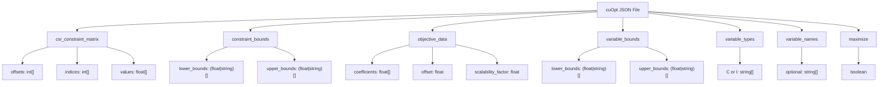
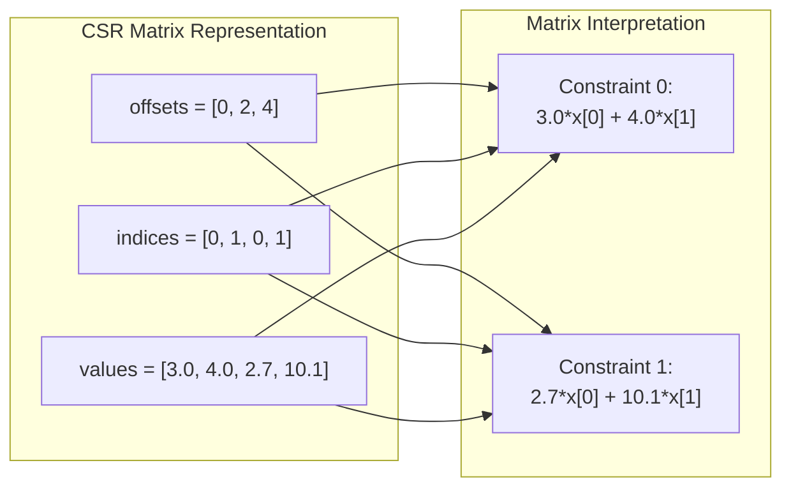
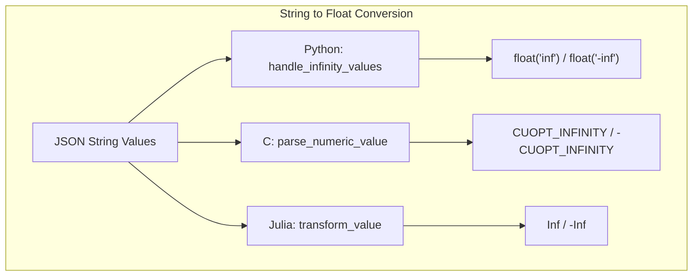
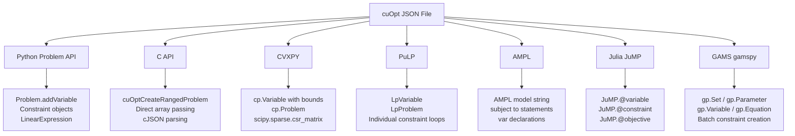
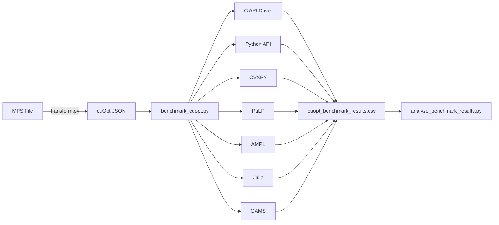
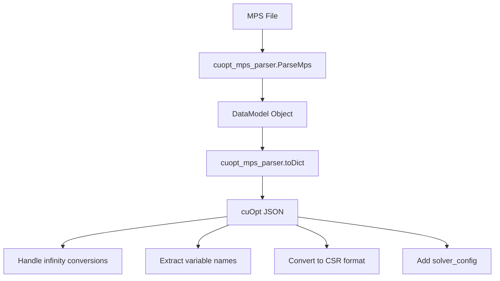

<!-- source: DeepWiki mcp.deepwiki.com · repo NVIDIA/cuopt-examples · page 10.1 cuOpt JSON Format · fetched 2026-10-26 -->

# cuOpt JSON Format

<details>
<summary>Relevant source files</summary>

The following files were used as context for generating this wiki page:

- [benchmark_apis/README.md](benchmark_apis/README.md)
- [benchmark_apis/analyze_benchmark_results.py](benchmark_apis/analyze_benchmark_results.py)
- [benchmark_apis/benchmark_cuopt.py](benchmark_apis/benchmark_cuopt.py)
- [benchmark_apis/c_api_driver/BUILD_GUIDE.md](benchmark_apis/c_api_driver/BUILD_GUIDE.md)
- [benchmark_apis/c_api_driver/Makefile](benchmark_apis/c_api_driver/Makefile)
- [benchmark_apis/c_api_driver/README.md](benchmark_apis/c_api_driver/README.md)
- [benchmark_apis/c_api_driver/cuopt_json_to_c_api.c](benchmark_apis/c_api_driver/cuopt_json_to_c_api.c)
- [benchmark_apis/c_api_driver/test_problem.json](benchmark_apis/c_api_driver/test_problem.json)
- [benchmark_apis/cuopt_json_to_ampl.py](benchmark_apis/cuopt_json_to_ampl.py)
- [benchmark_apis/cuopt_json_to_cvxpy.py](benchmark_apis/cuopt_json_to_cvxpy.py)
- [benchmark_apis/cuopt_json_to_gams.py](benchmark_apis/cuopt_json_to_gams.py)
- [benchmark_apis/cuopt_json_to_julia.jl](benchmark_apis/cuopt_json_to_julia.jl)
- [benchmark_apis/cuopt_json_to_pulp.py](benchmark_apis/cuopt_json_to_pulp.py)
- [benchmark_apis/cuopt_json_to_python_api.py](benchmark_apis/cuopt_json_to_python_api.py)
- [benchmark_apis/transform.py](benchmark_apis/transform.py)

</details>


This page documents the standardized JSON schema used to represent Linear Programming (LP) and Mixed-Integer Programming (MILP) problems in the cuOpt ecosystem. This format serves as a common interchange format for benchmarking across different modeling frameworks and APIs.

**Related Pages:** For information about converting MPS files to this format, see the [cuOpt JSON Format](#10.1) utility. For running benchmarks using this format, see [Running Benchmarks](#10.2). For using the format with specific APIs, see [Modeling Language Integrations](#8).

---

## Purpose and Scope

The cuOpt JSON format provides a language-agnostic representation of optimization problems that can be consumed by multiple solver interfaces including the Python Problem API, C API, CVXPY, PuLP, AMPL, Julia/JuMP, and GAMS. It is primarily used in the benchmarking infrastructure to ensure all APIs solve identical problem instances, enabling fair performance comparisons.

**Sources:** [benchmark_apis/c_api_driver/README.md:14-72](), [benchmark_apis/transform.py:1-102]()

---

## Overall JSON Structure

The cuOpt JSON format consists of seven main sections that fully specify an optimization problem:



**Diagram: cuOpt JSON Schema Structure**

**Sources:** [benchmark_apis/c_api_driver/README.md:16-72](), [benchmark_apis/c_api_driver/test_problem.json:1-24]()

---

## CSR Constraint Matrix Format

The constraint matrix is stored in Compressed Sparse Row (CSR) format for memory efficiency with sparse problems. This representation is used consistently across all API implementations.

### CSR Components

| Field | Type | Description |
|-------|------|-------------|
| `offsets` | `int[]` | Row pointer array of size `num_constraints + 1` |
| `indices` | `int[]` | Column indices of non-zero elements |
| `values` | `float[]` | Values of non-zero matrix elements |

### Interpretation Logic

For constraint `i`, the non-zero elements span from `offsets[i]` to `offsets[i+1]-1` in the `indices` and `values` arrays. Each entry at index `j` in this range represents:
- Variable index: `indices[j]`
- Coefficient: `values[j]`



**Diagram: CSR Matrix Example from test_problem.json**

**Parsing Implementations:**
- Python: [benchmark_apis/cuopt_json_to_pulp.py:229-231]()
- C: [benchmark_apis/c_api_driver/cuopt_json_to_c_api.c:235-282]()
- Julia: [benchmark_apis/cuopt_json_to_julia.jl:251-256]()
- GAMS: [benchmark_apis/cuopt_json_to_gams.py:110-111]()

**Sources:** [benchmark_apis/c_api_driver/README.md:46-49](), [benchmark_apis/c_api_driver/test_problem.json:2-6](), [benchmark_apis/cuopt_json_to_pulp.py:229-263]()

---

## Constraint Bounds Specification

Constraint bounds define the feasible region for each constraint. The format supports range constraints through separate lower and upper bounds arrays.

### Bounds Arrays

```json
"constraint_bounds": {
  "lower_bounds": ["-inf", 5.0],
  "upper_bounds": [10.0, 5.0]
}
```

### Constraint Type Derivation

APIs derive constraint types from the bounds arrays using masking logic:

| Condition | Constraint Type | Meaning |
|-----------|----------------|---------|
| `lower == upper` and both finite | Equality | `expr == bound` |
| `upper` finite and not equality | Upper bound | `expr <= upper` |
| `lower` finite and not equality | Lower bound | `expr >= lower` |

```python
# From cuopt_json_to_python_api.py
lower_bounds = np.array(constraint_bounds["lower_bounds"])
upper_bounds = np.array(constraint_bounds["upper_bounds"])

equality_mask = (lower_bounds == upper_bounds) & (lower_bounds != -np.inf) & (upper_bounds != np.inf)
upper_mask = (upper_bounds != np.inf) & ~equality_mask
lower_mask = (lower_bounds != -np.inf) & ~equality_mask
```

This logic is consistent across Python API [benchmark_apis/cuopt_json_to_python_api.py:152-155](), CVXPY [benchmark_apis/cuopt_json_to_cvxpy.py:181-183](), PuLP [benchmark_apis/cuopt_json_to_pulp.py:249-253](), AMPL [benchmark_apis/cuopt_json_to_ampl.py:226-232](), Julia [benchmark_apis/cuopt_json_to_julia.jl:262-267](), and GAMS [benchmark_apis/cuopt_json_to_gams.py:145-148]() implementations.

**Sources:** [benchmark_apis/cuopt_json_to_python_api.py:145-200](), [benchmark_apis/cuopt_json_to_cvxpy.py:167-219](), [benchmark_apis/c_api_driver/README.md:56-59]()

---

## Objective Data Structure

The objective function is specified through coefficient arrays and optional offset/scaling factors.

### Objective Components

```json
"objective_data": {
  "coefficients": [-0.2, 0.1],
  "offset": 0.0,
  "scalability_factor": 1.0
}
```

| Field | Type | Required | Description |
|-------|------|----------|-------------|
| `coefficients` | `float[]` | Yes | Objective coefficient for each variable |
| `offset` | `float` | No | Constant added to objective (default: 0.0) |
| `scalability_factor` | `float` | No | Scaling multiplier (default: 1.0) |

The objective function is computed as:
```
objective = sum(coefficients[i] * variables[i]) + offset
```

The `maximize` boolean flag (separate field at root level) determines optimization sense:
- `false` (default): Minimize objective
- `true`: Maximize objective

**Parsing Examples:**
- Python API creates `LinearExpression` objects: [benchmark_apis/cuopt_json_to_python_api.py:205-225]()
- C API reads directly into arrays: [benchmark_apis/c_api_driver/cuopt_json_to_c_api.c:292-318]()
- AMPL generates model strings: [benchmark_apis/cuopt_json_to_ampl.py:192-217]()

**Sources:** [benchmark_apis/c_api_driver/README.md:51-55](), [benchmark_apis/c_api_driver/test_problem.json:8-12](), [benchmark_apis/cuopt_json_to_python_api.py:205-225]()

---

## Variable Bounds and Types

Variable specifications include lower/upper bounds and type indicators (continuous or integer).

### Variable Bounds

```json
"variable_bounds": {
  "lower_bounds": [0.0, 0.0],
  "upper_bounds": ["inf", "inf"]
}
```

Bounds arrays must have length equal to the number of variables. Infinity values are represented as strings (see [Infinity Handling](#infinity-handling) section).

### Variable Types

```json
"variable_types": ["C", "I"]
```

| Type Code | Meaning | API Constant Examples |
|-----------|---------|----------------------|
| `"C"` | Continuous | `VType.CONTINUOUS`, `CUOPT_CONTINUOUS`, `pulp.LpContinuous` |
| `"I"` | Integer | `VType.INTEGER`, `CUOPT_INTEGER`, `pulp.LpInteger` |

**Type Conversion Examples:**
- Python API: [benchmark_apis/cuopt_json_to_python_api.py:121-124]()
- C API: [benchmark_apis/c_api_driver/cuopt_json_to_c_api.c:433-440]()
- PuLP: [benchmark_apis/cuopt_json_to_pulp.py:183-190]()
- Julia: [benchmark_apis/cuopt_json_to_julia.jl:180-219]()

### Variable Names (Optional)

```json
"variable_names": ["x1", "x2"]
```

If omitted, implementations generate default names like `x_0`, `x_1`, etc. The AMPL implementation sanitizes names to ensure compatibility with AMPL syntax: [benchmark_apis/cuopt_json_to_ampl.py:72-91]().

**Sources:** [benchmark_apis/c_api_driver/README.md:61-72](), [benchmark_apis/c_api_driver/test_problem.json:16-23](), [benchmark_apis/cuopt_json_to_python_api.py:127-138]()

---

## Infinity Handling

The JSON format represents infinite bounds as string literals to maintain JSON compatibility. All implementations must convert these strings to floating-point infinity values.

### Supported String Representations

| String Value | Numeric Interpretation |
|--------------|----------------------|
| `"inf"` or `"infinity"` | `float('inf')` / `Inf` |
| `"ninf"` or `"-inf"` or `"-infinity"` | `float('-inf')` / `-Inf` |
| `null` | Context-dependent (typically unbounded) |

### Conversion Implementations



**Diagram: Infinity String Conversion Across Languages**

**Conversion Functions:**
- Python: [benchmark_apis/cuopt_json_to_pulp.py:48-77]()
- Python (recursive): [benchmark_apis/cuopt_json_to_python_api.py:60-82]()
- C: [benchmark_apis/c_api_driver/cuopt_json_to_c_api.c:108-122]()
- Julia: [benchmark_apis/cuopt_json_to_julia.jl:38-69]()

**Sources:** [benchmark_apis/cuopt_json_to_pulp.py:48-77](), [benchmark_apis/c_api_driver/cuopt_json_to_c_api.c:108-122](), [benchmark_apis/c_api_driver/test_problem.json:13-18]()

---

## Complete Example

Here is a complete minimal example from the test suite:

```json
{
  "csr_constraint_matrix": {
    "offsets": [0, 2, 4],
    "indices": [0, 1, 0, 1],
    "values": [3.0, 4.0, 2.7, 10.1]
  },
  "objective_data": {
    "coefficients": [-0.2, 0.1],
    "scalability_factor": 1.0,
    "offset": 0.0
  },
  "constraint_bounds": {
    "upper_bounds": [5.4, 4.9],
    "lower_bounds": ["ninf", "ninf"]
  },
  "variable_bounds": {
    "upper_bounds": ["inf", "inf"],
    "lower_bounds": [0.0, 0.0]
  },
  "maximize": false,
  "variable_types": ["C", "C"],
  "variable_names": ["x1", "x2"]
}
```

**Mathematical Interpretation:**
```
minimize  -0.2*x1 + 0.1*x2
subject to:
  3.0*x1 + 4.0*x2 <= 5.4
  2.7*x1 + 10.1*x2 <= 4.9
  x1, x2 >= 0
  x1, x2 continuous
```

**Sources:** [benchmark_apis/c_api_driver/test_problem.json:1-24](), [benchmark_apis/c_api_driver/README.md:16-42]()

---

## API-Specific Usage Patterns

Different APIs have distinct parsing strategies for the JSON format:



**Diagram: API Parsing Implementations**

### Implementation Characteristics

| API | Parsing Library | Constraint Creation | Performance Notes |
|-----|----------------|---------------------|-------------------|
| Python API | `json` module | Vectorized with masks | Clean API, efficient |
| C API | `cJSON` | Direct array allocation | Lowest overhead |
| CVXPY | `json` module | Vectorized matrix operations | Efficient for large problems |
| PuLP | `json` module | Individual constraint loops | Higher overhead |
| AMPL | `json` module | String-based model generation | Moderate overhead |
| Julia | `JSON.jl` | JuMP macro-based | Native Julia efficiency |
| GAMS | `json` module | Batch with conditional masks | Optimized batch operations |

**Sources:** [benchmark_apis/cuopt_json_to_python_api.py:84-288](), [benchmark_apis/c_api_driver/cuopt_json_to_c_api.c:169-461](), [benchmark_apis/cuopt_json_to_cvxpy.py:82-353](), [benchmark_apis/cuopt_json_to_pulp.py:79-441](), [benchmark_apis/cuopt_json_to_julia.jl:72-464](), [benchmark_apis/cuopt_json_to_gams.py:24-340]()

---

## Benchmarking Integration

The JSON format is central to the benchmarking infrastructure, which measures performance across all APIs using identical problem instances.

### Benchmark Workflow



**Diagram: Benchmarking Pipeline Using cuOpt JSON**

### Timing Markers

The benchmark infrastructure embeds timing markers in stdout to decompose performance:

```python
# From benchmark_cuopt.py parse_detailed_timing_markers function
markers = {
    'PROBLEM_START': r'PROBLEM_START:?\s+([\d.]+(?:[eE][-+]?\d+)?)',
    'CUOPT_SOLVE_START': r'CUOPT_SOLVE_START:?\s+([\d.]+(?:[eE][-+]?\d+)?)',
    'CUOPT_SOLVE_RETURN': r'CUOPT_SOLVE_RETURN:?\s+([\d.]+(?:[eE][-+]?\d+)?)',
    'SOLVE_END_TIME': r'(?:SOLVE_END_TIME|SOLVE_END):?\s+([\d.]+(?:[eE][-+]?\d+)?)'
}
```

These markers enable calculation of:
- **Interface overhead**: Setup + teardown time
- **cuOpt solver time**: Pure solver execution
- **Total time**: End-to-end including overhead

**Sources:** [benchmark_apis/benchmark_cuopt.py:57-121](), [benchmark_apis/analyze_benchmark_results.py:1-43]()

---

## Conversion from MPS Format

The `transform.py` utility converts industry-standard MPS files to cuOpt JSON format:

### Conversion Command

```bash
python transform.py problem.mps -o problem.json
```

### Conversion Process



**Diagram: MPS to JSON Transformation Pipeline**

The `transform.py` script supports optional parameters for solver configuration:

| Parameter | Flag | Description |
|-----------|------|-------------|
| Tolerances | `-tol` | JSON string or file with tolerance settings |
| Time limit | `-tl` | Time limit in milliseconds |
| Iteration limit | `-il` | Maximum iteration count |
| Exclude names | `-nv` | Omit variable names from output |

**Implementation:** [benchmark_apis/transform.py:23-101]()

**Sources:** [benchmark_apis/transform.py:1-102](), [benchmark_apis/README.md:46-54]()

---

## Field Reference Summary

| Field Path | Type | Required | Default | Description |
|------------|------|----------|---------|-------------|
| `csr_constraint_matrix.offsets` | `int[]` | Yes | - | CSR row pointers |
| `csr_constraint_matrix.indices` | `int[]` | Yes | - | CSR column indices |
| `csr_constraint_matrix.values` | `float[]` | Yes | - | CSR non-zero values |
| `constraint_bounds.lower_bounds` | `(float\|string)[]` | Yes | - | Constraint lower bounds |
| `constraint_bounds.upper_bounds` | `(float\|string)[]` | Yes | - | Constraint upper bounds |
| `objective_data.coefficients` | `float[]` | Yes | - | Objective coefficients |
| `objective_data.offset` | `float` | No | `0.0` | Objective constant offset |
| `objective_data.scalability_factor` | `float` | No | `1.0` | Objective scaling factor |
| `variable_bounds.lower_bounds` | `(float\|string)[]` | Yes | - | Variable lower bounds |
| `variable_bounds.upper_bounds` | `(float\|string)[]` | Yes | - | Variable upper bounds |
| `variable_types` | `string[]` | No | All `"C"` | Variable types ("C" or "I") |
| `variable_names` | `string[]` | No | Auto-generated | Variable identifiers |
| `maximize` | `boolean` | No | `false` | Optimization sense flag |

**Sources:** [benchmark_apis/c_api_driver/README.md:44-72](), [benchmark_apis/cuopt_json_to_python_api.py:108-116]()

---

