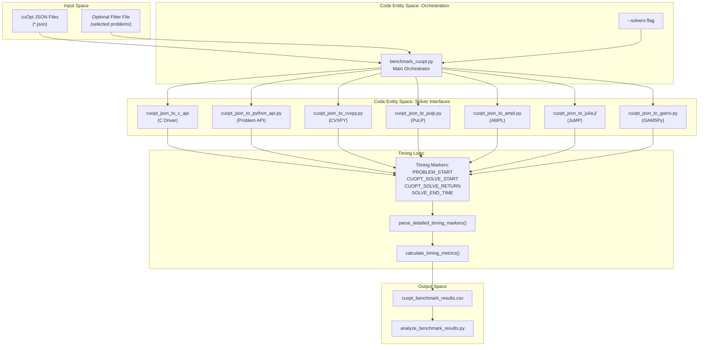
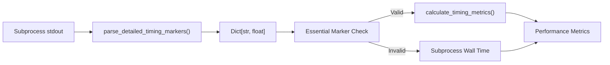
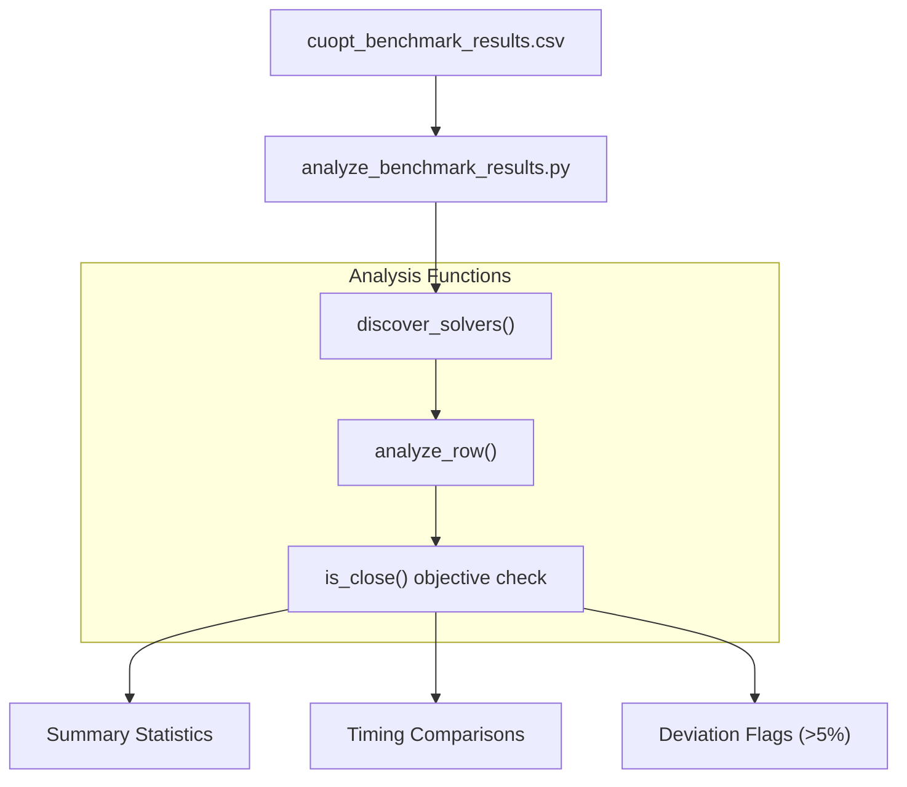

<!-- source: DeepWiki mcp.deepwiki.com · repo NVIDIA/cuopt-examples · page 10.2 Running Benchmarks · fetched 2026-10-26 -->

# Running Benchmarks

<details>
<summary>Relevant source files</summary>

The following files were used as context for generating this wiki page:

- [benchmark_apis/analyze_benchmark_results.py](benchmark_apis/analyze_benchmark_results.py)
- [benchmark_apis/benchmark_cuopt.py](benchmark_apis/benchmark_cuopt.py)
- [benchmark_apis/c_api_driver/Makefile](benchmark_apis/c_api_driver/Makefile)
- [benchmark_apis/c_api_driver/cuopt_json_to_c_api.c](benchmark_apis/c_api_driver/cuopt_json_to_c_api.c)
- [benchmark_apis/cuopt_json_to_ampl.py](benchmark_apis/cuopt_json_to_ampl.py)
- [benchmark_apis/cuopt_json_to_cvxpy.py](benchmark_apis/cuopt_json_to_cvxpy.py)
- [benchmark_apis/cuopt_json_to_gams.py](benchmark_apis/cuopt_json_to_gams.py)
- [benchmark_apis/cuopt_json_to_julia.jl](benchmark_apis/cuopt_json_to_julia.jl)
- [benchmark_apis/cuopt_json_to_pulp.py](benchmark_apis/cuopt_json_to_pulp.py)
- [benchmark_apis/cuopt_json_to_python_api.py](benchmark_apis/cuopt_json_to_python_api.py)
- [benchmark_apis/transform.py](benchmark_apis/transform.py)

</details>


## Purpose and Scope

This page describes the benchmarking infrastructure for measuring and comparing cuOpt API performance across different integration interfaces. The system orchestrates execution of identical problems across multiple solver interfaces (C API, Python Problem API, CVXPY, PuLP, AMPL, Julia/JuMP, and GAMS), collecting detailed timing metrics to isolate interface overhead from core solver performance.

For information about the cuOpt JSON format used as input to benchmarks, see [cuOpt JSON Format](). For details on building the C API driver specifically, see [C API Driver]().

## Overview

The benchmarking system provides comparative performance analysis across all cuOpt integration methods. It solves a collection of LP/MILP problems encoded in cuOpt JSON format using each available API, measuring three distinct time components:

- **Interface Overhead**: Time spent in API translation and setup/teardown.
- **cuOpt Solver Time**: Pure solver execution time (kernel + internal operations).
- **Process Total Time**: End-to-end wall clock time measured by the orchestrator.

This decomposition enables identification of interface-specific bottlenecks versus underlying solver performance characteristics.

**Sources:** [benchmark_apis/benchmark_cuopt.py:18-45]()

## Benchmark Architecture



**Benchmark System Architecture**

The orchestrator executes each solver interface as a subprocess, capturing `stdout` to extract timing markers. Results are incrementally written to CSV, enabling real-time monitoring.

**Sources:** [benchmark_apis/benchmark_cuopt.py:123-140](), [benchmark_apis/benchmark_cuopt.py:349-481]()

## Timing Marker Protocol

All solver interfaces implement a standardized timing marker protocol that emits Unix timestamps to `stdout`. The orchestrator parses these markers to compute performance metrics.

### Required Timing Markers

| Marker | Description | Example Implementation |
|--------|-------------|------------------------|
| `PROBLEM_START` | Interface setup begins | [benchmark_apis/cuopt_json_to_python_api.py:103-103]() |
| `CUOPT_SOLVE_START` | Solver execution begins | [benchmark_apis/cuopt_json_to_python_api.py:252-252]() |
| `CUOPT_SOLVE_RETURN` | Solver execution completes | [benchmark_apis/cuopt_json_to_python_api.py:254-254]() |
| `SOLVE_END_TIME` | Interface teardown completes | [benchmark_apis/cuopt_json_to_python_api.py:264-264]() |

### Optional Markers

| Marker | Description | Usage |
|--------|-------------|-------|
| `CUOPT_CREATE_PROBLEM` | Problem object creation | Finer-grained setup timing |

### Marker Parsing Implementation



**Timing Marker Parsing Flow**

The parser uses regular expressions to extract timestamps from solver output, validating that essential markers are present before computing derived metrics.

**Sources:** [benchmark_apis/benchmark_cuopt.py:57-92](), [benchmark_apis/benchmark_cuopt.py:93-121]()

### Metric Calculations

Metrics are computed as follows:

- **Interface Overhead**: `(CUOPT_SOLVE_START - PROBLEM_START) + (SOLVE_END_TIME - CUOPT_SOLVE_RETURN)`.
- **cuOpt Solver Time**: `CUOPT_SOLVE_RETURN - CUOPT_SOLVE_START`.
- **Total Time**: `SOLVE_END_TIME - PROBLEM_START`.

**Sources:** [benchmark_apis/benchmark_cuopt.py:93-121]()

## Running Benchmarks

### Basic Usage

```bash
# Run all solvers on JSON files in current directory
python benchmark_cuopt.py

# Run on specific directory
python benchmark_cuopt.py /path/to/json/files

# Select specific solvers
python benchmark_cuopt.py --solvers C,python,cvxpy
```

### Solver Selection

The `--solvers` flag accepts comma-separated solver keys:

| Key | Interface | Source Script |
|-----|-----------|---------------|
| `C` | C API | `cuopt_json_to_c_api` |
| `python` | Python Problem API | `cuopt_json_to_python_api.py` |
| `cvxpy` | CVXPY | `cuopt_json_to_cvxpy.py` |
| `pulp` | PuLP | `cuopt_json_to_pulp.py` |
| `ampl` | AMPL | `cuopt_json_to_ampl.py` |
| `julia` | Julia JuMP | `cuopt_json_to_julia.jl` |
| `gams` | GAMSPy | `cuopt_json_to_gams.py` |

**Sources:** [benchmark_apis/benchmark_cuopt.py:526-569]()

## Analyzing Results

The `analyze_benchmark_results.py` script processes benchmark CSV output to generate comparative analysis.

### Analysis Logic



**Analysis Report Generation**

The script identifies which solver was fastest for each problem, checks if objective values are consistent (within 1e-6 tolerance), and flags interfaces with significant solver time deviations.

**Sources:** [benchmark_apis/analyze_benchmark_results.py:44-51](), [benchmark_apis/analyze_benchmark_results.py:74-143](), [benchmark_apis/analyze_benchmark_results.py:153-160]()

### Interpreting Analysis Output

The analyzer flags significant deviations for investigation:
- **🏆** = Fastest overall (including overhead).
- **⚡** = Fastest pure solver time.
- **🚨** = Solver time deviation >5% (indicates potential formulation or measurement issues).
- **❌** = Objective value inconsistency.

**Sources:** [benchmark_apis/analyze_benchmark_results.py:310-396]()

## Solver-Specific Implementation Details

### Python Problem API
Uses the high-level `Problem` class from `cuopt.linear_programming.problem`. It converts JSON data (CSR matrix, bounds, types) into `addVariable` and `addConstraint` calls.
**Sources:** [benchmark_apis/cuopt_json_to_python_api.py:118-138](), [benchmark_apis/cuopt_json_to_python_api.py:163-244]()

### C API Driver
A C program that parses JSON using `cJSON`, converts it to `cuopt_int_t` and `cuopt_float_t` arrays, and calls the `cuopt_solve` C function.
**Sources:** [benchmark_apis/c_api_driver/cuopt_json_to_c_api.c:218-223](), [benchmark_apis/c_api_driver/cuopt_json_to_c_api.c:543-556]()

### GAMSPy Integration
Uses `gamspy.Container` to define sets, parameters, and variables. It parses the CSR matrix and uses mask operations to identify equality, upper, and lower bound constraints.
**Sources:** [benchmark_apis/cuopt_json_to_gams.py:75-75](), [benchmark_apis/cuopt_json_to_gams.py:141-155](), [benchmark_apis/cuopt_json_to_gams.py:228-313]()

### CVXPY Integration
Converts JSON data into `cp.Variable`, `cp.Minimize`/`cp.Maximize`, and `cp.Problem`. It uses `scipy.sparse.csr_matrix` for the constraint matrix.
**Sources:** [benchmark_apis/cuopt_json_to_cvxpy.py:53-63](), [benchmark_apis/cuopt_json_to_cvxpy.py:136-140](), [benchmark_apis/cuopt_json_to_cvxpy.py:151-156]()

## Troubleshooting

### Missing Timing Markers
If timing markers are not found, the orchestrator falls back to subprocess wall clock time.
**Causes:** Solver crash, output buffering, or incorrect marker format.
**Sources:** [benchmark_apis/benchmark_cuopt.py:458-469]()

### Julia Environment
Julia requires `LD_LIBRARY_PATH` to include the conda environment library path to find `libcuopt.so`.
**Sources:** [benchmark_apis/benchmark_cuopt.py:378-401]()

### Objective Inconsistencies
Differences are checked with a relative tolerance of `1e-6`. Inconsistencies often stem from different solver tolerances or formulation variations.
**Sources:** [benchmark_apis/analyze_benchmark_results.py:44-51](), [benchmark_apis/analyze_benchmark_results.py:153-160]()

---

