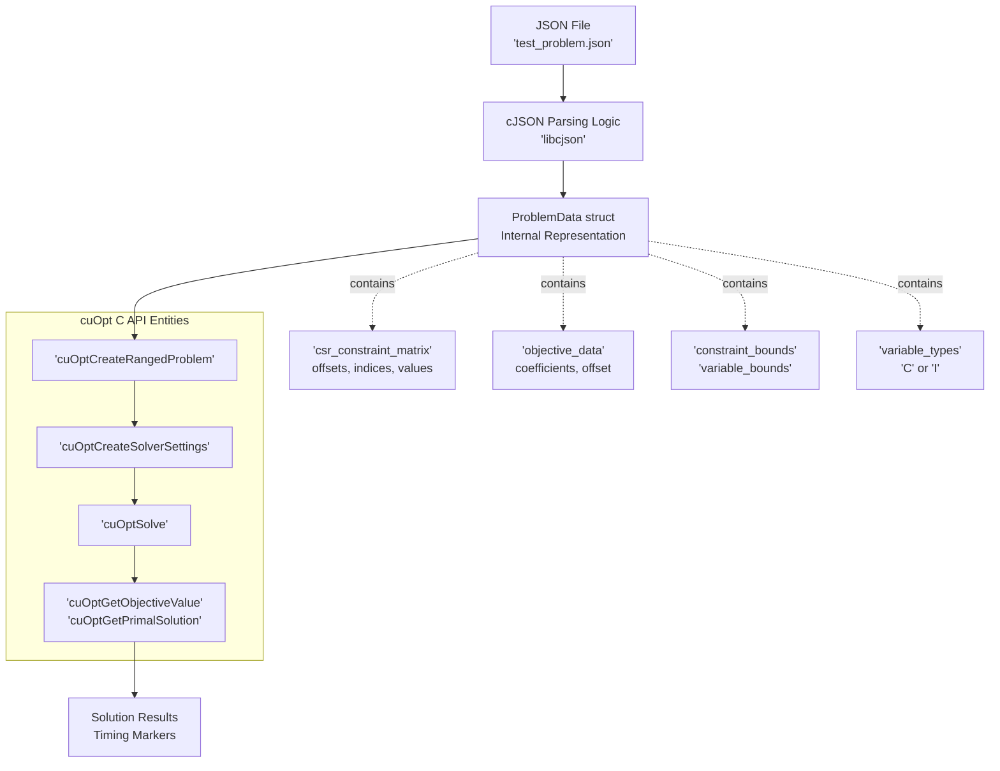
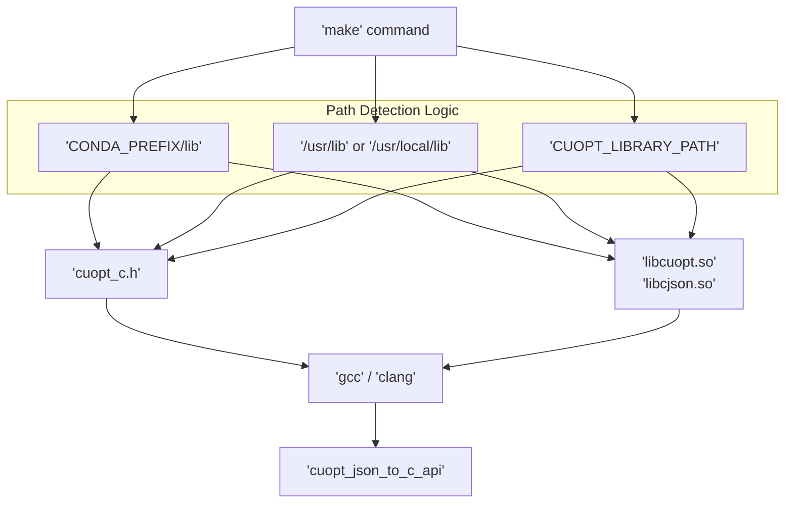

<!-- source: DeepWiki mcp.deepwiki.com · repo NVIDIA/cuopt-examples · page 10.3 C API Driver · fetched 2026-10-26 -->

# C API Driver

<details>
<summary>Relevant source files</summary>

The following files were used as context for generating this wiki page:

- [benchmark_apis/README.md](benchmark_apis/README.md)
- [benchmark_apis/c_api_driver/BUILD_GUIDE.md](benchmark_apis/c_api_driver/BUILD_GUIDE.md)
- [benchmark_apis/c_api_driver/README.md](benchmark_apis/c_api_driver/README.md)
- [benchmark_apis/c_api_driver/test_problem.json](benchmark_apis/c_api_driver/test_problem.json)

</details>


This page documents the C API driver (`cuopt_json_to_c_api`), a low-level interface for solving optimization problems using NVIDIA cuOpt's C API. The driver reads problems in cuOpt JSON format and invokes C API functions directly, providing baseline performance measurements for benchmarking against higher-level language bindings.

For information about the cuOpt JSON format consumed by this driver, see [cuOpt JSON Format](#10.1). For instructions on running the complete benchmarking suite that includes this driver, see [Running Benchmarks](#10.2).

## Overview and Purpose

The C API driver serves three primary purposes within the `cuopt-examples` repository:

1.  **Performance Baseline**: Provides direct C API measurements without language binding overhead, establishing the minimum achievable solve times for comparison with Python, Julia, CVXPY, PuLP, AMPL, and GAMS interfaces.
2.  **API Demonstration**: Shows how to use the cuOpt C API functions (`cuOptCreateRangedProblem`, `cuOptSolve`, etc.) for building custom optimization applications. [benchmark_apis/c_api_driver/README.md:8-11]()
3.  **Benchmarking Integration**: Participates in automated benchmarking via `benchmark_cuopt.py` to measure interface overhead across all supported APIs. [benchmark_apis/README.md:1-5]()

The driver is implemented as a standalone C program that links against `libcuopt.so` and `libcjson`. It outputs standardized timing markers that the benchmarking infrastructure parses to compute interface overhead versus pure solver time. [benchmark_apis/c_api_driver/README.md:73-84]()

Sources: [benchmark_apis/c_api_driver/README.md:1-13](), [benchmark_apis/README.md:1-5]()

## Architecture and Data Flow

The following diagram illustrates how the C API driver transforms JSON problem data into cuOpt C API calls:

### Data Transformation Flow


**Processing Flow**

The driver executes the following sequence:

1.  **JSON Parsing**: Uses the `cJSON` library to parse the input file, handling infinity string representations ("inf", "-inf", "ninf") and extracting all problem components. [benchmark_apis/c_api_driver/README.md:18-42](), [benchmark_apis/c_api_driver/test_problem.json:1-23]()
2.  **Data Structure Population**: Fills an internal `ProblemData` struct with the parsed CSR matrix, objective coefficients, constraint/variable bounds, and variable types. [benchmark_apis/c_api_driver/README.md:44-72]()
3.  **Problem Creation**: Calls `cuOptCreateRangedProblem` with all problem data to create a `cuOptOptimizationProblem` handle.
4.  **Solver Configuration**: Creates `cuOptSolverSettings` and sets parameters like time limits and tolerances.
5.  **Problem Solving**: Invokes `cuOptSolve` to compute the solution.
6.  **Result Extraction**: Retrieves objective value, solve time, termination status, and primal solution values. [benchmark_apis/c_api_driver/README.md:10-11]()

Sources: [benchmark_apis/c_api_driver/README.md:14-72](), [benchmark_apis/c_api_driver/test_problem.json:1-23]()

## Dependencies and File Structure

The C API driver requires two external libraries and follows a simple file structure:

| Component | Purpose | Location |
| :--- | :--- | :--- |
| `README.md` | User documentation and JSON format reference | [benchmark_apis/c_api_driver/README.md]() |
| `BUILD_GUIDE.md` | Conda environment troubleshooting and build fixes | [benchmark_apis/c_api_driver/BUILD_GUIDE.md]() |
| `test_problem.json` | Example 2-variable LP problem for testing | [benchmark_apis/c_api_driver/test_problem.json]() |

**Required Libraries**

1.  **libcuopt** - NVIDIA cuOpt optimization library. [benchmark_apis/c_api_driver/README.md:83-84]()
    *   Provides C API functions (`cuOptCreateRangedProblem`, `cuOptSolve`, etc.).
    *   Typically installed via conda or pip as part of the `cuopt` package. [benchmark_apis/README.md:7-9]()
2.  **libcjson** - JSON parser. [benchmark_apis/c_api_driver/README.md:82-82]()
    *   Lightweight JSON parsing library.
    *   Install on Ubuntu/Debian: `sudo apt-get install libcjson-dev`. [benchmark_apis/c_api_driver/README.md:85-93]()

Sources: [benchmark_apis/c_api_driver/README.md:73-93](), [benchmark_apis/README.md:7-9]()

## Building the Driver

The build process involves compiling the C source and linking against `libcuopt` and `libcjson`.

### Build Path Resolution


**Build Commands**

```bash
# Standard build
make

# Build with explicit paths if auto-detection fails
make CUOPT_INCLUDE_PATH=/path/to/include CUOPT_LIBRARY_PATH=/path/to/lib

# Install system dependencies (Ubuntu)
make install-deps
```

Sources: [benchmark_apis/c_api_driver/README.md:95-108](), [benchmark_apis/c_api_driver/BUILD_GUIDE.md:37-40]()

### Troubleshooting Conda Environments

A common build issue occurs when `libcjson` is unavailable in conda environments: `ld: cannot find -lcjson`. [benchmark_apis/c_api_driver/BUILD_GUIDE.md:7-10]()

This happens because conda environments use isolated toolchains and `libcjson` is often missing from standard conda channels. [benchmark_apis/c_api_driver/BUILD_GUIDE.md:12-16]()

**Solution**: Deactivate the conda environment to build using system libraries, then point to the conda environment for `libcuopt.so` at runtime. [benchmark_apis/c_api_driver/BUILD_GUIDE.md:17-27]()

```bash
# 1. Deactivate conda
conda deactivate

# 2. Build with system libraries
make clean && make

# 3. Set LD_LIBRARY_PATH to find libcuopt.so in the conda env
export LD_LIBRARY_PATH=$HOME/miniforge3/envs/cuopt_dev/lib:$LD_LIBRARY_PATH

# 4. Run the driver
./cuopt_json_to_c_api your_problem.json
```

Sources: [benchmark_apis/c_api_driver/BUILD_GUIDE.md:1-28]()

## Timing and Benchmarking

The driver is designed to work with `benchmark_cuopt.py`. It emits standardized output that the benchmark script parses to calculate metrics. [benchmark_apis/README.md:36-41]()

### Execution Options

| Flag | Description |
| :--- | :--- |
| `--timing` / `-t` | Enables performance timing output for analysis. [benchmark_apis/c_api_driver/README.md:115-119]() |
| `problem.json` | The input file in cuOpt JSON format. [benchmark_apis/c_api_driver/README.md:113-113]() |

### Integration with `benchmark_cuopt.py`

The benchmarking suite uses this driver to establish the "C" entry in its performance tables. [benchmark_apis/README.md:1-5]() The script invokes the driver and extracts:
*   **Interface Overhead**: Time spent parsing JSON and preparing C structs.
*   **cuOpt Solver Time**: Pure GPU solve time reported by the C API.
*   **Total Time**: End-to-end execution time.

Sources: [benchmark_apis/c_api_driver/README.md:109-120](), [benchmark_apis/README.md:1-5]()

## Usage Example

To solve the provided test problem:

```bash
./cuopt_json_to_c_api test_problem.json
```

The `test_problem.json` defines a small 2-variable LP:
*   **Objective**: Minimize `-0.2*x1 + 0.1*x2`. [benchmark_apis/c_api_driver/test_problem.json:7-11]()
*   **Constraints**: Defined in CSR format with upper bounds `[5.4, 4.9]`. [benchmark_apis/c_api_driver/test_problem.json:2-15]()
*   **Variables**: Continuous (`"C"`), non-negative. [benchmark_apis/c_api_driver/test_problem.json:16-22]()

Sources: [benchmark_apis/c_api_driver/test_problem.json:1-23](), [benchmark_apis/c_api_driver/README.md:111-114]()

---

