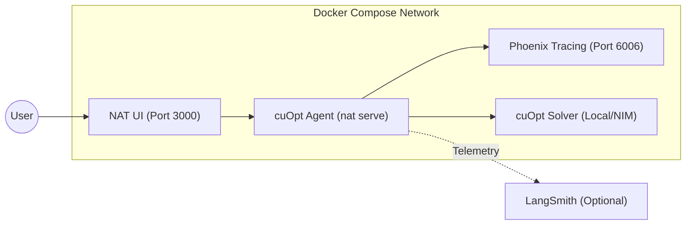

<!-- source: DeepWiki mcp.deepwiki.com · repo NVIDIA/cuopt-examples · page 11 cuOpt Agent — Natural Language Optimization · fetched 2026-10-26 -->

# cuOpt Agent — Natural Language Optimization

<details>
<summary>Relevant source files</summary>

The following files were used as context for generating this wiki page:

- [cuopt-agent/.env.example](cuopt-agent/.env.example)
- [cuopt-agent/AGENTS.md](cuopt-agent/AGENTS.md)
- [cuopt-agent/README.md](cuopt-agent/README.md)
- [cuopt-agent/cuopt_agent/configs/config-deepagent-eval.yml](cuopt-agent/cuopt_agent/configs/config-deepagent-eval.yml)
- [cuopt-agent/cuopt_agent/configs/config-deepagent.yml](cuopt-agent/cuopt_agent/configs/config-deepagent.yml)
- [cuopt-agent/cuopt_agent/data/max_supply_what_ifs/eval/max_supply_what_ifs.csv](cuopt-agent/cuopt_agent/data/max_supply_what_ifs/eval/max_supply_what_ifs.csv)
- [cuopt-agent/cuopt_agent/data/max_supply_what_ifs/sample_prompts/scenario_0.md](cuopt-agent/cuopt_agent/data/max_supply_what_ifs/sample_prompts/scenario_0.md)
- [cuopt-agent/cuopt_agent/data/max_supply_what_ifs/sample_prompts/scenario_1.md](cuopt-agent/cuopt_agent/data/max_supply_what_ifs/sample_prompts/scenario_1.md)
- [cuopt-agent/cuopt_agent/data/max_supply_what_ifs/sample_prompts/scenario_2.md](cuopt-agent/cuopt_agent/data/max_supply_what_ifs/sample_prompts/scenario_2.md)
- [cuopt-agent/cuopt_agent/data/max_supply_what_ifs/sample_prompts/scenario_3.md](cuopt-agent/cuopt_agent/data/max_supply_what_ifs/sample_prompts/scenario_3.md)
- [cuopt-agent/cuopt_agent/pyproject.toml](cuopt-agent/cuopt_agent/pyproject.toml)
- [cuopt-agent/cuopt_agent/src/nat_cuopt_agent/__init__.py](cuopt-agent/cuopt_agent/src/nat_cuopt_agent/__init__.py)
- [cuopt-agent/cuopt_agent/src/nat_cuopt_agent/function/subagent_factory.py](cuopt-agent/cuopt_agent/src/nat_cuopt_agent/function/subagent_factory.py)
- [cuopt-agent/cuopt_agent/src/nat_cuopt_agent/function/utils.py](cuopt-agent/cuopt_agent/src/nat_cuopt_agent/function/utils.py)
- [cuopt-agent/cuopt_agent/src/nat_cuopt_agent/register.py](cuopt-agent/cuopt_agent/src/nat_cuopt_agent/register.py)

</details>


The **cuOpt Agent** is a reference AI assistant designed to bridge the gap between natural-language problem descriptions and GPU-accelerated mathematical optimization. Built on the **NVIDIA NeMo Agent Toolkit (NAT)** and leveraging **LangChain Deep Agents**, the agent translates complex business scenarios into Linear Programming (LP) or Mixed-Integer Linear Programming (MILP) models that are solved using **NVIDIA cuOpt** [cuopt-agent/README.md:1-4]().

While the agent includes a built-in **multi-period supply chain planning** scenario ("max-supply"), its architecture is domain-agnostic and can be extended to various optimization fields by adding new skills and data [cuopt-agent/README.md:24-27]().

### Core Capabilities
*   **Natural Language Translation**: Converts ambiguous text descriptions into valid Python modeling code.
*   **GPU-Accelerated Solving**: Utilizes the `cuopt-cu12` solver for high-performance optimization [cuopt-agent/cuopt_agent/pyproject.toml:45-45]().
*   **Mandatory Ambiguity Handling**: The agent is programmed to clarify ambiguous requirements or solve for all plausible interpretations rather than making silent assumptions [cuopt-agent/AGENTS.md:13-13]().
*   **Integrated Observability**: Built-in support for **Phoenix** and **LangSmith** to trace agent reasoning and tool usage [cuopt-agent/README.md:35-35]().

---

### Agent Architecture and Components
The system follows an **orchestrator-subagent** pattern. A top-level orchestrator manages the conversation and delegates specific optimization tasks to a specialized `cuopt_sub_agent` via a `task()` tool [cuopt-agent/README.md:26-27](). This separation ensures that high-level coordination logic does not interfere with the precision required for mathematical modeling.

For details, see [Agent Architecture and Components](#11.1).

**System-to-Code Mapping**
The following diagram illustrates how high-level agent concepts map to specific classes and files within the repository.

#### Agent Entity Mapping
```mermaid
graph TD
    subgraph "Natural Language Space"
        UserPrompt["User Query (Scenario)"]
    end

    subgraph "Orchestration Layer (NAT/DeepAgents)"
        Orchestrator["Orchestrator (deepagent_fn)"]
        SubAgentFactory["SubAgentFactory"]
        Config["config-deepagent.yml"]
    end

    subgraph "Execution Space (Code Entities)"
        SubAgent["cuopt_sub_agent (DeepAgent)"]
        Tools["Tools (read_file, execute, etc.)"]
        Solver["cuOpt Solver (cuopt-cu12)"]
    end

    UserPrompt --> Orchestrator
    Config --> Orchestrator
    SubAgentFactory -->|registers| SubAgent
    Orchestrator -->|delegates via task()| SubAgent
    SubAgent -->|calls| Tools
    Tools -->|runs| Solver
```
**Sources:** [cuopt-agent/cuopt_agent/configs/config-deepagent.yml:46-70](), [cuopt-agent/cuopt_agent/src/nat_cuopt_agent/function/subagent_factory.py:34-41](), [cuopt-agent/README.md:26-27]()

---

### Skills System
The agent's intelligence is derived from a **progressive-disclosure skills architecture**. Skills provide the agent with the necessary context, rules, and reference models to perform tasks like parsing supply chain data, formulating constraints, and debugging solver errors [cuopt-agent/README.md:30-31](). These skills are stored in a dedicated `skills` directory and injected into the agent's sandbox at runtime [cuopt-agent/cuopt_agent/src/nat_cuopt_agent/function/utils.py:126-131]().

For details, see [Skills System](#11.2).

---

### Deploying and Running the Agent
The cuOpt Agent is designed for containerized deployment using **Docker Compose**. It provides both a production environment with health checks and a development environment that supports live code mounting for rapid iteration [cuopt-agent/README.md:107-130](). Users interact with the agent through a dedicated **NAT UI** chat interface [cuopt-agent/README.md:48-48]().

For details, see [Deploying and Running the Agent](#11.3).

**Deployment Component Interaction**
This diagram shows the relationship between the various services started during deployment.

#### Service Interaction Diagram

**Sources:** [cuopt-agent/README.md:81-90](), [cuopt-agent/cuopt_agent/configs/config-deepagent-eval.yml:22-32]()

---

### Evaluation and What-If Scenarios
To ensure reliability, the agent includes an evaluation harness using `nat eval`. This system tests the agent against a dataset of "What-If" scenarios—such as changing inventory levels, forcing procurement, or introducing material substitutions [cuopt-agent/cuopt_agent/data/max_supply_what_ifs/sample_prompts/scenario_2.md:1-10](). The agent is evaluated based on its ability to return the correct objective value within a specified tolerance [cuopt-agent/cuopt_agent/configs/config-deepagent-eval.yml:83-86]().

For details, see [Evaluation and What-If Scenarios](#11.4).

### Included Sample Scenarios
| Scenario | Description | Key Optimization Concept |
| :--- | :--- | :--- |
| **Scenario 0** | Add opening inventory balances at $t=0$ [cuopt_agent/data/max_supply_what_ifs/eval/max_supply_what_ifs.csv:2-27]() | Initial State Constraints |
| **Scenario 1** | Change supply bounds to equality constraints [cuopt_agent/data/max_supply_what_ifs/sample_prompts/scenario_1.md:1-15]() | Strict Equality Constraints |
| **Scenario 2** | Introduce material substitution with a usage penalty [cuopt_agent/data/max_supply_what_ifs/sample_prompts/scenario_2.md:1-22]() | Penalty-based Substitution |
| **Scenario 3** | Full BOM, co-production, and resource constraints [cuopt_agent/data/max_supply_what_ifs/sample_prompts/scenario_3.md:1-58]() | Complex MILP Formulation |

**Sources:** [cuopt-agent/cuopt_agent/data/max_supply_what_ifs/eval/max_supply_what_ifs.csv:1-86](), [cuopt-agent/cuopt_agent/data/max_supply_what_ifs/sample_prompts/scenario_3.md:1-119]()

---

