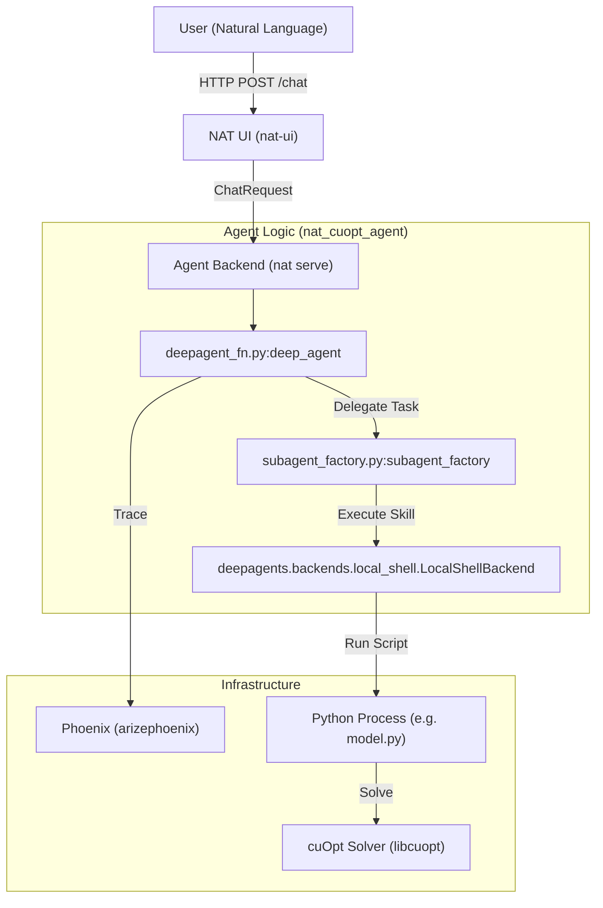
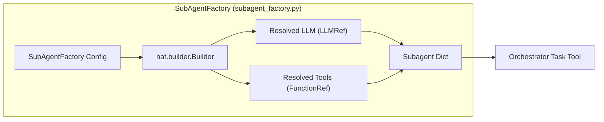

<!-- source: DeepWiki mcp.deepwiki.com · repo NVIDIA/cuopt-examples · page 11.1 Agent Architecture and Components · fetched 2026-10-26 -->

# Agent Architecture and Components

Relevant source files

The following files were used as context for generating this wiki page:

- [cuopt-agent/cuopt_agent/pyproject.toml](cuopt-agent/cuopt_agent/pyproject.toml)
- [cuopt-agent/cuopt_agent/src/nat_cuopt_agent/__init__.py](cuopt-agent/cuopt_agent/src/nat_cuopt_agent/__init__.py)
- [cuopt-agent/cuopt_agent/src/nat_cuopt_agent/evaluator/__init__.py](cuopt-agent/cuopt_agent/src/nat_cuopt_agent/evaluator/__init__.py)
- [cuopt-agent/cuopt_agent/src/nat_cuopt_agent/evaluator/cuopt_evaluator.py](cuopt-agent/cuopt_agent/src/nat_cuopt_agent/evaluator/cuopt_evaluator.py)
- [cuopt-agent/cuopt_agent/src/nat_cuopt_agent/function/__init__.py](cuopt-agent/cuopt_agent/src/nat_cuopt_agent/function/__init__.py)
- [cuopt-agent/cuopt_agent/src/nat_cuopt_agent/function/deepagent_fn.py](cuopt-agent/cuopt_agent/src/nat_cuopt_agent/function/deepagent_fn.py)
- [cuopt-agent/cuopt_agent/src/nat_cuopt_agent/function/healthcheck_fn.py](cuopt-agent/cuopt_agent/src/nat_cuopt_agent/function/healthcheck_fn.py)
- [cuopt-agent/cuopt_agent/src/nat_cuopt_agent/function/register.py](cuopt-agent/cuopt_agent/src/nat_cuopt_agent/function/register.py)
- [cuopt-agent/cuopt_agent/src/nat_cuopt_agent/function/subagent_factory.py](cuopt-agent/cuopt_agent/src/nat_cuopt_agent/function/subagent_factory.py)
- [cuopt-agent/cuopt_agent/src/nat_cuopt_agent/function/utils.py](cuopt-agent/cuopt_agent/src/nat_cuopt_agent/function/utils.py)
- [cuopt-agent/cuopt_agent/src/nat_cuopt_agent/register.py](cuopt-agent/cuopt_agent/src/nat_cuopt_agent/register.py)
- [cuopt-agent/deploy/compose/docker-compose.dev.yml](cuopt-agent/deploy/compose/docker-compose.dev.yml)
- [cuopt-agent/skills/max-supply/generic-max-supply/scripts/data.py](cuopt-agent/skills/max-supply/generic-max-supply/scripts/data.py)
- [cuopt-agent/skills/max-supply/generic-max-supply/scripts/model.py](cuopt-agent/skills/max-supply/generic-max-supply/scripts/model.py)

The cuOpt Agent is a natural-language optimization assistant designed to bridge the gap between human-readable problem descriptions and GPU-accelerated mathematical models. It utilizes an orchestrator-subagent pattern built on the NVIDIA NeMo Agent Toolkit (NAT) and the LangChain-based DeepAgents framework. This architecture allows for specialized delegation to domain-specific "skills" (such as supply chain planning or debugging) while maintaining a unified conversational interface.

### Sources:
* [cuopt-agent/cuopt_agent/pyproject.toml:28-34]()
* [cuopt-agent/cuopt_agent/src/nat_cuopt_agent/function/deepagent_fn.py:35-40]()

## System Architecture Overview

The cuOpt Agent operates as a multi-service system, typically deployed via Docker Compose. The architecture separates the reasoning logic (Orchestrator), the specialized task execution (Subagents), and the supporting infrastructure (Tracing and UI).

### Service Stack
*   **Agent Backend**: A NAT-powered server running the `deepagent_fn` workflow. It exposes a Chat API for processing requests.
*   **NAT UI**: A Next.js-based frontend providing a chat interface and visualization of intermediate reasoning steps.
*   **Phoenix Tracing**: An Arize Phoenix instance used for OpenTelemetry-compatible tracing of LLM calls, tool executions, and agent reasoning.
*   **Subagents**: Isolated logical units configured via `subagent_factory` that handle specific categories of tasks.

### Architecture Diagram: Natural Language to Code Entities

The following diagram illustrates how natural language requests flow through the system and map to specific code entities within the repository.

**Diagram: Request Flow and Code Mapping**

### Sources:
* [cuopt-agent/deploy/compose/docker-compose.dev.yml:50-85]()
* [cuopt-agent/cuopt_agent/src/nat_cuopt_agent/function/deepagent_fn.py:133-149]()
* [cuopt-agent/cuopt_agent/src/nat_cuopt_agent/function/subagent_factory.py:78-85]()

---

## The Orchestrator (`deepagent_fn.py`)

The `deep_agent` function acts as the central orchestrator. It is registered as a NAT function using the `@register_function` decorator and uses the `DeepAgentConfig` Pydantic model for configuration.

### Key Responsibilities
1.  **Sandbox Management**: It creates a temporary directory for each invocation and populates it with skills, memory (e.g., `AGENTS.md`), and workspace data using `populate_sandbox`.
2.  **Middleware Integration**: It wraps the agent with `FixToolNamesMiddleware` to normalize LLM-generated tool names (e.g., converting `read-file` to `read_file`) and `ModelRetryMiddleware` for transient failure handling.
3.  **Process Lifecycle**: Because `LocalShellBackend` does not have a native shutdown API, the orchestrator uses `kill_orphaned_children` to terminate any cuOpt solvers or Python scripts that persist after an invocation.

### Configuration (`DeepAgentConfig`)
| Field | Type | Description |
| :--- | :--- | :--- |
| `llm_name` | `LLMRef` | Reference to the primary LLM for orchestration. |
| `subagents` | `list[FunctionRef]` | List of `subagent_factory` functions to instantiate. |
| `skills_dir` | `list[Path]` | Source directories for agent skills. |
| `workspace_dirs` | `list[Path]` | Directories containing data (CSVs, etc.) for the sandbox. |

### Sources:
* [cuopt-agent/cuopt_agent/src/nat_cuopt_agent/function/deepagent_fn.py:35-131]()
* [cuopt-agent/cuopt_agent/src/nat_cuopt_agent/function/deepagent_fn.py:133-180]()
* [cuopt-agent/cuopt_agent/src/nat_cuopt_agent/function/utils.py:29-45]()
* [cuopt-agent/cuopt_agent/src/nat_cuopt_agent/function/utils.py:92-124]()

---

## Subagent Factory (`subagent_factory.py`)

Subagents are specialized workers that focus on specific domains. They are defined in the YAML configuration and instantiated via the `subagent_factory`.

### Implementation Details
The `subagent_factory` yields a `FunctionInfo` object that contains an asynchronous callable. This callable returns a dictionary representing the subagent's configuration, including its specific `system_prompt`, `tools`, and `model`. This allows the orchestrator to dynamically resolve subagents via the NAT `Builder`.

**Diagram: Subagent Internal Structure**

### Sources:
* [cuopt-agent/cuopt_agent/src/nat_cuopt_agent/function/subagent_factory.py:29-76]()
* [cuopt-agent/cuopt_agent/src/nat_cuopt_agent/function/subagent_factory.py:78-107]()

---

## Data Flow and Execution

The agent operates by translating user intent into file operations and script executions within a sandboxed environment.

1.  **Request Reception**: The `deep_agent` function receives a `ChatRequest`.
2.  **Sandbox Setup**: `populate_sandbox` copies files from `skills_src_dirs` and `workspace_dirs` into a temporary directory.
3.  **Agent Invocation**: The `create_deep_agent` function from the `deepagents` library initializes the agent with the provided subagents and tools.
4.  **Tool Execution**: When the agent needs to solve a problem, it uses tools to write Python scripts (e.g., using `generic-max-supply` templates) and executes them via `LocalShellBackend`.
5.  **Result Extraction**: The agent reads the output files from the sandbox and formulates a response.

### Sandbox Population Logic
The `populate_sandbox` function merges skill directories into a single `.skills/` directory within the sandbox. It implements collision detection; if two source directories contain a skill with the same name, a warning is logged and the first one encountered is used.

### Sources:
* [cuopt-agent/cuopt_agent/src/nat_cuopt_agent/function/deepagent_fn.py:186-210]()
* [cuopt-agent/cuopt_agent/src/nat_cuopt_agent/function/utils.py:126-174]()
* [cuopt-agent/skills/max-supply/generic-max-supply/scripts/data.py:59-70]()

---

## Evaluator Component (`cuopt_evaluator.py`)

To ensure agent quality, the architecture includes a specialized evaluator that compares agent-produced optimization results against ground truth data.

### `CuoptEvaluator`
This component implements the NAT `BaseEvaluator` interface. It specifically:
*   Extracts predicted values from the agent's output using a regex pattern (defaulting to LaTeX-style `\boxed{...}`).
*   Calculates the relative error between the predicted objective value and the expected value.
*   Returns a binary score (1 or 0) based on a configurable `tolerance` (defaulting to `1e-6`).

### Sources:
* [cuopt-agent/cuopt_agent/src/nat_cuopt_agent/evaluator/cuopt_evaluator.py:38-49]()
* [cuopt-agent/cuopt_agent/src/nat_cuopt_agent/evaluator/cuopt_evaluator.py:71-108]()

---

