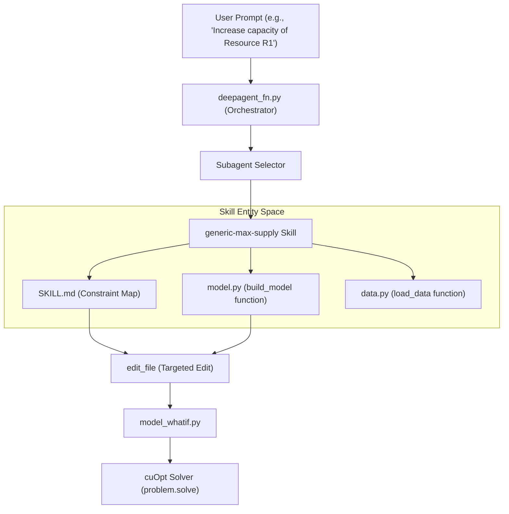
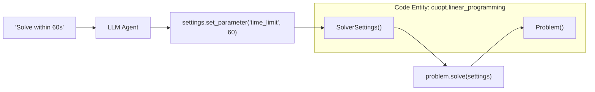

<!-- source: DeepWiki mcp.deepwiki.com · repo NVIDIA/cuopt-examples · page 11.2 Skills System · fetched 2026-10-26 -->

# Skills System

Relevant source files

The following files were used as context for generating this wiki page:

- [cuopt-agent/skills/max-supply/cuopt-debugging/SKILL.md](cuopt-agent/skills/max-supply/cuopt-debugging/SKILL.md)
- [cuopt-agent/skills/max-supply/generic-max-supply/SKILL.md](cuopt-agent/skills/max-supply/generic-max-supply/SKILL.md)

The cuOpt Agent utilizes a **progressive-disclosure skills architecture**. This design allows the agent to maintain a small, efficient context window by only loading the specific domain knowledge (tools, documentation, and code snippets) required for the user's current task.

The system is built on the NVIDIA NeMo Agent Toolkit (NAT) and uses "Skills" as modular units of expertise. Each skill contains a `SKILL.md` file that defines its purpose and provides the LLM with the necessary technical patterns to solve problems in that domain.

## Progressive-Disclosure Architecture

The agent does not attempt to understand every optimization domain simultaneously. Instead, it identifies the problem type (e.g., Supply Chain Planning vs. VRP) and "discloses" the relevant skill. This architecture ensures that the agent uses the correct variable types, status codes, and mathematical formulations for the specific solver backend being targeted.

### Skill Components
Each skill in the `cuopt-agent/skills/` directory typically includes:
- **`SKILL.md`**: The primary documentation for the LLM, containing variable references, constraint maps, and common pitfalls [cuopt-agent/skills/max-supply/generic-max-supply/SKILL.md:1-10]().
- **`scripts/`**: Reference implementations of models (e.g., `model.py`) and data loaders (`data.py`) [cuopt-agent/skills/max-supply/generic-max-supply/SKILL.md:19-24]().
- **`scripts/data/`**: Standardized CSV datasets used for benchmarking and baseline execution [cuopt-agent/skills/max-supply/generic-max-supply/SKILL.md:24-25]().

### Data Flow: Natural Language to Code
The following diagram illustrates how a user's natural language request is routed through the Skills System to produce a valid `cuOpt` LP/MILP model.

**Natural Language to Code Entity Mapping**

Sources: [cuopt-agent/skills/max-supply/generic-max-supply/SKILL.md:16-17](), [cuopt-agent/skills/max-supply/generic-max-supply/SKILL.md:35-67]()

## Generic Max-Supply Skill

The `generic-max-supply` skill is a template for multi-period supply chain planning. It formulates a Mixed-Integer Linear Program (MILP) to maximize the weighted sum of finished-good inventory at the end of a horizon [cuopt-agent/skills/max-supply/generic-max-supply/SKILL.md:71-75]().

### Implementation Details
- **Objective**: Maximize finished goods at the final period $T$ [cuopt-agent/skills/max-supply/generic-max-supply/SKILL.md:73-75]().
- **Variables**: Includes continuous variables for process execution (`x`), production output (`produced`), and inventory (`inventory`), alongside integer variables (`used`) to handle yield truncation [cuopt-agent/skills/max-supply/generic-max-supply/SKILL.md:120-132]().
- **Constraint Logic**:
    - **BOM Flow**: Links `produced[i, t]` to `used[i, t]` using integer types to ensure physical units are discrete [cuopt-agent/skills/max-supply/generic-max-supply/SKILL.md:125-126]().
    - **Resource Capacity**: Limits the sum of `x[p, r, t] * hours_per_unit` against `available_hours` in `resources.csv` [cuopt-agent/skills/max-supply/generic-max-supply/SKILL.md:85-89]().

### What-If Workflow
The skill enforces a strict "copy-and-edit" workflow to ensure reliability:
1.  **Read** `model.py` and relevant CSVs [cuopt-agent/skills/max-supply/generic-max-supply/SKILL.md:39-41]().
2.  **Run** the baseline `model.py` to capture the initial objective [cuopt-agent/skills/max-supply/generic-max-supply/SKILL.md:50-53]().
3.  **Fork** to `model_whatif.py` and apply a targeted modification using `edit_file` [cuopt-agent/skills/max-supply/generic-max-supply/SKILL.md:55-60]().
4.  **Compare** results between the baseline and the what-if execution [cuopt-agent/skills/max-supply/generic-max-supply/SKILL.md:62-65]().

Sources: [cuopt-agent/skills/max-supply/generic-max-supply/SKILL.md:1-136]()

## cuOpt Debugging Skill

The `cuopt-debugging` skill is a diagnostic layer used when the agent encounters solver errors or unexpected mathematical results.

### Diagnostic Patterns
The skill provides specific code patterns to troubleshoot common issues:
- **Status Code Validation**: Ensuring the code checks for `Optimal` or `FeasibleFound` (PascalCase) rather than `OPTIMAL` (UPPERCASE), which is a common silent failure point in Python scripts [cuopt-agent/skills/max-supply/cuopt-debugging/SKILL.md:30-49]().
- **Infeasibility Analysis**: Identifying conflicting constraints by iterating through `problem.getConstraints()` [cuopt-agent/skills/max-supply/cuopt-debugging/SKILL.md:71-78]().
- **Recursion Limits**: For very large problems, the skill directs the agent to use `LinearExpression` from `cuopt.linear_programming.problem` instead of chained `+` operators to avoid Python recursion depth errors [cuopt-agent/skills/max-supply/cuopt-debugging/SKILL.md:113-125]().

### LP vs. MILP Status Reference
The agent uses this reference to interpret solver output:

| Status | LP Meaning | MILP Meaning |
| :--- | :--- | :--- |
| `Optimal` | Found optimal solution | Found optimal solution |
| `PrimalInfeasible` | No feasible solution exists | (Use `Infeasible` for MILP) |
| `TimeLimit` | Stopped by time limit | Stopped by time limit |
| `FeasibleFound` | N/A | Found feasible within gap |

Sources: [cuopt-agent/skills/max-supply/cuopt-debugging/SKILL.md:142-165]()

## Extending the Agent with New Skills

To extend the agent for a new LP/MILP domain (e.g., Portfolio Optimization or Workforce Scheduling), follow this structure:

### 1. Define the Skill Metadata
Create a new directory in `cuopt-agent/skills/` with a `SKILL.md`. This file must define the `name`, `description`, and `usage` instructions for the LLM [cuopt-agent/skills/max-supply/generic-max-supply/SKILL.md:1-10]().

### 2. Provide Reference Models
Include a `scripts/model.py` that demonstrates the standard way to initialize the `cuopt.linear_programming.Problem` class, add variables with `vtype`, and set the objective sense [cuopt-agent/skills/max-supply/cuopt-debugging/SKILL.md:88-93](), [cuopt-agent/skills/max-supply/cuopt-debugging/SKILL.md:124]().

### 3. Implement Solver Settings
Include a section in `SKILL.md` for performance tuning using `SolverSettings`.

**Solver Configuration Data Flow**

Sources: [cuopt-agent/skills/max-supply/cuopt-debugging/SKILL.md:170-184]()

### 4. Diagnostic Snippets
Add a `resources/diagnostic_snippets.md` to provide the agent with copy-pasteable blocks for inspecting variable values and solver status [cuopt-agent/skills/max-supply/cuopt-debugging/SKILL.md:196-203]().

Sources: [cuopt-agent/skills/max-supply/generic-max-supply/SKILL.md:1-136](), [cuopt-agent/skills/max-supply/cuopt-debugging/SKILL.md:1-209]()

---

