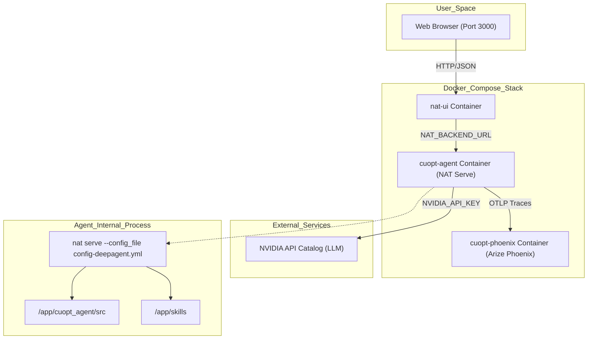
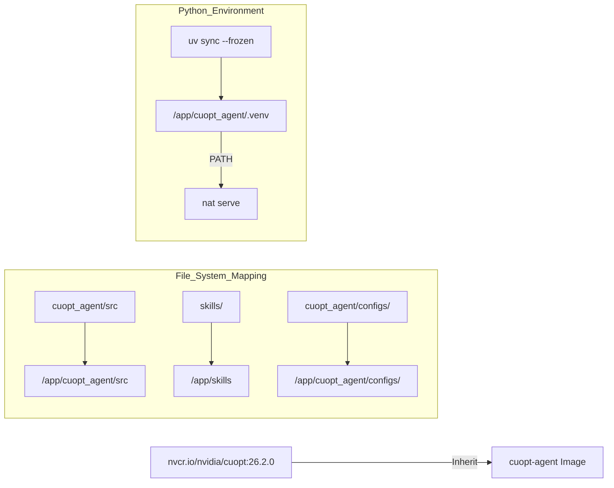

<!-- source: DeepWiki mcp.deepwiki.com · repo NVIDIA/cuopt-examples · page 11.3 Deploying and Running the Agent · fetched 2026-10-26 -->

# Deploying and Running the Agent

<details>
<summary>Relevant source files</summary>

The following files were used as context for generating this wiki page:

- [cuopt-agent/cuopt_agent/docker/Dockerfile](cuopt-agent/cuopt_agent/docker/Dockerfile)
- [cuopt-agent/deploy/compose/docker-compose.yml](cuopt-agent/deploy/compose/docker-compose.yml)

</details>


This page provides a comprehensive guide for deploying the cuOpt Agent, a natural-language optimization assistant. The deployment utilizes Docker Compose to orchestrate multiple services, including the agent backend (built on the NVIDIA NeMo Agent Toolkit), a Phoenix tracing dashboard for observability, and a specialized Chat UI.

## Deployment Overview

The cuOpt Agent is designed to run in a containerized environment to ensure all GPU dependencies, including the cuOpt solver and CUDA libraries, are correctly configured. The deployment architecture separates the reasoning engine (Agent) from the observability layer (Phoenix) and the user interface (NAT UI).

### System Architecture and Data Flow

The following diagram illustrates the interaction between the deployed containers and the external NVIDIA API services used for LLM reasoning.

**Diagram: cuOpt Agent Deployment Architecture**

Sources: [cuopt-agent/deploy/compose/docker-compose.yml:44-92](), [cuopt-agent/cuopt_agent/docker/Dockerfile:40-42]()

---

## Prerequisites and Initial Setup

Before deploying the agent, the host system must meet the following requirements:
1.  **NVIDIA GPU**: At least one NVIDIA GPU with appropriate drivers.
2.  **NVIDIA Container Toolkit**: Required for Docker to access the GPU.
3.  **NVIDIA API Key**: A valid key from the NVIDIA API Catalog to power the LLM reasoning.

### Initializing Submodules
The cuOpt Agent repository relies on external components for its UI. These must be initialized via git:
```bash
git submodule update --init --recursive
```
Sources: [cuopt-agent/deploy/compose/docker-compose.yml:73-75]()

### Configuration
Environment variables must be configured in a `.env` file at the repository root. The most critical variable is `NVIDIA_API_KEY`.
Sources: [cuopt-agent/deploy/compose/docker-compose.yml:32-32]()

---

## Production Deployment with Docker Compose

The production deployment uses the `docker-compose.yml` file to build and start the full stack.

### Service Definitions
The stack consists of three primary services:

| Service | Container Name | Port | Role |
| :--- | :--- | :--- | :--- |
| `cuopt-agent` | `cuopt-agent` | `8000` | The core NAT backend running the orchestrator and skills. |
| `phoenix` | `cuopt-phoenix` | `6006` | Tracing and observability using Arize Phoenix. |
| `nat-ui` | `cuopt-nat-ui` | `3000` | Next.js based chat interface. |

Sources: [cuopt-agent/deploy/compose/docker-compose.yml:45-92]()

### Deployment Commands
To start the agent in detached mode:
```bash
docker compose -f deploy/compose/docker-compose.yml up -d
```
Sources: [cuopt-agent/deploy/compose/docker-compose.yml:19-19]()

### Health Monitoring
The `cuopt-agent` container includes a health check that queries the `/health` endpoint. The `nat-ui` service is configured to wait until the agent is healthy before starting.
Sources: [cuopt-agent/deploy/compose/docker-compose.yml:51-56](), [cuopt-agent/deploy/compose/docker-compose.yml:89-91]()

---

## Implementation Detail: The Dockerfile

The agent's Dockerfile is based on the official cuOpt image, ensuring the GPU-accelerated solver is available to the Python environment.

**Diagram: Container Build and Environment Mapping**

Sources: [cuopt-agent/cuopt_agent/docker/Dockerfile:9-42]()

### Dependency Management
The build process uses `uv` for fast, reproducible dependency installation. It creates a virtual environment that inherits system site-packages to leverage the pre-installed `cuOpt`, `numpy`, and `numba` libraries from the base NVIDIA image.
Sources: [cuopt-agent/cuopt_agent/docker/Dockerfile:13-28]()

---

## Accessing the Agent Interfaces

Once the containers are running, the system provides two main entry points:

### 1. Chat UI (NAT UI)
Accessible at `http://localhost:3000`. This interface allows users to input natural language descriptions of supply chain or optimization problems. The UI is configured with specific environment variables to label the workflow as "cuOpt Agent".
Sources: [cuopt-agent/deploy/compose/docker-compose.yml:24-24](), [cuopt-agent/deploy/compose/docker-compose.yml:76-80]()

### 2. Phoenix Tracing Dashboard
Accessible at `http://localhost:6006`. This dashboard provides a deep look into the LLM's reasoning trace, including:
*   Sub-agent tool calls.
*   Generated Python code for optimization models.
*   Solver outputs and logs.

Sources: [cuopt-agent/deploy/compose/docker-compose.yml:25-25](), [cuopt-agent/deploy/compose/docker-compose.yml:64-70]()

---

## Running Evaluations

The deployment also supports a "one-shot" evaluation mode to measure agent performance against a dataset of supply chain scenarios.

To run the evaluation suite:
```bash
docker compose -f deploy/compose/docker-compose.yml run --rm cuopt-agent-eval
```
This command triggers the `nat eval` process using the `config-deepagent-eval.yml` configuration, which iterates through defined test cases in the `max-supply` dataset.
Sources: [cuopt-agent/deploy/compose/docker-compose.yml:22-22](), [cuopt-agent/deploy/compose/docker-compose.yml:58-62]()

---

