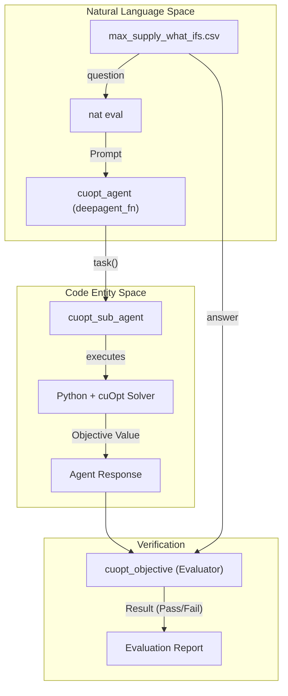
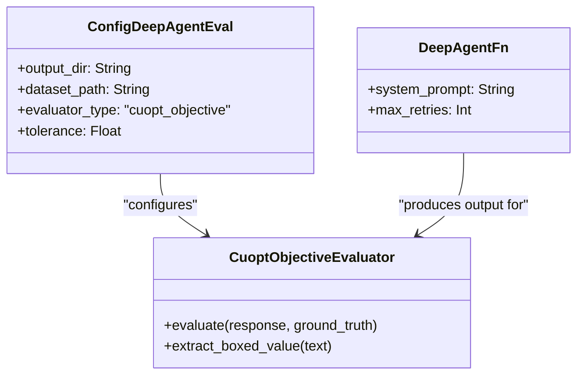

<!-- source: DeepWiki mcp.deepwiki.com · repo NVIDIA/cuopt-examples · page 11.4 Evaluation and What-If Scenarios · fetched 2026-10-26 -->

# Evaluation and What-If Scenarios

<details>
<summary>Relevant source files</summary>

The following files were used as context for generating this wiki page:

- [cuopt-agent/.env.example](cuopt-agent/.env.example)
- [cuopt-agent/AGENTS.md](cuopt-agent/AGENTS.md)
- [cuopt-agent/README.md](cuopt-agent/README.md)
- [cuopt-agent/cuopt_agent/configs/config-deepagent-eval.yml](cuopt-agent/cuopt_agent/configs/config-deepagent-eval.yml)
- [cuopt-agent/cuopt_agent/configs/config-deepagent.yml](cuopt-agent/cuopt_agent/configs/config-deepagent.yml)
- [cuopt-agent/cuopt_agent/data/max_supply_what_ifs/eval/max_supply_what_ifs.csv](cuopt-agent/cuopt_agent/data/max_supply_what_ifs/eval/max_supply_what_ifs.csv)
- [cuopt-agent/cuopt_agent/data/max_supply_what_ifs/sample_prompts/scenario_0.md](cuopt-agent/cuopt_agent/data/max_supply_what_ifs/sample_prompts/scenario_0.md)
- [cuopt-agent/cuopt_agent/data/max_supply_what_ifs/sample_prompts/scenario_1.md](cuopt-agent/cuopt_agent/data/max_supply_what_ifs/sample_prompts/scenario_1.md)
- [cuopt-agent/cuopt_agent/data/max_supply_what_ifs/sample_prompts/scenario_2.md](cuopt-agent/cuopt_agent/data/max_supply_what_ifs/sample_prompts/scenario_2.md)
- [cuopt-agent/cuopt_agent/data/max_supply_what_ifs/sample_prompts/scenario_3.md](cuopt-agent/cuopt_agent/data/max_supply_what_ifs/sample_prompts/scenario_3.md)
- [cuopt-agent/cuopt_agent/src/nat_cuopt_agent/evaluator/register.py](cuopt-agent/cuopt_agent/src/nat_cuopt_agent/evaluator/register.py)

</details>


The cuOpt Agent includes a dedicated evaluation harness to measure the accuracy of its natural language-to-optimization transformations. This system uses the NVIDIA NeMo Agent Toolkit (NAT) evaluation framework to run standardized "what-if" scenarios against a multi-period supply chain planning model, verifying that the agent's formulated Mixed-Integer Linear Program (MILP) produces the correct objective value.

### Evaluation Harness Overview

The evaluation process is driven by `nat eval`, which executes a series of prompts from a dataset and compares the agent's output against ground-truth answers [cuopt-agent/README.md:18-18](). The harness is configured to use a specialized evaluator, `cuopt_objective`, which extracts the objective value from the agent's response and checks it against the expected value within a defined tolerance [cuopt-agent/cuopt_agent/configs/config-deepagent-eval.yml:83-86]().

#### Data Flow: Natural Language to Evaluation
The diagram below illustrates how a natural language prompt is processed through the evaluation pipeline to yield a quality metric.

**Evaluation Pipeline Data Flow**

Sources: [cuopt-agent/cuopt_agent/configs/config-deepagent-eval.yml:46-86](), [cuopt-agent/README.md:24-37]()

### Max-Supply What-If Dataset

The core evaluation dataset is located at `cuopt_agent/data/max_supply_what_ifs/eval/max_supply_what_ifs.csv` [cuopt-agent/cuopt_agent/configs/config-deepagent-eval.yml:78-78](). It contains scenarios designed to test the agent's ability to modify an existing supply chain model based on complex business requirements.

| Scenario ID | Description | Key Optimization Challenge |
| :--- | :--- | :--- |
| `max_supply_0` | Initial Inventory | Modifying material balance constraints at $t=0$ [cuopt-agent/cuopt_agent/data/max_supply_what_ifs/eval/max_supply_what_ifs.csv:2-27]() |
| `max_supply_1` | Forced Procurement | Changing supply upper bounds ($\le$) to equality constraints ($=$) [cuopt-agent/cuopt_agent/data/max_supply_what_ifs/eval/max_supply_what_ifs.csv:28-54]() |
| `max_supply_2` | Material Substitution | Implementing conditional logic and penalty costs for substitute materials [cuopt-agent/cuopt_agent/data/max_supply_what_ifs/eval/max_supply_what_ifs.csv:55-85]() |

### Sample Prompts and Scenarios

The repository provides several sample prompts in Markdown format to test the agent's reasoning and modeling capabilities manually via the Chat UI or programmatically via the evaluation harness.

*   **Scenario 0 (Inventory):** Asks the agent to incorporate opening balances for items like `SA1`, `RM1`, and `RM3` into the model [cuopt-agent/cuopt_agent/data/max_supply_what_ifs/sample_prompts/scenario_0.md:8-15]().
*   **Scenario 1 (Supply Constraints):** Challenges the agent to treat confirmed purchase orders as fixed arrivals rather than flexible upper bounds [cuopt-agent/cuopt_agent/data/max_supply_what_ifs/sample_prompts/scenario_1.md:10-16]().
*   **Scenario 2 (Substitution):** Requires adding a new material (`RM4`) with substitution logic, where `RM4` is only used if `RM1` is insufficient [cuopt-agent/cuopt_agent/data/max_supply_what_ifs/sample_prompts/scenario_2.md:16-19]().
*   **Scenario 3 (Full Problem):** A comprehensive manufacturing plant description including multi-level BOM, co-production (e.g., `PROC2` producing `SA2` and `SA1`), resource-hours, and integer floor truncation for usable production [cuopt-agent/cuopt_agent/data/max_supply_what_ifs/sample_prompts/scenario_3.md:30-58]().

Sources: [cuopt-agent/cuopt_agent/data/max_supply_what_ifs/sample_prompts/scenario_0.md](), [cuopt-agent/cuopt_agent/data/max_supply_what_ifs/sample_prompts/scenario_1.md](), [cuopt-agent/cuopt_agent/data/max_supply_what_ifs/sample_prompts/scenario_2.md](), [cuopt-agent/cuopt_agent/data/max_supply_what_ifs/sample_prompts/scenario_3.md]()

### Measuring Agent Quality

Quality is measured through the `cuopt_objective` evaluator defined in the `nat_cuopt_agent.evaluator` package [cuopt-agent/cuopt_agent/src/nat_cuopt_agent/evaluator/register.py:16-16]().

**Agent Evaluation Components**


#### Key Metrics and Requirements
1.  **Objective Value Accuracy:** The agent must report the optimal objective value as a single float inside a `\boxed{...}` LaTeX-style block on the last line of its response [cuopt-agent/cuopt_agent/configs/config-deepagent-eval.yml:68-68]().
2.  **Ambiguity Handling:** According to the `AGENTS.md` rules, the agent is penalized if it makes silent assumptions about ambiguous constraints. It must either ask for clarification or solve all plausible interpretations [cuopt-agent/AGENTS.md:13-13](), [cuopt-agent/AGENTS.md:89-97]().
3.  **Constraint Satisfaction:** The evaluation checks if the final objective matches the expected value, which implicitly verifies that all material balance, supply, and resource capacity constraints were formulated correctly [cuopt-agent/cuopt_agent/configs/config-deepagent-eval.yml:83-86]().

### Running Evaluation

Evaluation can be executed using Docker Compose, which runs the `nat eval` command inside a containerized environment configured with the `config-deepagent-eval.yml` settings.

```bash
# Run the evaluation harness
docker compose -f deploy/compose/docker-compose.yml run --rm cuopt-agent-eval
```
Sources: [cuopt-agent/README.md:115-116](), [cuopt-agent/cuopt_agent/configs/config-deepagent-eval.yml:16-40]()

---

