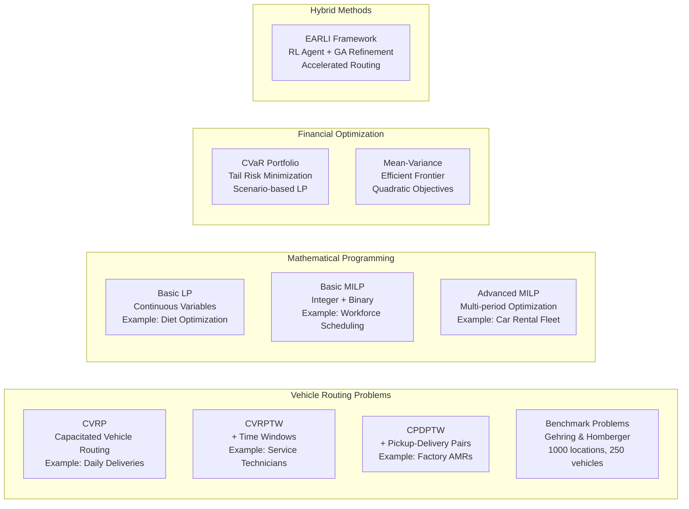
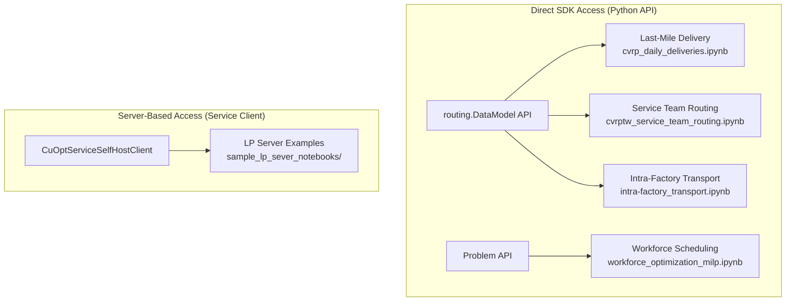
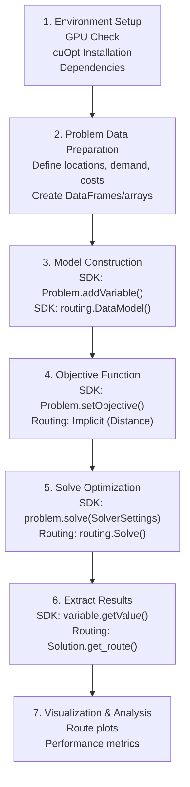
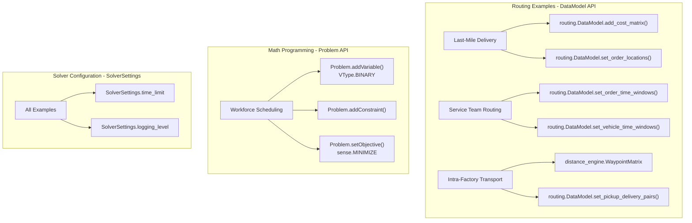

<!-- source: DeepWiki mcp.deepwiki.com · repo NVIDIA/cuopt-examples · page 12 Application Examples · fetched 2026-10-26 -->

# Application Examples

Relevant source files

The following files were used as context for generating this wiki page:

- [README.md](README.md)
- [VERSION](VERSION)
- [ci/release/update_version.sh](ci/release/update_version.sh)
- [intra-factory_transport/cost_matrix_and_waypoint_graph_creation.ipynb](intra-factory_transport/cost_matrix_and_waypoint_graph_creation.ipynb)
- [intra-factory_transport/intra-factory_transport.ipynb](intra-factory_transport/intra-factory_transport.ipynb)
- [last_mile_delivery/cvrp_daily_deliveries.ipynb](last_mile_delivery/cvrp_daily_deliveries.ipynb)
- [last_mile_delivery/cvrptw_benchmark_gehring_homberger.ipynb](last_mile_delivery/cvrptw_benchmark_gehring_homberger.ipynb)
- [last_mile_delivery/cvrptw_service_team_routing.ipynb](last_mile_delivery/cvrptw_service_team_routing.ipynb)
- [workforce_optimization/workforce_optimization_milp.ipynb](workforce_optimization/workforce_optimization_milp.ipynb)

This document provides an overview of the complete application examples included in the `cuopt-examples` repository. These examples demonstrate cuOpt's capabilities across logistics, operations, and financial optimization domains, ranging from vehicle routing to mathematical programming to portfolio optimization. Each example is a fully functional Jupyter notebook with problem setup, optimization, and results visualization.

For detailed API documentation of the `Problem` class and `routing.DataModel`, see [Problem API](#3.1) and [Routing DataModel API](#4.1). For information on benchmark infrastructure and performance testing, see [Benchmarking and Performance](#10).

## Example Repository Structure

The examples are organized by problem domain and access method. The following diagram shows the primary example directories and the types of problems they contain:

```mermaid
graph TB
    subgraph "Vehicle Routing Examples"
        LMD["last_mile_delivery/<br/>CVRP, CVRPTW, Benchmarks"]
        IFT["intra-factory_transport/<br/>CPDPTW with Waypoint Graphs"]
        ROS["routing_optimization_over_server/<br/>Server-based CVRPTW"]
    end
    
    subgraph "Mathematical Programming Examples"
        SLP["sample_lp_sever_notebooks/<br/>LP, MILP with DataModel"]
        CRO["car_rental_optimization/<br/>Fleet Optimization MILP"]
        WFS["workforce_scheduling/<br/>Worker-Shift Assignment"]
        DIET["diet_optimization/<br/>Nutritional LP"]
    end
    
    subgraph "Portfolio Optimization Examples"
        CVAR["portfolio_optimization/<br/>CVaR Risk Minimization"]
        MVO["portfolio_optimization/<br/>Mean-Variance Frontier"]
    end
    
    subgraph "AI-Accelerated Examples"
        EARLI["earli_examples/<br/>RL + GA Hybrid Routing"]
    end
    
    SDK["cuOpt Python SDK"] --> LMD
    SDK --> IFT
    SDK --> CRO
    SDK --> WFS
    SDK --> DIET
    SDK --> CVAR
    SDK --> MVO
    SDK --> EARLI
    
    SERVICE["cuOpt Service<br/>localhost:5000"] --> ROS
    SERVICE --> SLP
```

**Sources:** [README.md:65-75](), [last_mile_delivery/cvrptw_benchmark_gehring_homberger.ipynb:17-23](), [intra-factory_transport/intra-factory_transport.ipynb:9-11](), [workforce_optimization/workforce_optimization_milp.ipynb:7-18]()

## Example Categories by Problem Type

The examples span four major problem domains, each demonstrating different cuOpt capabilities:

**Sources:** [last_mile_delivery/cvrp_daily_deliveries.ipynb:8-19](), [last_mile_delivery/cvrptw_service_team_routing.ipynb:8-19](), [intra-factory_transport/intra-factory_transport.ipynb:9-21](), [workforce_optimization/workforce_optimization_milp.ipynb:7-18]()

## Feature Coverage Matrix

Each example demonstrates specific cuOpt features. The following table maps examples to the key capabilities they showcase:

| Example | Problem Type | Capacity Constraints | Time Windows | Multi-Dimensional | Pickup-Delivery | Integer Variables | Waypoint Graphs | Benchmark Scale |
|---------|--------------|---------------------|--------------|-------------------|-----------------|-------------------|-----------------|-----------------|
| **Last-Mile Delivery** | CVRP | ✓ | ✗ | ✓ | ✗ | ✗ | ✗ | Medium (50-100 loc) |
| **Service Team Routing** | CVRPTW | ✓ | ✓ | ✓ | ✗ | ✗ | ✗ | Medium (50-100 loc) |
| **Gehring & Homberger** | CVRPTW | ✓ | ✓ | ✗ | ✗ | ✗ | ✗ | Large (1000 loc) |
| **Intra-Factory Transport** | CPDPTW | ✓ | ✓ | ✗ | ✓ | ✗ | ✓ | Small (20-40 loc) |
| **Workforce Scheduling** | MILP | ✗ | ✗ | ✗ | ✗ | ✓ | ✗ | Small |
| **Diet Optimization** | LP | ✗ | ✗ | ✗ | ✗ | ✗ | ✗ | Small |

**Sources:** [last_mile_delivery/cvrp_daily_deliveries.ipynb:27-41](), [last_mile_delivery/cvrptw_service_team_routing.ipynb:27-44](), [last_mile_delivery/cvrptw_benchmark_gehring_homberger.ipynb:21-23](), [intra-factory_transport/intra-factory_transport.ipynb:30-36](), [workforce_optimization/workforce_optimization_milp.ipynb:129-171]()

## API Access Patterns in Examples

Examples demonstrate two primary access patterns: direct SDK usage and server-based submission. The following diagram shows which examples use which approach:

**Sources:** [last_mile_delivery/cvrp_daily_deliveries.ipynb:160](), [last_mile_delivery/cvrptw_service_team_routing.ipynb:165](), [intra-factory_transport/intra-factory_transport.ipynb:133](), [workforce_optimization/workforce_optimization_milp.ipynb:109]()

## Common Example Workflow

All examples follow a consistent structure that makes them easy to understand and adapt:

**Sources:** [last_mile_delivery/cvrp_daily_deliveries.ipynb:71-114](), [last_mile_delivery/cvrptw_service_team_routing.ipynb:75-118](), [intra-factory_transport/intra-factory_transport.ipynb:59-102](), [workforce_optimization/workforce_optimization_milp.ipynb:39-78]()

## Example-to-Code Entity Mapping

The following diagram maps example applications to the specific cuOpt API classes and methods they use:

**Sources:** [last_mile_delivery/cvrptw_service_team_routing.ipynb:165](), [intra-factory_transport/intra-factory_transport.ipynb:133-134](), [workforce_optimization/workforce_optimization_milp.ipynb:109-110]()

## Vehicle Routing Examples Overview

### CVRP - Capacitated Vehicle Routing
Located in `last_mile_delivery/cvrp_daily_deliveries.ipynb`. Demonstrates basic capacity-constrained routing for delivery vehicles from a micro fulfillment center.
- Heterogeneous fleet (trucks vs. vans) [last_mile_delivery/cvrp_daily_deliveries.ipynb:35-39]().
- Demand-based delivery assignments [last_mile_delivery/cvrp_daily_deliveries.ipynb:32]().

### CVRPTW - Routing with Time Windows
Demonstrated in `last_mile_delivery/cvrptw_service_team_routing.ipynb`.
- Service technician scheduling with time-on-site [last_mile_delivery/cvrptw_service_team_routing.ipynb:19]().
- Technician availability windows [last_mile_delivery/cvrptw_service_team_routing.ipynb:43]().

### CPDPTW - Pickup and Delivery with Time Windows
Located in `intra-factory_transport/intra-factory_transport.ipynb`.
- AMR routing within a factory using waypoint graphs [intra-factory_transport/intra-factory_transport.ipynb:21-22]().
- Compressed Sparse Row (CSR) representation of weighted graphs [intra-factory_transport/intra-factory_transport.ipynb:184-198]().

For details, see [Last-Mile Delivery Optimization](#12.1), [Service Team Routing](#12.2), or [Intra-Factory Transport](#12.3).

## Mathematical Programming Examples Overview

### Workforce Scheduling
Located in `workforce_optimization/workforce_optimization_milp.ipynb`.
- Formulated as a Mixed Integer Linear Program (MILP) [workforce_optimization/workforce_optimization_milp.ipynb:18]().
- Uses binary variables to assign workers to shifts [workforce_optimization/workforce_optimization_milp.ipynb:109]().

### Diet Optimization
Classic linear programming example.
- Minimizes food purchase costs while meeting nutritional requirements.
- Available in both continuous (LP) and integer (MILP) variants.

For details, see [Workforce Scheduling](#12.4), [Car Rental Fleet Optimization](#12.5), or [Diet Optimization](#12.6).

## Running the Examples

All examples follow a standard execution pattern:
1. **Clone the repository**: `git clone https://github.com/NVIDIA/cuopt-examples.git` [README.md:27-30]().
2. **Pull the Docker image**: `docker pull nvidia/cuopt:25.12.0a-cuda13.0-py3.13` [README.md:37-38]().
3. **Launch Jupyter**: Use the provided `docker run` commands to start a notebook server with GPU access [README.md:47-55]().

**Sources:** [README.md:25-58]()

---

