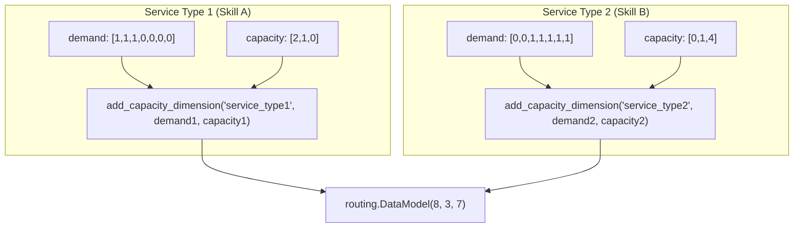

<!-- source: DeepWiki mcp.deepwiki.com · repo NVIDIA/cuopt-examples · page 12.1 Last-Mile Delivery Optimization · fetched 2026-10-26 -->

# Last-Mile Delivery Optimization

Relevant source files

The following files were used as context for generating this wiki page:

- [intra-factory_transport/cost_matrix_and_waypoint_graph_creation.ipynb](intra-factory_transport/cost_matrix_and_waypoint_graph_creation.ipynb)
- [intra-factory_transport/intra-factory_transport.ipynb](intra-factory_transport/intra-factory_transport.ipynb)
- [last_mile_delivery/cvrp_daily_deliveries.ipynb](last_mile_delivery/cvrp_daily_deliveries.ipynb)
- [last_mile_delivery/cvrptw_benchmark_gehring_homberger.ipynb](last_mile_delivery/cvrptw_benchmark_gehring_homberger.ipynb)
- [last_mile_delivery/cvrptw_service_team_routing.ipynb](last_mile_delivery/cvrptw_service_team_routing.ipynb)

This document describes the last-mile delivery optimization examples in the `last_mile_delivery/` directory. These examples demonstrate how to solve Capacitated Vehicle Routing Problems (CVRP) and their variants using the cuOpt Python SDK. For more general information about the routing API, see [Routing DataModel API](). For service team-specific details, see [Service Team Routing]().

## Purpose and Scope

The last-mile delivery examples demonstrate three distinct routing problem variants:

1.  **CVRP Daily Deliveries** - Basic capacitated routing with a heterogeneous fleet (trucks and vans) and distance minimization objectives [[last_mile_delivery/cvrp_daily_deliveries.ipynb:8-19]]().
2.  **CVRPTW Service Team Routing** - Routing with time windows, service times, and multi-dimensional capacity to model technician skills [[last_mile_delivery/cvrptw_service_team_routing.ipynb:8-20]]().
3.  **CVRPTW Benchmark** - Large-scale performance testing on 1000-location Gehring & Homberger instances to demonstrate cuOpt's speed and accuracy [[last_mile_delivery/cvrptw_benchmark_gehring_homberger.ipynb:8-23]]().

All examples use the `cuopt.routing` module and follow similar modeling patterns with the `DataModel` class [[last_mile_delivery/cvrp_daily_deliveries.ipynb:160]]().

## Problem Variants Architecture

The following diagram illustrates the data flow and configuration steps for each of the three primary last-mile delivery scenarios.

### Routing Logic Flow

Sources: [[last_mile_delivery/cvrp_daily_deliveries.ipynb:485-594]](), [[last_mile_delivery/cvrptw_service_team_routing.ipynb:536-628]](), [[last_mile_delivery/cvrptw_benchmark_gehring_homberger.ipynb:277-505]]()

## CVRP Daily Deliveries

The daily deliveries example demonstrates a basic CVRP scenario where a micro fulfillment center (MFC) dispatches same-day orders using a heterogeneous fleet [[last_mile_delivery/cvrp_daily_deliveries.ipynb:17-19]]().

### Problem Configuration

The problem setup involves a small set of locations and vehicles with varying capacities [[last_mile_delivery/cvrp_daily_deliveries.ipynb:27-41]]():

| Component | Value | Description |
|-----------|-------|-------------|
| Locations | 8 (1 MFC + 7 delivery) | Total node count |
| Vehicles | 3 (2 trucks + 1 van) | Fleet composition |
| Truck Capacity | 8 units each | Larger capacity vehicles |
| Van Capacity | 4 units | Smaller capacity vehicle |
| Location Demand | [0, 4, 4, 2, 2, 1, 2, 1] | Units per delivery location |

### Implementation Details

The implementation follows a standard sequence of initializing the `DataModel`, adding cost matrices, and defining capacity dimensions [[last_mile_delivery/cvrp_daily_deliveries.ipynb:485-553]]().

*   **DataModel Initialization**: `data_model = routing.DataModel(n_locations, n_vehicles)` [[last_mile_delivery/cvrp_daily_deliveries.ipynb:488]]().
*   **Cost Matrix**: Uses a `cudf.DataFrame` representing distances between all points [[last_mile_delivery/cvrp_daily_deliveries.ipynb:507-509]]().
*   **Capacity**: `add_capacity_dimension` is used to enforce that vehicle load does not exceed capacity [[last_mile_delivery/cvrp_daily_deliveries.ipynb:528-530]]().
*   **Minimum Vehicles**: The example shows how to force the use of the entire fleet using `data_model.set_min_vehicles(n_vehicles)` [[last_mile_delivery/cvrp_daily_deliveries.ipynb:659]]().

Sources: [[last_mile_delivery/cvrp_daily_deliveries.ipynb:485-659]]()

## CVRPTW Service Team Routing

The service team routing example models technicians with specific skill sets and availability windows [[last_mile_delivery/cvrptw_service_team_routing.ipynb:17-20]]().

### Multi-Dimensional Capacity

This example uses two capacity dimensions to represent different service types (skills) [[last_mile_delivery/cvrptw_service_team_routing.ipynb:30-43]]().

Sources: [[last_mile_delivery/cvrptw_service_team_routing.ipynb:30-43]](), [[last_mile_delivery/cvrptw_service_team_routing.ipynb:610-618]]()

### Time Constraints

*   **Order Windows**: `set_order_time_windows` defines when a customer is available [[last_mile_delivery/cvrptw_service_team_routing.ipynb:581-582]]().
*   **Service Times**: `set_order_service_times` accounts for the duration of the task at the site [[last_mile_delivery/cvrptw_service_team_routing.ipynb:587]]().
*   **Vehicle Availability**: `set_vehicle_time_windows` defines the shift start and end times for technicians [[last_mile_delivery/cvrptw_service_team_routing.ipynb:608]]().

Sources: [[last_mile_delivery/cvrptw_service_team_routing.ipynb:581-608]]()

## CVRPTW Benchmark (Gehring & Homberger)

The benchmark notebook demonstrates cuOpt's ability to solve large problems (1000 locations) rapidly [[last_mile_delivery/cvrptw_benchmark_gehring_homberger.ipynb:21]]().

### Data Handling

The example includes a `create_from_file` function to parse the standard benchmark text format into components required by cuOpt [[last_mile_delivery/cvrptw_benchmark_gehring_homberger.ipynb:186-243]]().

| Metric | Value |
|--------|-------|
| Instance | C1_10_1 |
| Locations | 1000 + 1 depot |
| Fleet Size | 250 |
| Best Known Cost | 42478.95 |

Sources: [[last_mile_delivery/cvrptw_benchmark_gehring_homberger.ipynb:157-167]]()

### Performance Configuration

The solver settings are tuned for large-scale problems by adjusting the time limit [[last_mile_delivery/cvrptw_benchmark_gehring_homberger.ipynb:446]](). The example compares a 60-second run against a 120-second run to show the trade-off between speed and optimality [[last_mile_delivery/cvrptw_benchmark_gehring_homberger.ipynb:444-505]]().

Sources: [[last_mile_delivery/cvrptw_benchmark_gehring_homberger.ipynb:444-505]]()

## Solution Extraction and Visualization

Across all notebooks, the solution is retrieved from the `routing.Solve` function and processed into a readable format [[last_mile_delivery/cvrp_daily_deliveries.ipynb:592-611]]().

### Solution Object Reference

| Method | Description |
|--------|-------------|
| `get_status()` | Returns 0 if a solution was found [[last_mile_delivery/cvrp_daily_deliveries.ipynb:596]](). |
| `get_total_objective()` | Returns the total optimized cost/distance [[last_mile_delivery/cvrp_daily_deliveries.ipynb:604]](). |
| `get_vehicle_count()` | Returns the number of vehicles utilized [[last_mile_delivery/cvrp_daily_deliveries.ipynb:608]](). |
| `get_route()` | Returns a `cudf.DataFrame` with route sequences [[last_mile_delivery/cvrp_daily_deliveries.ipynb:611]](). |

Sources: [[last_mile_delivery/cvrp_daily_deliveries.ipynb:596-611]]()

### Visualization

The examples provide utility functions to plot the results using `matplotlib` [[last_mile_delivery/cvrp_daily_deliveries.ipynb:183-381]]().
*   `gen_plot(df)`: Plots coordinates for all locations [[last_mile_delivery/cvrp_daily_deliveries.ipynb:183]]().
*   `map_vehicle_routes(df, solution, colors)`: Overlays the optimized routes onto the coordinate plot [[last_mile_delivery/cvrp_daily_deliveries.ipynb:355]]().

Sources: [[last_mile_delivery/cvrp_daily_deliveries.ipynb:183-381]]()

## Technical Requirements

### Data Types

cuOpt requires specific data types for GPU acceleration [[last_mile_delivery/cvrp_daily_deliveries.ipynb:433-461]]():
*   **Costs/Distances**: `np.float32` [[last_mile_delivery/cvrp_daily_deliveries.ipynb:433]]().
*   **Demands/Capacities/Time**: `np.int32` [[last_mile_delivery/cvrp_daily_deliveries.ipynb:461]](), [[last_mile_delivery/cvrptw_service_team_routing.ipynb:581]]().

### Cost Matrix Generation

Costs can be generated in three ways as documented in related notebooks [[intra-factory_transport/cost_matrix_and_waypoint_graph_creation.ipynb:22-24]]():
1.  **Euclidean Distance**: Calculated via `scipy.spatial.distance.cdist` [[last_mile_delivery/cvrptw_benchmark_gehring_homberger.ipynb:297]]().
2.  **Map-based Routing**: Using OSRM or similar map data [[intra-factory_transport/cost_matrix_and_waypoint_graph_creation.ipynb:22]]().
3.  **Waypoint Graphs**: Using `distance_engine.WaypointMatrix` for indoor or complex environments [[intra-factory_transport/intra-factory_transport.ipynb:134]]().

Sources: [[last_mile_delivery/cvrptw_benchmark_gehring_homberger.ipynb:297]](), [[intra-factory_transport/cost_matrix_and_waypoint_graph_creation.ipynb:22-24]](), [[intra-factory_transport/intra-factory_transport.ipynb:134]]()

---

