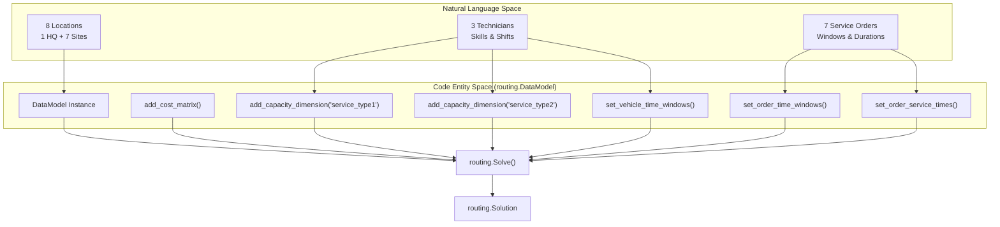
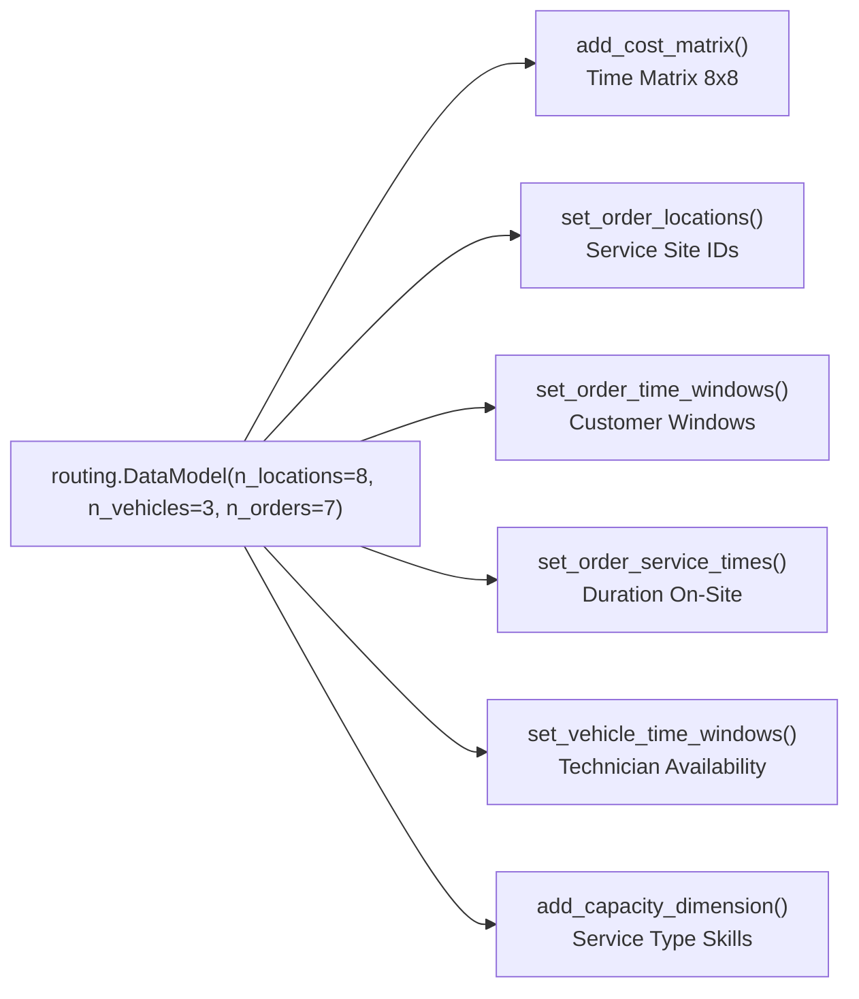
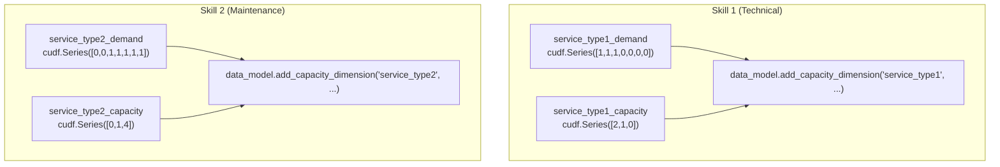
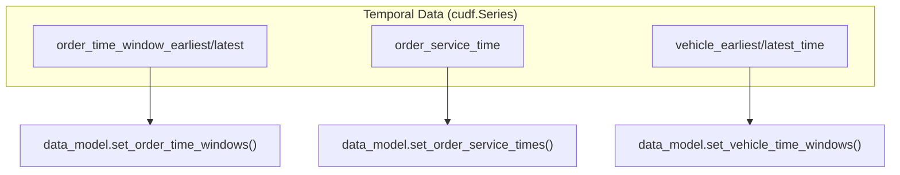
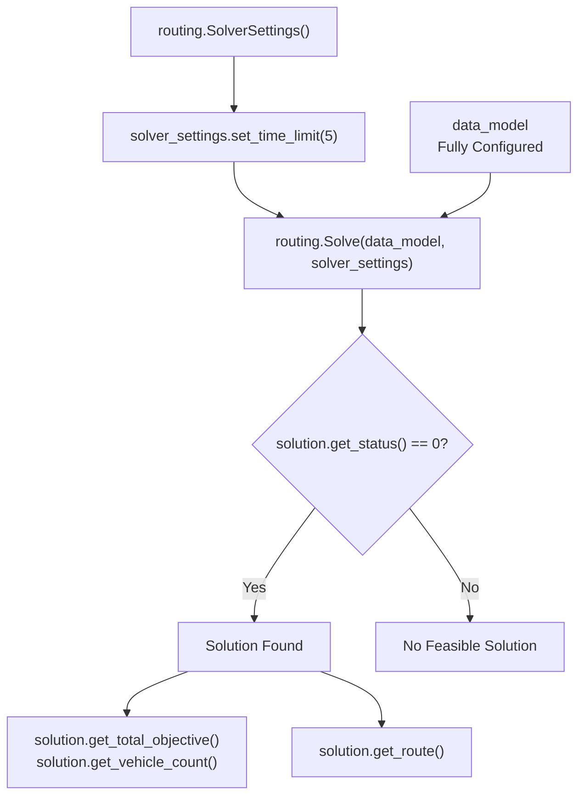

<!-- source: DeepWiki mcp.deepwiki.com · repo NVIDIA/cuopt-examples · page 12.2 Service Team Routing · fetched 2026-10-26 -->

# Service Team Routing

Relevant source files

The following files were used as context for generating this wiki page:

- [intra-factory_transport/cost_matrix_and_waypoint_graph_creation.ipynb](intra-factory_transport/cost_matrix_and_waypoint_graph_creation.ipynb)
- [intra-factory_transport/intra-factory_transport.ipynb](intra-factory_transport/intra-factory_transport.ipynb)
- [last_mile_delivery/cvrp_daily_deliveries.ipynb](last_mile_delivery/cvrp_daily_deliveries.ipynb)
- [last_mile_delivery/cvrptw_benchmark_gehring_homberger.ipynb](last_mile_delivery/cvrptw_benchmark_gehring_homberger.ipynb)
- [last_mile_delivery/cvrptw_service_team_routing.ipynb](last_mile_delivery/cvrptw_service_team_routing.ipynb)
- [routing_optimization_over_server/cvrptw_benchmark_gehring_homberger.ipynb](routing_optimization_over_server/cvrptw_benchmark_gehring_homberger.ipynb)
- [routing_optimization_over_server/cvrptw_service_team_routing.ipynb](routing_optimization_over_server/cvrptw_service_team_routing.ipynb)
- [sample_lp_sever_notebooks/linear-programming-with-datamodel.ipynb](sample_lp_sever_notebooks/linear-programming-with-datamodel.ipynb)
- [sample_lp_sever_notebooks/linear-programming.ipynb](sample_lp_sever_notebooks/linear-programming.ipynb)
- [sample_lp_sever_notebooks/mixed-integer-linear-programming-with-datamodel.ipynb](sample_lp_sever_notebooks/mixed-integer-linear-programming-with-datamodel.ipynb)
- [sample_lp_sever_notebooks/mixed-integer-linear-programming.ipynb](sample_lp_sever_notebooks/mixed-integer-linear-programming.ipynb)

## Purpose and Scope

This page documents the Service Team Routing example, which demonstrates solving a **Capacitated Vehicle Routing Problem with Time Windows (CVRPTW)** for service technician scheduling. The example shows how to model technician availability, multi-dimensional capacity constraints (representing different skill types), location time windows, and service times at each customer site.

For basic CVRP without time windows, see [Last-Mile Delivery Optimization](#12.1). For performance benchmarking on large-scale CVRPTW instances, see [CVRPTW - Vehicle Routing with Time Windows](#4.3). For pickup-delivery problems with time windows, see [Intra-Factory Transport](#12.3).

---

## Problem Overview

The service team routing problem models a scenario where service technicians with different skill sets must visit customer locations within specified time windows. Each technician has:
- Limited availability (time window) [last_mile_delivery/cvrptw_service_team_routing.ipynb:43-43]()
- Capacity to handle specific service types (skills) [last_mile_delivery/cvrptw_service_team_routing.ipynb:41-42]()
- Maximum number of service appointments per day [last_mile_delivery/cvrptw_service_team_routing.ipynb:19-19]()

Each service location has:
- A specific time window for service [last_mile_delivery/cvrptw_service_team_routing.ipynb:36-36]()
- Required service types (demand) [last_mile_delivery/cvrptw_service_team_routing.ipynb:34-35]()
- Service duration (time on-site) [last_mile_delivery/cvrptw_service_team_routing.ipynb:37-37]()

The objective is to minimize total travel time while satisfying all constraints.

Sources: [last_mile_delivery/cvrptw_service_team_routing.ipynb:13-45]()

---

## Problem Structure Diagram

The following diagram maps the natural language problem description to the code entities used in the implementation.

**Service Routing Problem Mapping**

Sources: [last_mile_delivery/cvrptw_service_team_routing.ipynb:27-45](), [last_mile_delivery/cvrptw_service_team_routing.ipynb:529-617]()

---

## Data Model Initialization

The problem uses the `routing.DataModel` class to represent the CVRPTW instance. The initialization requires parameters defining the problem size [last_mile_delivery/cvrptw_service_team_routing.ipynb:529-539]().

| Parameter | Value | Description |
|-----------|-------|-------------|
| `n_locations` | 8 | Total locations including headquarters |
| `n_vehicles` | 3 | Number of technicians available |
| `n_orders` | 7 | Number of service orders to fulfill |

**DataModel Configuration Flow**

Sources: [last_mile_delivery/cvrptw_service_team_routing.ipynb:529-539](), [last_mile_delivery/cvrptw_service_team_routing.ipynb:552-617]()

---

## Multi-Dimensional Capacity Configuration

Service team routing handles multiple capacity dimensions representing different skill types. Each technician has capacity for different service types, and each order requires specific skills [last_mile_delivery/cvrptw_service_team_routing.ipynb:19-19]().

### Service Location Requirements

| Location | Service Type 1 Demand | Service Type 2 Demand | Time Window | Service Time |
|----------|----------------------|----------------------|-------------|--------------|
| HQ (0)   | 0                    | 1                    | [5, 20]     | -            |
| Site 1   | 1                    | 0                    | [9, 12]     | 1            |
| Site 2   | 1                    | 0                    | [9, 12]     | 1            |
| Site 3   | 1                    | 1                    | [11, 14]    | 1.5          |
| Site 4   | 0                    | 1                    | [13, 16]    | 0.5          |
| Site 5   | 0                    | 1                    | [13, 16]    | 0.5          |
| Site 6   | 0                    | 1                    | [13, 16]    | 0.5          |
| Site 7   | 0                    | 1                    | [13, 16]    | 0.5          |

Sources: [last_mile_delivery/cvrptw_service_team_routing.ipynb:30-37](), [last_mile_delivery/cvrptw_service_team_routing.ipynb:460-481]()

### Technician Capabilities

| Technician ID | Type 1 Capacity | Type 2 Capacity | Available | Until |
|---------------|-----------------|-----------------|-----------|-------|
| 0             | 2               | 0               | 9:00      | 17:00 |
| 1             | 1               | 1               | 12:00     | 15:00 |
| 2             | 0               | 4               | 9:00      | 17:00 |

Sources: [last_mile_delivery/cvrptw_service_team_routing.ipynb:41-43](), [last_mile_delivery/cvrptw_service_team_routing.ipynb:500-518]()

### Capacity Dimension Implementation
Multi-dimensional capacity is implemented by calling `add_capacity_dimension` multiple times with different names and `cudf.Series` data [last_mile_delivery/cvrptw_service_team_routing.ipynb:600-617]().

**Capacity Mapping**

Sources: [last_mile_delivery/cvrptw_service_team_routing.ipynb:600-617]()

---

## Cost Matrix and Time Windows

The cost matrix represents travel time between all locations. When time window constraints are present, cuOpt assumes the cost matrix represents time [last_mile_delivery/cvrptw_service_team_routing.ipynb:552-559]().

### Time Window Configuration

| Component | API Method | Parameters | Description |
|-----------|-----------|------------|-------------|
| Order Time Windows | `set_order_time_windows()` | earliest, latest | Service location availability [last_mile_delivery/cvrptw_service_team_routing.ipynb:581-584]() |
| Service Times | `set_order_service_times()` | service_time | Duration at each location [last_mile_delivery/cvrptw_service_team_routing.ipynb:587-588]() |
| Vehicle Time Windows | `set_vehicle_time_windows()` | earliest, latest | Technician work hours [last_mile_delivery/cvrptw_service_team_routing.ipynb:593-596]() |

**Temporal Constraint Flow**

Sources: [last_mile_delivery/cvrptw_service_team_routing.ipynb:581-596]()

---

## Solver Configuration and Execution

The solver is configured with `routing.SolverSettings()` and executed via `routing.Solve()`.

**Solver Workflow**

Sources: [last_mile_delivery/cvrptw_service_team_routing.ipynb:630-669]()

---

## Solution Extraction

The solution object provides methods to access routing results [last_mile_delivery/cvrptw_service_team_routing.ipynb:655-669]().

| Method | Return Type | Description |
|--------|-------------|-------------|
| `get_status()` | int | 0 for success, non-zero for failure |
| `get_total_objective()` | float | Total optimized cost (travel time) |
| `get_vehicle_count()` | int | Number of vehicles used |
| `get_route()` | cudf.DataFrame | Complete route information |

The `get_route()` method returns a cudf DataFrame with columns for `truck_id`, `route`, `arrival_stamp`, and `type` [last_mile_delivery/cvrptw_service_team_routing.ipynb:669-669]().

Sources: [last_mile_delivery/cvrptw_service_team_routing.ipynb:655-669]()

---

## Key Optimization Results

The solution demonstrates that cuOpt leverages the multi-dimensional capacity constraints effectively [last_mile_delivery/cvrptw_service_team_routing.ipynb:672-677]():

- **Vehicle 1** (Technician 1) serves location C because it is the only one with both required skill capacities.
- **Vehicle 0** (Technician 0) handles Type 1 services.
- **Vehicle 2** (Technician 2) handles Type 2 services.

This skill-based routing ensures all service requirements and time windows are respected while minimizing travel time.

Sources: [last_mile_delivery/cvrptw_service_team_routing.ipynb:672-677]()

---

